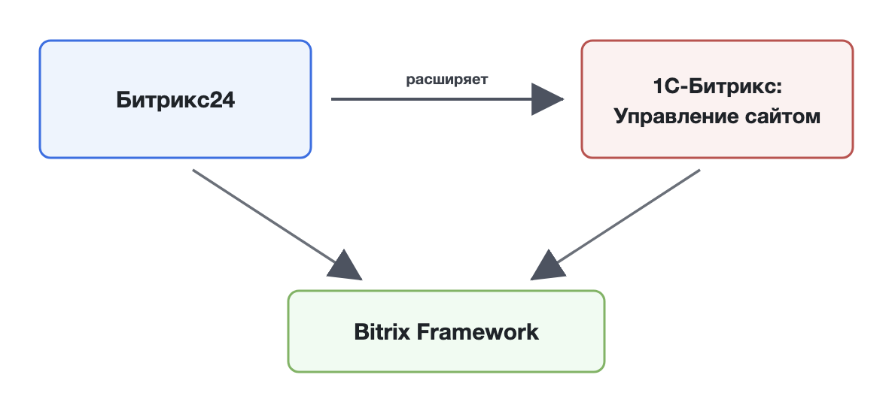
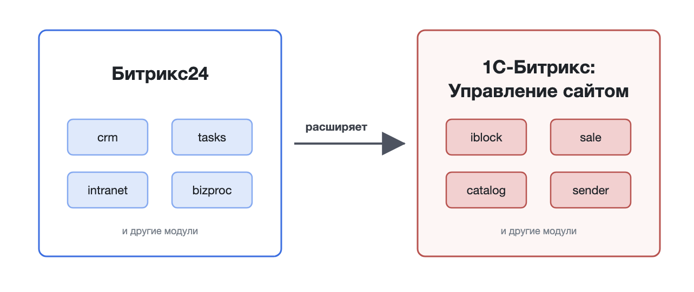
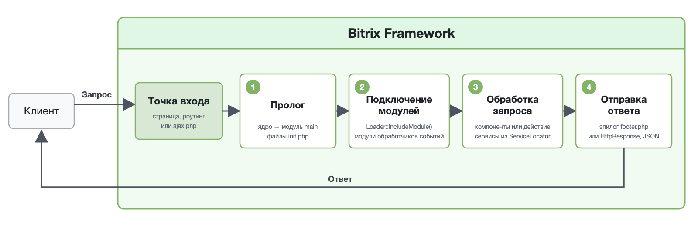

Bitrix Framework — PHP-платформа для разработки веб-приложений. Платформа служит основой двух продуктов — 1C-Битрикс: Управление сайтом и Битрикс24.

1C-Битрикс: Управление сайтом — это система управления контентом (CMS). В ней создают сайты, публикуют новости и страницы, настраивают интернет-магазин, рассылки, рекламу и аналитику. За эти сценарии отвечают модули продукта — [информационные блоки](../modules/iblocks/overview.md) `iblock`, [торговый каталог](../modules/catalog/overview.md) `catalog`, [интернет-магазин](../modules/sale/overview.md) `sale`, Email-маркетинг `sender` и другие. Продукт устанавливают на собственный сервер.

Битрикс24 — это продукт для управления бизнесом и совместной работы. В нем ведут клиентов в CRM, выполняют задачи, автоматизируют процессы и общаются в чатах. За эти сценарии отвечают модули продукта — [CRM](../modules/crm/overview.md) `crm`, задачи `tasks`, мессенджер `im`, интранет `intranet`, бизнес-процессы `bizproc` и другие. Битрикс24 поставляется в двух версиях:

- облачная — онлайн-сервис, который работает сразу, без установки,

- коробочная — продукт, который устанавливают на собственный сервер и дорабатывают под задачи компании.

## Какой API доступен в каждом продукте

Продукт и версия определяют, где выполняется код и каким API он работает с данными.

| Продукт и версия | Где выполняется код | Какой API использовать |
|---|---|---|
| 1C-Битрикс: Управление сайтом | На собственном сервере, внутри установки | PHP API модулей Bitrix Framework |
| Коробочный Битрикс24 | На собственном сервере, внутри установки, или во внешнем приложении на другом сервере | Внутри установки — PHP API модулей Bitrix Framework. Во внешнем приложении — [REST API Битрикс24](https://apidocs.bitrix24.ru/) |
| Облачный Битрикс24 | Во внешнем приложении | [REST API Битрикс24](https://apidocs.bitrix24.ru/). Приложение не может напрямую вызвать PHP-классы Битрикс24 |

Подробнее о выборе между PHP API и REST API на примере CRM читайте в статье [Как выбрать API CRM](../modules/crm/choose-crm-api.md). О выборе уровня PHP API внутри модуля — ORM, объектной модели или классического API — читайте в статьях [Как выбрать API интернет-магазина](../modules/sale/choose-sale-api.md) и [Как выбрать API торгового каталога](../modules/catalog/choose-catalog-api.md).

## Редакции, лицензии и готовые решения

Продукты поставляются в разных редакциях. Редакция — это вариант поставки с определенным набором модулей и возможностей. Чтобы узнать состав редакций, откройте страницы сравнения редакций [1C-Битрикс: Управление сайтом](https://www.1c-bitrix.ru/products/cms/license.php) и [коробочного Битрикс24](https://www.bitrix24.ru/prices/self-hosted.php). Возможности облачного Битрикс24 зависят от тарифа — сравнение тарифов есть на странице [Тарифы Битрикс24](https://www.bitrix24.ru/prices/).

Лицензия дает право использовать продукт. Лицензионное соглашение определяет, на каких условиях действует лицензия. При [установке коммерческого дистрибутива](../get-started/install-distr.md) укажите лицензионный ключ. Ключ должен соответствовать продукту и выбранной редакции.

Готовое решение — это пакет для определенной задачи, например для создания интернет-магазина. В готовое решение могут входить модули, компоненты, шаблоны дизайна и демоданные. Чтобы развернуть сайт на основе готового решения, выполните шаги из статьи [Установка решения](../get-started/install-solution.md).

## Как связаны CMS и Битрикс24

Оба продукта используют общие модули платформы. Например, интерфейсные компоненты находятся в модуле `ui`.



Битрикс24 расширяет 1C-Битрикс: Управление сайтом. Коробочный Битрикс24 использует модули CMS, например управление структурой `fileman`, и добавляет к ним модули для бизнеса.

Часть модулей Битрикс24 работает только вместе с модулями CMS. Например, интранет `intranet` не загружается без [информационных блоков](../modules/iblocks/overview.md) `iblock`. Подробнее — в разделе [Как модули зависят друг от друга](#module-dependencies).



## Как устроен модульный монолит

Продукты экосистемы работают как модульный монолит. Каждый продукт состоит из самостоятельных модулей, но выполняется как единое приложение. Модули отвечают за отдельные области — контент, торговый каталог, CRM, задачи, сообщения или интерфейс.

Bitrix Framework связывает модули между собой. Главный модуль `main` отвечает за загрузку модулей, события, права доступа, кеширование, работу с базой данных и другие базовые сервисы платформы. О принципах архитектуры читайте в статье [Архитектура](../framework/architecture.md).

Чтобы работать с модулем из кода, подключите модуль и учтите его зависимости от других модулей.

### Как подключить модуль

Классы модуля доступны коду только после подключения модуля. Метод `Bitrix\Main\Loader::includeModule()` подключает модуль по его идентификатору. Если модуль подключен, метод регистрирует его сервисы в [локаторе сервисов](../framework/service-locator.md). Метод:

- возвращает `true`, если модуль подключен,

- возвращает `false`, если модуль не установлен или не загрузился,

- выбрасывает исключение `Bitrix\Main\LoaderException`, если идентификатор пустой или некорректный.

Если код использует классы модуля, подключите модуль до первого обращения к ним и проверьте результат.

**Пример.** Код подключает модуль [торгового каталога](../modules/catalog/overview.md) `catalog` и только после этого обращается к классу `Bitrix\Catalog\ProductTable`. Метод `getRowById()` возвращает массив полей товара или `null`, если товара с таким идентификатором нет.

```php
<?php

use Bitrix\Catalog\ProductTable;
use Bitrix\Main\Loader;

if (!Loader::includeModule('catalog'))
{
    // Модуль catalog не установлен или не загрузился
    return;
}

// Модуль catalog подключил iblock и currency, их классы тоже доступны
$productId = 1;
$product = ProductTable::getRowById($productId);

if ($product === null)
{
    // Товара с таким идентификатором нет
    return;
}
```

Если без модуля сценарий продолжать нельзя, используйте `Loader::requireModule()` — метод выбрасывает исключение `LoaderException`, когда модуль не подключен.

**Пример.** Код требует модуль [интернет-магазина](../modules/sale/overview.md) `sale` и обрабатывает исключение, если модуль не подключен.

```php
<?php

use Bitrix\Main\Loader;
use Bitrix\Main\LoaderException;

try
{
    Loader::requireModule('sale');
}
catch (LoaderException $e)
{
    // Сообщение исключения: Required module `sale` was not found
    echo $e->getMessage();
    return;
}

// Модуль sale подключен, его классы доступны
```

Исключение в `requireModule()` можно отключить. Метод `Loader::setRequireThrowException()` действует на все следующие вызовы `requireModule()` до конца запроса:

- `Loader::setRequireThrowException(false)` отключает исключение, и `requireModule()` возвращает `false`, как `includeModule()`.

- `Loader::setRequireThrowException(true)` снова включает исключение.

Подробнее о подключении модулей читайте в разделе [Подключить модуль](../modules/architecture.md#подключить-модуль) статьи «Архитектура модулей».

### Как модули зависят друг от друга {#module-dependencies}

Зависимости бывают двух типов.

- Обязательная зависимость. Модуль проверяет или подключает нужный модуль при загрузке. Если нужного модуля нет, вызов `Loader::includeModule()` для зависимого модуля возвращает `false`, и зависимый модуль не загружается.

- Зависимость для отдельной возможности. Модуль подключает другой модуль только там, где нужна эта возможность. Без него модуль работает, но возможность недоступна.

В таблице — примеры зависимостей между модулями.

| Модуль | Зависит от модуля | Тип зависимости | Подключает зависимость сам | Что происходит без зависимости |
|---|---|---|---|---|
| [Торговый каталог](../modules/catalog/overview.md) `catalog` | [Информационные блоки](../modules/iblocks/overview.md) `iblock`, валюты `currency` | Обязательная | Да, `iblock` и `currency` доступны после подключения `catalog` | Модуль не устанавливается и не загружается |
| [Интернет-магазин](../modules/sale/overview.md) `sale` | Валюты `currency` | Обязательная | Да, `currency` доступен после подключения `sale` | Модуль не загружается |
| Интранет `intranet` | Информационные блоки `iblock` | Обязательная | Нет, только проверяет, что `iblock` установлен. Перед работой с информационными блоками подключите `iblock` отдельно | Модуль не загружается |
| Задачи `tasks` | Мессенджер `im` | Для отдельной возможности — отправки уведомлений | Да, в коде отправки уведомлений | Модуль работает, уведомления о задачах в мессенджер не отправляются |

## Как обрабатывается запрос

Путь запроса зависит от точки входа — PHP-файла, который получает запрос. Веб-сервер выбирает точку входа по адресу запроса и по своим правилам перенаправления.

| Точка входа | Когда получает запрос | Что делает |
|---|---|---|
| Физическая страница | Запрошенный PHP-файл существует | Выполняет свой код и вызывает компоненты |
| `/bitrix/urlrewrite.php` | По адресу нет ни файла, ни папки. Стандартный файл `.htaccess` сайта направляет такие запросы в `/bitrix/urlrewrite.php` | Ищет правило перезаписи адресов в файле `/urlrewrite.php`. Если правило не подошло, ищет маршрут в правилах [роутинга](../framework/routing.md) |
| `/bitrix/routing_index.php` | По адресу нет ни файла, ни папки, и веб-сервер перенастроен на роутинг | Ищет маршрут для адреса в правилах роутинга и вызывает обработчик маршрута. Если маршрут не найден, проверяет правила файла `/urlrewrite.php` |
| `/bitrix/services/main/ajax.php` | JS-код страницы отправляет AJAX-запрос к контроллеру | Определяет [контроллер](../framework/controllers.md) и действие по параметрам запроса |

Если не подошли ни маршрут, ни правило и в корне сайта есть страница `/404.php`, файлы `/bitrix/urlrewrite.php` и `/bitrix/routing_index.php` подключают ее.



Механизм `urlrewrite.php` устарел, но продолжает работать. Для нового кода используйте роутинг и перенастройте веб-сервер, чтобы он сразу направлял запросы к несуществующим файлам в `/bitrix/routing_index.php`. Как настроить веб-сервер и перенести правила на роутинг, читайте в разделах [Как включить роутинг](../framework/routing.md#enable-routing) и [Миграция с устаревшего urlrewrite.php](../framework/routing.md#urlrewrite-migration).



После выбора точки входа запрос проходит четыре этапа.

1. Точка входа подключает пролог. Физическая страница делает это через файл `/bitrix/header.php`. Роутинг и AJAX-контроллеры подключают пролог сами перед вызовом обработчика. Пролог загружает ядро, то есть главный модуль `main`, и [файлы `init.php`](../framework/request-lifecycle.md#prepare-context) проекта.

2. Код подключает нужные модули методом `Loader::includeModule()`. Если обработчик события зарегистрирован методом `EventManager::registerEventHandler()`, [менеджер событий](../framework/events.md) подключает модуль обработчика перед его вызовом. Для обработчиков, добавленных методом `EventManager::addEventHandler()`, менеджер событий модуль не подключает.

3. Страница или контроллер обрабатывает запрос. Физическая страница вызывает компоненты, контроллер выполняет действие. Код получает сервисы модулей из [локатора сервисов](../framework/service-locator.md).

4. Система отправляет ответ. Физическая страница завершает работу эпилогом `/bitrix/footer.php`. Контроллер возвращает результат действия. Если действие вернуло объект `Bitrix\Main\HttpResponse`, система отправляет его без изменений. Остальные результаты система отправляет в виде JSON-ответа. Если во время действия контроллер добавил ошибки, JSON-ответ получает статус `error` и список ошибок.



Подробнее о каждом этапе читайте в статье [Жизненный цикл запроса](../framework/request-lifecycle.md).

## Что дальше

Чтобы изучить связанные темы, перейдите к статьям:

- [Архитектура](../framework/architecture.md),

- [Жизненный цикл запроса](../framework/request-lifecycle.md),

- [Роутинг](../framework/routing.md).

Если нужно сравнить платформу с другими CMS и фреймворками, используйте статьи:

- [Отличия от других CMS](./cms-comparison.md),

- [Отличия от других фреймворков](./framework-comparison.md).
