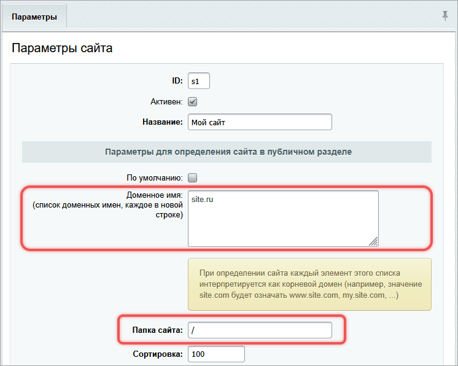
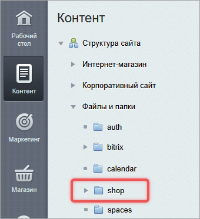
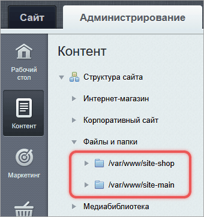
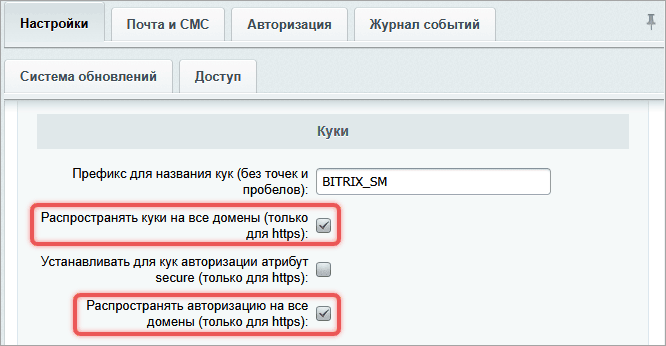
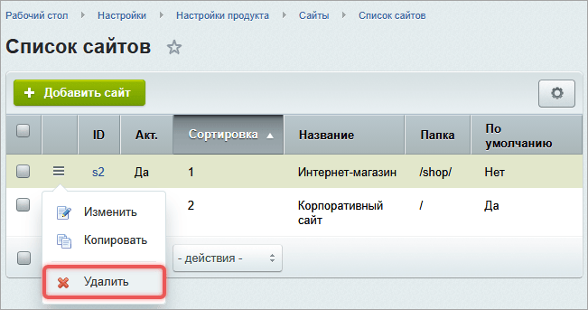

Bitrix Framework позволяет запускать несколько сайтов на одной установке. Сайты размещают в подпапках одного домена или на разных доменах.

Многосайтовость подходит для управления отдельными, но связанными проектами. Все сайты используют одно ядро, общую базу данных и единый набор модулей.

Система поддерживает неограниченное количество сайтов. Исключение — редакция Старт, в ней можно создать два сайта.

По лицензионному соглашению нельзя размещать на одной лицензии независимые копии системы с отдельным ядром или отдельной базой данных, даже если они находятся на одном сервере.



Подробнее о том, что такое сайт в Bitrix Framework и как им управлять, читайте в статье [Сайты](../cms-basics/sites.md).



## Когда использовать многосайтовость

При создании нескольких сайтов выберите архитектуру: многосайтовость или отдельные установки.

Многосайтовость подходит:

-  когда все сайты обслуживает одна команда разработки и администрирования,

-  сайты связаны по содержанию — например, языковые версии одного проекта или корпоративный сайт и интернет-магазин,

-  система сохраняет авторизацию при переходе между сайтами.

Отдельные установки нужны:

-  когда разные команды поддерживают отдельные сайты,

-  данные одного сайта нельзя показывать участникам другого,

-  посетители воспринимают сайты как независимые проекты.

## Как система различает сайты

Система определяет текущий сайт по двум параметрам из настроек: Доменное имя и Папка сайта.

{width=746px height=596px}

### По доменному имени

При запросе система сравнивает домен из адресной строки браузера с доменами, которые указаны в настройках сайтов.

Если указали `site.ru`, система считает принадлежащими этому сайту все поддомены: `www.site.ru`, `docs.site.ru`, `m.site.ru`.

Укажите домен без `www`. Это упрощает настройку и избавляет от дублирования.

Можно перечислить несколько доменов — по одному на строку. Например, если сайт должен отвечать на `site.ru` и на `my-site.ru`, укажите оба адреса.



Не добавляйте домены, которые не относятся к текущей установке Bitrix Framework. Это замедлит работу и нарушит передачу данных между сайтами.



Если ни один сайт не соответствует домену, система открывает сайт по умолчанию.

### По папке сайта

Если доменные имена не указаны или совпадают у нескольких сайтов, система выбирает сайт по пути в адресе страницы.

В поле Папка сайта задайте путь относительно корня сайта: `/`, `/ru/`, `/shop/`. Это не путь в файловой системе сервера, а часть URL после домена.

Например, при открытии `example.ru/` система покажет сайт с папкой `/`, при открытии `example.ru/shop/` система покажет сайт с папкой `/shop/`.



Система не учитывает номер порта в адресе. Нельзя настроить многосайтовость на одном домене с разными портами.



## Настроить многосайтовость

Bitrix Framework поддерживает два режима многосайтовости.

-  На одном домене — сайты разделяют по подкаталогам, чтобы структура файлов не пересекалась. Каждый сайт размещают в отдельном подкаталоге внутри корневого каталога.

-  На разных доменах — ядро продукта устанавливают в папку одного из сайтов, для остальных сайтов настраивают символические ссылки. Технологию можно реализовать на разных доменах и на поддоменах.

Настройка отличается способом организации файловой структуры и параметров сайта.

В примерах папки сайтов размещены в `/var/www/`. На вашем сервере путь может отличаться, например, быть `/home/www/`. Используйте фактические пути к папкам во всех командах, настройках сайтов и конфигурации веб-сервера.



Если используете BitrixVM, не редактируйте конфигурационные файлы вручную. В меню виртуальной машины запустите мастер *8\. Configure pool sites > 1. Create a site*.



### Сравнить режимы

Выбор зависит от структуры проекта и возможностей хостинга. Таблица помогает оценить различия по ключевым параметрам.

#|
|| **Критерий** | **На одном домене** | **На разных доменах** ||
|| URL-структура | `example.ru/`, `example.ru/shop/` | `example.ru`, `shop.example.ru`, `onlineshop.ru` ||
|| Файловая структура | Все сайты в одной папке | Каждый сайт в отдельной папке с символическими ссылками ||
|| Виртуальные хосты | Один виртуальный хост | Отдельный виртуальный хост для каждого сайта ||
|| SSL-сертификат | Один сертификат на весь домен | Можно использовать разные сертификаты ||
|| SEO | Общее SEO-ядро, возможны дубли | Независимое SEO для каждого сайта ||
|| Сложность настройки | Простая настройка | Нужно настроить Apache и символические ссылки ||
|#

Если сайты логически связаны и используют общий контент, выбирайте многосайтовость на одном домене.

Если нужны независимые URL, четкое разделение, выбирайте многосайтовость на разных доменах.

### На одном домене

В этом режиме все сайты размещаются в подпапках одного домена. Например:

-  `example.ru/` — корпоративный сайт,

-  `example.ru/shop/` — интернет-магазин.

#### Создать папки для сайтов

1. Создайте общий корневой каталог, например, `/var/www/bx-sites/`.

2. Установите Bitrix Framework в этот каталог.

3. Создайте подпапку для второго сайта — `/var/www/bx-sites/shop/`.

4. Поместите публичные файлы интернет-магазина в папку `/var/www/bx-sites/shop/`.

#### Настроить сайты в административном разделе

1. Откройте страницу *Настройки > Настройки продукта > Сайты > Список сайтов*.

2. Отредактируйте сайт, который создали при установке продукта. Проверьте настройки:

   -  Папка сайта — `/`,

   -  Доменное имя — пустое поле,

   -  Путь к корневой папке веб-сервера для этого сайта — пустое поле,

   -  URL сервера — `example.ru`.

3. Нажмите Добавить сайт.

4. Настройте параметры второго сайта:

   -  ID — `shop`,

   -  Название — Интернет-магазин,

   -  Доменное имя — пустое поле,

   -  Папка сайта — `/shop/`,

   -  Путь к корневой папке веб-сервера для этого сайта — пустое поле,

   -  Название веб-сайта — Интернет-магазин,

   -  URL сервера — `example.ru/shop/`.

      Остальные параметры настройте стандартным способом, как описано в статье [Сайты](../cms-basics/sites.md).



Убедитесь, что у каждого сайта в поле Папка сайта указана уникальная папка. Иначе система не сможет определить, какой сайт показывать.



В административной части оба сайта отображаются в одной файловой структуре:

-  `/shop/` — папка второго сайта,

-  остальные папки — ядро и папки первого сайта.

{width=340px height=373px}

#### Настроить веб-сервер Apache

Убедитесь, что в конфигурационном файле `httpd.conf` веб-сервера Apache настроен один виртуальный хост:

```apache
<VirtualHost *:80>
    DocumentRoot "/var/www/bx-sites"
    ServerName example.ru
    ServerAlias www.example.ru
</VirtualHost>
```

Дополнительные настройки выполнять не нужно.

### На разных доменах

Режим применяют, когда сайты должны быть доступны по разным адресам. Например:

-  `company.ru` — корпоративный сайт,

-  `shop.company.ru` — интернет-магазин.

#### Установить систему и создать папки

1. Создайте отдельную папку для каждого сайта:

   -  `/var/www/site-main/` — для первого сайта,

   -  `/var/www/site-shop/` — для второго.

2. Установите Bitrix Framework в папку первого сайта — `/var/www/site-main/`.

#### Настроить сайты

1. Откройте страницу *Настройки > Настройки продукта > Сайты > Список сайтов*.

2. Отредактируйте основной сайт, который создали при установке продукта. Проверьте настройки:

   -  Папка сайта — `/`,

   -  Доменное имя — `company.ru`,

   -  Путь к корневой папке веб-сервера для этого сайта — `/var/www/site-main/`,

   -  URL сервера — `company.ru`.

3. Нажмите Добавить сайт.

4. Укажите параметры второго сайта:

   -  ID — `s2`,

   -  Название — Интернет-магазин,

   -  Доменное имя — `shop.company.ru`,

   -  Папка сайта — `/`,

   -  Путь к корневой папке веб-сервера для этого сайта — `/var/www/site-shop/`,

   -  Название веб-сайта — Интернет-магазин,

   -  URL сервера — `shop.company.ru`.

   Остальные параметры настройте стандартным способом, как описано в статье [Сайты](../cms-basics/sites.md).

Каждый сайт отображается отдельно в файловой структуре:

{width=340px height=362px}

#### Добавить символические ссылки

Чтобы сайты на разных доменах использовали общее ядро, настройте символические ссылки. Это специальные файлы, которые указывают на фактическое расположение папок.



Не копируйте папки `/bitrix/`, `/upload/`, `/local/`. Это действие вызывает проблемы при обновлении и нарушает лицензию на продукт.



Выберите один из двух вариантов в зависимости от структуры каталогов и прав доступа.

**Вариант 1.** Создайте отдельный каталог для ядра и общих файлов.

1. Создайте каталог для общих файлов, например, `/var/www/shared/`.

   ```bash prompt="$"
   $ mkdir /var/www/shared
   ```

2. Переместите ядро и ключевые папки из первого сайта в общий каталог:

   ```bash prompt="$"
   $ mv /var/www/site-main/bitrix /var/www/shared/bitrix
   $ mv /var/www/site-main/upload /var/www/shared/upload
   $ mv /var/www/site-main/local /var/www/shared/local
   ```

3. Создайте ссылки на общие папки в корне каждого сайта. Выполните команды от имени пользователя и группы веб-сервера. Для первого сайта `/var/www/site-main/`:

   ```bash prompt="$"
   $ ln -s /var/www/shared/bitrix /var/www/site-main/bitrix
   $ ln -s /var/www/shared/upload /var/www/site-main/upload
   $ ln -s /var/www/shared/local /var/www/site-main/local
   ```

   Для второго сайта `/var/www/site-shop/`:

   ```bash prompt="$"
   $ ln -s /var/www/shared/bitrix /var/www/site-shop/bitrix
   $ ln -s /var/www/shared/upload /var/www/site-shop/upload
   $ ln -s /var/www/shared/local /var/www/site-shop/local
   ```

4. Проверьте, что веб-сервер имеет права на запись в `/var/www/shared/`. Это необходимо для установки обновлений и загрузки файлов.

5. Разместите уникальные файлы второго сайта в папке `/var/www/site-shop/`.

**Вариант 2.** Создайте ссылки напрямую из корня второго сайта в каталоги первого.



Скрипт `symlink.php` предназначен для однократного запуска из командной строки. Проверка `PHP_SAPI` запрещает вызов через браузер. Выполняйте скрипт от имени пользователя веб-сервера и удалите файл сразу после проверки ссылок.



1. Создайте файл `/var/www/site-shop/symlink.php`:

   ```php
   <?php
   if (PHP_SAPI !== 'cli')
   {
       http_response_code(403);
       exit('Доступ запрещен.');
   }

   $sourceRoot = '/var/www/site-main';
   $targetRoot = __DIR__;
   $directories = ['bitrix', 'upload', 'local'];

   // Проверяем все пути до создания ссылок.
   foreach ($directories as $directory)
   {
       $source = $sourceRoot . '/' . $directory;
       $target = $targetRoot . '/' . $directory;

       if (!is_dir($source))
       {
           fwrite(STDERR, 'Исходная папка не найдена: ' . $source . PHP_EOL);
           exit(1);
       }

       if (file_exists($target) || is_link($target))
       {
           fwrite(STDERR, 'Путь уже занят: ' . $target . PHP_EOL);
           exit(1);
       }
   }

   foreach ($directories as $directory)
   {
       if (!symlink($sourceRoot . '/' . $directory, $targetRoot . '/' . $directory))
       {
           fwrite(STDERR, 'Не удалось создать ссылку: ' . $directory . PHP_EOL);
           exit(1);
       }
   }

   echo 'Символические ссылки успешно созданы.' . PHP_EOL;
   ```

2. Проверьте права доступа. Пользователь веб-сервера должен иметь доступ к исходным папкам и право записи в `/var/www/site-shop/`.

3. В командной строке от имени пользователя веб-сервера запустите скрипт:

   ```bash prompt="$"
   $ php /var/www/site-shop/symlink.php
   ```

4. Проверьте, что в корне второго сайта появились символические ссылки на папки `bitrix`, `upload` и `local`. Сразу удалите служебный файл `symlink.php`. Если скрипт завершился с ошибкой после создания части ссылок, проверьте их перед повторным запуском: существующие пути он не перезаписывает.

5. Откройте `http://shop.company.ru/bitrix/admin/` и войдите под учетной записью администратора первого сайта.

#### Добавить служебные файлы

В корень второго сайта `/var/www/site-shop/` добавьте следующие файлы:

-  `.htaccess` — управляет маршрутизацией, правилами доступа и настройками сервера. Без него страницы сайта могут не открываться или возвращать ошибку 404. Скопируйте его с первого сайта.

-  `404.php` — отображает страницу при ошибке `404`. Если файла нет, браузер покажет стандартную ошибку сервера. Скопируйте его с первого сайта и адаптируйте текст под второй сайт.

-  `.access.php` — ограничивает доступ к публичной части сайта. Добавьте файл, если он есть на основном сайте. Файл содержит строку, которая разрешает всем пользователям просматривать корень сайта.

   ```php
   <?php $PERM["/"]["*"]="R"; ?>
   ```

#### Настроить виртуальные хосты

Добавьте настройки виртуальных хостов в конфигурационный файл Apache `httpd.conf`.

1. Укажите для каждого сайта собственный `DocumentRoot`.

2. Задайте основной домен в параметре `ServerName`.

3. Добавьте `ServerAlias *.company.ru`, чтобы сайт отвечал на все поддомены: `www`, `m` и `shop`.

Пример конфигурации для двух сайтов:

```apache
<VirtualHost *:80>
  DocumentRoot "/var/www/site-main"
  ServerName company.ru
  ServerAlias *.company.ru
</VirtualHost>

<VirtualHost *:80>
  DocumentRoot "/var/www/site-shop"
  ServerName shop.company.ru
</VirtualHost>
```



После настройки проверьте, что оба сайта открывают административную панель по пути `/bitrix/admin/` и используют одну базу данных.



Если используете разные IP-адреса, укажите их вместо `*`:

```apache
<VirtualHost 192.168.0.1:80>
  ServerName company.ru
  DocumentRoot "/var/www/site-main"
</VirtualHost>

<VirtualHost 192.168.0.2:80>
  ServerName shop.company.ru
  DocumentRoot "/var/www/site-shop"
</VirtualHost>
```

После изменения конфигурации перезапустите Apache.

Чтобы задать для второго сайта отдельный путь к папкам `php_interface` и `templates` без доступа к файлу `httpd.conf`, выполните три действия.

1. Создайте в корне второго сайта папку `/bitrix_personal/`.

2. В папке `/bitrix_personal/` создайте ссылки `php_interface` и `templates` на `/var/www/site-main/bitrix/php_interface/` и `/var/www/site-main/bitrix/templates/` соответственно.

3. Добавьте в `.htaccess` второго сайта:

   ```apache
   SetEnv BX_PERSONAL_ROOT /bitrix_personal
   ```

Значение `BX_PERSONAL_ROOT` задает путь относительно корня сайта. В этом примере ему соответствует папка `/var/www/site-shop/bitrix_personal/`. Пока `php_interface` и `templates` остаются ссылками, сайты используют общие настройки и шаблоны.

#### Настроить сортировку сайтов

Если один сайт работает на поддомене другого, укажите для поддомена меньшее значение сортировки. Это гарантирует, что при запросе к поддомену откроется второй сайт, а не основной.

Примеры значений сортировки:

-  `shop.company.ru` — `400`,

-  `company.ru` — `500`.

Для независимых доменов, например, `company.ru` и `onlineshop.ru`, порядок сортировки не важен.

#### Учитывать особенности режима

**Проактивная защита.** Если в системе включена Проактивная защита, добавьте второй домен в список разрешенных на странице *Настройки > Проактивная защита > Хосты/домены*.

**Кеширование.** HTML-кеширование не работает в режиме многосайтовости на разных доменах. Используйте [Композитный сайт](../performance/composite-site.md).

## Как объекты зависят от сайтов

В многосайтовой системе одни данные общие для всех сайтов, другие принадлежат только одному. Учитывайте это при проектировании структуры или переносе данных.

Примеры данных, которые всегда привязаны к конкретному сайту и не могут быть общими:

-  разделы и страницы, например `/about/` или `/company/index.php`,

-  заказы интернет-магазина,

-  налоги,

-  правила работы с корзиной,

-  файлы `robots.txt` и `sitemap.xml`,

-  A/B-тестирование,

-  триггерные рассылки,

-  почтовые ящики и сервисы.

Следующие данные поддерживают привязку к одному или нескольким сайтам:

-  информационные блоки,

-  баннерная реклама,

-  опросы и веб-формы,

-  учебные курсы,

-  типы плательщиков и цен,

-  отчеты по товарам и заказам.

Статистика собирается по каждому сайту отдельно, но права на просмотр разделить невозможно. Если пользователь имеет доступ к модулю Веб-аналитика, он видит данные по всем сайтам.

### Учитывать контекст сайта в агентах

Агенты общие для всей установки. Система хранит их в единой базе данных и запускает из общего списка без автоматической фильтрации по текущему сайту. Агент не запускается отдельно для каждого сайта и не получает контекст пользователя и сайта.

Функция агента должна работать без контекста текущего пользователя и сайта. Не используйте константу `SITE_ID` как неявный идентификатор сайта, данные которого должен обработать агент.

Если задача относится к определенному сайту, передайте его идентификатор в вызове агента явно:

```php
\MyAgent::runAgent('s2');
```

В примере `s2` — идентификатор сайта, данные которого должен обработать агент.

При переносе агентов на cron не создавайте одинаковые задания для каждого сайта. Cron запускает общий список агентов, а отдельное задание не передает агенту контекст конкретного сайта. Стандартные агенты модулей должны работать независимо от контекста сайта.

Подробнее о способах запуска и настройке cron читайте в статье [Агенты и фоновые задачи](../framework/background-jobs.md).

## Обеспечить сквозную идентификацию пользователей

Когда посетитель заходит на один сайт многосайтовой системы, он получает идентификаторы для статистики, корзины, авторизации и других модулей. Данные сохраняются в cookie, которые привязаны к домену сайта.

Если посетитель переходит на второй сайт с другим доменом, браузер не передает cookie первого сайта — это ограничение безопасности. Второй сайт считает посетителя новым.

Чтобы решить эту задачу, Bitrix Framework использует технологию `UserMultiSiteTransfer`. Она распространяет cookie на другие домены с помощью JavaScript. Это происходит автоматически при подключении функции `CMain::ShowSpreadCookieHTML()`.

Чтобы активировать технологию, включите две настройки на странице *Настройки > Настройки продукта > Настройки модулей > Главный модуль*.

-  Распространять куки на все домены — включает `UserMultiSiteTransfer` и позволяет распознавать анонимных посетителей на всех сайтах.

-  Распространять авторизацию на все домены — обеспечивает автоматический вход зарегистрированных пользователей на всех сайтах после авторизации на одном.

{width=666px height=346px}

Обе настройки работают, если:

-  все сайты используют одну установку Bitrix Framework,

-  в настройках каждого сайта в поле *Доменное имя* перечислены все домены.

В результате посетитель остается одним и тем же пользователем при переходе между сайтами.

## Решить проблему дублирования PHPSESSID

Bitrix Framework не поддерживает размещение независимых установок на поддоменах одного родительского домена. Например:

-  `site.ru` — первая установка с 1С-Битрикс: Управление сайтом,

-  `crm.site.ru` — вторая установка с 1С-Битрикс24.

Обе установки используют собственные ядра и разные базы данных, но работают в рамках одного домена второго уровня.

Если в настройках сайта `site.ru` заполнено поле Доменное имя, система устанавливает cookie для всех поддоменов  `*.site.ru`. В эти cookie входит идентификатор сессии `PHPSESSID`.

Когда пользователь переходит с `site.ru` на `crm.site.ru`, браузер отправляет идентификатор сессии от первой установки. Вторая установка пытается использовать чужой `PHPSESSID`. Это приводит к сбоям авторизации, сбросу корзины и другим ошибкам.

#### Настроить установки без многосайтовости

Если каждая установка содержит только один сайт и не требует сквозной авторизации между поддоменами, очистите поле Доменное имя в настройках `site.ru`.

1. Перейдите на страницу *Настройки > Настройки продукта > Сайты > Список сайтов*.

2. Откройте сайт на редактирование.

3. Удалите значение из поля Доменное имя и сохраните изменения.

Повторите эту операцию для второй установки — `crm.site.ru`.

После изменения пользователи должны выйти из системы и войти заново. Это обновит cookie и ограничит их область действия конкретным доменом.

Если авторизация не восстанавливается, временно добавьте в файл `/bitrix/php_interface/dbconn.php`:

```php
setcookie("PHPSESSID", "", time() - 3600, '/', '.site.ru');
```

После успешного входа удалите эту строку.

#### Настроить установки с многосайтовостью

Если одна из установок использует многосайтовость на разных доменах, поле Доменное имя оставьте заполненным. Система на его основе обеспечивает сквозную авторизацию между сайтами одной установки.

В этом случае невозможно изолировать cookie через настройки. Единственное корректное решение — использовать для второй установки домен, который не связан с родительским доменом первой установки.

Подходящие варианты: `crm-site.ru`, `crm.company.ru`, `mycrm.ru`.

Такая архитектура исключает конфликт сессий и обеспечивает стабильную работу обеих систем.

## Вынести раздел на поддомен

Раздел сайта можно вынести на отдельный поддомен и не создавать второй сайт.

Пример: `forum.example.ru` вместо `example.ru/forum/`.

Для этого используйте элементы конфигурации многосайтовости на разных доменах.



Настройте DNS-запись для поддомена в панели управления доменом: A-запись на IP-адрес сервера или CNAME на основной домен.



#### Настроить веб-сервер

1. Создайте отдельную папку для поддомена — `/var/www/forum/`.

2. Настройте виртуальный хост Apache.

   ```apache
   <VirtualHost *:80>
     ServerName forum.example.ru
     DocumentRoot "/var/www/forum"
   </VirtualHost>
   ```

3. Добавьте символические ссылки.

   ```bash prompt="$"
   $ ln -s /var/www/example/bitrix /var/www/forum/bitrix
   $ ln -s /var/www/example/upload /var/www/forum/upload
   ```

#### Настроить шаблон сайта

Примените шаблон дизайна для поддомена.

1. Перейдите на страницу *Настройки > Настройки продукта > Сайты > Список сайтов*.

2. Откройте форму редактирования сайта.

3. В разделе Шаблон сайта добавьте новое условие:

   -  Шаблон — выберите шаблон из списка,

   -  Тип условия — укажите `Выражение PHP`,

   -  Условие — введите `$_SERVER['HTTP_HOST'] == 'forum.example.ru'`.

#### Настроить меню

Меню основного сайта содержит относительные пути и не работает в поддомене.

Чтобы настроить меню, используйте абсолютные пути или создайте отдельное меню для поддомена.

## Как создать языковые версии сайта

Языковые версии сайта можно создать двумя способами: как папки внутри одного сайта или как отдельные сайты.

Если сайт содержит только текстовые страницы, новости или каталог, достаточно использовать папки.

Если нужен раздельный интернет-магазин, разные валюты, рекламные кампании или аналитика, создавайте отдельные сайты.

### Папки внутри одного сайта

Разместите контент для каждого языка в отдельной папке: `example.ru/ru/`, `example.ru/en/`.

Для каждого языкового раздела можно задать отдельный шаблон сайта. В настройках шаблона укажите условие *для папки* и введите путь, например `/ru/`.

Все данные остаются общими для всех языковых разделов.

-  Статистика собирается по всему сайту, а не по каждому языку отдельно.

-  Корзина и заказы общие. Когда пользователь добавит товар на русском языке, он увидит его в корзине на английской версии,

-  Настройки валют, правила работы с корзиной и доставки применяются ко всему сайту.

### Отдельные сайты на разных языках

Создайте независимые сайты с разными доменами или поддоменами: `site.ru`, `site.com`.

Способ дает полный контроль над данными:

-  раздельная статистика,

-  разные валюты и правила доставки,

-  независимые рекламные кампании и веб-формы,

-  отдельные региональные настройки: формат даты, часовой пояс.

## Решить типовые задачи

Настройка многосайтовости включает типовые операции: временное закрытие сайта, подключение переключателя сайтов, резервное копирование и удаление.

### Закрыть только один сайт

В настройках главного модуля можно отключить публичную часть всех сайтов сразу. Чтобы закрыть только один сайт, выполните три шага.

1. Создайте файл `/bitrix/php_interface/siteid/init.php`, где `siteid` — идентификатор сайта, например, `s1`.

2. Добавьте код:

   ```php
   <?php
   use Bitrix\Main\Engine\CurrentUser;
   use Bitrix\Main\EventManager;

   EventManager::getInstance()->addEventHandler(
       'main',
       'OnBeforeProlog',
       static function (): void
       {
           if (!CurrentUser::get()->isAdmin())
           {
               include $_SERVER['DOCUMENT_ROOT'] . '/coming-soon/underconstruction.html';
               exit;
           }
       },
       false,
       50,
   );
   ```

   Обработчик события `OnBeforeProlog` показывает заглушку всем посетителям, кроме администраторов. Значение `50` задает порядок вызова обработчика.

3. Создайте файл `/coming-soon/underconstruction.html` с информацией для посетителей в корне закрываемого сайта.



Такой способ отключает выполнение заданий cron для сайта.



### Подключить компонент выбора сайта

Чтобы посетители могли переходить между сайтами, используйте компонент Выбор сайта `bitrix:main.site.selector`. Разместите его в шаблоне сайта.

Шаблон компонента можно скопировать и изменить под дизайн проекта.



Подробнее о работе с компонентами читайте в статье [Компоненты](../framework/components.md).



### Выполнить резервное копирование

**Многосайтовость на одном домене.** Резервную копию создают стандартным способом — как для обычного сайта. Архив включает все сайты, потому что они находятся в одной папке.

**Многосайтовость на разных доменах.** В архив можно включить любые сайты. База данных архивируется всегда целиком. После распаковки нужно перенести публичные папки сайтов и восстановить символические ссылки.



Подробнее о создании архивов читайте в статье [Резервное копирование](./backup.md).



### Удалить сайт

Система не позволяет удалить сайт, если к нему привязаны другие объекты. Перед удалением убедитесь, что удалены или отвязаны:

-  информационные блоки,

-  заказы и типы плательщиков,

-  форумы, блоги, рассылки,

-  справочники техподдержки,

-  учебные курсы,

-  почтовые ящики и сервисы.

Если сайт содержит ядро Bitrix Framework, а другие сайты используют символические ссылки на него:

1. Перенесите папку `/bitrix/` в папку второго сайта. Также перенесите `/local/` и `/upload/`, если они содержат общие данные.

2. Замените символические ссылки реальными каталогами.

3. Проверьте, что второй сайт работает.

Теперь можно удалить сайт.

1. Откройте страницу *Настройки > Настройки продукта > Сайты > Список сайтов*.

2. В меню сайта нажмите Удалить.

{width=651px height=343px}

Если удаление невозможно, система покажет ошибку с указанием модуля.

Пример: `Ошибка при удалении в CIBlock::OnBeforeLangDelete (iblock)` — остались привязанные инфоблоки.
