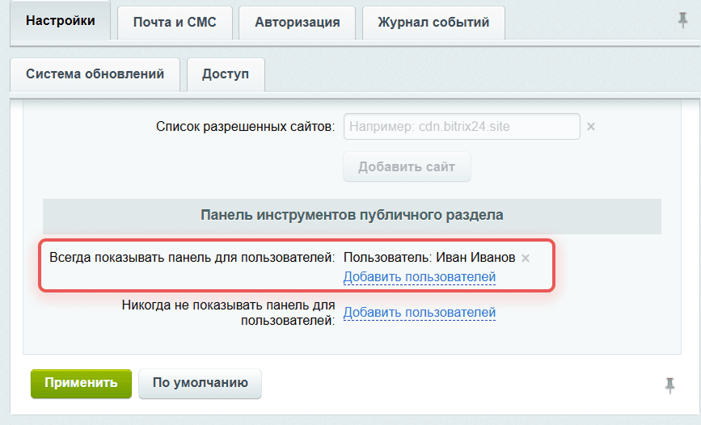
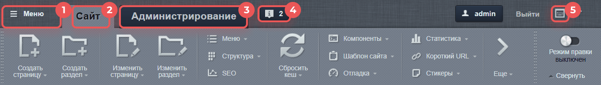
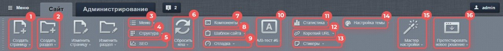
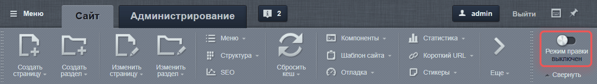
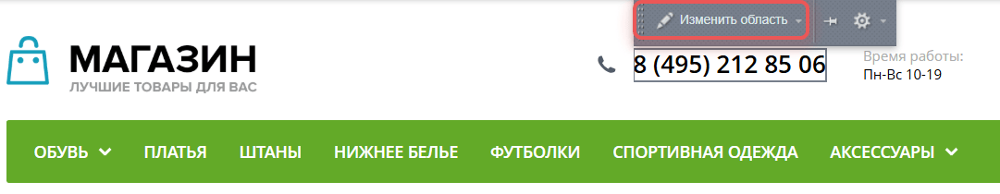
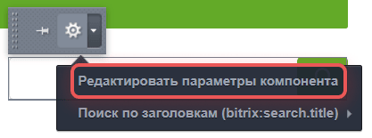
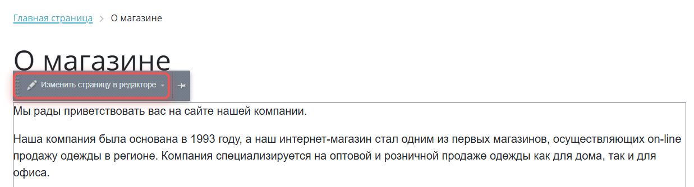
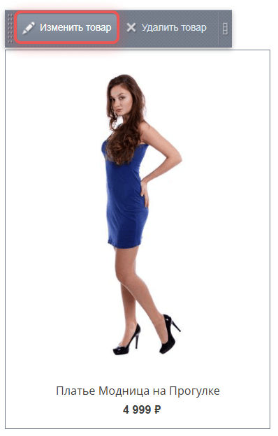
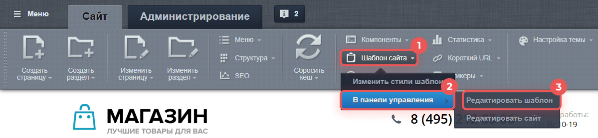

Панель администрирования — инструмент для работы с содержимым сайта, отображается в верхней части страницы после авторизации. Набор инструментов зависит от страницы и прав пользователя.

С помощью панели администрирования можно:

-  управлять параметрами текущего раздела,

-  редактировать текущую страницу и включаемые области,

-  добавлять и изменять меню раздела,

-  настраивать параметры компонентов,

-  переходить в административный раздел.

## Как включить панель администрирования

В 1С-Битрикс: Управление сайтом панель администрирования доступна для пользователей с правами на редактирование сайта.

В коробочной версии Битрикс24 панель скрыта по умолчанию для всех пользователей, независимо от их прав. Чтобы включить панель администрирования:

1. Авторизуйтесь как администратор и перейдите по ссылке `http://адрес_Битрикс24/bitrix/`.

2. Откройте настройки главного модуля в разделе *Настройки > Настройки продукта > Настройки модулей > Главный модуль*.

3. Выберите, кому показывать панель.

   -  В параметре *Всегда показывать панель для пользователей* укажите нужных пользователей или группы.

      {width=750px height=441px}

   -  По умолчанию есть группа *Работает в панели управления* — добавьте в нее пользователей, и они увидят панель.

4. Сохраните изменения с помощью кнопки *Применить*.

Параметр *Никогда не показывать панель для пользователей* скрывает панель для выбранных пользователей и групп. Если пользователь попал в оба списка, панель у него не отображается.

### Добавить пользователя в группу

1. Откройте профиль пользователя в разделе *Настройки > Пользователи > Список пользователей*.

2. Перейдите на вкладку *Группы* и отметьте *Работает в панели управления*.

После этого панель администрирования будет доступна выбранным пользователям.

## Основные части панели

{width=1258px height=179px}

1. Меню — выпадающее меню позволяет быстро перейти в любую часть административного раздела.

2. Сайт — работа с публичной частью. Можно вносить изменения и сразу видеть результат.

3. Администрирование — полный доступ ко всем функциям системы.

4. Окно уведомлений — системные сообщения и оповещения. Цифра рядом обозначает количество новых уведомлений.

5. Настройка горячих клавиш — окно [настроек горячих клавиш](#hotkeys), где можно назначить нужную комбинацию.

## Описание элементов интерфейса

{width=1280px height=133px}

1. Создать страницу — добавляет новые страницы.

2. Создать раздел — добавляет новый раздел.

3. Меню — управляет навигацией.

4. Структура — открывает инструменты для работы со структурой сайта.

5. SEO — настраивает ключевые слова, заголовки и рекомендации для поисковой оптимизации.

6. Сбросить кеш — очищает кеш.

7. Компоненты — переходит к редактированию компонентов.

8. Шаблон сайта — позволяет редактировать шаблон сайта.

9. Отладка — инструменты для поиска проблем в работе сайта. Показывают суммарную статистику, статистику SQL-запросов, детальную статистику кеша, статистику включаемых областей и время исполнения страницы.

10. A/B-тест — переключает режимы тестирования. Появляется при запуске A/B-теста.

11. Статистика — показывает данные веб-аналитики.

12. Короткий URL — создает короткие ссылки для текущей страницы.

13. Стикеры — добавляет заметки на страницу.

14. Настройка темы — меняет цветовую тему, если предусмотрено шаблоном сайта.

15. Мастер настройки — возвращает к мастеру установки решения.

16. Протестировать новое решение — переходит к установке другого решения.

## Режим правки {#edit-mode}

{width=1258px height=179px}

Режим правки — быстрый способ отредактировать элементы в публичном разделе сайта. Включите режим с помощью кнопки *Режим правки* и наведите курсор на нужную область, чтобы изменить элемент.

### Типы редактируемых областей

Способ правки зависит от типа области. В режиме правки доступны включаемые области, рабочая область страницы и области компонентов.

#### Включаемые области

Используйте, чтобы отредактировать простой текст, например контакты или описание:

1. Наведите курсор на включаемую область и нажмите *Изменить область*.

2. Отредактируйте текст и нажмите *Сохранить*.

{width=1081px height=210px}

Если во включаемой области размещен файл с компонентом, например строка поиска или ссылки на социальные сети:

1. Нажмите {width=31px height=34px} > *Редактировать параметры компонента*.

2. Внесите изменения и нажмите *Сохранить*.

{width=417px height=155px}

#### Рабочая область страницы

1. Наведите курсор на текст и нажмите *Изменить страницу в редакторе*.

2. Внесите изменения и нажмите *Сохранить*.

{width=1237px height=334px}

#### Область компонента

Вид панели будет зависеть от типа компонента. Например, чтобы изменить товар каталога:

1. Наведите курсор на товар и нажмите *Изменить товар*.

2. Внесите изменения и нажмите *Сохранить*.

{width=398px height=624px}

### Редактирование шаблона

Чтобы отредактировать шаблон сайта, выберите *Шаблон сайта > В панели управления > Редактировать шаблон*.

{width=1199px height=279px}

Доступные опции:

-  Изменить стили шаблона — изменить CSS-стили шаблона.

-  Редактировать сайт — изменить настройки сайта.

-  Редактировать шаблон — изменить внешний вид сайта.

## Горячие клавиши {#hotkeys}

Используйте горячие клавиши для ускорения работы. Чтобы настроить комбинации, нажмите кнопку *Горячие клавиши* на панели администрирования.

## Управление панелью администрирования

Шаблон сайта выводит панель, а обработчики событий, страницы и компоненты добавляют на нее кнопки и контекстные меню. Методы панели вызывают у глобального объекта `$APPLICATION` класса `CMain`, методы контекстных меню — у объекта компонента или шаблона компонента.

### Подключить панель

Метод `$APPLICATION->ShowPanel()` выводит панель. Вызовите его в файле `header.php` [шаблона сайта](./site-templates.md) сразу после тега `<body>`.

**Пример.** Начало файла `header.php` с панелью:

```php
<?php
if (!defined('B_PROLOG_INCLUDED') || B_PROLOG_INCLUDED !== true)
{
    die();
}

/** @global CMain $APPLICATION */
?>
<!DOCTYPE html>
<html lang="<?= LANGUAGE_ID ?>">
<head>
    <?php $APPLICATION->ShowHead(); ?>
    <title><?php $APPLICATION->ShowTitle(); ?></title>
</head>
<body>
<?php $APPLICATION->ShowPanel(); ?>
```

Метод не принимает параметров и ничего не возвращает. Ядро вставляет HTML панели в буфер страницы в конце ее формирования. Поэтому на панель попадают и кнопки, которые страница и компоненты добавляют ниже вызова `ShowPanel()`.

Панель не выводится, если:

-  пользователь не авторизован,

-  пользователь входит в список параметра *Никогда не показывать панель для пользователей*,

-  пользователя нет в списке *Всегда показывать панель для пользователей* и на панели нет ни одной кнопки с адресом или меню.

Ядро добавляет стандартные кнопки, только если у пользователя есть права на действие. Поэтому набор кнопок зависит от прав пользователя.

Чтобы скрыть панель на отдельной странице, присвойте свойству `$APPLICATION->ShowPanel` значение `false`. Ядро проверяет свойство при выводе панели в конце страницы, поэтому его можно задать в коде страницы или компонента.

### Добавить кнопки

Метод `$APPLICATION->AddPanelButton($arButton, $bReplace = false)` добавляет кнопку на панель. Метод ничего не возвращает.

*Обязательные параметры обозначены \*.*

| Параметр | Тип | Описание |
|---|---|---|
| `$arButton`* | `array` | Описание кнопки. Пустой массив или значение другого типа метод пропускает |
| `$bReplace` | `bool` | Действие, если кнопка с таким `ID` уже добавлена. `false` — оставить прежнюю кнопку и не добавлять новую. `true` — заменить кнопку, пункты `MENU` прежней кнопки сохранить и дописать к ним пункты новой. По умолчанию `false` |

Ключи массива `$arButton` описаны в таблице.

| Ключ | Описание |
|---|---|
| ID<br>`string` | Идентификатор кнопки. По нему метод `AddPanelButtonMenu()` добавляет пункты меню, а параметр `$bReplace` находит кнопку для замены. Кнопку без `ID` метод добавляет при каждом вызове как новую |
| TEXT<br>`string` | Подпись кнопки. У маленькой кнопки ядро экранирует HTML в подписи. У большой кнопки `BIG` ядро выводит подпись без экранирования и заменяет `#BR#` переносом строки |
| TYPE<br>`string` | Размер кнопки. `BIG` — большая кнопка. Любое другое значение или отсутствие ключа — маленькая кнопка `SMALL` |
| MAIN_SORT<br>`int` | Группа кнопок. Ядро сортирует кнопки по `MAIN_SORT`, затем по `SORT` и отделяет группы с разным `MAIN_SORT` разделителем. Стандартные группы занимают значения 100, 200, 300, 400, 500 и 1000 |
| SORT<br>`int` | Позиция кнопки внутри группы |
| HREF<br>`string` | Адрес перехода. Значение с префиксом `javascript:` ядро выполняет как JavaScript-код по клику |
| ICON<br>`string` | CSS-класс иконки |
| SRC<br>`string` | Путь к изображению иконки. Ядро задает изображение фоном элемента иконки |
| ALT<br>`string` | Текст атрибута `title` кнопки. Если задан ключ `HINT`, ядро не выводит `ALT` |
| HINT<br>`array` | Всплывающая подсказка. `TITLE` — заголовок, `TEXT` — текст с поддержкой HTML. Необязательный `ID` — идентификатор подсказки. Если пользователь отключил подсказку с этим `ID`, ядро ее больше не показывает |
| HINT_MENU<br>`array` | Подсказка к стрелке меню кнопки, у которой заданы `HREF` и `MENU`. Ключи `TITLE` и `TEXT` |
| MENU<br>`array` | Пункты выпадающего меню. Ключи пункта описаны в следующей таблице |
| RESORT_MENU<br>`bool` | `true` — перед выводом отсортировать пункты `MENU` по ключу `SORT`. Пункты без `SORT` попадают в конец меню. Без ключа пункты выводятся в порядке добавления |

Ключи пункта меню описаны в таблице.

| Ключ | Описание |
|---|---|
| TEXT<br>`string` | Название пункта. HTML в названии экранируется |
| ACTION<br>`string` | JavaScript-код, который выполняется по клику. Префикс `javascript:` не нужен |
| SORT<br>`int` | Порядок пункта. Ядро учитывает его, если у кнопки задан `RESORT_MENU` со значением `true` |
| DEFAULT<br>`bool` | `true` — выделить пункт в меню как действие по умолчанию |
| MENU<br>`array` | Вложенное меню. Пункты вложенного меню задают ключами из этой таблицы |
| SEPARATOR<br>`bool` | `true` — вывести линию-разделитель вместо пункта. Название разделителю не задают |

Метод `AddPanelButton()` не проверяет права пользователя. Если у кнопки задан `HREF` или непустой `MENU`, панель появится у любого авторизованного пользователя, даже без стандартных кнопок. Перед вызовом проверьте права, например методом `$USER->CanDoOperation()` или `$USER->IsAdmin()`.

Кнопку можно добавить:

-  в компоненте,

-  на странице,

-  в шаблоне сайта,

-  через событие `OnBeforeProlog`,

-  через событие `OnPanelCreate` модуля `main`.

Ядро вызывает событие `OnPanelCreate`, когда собирает панель для авторизованного пользователя, после добавления стандартных кнопок.

**Пример.** Обработчик в файле `/local/php_interface/init.php` добавляет большую кнопку со ссылкой на настройки главного модуля и меню из двух пунктов. Кнопку видят пользователи с правом на операцию `view_other_settings` — просмотр настроек. Подробнее о подключении обработчиков — в статье [События](../framework/events.md).

```php
<?php
use Bitrix\Main\EventManager;

EventManager::getInstance()->addEventHandler(
    'main',
    'OnPanelCreate',
    static function (): void
    {
        global $APPLICATION, $USER;

        // Кнопку видят только пользователи с правом просмотра настроек
        if (!$USER->CanDoOperation('view_other_settings'))
        {
            return;
        }

        $usersUrl = '/bitrix/admin/user_admin.php?lang=' . LANGUAGE_ID;
        $groupsUrl = '/bitrix/admin/group_admin.php?lang=' . LANGUAGE_ID;

        $APPLICATION->AddPanelButton([
            'ID' => 'doc_settings',
            'TEXT' => 'Настройки',
            'TYPE' => 'BIG',
            'MAIN_SORT' => 2500,
            'SORT' => 10,
            'HREF' => '/bitrix/admin/settings.php?lang=' . LANGUAGE_ID . '&mid=main',
            'ICON' => 'bx-panel-site-wizard-icon',
            'HINT' => [
                'TITLE' => 'Настройки',
                'TEXT' => 'Открывает настройки <b>главного модуля</b>',
            ],
            'RESORT_MENU' => true,
            'MENU' => [
                [
                    'TEXT' => 'Пользователи',
                    'ACTION' => "jsUtils.Redirect([], '" . CUtil::JSEscape($usersUrl) . "')",
                    'SORT' => 10,
                ],
                [
                    'SEPARATOR' => true,
                    'SORT' => 15,
                ],
                [
                    'TEXT' => 'Группы пользователей',
                    'ACTION' => "jsUtils.Redirect([], '" . CUtil::JSEscape($groupsUrl) . "')",
                    'SORT' => 20,
                ],
            ],
        ]);
    }
);
```

У разделителя в примере задан `SORT`. Без него при `RESORT_MENU` со значением `true` разделитель переместится в конец меню.

### Добавить пункты в меню кнопки

Метод `$APPLICATION->AddPanelButtonMenu($button_id, $arMenuItem)` добавляет один пункт в меню кнопки панели. Метод ничего не возвращает.

*Обязательные параметры обозначены \*.*

| Параметр | Тип | Описание |
|---|---|---|
| `$button_id`* | `string` | Значение ключа `ID` кнопки, в меню которой нужно добавить пункт |
| `$arMenuItem`* | `array` | Описание пункта с ключами `TEXT`, `ACTION`, `SORT`, `DEFAULT`, `MENU` или `SEPARATOR` из таблицы ключей пункта меню метода `AddPanelButton()` |

Чтобы добавить несколько пунктов, вызовите метод для каждого пункта. Метод можно вызвать до или после `AddPanelButton()`. Если кнопки с таким `ID` еще нет, метод сохраняет пункт и добавляет его в меню, когда кнопку создаст метод `AddPanelButton()`.

Пункты выводятся в порядке добавления. Чтобы ядро отсортировало их по ключу `SORT`, у кнопки должен быть задан ключ `RESORT_MENU` со значением `true`. У стандартной кнопки *Изменить страницу* с идентификатором `edit` этот ключ уже задан.

**Пример.** Страница сайта добавляет пункт в меню стандартной кнопки *Изменить страницу*. Пункт видят только администраторы.

```php
<?php
require $_SERVER['DOCUMENT_ROOT'] . '/bitrix/header.php';

/** @global CMain $APPLICATION */
/** @global CUser $USER */

if ($USER->IsAdmin())
{
    $eventLogUrl = '/bitrix/admin/event_log.php?lang=' . LANGUAGE_ID;

    $APPLICATION->AddPanelButtonMenu(
        'edit',
        [
            'TEXT' => 'Журнал событий',
            'ACTION' => "jsUtils.Redirect([], '" . CUtil::JSEscape($eventLogUrl) . "')",
            'SORT' => 70,
        ]
    );
}

$APPLICATION->SetTitle('Типы документов');
?>
<p>Содержимое страницы</p>
<?php
require $_SERVER['DOCUMENT_ROOT'] . '/bitrix/footer.php';
```

Кнопку `edit` ядро добавляет, только если у пользователя есть права хотя бы на одно действие с текущей страницей. Если кнопки нет, пункт не выводится.

### Тулбар компонента

Тулбар — панель кнопок над компонентом. Здесь размещают:

-  основные действия, например редактировать, добавить, удалить,

-  часто используемые функции.

Остальные действия помещают в контекстное меню.

Метод `$this->AddIncludeAreaIcons($arIcons)` объекта компонента задает кнопки тулбара. Метод принимает массив кнопок `array` и ничего не возвращает. Значение другого типа метод пропускает.

Метод заменяет весь набор кнопок, который задал компонент. Повторный вызов удаляет кнопки предыдущего вызова. Чтобы добавить одну кнопку к уже заданным, используйте метод `$this->AddIncludeAreaIcon($arIcon)`.

Ключи кнопки тулбара описаны в таблице.

| Ключ | Описание |
|---|---|
| ID<br>`string` | Идентификатор кнопки. Кнопку с повторяющимся `ID` ядро в тулбар не добавляет |
| TITLE<br>`string` | Текст кнопки |
| ALT<br>`string` | Всплывающая подсказка кнопки |
| URL<br>`string` | Адрес перехода. Значение с префиксом `javascript:` ядро выполняет как JavaScript-код по клику |
| ICON<br>`string` | CSS-класс иконки |
| SRC<br>`string` | Путь к изображению иконки |
| MENU<br>`array` | Пункты меню кнопки. У пункта задайте `TEXT` — название и `URL` — адрес или JavaScript-код с префиксом `javascript:` |
| IN_MENU<br>`bool` | `true` — вывести кнопку не в тулбаре, а в подменю компонента в выпадающем меню кнопки с шестеренкой |
| IN_PARAMS_MENU<br>`bool` | `true` — добавить кнопку в выпадающее меню кнопки с шестеренкой. Если заданы оба ключа, действует `IN_MENU` |
| SEPARATOR<br>`bool` | `true` — вывести разделитель вместо кнопки |

Тулбар виден только в режиме правки. Метод `$APPLICATION->GetShowIncludeAreas()` возвращает `true`, если пользователь авторизован, страница открыта не в административном разделе и режим правки включен или в пользовательских настройках панели включен параметр `panel_dynamic_mode`. В остальных случаях метод возвращает `false`.

Ядро не выводит тулбар и для компонента, который подключен с ключом `HIDE_ICONS` со значением `Y` в пятом аргументе `$arFunctionParams` метода `$APPLICATION->IncludeComponent()`.

Вызывайте `AddIncludeAreaIcons()` после блока `startResultCache()`. При чтении из [кеша компонента](../framework/components.md#component-caching) код внутри этого блока не выполняется, и кнопки не появятся.

**Пример.** Файл `component.php` выводит шаблон и добавляет кнопку тулбара со ссылкой на настройки главного модуля. Кнопка появляется у администратора в режиме правки и дублируется в меню кнопки с шестеренкой.

```php
<?php
if (!defined('B_PROLOG_INCLUDED') || B_PROLOG_INCLUDED !== true)
{
    die();
}

/** @var CBitrixComponent $this */
/** @var array $arResult */
/** @global CMain $APPLICATION */
/** @global CUser $USER */

if ($this->startResultCache())
{
    $arResult['TITLE'] = 'Типы документов';
    $this->includeComponentTemplate();
}

// Кнопки тулбара нужны только в режиме правки
if ($APPLICATION->GetShowIncludeAreas() && $USER->IsAdmin())
{
    $this->AddIncludeAreaIcons([
        [
            'ID' => 'doc_settings',
            'TITLE' => 'Настройки модуля',
            'ALT' => 'Открыть настройки главного модуля',
            'URL' => '/bitrix/admin/settings.php?lang=' . LANGUAGE_ID . '&mid=main',
            'ICON' => 'bx-context-toolbar-edit-icon',
            'IN_PARAMS_MENU' => true,
        ],
    ]);
}
```

### Контекстное меню элементов списка

Контекстное меню появляется над HTML-блоком в режиме правки. Блоку нужен идентификатор, а меню — кнопки.

#### Настроить HTML-атрибут

Метод `$this->GetEditAreaId($entryId)` шаблона компонента возвращает строку — идентификатор HTML-блока. В параметре `$entryId` передайте идентификатор записи, например ID элемента. Метод добавляет к нему хеш имени компонента и номера его вызова на странице, поэтому один `$entryId` в двух компонентах дает разные идентификаторы.

**Пример.** Блок в `template.php` с идентификатором для контекстного меню:

```php
<div id="<?= $this->GetEditAreaId('edit_area_1') ?>">
    <!-- Содержимое редактируемого блока -->
</div>
```

#### Определить кнопки контекстного меню

Метод `$APPLICATION->SetEditArea($areaId, $arIcons)` задает кнопки контекстного меню для блока. Метод ничего не возвращает.

*Обязательные параметры обозначены \*.*

| Параметр | Тип | Описание |
|---|---|---|
| `$areaId`* | `string` | Идентификатор блока, который вернул метод `GetEditAreaId()` |
| `$arIcons`* | `array` | Массив кнопок. Кнопки для одного блока из нескольких вызовов метод объединяет |

Ключи кнопки контекстного меню описаны в таблице.

| Ключ | Описание |
|---|---|
| TITLE<br>`string` | Текст кнопки |
| ALT<br>`string` | Всплывающая подсказка кнопки |
| URL<br>`string` | Адрес перехода. Значение с префиксом `javascript:` ядро выполняет как JavaScript-код по клику. Без `URL` кнопка ничего не делает |
| ICON<br>`string` | CSS-класс иконки, например `bx-context-toolbar-edit-icon` или `bx-context-toolbar-delete-icon` |
| SRC<br>`string` | Путь к изображению иконки |
| MENU<br>`array` | Пункты меню кнопки с ключами `TEXT` и `URL` |

Метод работает только в режиме правки. Если `$APPLICATION->GetShowIncludeAreas()` возвращает `false`, метод ничего не делает. Права на действие по адресу `URL` метод не проверяет. Проверяйте их в коде страницы, которая открывается по ссылке.

Файл `component_epilog.php` выполняется и при чтении результата из кеша, поэтому кнопки из него появляются на каждом хите. Подробнее о файле — в статье [Компоненты](../framework/components.md#component-epilog-file).

**Пример.** Файл `component_epilog.php` добавляет блоку `edit_area_1` кнопку со ссылкой на настройки главного модуля:

```php
<?php
if (!defined('B_PROLOG_INCLUDED') || B_PROLOG_INCLUDED !== true)
{
    die();
}

/** @var CBitrixComponent $this */
/** @global CMain $APPLICATION */
/** @global CUser $USER */

if ($USER->IsAdmin())
{
    $APPLICATION->SetEditArea(
        $this->GetEditAreaId('edit_area_1'),
        [
            [
                'TITLE' => 'Настройки модуля',
                'URL' => '/bitrix/admin/settings.php?lang=' . LANGUAGE_ID . '&mid=main',
                'ICON' => 'bx-context-toolbar-edit-icon',
            ],
        ]
    );
}
```

#### Работа с кнопками {#edit-area-buttons}

Методы `AddEditAction()` и `AddDeleteAction()` привязывают кнопки к блоку, `id` которого вернул метод `GetEditAreaId()`. Первым параметром методы принимают тот же идентификатор записи, который передан в `GetEditAreaId()`. Чтобы обе кнопки появились в контекстном меню одного блока, передайте в них одно значение.

Методы вызывают в `template.php` у объекта шаблона `$this`. Ядро применяет кнопки после выполнения шаблона и сохраняет их в кеше компонента, поэтому кнопки появляются и при чтении результата из кеша. Ни один из методов ничего не возвращает. Кнопки видны только в режиме правки.

**Добавить кнопку редактирования**

Метод `$this->AddEditAction($entryId, $editLink, $editTitle = false, $arParams = [])` добавляет кнопку, которая открывает адрес во всплывающем окне.

*Обязательные параметры обозначены \*.*

| Параметр | Тип | Описание |
|---|---|---|
| `$entryId`* | `string` | Идентификатор записи, как в `GetEditAreaId()`. Если значение пустое, кнопка не добавляется |
| `$editLink`* | `string` | Адрес формы редактирования. Если адрес пустой, кнопка не добавляется |
| `$editTitle` | `string` или `false` | Текст кнопки. По умолчанию `false` — ядро подставляет «Редактировать» |
| `$arParams` | `array` | Ключ `WINDOW` — размеры окна, массив с ключами `width` и `height`, по умолчанию 780 на 500 пикселей. Ключ `ICON` — CSS-класс иконки, по умолчанию `bx-context-toolbar-edit-icon`. Ключ `SRC` — путь к изображению иконки, ядро использует его, если `ICON` не задан |

**Пример.** Кнопка открывает форму элемента инфоблока в окне 780 на 500 пикселей. Ссылку `EDIT_LINK` готовит компонент, как показано в разделе [Кнопки управления для инфоблоков](#iblock-buttons).

```php
$this->AddEditAction(
    $item['ID'],
    $item['EDIT_LINK'],
    'Изменить элемент',
    [
        'WINDOW' => ['width' => 780, 'height' => 500],
        'ICON' => 'bx-context-toolbar-edit-icon',
    ]
);
```

**Добавить кнопку удаления элемента**

Метод `$this->AddDeleteAction($entryId, $deleteLink, $deleteTitle = false, $arParams = [])` добавляет кнопку, которая переходит по адресу удаления.

*Обязательные параметры обозначены \*.*

| Параметр | Тип | Описание |
|---|---|---|
| `$entryId`* | `string` | Идентификатор записи, как в `GetEditAreaId()`. Если значение пустое, кнопка не добавляется |
| `$deleteLink`* | `string` | Адрес обработчика удаления с параметрами запроса или JavaScript-код с префиксом `javascript:`. Если адрес пустой, кнопка не добавляется |
| `$deleteTitle` | `string` или `false` | Текст кнопки. По умолчанию `false` — ядро подставляет «Удалить» |
| `$arParams` | `array` | Ключ `CONFIRM` — текст подтверждения. `false` — удалять без подтверждения. Без ключа ядро показывает стандартный вопрос «Вы уверены, что хотите удалить эту запись?». Ключи `ICON` и `SRC` задают иконку, по умолчанию `bx-context-toolbar-delete-icon` |

К адресу без префикса `javascript:` метод дописывает `&return_url=` с адресом текущей страницы, если такого параметра нет, и `&sessid=` с идентификатором сессии. Поэтому адрес уже должен содержать `?` и параметры запроса. Адрес вида `/path/to/delete/` без параметров после дописывания станет некорректным. Ссылку из `CIBlock::GetPanelButtons()` получайте с опцией `'SESSID' => false`, иначе идентификатор сессии попадет в адрес дважды.

**Пример.** Шаблон списка `template.php` выводит элементы и добавляет к каждому кнопки изменения и удаления:

```php
<?php
if (!defined('B_PROLOG_INCLUDED') || B_PROLOG_INCLUDED !== true)
{
    die();
}

/** @var CBitrixComponentTemplate $this */
/** @var array $arResult */

foreach ($arResult['ITEMS'] as $item)
{
    $this->AddEditAction(
        $item['ID'],
        $item['EDIT_LINK'],
        CIBlock::GetArrayByID($item['IBLOCK_ID'], 'ELEMENT_EDIT')
    );
    $this->AddDeleteAction(
        $item['ID'],
        $item['DELETE_LINK'],
        CIBlock::GetArrayByID($item['IBLOCK_ID'], 'ELEMENT_DELETE'),
        ['CONFIRM' => 'Удалить элемент?']
    );
    ?>
    <div id="<?= $this->GetEditAreaId($item['ID']) ?>">
        <?= $item['NAME'] ?>
    </div>
    <?php
}
```

Значение `NAME` уже экранировано. Компонент получает элементы методом `GetNext()`, который возвращает HTML-безопасные значения.

**Указать название кнопки**

Подписи кнопок для элементов инфоблока администратор задает в настройках инфоблока на вкладке *Подписи*.

Метод `CIBlock::GetArrayByID($ID, $FIELD = '')` возвращает массив параметров инфоблока вместе с подписями. Если подпись не задана, в массиве будет стандартная фраза, например «Изменить элемент». Чтобы получить одну подпись, передайте вторым параметром код поля. Тогда метод вернет строку.

Метод возвращает `false`, если инфоблок не найден или ID меньше единицы, и `null`, если в параметрах инфоблока нет поля `$FIELD`. Права доступа метод не проверяет. Метод входит в модуль `iblock`, перед вызовом подключите модуль методом `Loader::includeModule('iblock')`.

**Пример.** Шаблон получает подпись «Изменить элемент» из настроек инфоблока и передает ее в кнопку:

```php
// Получить подпись «Изменить элемент» из настроек инфоблока
$editTitle = CIBlock::GetArrayByID(
    $arParams['IBLOCK_ID'],  // ID инфоблока
    'ELEMENT_EDIT'           // Код поля с подписью
);

$this->AddEditAction($item['ID'], $item['EDIT_LINK'], $editTitle);
```

Коды полей с подписями:

-  `ELEMENT_EDIT` — изменить элемент,

-  `ELEMENT_ADD` — добавить элемент,

-  `ELEMENT_DELETE` — удалить элемент,

-  `SECTION_EDIT` — изменить раздел,

-  `SECTION_ADD` — добавить раздел,

-  `SECTION_DELETE` — удалить раздел.

### Административные страницы в публичной части

Административные страницы, например формы редактирования элементов инфоблоков, позволяют редактировать контент в публичной части сайта без перехода в административный раздел.

#### Открыть страницу во всплывающем окне

Метод `$APPLICATION->GetPopupLink($arUrl)` возвращает строку JavaScript-кода, который открывает страницу во всплывающем окне. Код имеет вид `(new BX.CDialog({...})).Show()` и не содержит префикса `javascript:`. Метод сам подключает JS-расширения `window` и `ajax`.

Ключи массива `$arUrl` описаны в таблице.

*Обязательные ключи обозначены \*.*

| Ключ | Описание |
|---|---|
| URL*<br>`string` | Адрес страницы. Если ключ `resizable` в `PARAMS` не равен `false` и константа `SITE_TEMPLATE_ID` определена, метод добавляет к адресу параметр `siteTemplateId` |
| PARAMS<br>`array` | Параметры окна, описаны в следующей таблице |

Ключи массива `PARAMS` описаны в таблице.

| Ключ | Описание |
|---|---|
| width<br>`int` | Ширина окна в пикселях |
| height<br>`int` | Высота окна в пикселях |
| min_width<br>`int` | Минимальная ширина окна в пикселях |
| min_height<br>`int` | Минимальная высота окна в пикселях |
| resizable<br>`bool` | `false` — запретить изменение размера окна. Если ключ не равен `false` и пользователь уже менял размер окна для этого адреса, метод подставляет сохраненные ширину и высоту вместо `width` и `height` |
| dialog_type<br>`string` | Тип окна. `ADMIN` — окно для административных страниц, `EDITOR` — окно редактора. Без ключа метод создает обычное окно. Если адрес содержит параметр `bxpublic=`, метод создает окно для административных страниц |

**Пример.** Страница сайта выводит кнопку, которая открывает страницу `/local/tools/document-types.php` в окне 780 на 570 пикселей. Кнопку видят только администраторы.

```php
<?php
require $_SERVER['DOCUMENT_ROOT'] . '/bitrix/header.php';

/** @global CMain $APPLICATION */
/** @global CUser $USER */

$APPLICATION->SetTitle('Типы документов');

if ($USER->IsAdmin())
{
    $popupScript = $APPLICATION->GetPopupLink([
        'URL' => '/local/tools/document-types.php',
        'PARAMS' => [
            'width' => 780,
            'height' => 570,
            'min_width' => 780,
            'min_height' => 400,
        ],
    ]);
    ?>
    <button type="button" onclick="<?= htmlspecialcharsbx($popupScript) ?>">Открыть типы документов</button>
    <?php
}

require $_SERVER['DOCUMENT_ROOT'] . '/bitrix/footer.php';
```

Чтобы передать код в ключ `HREF` кнопки панели или `URL` кнопки контекстного меню, добавьте к нему префикс `javascript:`, например `'javascript:' . $popupScript`.

#### Кнопки управления для инфоблоков {#iblock-buttons}

Метод `CIBlock::GetPanelButtons($IBLOCK_ID = 0, $ELEMENT_ID = 0, $SECTION_ID = 0, $arOptions = [])` возвращает массив описаний кнопок для работы с элементами и разделами инфоблока. Метод не формирует HTML. Метод входит в модуль `iblock`, перед вызовом подключите модуль методом `Loader::includeModule('iblock')`.

| Параметр | Тип | Описание |
|---|---|---|
| `$IBLOCK_ID` | `int` | ID инфоблока. По умолчанию `0`. Если ID не передан и не найден по элементу, метод возвращает пустые группы кнопок |
| `$ELEMENT_ID` | `int` | ID элемента для кнопок изменения и удаления элемента. По умолчанию `0` — кнопок элемента нет. Если передан только ID элемента, метод ищет инфоблок по активному элементу, к которому у пользователя есть доступ |
| `$SECTION_ID` | `int` | ID раздела для кнопок раздела и для привязки нового элемента. По умолчанию `0` |
| `$arOptions` | `array` | Дополнительные настройки, описаны в следующей таблице |

Ключи массива `$arOptions` описаны в таблице.

| Ключ | Описание |
|---|---|
| SECTION_BUTTONS<br>`bool` | `false` — не формировать кнопки разделов. По умолчанию кнопки разделов формируются, если `$ELEMENT_ID` равен `0` и в типе инфоблока включены разделы |
| SESSID<br>`bool` | `false` — не добавлять идентификатор сессии в ссылки удаления. По умолчанию идентификатор добавляется |
| RETURN_URL<br>`string` или `array` | Адрес возврата после действия. Строка задает адрес для всех кнопок. Массив задает адрес для отдельных кнопок по их кодам, например `edit_element`. По умолчанию — адрес текущего запроса |
| LABELS<br>`array` | Собственные подписи кнопок. Ключи `ELEMENT_EDIT_TEXT`, `ELEMENT_ADD_TEXT`, `ELEMENT_DELETE_TEXT`, `SECTION_EDIT_TEXT`, `SECTION_ADD_TEXT`, `SECTION_DELETE_TEXT` задают текст кнопки, такие же ключи с окончанием `_TITLE` — подсказку. Пустые и не заданные подписи метод берет из настроек инфоблока |

Метод возвращает массив с группами `view`, `edit`, `configure`, `submenu`. Группа `intranet` появляется, если пользователю доступна кнопка добавления элемента или списка элементов. В группах кнопки лежат под кодами `edit_element`, `add_element`, `delete_element`, `edit_section`, `add_section`, `delete_section`, `element_list`, `section_list`, `edit_iblock`. Между кнопками встречаются разделители `['SEPARATOR' => 'Y', 'HREF' => '']`.

Ключи описания кнопки:

-  `TEXT` — текст кнопки,

-  `TITLE` — подсказка,

-  `ACTION` — JavaScript-код с префиксом `javascript:`,

-  `ACTION_URL` — адрес действия, его передают в `AddEditAction()` и `AddDeleteAction()`,

-  `ONCLICK` — JavaScript-код без префикса,

-  `ICON` — CSS-класс иконки,

-  `ID` — идентификатор кнопки.

Метод проверяет права текущего пользователя и добавляет только кнопки разрешенных действий. Если прав нет, в группе не будет кнопки с нужным кодом. Обращайтесь к ней через `??`, как в примере ниже.

**Пример.** Файл `component.php` выбирает элементы инфоблока и готовит для шаблона ссылки `EDIT_LINK` и `DELETE_LINK`. Шаблон, который выводит по этим ссылкам кнопки, показан в разделе [Работа с кнопками](#edit-area-buttons).

```php
<?php
if (!defined('B_PROLOG_INCLUDED') || B_PROLOG_INCLUDED !== true)
{
    die();
}

use Bitrix\Main\Loader;

/** @var CBitrixComponent $this */
/** @var array $arParams */
/** @var array $arResult */
/** @global CUser $USER */

if (!Loader::includeModule('iblock'))
{
    ShowError('Модуль iblock не установлен');
    return;
}

$iblockId = (int)$arParams['IBLOCK_ID'];

// Ссылки зависят от прав, поэтому кеш разделяется по группам пользователя
if ($this->startResultCache(false, $USER->GetGroups()))
{
    $arResult['ITEMS'] = [];

    $elements = CIBlockElement::GetList(
        ['SORT' => 'ASC'],
        ['IBLOCK_ID' => $iblockId, 'ACTIVE' => 'Y'],
        false,
        false,
        ['ID', 'IBLOCK_ID', 'NAME']
    );

    while ($element = $elements->GetNext())
    {
        $buttons = CIBlock::GetPanelButtons(
            $element['IBLOCK_ID'],
            $element['ID'],
            0,
            ['SECTION_BUTTONS' => false, 'SESSID' => false]
        );

        $element['EDIT_LINK'] = $buttons['edit']['edit_element']['ACTION_URL'] ?? '';
        $element['DELETE_LINK'] = $buttons['edit']['delete_element']['ACTION_URL'] ?? '';

        $arResult['ITEMS'][] = $element;
    }

    $this->includeComponentTemplate();
}
```

Пустая ссылка не ошибка. Методы `AddEditAction()` и `AddDeleteAction()` с пустым адресом кнопку не добавляют. Поэтому пользователь без прав на элемент не увидит кнопок.

## Что дальше

- [Шаблоны сайтов](./site-templates.md) — где размещать вызов `ShowPanel()`.
- [Компоненты](../framework/components.md) — шаблоны, `component_epilog.php` и кеширование компонентов.
- [События](../framework/events.md) — как подключить обработчик `OnPanelCreate` или `OnBeforeProlog`.
- [Группы пользователей](./user-groups.md) — группы, которым показывают панель.
