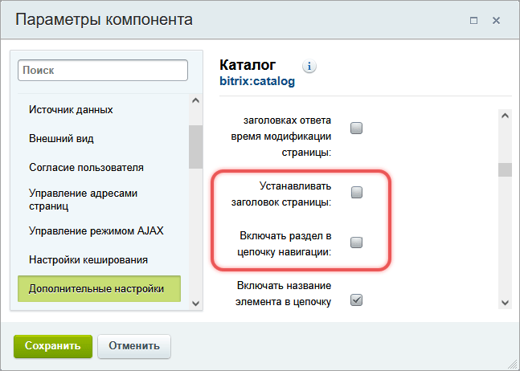
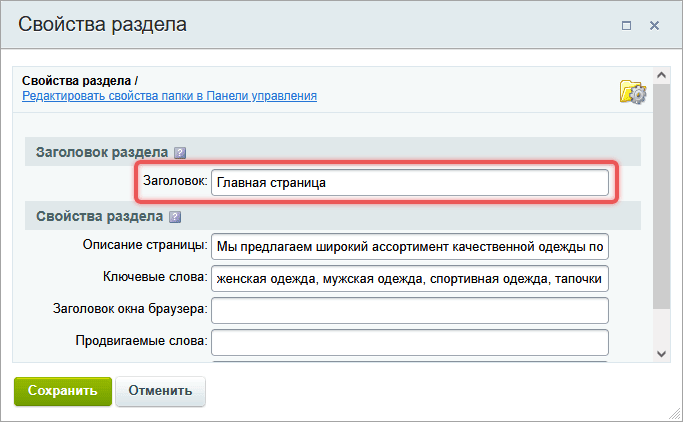
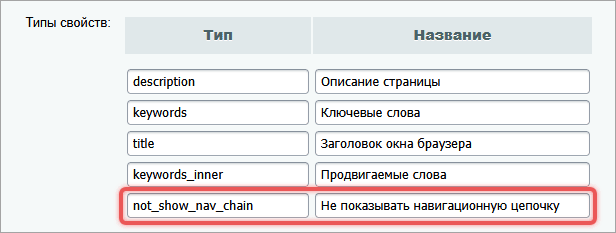
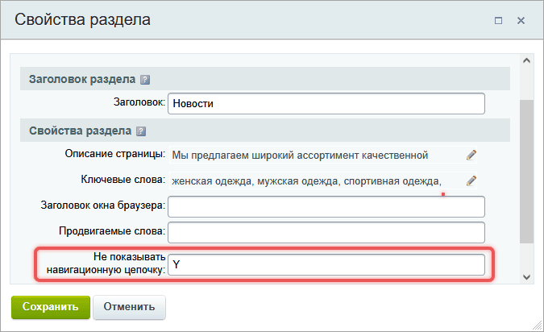

Хлебные крошки или цепочка навигации — это список ссылок, который показывает путь от главной страницы до текущей. Например, `Главная / Статьи / Статья о Bitrix Framework`. Крошки помогают пользователям ориентироваться в структуре сайта и позволяют перемещаться между разделами.

## Как работает цепочка навигации

Система собирает путь по разделам сайта, а компоненты и код страницы могут добавлять к нему свои пункты.

### Откуда берутся пункты

Названия разделов хранятся в переменной `$sSectionName` в файле `.section.php` каждой папки. В интерфейсе ей соответствует поле Заголовок в свойствах раздела. Система читает эти файлы от текущей папки до корня сайта и располагает пункты от корня к текущему разделу. Папки с пустым `$sSectionName` в цепочку не попадают.

Чтобы добавить раздел «Статьи» в цепочку, укажите в `/articles/.section.php`:

```php
<?php
$sSectionName = 'Статьи';
?>
```

Пункт «Главная» для сайта в корне берет название из `/.section.php`. Если на чистой установке этого файла нет, создайте его и задайте название:

```php
<?php
$sSectionName = 'Главная';
?>
```

Если файл уже существует, добавьте или измените только `$sSectionName`, сохранив свойства раздела в `$arDirProperties`.

Заголовок страницы, заданный через `SetTitle()`, сам по себе не попадает в цепочку. Компоненты добавляют названия инфоблоков, разделов и элементов отдельно. Для обычной страницы свой пункт можно добавить методом `AddChainItem()`.

### Компонент Навигационная цепочка

Навигационную цепочку можно добавить на сайт с помощью компонента `bitrix:breadcrumb`. Чтобы крошки были видны на всех страницах, компонент подключают в шаблоне сайта.



О том, как подключить компонент, читайте в статье [Компоненты](./../framework/components#%D0%BA%D0%B0%D0%BA-%D0%BF%D0%BE%D0%B4%D0%BA%D0%BB%D1%8E%D1%87%D0%B8%D1%82%D1%8C-%D0%BA%D0%BE%D0%BC%D0%BF%D0%BE%D0%BD%D0%B5%D0%BD%D1%82).



### Вывод через API

Метод `ShowNavChain()` выводит цепочку отложенно. Его можно вызвать в `header.php` шаблона сайта, даже если код страницы добавит пункты позже. Метод использует файл `chain_template.php` шаблона сайта, а при его отсутствии — общий шаблон `.default`.

Метод `GetNavChain()` сразу формирует и возвращает строку с HTML цепочки. Используйте его, если нужно получить готовую разметку в переменную. Пункты, которые код добавит после вызова, в эту строку не попадут.

Для вывода через шаблон компонента используйте `bitrix:breadcrumb`. Компонент также строит цепочку отложенно.

### Как компоненты влияют на навигационную цепочку

Некоторые компоненты автоматически добавляют свои заголовки в цепочку. Например, компоненты `bitrix:news` и `bitrix:catalog` добавляют названия элементов:

-  `Главная / Новости / Как выбрать CMS` — цепочка на странице просмотра новости «Как выбрать CMS»,

-  `Главная / Каталог / Смартфоны / Смартфон XYZ` — на странице товара с названием «Смартфон XYZ».

Чтобы отключить добавление пунктов, откройте настройки компонента и снимите отметки у нужных параметров.

-  *Включать инфоблок в цепочку навигации* — добавляет название инфоблока.

-  *Включать раздел в цепочку навигации* — добавляет разделы инфоблока.

-  *Включать название элемента в цепочку навигации* — добавляет элемент, если компонент поддерживает этот параметр.

Параметр *Устанавливать заголовок страницы* управляет заголовком страницы отдельно от цепочки.

{width=647px height=462px}

## Как управлять навигационной цепочкой

Цепочку можно настраивать вручную — добавлять, убирать, менять названия.

### Изменить название пункта

Чтобы изменить название пункта, нужно отредактировать заголовок раздела.

1. Откройте свойства раздела одним из двух способов.

   -  В публичной части сайта на административной панели нажмите *Изменить раздел*.

   -  В административной части сайта в меню раздела нажмите *Свойства папки*.

2. В поле Заголовок введите новое название и сохраните его.

{width=683px height=422px}



Чтобы скрыть раздел в цепочке, удалите значение из поля Заголовок.



### Скрыть цепочку на странице или в разделе

1. В административном разделе сайта откройте страницу *Настройки > Настройки продукта > Настройки модулей > Управление структурой*.

2. На вкладке Настройки в секции *Настройки для сайтов* найдите параметр Типы свойств. Добавьте тип свойства.

   -  Тип — `not_show_nav_chain`,

   -  Название — *Не показывать навигационную цепочку*.

   {width=616px height=233px}

3. Откройте свойства раздела или страницы и установите значение `Y`.

   {width=675px height=412px}

### Добавить свой пункт в цепочку

Чтобы вручную добавить пункт в цепочку, в коде страницы после подключения `/bitrix/header.php` вызовите метод `AddChainItem()`:

```php
<?php
$APPLICATION->AddChainItem('Отзывы', '/ru/forum/list.php?FID=3');
?>
```

Метод добавит в конец цепочки пункт с текстом «Отзывы» и адресом `/ru/forum/list.php?FID=3`. Шаблон определяет, будет ли последний пункт ссылкой.

Вызов работает и после подключения `bitrix:breadcrumb` в шапке сайта. Компонент формирует HTML при отложенном выводе и учитывает пункты, которые код страницы добавил позже.

По умолчанию `AddChainItem()` декодирует в заголовке сущности `&amp;`, `&quot;`, `&#039;`, `&lt;` и `&gt;`, а в ссылке экранирует специальные HTML-символы. В собственном шаблоне экранируйте заголовок при вставке в HTML, как это делает стандартный шаблон через `htmlspecialcharsex()`.

## Внешний вид цепочки

Внешний вид определяется шаблоном компонента `bitrix:breadcrumb`. Системные шаблоны расположены в папке `/bitrix/components/bitrix/breadcrumb/templates`.

Вы можете:

-  выбрать готовый шаблон в настройках компонента,

-  создать свой вариант,

-  скопировать и отредактировать существующий шаблон.



Подробно о работе с шаблонами компонента читайте в статье [Компоненты](./../framework/components#%D1%88%D0%B0%D0%B1%D0%BB%D0%BE%D0%BD%D1%8B-%D0%BA%D0%BE%D0%BC%D0%BF%D0%BE%D0%BD%D0%B5%D0%BD%D1%82%D0%B0).



### Требования к своему шаблону

Файл `template.php` компонента `bitrix:breadcrumb` получает пункты в массиве `$arResult`. Соберите HTML в строку и верните ее через `return`. Прямой вывод через `echo` или HTML вне PHP не подходит для отложенного формирования цепочки.

Подключайте CSS до отложенного вывода, например, в `header.php` шаблона сайта. Внутри `template.php` цепочки вызов `SetAdditionalCSS()` не подключит стили вовремя, поскольку шаблон выполняется внутри отложенного `GetNavChain()`. Файл `style.css` рядом с шаблоном компонент подключает самостоятельно.

## Частые проблемы

Чтобы хлебные крошки отображались корректно, нужно следить за дублированием пунктов и проверять настройки компонентов.

### Не отображаются заголовки страниц

В цепочке навигации отображаются только названия инфоблоков. Главная страница и названия разделов сайта отсутствуют.

**Решение**

-  Проверьте `$sSectionName` в `/.section.php`. Если файла нет, создайте его, как показано в разделе [Откуда берутся пункты](#откуда-берутся-пункты).

-  Для остальных разделов проверьте поле Заголовок в свойствах раздела. Из него система берет текст для цепочки. Заголовки самих страниц автоматически в нее не попадают.

Если цепочка не отображается целиком, проверьте свойство *Не показывать навигационную цепочку* на странице и в разделе. Значение `Y` скрывает всю цепочку.

Дополнительно главная страница может не отображаться, если в параметрах компонента `bitrix:breadcrumb` неправильно задан параметр *Номер пункта, начиная с которого будет построена навигационная цепочка*.

-  Значение `0` означает, что цепочка строится от корня сайта.

-  Если заполнено поле *Путь, для которого будет построена навигационная цепочка*, номер пункта считается по этому пути.

### Повторяются пункты в цепочке

В хлебных крошках название торгового каталога отображается дважды: `Главная / Магазин / Видеонаблюдение / Видеонаблюдение`.

-  Первая ссылка — `/catalog/video/`.

-  Вторая ссылка — `/catalog/video/section.php?SECTION_ID=0`.

**Решение**

Первое название взято из свойств раздела `video`. Второе — от компонента, который находится на странице `section.php`.

Дублирование происходит по двум причинам:

-  Компонент добавляет свое значение в цепочку.

-  На странице несколько компонентов, которые добавляют свои пункты.

Чтобы исправить проблему, в настройках компонента отключите опции *Включать инфоблок в цепочку навигации* и *Включать раздел в цепочку навигации*.

### Лишнее название инфоблока в цепочке

Разделы инфоблока опубликованы с помощью комплексного компонента Новости `bitrix:news`. В цепочке навигации отображается название инфоблока без ссылки, но его быть не должно. В настройках раздел и инфоблок не включены в цепочку.

**Решение**

Проверьте передачу параметров в копии шаблона комплексного компонента, например, в `/local/templates/<шаблон_сайта>/components/bitrix/news/<шаблон_компонента>/`. В файлах `news.php` и `section.php` найдите вызов `bitrix:news.list`, а в `detail.php` — вызов `bitrix:news.detail`.

В массиве параметров вложенного компонента передайте `INCLUDE_IBLOCK_INTO_CHAIN` и `ADD_SECTIONS_CHAIN` из `$arParams` комплексного компонента. Первый параметр управляет названием инфоблока, второй — его разделами.

**Пример.** Фрагмент вызова `bitrix:news.list` в `news.php` передает обе настройки:

```php
<?php
$APPLICATION->IncludeComponent(
    'bitrix:news.list',
    '',
    [
        'IBLOCK_TYPE' => $arParams['IBLOCK_TYPE'],
        'IBLOCK_ID' => $arParams['IBLOCK_ID'],
        'INCLUDE_IBLOCK_INTO_CHAIN' => $arParams['INCLUDE_IBLOCK_INTO_CHAIN'],
        'ADD_SECTIONS_CHAIN' => $arParams['ADD_SECTIONS_CHAIN'],
        // Остальные параметры существующего вызова сохраните
    ],
    $component
);
?>
```

Установите для ненужных пунктов значение `N` в настройках комплексного компонента. Если вложенный компонент не получит `ADD_SECTIONS_CHAIN`, он по умолчанию включит разделы в цепочку. Передача этого параметра сама по себе не отключает название инфоблока — для него нужен `INCLUDE_IBLOCK_INTO_CHAIN`.
