Bitrix Framework обрабатывает входящие и исходящие письма отдельно.

1. Входящие — через модуль Почта. Он подключает ящики, забирает письма с сервера и применяет правила обработки.

2. Исходящие — через почтовые события. Они срабатывают на действия пользователя и отправляют письма по заданным шаблонам.

> Быстрый переход:
> - [Модуль Почта: настройки, ящики POP3/IMAP, правила обработки.](./mail.md#module)
> - [Отправка писем: настройка SMTP, sendmail, postfix.](./mail.md#how-to-send-mail)
> - [Почтовые события: типы, шаблоны, макросы, темы оформления.](./mail.md#event-type)
> - [Работа с API: CEventType::Add, CEventMessage::Add, Event::send, Event::sendImmediate, CEvent::Send.](./mail.md#api)

## Модуль Почта {#module}

Модуль Почта получает входящие письма и обрабатывает их по правилам. Он позволяет:

-  хранить письма в одном месте,

-  создавать любое количество почтовых ящиков,

-  применять автоматически или вручную правила к письмам,

-  обучать систему фильтровать спам,

-  получать письма без их удаления на сервере.

### Настройки модуля

Чтобы работать с почтой, настройте параметры модуля.

1. Откройте страницу *Настройки > Настройки продукта > Настройки модулей > Почта*.

2. На вкладке Настройки задайте параметры обработки и хранения писем.

   -  Встраивать локальный идентификатор в заголовок исходящего письма — добавляет уникальный `ID` в заголовок письма. Модуль привязывает ответ на письмо к исходному сообщению.

   -  Сохранять исходный текст письма — сохраняет письмо в базе данных.

   -  Сохранять вложенные файлы — разрешает или запрещает сохранять вложения в папке `/upload/mail/attachment/`.

   -  Таймаут соединения — максимальное время, в течение которого система ждет ответ от почтового сервера.

   -  Проверять сообщения на спам при получении почты — включает автоматическую проверку входящих писем на спам.

   -  Хранить журнал работы (дней) — срок хранения записей в журнале работы модуля.

   -  Срок хранения писем в днях — автоматически удаляет письма старше указанного срока. Значение `0` отключает удаление.

   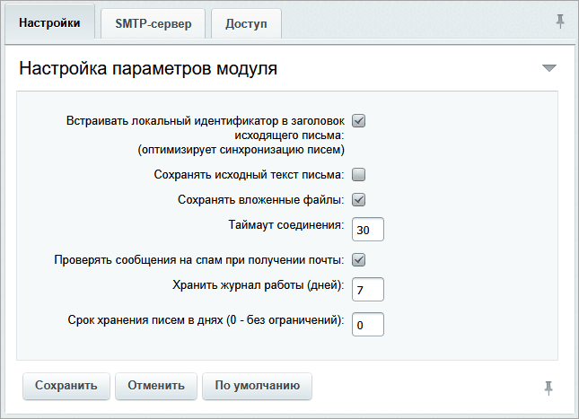{width=645px height=467px}

3. На вкладке SMTP-сервер укажите команду для запуска встроенного почтового сервера.

   -  Командная строка запуска PHP — полная команда, которая запускает PHP-скрипт SMTP-сервера. Поле обязательно, если сайт работает не на BitrixVM.

   -  Состояние — текущее состояние SMTP-сервера.

   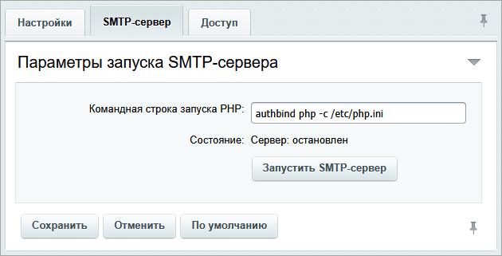{width=630px height=321px}

4. Для SMTP-сервера учтите системные ограничения.

   -  Убедитесь, что порт не занят другими службами.

   -  В Linux только пользователь `root` может использовать порты 1–1024. Чтобы обойти ограничение, используйте `authbind` или настройте переадресацию на файерволе.

   -  Откройте порт в файерволе для внешних подключений.

   -  В настройках почтового ящика домены должны иметь DNS-запись `MX` или `A`, которая ведет на IP-адрес SMTP-сервера. Если SMTP работает на том же IP-адресе, что и сайт, дополнительных настроек не требуется.

5. На вкладке Доступ выберите группы пользователей, которым разрешен доступ к инструментам модуля.

### Почтовые ящики

Существует два типа почтовых ящиков.

-  Системный — предназначен для служебных задач.

-  Пользовательский — создается пользователем на сайте или администратором в административном разделе.

#### Как добавить почтовый ящик



В Bitrix Framework можно создавать любое количество почтовых ящиков.



1. Откройте страницу *Сервисы > Почта > Почтовые ящики*.

2. Нажмите Добавить и выберите тип ящика.

   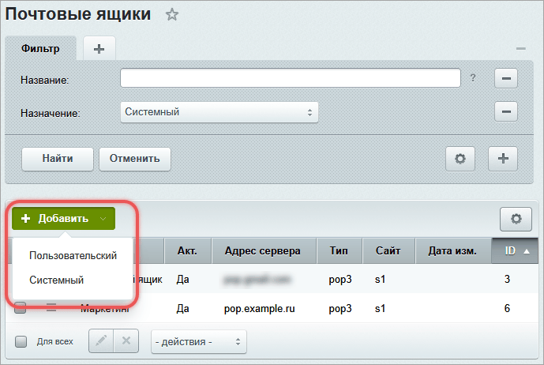{width=689px height=462px}

3. Заполните форму редактирования.

#### Системный ящик

Создайте системный ящик, чтобы принимать обращения в техподдержку, публиковать сообщения на форумах, обрабатывать письма в CRM.

На вкладке Почтовый ящик укажите настройки подключения.

-  Название — введите название, которое поясняет предназначение ящика.

-  Тип — выберите тип сервера:

   -  Внешний POP3-сервер — для подключения к внешнему почтовому серверу,

   -  Внутренний SMTP-сервер — для приема писем напрямую на сервер сайта.

      

      Для внутреннего SMTP-сервера обязательно укажите *Доменные имена, обслуживаемые сервером*. Если не ограничить список доменов, сервер будет принимать письма с любых адресов. Почтовые сервисы и организации занесут IP-адрес сервера в публичные спам-листы.

      

-  Почтовый сервер (POP3) / порт — задайте адрес и порт сервера.

-  Имя входа и пароль — введите учетные данные для доступа к ящику.

-  Проверять с периодом — укажите интервал автоматической проверки новых писем. Для ручной проверки оставьте поле пустым или укажите `0`.

Чтобы добавить правила обработки писем, в секции *Добавить ящик и перейти к созданию правила* укажите тип правила и нажмите Добавить. Подробнее читайте в разделе [Правила обработки](#rules).

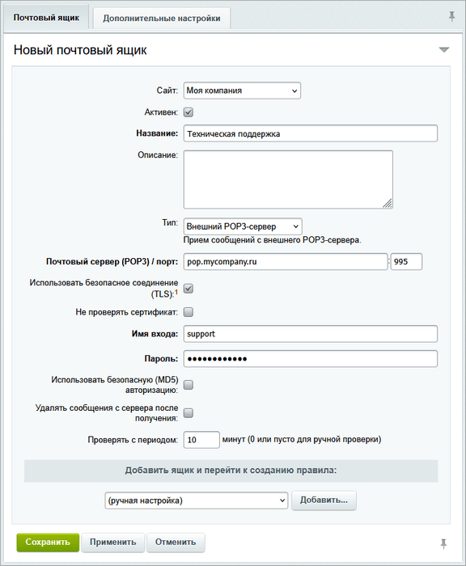{width=576px height=700px}

На вкладке Дополнительные настройки укажите параметры получения сообщений.

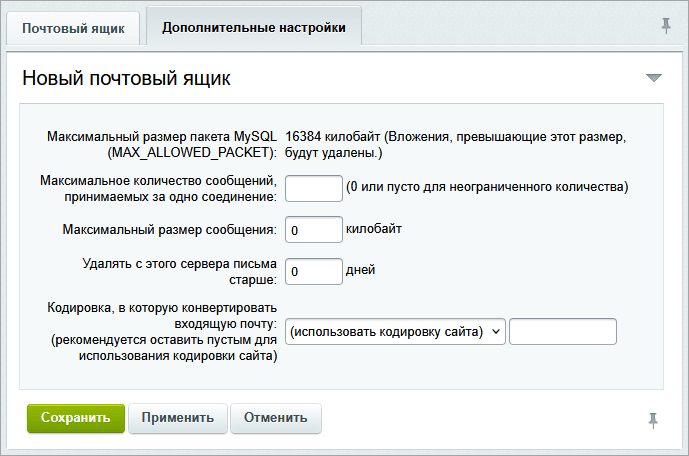{width=689px height=456px}

#### Пользовательский ящик

Чтобы подключить к сайту личный ящик сотрудника, добавьте пользовательский ящик и укажите параметры подключения.

-  Почтовый сервис — выберите один из сервисов, который добавлен в разделе *Сервисы > Почта > Почтовые сервисы*. Подробнее читайте в подразделе [Почтовые сервисы](#mail-services).

-  Название — укажите понятное название ящика.

-  Почтовый сервер (IMAP) / порт — задайте адрес сервера и порт. Для IMAP с SSL используйте порт 993.

-  Имя входа и пароль — введите учетные данные для доступа к ящику.

-  Владелец — выберите пользователя сайта, к которому нужно привязать ящик.

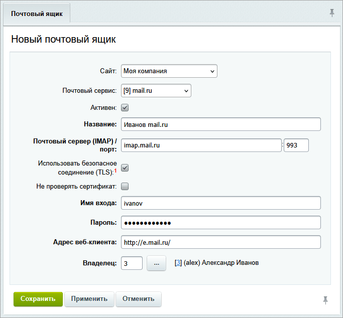{width=683px height=634px}

### Правила обработки {#rules}

Правила обработки помогают отметить письмо как прочитанное, определить спам, удалить ненужные письма. Существует четыре типа правил.

-  Ручная настройка — общие настройки для обработки писем.

-  Добавление сообщений в форумы соцсети — шаблон для писем на форумы.

-  Добавление сообщения в техподдержку — шаблон для обращений в поддержку.

-  Добавление события в CRM — шаблон для привязки письма к объекту CRM.



Правила работают только для системных почтовых ящиков.



#### Как добавить правило

1. Откройте страницу *Сервисы > Почта > Правила*.

2. Нажмите Добавить правило и выберите тип.

   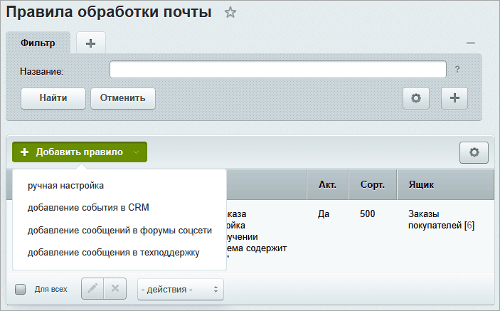{width=703px height=437px}

3. Заполните поля на вкладке Параметры.

   -  Почтовый ящик — укажите ящик, для которого работает правило.

   -  Название — введите название правила.

   -  Применять при событиях — выберите, когда срабатывает правило — автоматически при получении почты или вручную при принудительном вызове.

   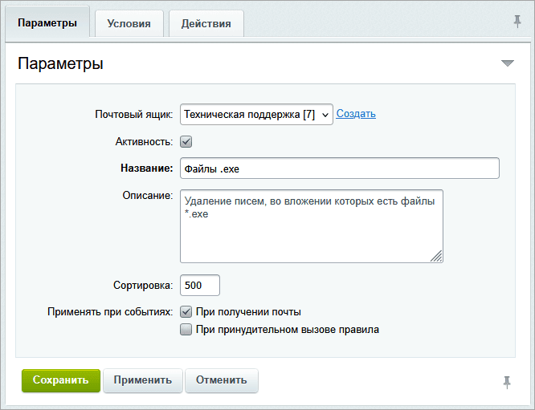{width=666px height=511px}

4. На вкладке Условия укажите, когда сработает правило. Значения задайте в текстовых полях. Если стандартных условий недостаточно, составьте условие на PHP-скрипте.

   **Пример.** Правило сработает, если приоритет письма выше 3 или отправитель использует адрес с доменом `@bitrix`.

   ```php
   if ($arMessageFields['FIELD_PRIORITY'] > 3 || strpos($arMessageFields['FIELD_FROM'], '@bitrix') > 0)
   {
       return true;
   }

   return false;
   ```

   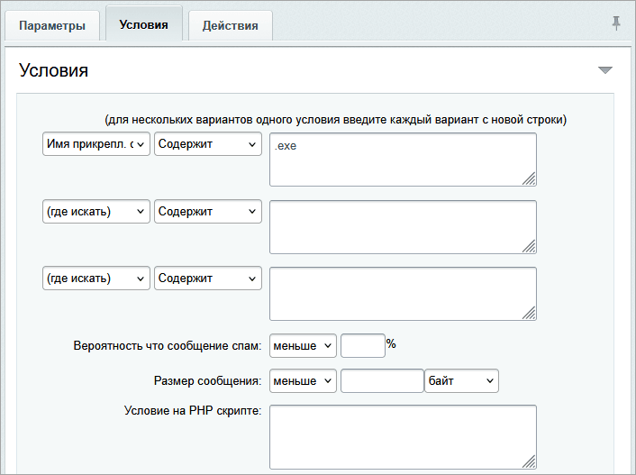{width=706px height=527px}

   Если правило создано по шаблонам для форума, техподдержки или CRM, настройте параметры в дополнительных секциях.

   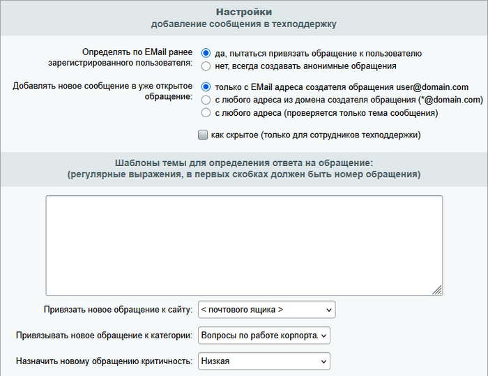{width=700px height=539px}

5. На вкладке Действия выберите, что система сделает с письмами, которые соответствуют условиям правила.

   -  Установить статус прочтенности — отметит письмо как прочитанное.

   -  Установить пометку спам — пометит письмо как спам-рассылку.

   -  Действие на PHP скрипте — запустит скрипт при обработке письма.

   -  Удалить сообщение — удалит письмо.

   -  Не обрабатывать другими правилами — закончит обработку письма и не применит другие правила.

   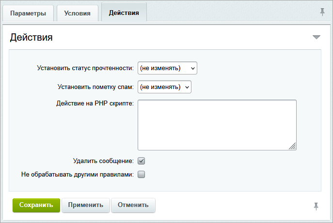{width=687px height=461px}

### Как работать с письмами

Список писем хранится на странице *Сервисы > Почта > Письма*. Иконки рядом с письмами показывают их статус.

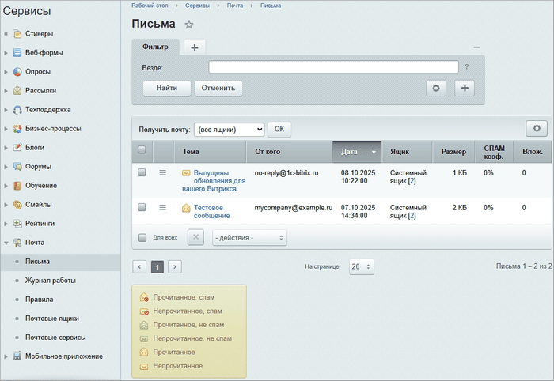{width=700px height=482px}

#### Получить почту вручную

В поле Получить почту выберите ящик и нажмите OK. Система покажет отчет о доставке почты.

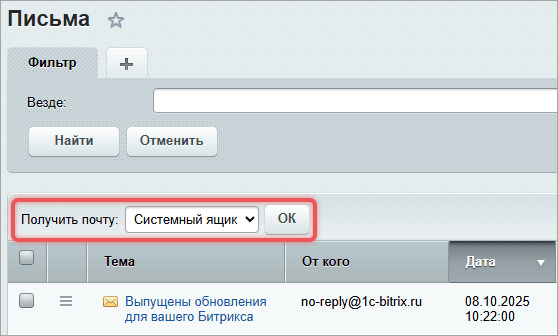{width=558px height=336px}

#### Просмотреть письмо

Чтобы прочитать письмо, перейдите по ссылке с его темой. Форма просмотра позволяет:

-  обучить систему фильтровать спам,

-  применить к письму ручные правила,

-  пометить письмо на удаление.

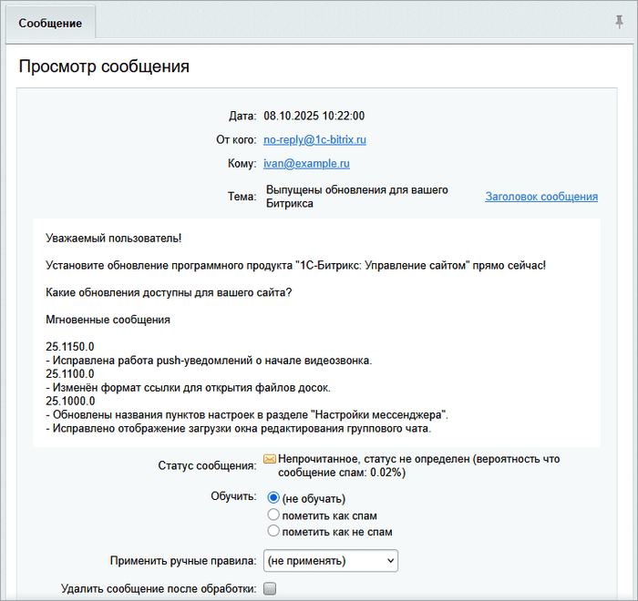{width=700px height=660px}

### Как отслеживать работу модуля

Журнал обработки почты расположен на странице *Сервисы > Почта > Журнал работы*. Он помечает события разными цветами:

-  зеленый — запросы к почтовому серверу,

-  синий — ответы сервера,

-  красный — ошибки,

-  черный — применение правил и действий.

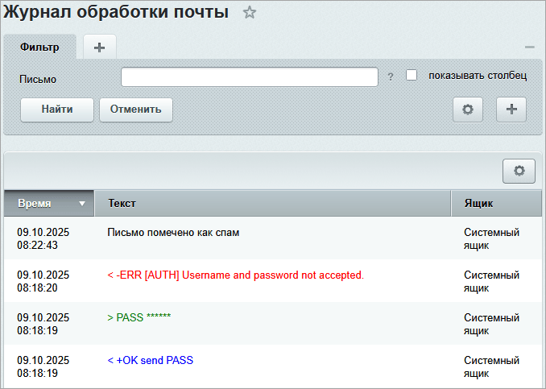{width=678px height=483px}

### Почтовые сервисы {#mail-services}

Почтовые сервисы — это внешние провайдеры, через которых пользователи подключают ящики в системе. Администратор управляет списком на странице *Сервисы > Почта > Почтовые сервисы*.

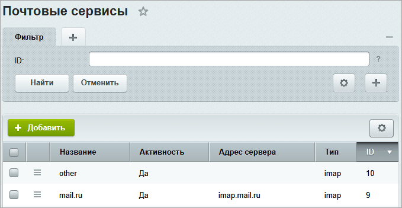{width=679px height=351px}

Пользователи могут подключать ящики только через почтовые сервисы из этого списка.

Чтобы добавить сервис, нажмите Добавить и укажите параметры подключения сервера.

-  Тип — выберите тип почтового сервера, `imap` или `domain`.

-  Почтовый сервер (IMAP) / порт — укажите адрес сервера и порт.

-  Адрес веб-интерфейса — укажите адрес сервиса.

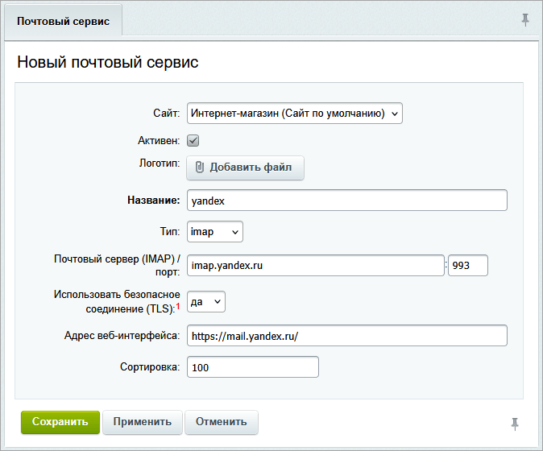{width=674px height=560px}

Если тип сервера — `domain`, заполните поля Доменное имя и Токен. В них нужно внести данные, которые получены от доменного регистратора.

## Как отправлять письма {#how-to-send-mail}

Модуль Почта не отправляет письма. Отправка исходящих сообщений происходит через механизм почтовых событий.

Чтобы отправлять письма, необходимо выполнить три этапа настроек.

1. Настроить окружение PHP для отправки.

2. Создать тип события.

3. Создать почтовый шаблон.

### Настройка окружения

Сообщения можно отправлять через один из трех вариантов.

-  Локальный агент `sendmail` или `postfix` для сайта на Linux.

-  Внешний SMTP-сервер без авторизации для сайта на Windows.

-  Внешний SMTP-сервер с авторизацией, если стандартная отправка недоступна.

Чтобы создавать локальные SMTP-подключения для отдельных отправителей, включите секцию `smtp` в файле `/bitrix/.settings.php`. Порядок настройки описан в разделе [Отправка писем](../framework/settings.md#smtp).

На Windows укажите SMTP-сервер в файле `php.ini`. На сервере, например MS Exchange, разрешите прием сообщений с IP-адреса сайта без авторизации.

#### Настройка на Linux

Если сайт работает на BitrixVM, настройте отправку через меню виртуальной машины, как описано в подразделе [Настройка на BitrixVM](#vmbitrix-setup). На другом сервере Linux настройте локальный почтовый агент, например `postfix`.

1. Установите `postfix` пакетным менеджером дистрибутива.

2. Включите автозапуск `postfix` и запустите службу.

   ```bash prompt="$"
   $ systemctl enable --now postfix
   ```

3. В файле `php.ini` укажите значение `sendmail_path`.

   ```ini
   sendmail_path = /usr/sbin/sendmail -t -i
   ```

4. Перезапустите службу, которая выполняет PHP: Apache или PHP-FPM. После перезапуска PHP читает новое значение `sendmail_path`.

5. Выполните код в PHP-файле на сайте и проверьте ящик получателя.

   ```php
   <?php
   if (mail('user@example.com', 'test subject', 'test body', 'From: sender@example.com'))
   {
       echo 'Сообщение передано функции mail, проверьте почту в ящике.';
   }
   else
   {
       echo 'Функция mail не работает, свяжитесь с администрацией хостинга.';
   }
   ?>
   ```

#### Настройка на BitrixVM {#vmbitrix-setup}

BitrixVM отправляет письма через `msmtp`, который входит в ее состав. Параметры отправки задаются в меню виртуальной машины.

1. Запустите виртуальную машину.

2. Войдите в BitrixVM под пользователем `root`.

3. В главном меню перейдите *8\. Configure pool sites > 4. Change a site's e-mail settings*.

4. Введите имя хоста, для которого нужно настроить отправку почты.

   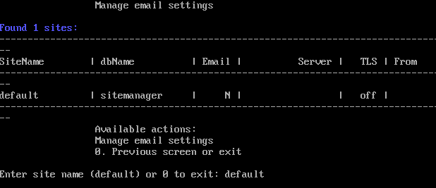{width=618px height=267px}

5. Укажите параметры.

   -  `from address` — адрес отправителя, от которого выполняется пересылка писем.

   -  `server address or DNS` — IP- или DNS-адрес SMTP-сервера. По умолчанию — `127.0.0.1`.

   -  `server port` — порт сервера. Используйте `25` для обычного соединения или `465` для SSL.

   -  `SMTP authentication` — укажите `y`, если требуется авторизация. Для большинства почтовых сервисов авторизация обязательна. Если авторизация не нужна, введите `n`.

      Если ввели `y`, задайте логин, пароль и метод авторизации, например `auto`, `plain` или `login`.

   -  `TLS enabled` — укажите `y`, если сервер поддерживает TLS. В противном случае введите `n`.

   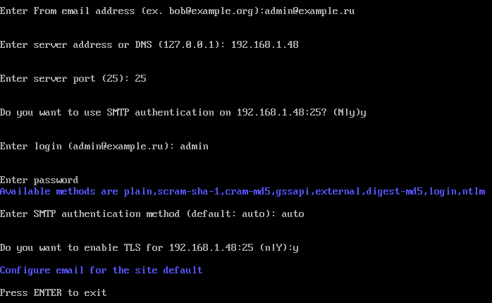{width=698px height=430px}

6. Дождитесь завершения настройки.

Задачи настройки могут выполняться долго — до нескольких часов. Текущие задачи отображаются в меню *5\. Background tasks > 1. View running tasks*. Логи можно посмотреть в каталоге `/opt/webdir/temp`.



Почтовые сервисы, например Яндекс и Mail.ru, не позволяют подменять адрес в поле `From` при отправке письма через их SMTP. Адрес должен совпадать с учетной записью. Указать несколько отправителей нельзя.



#### Решение проблем {#troubleshooting}

На странице *Настройки > Инструменты > Проверка сайта* может отображаться ошибка *Есть ошибки при отправке системных почтовых сообщений.* Возможная причина — включена отправка через cron.

Если в `dbconn.php` определена константа `BX_CRONTAB_SUPPORT` со значением `true`, обычные хиты не обрабатывают очередь почтовых событий. Письма уходят, только когда запускается скрипт с константой `BX_CRONTAB`, например `/bitrix/modules/main/tools/cron_events.php`.

Чтобы письма уходили на обычных хитах, отключите cron в файле `dbconn.php`. Система подключает `/local/php_interface/dbconn.php`, а если его нет — `/bitrix/php_interface/dbconn.php`.

```php
define('BX_CRONTAB_SUPPORT', false);
```

Если отправку нужно оставить в cron, настройте периодический запуск `cron_events.php` по инструкции из раздела [Запустить агента](../framework/background-jobs.md#run-agent).

### Типы событий {#event-type}

Тип определяет, какой шаблон письма использовать при событии в системе. Например, при регистрации пользователя сайт вызывает событие `NEW_USER`. Администратор создает шаблон для этого типа, и новичок получает приветственное письмо.

События нужны, чтобы отправлять уведомления без изменения кода ядра. Например, обнаружен вирус, запрошен код авторизации, изменился статус заказа.

#### Как создать тип события

1. Откройте страницу *Настройки > Настройки продукта > Почтовые и СМС события > Типы событий*.

2. Нажмите Добавить тип.

3. Заполните параметры:

   -  Тип события — укажите латинскими буквами кодовое название события. Можно начать с кода модуля, например, `SALE_MY_STATUS_CHANGE`.

   -  Вид события — выберите Почтовое событие.

4. Отметьте язык системы и укажите:

   -  Название — задайте название типа.

   -  Описание — введите макросы полей `#SOMETHING#`, которые можно использовать в почтовом шаблоне.

   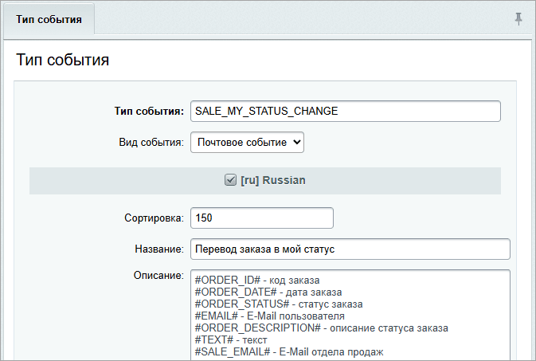{width=673px height=453px}

Тип события настроен. Теперь можно добавить почтовый шаблон.



Тип события не работает самостоятельно. Разработчик добавляет вызов события методом `\Bitrix\Main\Mail\Event::send()` или методом классического API `CEvent::Send()` в нужный участок кода. Подробности читайте в подразделе [Вызвать почтовое событие](#send-event).



### Почтовые шаблоны

Почтовые шаблоны управляют внешним видом исходящих писем. Их настраивают на странице *Настройки > Настройки продукта > Почтовые и СМС события > Почтовые шаблоны*.

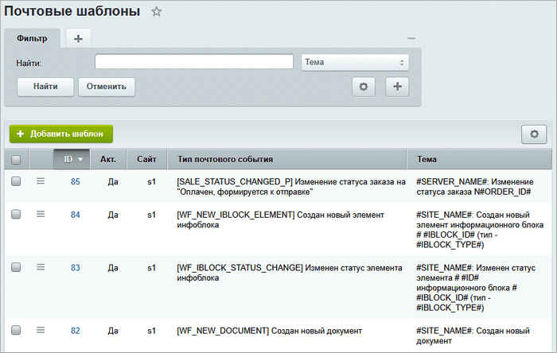{width=700px height=444px}

#### Как настроить шаблон

1. Нажмите Добавить шаблон для нового шаблона или Изменить, чтобы отредактировать существующий шаблон.

   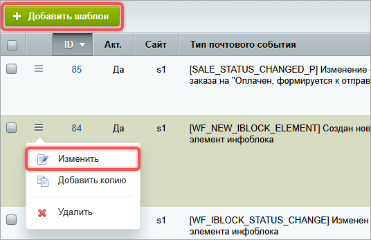{width=536px height=347px}

2. Настройте параметры шаблона.

   -  Тип почтового события — выберите тип события, при котором система отправит письмо. Параметр можно настроить только при создании шаблона.

   -  Активен — отметьте опцию. Только активные шаблоны можно использовать для генерации писем.

   -  Сайт — укажите сайт, к которому привязан шаблон.

   -  Язык — задайте язык события или оставьте значение `(не установлен)`. При создании письма система выбирает почтовые шаблоны, которые соответствуют языку события или не имеют установленного языка. При многосайтовости язык сайта и язык шаблона должны совпадать.

   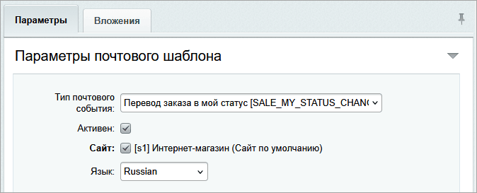{width=674px height=273px}

3. В блоке Поля письма задайте отправителя, получателей и тему письма. Чтобы увидеть все поля, нажмите «показать дополнительные заголовки...». При заполнении можно использовать [макросы](#macros).

   -  От кого — заполните адрес отправителя. Можно указать любой адрес. Для интернет-магазина по умолчанию используется `#SALE_EMAIL#` — email отдела продаж.

   -  Кому — укажите получателей письма. Адреса указываются через запятую.

   

   Если поля От кого и Кому не заполнены, система подставит адрес из настроек сайта. Если в настройках сайта адреса нет — из настроек Главного модуля. Адрес используется в обоих полях.

   

   -  Скрытая копия — укажите адреса, которые не видны другим получателям. Получатели из этого поля не видят друг друга.

   -  Важность — выберите уровень важности — высокая, нормальная или низкая.

   -  Тема — укажите тему письма.

   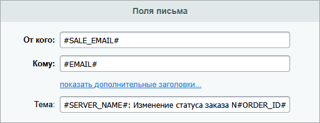{width=524px height=202px}

4. В блоке Сообщение напишите текст письма в формате Текст, HTML или Визуальный редактор.

   В сообщение можно вставлять макросы и PHP-код:

   ```php
   Добрый день!
   Ваш логин: #LOGIN#
   Текущая дата: <?= date('d.m.Y') ?>
   ```

   В параметре Тема оформления можно выбрать вариант оформления письма. Подробнее о темах читайте в подразделе [Темы оформления](#themes).

   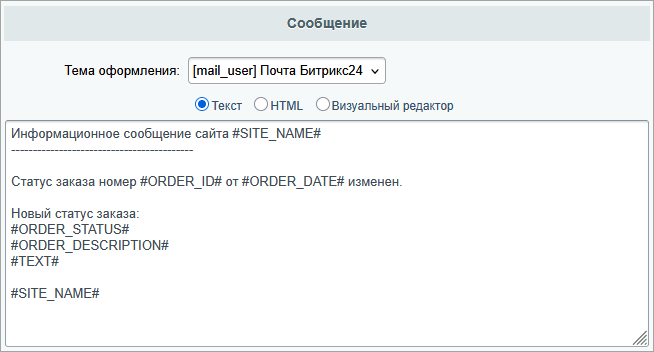{width=654px height=352px}

#### Макросы {#macros}

Внизу формы редактирования шаблона перечислены макросы, которые в нем доступны. Их можно вставлять в любое поле.

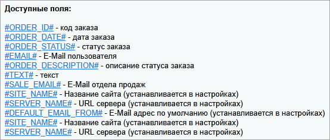{width=554px height=236px}



Если в описании макроса указано «устанавливается в настройках», речь идет о настройках Главного модуля.



В почтовых шаблонах можно использовать системные макросы и макросы из описания типа события.

Системные макросы берут значения из настроек сайта. Если поле в настройках сайта пустое, система берет значение опции Главного модуля:

-  `#DEFAULT_EMAIL_FROM#` — отправитель по умолчанию. Значение берется из адреса email в настройках сайта, а если оно пустое — из опции `email_from`.

-  `#SITE_NAME#` — название сайта. Значение берется из названия сайта, а если оно пустое — из опции `site_name`.

-  `#SERVER_NAME#` — URL сайта. Значение берется из поля URL сервера сайта, а если оно пустое — из опции `server_name`.

Макрос `#DEFAULT_SENDER#` используется в шаблонах СМС, а не в почтовых шаблонах. О шаблонах СМС читайте в статье [Работа с СМС](./sms.md).

Системные макросы подставляются при обработке события. Если разработчик передаст в `C_FIELDS` ключ с тем же именем, значение из `C_FIELDS` заменит системное.

Макросы описания типа соответствуют ключам массива `C_FIELDS`, который разработчик передает при [вызове почтового события](#send-event).

**Пример.** Массив `C_FIELDS`, который передают при вызове события:

```php
[
    'ORDER_ID' => 123,
    'ORDER_PAID' => 'Y',
    'DELIVERY_TYPE' => 'pickup'
]
```

Для такого массива в шаблоне доступны:

-  макросы `#ORDER_ID#`, `#ORDER_PAID#`, `#DELIVERY_TYPE#`,

-  те же значения в переменной `$arParams`.

   ```php
   <?= $arParams['ORDER_ID'] ?>
   <?= $arParams['ORDER_PAID'] ?>
   <?= $arParams['DELIVERY_TYPE'] ?>
   ```

#### Компоненты

В тело письма можно вставлять компоненты. Они позволяют добавить динамические данные, например, список товаров или информацию по заказу.

1. Включите формат сообщения — Визуальный редактор.

2. Перетащите компонент из списка в рабочую область.

   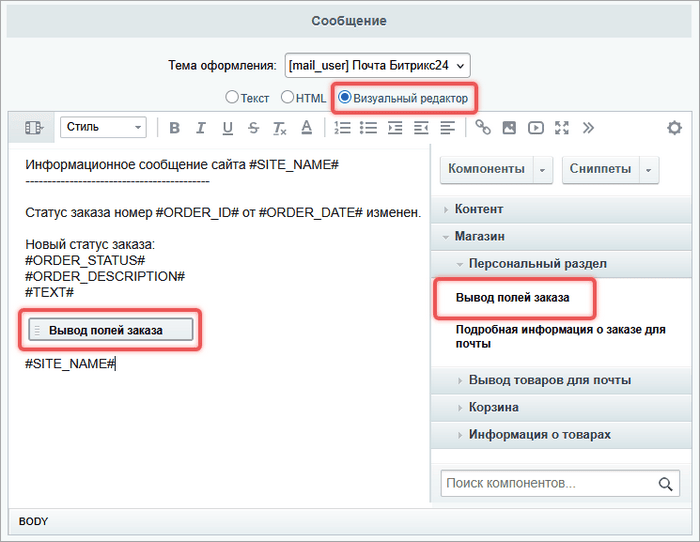{width=700px height=542px}

3. В теле письма нажмите на компонент дважды.

4. Настройте параметры компонента.

   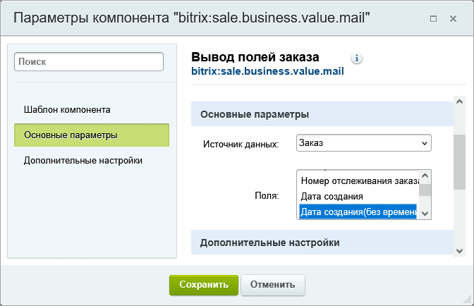{width=672px height=434px}

При размещении компонентов в шаблонах учитывайте технические особенности.

-  Компоненты подключают с помощью метода `EventMessageThemeCompiler::includeComponent()`, а не `CMain::IncludeComponent()`. Аргументы методов одинаковые.

-  В редакторе отображаются компоненты, у которых в файле `.description.php` указан тип `'TYPE' => 'mail'`.

   ```php
   <?php
   use Bitrix\Main\Localization\Loc;

   if (!defined('B_PROLOG_INCLUDED') || B_PROLOG_INCLUDED !== true)
   {
       die();
   }

   $arComponentDescription = [
       'NAME' => Loc::getMessage('SBBS_DEFAULT_TEMPLATE_NAME'),
       'TYPE' => 'mail',
       'DESCRIPTION' => Loc::getMessage('SBBS_DEFAULT_TEMPLATE_DESCRIPTION'),
       'ICON' => '/images/sale_basket.gif',
       'PATH' => [
           'ID' => 'e-store',
           'CHILD' => [
               'ID' => 'sale_basket',
               'NAME' => Loc::getMessage('SBBS_NAME'),
           ],
       ],
   ];
   ?>
   ```

-  Компонент не должен использовать:

   -  глобальный объект `USER`. Он содержит данные о посетителе, а не о получателе письма.

   -  константы `SITE_ID`, `LANGUAGE_ID`, `SITE_TEMPLATE_ID`. Вместо них используйте `$this->getSiteId()`, `$this->getLanguageId()`, `$this->getSiteTemplateId()`.



При генерации письма по шаблону Bitrix Framework выполняет код компонентов и использует:

-  язык интерфейса и языковые файлы из настроек сайта, к которому привязано событие,

-  кодировку письма — из настроек сайта.

В многосайтовой системе с разными языками письмо может прийти на другом языке. Чтобы избежать ошибки, передавайте идентификатор сайта получателя в параметре `LID` метода `Event::send()` или во втором аргументе `CEvent::Send()`.



#### Как протестировать шаблон

1. Откройте форму почтового шаблона.

2. В поле Кому укажите собственный email.

3. Отправьте письмо и проверьте внешний вид.

4. Если все правильно, заполните поля нужными адресами.

### Темы оформления {#themes}

Тема оформления — это шаблон внешнего вида письма. Он определяет расположение элементов письма, художественный стиль и способ отображения текста сообщения. Тема включает в себя программный HTML-код, таблицы стилей и дополнительные файлы.

Чтобы создать тему, откройте страницу *Настройки > Настройки продукта > Почтовые и СМС события > Темы оформления* и нажмите Добавить тему. Заполните поля формы.

-  ID — задайте уникальный идентификатор латинскими буквами. Обязательное поле.

-  Название — введите название темы оформления.

-  Тип — укажите `Шаблон для почтовых писем`.

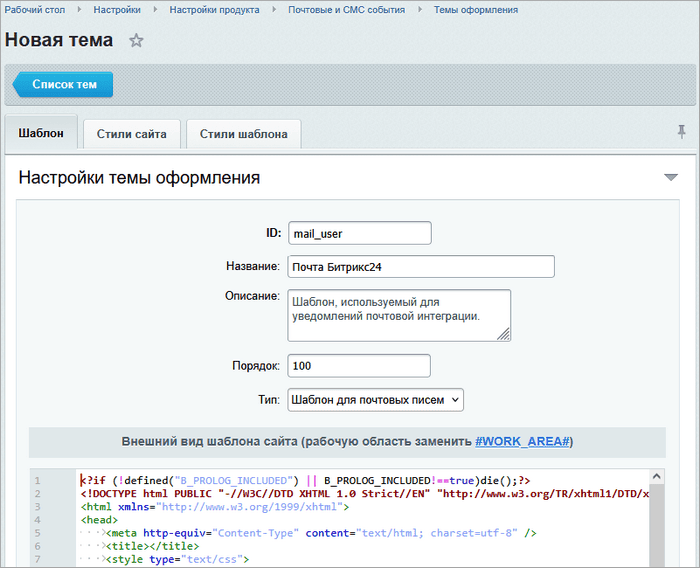{width=700px height=568px}

Дальнейшие шаги повторяют создание шаблона сайта. Технически тема оформления — это шаблон сайта с типом `mail`. В файле `description.php` должно быть:

```php
<?php
$arTemplate = [
    'NAME' => 'Тестовая тема оформления',
    'DESCRIPTION' => 'Тестовая тема оформления',
    'SORT' => '',
    'TYPE' => 'mail', // тип шаблона
];
?>
```

Если берете за основу шаблон штатной темы, скопируйте его из `/bitrix/templates/` в `/local/templates/` и отредактируйте копию.



Подробнее о шаблонах читайте в статье [Шаблоны сайтов](./site-templates.md).



Стили из CSS-файлов подставляются в HTML-код письма в том месте, где вызвано:

```php
<?= $this->showStyles() ?>
```

Тема оформления, как и шаблон сайта, может содержать PHP-код.

**Пример.** Шапка темы, которая выводит название сайта из опций:

```php
<div style="padding: 41px 0 24px;max-width: 732px;margin: 0 auto;">
<?php
    $str24 = '<span style="color: #c2d1d6;">24</span>';

    $companyName = (
        IsModuleInstalled('bitrix24')
            ? \Bitrix\Main\Config\Option::get('bitrix24', 'site_title', '')
            : \Bitrix\Main\Config\Option::get('main', 'site_name', '')
    );

    if (empty($companyName))
    {
        $companyName = $arParams['SITE_NAME'];
    }

    $companyName .= (
        IsModuleInstalled('bitrix24')
            ? (\Bitrix\Main\Config\Option::get('bitrix24', 'logo24show', 'Y') == 'Y' ? $str24 : '')
            : $str24
    );

    ?>
    <h1 style="color: #ffffff;font-family: 'Helvetica Neue', Helvetica, Arial, sans-serif;font-size: 35px;font-weight: bold;margin: 0;padding: 0;"><?= $companyName ?></h1>
</div>
```

## API почтовой системы {#api}

Работу по отправке писем можно выполнять через API, без участия административной части.

### Создать тип события

Чтобы зарегистрировать тип события, используйте статический метод `CEventType::Add()`. Он возвращает `ID` нового типа или `false` при ошибке. Ошибку метод передает в `$APPLICATION->ThrowException()`, получить ее можно через `$APPLICATION->GetException()`. В метод передайте параметры:

-  `EVENT_NAME` — уникальный код типа. Обязательный параметр.

-  `LID` — идентификатор языка интерфейса, например `ru`. Пара `LID` и `EVENT_NAME` должна быть уникальной, иначе метод вернет `false`.

-  `EVENT_TYPE` — вид события. Значение `email` задает почтовое событие, `sms` — СМС. Если параметр не передан, метод подставляет `email`.

-  `NAME` — название типа события.

-  `DESCRIPTION` — список макросов с пояснениями.

**Пример.** Регистрация типа события и вывод ошибки:

```php
<?php
global $APPLICATION;

$eventTypeId = CEventType::Add([
    'EVENT_NAME'  => 'ADV_BANNER_STATUS_CHANGE',
    'NAME'        => 'Изменился статус баннера',
    'LID'         => 'ru',
    'DESCRIPTION' => '
        #ID# - ID баннера
        #CONTRACT_ID# - ID контракта
        #TYPE_SID# - ID типа
        #EMAIL_TO# - email получателя
        #STATUS# - текущий статус
    ',
]);

if (!$eventTypeId)
{
    $exception = $APPLICATION->GetException();
    echo $exception ? $exception->GetString() : 'Тип события не создан';
}
?>
```

### Создать почтовый шаблон

Шаблон привязан к типу события по `EVENT_NAME`. Чтобы его добавить, используйте метод `CEventMessage::Add()`. Он возвращает `ID` шаблона или `false` при ошибке. Текст ошибки сохраняется в свойстве `LAST_ERROR` объекта.

Основные поля:

-  `EVENT_NAME` — код типа. Обязательное поле. Тип события с таким кодом должен существовать, иначе метод вернет `false`.

-  `LID` — сайт шаблона. Обязательное поле. Принимает идентификатор сайта строкой или массив идентификаторов. Каждый сайт должен существовать.

-  `EMAIL_FROM`, `EMAIL_TO`, `BCC` — адреса, могут содержать макросы. Если `EMAIL_FROM` или `EMAIL_TO` передан короче трех символов, метод вернет `false`.

-  `SUBJECT` — тема письма.

-  `BODY_TYPE` — формат тела письма, `'text'` или `'html'`.

-  `MESSAGE` — тело письма с макросами.

-  `ACTIVE` — флаг активности шаблона, `'Y'` или `'N'`. Любое значение, кроме `'Y'`, метод сохраняет как `'N'`.

**Пример.** Шаблон для типа события из предыдущего раздела с привязкой к двум сайтам:

```php
<?php
$em = new CEventMessage();
$messageId = $em->Add([
    'ACTIVE'     => 'Y',
    'EVENT_NAME' => 'ADV_BANNER_STATUS_CHANGE',
    'LID'        => ['s1', 's2'],
    'EMAIL_FROM' => '#DEFAULT_EMAIL_FROM#',
    'EMAIL_TO'   => '#EMAIL_TO#',
    'BCC'        => '#BCC#',
    'SUBJECT'    => 'Тема сообщения',
    'BODY_TYPE'  => 'text',
    'MESSAGE'    => 'Текст сообщения',
]);

if (!$messageId)
{
    echo $em->LAST_ERROR;
}
?>
```

Чтобы добавить в письмо дополнительный заголовок, используйте массив `ADDITIONAL_FIELD`. Каждый элемент массива содержит ключи `NAME` — имя заголовка и `VALUE` — значение. В значении можно использовать макросы.

**Пример.** Шаблон с заголовком `envelope-from`:

```php
<?php
$em = new CEventMessage();
$em->Add([
    'ACTIVE'       => 'Y',
    'EVENT_NAME'   => 'MY_EVENT',
    'LID'          => ['s1'],
    'EMAIL_FROM'   => '#DEFAULT_EMAIL_FROM#',
    'EMAIL_TO'     => '#USER_EMAIL#',
    'SUBJECT'      => 'Привет!',
    'BODY_TYPE'    => 'text',
    'MESSAGE'      => 'Здравствуйте, #USER_NAME#!',
    'ADDITIONAL_FIELD' => [
        [
            'NAME'  => 'envelope-from',
            'VALUE' => '#DEFAULT_EMAIL_FROM#',
        ],
    ],
]);
?>
```

### Вызвать почтовое событие {#send-event}

Метод `\Bitrix\Main\Mail\Event::send()` записывает почтовое событие в очередь. Письмо система формирует и отправляет позже, при обработке очереди. В метод передайте массив параметров события.

-  `EVENT_NAME` — код типа события, строка. Обязательный параметр.

-  `LID` — идентификатор сайта. Обязательный параметр. Принимает строку `'s1'`, строку со списком сайтов через запятую `'s1,s2'` или массив `['s1', 's2']`. Массив метод преобразует в строку через запятую. Шаблоны система ищет по всем сайтам списка, а кодировку письма и имя сервера берет из настроек первого сайта.

-  `C_FIELDS` — массив данных для подстановки в макросы. Ключ массива — имя макроса без символов `#`. Если параметр не передан, метод подставляет пустой массив.

-  `MESSAGE_ID` — идентификатор почтового шаблона, целое число. Если шаблон с таким `ID` существует, система отправляет письмо только по нему и только если шаблон активен. Если шаблона нет, система выбирает активные шаблоны по `EVENT_NAME` и сайтам из `LID`.

-  `LANGUAGE_ID` — код языка, например `ru`. Система выбирает шаблоны с этим языком и шаблоны без языка. Если параметр не передан, язык шаблона при выборе не учитывается.

-  `DUPLICATE` — `'Y'` добавляет в скрытую копию адреса из опции Главного модуля `all_bcc`. Если параметр не передан, `Event::send()` сохраняет событие со значением `'Y'`, и копия добавляется. `Event::sendImmediate()` без параметра копию не добавляет.

-  `FILE` — массив вложений. Поле принимает:

   -  массив идентификаторов файлов, которые сохранены через `CFile::SaveFile()`,

   -  массив абсолютных путей до файлов.

Метод возвращает объект `\Bitrix\Main\ORM\Data\AddResult`.

-  Если событие записано в очередь, `isSuccess()` возвращает `true`, а `getId()` — идентификатор события. Успешный результат не подтверждает отправку письма.

-  Если обработчик события `OnBeforeEventAdd` модуля `main` вернул `false`, метод не создает событие и возвращает результат с ошибкой `OnBeforeEventAdd`.

-  Если не передан `EVENT_NAME` или `LID`, событие не создается, а результат содержит ошибку проверки обязательного поля.

Подробнее об объекте результата читайте в статье [Результаты и ошибки](../framework/results-and-errors.md).

**Пример.** Событие `NEW_USER` для сайта `s1` с проверкой результата:

```php
<?php
use Bitrix\Main\Mail\Event;

$result = Event::send([
    'EVENT_NAME' => 'NEW_USER',
    'LID'        => 's1',
    'C_FIELDS'   => [
        'USER_EMAIL' => 'user@example.com', // макрос #USER_EMAIL# → ключ 'USER_EMAIL'
        'USER_ID'    => 42,
    ],
]);

if ($result->isSuccess())
{
    $eventId = $result->getId();
}
else
{
    foreach ($result->getErrorMessages() as $message)
    {
        echo $message;
    }
}
?>
```

В классическом API то же действие выполняет метод `CEvent::Send()`. Он принимает параметры отдельными аргументами и вызывает `Event::send()`:

```php
CEvent::Send($event, $lid, $arFields, $Duplicate = 'Y', $message_id = '', $files = [], $languageId = '')
```

Метод `CEvent::Send()` отличается от `Event::send()` двумя деталями:

-  возвращает идентификатор события или `false` вместо объекта результата,

-  если язык не передан, подставляет язык текущего запроса из константы `LANGUAGE_ID`.

**Пример.** То же событие через классический API:

```php
<?php
$eventId = CEvent::Send('NEW_USER', 's1', [
    'USER_EMAIL' => 'user@example.com',
    'USER_ID'    => 42,
]);
?>
```

#### Как система обрабатывает очередь

После выполнения страницы система запускает фоновую задачу `\Bitrix\Main\Mail\EventManager::checkEvents()`. Метод классического API `CEvent::CheckEvents()` вызывает тот же обработчик. За один запуск обработчик берет не больше пяти необработанных событий. Число задает опция Главного модуля `mail_event_bulk`.

Обработчик:

-  выбирает необработанные события в порядке их создания,

-  генерирует письма по активным шаблонам,

-  отправляет письма,

-  записывает результат в поле события `SUCCESS_EXEC`:

   -  `Y` — все письма отправлены успешно,

   -  `F` — ни одно письмо не отправлено,

   -  `P` — отправлены только некоторые письма,

   -  `0` — шаблоны не найдены,

   -  `N` — событие еще не обрабатывалось,

   -  `E` — при обработке возникло исключение. Система записывает его в журнал ошибок и прекращает обработку очереди до следующего запуска.

Обычный хит не обрабатывает очередь в трех случаях:

-  опция Главного модуля `check_events` равна `N`,

-  определена константа `DisableEventsCheck` со значением `true`,

-  определена константа `BX_CRONTAB_SUPPORT` со значением `true`, а константа `BX_CRONTAB` в запросе не определена. В этом режиме очередь обрабатывает cron-скрипт, как описано в подразделе [Решение проблем](#troubleshooting).

#### Отправить письмо без очереди {#send-immediate}

Метод `\Bitrix\Main\Mail\Event::sendImmediate()` формирует и отправляет письма в текущем запросе. Событие в очередь не записывается. Метод принимает тот же массив параметров, что и `Event::send()`.

Метод возвращает строку со статусом отправки. Значения совпадают с полем `SUCCESS_EXEC` и константами класса `Event`:

-  `Y` — `Event::SEND_RESULT_SUCCESS`, все письма отправлены,

-  `P` — `Event::SEND_RESULT_PARTLY`, отправлена часть писем,

-  `F` — `Event::SEND_RESULT_ERROR`, ни одно письмо не отправлено,

-  `0` — `Event::SEND_RESULT_TEMPLATE_NOT_FOUND`, активные шаблоны не найдены или сайт из `LID` не найден,

-  `N` — `Event::SEND_RESULT_NONE`, обработчик `OnBeforeEventAdd` отменил отправку.

Из массива `FILE` метод `sendImmediate()` прикладывает только идентификаторы файлов. Пути к файлам он не обрабатывает.

Метод классического API `CEvent::SendImmediate()` принимает аргументы в том же порядке, что и `CEvent::Send()`. Вместо статуса `N` он возвращает `false`.

**Пример.** Немедленная отправка с проверкой статуса:

```php
<?php
use Bitrix\Main\Mail\Event;

$status = Event::sendImmediate([
    'EVENT_NAME' => 'NEW_USER',
    'LID'        => 's1',
    'C_FIELDS'   => [
        'USER_EMAIL' => 'user@example.com',
        'USER_ID'    => 42,
    ],
]);

if ($status !== Event::SEND_RESULT_SUCCESS)
{
    echo 'Статус отправки: ' . $status;
}
?>
```

#### Отправить файл во вложении

**Пример.** Событие с файлом, который пользователь загрузил через форму:

```php
<?php
use Bitrix\Main\Context;
use Bitrix\Main\Mail\Event;

global $USER;

$request = Context::getCurrent()->getRequest();
$file = $request->getFile('file');

$fileId = false;
if (is_array($file) && $file['error'] === UPLOAD_ERR_OK)
{
    $fileId = \CFile::SaveFile($file, 'mailatt');
}

Event::send([
    'EVENT_NAME' => 'VM_SERVICE_REQUEST',
    'LID'        => 's2',
    'C_FIELDS'   => [
        'EMAIL'      => 'support@example.com',
        'MESSAGE'    => $request->getPost('MESSAGE'),
        'USER_NAME'  => $USER->GetFullName(),
        'USER_EMAIL' => $USER->GetEmail(),
    ],
    'FILE' => $fileId ? [$fileId] : [],
]);
?>
```



Метод `Event::send()` не копирует файл, переданный по идентификатору: событие ссылается на исходный файл. Письмо уходит при обработке очереди, поэтому не удаляйте файл сразу после вызова `Event::send()` — иначе письмо может уйти без вложения.



Файл, переданный по абсолютному пути, метод копирует. Копию удаляет агент очистки после удаления события. События хранятся столько дней, сколько задано в настройке Главного модуля `mail_event_period`, по умолчанию 14.

### Настроить поведение почтовой системы

На отправку писем влияют опции Главного модуля. Ниже указан код опции для `Option::get('main', ...)` и `Option::set('main', ...)`, назначение и значение по умолчанию.

-  `CONVERT_UNIX_NEWLINE_2_WINDOWS` — `'Y'` заменяет переводы строк формата Unix на формат Windows при отправке письма. По умолчанию `'N'`.

-  `convert_mail_header` — `'Y'` кодирует 8-битные символы в заголовках письма. По умолчанию `'Y'`.

-  `all_bcc` — адрес или список адресов через запятую. Система добавляет их в скрытую копию писем, если событие передано с `DUPLICATE` равным `'Y'` и значение опции содержит символ `@`. По умолчанию пустая строка.

-  `fill_to_mail` — `'Y'` добавляет в письмо заголовок `To` с адресом получателя. По умолчанию `'N'`.

-  `send_mid` — `'Y'` добавляет в конец тела письма строку `MID #` с идентификаторами почтового события и шаблона. По умолчанию `'N'`.

-  `mail_event_bulk` — сколько событий очереди система обрабатывает за один запуск. По умолчанию `5`.

-  `mail_event_period` — сколько дней система хранит обработанные события. По умолчанию `14`.

-  `check_events` — `'N'` отключает обработку очереди на обычных хитах. По умолчанию `'Y'`.

**Пример.** Копия всех писем, отправленных с `DUPLICATE` равным `'Y'`, на служебный адрес:

```php
<?php
use Bitrix\Main\Config\Option;

Option::set('main', 'all_bcc', 'archive@example.com');
?>
```

Чтобы при отладке не отправлять письма реальным получателям, задайте константу `ONLY_EMAIL`, например в `init.php`. Система отправляет только письма, у которых адрес получателя совпадает со значением константы. Остальные письма система не отправляет, но считает отправленными, и событие получает статус `Y`.

**Пример.** Ограничение отправки одним адресом:

```php
define('ONLY_EMAIL', 'dev@example.com');
```
