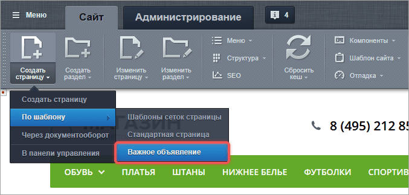
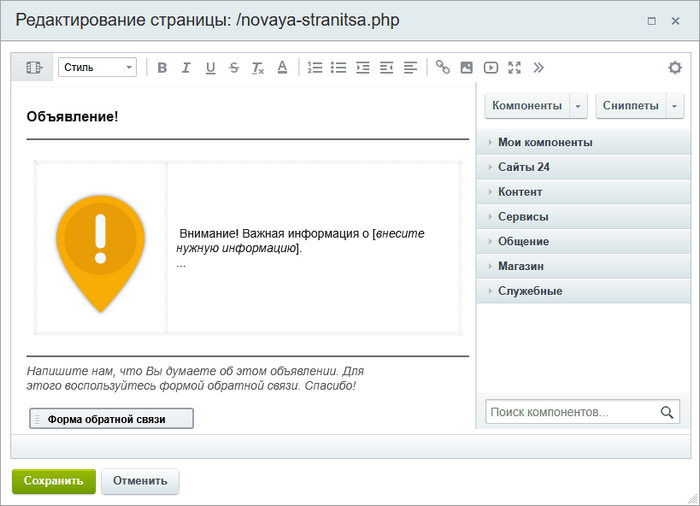
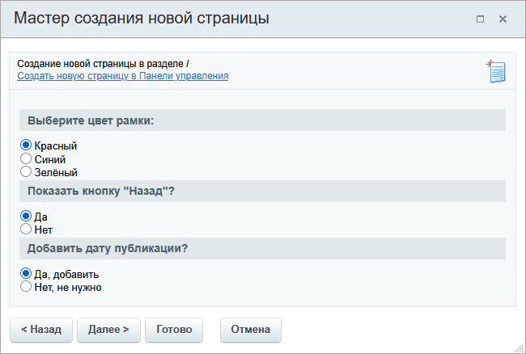
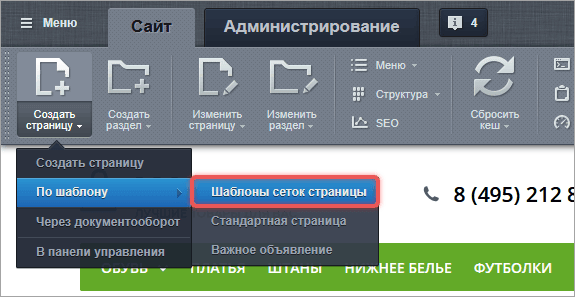
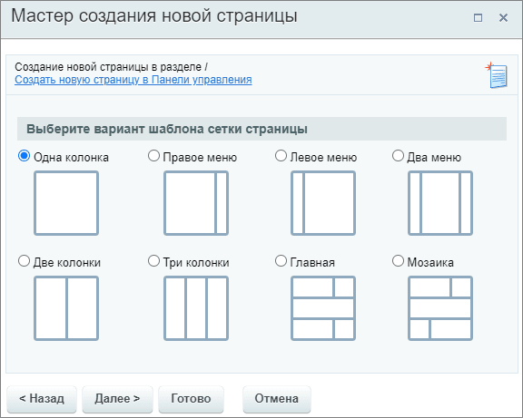
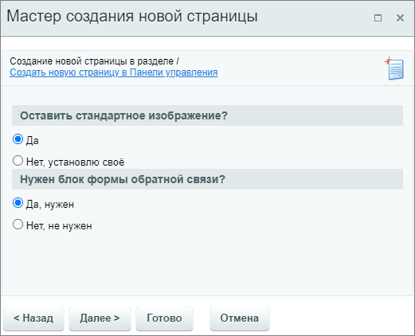

В Bitrix Framework страница — это PHP-файл, который состоит из трех частей.

1. Header или шапка сайта — общие элементы сайта.

2. Основная рабочая область — уникальный контент страницы, который может быть:

   -  статическим — обычный HTML-контент: текст, изображения, таблицы,

   -  динамическим — контент создан с помощью компонентов.

3. Footer или подвал — завершающие элементы сайта.

Страницы формируются динамически на основе шаблона сайта, компонентов и статических элементов.

## Свойства страниц

На отображение и поведение страницы влияют ее свойства: заголовок, ключевые слова, описание. Свойства можно задать:

-  на странице в рабочей области или между служебной и визуальной частью шапки сайта,

-  в файле `.section.php` раздела — это общие настройки для всех страниц внутри раздела.

## Шаблоны страниц

Шаблон страницы — это PHP-файл, который содержит структуру страницы и соответствует правилам оформления.

Собственные шаблоны страниц размещайте в папках пользовательских шаблонов сайта:

-  `/local/templates/.default/page_templates` — для всех шаблонов сайта,

-  `/local/templates/[идентификатор_шаблона]/page_templates` — для конкретного шаблона сайта.

Штатные примеры шаблонов страниц находятся в `/bitrix/templates/.default/page_templates` и `/bitrix/templates/[идентификатор_шаблона]/page_templates`. Их можно скопировать в `/local/templates/` и использовать как основу для своего шаблона.

Каждая папка может содержать:

-  файлы шаблонов страниц,

-  служебный файл `.content.php` — он хранит названия шаблонов и порядок их вывода.

## Разработка шаблонов страниц

Существует два типа шаблонов страниц.

-  Пассивный шаблон — это PHP-файл с готовым содержимым новой страницы. Он может содержать HTML-разметку, PHP-код и вызовы компонентов. При создании страницы контент-менеджер редактирует заготовленное содержимое в визуальном редакторе.

-  Активный шаблон — это шаблон с дополнительным шагом мастера создания страницы. Он запрашивает параметры у контент-менеджера и формирует содержимое страницы с учетом выбранных значений.

### Пассивный шаблон

Пассивный шаблон — это шаблон с заготовленным контентом для новой страницы.

#### Как создать пассивный шаблон

**Первый способ**. Скопировать штатный шаблон

`/bitrix/templates/.default/page_templates/standard.php` в `/local/templates/.default/page_templates/` и отредактировать копию.

**Второй способ**. Создать шаблон с нуля.

1. Продумайте структуру страницы. Это может быть HTML, текст, изображения, таблицы, компоненты и PHP-код.

2. В папке `/local/templates/[идентификатор_шаблона]/page_templates` создайте файл, например `new.php`.

3. В файле разместите код шаблона.

4. Убедитесь, что в начале и конце файла есть вызовы `header.php` и `footer.php`. Они обязательны.

```php
<?php
require($_SERVER["DOCUMENT_ROOT"]."/bitrix/header.php");
$APPLICATION->SetTitle("Title");
?>

<p>Добавьте контент на страницу</p>

<?php require($_SERVER["DOCUMENT_ROOT"]."/bitrix/footer.php");?>
```

#### Как подключить пассивный шаблон

Чтобы шаблон появился в меню создания страницы, в файл `/local/templates/[идентификатор_шаблона]/page_templates/.content.php` добавьте строку:

```php
$TEMPLATE['new.php'] = ['name' => 'Новый шаблон', 'sort' => 4];
```

-  `'new.php'` — имя файла шаблона,

-  `'Новый шаблон'` — название, которое увидит контент-менеджер,

-  `'sort' => 4` — порядок отображения.

Пример содержимого файла:

```php
<?php
if (!defined('B_PROLOG_INCLUDED') || B_PROLOG_INCLUDED !== true)
{
    die();
}

$TEMPLATE['standard.php'] = ['name' => 'Стандартная страница', 'sort' => 1];
$TEMPLATE['new.php'] = ['name' => 'Новый шаблон', 'sort' => 4];
```

#### Языковые файлы

Используйте языковые файлы для шаблонов, если сайт использует несколько языков. В файле `.content.php` загрузите сообщения методом `Loc::loadMessages(__FILE__)`. Метод `Loc::getMessage('new')` вернет название шаблона по ключу `new`:

```php
<?php
use Bitrix\Main\Localization\Loc;

if (!defined('B_PROLOG_INCLUDED') || B_PROLOG_INCLUDED !== true)
{
    die();
}

Loc::loadMessages(__FILE__);

$TEMPLATE['standard.php'] = ['name' => Loc::getMessage('standard'), 'sort' => 1];
$TEMPLATE['new.php'] = ['name' => Loc::getMessage('new'), 'sort' => 4];
```

Языковые файлы пользовательского шаблона храните в папке `lang` того шаблона сайта, где расположен файл страницы:

-  для общего шаблона — `/local/templates/.default/lang/`,

-  для шаблона конкретного сайта — `/local/templates/[идентификатор_шаблона]/lang/`.

Например, названия шаблонов на русском языке добавьте в файл `/local/templates/[идентификатор_шаблона]/lang/ru/page_templates/.content.php`:

```php
<?php
$MESS['standard'] = 'Стандартная страница';
$MESS['new'] = 'Новый шаблон';
```

Для английского языка создайте файл `/local/templates/[идентификатор_шаблона]/lang/en/page_templates/.content.php` и задайте те же ключи с переводами. Например, `$MESS['new'] = 'New template';`.

Если берете за основу штатный шаблон, пример языковых файлов можно посмотреть в `/bitrix/templates/.default/lang/ru/page_templates/.content.php` или в папке нужного штатного шаблона.

#### Пример создания пассивного шаблона

Создайте общий шаблон страницы объявления, который доступен для всех шаблонов сайта. Скачайте [изображение для объявления](./_images/announcement.svg) и разместите его на сайте в файле `/upload/page-templates/announcement.svg`. Этот файл используется в пассивном и активном примерах ниже.

1. В папке `/local/templates/.default/page_templates` создайте файл `announcement.php`.

2. Добавьте код шаблона и проверьте наличие подключенных `header.php` и `footer.php`.

   ```php
   <?php
   require($_SERVER['DOCUMENT_ROOT'] . '/bitrix/header.php');
   $APPLICATION->SetTitle('Объявление');
   ?>
   <h3>Объявление!</h3>
   <hr>
   <br>
   <table cellpadding="10" cellspacing="1" align="center" style="width: 500px;">
   <tbody>
   <tr>
       <td>
             
       </td>
       <td>
            Внимание! Важная информация о [<i>внесите нужную информацию</i>].<br>
            ...
       </td>
   </tr>
   </tbody>
   </table>
    <br>
   <hr>
    <span style="color: #555555;"><i>Напишите нам, что вы думаете об этом объявлении. Для этого воспользуйтесь формой обратной связи. Спасибо!</i></span><br>
    <br>
   <?php $APPLICATION->IncludeComponent(
       'bitrix:main.feedback',
       '',
       [
           'EMAIL_TO' => 'sale@example.com',
           'EVENT_MESSAGE_ID' => ['7'],
           'OK_TEXT' => 'Спасибо за ваше мнение!',
           'REQUIRED_FIELDS' => ['NAME', 'EMAIL'],
           'USE_CAPTCHA' => 'Y',
       ]
   );?>
   <?php require($_SERVER['DOCUMENT_ROOT'] . '/bitrix/footer.php'); ?>
   ```

3. В файле `.content.php` загрузите языковые сообщения и добавьте запись для шаблона `announcement.php`:

   ```php
   <?php
   use Bitrix\Main\Localization\Loc;

   if (!defined('B_PROLOG_INCLUDED') || B_PROLOG_INCLUDED !== true)
   {
       die();
   }

   Loc::loadMessages(__FILE__);

   $TEMPLATE['announcement.php'] = ['name' => Loc::getMessage('announcement'), 'sort' => 2];
   ```

4. Настройте языковые файлы:

   -  для русского языка в файле `/local/templates/.default/lang/ru/page_templates/.content.php`,

   ```php
   $MESS['announcement'] = 'Важное объявление';
   ```

   -  для английского языка в файле `/local/templates/.default/lang/en/page_templates/.content.php`.

   ```php
   $MESS['announcement'] = 'Important announcement';
   ```

В результате шаблон будет доступен при создании страницы.

{width=677px height=323px}

При создании новой страницы по этому шаблону контент-менеджер увидит визуальный редактор с заполненными элементами.

{width=700px height=506px}

### Активный шаблон

Активный шаблон — это шаблон, который при создании страницы запрашивает дополнительные данные у контент-менеджера. Эти данные можно использовать для настройки структуры или содержимого страницы.

{width=650px height=438px}

#### Примеры шаблонов

Свой активный шаблон можно создать на основе штатных примеров.

-  Пример `forum` находится в `/bitrix/templates/.default/page_templates/forum`. Он есть и в чистой установке 1С-Битрикс: Управление сайтом.

-  Пример `bootstrap` входит в шаблон сайта `eshop_bootstrap_v4`, который устанавливает мастер интернет-магазина. После установки этого шаблона пример находится в `/bitrix/templates/eshop_bootstrap_v4/page_templates/bootstrap`. В чистой установке до запуска мастера этой папки может не быть.



```php
<?php
use Bitrix\Main\Localization\Loc;

if(!defined("B_PROLOG_INCLUDED") || B_PROLOG_INCLUDED !== true) die();

CPageTemplate::IncludeLangFile(__FILE__);

class CBootstrapPageTemplate
{
    function GetDescription()
    {
        return [
            "name" => Loc::getMessage("bt_wizard_name"),
            "description" => Loc::getMessage("bt_wizard_title"),
            "modules" => ["bitrix.eshop"],
        ];
    }

    function GetFormHtml()
    {
        $s = '
<tr class="section">
    <td colspan="4">'.Loc::getMessage("BT_TYPE").'</td>
</tr>
';
        $s .= '
<tr>
    <td style="vertical-align: top; padding-top:10px">
        <input type="radio" name="BT_COL" value="1" id="BT_COL_1" checked>
        <label for="BT_COL_1">'.Loc::getMessage("BT_COL_1").'</label><br>
        <br>
    </td>
    <td style="padding-top:10px">
        <input type="radio" name="BT_COL" value="2_1" id="BT_COL_2_1">
        <label for="BT_COL_2_1">'.Loc::getMessage("BT_COL_2_1").'</label><br>
        <br>
    </td>
    <td style="padding-top:10px">
        <input type="radio" name="BT_COL" value="1_2" id="BT_COL_1_2">
        <label for="BT_COL_1_2">'.Loc::getMessage("BT_COL_1_2").'</label><br>
        <br>
    </td>
    <td style="padding-top:10px">
        <input type="radio" name="BT_COL" value="1_2_1" id="BT_COL_1_2_1">
        <label for="BT_COL_1_2_1">'.Loc::getMessage("BT_COL_1_2_1").'</label><br>
        <br>
    </td>
</tr>
<tr>
    <td style="padding-top:20px">
        <input type="radio" name="BT_COL" value="1_1" id="BT_COL_1_1">
        <label for="BT_COL_1_1">'.Loc::getMessage("BT_COL_1_1").'</label><br>
        <br>
    </td>
    <td style="padding-top:20px">
        <input type="radio" name="BT_COL" value="1_1_1" id="BT_COL_1_1_1">
        <label for="BT_COL_1_1_1">'.Loc::getMessage("BT_COL_1_1_1").'</label><br>
        <br>
    </td>
    <td style="padding-top:20px">
        <input type="radio" name="BT_COL" value="5" id="BT_COL_5">
        <label for="BT_COL_5">'.Loc::getMessage("BT_COL_5").'</label><br>
        <br>
    </td>
    <td style="padding-top:20px">
        <input type="radio" name="BT_COL" value="4" id="BT_COL_4">
        <label for="BT_COL_4">'.Loc::getMessage("BT_COL_4").'</label><br>
        
    </td>
</tr>
';
        return $s;
    }

    function GetContent($arParams)
    {
        $gridHtml = '
<div class="row">';

        if (isset($_POST['BT_COL']))
        {
            switch ($_POST['BT_COL'])
            {
                case '1':
                {
                    $gridHtml.= '
    <div class="col-xs-12"></div>';
                    break;
                }
                case '2_1':
                {
                    $gridHtml.= '
    <div class="col-sm-8"></div>
    <div class="col-sm-4"></div>';
                    break;
                }
                case '1_2':
                {
                    $gridHtml.= '
    <div class="col-sm-4"></div>
    <div class="col-sm-8"></div>';
                    break;
                }
                case '1_2_1':
                {
                    $gridHtml.= '
    <div class="col-sm-3"></div>
    <div class="col-sm-6"></div>
    <div class="col-sm-3"></div>';
                    break;
                }
                case '1_1':
                {
                    $gridHtml.= '
    <div class="col-sm-6"></div>
    <div class="col-sm-6"></div>';
                    break;
                }
                case '1_1_1':
                {
                    $gridHtml.= '
    <div class="col-sm-4"></div>
    <div class="col-sm-4"></div>
    <div class="col-sm-4"></div>';
                    break;
                }
                case '5':
                {
                    $gridHtml.= '
    <div class="col-sm-8"></div>
    <div class="col-sm-4"></div>
</div>
<div class="row">
    <div class="col-xs-12"></div>
</div>
<div class="row">
    <div class="col-sm-8"></div>
    <div class="col-sm-4"></div>';
                    break;
                }
                case '4':
                {
                    $gridHtml.= '
    <div class="col-sm-8"></div>
    <div class="col-sm-4"></div>
</div>
<div class="row">
    <div class="col-xs-4"></div>
    <div class="col-xs-8"></div>';
                    break;
                }
            }
        }
        $gridHtml.= '
</div>
';

        $s = '<?php require($_SERVER["DOCUMENT_ROOT"]."/bitrix/header.php");?>';
        $s.= $gridHtml;
        $s.= '<?php require($_SERVER["DOCUMENT_ROOT"]."/bitrix/footer.php");?>';
        return $s;
    }
}

$pageTemplate = new CBootstrapPageTemplate;
?>
```



Шаблон `bootstrap` имеет название Шаблоны сеток страницы. Он предлагает выбрать вариант сетки страницы.

{width=575px height=297px}

Чтобы создать страницу по шаблону `bootstrap`, выполните следующие действия:

1. На панели управления нажмите *Создать страницу > По шаблону > Шаблоны сеток страницы*.

2. В мастере создания заполните параметры страницы и нажмите Далее.

3. Выберите вариант сетки страницы и нажмите Готово.

   {width=576px height=461px}

#### Структура шаблона

В папке шаблона обязательно должен быть файл `template.php`. Он содержит логику шаблона.

Дополнительно могут быть другие файлы и папки:

-  папка `/lang` — языковые файлы,

-  папка `/images` — изображения для шаблона.

#### Как подключить активный шаблон

Чтобы добавить шаблон в меню, достаточно создать папку и файл шаблона. Редактировать вспомогательные файлы  не нужно.

#### Как подключить языковые файлы

Названия и подписи шаблона рекомендуется задавать через языковые файлы, а не указывать напрямую в файле шаблона `template.php`.

Пример файла с русскими языковыми фразами для шаблона `bootstrap`: `/bitrix/templates/eshop_bootstrap_v4/page_templates/bootstrap/lang/ru/template.php`.

```php
<?php
$MESS['bt_wizard_name'] = "Шаблоны сеток страницы";
$MESS['bt_wizard_title'] = "Раздел с шаблоном сетки";
$MESS['BT_TYPE'] = "Выберите вариант шаблона сетки страницы";
$MESS['BT_COL_1'] = "Одна колонка";
$MESS['BT_COL_2_1'] = "Правое меню";
$MESS['BT_COL_1_2'] = "Левое меню";
$MESS['BT_COL_1_2_1'] = "Два меню";
$MESS['BT_COL_1_1'] = "Две колонки";
$MESS['BT_COL_1_1_1'] = "Три колонки";
$MESS['BT_COL_5'] = "Главная";
$MESS['BT_COL_4'] = "Мозаика";
?>
```

#### Пример создания активного шаблона

Активный шаблон будет создан на основе штатного шаблона `bootstrap` и [пассивного шаблона](./page-templates.md#пример-создания-пассивного-шаблона)  `announcement.php`. В форме создания страницы новый шаблон будет выводить два вопроса.

{width=521px height=422px}

1. Скопируйте штатный шаблон `/bitrix/templates/eshop_bootstrap_v4/page_templates/bootstrap` в папку пользовательского шаблона `/local/templates/<идентификатор_шаблона>/page_templates/new_template`.

2. Откройте файл `template.php` и внесите изменения в код.

   ```php
   <?php
   use Bitrix\Main\Localization\Loc;

   if(!defined("B_PROLOG_INCLUDED") || B_PROLOG_INCLUDED !== true) die();

   CPageTemplate::IncludeLangFile(__FILE__);

   class CMyNewPageTemplate
   {
       function GetDescription()
       {
           return [
               'name' => Loc::getMessage('bt_wizard_name'),
               'description' => Loc::getMessage('bt_wizard_title'),
           ];
       }

   // Описываем новый шаг мастера создания страницы
       function GetFormHtml()
       {

   // Первый вопрос
           $s = '
   <tr class="section">
       <td>'.Loc::getMessage("BT_TYPE_1").'</td>
   </tr>
   ';

   // Варианты ответа на первый вопрос
           $s .= '
   <tr>
       <td style="vertical-align: top; padding-top:10px">
           <input type="radio" name="BT_COL_1" value="1_1" id="BT_COL_1_1" checked>
           <label for="BT_COL_1_1">'.Loc::getMessage("BT_COL_1_1").'</label><br>
       </td>
   </tr>
   <tr>
       <td style="padding-top:10px">
           <input type="radio" name="BT_COL_1" value="1_2" id="BT_COL_1_2">
           <label for="BT_COL_1_2">'.Loc::getMessage("BT_COL_1_2").'</label><br>
       </td>
   </tr>
   ';

   // Второй вопрос
           $s .= '
   <tr class="section">
       <td>'.Loc::getMessage("BT_TYPE_2").'</td>
   </tr>
   ';

   // Варианты ответа на второй вопрос
           $s .= '
   <tr>
       <td style="vertical-align: top; padding-top:10px">
           <input type="radio" name="BT_COL_2" value="2_1" id="BT_COL_2_1" checked>
           <label for="BT_COL_2_1">'.Loc::getMessage("BT_COL_2_1").'</label><br>
       </td>
   </tr>
   <tr>
       <td style="padding-top:10px">
           <input type="radio" name="BT_COL_2" value="2_2" id="BT_COL_2_2">
           <label for="BT_COL_2_2">'.Loc::getMessage("BT_COL_2_2").'</label><br>
       </td>
   </tr>
   ';

           return $s;
       }

   // Описываем шаблон в зависимости от выбранных вариантов
       function GetContent($arParams)
       {

   // Начало шаблона Объявление
           $myNewHtml = '
   <h3>Объявление!</h3>
   <hr>
   <br>
   <table cellpadding="10" cellspacing="1" align="center" style="width: 500px;">
   <tbody>
   <tr>
       <td>';

   // Изменение шаблона в зависимости от ответа на первой вопрос об изображении
           if (isset($_POST['BT_COL_1']))
           {
               switch ($_POST['BT_COL_1'])
               {
                   case '1_1':
                   {
                       $myNewHtml.= '
             ';
                       break;
                   }
                   case '1_2':
                   {
                       $myNewHtml.= '
   ';
                       break;
                   }
               }
           }


   // Продолжение шаблона
           $myNewHtml .= '
       </td>
       <td>
            Внимание! Важная информация о [<i>внесите нужную информацию</i>].<br>
            ...
       </td>
   </tr>
   </tbody>
   </table>
    <br>';

   // Изменение шаблона в зависимости от ответа на второй вопрос об обратной связи
           if (isset($_POST['BT_COL_2']))
           {
               switch ($_POST['BT_COL_2'])
               {
                   case '2_1':
                   {
                       $myNewHtml.= '
   <hr>
    <span style="color: #555555;"><i>Напишите нам, что вы думаете об этом объявлении. Для этого воспользуйтесь формой обратной связи. Спасибо!</i></span><br>
    <br>
   <?php $APPLICATION->IncludeComponent(
       "bitrix:main.feedback",
       "",
       [
           "EMAIL_TO" => "sale@example.ru",
           "EVENT_MESSAGE_ID" => ["7"],
           "OK_TEXT" => "Спасибо за ваше мнение!",
           "REQUIRED_FIELDS" => ["NAME", "EMAIL"],
           "USE_CAPTCHA" => "Y"
       ]
   );?>';
                       break;
                   }
                   case '2_2':
                   {
                       $myNewHtml.= '
   ';
                       break;
                   }
               }
           }

   // Формируем готовый шаблон
           $s = '<?php require($_SERVER["DOCUMENT_ROOT"]."/bitrix/header.php");?>';
           $s.= $myNewHtml;
           $s.= '<?php require($_SERVER["DOCUMENT_ROOT"]."/bitrix/footer.php");?>';
           return $s;
       }
   }

   $pageTemplate = new CMyNewPageTemplate;
   ?>
   ```

3. Отредактируйте файл с языковыми сообщениями `/new_template/lang/ru/template.php`.

   ```php
   <?php
   $MESS['bt_wizard_name'] = "Объявление";
   $MESS['bt_wizard_title'] = "Уточнение по шаблону";
   $MESS['BT_TYPE_1'] = "Оставить стандартное изображение?";
   $MESS['BT_COL_1_1'] = "Да";
   $MESS['BT_COL_1_2'] = "Нет, установлю своё";
   $MESS['BT_TYPE_2'] = "Нужен блок формы обратной связи?";
   $MESS['BT_COL_2_1'] = "Да, нужен";
   $MESS['BT_COL_2_2'] = "Нет, не нужен";
   ?>
   ```

В результате в мастере создания страницы появится новый шаг с выбором параметров.
