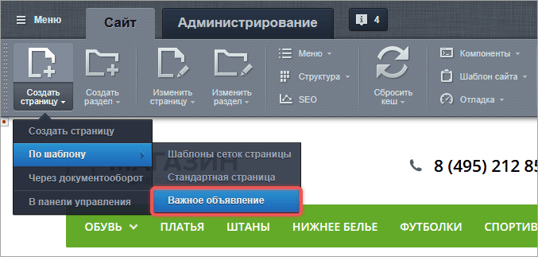
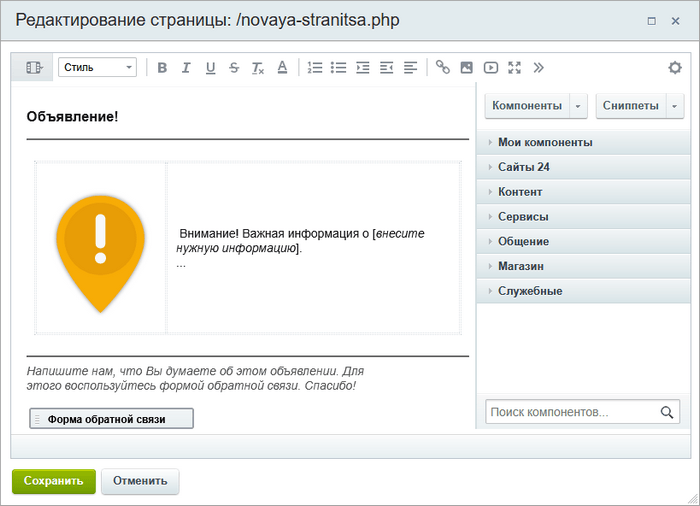
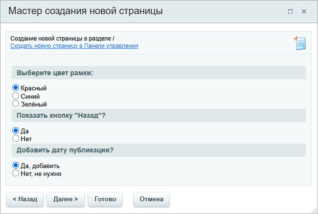
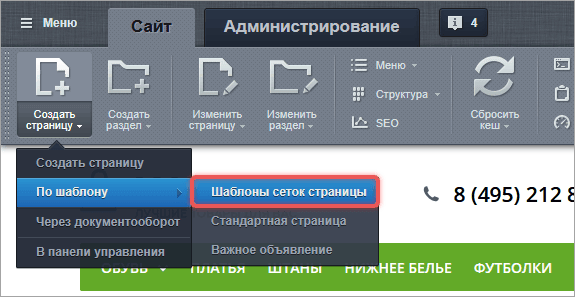
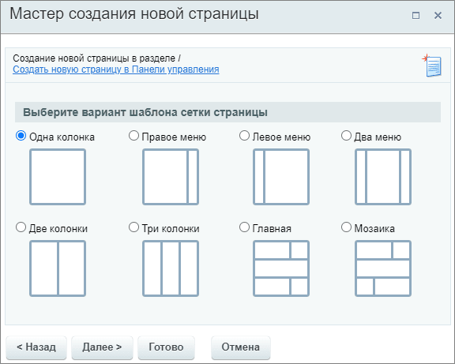
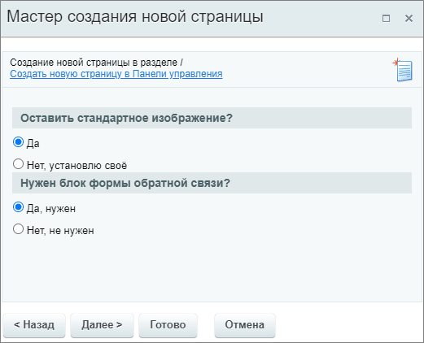

В Bitrix Framework страница — это PHP-файл, который состоит из трех частей.

1. Header или шапка сайта — общие элементы сайта.

2. Основная рабочая область — уникальный контент страницы, который может быть:

   -  статическим — обычный HTML-контент, например текст, изображения и таблицы,

   -  динамическим — контент создан с помощью компонентов.

3. Footer или подвал — завершающие элементы сайта.

Система собирает страницу динамически из шаблона сайта, компонентов и статических элементов. Начальное содержимое нового файла страницы задает шаблон страницы.

## Свойства страниц

На отображение и поведение страницы влияют ее свойства, например заголовок, ключевые слова и описание. Свойства можно задать:

-  на странице в рабочей области или между служебной и визуальной частью шапки сайта,

-  в файле `.section.php` раздела — это общие настройки для всех страниц внутри раздела.

Способы задать свойства описаны в статье [Свойства страницы и раздела](./properties.md).

## Шаблоны страниц

Шаблон страницы — это заготовка содержимого новой страницы. Контент-менеджер выбирает шаблон на панели управления в меню *Создать страницу > По шаблону*. Мастер создания страницы берет код из шаблона и сохраняет его в новый PHP-файл.

Шаблон страницы отличается от [шаблона сайта](./site-templates.md). Шаблон сайта задает оформление страниц при выводе, а шаблон страницы только заполняет новый файл при создании. Изменения в шаблоне страницы не затрагивают уже созданные страницы.

Собственные шаблоны страниц размещайте в папках пользовательских шаблонов сайта:

-  `/local/templates/.default/page_templates` — для всех шаблонов сайта,

-  `/local/templates/[идентификатор_шаблона]/page_templates` — для конкретного шаблона сайта.

Штатные примеры шаблонов страниц находятся в `/bitrix/templates/.default/page_templates` и `/bitrix/templates/[идентификатор_шаблона]/page_templates`. Их можно скопировать в `/local/templates/` и использовать как основу для своего шаблона.



Ядро читает папку `page_templates` либо из `/local/templates/`, либо из `/bitrix/templates/`. Если папка есть в `/local/templates/`, одноименную папку в `/bitrix/templates/` ядро не читает. Например, после создания `/local/templates/.default/page_templates` из меню пропадут штатные шаблоны из `/bitrix/templates/.default/page_templates`. Скопируйте в `/local/` те штатные шаблоны, которые нужно оставить в меню.



Каждая папка может содержать:

-  файлы пассивных шаблонов страниц,

-  папки активных шаблонов с файлом `template.php`,

-  служебный файл `.content.php` — он хранит названия пассивных шаблонов и порядок их вывода.

Меню создания страницы собирает шаблоны из папки `.default` и из папки текущего шаблона сайта. Если в обеих папках есть шаблон с одинаковым именем файла или папки, меню показывает шаблон из папки шаблона сайта.

## Разработка шаблонов страниц

Существует два типа шаблонов страниц.

-  Пассивный шаблон — это PHP-файл с готовым содержимым новой страницы. Он может содержать HTML-разметку, PHP-код и вызовы компонентов. При создании страницы контент-менеджер редактирует заготовленное содержимое в визуальном редакторе.

-  Активный шаблон — это шаблон с дополнительным шагом мастера создания страницы. Он запрашивает параметры у контент-менеджера и формирует содержимое страницы с учетом выбранных значений.

### Пассивный шаблон

Пассивный шаблон — это шаблон с заготовленным контентом для новой страницы.

#### Как создать пассивный шаблон

**Первый способ.** Скопируйте штатный шаблон `/bitrix/templates/.default/page_templates/standard.php` в `/local/templates/.default/page_templates/` и отредактируйте копию.

**Второй способ.** Создайте шаблон с нуля.

1. Продумайте структуру страницы. Это может быть HTML, текст, изображения, таблицы, компоненты и PHP-код.

2. В папке `/local/templates/[идентификатор_шаблона]/page_templates` создайте файл, например `new.php`.

3. В файле разместите код шаблона.

4. Убедитесь, что в начале и конце файла есть вызовы `header.php` и `footer.php`. Они обязательны.

**Пример.** Минимальный пассивный шаблон с заголовком страницы и абзацем текста.

```php
<?php
require($_SERVER['DOCUMENT_ROOT'] . '/bitrix/header.php');
$APPLICATION->SetTitle('Новая страница');
?>

<p>Добавьте контент на страницу</p>

<?php require($_SERVER['DOCUMENT_ROOT'] . '/bitrix/footer.php'); ?>
```

Вызов `$APPLICATION->SetTitle()` задает заголовок по умолчанию. Если контент-менеджер укажет заголовок в мастере создания, мастер заменит значение в вызове `SetTitle()` на введенное. Замена срабатывает, если аргумент — строка в кавычках. Если вызова `SetTitle()` в шаблоне нет, мастер добавит его после подключения `header.php`. Подробнее о заголовках — в статье [Заголовки страницы](./titles.md).

#### Как подключить пассивный шаблон

Пассивный шаблон появляется в меню создания страницы, как только файл попадает в папку `page_templates`. Меню показывает каждый файл этой папки, если имя файла не начинается с точки и у пользователя есть право на чтение файла. Без записи в `.content.php` название шаблона в меню совпадает с именем файла без расширения, а индекс сортировки равен `150`.

Чтобы задать название и порядок вывода, добавьте запись в файл `.content.php` той же папки, например `/local/templates/[идентификатор_шаблона]/page_templates/.content.php`:

```php
$TEMPLATE['new.php'] = ['name' => 'Новый шаблон', 'sort' => 4];
```

Элементы записи:

-  ключ `'new.php'` — имя файла шаблона в этой папке,

-  `name` — название, которое увидит контент-менеджер,

-  `sort` — индекс сортировки, шаблоны с меньшим значением стоят в меню выше.

Другие ключи записи ядро не читает.

**Пример.** Файл `.content.php` с записями для штатного шаблона `standard.php` и нового шаблона `new.php`:

```php
<?php
if (!defined('B_PROLOG_INCLUDED') || B_PROLOG_INCLUDED !== true)
{
    die();
}

$TEMPLATE['standard.php'] = ['name' => 'Стандартная страница', 'sort' => 1];
$TEMPLATE['new.php'] = ['name' => 'Новый шаблон', 'sort' => 4];
```

Команда *Создать страницу* без выбора шаблона заполняет новую страницу первым пассивным шаблоном из списка, отсортированного по `sort`. Подменю *По шаблону* появляется, если в папках есть хотя бы один активный шаблон для меню *Создать страницу* или больше одного пассивного. Если пассивный шаблон один, а активных шаблонов для этого меню нет, подменю не выводится и мастер применяет этот шаблон только как содержимое по умолчанию.

#### Языковые файлы

Если сайт работает на нескольких языках, задайте названия шаблонов в языковых файлах. В файле `.content.php` загрузите сообщения методом `Loc::loadMessages(__FILE__)`. Метод `Loc::getMessage('new')` вернет название шаблона по ключу `new`:

```php
<?php
use Bitrix\Main\Localization\Loc;

if (!defined('B_PROLOG_INCLUDED') || B_PROLOG_INCLUDED !== true)
{
    die();
}

Loc::loadMessages(__FILE__);

$TEMPLATE['standard.php'] = ['name' => Loc::getMessage('standard'), 'sort' => 1];
$TEMPLATE['new.php'] = ['name' => Loc::getMessage('new'), 'sort' => 4];
```

Языковые файлы храните в папке `lang` того шаблона сайта, где расположен файл `.content.php`:

-  для общего шаблона — `/local/templates/.default/lang/`,

-  для шаблона конкретного сайта — `/local/templates/[идентификатор_шаблона]/lang/`.

Например, названия шаблонов на русском языке добавьте в файл `/local/templates/[идентификатор_шаблона]/lang/ru/page_templates/.content.php`:

```php
<?php
$MESS['standard'] = 'Стандартная страница';
$MESS['new'] = 'Новый шаблон';
```

Для английского языка создайте файл `/local/templates/[идентификатор_шаблона]/lang/en/page_templates/.content.php` и задайте те же ключи с переводами. Например, `$MESS['new'] = 'New template';`.

Если берете за основу штатный шаблон, пример языковых файлов можно посмотреть в `/bitrix/templates/.default/lang/ru/page_templates/.content.php` или в папке нужного штатного шаблона.

#### Пример создания пассивного шаблона {#passive-template-example}

Создайте общий шаблон страницы объявления, который доступен для всех шаблонов сайта. Скачайте [изображение для объявления](./_images/announcement.svg) и разместите его на сайте в файле `/upload/page-templates/announcement.svg`. Изображение нужно для пассивного и активного примеров ниже.

1. В папке `/local/templates/.default/page_templates` создайте файл `announcement.php`.

2. Добавьте код шаблона. Проверьте, что код подключает `header.php` в начале и `footer.php` в конце.

   ```php
   <?php
   require($_SERVER['DOCUMENT_ROOT'] . '/bitrix/header.php');
   $APPLICATION->SetTitle('Объявление');
   ?>
   <h3>Объявление!</h3>
   <hr>
   <br>
   <table cellpadding="10" cellspacing="1" align="center" style="width: 500px;">
   <tbody>
   <tr>
       <td>
             
       </td>
       <td>
            Внимание! Важная информация о [<i>внесите нужную информацию</i>].<br>
            ...
       </td>
   </tr>
   </tbody>
   </table>
    <br>
   <hr>
    <span style="color: #555555;"><i>Напишите нам, что вы думаете об этом объявлении. Для этого воспользуйтесь формой обратной связи. Спасибо!</i></span><br>
    <br>
   <?php $APPLICATION->IncludeComponent(
       'bitrix:main.feedback',
       '',
       [
           'EMAIL_TO' => 'sale@example.com',
           'EVENT_MESSAGE_ID' => ['7'],
           'OK_TEXT' => 'Спасибо за ваше мнение!',
           'REQUIRED_FIELDS' => ['NAME', 'EMAIL'],
           'USE_CAPTCHA' => 'Y',
       ]
   );?>
   <?php require($_SERVER['DOCUMENT_ROOT'] . '/bitrix/footer.php'); ?>
   ```

3. В файле `.content.php` загрузите языковые сообщения и добавьте запись для шаблона `announcement.php`:

   ```php
   <?php
   use Bitrix\Main\Localization\Loc;

   if (!defined('B_PROLOG_INCLUDED') || B_PROLOG_INCLUDED !== true)
   {
       die();
   }

   Loc::loadMessages(__FILE__);

   $TEMPLATE['announcement.php'] = ['name' => Loc::getMessage('announcement'), 'sort' => 2];
   ```

4. Настройте языковые файлы. Для русского языка добавьте фразу в файл `/local/templates/.default/lang/ru/page_templates/.content.php`:

   ```php
   <?php
   $MESS['announcement'] = 'Важное объявление';
   ```

   Для английского языка добавьте фразу в файл `/local/templates/.default/lang/en/page_templates/.content.php`:

   ```php
   <?php
   $MESS['announcement'] = 'Important announcement';
   ```

В результате пункт *Важное объявление* появится в меню *Создать страницу > По шаблону*. Если в папках `page_templates` нет других шаблонов, подменю *По шаблону* не появится, а команда *Создать страницу* заполнит новую страницу этим шаблоном.

{width=677px height=323px}

При создании новой страницы по этому шаблону контент-менеджер увидит визуальный редактор с заполненными элементами.

{width=700px height=506px}

### Активный шаблон

Активный шаблон — это шаблон, который при создании страницы запрашивает дополнительные данные у контент-менеджера. Эти данные можно использовать для настройки структуры или содержимого страницы.

{width=650px height=438px}

На дополнительном шаге мастер выводит поля, разметку которых возвращает метод `GetFormHtml()` класса шаблона. На скриншоте каждый вопрос — заголовок группы, под ним переключатели с вариантами ответа. Метод `GetContent()` читает ответы и формирует код страницы.

#### Примеры шаблонов

Свой активный шаблон можно создать на основе штатных примеров.

-  Пример `forum` находится в `/bitrix/templates/.default/page_templates/forum`. Папку копирует модуль `forum` при установке. Метод `GetDescription()` этого шаблона возвращает тип `section`, поэтому шаблон доступен в меню *Создать раздел*, а не *Создать страницу*.

-  Пример `bootstrap` входит в шаблон сайта `eshop_bootstrap_v4`, который устанавливает мастер интернет-магазина. После установки этого шаблона пример находится в `/bitrix/templates/eshop_bootstrap_v4/page_templates/bootstrap`. В чистой установке до запуска мастера этой папки может не быть.

В сокращенном коде шаблона `bootstrap` форма и метод `GetContent()` содержат два варианта сетки из восьми. Остальные варианты устроены так же.



```php
<?php
use Bitrix\Main\Localization\Loc;

if(!defined("B_PROLOG_INCLUDED") || B_PROLOG_INCLUDED !== true) die();

CPageTemplate::IncludeLangFile(__FILE__);

class CBootstrapPageTemplate
{
    function GetDescription()
    {
        return [
            "name" => Loc::getMessage("bt_wizard_name"),
            "description" => Loc::getMessage("bt_wizard_title"),
            "modules" => ["bitrix.eshop"],
        ];
    }

    function GetFormHtml()
    {
        $s = '
<tr class="section">
    <td colspan="4">'.Loc::getMessage("BT_TYPE").'</td>
</tr>
';
        $s .= '
<tr>
    <td style="vertical-align: top; padding-top:10px">
        <input type="radio" name="BT_COL" value="1" id="BT_COL_1" checked>
        <label for="BT_COL_1">'.Loc::getMessage("BT_COL_1").'</label><br>
        <br>
    </td>
    <td style="padding-top:10px">
        <input type="radio" name="BT_COL" value="2_1" id="BT_COL_2_1">
        <label for="BT_COL_2_1">'.Loc::getMessage("BT_COL_2_1").'</label><br>
        <br>
    </td>
</tr>
';
        // Ячейки вариантов 1_2, 1_2_1, 1_1, 1_1_1, 5 и 4 устроены так же
        return $s;
    }

    function GetContent($arParams)
    {
        $gridHtml = '
<div class="row">';

        if (isset($_POST['BT_COL']))
        {
            switch ($_POST['BT_COL'])
            {
                case '1':
                {
                    $gridHtml.= '
    <div class="col-xs-12"></div>';
                    break;
                }
                case '2_1':
                {
                    $gridHtml.= '
    <div class="col-sm-8"></div>
    <div class="col-sm-4"></div>';
                    break;
                }
                // Варианты 1_2, 1_2_1, 1_1, 1_1_1, 5 и 4 добавляют свою разметку колонок так же
            }
        }
        $gridHtml.= '
</div>
';

        $s = '<?php require($_SERVER["DOCUMENT_ROOT"]."/bitrix/header.php");?>';
        $s.= $gridHtml;
        $s.= '<?php require($_SERVER["DOCUMENT_ROOT"]."/bitrix/footer.php");?>';
        return $s;
    }
}

$pageTemplate = new CBootstrapPageTemplate;
?>
```



В меню шаблон `bootstrap` называется *Шаблоны сеток страницы*. Шаблон предлагает выбрать вариант сетки страницы. Метод `GetDescription()` шаблона возвращает ключ `modules` со значением `bitrix.eshop`, поэтому шаблон есть в меню, только если модуль `bitrix.eshop` установлен.

Штатный шаблон читает ответ формы из `$_POST` напрямую. В своих шаблонах читайте значения через объект запроса и сравнивайте их со списком допустимых, как в [примере создания активного шаблона](#active-template-example).

{width=575px height=297px}

Чтобы создать страницу по шаблону `bootstrap`, выполните следующие действия:

1. На панели управления нажмите *Создать страницу > По шаблону > Шаблоны сеток страницы*.

2. В мастере создания заполните параметры страницы и нажмите *Далее*.

3. Выберите вариант сетки страницы и нажмите *Готово*.

   {width=576px height=461px}

#### Структура шаблона

В папке шаблона обязательно должен быть файл `template.php`. Он содержит логику шаблона. Папку без этого файла меню пропускает.

Дополнительно могут быть другие файлы и папки:

-  папка `/lang` — языковые файлы,

-  папка `/images` — изображения для шаблона.

#### Контракт класса шаблона

Файл `template.php` объявляет класс шаблона и создает его объект. Ядро подключает файл и берет объект из переменной `$pageTemplate`, поэтому в конце файла присвойте ей объект своего класса:

```php
$pageTemplate = new CMyNewPageTemplate();
```

Если переменная `$pageTemplate` не содержит объект с методом `GetDescription()`, шаблон не появится в меню.

Когда ядро строит меню, оно подключает файлы `template.php` всех доступных активных шаблонов в одном запросе. Поэтому имя класса должно быть уникальным. Если два шаблона объявляют класс с одним именем, PHP остановит выполнение с ошибкой `Cannot declare class`. При копировании штатного шаблона переименуйте класс.

Ядро вызывает три метода объекта шаблона.

| Метод | Когда ядро вызывает метод | Что метод возвращает |
|---|---|---|
| `GetDescription()` | При построении меню *Создать страницу* и *Создать раздел* на панели управления | Массив с ключами `name`, `description`, `icon`, `sort`, `type` и `modules` |
| `GetFormHtml()` | Когда мастер создания строит форму по выбранному шаблону | Строку с HTML-разметкой строк таблицы `<tr>`. Мастер выводит ее внутри `<table>` на дополнительном шаге. Если метод вернет пустую строку, мастер не покажет дополнительный шаг |
| `GetContent($arParams)` | Когда контент-менеджер завершает мастер, а мастер не нашел ошибок в имени файла, правах доступа и сессии | Строку с PHP-кодом новой страницы. Мастер сохраняет строку в файл. Если метод вернет пустую строку или `false`, мастер запишет стандартную заготовку с подключением `header.php` и `footer.php` |

Метод `GetDescription()` возвращает массив, в котором все ключи необязательны.

| Ключ | Описание |
|---|---|
| name<br>`string` | Название шаблона в меню. Если ключ не задан, меню показывает имя папки шаблона |
| description<br>`string` | Подсказка к пункту меню. По умолчанию пустая строка |
| icon<br>`string` | Путь к изображению для пункта меню. Если ключ не задан, пункт меню получает стандартный значок |
| sort<br>`int` | Индекс сортировки, по умолчанию `150`. Шаблоны с меньшим значением стоят в меню выше, шаблоны с одинаковым значением упорядочены по `name` |
| type<br>`string` | Меню, в котором доступен шаблон. `page` — только *Создать страницу*, `section` — только *Создать раздел*, пустая строка — оба меню. По умолчанию пустая строка |
| modules<br>`array` | Идентификаторы модулей, без которых шаблон не работает. Если хотя бы один модуль из списка не установлен, шаблона нет в меню |

Метод `GetContent()` получает в параметре `$arParams` массив с ключами.

| Ключ | Описание |
|---|---|
| path<br>`string` | Путь к папке новой страницы от корня сайта. При создании раздела — путь к папке нового раздела со слешем в конце |
| file<br>`string` | Имя файла новой страницы. При создании раздела — `index.php` |
| site<br>`string` | Идентификатор сайта, на котором мастер создает страницу |
| siteDir<br>`string` | Папка сайта из настроек сайта, например `/` |
| allowLegacyDuplicateCollapse<br>`bool` | Служебный флаг для штатного шаблона `disk_common` |

Поля из `GetFormHtml()` мастер отправляет методом POST вместе с остальными полями формы. В методе `GetContent()` читайте их через объект запроса `Context::getCurrent()->getRequest()->getPost('имя_поля')`. Метод `getPost()` возвращает `null`, если поля нет в запросе. Сравнивайте полученное значение со списком допустимых и не подставляйте его в код страницы без проверки.

Мастер проверяет сессию функцией `check_bitrix_sessid()` до вызова `GetContent()`, поэтому повторять проверку в шаблоне не нужно. После `GetContent()` мастер подставляет в код страницы заголовок и свойства из своих шагов так же, как для пассивного шаблона.



Мастер сохраняет строку из `GetContent()` как PHP-файл. Если вставляете в страницу текст, который ввел контент-менеджер, экранируйте его функцией `htmlspecialcharsbx()`. Без экранирования введенный фрагмент `<?php ... ?>` выполнится при открытии страницы.



#### Как подключить активный шаблон

Активный шаблон появляется в меню, когда выполнены условия:

-  в папке `page_templates` есть подпапка шаблона с файлом `template.php`,

-  файл `template.php` создает объект в переменной `$pageTemplate`,

-  у пользователя есть право на чтение файла `template.php`,

-  установлены все модули из ключа `modules`.

Файл `.content.php` для активных шаблонов не нужен. Название, порядок и меню для шаблона задает метод `GetDescription()`.

#### Как подключить языковые файлы

Задавайте названия и подписи шаблона в языковых файлах, а не напрямую в файле `template.php`. Чтобы подключить фразы, вызовите в начале `template.php` метод `Loc::loadMessages(__FILE__)`. Метод загружает фразы из файла `lang/[код_языка]/template.php` в папке шаблона.

**Пример.** Русские языковые фразы шаблона `bootstrap` из файла `/bitrix/templates/eshop_bootstrap_v4/page_templates/bootstrap/lang/ru/template.php`.

```php
<?php
$MESS['bt_wizard_name'] = "Шаблоны сеток страницы";
$MESS['bt_wizard_title'] = "Раздел с шаблоном сетки";
$MESS['BT_TYPE'] = "Выберите вариант шаблона сетки страницы";
$MESS['BT_COL_1'] = "Одна колонка";
$MESS['BT_COL_2_1'] = "Правое меню";
$MESS['BT_COL_1_2'] = "Левое меню";
$MESS['BT_COL_1_2_1'] = "Два меню";
$MESS['BT_COL_1_1'] = "Две колонки";
$MESS['BT_COL_1_1_1'] = "Три колонки";
$MESS['BT_COL_5'] = "Главная";
$MESS['BT_COL_4'] = "Мозаика";
?>
```

#### Пример создания активного шаблона {#active-template-example}

Создайте активный шаблон на основе штатного шаблона `bootstrap` и [пассивного шаблона](#passive-template-example) `announcement.php`. В форме создания страницы новый шаблон выводит два вопроса — об изображении и о форме обратной связи.

{width=521px height=422px}

1. Скопируйте штатный шаблон `/bitrix/templates/eshop_bootstrap_v4/page_templates/bootstrap` в папку пользовательского шаблона `/local/templates/[идентификатор_шаблона]/page_templates/new_template`.

2. Замените код файла `template.php`. Класс получает новое имя `CMyNewPageTemplate`, чтобы не конфликтовать со штатным классом `CBootstrapPageTemplate`.

   **Пример.** Класс шаблона с двумя вопросами в форме мастера. Метод `GetContent()` читает ответы через объект запроса и собирает страницу объявления из готовых фрагментов.

   ```php
   <?php
   use Bitrix\Main\Context;
   use Bitrix\Main\Localization\Loc;

   if (!defined('B_PROLOG_INCLUDED') || B_PROLOG_INCLUDED !== true)
   {
       die();
   }

   Loc::loadMessages(__FILE__);

   class CMyNewPageTemplate
   {
       public function GetDescription()
       {
           return [
               'name' => Loc::getMessage('ANNOUNCEMENT_WIZARD_NAME'),
               'description' => Loc::getMessage('ANNOUNCEMENT_WIZARD_TITLE'),
               'type' => 'page',
           ];
       }

       // Строки таблицы для дополнительного шага мастера
       public function GetFormHtml()
       {
           return $this->getQuestionHtml('ANNOUNCEMENT_IMAGE')
               . $this->getQuestionHtml('ANNOUNCEMENT_FEEDBACK');
       }

       // PHP-код новой страницы с учетом ответов
       public function GetContent($arParams)
       {
           $request = Context::getCurrent()->getRequest();

           // Ответ N убирает блок, любое другое значение оставляет его
           $showImage = $request->getPost('ANNOUNCEMENT_IMAGE') !== 'N';
           $showFeedback = $request->getPost('ANNOUNCEMENT_FEEDBACK') !== 'N';

           $image = '';

           $feedback = <<<'HTML'
   <hr>
   <p><i>Напишите нам, что вы думаете об этом объявлении. Для этого воспользуйтесь формой обратной связи. Спасибо!</i></p>
   <?php $APPLICATION->IncludeComponent(
       'bitrix:main.feedback',
       '',
       [
           'EMAIL_TO' => 'sale@example.com',
           'EVENT_MESSAGE_ID' => ['7'],
           'OK_TEXT' => 'Спасибо за ваше мнение!',
           'REQUIRED_FIELDS' => ['NAME', 'EMAIL'],
           'USE_CAPTCHA' => 'Y',
       ]
   ); ?>
   HTML;

           $page = <<<'HTML'
   <?php require($_SERVER['DOCUMENT_ROOT'] . '/bitrix/header.php'); ?>
   <h3>Объявление!</h3>
   <hr>
   <table cellpadding="10" cellspacing="1" align="center" style="width: 500px;">
   <tr>
       <td>#IMAGE#</td>
       <td>Внимание! Важная информация о [<i>внесите нужную информацию</i>].</td>
   </tr>
   </table>
   #FEEDBACK#
   <?php require($_SERVER['DOCUMENT_ROOT'] . '/bitrix/footer.php'); ?>
   HTML;

           return strtr($page, [
               '#IMAGE#' => $showImage ? $image : '',
               '#FEEDBACK#' => $showFeedback ? $feedback : '',
           ]);
       }

       // Вопрос с вариантами Y и N, вариант Y выбран по умолчанию
       private function getQuestionHtml(string $name): string
       {
           $html = '<tr class="section"><td>' . htmlspecialcharsbx(Loc::getMessage($name)) . '</td></tr>';

           foreach (['Y', 'N'] as $value)
           {
               $id = $name . '_' . $value;
               $checked = $value === 'Y' ? ' checked' : '';

               $html .= '<tr><td style="padding-top: 10px;">'
                   . '<input type="radio" name="' . $name . '" value="' . $value . '" id="' . $id . '"' . $checked . '>'
                   . '<label for="' . $id . '">' . htmlspecialcharsbx(Loc::getMessage($id)) . '</label>'
                   . '</td></tr>';
           }

           return $html;
       }
   }

   $pageTemplate = new CMyNewPageTemplate();
   ```

   Метод `getQuestionHtml()` выводит один вопрос с вариантами `Y` и `N`. Имя поля совпадает с ключом языковой фразы вопроса, а подписи вариантов метод берет из фраз с суффиксами `_Y` и `_N`. Метод `GetContent()` убирает изображение или форму, только если в ответе пришло значение `N`. Любое другое значение и отсутствие поля оставляют блок на странице.

3. Замените содержимое языкового файла `/local/templates/[идентификатор_шаблона]/page_templates/new_template/lang/ru/template.php`.

   ```php
   <?php
   $MESS['ANNOUNCEMENT_WIZARD_NAME'] = 'Объявление';
   $MESS['ANNOUNCEMENT_WIZARD_TITLE'] = 'Уточнение по шаблону';
   $MESS['ANNOUNCEMENT_IMAGE'] = 'Оставить стандартное изображение?';
   $MESS['ANNOUNCEMENT_IMAGE_Y'] = 'Да';
   $MESS['ANNOUNCEMENT_IMAGE_N'] = 'Нет, установлю свое';
   $MESS['ANNOUNCEMENT_FEEDBACK'] = 'Нужен блок формы обратной связи?';
   $MESS['ANNOUNCEMENT_FEEDBACK_Y'] = 'Да, нужен';
   $MESS['ANNOUNCEMENT_FEEDBACK_N'] = 'Нет, не нужен';
   ```

В результате в мастере создания страницы появится новый шаг с выбором параметров. После нажатия *Готово* мастер сохранит страницу только с теми блоками, которые контент-менеджер оставил в ответах.

Оформление созданной страницы задает шаблон сайта, подробнее — в статье [Шаблоны сайтов](./site-templates.md). Как изменить заголовок и другие свойства новой страницы, описано в статье [Свойства страницы и раздела](./properties.md).
