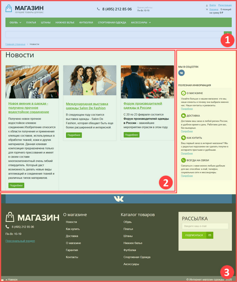
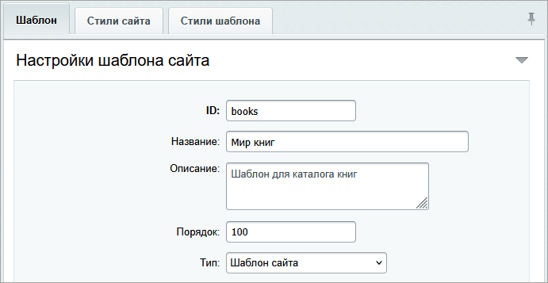
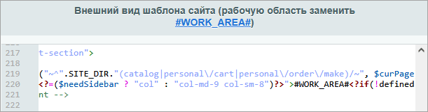
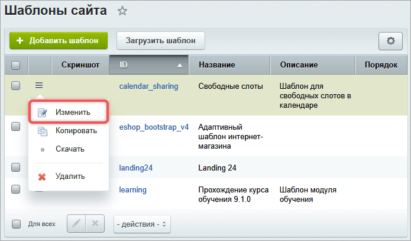
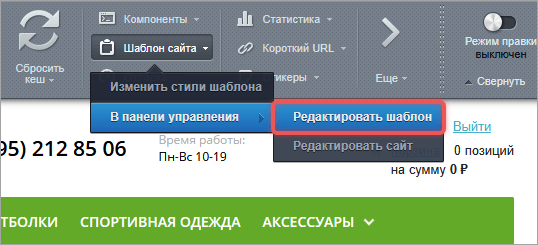
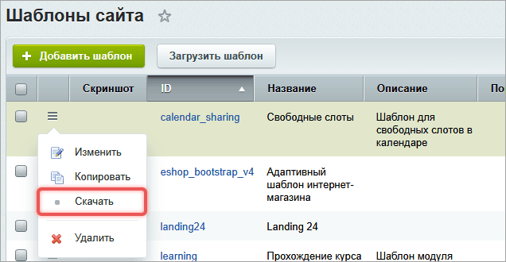
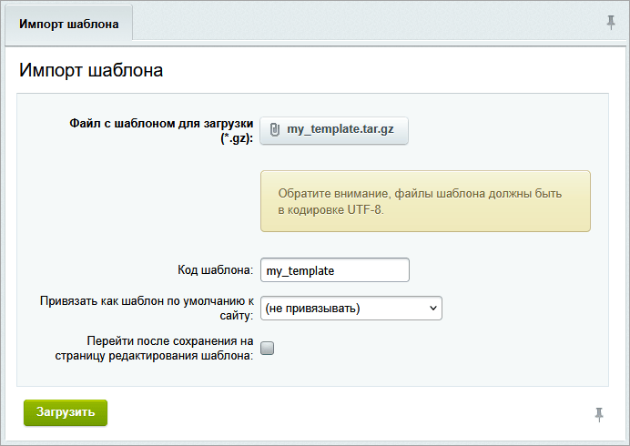
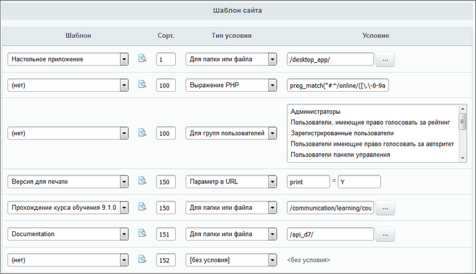

Шаблон — это макет сайта. Он задает внешний вид страниц, расположение меню, логотипа, рекламы, формы авторизации и других элементов.

Шаблон объединяет несколько элементов.

-  HTML-разметку,

-  CSS-стили,

-  графические элементы,

-  шаблоны компонентов и страниц,

-  сниппеты — готовые блоки кода.

Продукты компании 1С-Битрикс поставляются с демонстрационными шаблонами. Это позволяет изучить структуру шаблонов и их подключение к сайту. Если требуется уникальное оформление, можно подготовить и применить собственный шаблон.

## Файловая структура шаблона

Каждый шаблон содержит стандартные файлы и папки.

Основные файлы шаблона.

-  `header.php` — верхняя часть, шапка сайта,

-  `footer.php` — нижняя часть, подвал сайта,

-  `description.php` — название, описание и параметры шаблона,

-  `.styles.php` — стили для визуального редактора,

-  `template_styles.css` — стили шаблона,

-  `styles.css` — стили сайта.

Папки шаблона.

-  `/components/` — шаблоны компонентов,

-  `/lang/` — языковые файлы для локализации,

-  `/page_templates/` — шаблоны страницы.

Могут присутствовать дополнительные папки, например, `/images/` — для изображений шаблона.

## Основные части шаблона

Шаблон делится на три основные части.

1. Header или шапка сайта — верхняя часть сайта, хранится в файле `<идентификатор_шаблона>/header.php`. Содержит логотип, название сайта, меню.

2. Рабочая область — место для контента страницы между шапкой и подвалом.

3. Footer или подвал — нижняя часть сайта, хранится в файле `<идентификатор_шаблона>/footer.php`. Содержит контактную информацию, дополнительное меню, информацию об авторских правах.

В файлах шаблона границу задает разделение на `header.php` и `footer.php`. Маркер `#WORK_AREA#` нужен только в поле «Внешний вид шаблона сайта» в административном разделе. При сохранении система записывает код до маркера в `header.php`, а код после маркера — в `footer.php`. Сам маркер в файлы не попадает.



Header, рабочая область и footer должны всегда следовать в указанном порядке независимо от их размера и формы.



{width=470px height=559px}

### Как собирается страница

В файле страницы подключите системный `/bitrix/header.php`, добавьте контент и подключите `/bitrix/footer.php`. Система выберет шаблон по настройкам сайта и подключит его шапку и подвал.

```php
<?php
require($_SERVER['DOCUMENT_ROOT'] . '/bitrix/header.php');
$APPLICATION->SetTitle('Заголовок страницы');
?>

Контент страницы

<?php
require($_SERVER['DOCUMENT_ROOT'] . '/bitrix/footer.php');
?>
```

## Где хранятся шаблоны

Шаблоны хранятся в двух папках.

-  системные шаблоны размещены в `/bitrix/templates`,

-  пользовательские шаблоны следует хранить в `/local/templates`.

Имя папки — идентификатор шаблона. Например, шаблон `demo` хранится в `/local/templates/demo/`. При переносе шаблона с тем же идентификатором привязку к сайту менять не нужно.



Если шаблон с одинаковым ID есть в обеих папках, система использует `/local/templates/<идентификатор_шаблона>/`. При создании через административный раздел система проверяет занятость ID только в `/bitrix/templates/`, поэтому может создать дубликат. Перед созданием проверьте обе папки.





В Битрикс24 шаблон `/bitrix/templates/bitrix24` изменять нельзя. Для собственного оформления создайте отдельный пользовательский шаблон.



## Управление шаблонами

Список всех шаблонов расположен в административном разделе на странице *Настройки > Настройки продукта > Сайты > Шаблоны сайтов*.

### Как создать шаблон через административный раздел {#как-создать-шаблон}

Шаблон можно создать через административный интерфейс системы.



На время создания шаблона рекомендуется отключить кеширование, чтобы сразу видеть изменения. Откройте страницу *Настройки > Настройки продукта > Автокеширование* и нажмите Выключить автокеширование.



1. На странице со списком шаблонов нажмите кнопку Добавить шаблон.

2. На вкладке Шаблон заполните параметры.

   -  ID — идентификатор шаблона. Задается латинскими символами. Обязательное поле.

   -  Название — название шаблона.

   -  Описание — описание шаблона. Используется для пояснения назначения или особенностей шаблона.

   -  Порядок — число, которое определяет положение шаблона в общем списке шаблонов. Чем меньше число, тем выше шаблон в списке.

   -  Тип — тип шаблона. Укажите, что данный шаблон — это шаблон сайта, а не почтовый.

   {width=691px height=357px}

3. В поле «Внешний вид шаблона сайта» напишите код шаблона. Чтобы обозначить границу между верхней и нижней частью, используйте разделитель `#WORK_AREA#`.

   {width=611px height=161px}

4. На вкладке «Стили сайта» заполните файл `styles.css`.

5. На вкладке «Стили шаблона» заполните файл `template_styles.css`.

6. Нажмите Сохранить. Система сохранит шаблон в папке `/bitrix/templates/<идентификатор_шаблона>`.

Чтобы хранить созданный шаблон в `/local/`, перенесите его по инструкции ниже.

Скриншот шаблона сохраните в `screen.gif`, а изображение для предварительного просмотра — в `preview.gif`. Система сначала ищет каждый файл в `lang/<язык>/` внутри папки шаблона, затем в корне папки. Например, `lang/ru/screen.gif` имеет приоритет перед `screen.gif` для русского языка интерфейса.

### Как перенести шаблон в /local

Переносите пользовательский шаблон с сохранением идентификатора.

1. Сохраните резервную копию папки `/bitrix/templates/<идентификатор_шаблона>/`.

2. Убедитесь, что в `/local/templates/` нет папки с таким же идентификатором.

3. Скопируйте папку шаблона целиком в `/local/templates/<идентификатор_шаблона>/`, включая скрытые файлы, шаблоны компонентов и изображения.

4. Замените жестко заданные пути `/bitrix/templates/<идентификатор_шаблона>/` в PHP, HTML, CSS и JavaScript. В PHP используйте `SITE_TEMPLATE_PATH`, а в CSS — относительные пути к файлам шаблона.

5. Очистите кеш и проверьте страницы сайта, стили, изображения и компоненты. Система уже использует копию из `/local/`.

6. После проверки удалите исходную папку из `/bitrix/templates/`, чтобы не поддерживать две копии шаблона.

### Как создать шаблон в /local

Для разработки в файлах создайте папку `/local/templates/<идентификатор_шаблона>/`. Добавьте `header.php`, `footer.php`, `description.php`, `styles.css` и `template_styles.css`. CSS-файлы могут быть пустыми, пока оформление не готово. Код шапки и подвала приведен в разделе [Минимальный шаблон](#minimal-template).

В `description.php` задайте массив `$arTemplate`. Для шаблона `demo` создайте такой файл:

```php
<?php
$arTemplate = [
    'NAME' => 'Основной шаблон',
    'DESCRIPTION' => 'Шаблон публичных страниц сайта',
    'SORT' => 100,
    'TYPE' => '',
    'EDITOR_STYLES' => [],
];
```

Поля массива определяют параметры шаблона.

-  `NAME` — название в административном разделе.

-  `DESCRIPTION` — описание назначения шаблона.

-  `SORT` — порядок в списке шаблонов. Это значение не задает приоритет применения шаблона на сайте.

-  `TYPE` — тип шаблона. Пустая строка обозначает шаблон сайта, `mail` — почтовый шаблон.

-  `EDITOR_STYLES` — массив путей к дополнительным CSS-файлам визуального редактора. Если дополнительные стили не нужны, оставьте пустой массив.

После создания папки шаблон появится в списке. Чтобы применить его к сайту, выберите шаблон в настройках сайта и задайте условие применения.

### Как отредактировать шаблон

Открыть шаблон для редактирования можно двумя способами.

-  **Через административный раздел**. Откройте список шаблонов и в меню шаблона нажмите пункт Изменить.

   {width=695px height=407px}

-  **Через публичный раздел**. На административной панели нажмите *Шаблон сайта > В панели управления > Редактировать шаблон*.

   {width=538px height=245px}



Если файлы шаблона находятся под контролем версий, после сохранения через административный раздел проверьте изменения в Git. Система заново генерирует `description.php` из параметров шаблона, поэтому произвольный PHP-код и комментарии в нем не сохраняются. Она также записывает содержимое полей «Стили сайта» и «Стили шаблона» в `styles.css` и `template_styles.css`, даже если поля пустые. Для изменений, которые должны пройти проверку кода, редактируйте файлы в рабочей копии репозитория.



### Экспорт и импорт

Шаблон можно экспортировать в файл `<идентификатор_шаблона>.tar.gz`. Для этого в меню шаблона нажмите Скачать.

{width=636px height=330px}

Готовый шаблон можно загрузить в систему с помощью менеджера файлов или через специальный интерфейс.

1. На странице со списком шаблонов нажмите Загрузить шаблон.

2. Выберите файл шаблона с помощью кнопки Добавить файл.

   

   Файлы шаблона должны быть в кодировке UTF-8.

   

3. В поле Код шаблона введите идентификатор шаблона. Если поле оставить пустым, шаблон будет распакован и помещен в папку с именем файла.

4. Укажите сайт, если к нему нужно привязать загруженный шаблон как шаблон по умолчанию.

   {width=692px height=490px}

## Условия применения шаблона

Количество шаблонов на сайте не ограничено. Для каждого шаблона можно задать условие применения. В настройках сайта доступны следующие типы.

-  [без условия] — шаблон по умолчанию,

-  для папки или файла,

-  для групп пользователей,

-  период времени,

-  параметр в URL,

-  пользователь не имеет доступ,

-  выражение PHP.

Обработчик условий также поддерживает `[выключено]`. Такое условие равно `false`, и шаблон не применяется. Если в форме настроек сайта нет этого пункта, пользователь с правом `edit_php` может задать `false` в поле «Выражение PHP».

Условие «Для папки или файла» сравнивает начало пути текущей страницы. Для раздела указывайте завершающий слеш. Значение `/news/` подходит для страниц внутри `/news/`, а `/news` также подойдет для `/newsletter/`. Проверка пути файла тоже работает по началу строки, а не по точному совпадению.

Сохранить или изменить условие «Выражение PHP» может только пользователь с правом `edit_php`.

### Порядок работы

1. При обработке запроса система сначала перебирает шаблоны с непустым условием по возрастанию значения сортировки.

2. Для каждого шаблона проверяется его условие применения.

3. Система применяет первый шаблон, условие которого выполняется и папка которого существует. Остальные шаблоны не проверяются.

4. Если подходящего шаблона с условием нет, система проверяет шаблоны без условия. Они служат шаблонами по умолчанию и идут после шаблонов с условиями независимо от сортировки. Если таких шаблонов несколько, система также учитывает их сортировку.

### Настройка условий

Условия применения шаблонов настраиваются отдельно для каждого сайта.

1. Перейдите на страницу *Настройки > Настройки продукта > Сайты > Список сайтов*.

2. Выберите сайт и откройте его на редактирование.

3. Настройте условия в разделе «Шаблон сайта». Например, для сайта создан шаблон «Версия для печати». Он должен быть применен, если в URL есть параметр `print=Y`.

   -  В колонке Шаблон выберите «Версия для печати».

   -  Задайте индекс сортировки. Чем меньше число, тем раньше система проверит условие среди других шаблонов с условиями. Если несколько условий выполняются одновременно, приоритет имеет шаблон с меньшим индексом.

   -  В колонке Тип условия выберите «Параметр в URL».

   -  В колонке Условие укажите `print=Y`.

   {width=690px height=397px}

### Примеры

Таблица показывает, как можно задавать условия в зависимости от выбранного типа и когда будет применен шаблон.

| Тип условия | Пример условия | Когда применяется шаблон |
| ----------- | -------------- | ------------------------ |
| Для папки или файла | `/index.php` | Если путь страницы начинается с `/index.php` |
| Для папки или файла | `/news/` | При открытии новостного раздела |
| Выражение PHP | `$USER->IsAuthorized()` | Если пользователь авторизован на сайте |
| Выражение PHP | `$USER->IsAdmin()` | Для администратора сайта |
| Выражение PHP | `in_array('5', $USER->GetUserGroupArray())` | Если пользователь принадлежит группе с идентификатором `5` |

## Разработка шаблона

Процесс разработки шаблона состоит из двух основных этапов.

-  создание прототипа — HTML-шаблона с заголовком, меню, формой авторизации, поиском и другими элементами дизайна,

-  создание шаблона с учетом рекомендаций.

### Минимальный шаблон {#minimal-template}

Шапка открывает HTML-документ и рабочую область, а подвал закрывает их. Файлы шаблона подключает система, поэтому в начале каждого файла проверьте `B_PROLOG_INCLUDED`. Проверка останавливает прямой запрос к файлу без пролога.

Создайте `/local/templates/demo/header.php`:

```php
<?php
if (!defined('B_PROLOG_INCLUDED') || B_PROLOG_INCLUDED !== true)
{
    die();
}
?>
<!DOCTYPE html>
<html lang="<?= htmlspecialcharsbx(LANGUAGE_ID) ?>">
<head>
    <?php $APPLICATION->ShowHead(); ?>
    <meta name="viewport" content="width=device-width, initial-scale=1">
    <title><?php $APPLICATION->ShowTitle(); ?></title>
</head>
<body>
    <div id="panel"><?php $APPLICATION->ShowPanel(); ?></div>
    <header class="site-header">
        <a href="<?= htmlspecialcharsbx(SITE_DIR) ?>">Главная</a>
    </header>
    <main>
        <h1><?php $APPLICATION->ShowTitle(false); ?></h1>
```

Создайте `/local/templates/demo/footer.php`:

```php
<?php
if (!defined('B_PROLOG_INCLUDED') || B_PROLOG_INCLUDED !== true)
{
    die();
}
?>
    </main>
    <footer class="site-footer">
        <p>Контактная информация</p>
    </footer>
</body>
</html>
```

В результате контент файла страницы окажется внутри `<main>`, между шапкой и подвалом. Заголовок страницы задайте через `SetTitle()` в файле страницы, как в примере [Как собирается страница](#как-собирается-страница). Система подставит его при завершении обработки страницы.

Методы объекта `$APPLICATION` и константа шаблона выполняют разные задачи.

-  `ShowHead()` выводит метаданные, CSS, JavaScript и дополнительные строки для `<head>`. Кодировка страницы входит в этот вывод.

-  `ShowCSS()` выводит подключенные CSS-файлы. `ShowHead()` уже вызывает этот метод, поэтому отдельно вызывать `ShowCSS()` в минимальном шаблоне не нужно.

-  `ShowPanel()` выводит административную панель в публичной части сайта с учетом прав пользователя. Разместите вызов после открытия `<body>`.

-  `ShowTitle()` выводит заголовок с учетом свойства страницы `title`, а `ShowTitle(false)` — заголовок, заданный через `SetTitle()`. Первый вариант используйте для `<title>`, второй — для `<h1>`.

-  `SITE_TEMPLATE_PATH` содержит путь от корня сайта к папке текущего шаблона, например `/local/templates/demo`. Используйте его для ресурсов шаблона, чтобы не привязывать код к `/bitrix/` или `/local/`.

Если в папке шаблона есть `images/logo.svg`, добавьте логотип в `header.php`:

```php
" alt="Логотип сайта">
```

### Рекомендации по созданию шаблона

-  Разделяйте графический дизайн на верхнюю `header.php` и нижнюю `footer.php` части заранее. Это позволяет повторно использовать части шаблона и улучшает структуру сайта.

-  Настраивайте стили заранее. Задавайте цвета, шрифты и размеры до подключения к системе.

-  Выделяйте повторяющиеся элементы для меню разных уровней. Это упрощает создание шаблона и управление меню.

-  Для многоязычных сайтов используйте текстовые элементы вместо графических.

-  Планируйте место для компонентов. Заранее определите места для меню, рекламных блоков, дополнительных форм. Верстайте их отдельно от основного дизайна.

-  Отключите сжатие и объединение CSS и JS-файлов. Это упростит отладку.

-  Храните изображения пользовательского шаблона в папке `images`. Вы избежите путаницы с изображениями других шаблонов и компонентов.

-  Разделяйте каскадные стили на два файла.

   -  `styles.css` — для отображения содержимого страницы,

   -  `template_styles.css` — для стилей самого шаблона.

-  Дополнительные CSS-файлы подключайте через `Asset::getInstance()->addCss()`. Система сможет включить их в объединение CSS, если оно включено в настройках.

Создайте файл `css/additional.css` в папке шаблона и подключите его в PHP-части `header.php` после проверки `B_PROLOG_INCLUDED`, перед выводом HTML:

```php
<?php
use Bitrix\Main\Page\Asset;

Asset::getInstance()->addCss(SITE_TEMPLATE_PATH . '/css/additional.css');
```

Подробнее о подключении и объединении CSS читайте в статье [Работа со стилями](./styles.md).



Комплексные компоненты рекомендуется размещать в рабочей области шаблона сайта, потому что они могут использовать свои правила обработки ЧПУ. Если комплексный компонент подключить в верхней или нижней части шаблона, это может нарушить работу маршрутизации, привести к ошибкам 404, сделать сайт непредсказуемым при переходах между страницами.



### Как развернуть шаблон

Подготовьте шаблон на тестовой установке продукта. Перенесите его папку в `/local/templates/<идентификатор_шаблона>/` на целевом сайте или распакуйте туда архив `tar.gz`. Проверьте, что `header.php` и `footer.php` лежат непосредственно в папке с идентификатором шаблона, а не во вложенной папке архива. Затем выберите шаблон в настройках сайта и проверьте публичные страницы.

### Несколько шаблонов для сайта

Для сайта можно создать несколько шаблонов — для главной страницы, разделов и детальной страницы. Если различия между шаблонами незначительные, лучше использовать один шаблон. Внутри него можно проверить, какая страница открыта, и подключить нужные включаемые области. Это упрощает поддержку и уменьшает риск ошибок.

Для проверки текущего пути используйте методы `$APPLICATION`.

-  `GetCurPage(true)` возвращает путь текущей страницы без параметров запроса, с `index.php`. Например, для `/news/index.php?print=Y` вернется `/news/index.php`.

-  `GetCurPage(false)` возвращает путь без `index.php`. Для того же запроса вернется `/news/`. Передавайте `true` или `false`, чтобы результат не зависел от настройки `BX_DISABLE_INDEX_PAGE`.

-  `GetCurDir()` возвращает папку текущей страницы с завершающим слешем. Для `/news/detail.php` вернется `/news/`.

Внутри `header.php` добавьте блок только для главной страницы сайта:

```php
<?php
if ($APPLICATION->GetCurPage(false) === SITE_DIR)
{
    ?>
    <div class="home-banner">Объявление на главной странице</div>
    <?php
}
?>
```
