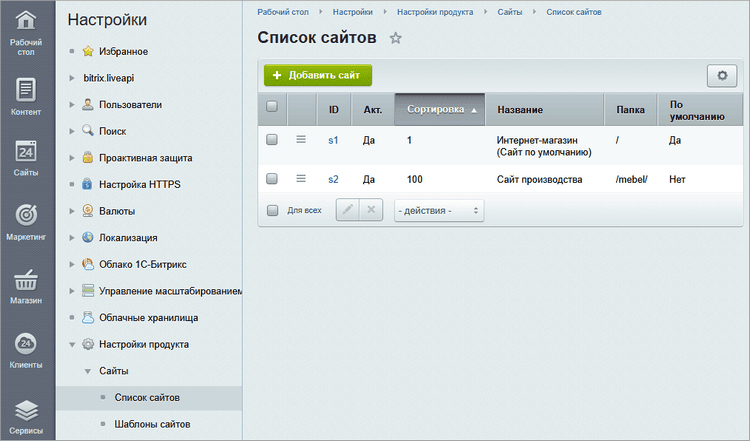
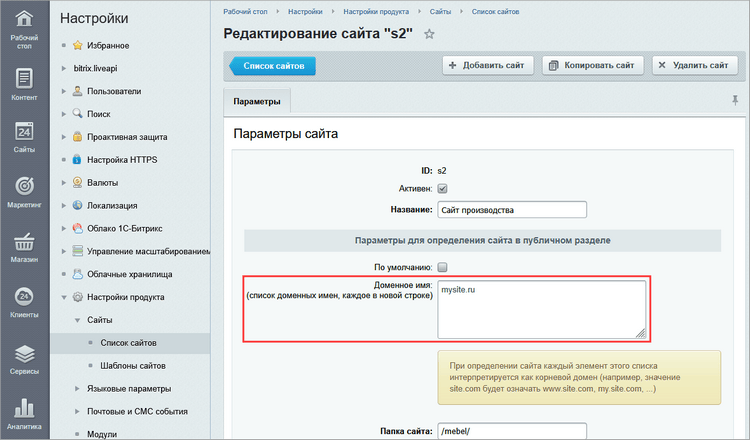

Сайт в Bitrix Framework — это запись с идентификатором, папкой, доменами, языком и шаблонами. Один экземпляр продукта может обслуживать несколько сайтов. При каждом запросе ядро определяет текущий сайт по домену и папке и от него зависят шаблон страницы, язык, региональные настройки, параметры модулей и почтовые события. Разработчику идентификатор сайта нужен, чтобы привязывать к сайту данные, настройки и код.

Сайт состоит из трех частей:

1. Запись сайта. С записями работает ORM-класс `\Bitrix\Main\SiteTable`, с доменами сайта — `\Bitrix\Main\SiteDomainTable`, с привязкой шаблонов — `\Bitrix\Main\SiteTemplateTable`.

2. Файлы:

   -  публичные файлы в папке сайта,

   -  [шаблон сайта](./site-templates.md),

   -  код инициализации для конкретного сайта в `/local/php_interface/<ID сайта>/init.php`. Ядро подключает его после общего `init.php`. Подробнее о папках — в статье [Структура директорий](../get-started/directory-structure.md).

3. Настройки, привязанные к сайту, например параметры модулей. Метод [`\Bitrix\Main\Config\Option::get()`](../api-reference/main/config/option/get.md) принимает идентификатор сайта четвертым аргументом. Если аргумент не передан, метод берет текущий сайт из контекста. Значения для сайта хранятся отдельно от общих. Если значения для сайта нет, метод возвращает общее значение, поэтому задавать параметр для каждого сайта не обязательно.



Как настроить несколько сайтов на одном экземпляре продукта, описано в статье [Многосайтовость](../advanced/multisite.md).



## Работа с сайтами

Для управления сайтами в административном разделе предназначена страница *Настройки > Настройки продукта > Сайты > Список сайтов*. Каждый сайт представлен отдельной строкой с идентификатором, названием, папкой и признаками активности и сайта по умолчанию.

{width=750px height=441px}

### Как создать новый сайт

1. На странице со списком сайтов нажмите *Добавить сайт*.

2. Заполните параметры сайта. В скобках указан ключ поля в массиве полей `CSite`. Те же ключи есть в `SiteTable`, кроме `DOMAINS` и `TEMPLATE`. Домены в ORM хранит `SiteDomainTable`, шаблоны — `SiteTemplateTable`.

   -  ID (`LID`) — уникальный идентификатор сайта, обязательное поле. Идентификатор состоит ровно из двух символов — латинских букв, цифр или подчеркивания, например `s1`.

   -  Активен (`ACTIVE`) — отметьте, чтобы сайт открывался в публичной части. Неактивный сайт ядро не выбирает при определении текущего сайта по домену и папке. Значения `Y` или `N`, по умолчанию `Y`.

   -  Название (`NAME`) — название сайта для административного раздела, не короче двух символов. В базе данных хранится до 50 символов. Передавайте ключ в `CSite::Add()` обязательно. Метод проверяет поле, только если ключ передан. Без ключа результат зависит от базы данных. В MySQL без строгого режима, как после установки продукта, сайт сохранится с пустым значением, в PostgreSQL сохранение завершится ошибкой базы данных.

   -  По умолчанию (`DEF`) — отметьте, чтобы сделать сайт основным. Ядро открывает его, только если запрос не подошел ни одному активному сайту ни по папке, ни по домену. Метод `SiteTable::getDefaultSite()` возвращает этот сайт, если он активен, иначе `null`. Сайт по умолчанию может быть только один, при сохранении флага у другого сайта он снимается.

   -  Доменное имя (`DOMAINS`) — список доменов, каждый с новой строки. В `CSite` поле передают строкой, а не массивом, домены разделяют символом `"\n"`, например `"en.site.com\nwww.en-site.com"`. Пустая строка удаляет все домены сайта. Каждый домен работает как корневой, например `site.com` подходит и для `www.site.com`, и для `my.site.com`. Если список заполнен, на основных шагах выбора сайт подходит только для этих доменов и их поддоменов. Если пуст, сайт подходит для любого домена. Ядро приводит домены к нижнему регистру, убирает `http://`, `https://` и завершающий `/`, а кириллические домены переводит в punycode.

   -  Папка сайта (`DIR`) — путь к папке сайта от корня, например `/` или `/en/`, до 50 символов, обязательное поле. Ядро проверяет только, что значение не пустое. Передавайте ключ в `CSite::Add()` обязательно, как и `NAME`. Сайт с пустой папкой подходит для любого пути и нарушает выбор сайта.

      Методы `CSite::Add()` и `CSite::Update()` создают папку, если ее нет, но файлы в ней не создают. Папку методы создают от корня текущего запроса `$_SERVER['DOCUMENT_ROOT']`, а не от поля `DOC_ROOT` сайта. Разместите в папке публичные файлы сайта, например `index.php`, иначе страницы сайта не откроются.

   -  Сортировка (`SORT`) — порядок сайта в списке и при выборе сайта по домену, целое число. По умолчанию `100`.

   -  Путь к корневой папке веб-сервера для этого сайта (`DOC_ROOT`) — заполните, если у сайта своя корневая папка веб-сервера. Оставьте пустым, если у всех сайтов одна корневая папка.

   -  Название веб-сайта (`SITE_NAME`) — название, которое видят посетители. Ядро подставляет его в письма вместо макроса `#SITE_NAME#`. Если поле пустое, берется название из настроек главного модуля.

   -  URL сервера (`SERVER_NAME`) — адрес сайта без протокола, например `www.site.com`. Ядро подставляет его в письма вместо макроса `#SERVER_NAME#` и задает константу `SITE_SERVER_NAME`. Если поле пустое, в письма попадает адрес из настроек главного модуля, а константа остается пустой.

   -  E-Mail адрес по умолчанию (`EMAIL`) — адрес отправителя писем сайта, подставляется вместо макроса `#DEFAULT_EMAIL_FROM#`. Если поле пустое, ядро берет адрес из настроек главного модуля. Почтовые шаблоны описаны в статье [Почтовые события](./mail.md).

   -  Язык (`LANGUAGE_ID`) — код языка публичных страниц сайта, например `en`, обязательное поле для нового сайта.

   -  Региональные настройки (`CULTURE_ID`) — числовой идентификатор записи `\Bitrix\Main\Localization\CultureTable` с [региональными](../advanced/localization.md) форматами даты, времени, имени и кодировкой сайта, обязательное поле для нового сайта.

   -  Создать почтовые шаблоны — что сделать с почтовыми шаблонами для нового сайта. Шаблоны можно не создавать, привязать к имеющимся почтовым шаблонам другого сайта или скопировать почтовые шаблоны другого сайта.

   -  Запустить мастер установки — поле есть только у нового сайта. Вариант *Запустить мастер установки решения* выбран по умолчанию, после сохранения запускается мастер, а шаблоны из формы не сохраняются. Если в папке сайта уже есть `index.php`, сохранение завершается ошибкой, пока не отмечена замена существующего решения. Вариант *Выбрать шаблон* сохраняет шаблоны из формы.

   -  Шаблон сайта (`TEMPLATE`) — один или несколько шаблонов с условиями применения. Шаблон определяет дизайн страниц, меню, навигацию и включаемые области. В `CSite` поле передают массивом элементов с ключами `TEMPLATE` — идентификатор шаблона, `CONDITION` — условие, пустое для шаблона по умолчанию, и `SORT` — порядок проверки условий.

3. Сохраните сайт. Если поле заполнено неверно, форма покажет ошибку и сайт не создастся.

Сайту можно назначить несколько шаблонов и для каждого задать условие применения, например папку или файл, группу пользователей, период времени. Как система выбирает шаблон, читайте в разделе [Условия применения шаблона](./site-templates.md#template-conditions) статьи «Шаблоны сайтов».

### Как ядро выбирает текущий сайт

При каждом запросе ядро сравнивает домен и путь страницы с активными сайтами:

1. Ядро сортирует сайты по длине папки сайта, от длинной к короткой, затем сайты с доменами ставит перед сайтами без доменов, затем сортирует по полю `SORT` по возрастанию.

2. Ядро выбирает первый сайт, у которого путь страницы начинается с папки сайта, а домен запроса совпадает с одним из доменов сайта или является его поддоменом. Например, домен `site.com` подходит для `shop.site.com`, но не для `mysite.com`. Сайт без списка доменов подходит для любого домена.

3. Если такого сайта нет, ядро последовательно ослабляет условия. Сначала оно ищет среди сайтов, подошедших по домену или папке, сайт, папка которого начинается с запрошенного пути, затем сайт с подходящим доменом при несовпадении папки, затем первый сайт, подошедший по папке или домену.

4. Сайт по умолчанию ядро выбирает, только если ни один активный сайт не подошел ни по папке, ни по домену. Если активного сайта по умолчанию нет, ядро берет первый активный сайт по сортировке.

Если среди активных сайтов есть сайт с папкой `/`, он подходит для любого пути, поэтому шаг 4 обычно не выполняется.

Сайты с одинаковой папкой и доменами ядро сравнивает по `SORT`. Поэтому сайты на поддоменах с той же папкой должны иметь меньшее значение сортировки, чем сайт основного домена. Домен `site.com` подходит и для `shop.site.com`, и при большей сортировке сайта `shop.site.com` первым окажется сайт основного домена. Для сайтов на разных доменах ограничений нет. Подробно режимы описаны в статье [Многосайтовость](../advanced/multisite.md#kak-sistema-razlichaet-sajty).

## Сайт в коде

Текущий сайт ядро определяет при подключении и сохраняет в [контексте приложения](../framework/app-and-context.md) и в константах:

-  `SITE_ID` — идентификатор текущего сайта, например `s1`,
-  `SITE_DIR` — папка текущего сайта, например `/` или `/en/`,
-  `LANGUAGE_ID` — язык текущей страницы,
-  `SITE_SERVER_NAME` — значение поля *URL сервера* текущего сайта,
-  `SITE_TEMPLATE_ID` — идентификатор шаблона текущей страницы.

В административном разделе сайт не определяется, поэтому `SITE_ID` там содержит идентификатор языка интерфейса, например `ru`. В административном коде не используйте `SITE_ID` как идентификатор сайта, получайте сайт явно, например через `SiteTable::getDefaultSiteId()`.

В консольных скриптах и cron домена запроса нет. Чтобы ядро работало от имени нужного сайта, задайте константу `SITE_ID` до подключения ядра, например `define('SITE_ID', 's1')`. Тогда ядро берет сайт по идентификатору без выбора по домену и без проверки активности. Если сайта с таким идентификатором нет, ядро выбрасывает исключение `\Bitrix\Main\SystemException` с текстом вида `Incorrect site: <ID>.`.

**Пример.** Код получает идентификатор и папку текущего сайта через контекст приложения. Метод `getSite()` возвращает идентификатор сайта, метод `getSiteObject()` — объект записи сайта. В административном разделе оба метода возвращают `null`:

```php
use Bitrix\Main\Application;

$context = Application::getInstance()->getContext();
$siteId = $context->getSite(); // например, 's1'
$site = $context->getSiteObject();

if ($site)
{
    $siteDir = $site->getDir(); // например, '/'
}
```

### Получить список сайтов

ORM-класс `\Bitrix\Main\SiteTable` читает записи сайтов методом `getList()`. Кроме полей формы, класс содержит связи `LANGUAGE` и `CULTURE` с языком и региональными настройками сайта. Метод `getDefaultSite()` возвращает объект сайта по умолчанию или `null`, метод `getDefaultSiteId()` — его идентификатор.

**Пример.** Код выводит идентификатор, название и папку всех активных сайтов в порядке сортировки:

```php
use Bitrix\Main\SiteTable;

$sites = SiteTable::getList([
    'select' => ['LID', 'NAME', 'DIR'],
    'filter' => ['=ACTIVE' => 'Y'],
    'order' => ['SORT' => 'ASC'],
]);

while ($site = $sites->fetch())
{
    echo $site['LID'] . ' — ' . $site['NAME'] . ' — ' . $site['DIR'] . PHP_EOL;
}
```

Домены сайтов хранятся отдельно, их читает ORM-класс `\Bitrix\Main\SiteDomainTable` с полями `LID` и `DOMAIN`.

### Создать сайт в коде

Для создания и изменения сайта используйте класс классического API `CSite`. У `SiteTable` нет аналога, который сохраняет домены и шаблоны, снимает флаг сайта по умолчанию у других сайтов и проверяет поля. Метод `Add()` проверяет поля так же, как форма в административном разделе. Метод возвращает идентификатор сайта или `false`. Текст ошибки находится в свойстве `LAST_ERROR`, объект ошибки возвращает `$APPLICATION->GetException()`.

Домены сайта меняйте через поле `DOMAINS` методов `CSite::Add()` и `CSite::Update()`, а не через `SiteDomainTable`. Класс `CSite` вместе с доменами выставляет служебный флаг `DOMAIN_LIMITED`, который ядро учитывает при выборе сайта.

**Пример.** Код находит региональные настройки с кодом `en` и создает активный сайт `s2` в папке `/en/` для домена `en.site.com` с шаблоном `.default`. Код выполняется после подключения ядра, язык `en` должен быть установлен в продукте:

```php
use Bitrix\Main\Localization\CultureTable;

$culture = CultureTable::getList([
    'filter' => ['=CODE' => 'en'],
    'select' => ['ID'],
])->fetch();

$site = new CSite();
$siteId = $site->Add([
    'LID' => 's2',
    'ACTIVE' => 'Y',
    'NAME' => 'English site',
    'DIR' => '/en/',
    'DOMAINS' => 'en.site.com',
    'SORT' => 100,
    'LANGUAGE_ID' => 'en',
    'CULTURE_ID' => $culture ? (int)$culture['ID'] : 0,
    'SERVER_NAME' => 'en.site.com',
    'EMAIL' => 'info@site.com',
    'TEMPLATE' => [
        ['TEMPLATE' => '.default', 'CONDITION' => '', 'SORT' => 1],
    ],
]);

if ($siteId === false)
{
    echo $site->LAST_ERROR;
}
```

Метод `Add()` возвращает `false` и заполняет `LAST_ERROR`, если:

-  идентификатор `LID` не из двух символов или содержит символы кроме латинских букв, цифр и подчеркивания,
-  название `NAME` короче двух символов,
-  папка `DIR` пустая,
-  язык `LANGUAGE_ID` или региональные настройки `CULTURE_ID` не заданы или не существуют,
-  в `TEMPLATE` нет ни одного существующего шаблона, список шаблонов пуст или пара «шаблон и условие» повторяется. Несуществующий шаблон рядом с существующим ошибки не вызывает и записывается вместе с ним,
-  сайт с таким `LID` уже существует,
-  передано пустое значение `SORT`,
-  обработчик события `OnBeforeSiteAdd` отменил сохранение.

Метод `Update($id, $fields)` меняет поля существующего сайта и возвращает `true` или `false`. Он проверяет переданные поля по тем же правилам, кроме уникальности `LID` и обязательности `LANGUAGE_ID` и `CULTURE_ID`. Ключи `TEMPLATE` и `DOMAINS` заменяют весь набор шаблонов и доменов сайта. Чтобы добавить один шаблон, передайте все шаблоны сайта вместе с новым. Сохранение может отменить обработчик [события](../framework/events.md) `OnBeforeSiteUpdate`.

Статический метод `CSite::Delete($id)` удаляет сайт вместе с его доменами, шаблонами и привязками почтовых шаблонов. Метод возвращает `false`, если удалить не удалось или удаление отменил обработчик события `OnBeforeSiteDelete` или `OnBeforeLangDelete`. При успехе метод возвращает непустой результат запроса, поэтому проверяйте результат через `=== false`. Для несуществующего идентификатора метод тоже возвращает непустой результат. Если удаление отменил обработчик события, текст ошибки возвращает `$APPLICATION->GetException()`. При ошибке базы данных метод возвращает `false` без объекта ошибки.

## Изменить домен сайта

Новый домен сначала направляют на сервер сайта, затем указывают в настройках сайта.

1. Привяжите домен к хостингу сайта. Если домен и хостинг у разных провайдеров, добавьте домен в настройки хостинга и укажите DNS-серверы хостинга у регистратора домена. Изменения DNS могут вступать в силу до нескольких дней.

2. Откройте настройки сайта *Настройки > Настройки продукта > Сайты > Список сайтов > \[ваш\_сайт\]*.

3. Замените домен в поле *Доменное имя* и адрес в поле *URL сервера*. Если поле *Доменное имя* было пустым, его можно не заполнять, тогда сайт подходит для любого домена.

{width=750px height=440px}



Если в [проактивной защите](./../security/proactive-security.md#hosts-domains) настроено ограничение доступа или перенаправление запросов, укажите новый домен на странице *Настройки > Проактивная защита > Хосты/домены*.



## Что дальше

- [Многосайтовость](../advanced/multisite.md) — несколько сайтов на одном или разных доменах.
- [Шаблоны сайтов](./site-templates.md) — дизайн сайта и условия применения шаблонов.
- [Структура директорий](../get-started/directory-structure.md) — где хранятся файлы сайта и `init.php`.
