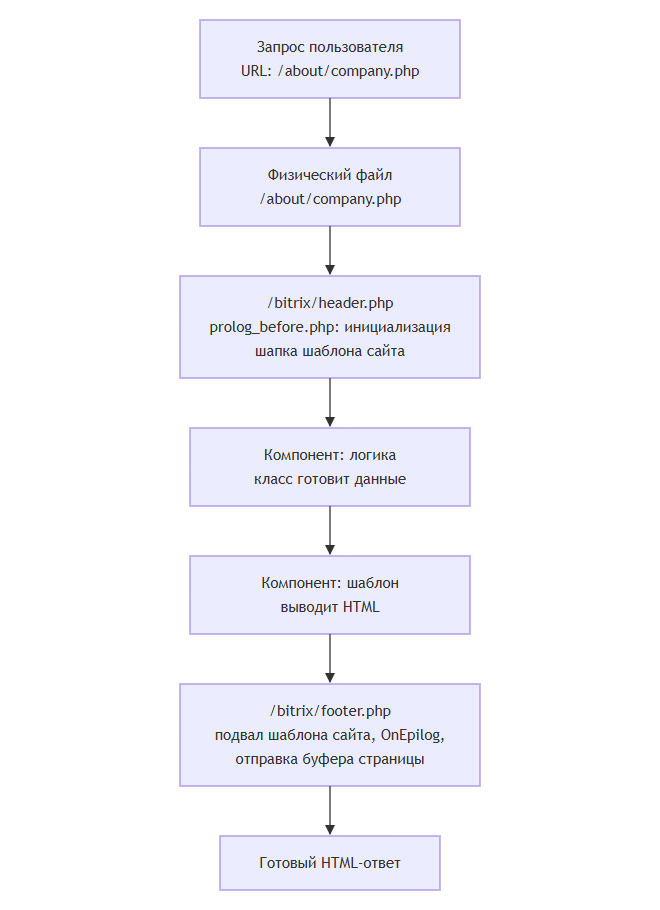

Bitrix Framework состоит из независимых модулей, которые работают друг с другом как единое приложение. Такая архитектура называется модульным монолитом. Каждый модуль лежит в своей папке в `/bitrix/modules/` или `/local/modules/` и содержит данные, бизнес-логику, контроллеры и компоненты своей предметной области. Подробнее об устройстве модуля — в статье [Архитектура модулей](./../modules/architecture.md).

Прочитайте статью, прежде чем создавать модуль, контроллер или страницу. Она показывает, из каких элементов строится проект, как модули связаны между собой и какими двумя способами система обрабатывает запрос, и помогает выбрать, где размещать код. Подробности по каждому элементу — в статьях по ссылкам.

О продуктах на Bitrix Framework, их модулях и зависимостях между модулями читайте в статье [Экосистема](../about/ecosystem.md).

## Основные принципы архитектуры

**Преемственность**. Новые версии сохраняют совместимость с предыдущими: классический API продолжает работать рядом с D7, поэтому сайты обновляются без переписывания кода.

**Кастомизация без правки ядра**. Собственный код размещают в `/local/`: модули, компоненты, шаблоны. Файлы ядра в `/bitrix/` не меняют, иначе изменения пропадут при обновлении. Подробнее в статье [Как кастомизировать](./../get-started/how-customize.md).

**Расширяемость**. Разработчики создают свои модули, компоненты и решения и встраиваются в чужую логику через события, не изменяя код других модулей.

## MVC в Bitrix Framework

Проекты строятся по схеме MVC:

-  M (Model) — данные и бизнес-логика: [ORM](./../orm/orm-concepts.md) и сервисы модуля,

-  V (View) — [шаблоны сайтов](./../cms-basics/site-templates.md), [шаблоны страниц](./../cms-basics/page-templates.md) и шаблоны [компонентов](./components.md),

-  C (Controller) — [контроллеры](./controllers.md), то есть обработка запросов.

## Слои модуля и связи между модулями

Модуль делится на четыре слоя: контроллеры принимают запрос и возвращают ответ, представление выводит данные, модель содержит бизнес-логику и [ORM-классы](./../orm/orm-concepts.md) для работы с данными, инфраструктура связывает модули и выполняет фоновые задачи. Первые три слоя соответствуют MVC из раздела выше, инфраструктура лежит вне MVC. Элементы слоев и где размещают их код:

| Элемент | Слой модуля | Назначение | Где размещают | Статья |
|---|---|---|---|---|
| Контроллеры | Контроллеры | Классы с действиями, которые обрабатывают запрос | Папка `lib/` модуля | [Контроллеры](./controllers.md) |
| Префильтры и постфильтры | Контроллеры | Обработчики до и после действия контроллера: проверка авторизации, метода запроса, CSRF-токена | В контроллере | [Префильтры и постфильтры](./pre-post-filters.md) |
| Компоненты | Представление | Блоки страницы: класс компонента готовит данные, шаблон выводит их. Бизнес-логику размещают в модели | `/local/components/` | [Компоненты](./components.md) |
| Шаблоны | Представление | Шаблоны сайта, страниц и компонентов | `/local/templates/` | [Шаблоны сайта](./../cms-basics/site-templates.md) |
| Расширения | Представление | Подключаемые JavaScript- и CSS-библиотеки для интерфейса | `/local/js/` | [Расширения](./extensions.md) |
| ORM-классы | Модель | Описание данных и работа с таблицами | Папка `lib/` модуля | [Концепция ORM](./../orm/orm-concepts.md) |
| Сервисы | Модель | Классы со сложной бизнес-логикой, которые можно регистрировать в сервис-локаторе и получать через него | Папка `lib/` модуля | [Сервис-локатор](./service-locator.md) |
| События и обработчики | Инфраструктура | Связь бизнес-логики внутри модуля и между модулями без прямых вызовов | Обработчики — в `lib/` модуля | [События](./events.md) |
| Агенты | Инфраструктура | Задачи, которые выполняются по расписанию | Класс агента — в `lib/` модуля | [Агенты и фоновые задачи](./background-jobs.md) |

Модуль может вызывать публичный API другого модуля напрямую после подключения этого модуля вызовом `\Bitrix\Main\Loader::includeModule()`. Метод возвращает `false`, если модуль не установлен, — проверяйте результат перед вызовом. Чтобы модули меньше зависели от внутренних классов друг друга, связь между ними строят через события и [сервис-локатор](./service-locator.md). Подробнее — в разделе [Взаимодействие модулей](./../modules/architecture.md#vzaimodejstvie-modulej).

<iframe src="pages/framework/_images/architecture.svg" width="100%" height="341px" style="border:none;"></iframe>

На схеме EventBus — условное обозначение механизма событий `Bitrix\Main\EventManager`, ServiceLocator — класс `Bitrix\Main\DI\ServiceLocator`.

## Обработка запроса

Bitrix Framework поддерживает два подхода к обработке запросов.

| Подход | Когда использовать |
|---|---|
| [Роутинг и контроллеры](#controllers) | Новый код, API и страницы, адрес которых не совпадает с файлом на диске. Подход разделяет логику, шаблоны и данные по принципам MVC |
| [Физические страницы](#pages) | Страницы существующего сайта на шаблоне. Это основа CMS и большинства проектов: страница подключает шаблон сайта и вызывает компоненты |

Подробно путь запроса от веб-сервера до ответа описан в статье [Жизненный цикл запроса](./request-lifecycle.md).

### Роутинг и контроллеры {#controllers}

Запросы к адресам, для которых на диске нет файла, веб-сервер направляет в одну из двух точек входа:

-  `/bitrix/routing_index.php` сначала ищет маршрут, а если не находит — применяет правила `/urlrewrite.php`,

-  `/bitrix/urlrewrite.php` сначала применяет правила `/urlrewrite.php`, а маршруты проверяет, только если ни одно правило не подошло. Так настроено по умолчанию, например в Docker-окружении.

Как переключить точку входа — в разделе [Как включить роутинг](./routing.md#enable-routing). Роутер по [правилам маршрутизации](./routing.md) определяет, какой обработчик выполнит запрос. Маршруты описывают в файлах `/local/routes/*.php` и подключают в секции `routing` файла `/bitrix/.settings.php` или, с версии 24.100.0 главного модуля, `/local/.settings_extra.php` — подробнее в разделе [Конфигурация](./routing.md#configuration). Роутинг поддерживает главный модуль версии 21.400.0 и выше.

Действия контроллеров можно вызывать из JavaScript и без маршрута — через отдельную точку входа `/bitrix/services/main/ajax.php`. Подробнее в разделе [Настроить AJAX-контроллер](./controllers.md#http-ajax).

Порядок обработки запроса через `routing_index.php`:

1. **Загрузка ядра**. `routing_index.php` подключает `/bitrix/modules/main/start.php`: [автозагрузку классов](./autoloading.md), конфигурацию и базовые константы.

2. **Поиск маршрута**. Роутер сравнивает URL с маршрутами. Если маршрут не найден, запрос обрабатывается по правилам из файла `/urlrewrite.php` в корне сайта, а затем страницей `/404.php`, если она есть.

3. **Подготовка**. Зависит от обработчика маршрута:

   -  контроллер, класс действия или замыкание — система подключает `/bitrix/modules/main/include/prolog_before.php`: инициализирует сайт, язык и пользователя. Права доступа к физическим файлам не проверяются — константа `NOT_CHECK_FILE_PERMISSIONS`. Проверяйте доступ в действии или в [префильтрах](./pre-post-filters.md),

   -  публичная страница `\Bitrix\Main\Routing\Controllers\PublicPageController` — подключается физический файл страницы, и он обрабатывается как [физическая страница](#pages): ядро само проверяет право на чтение файла. Подробнее в разделе [Публичные страницы на контроллерах](./routing.md#controller-public-pages).

4. **Действие**. Запускается обработчик маршрута: метод действия контроллера, например `detailAction()`, класс действия или замыкание — подробнее в разделе [Типы обработчиков маршрутов](./routing.md#route-handlers). Действие работает с моделью, получает данные и готовит результат.

5. **Формирование ответа**. Правила зависят от обработчика:

   -  действие контроллера вернуло [`\Bitrix\Main\HttpResponse`](./request-response.md), например редирект, — ответ отправляется как есть,

   -  действие контроллера вернуло другой результат — система оборачивает его в JSON `{"status":"success","data":…,"errors":[]}`, при ошибках `status` принимает значение `error`, а ошибки передаются в `errors`,

   -  замыкание вернуло `HttpResponse` — ответ отправляется как есть, массив — как JSON без обертки, строку и другие скалярные значения — телом ответа `HttpResponse`, `null` — ответ не формируется.

   Подробнее в статье [Контроллеры](./controllers.md).

{width=820px height=944px}

### Физические страницы {#pages}

Запрос пользователя поступает на PHP-файл в структуре сайта, например, `/about/company.php`.

Порядок обработки запроса:

1. **Запуск страницы**. Сервер выполняет код файла `/about/company.php`.

2. **Подключение заголовка**. Файл `/about/company.php` подключает `/bitrix/header.php`, который подключает:

   -  `prolog_before.php` для инициализации фреймворка и сайта,

   -  [шаблон сайта](./../cms-basics/site-templates.md), если он настроен в системе.

3. **Генерация контента**. Код страницы вызывает [компоненты](./components.md) через `$APPLICATION->IncludeComponent()`. Компонент выполняет логику, затем подключает шаблон с HTML-разметкой и логикой отображения.

4. **Подключение подвала**. В конце файл `/about/company.php` подключает `/bitrix/footer.php`. Он подключает эпилог: нижнюю часть шаблона сайта `footer.php`, обработчики [события](./events.md) `OnEpilog`, отправку собранного буфера страницы и завершающие действия `CMain::FinalActions()`.

{width=660px height=910px}

Шаги подготовки и завершения страницы подробно описаны в статье [Жизненный цикл запроса](./request-lifecycle.md#start-page-lifecycle).

## Что дальше

-  [Жизненный цикл запроса](./request-lifecycle.md) — путь запроса от веб-сервера до ответа,

-  [Роутинг](./routing.md) и [Контроллеры](./controllers.md) — обработка запросов в новом коде,

-  [Архитектура модулей](./../modules/architecture.md) — структура и установка модуля,

-  [Создание модуля](./../get-started/create-module.md) — пошаговый пример.
