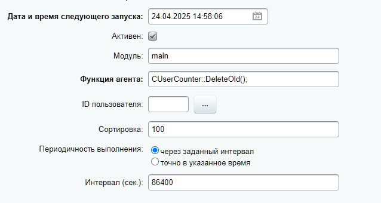

Агенты и фоновые задачи помогают выполнять PHP-код автоматически.

-  Агенты — запускают код по расписанию.

-  Фоновые задачи — после отправки ответа пользователю.

## Отличия агентов от фоновых задач {#agents-vs-background-tasks}

| **Характеристика** | **Агенты**                                                             | **Фоновые задачи**              |
|--------------------|------------------------------------------------------------------------|---------------------------------|
| Запуск             | При посещении сайта посетителями (на хитах) и по расписанию через cron | Сразу после ответа пользователю |
| Время начала       | После наступления срока, при очередной проверке агентов                 | При завершении текущего запроса, после отправки ответа |
| Порядок выполнения | С учетом состояния запуска и параметра сортировки `SORT`                | По убыванию числового приоритета |
| Подходит для       | Регулярных и поэтапных задач                                            | Разовых операций в рамках текущего запроса |

Для сложных сценариев можно комбинировать оба подхода. Перед регистрацией подготовьте установленный модуль `my.module`, в котором доступен класс `MyLongProcess` со статическим методом `start()`. Метод должен соблюдать [правила функции агента](#agent-functions).

Запускайте такой код один раз, например по действию пользователя, а не на каждом хите. Если агент с тем же кодом вызова уже есть, `CAgent::AddAgent()` вернет `false` и зарегистрирует ошибку. Чтобы вместо ошибки получить ID существующего агента, передайте последним параметром `$existError = false`.

**Пример.** Фоновая задача регистрирует агента для поэтапной обработки:

```php
$app = \Bitrix\Main\Application::getInstance();
$app->addBackgroundJob(static function ()
{
    // Последний параметр false: повторный вызов вернет ID существующего агента без ошибки
    CAgent::AddAgent('MyLongProcess::start();', 'my.module', 'N', 60, '', 'Y', '', 100, false, false);
});
```

## Агенты

Агент — это запись в базе данных, которая содержит:

-  код для выполнения,

-  время следующего запуска,

-  интервал выполнения,

-  тип агента: периодический или непериодический.

За один проход система выбирает агентов с наступившим сроком и выполняет их последовательно. Какие агенты попадают в проход и сколько их, зависит от режима.

| Режим | Какие агенты выбираются | Лимит за проход |
|---|---|---|
| Без разделения, `agents_use_crontab = N` и нет `BX_CRONTAB_SUPPORT` | Все агенты | Настройка `agents_limit`, по умолчанию 100 |
| Разделение включено — `agents_use_crontab = Y` или `BX_CRONTAB_SUPPORT = true`. Обычный хит без `BX_CRONTAB = true` | Только периодические | Настройка `agents_limit`, по умолчанию 100 |
| Разделение включено — `agents_use_crontab = Y` или `BX_CRONTAB_SUPPORT = true`. Скрипт с `BX_CRONTAB = true` | Только непериодические | Настройка `agents_cron_limit`, по умолчанию 1000 |

Значение лимита `0` снимает ограничение. Если проход длится дольше 570 секунд, оставшиеся агенты ждут следующей проверки.

Перед выполнением система откладывает повторную проверку выбранных агентов на 600 секунд. Это не ограничение времени работы PHP-функции и не гарантия отсутствия параллельных запусков при обработке дольше 10 минут. Длительную задачу разбивайте на шаги, сохраняя результат каждого шага. Для пошаговой обработки больших объемов данных есть штатный механизм — [Итератор](../advanced/stepper.md).

### Типы агентов

-  **Периодические.** Отсчитывают интервал от ранее запланированного запуска. Фактический запуск зависит от момента проверки агентов.

   `Время следующего запуска = ранее запланированное время запуска + интервал`.

-  **Непериодические.** Отсчитывают интервал от окончания предыдущего успешного выполнения.

   `Время следующего запуска = время окончания работы + интервал`.

### Функции агентов {#agent-functions}

Функция агента выполняет задачу и возвращает результат, от которого зависит судьба агента:

-  строка с кодом вызова, например `'TestAgent();'`, — система сохраняет ее как код следующего запуска и планирует запуск через интервал агента,
-  объект `Bitrix\Main\Type\Callback` — система сохраняет его как обработчик следующего запуска. Подробнее в разделе [Зарегистрировать агента без строки PHP-кода](#agent-callback),
-  пустая строка, `null` или `false` — система удаляет агента из списка.

Функция может изменить код следующего вызова, например передать в него счетчик или идентификатор последней обработанной записи. Чтобы изменить интервал до следующего запуска, функция присваивает новое значение в секундах глобальной переменной `$pPERIOD`. Перед вызовом система записывает в нее интервал агента.

Если функция выбросит исключение, система запишет ошибку в журнал и сохранит запись агента. Повторный запуск произойдет не раньше чем через 600 секунд, когда закончится отсрочка проверки. Функция, которая падает на одних и тех же данных, будет повторяться каждые 10 минут. Обрабатывайте ожидаемые ошибки внутри функции и возвращайте код следующего вызова.

**Пример.** Функция отправляет письмо и возвращает свой вызов для повторного запуска:

```php
function TestAgent()
{
    mail('admin@example.com', 'Тест агента', 'Агент работает'); // Код задачи
    return 'TestAgent();'; // Для повторного запуска
    // Для остановки агента верните пустую строку: return '';
}
```

**Пример.** Агент обрабатывает очередь и при пустой очереди откладывает следующий запуск на час:

```php
function ProcessQueueAgent()
{
    global $pPERIOD;

    $processed = 0; // Обработайте порцию записей и сохраните их количество

    if ($processed === 0)
    {
        $pPERIOD = 3600;
    }

    return 'ProcessQueueAgent();';
}
```

#### Где размещать функции

-  **В модуле.** Укажите модуль при регистрации агента. Функция становится доступной после подключения модуля, то есть файла `/local/modules/<ID модуля>/include.php` или `/bitrix/modules/<ID модуля>/include.php`.

   ```php
   CAgent::AddAgent('MyFunction();', 'my.module');
   ```

-  **Без модуля.** Разместите функцию в файле `/local/php_interface/init.php`. Модуль в параметрах регистрации указывать не нужно.

   ```php
   CAgent::AddAgent('MyFunction();');
   ```

Для нового кода используйте собственный модуль. Файл `init.php` подключается на раннем этапе пролога, поэтому ошибка в файле может нарушить работу сайта.

### Зарегистрировать агента

Для работы с агентами используйте методы класса [CAgent](https://dev.1c-bitrix.ru/api_help/main/reference/cagent/index.php).

Выполняйте регистрацию после подключения ядра, например в установщике собственного модуля. Функция `MyFunction()` в примерах должна быть доступна после подключения модуля `my.module` и соблюдать [правила функции агента](#agent-functions).

-  Метод `CAgent::AddAgent()` добавляет агент. Передайте параметры в следующем порядке:

   ```php
   CAgent::AddAgent(
       'MyFunction();',      // Код вызова функции
       'my.module',           // Идентификатор модуля
       'N',                  // N — непериодический, Y — периодический
       3600,                 // Интервал в секундах. Например, 3600 сек, то есть 1 час
       '',                   // Параметр datecheck в текущей реализации не используется
       'Y',                  // Y — активен, N — неактивен
       '',                   // Пустая дата — доступен при ближайшей проверке
       100,                  // Сортировка SORT
       false,                // ID пользователя. По умолчанию false, то есть для системных агентов
       true                  // Выдавать ошибку при дублировании агента
   );
   ```

   Обязателен только `$name` — строка с PHP-кодом вызова. Остальные параметры имеют значения по умолчанию:

   - `$module = ''` — строка с идентификатором модуля, который система подключит перед запуском.
   - `$period = 'N'` — тип агента: `N` — непериодический, `Y` — периодический.
   - `$interval = 86400` — интервал в секундах.
   - `$datecheck = ''` — в текущей реализации не используется. Передавайте пустую строку.
   - `$active = 'Y'` — активность: `Y` — выполнять, `N` — не выполнять.
   - `$next_exec = ''` — строка с датой первого запуска в полном формате региональных настроек сайта. Пустая строка делает агент доступным при ближайшей проверке. Для формирования даты используйте `ConvertTimeStamp($timestamp, 'FULL')`.
   - `$sort = 100` — целое число для сортировки. Среди агентов с одинаковым состоянием запуска сначала выбираются агенты с большим `SORT`.
   - `$user_id = false` — идентификатор пользователя или `false` для системного агента. Это значение не авторизует пользователя при выполнении.
   - `$existError = true` — поведение при дублировании: `true` — вернуть `false` и зарегистрировать ошибку, `false` — вернуть ID существующего агента.

   Метод возвращает ID агента или `false` при ошибке. Дубликат определяется по коду вызова и пользователю, модуль при этом не учитывается. Текст ошибки метод передает в `$APPLICATION->ThrowException()`, получить его можно методом `$APPLICATION->GetException()`.

   **Пример.** Регистрация агента в установщике модуля с проверкой результата. Если агент уже есть, метод вернет его ID без ошибки, потому что последний параметр равен `false`:

   ```php
   global $APPLICATION;

   $agentId = CAgent::AddAgent('MyFunction();', 'my.module', 'N', 3600, '', 'Y', '', 100, false, false);
   if ($agentId === false)
   {
       $exception = $APPLICATION->GetException();
       $message = $exception ? $exception->GetString() : 'Agent was not registered';
       // Прервите установку модуля и покажите $message
   }
   ```

-  Метод `RemoveAgent` удаляет агент.

   ```php
   CAgent::RemoveAgent(
       'MyFunction();',      // Код вызова функции агента
       'my.module',           // Модуль. Пустое значение используют только в старом коде без модуля
       false                 // ID пользователя. По умолчанию false, то есть для системных агентов
   );
   ```

Метод `CAgent::RemoveAgent()` удаляет запись, у которой совпадают код вызова, модуль и пользователь. При пустом `$module` метод ищет только агентов без модуля, поэтому для агента модуля передавайте идентификатор модуля. Метод ничего не возвращает. Чтобы проверить удаление, найдите агента методом `CAgent::GetList()`.

При снятии регистрации модуля метод [`ModuleManager::unRegisterModule()`](../api-reference/main/module-manager/un-register-module.md) автоматически удаляет все агенты с идентификатором этого модуля через `CAgent::RemoveModuleAgents()`. Поэтому в установщике модуля не нужно удалять каждый агент отдельно.

### Создать класс агента в модуле {#agent-class}

В модуле код агента можно разместить в классе с пространством имен. Статический метод выполняет задачу и возвращает строку с вызовом для следующего запуска. Регистрация такого агента остается через `CAgent::AddAgent()`.

Создайте класс в установленном модуле `my.module` с помощью команды [`make:agent`](./console-commands.md). Команда доступна с версии главного модуля 25.900.0. Выполните команду из папки `/bitrix/` сайта:

```bash prompt="$"
$ php bitrix.php make:agent UpdateRating -m my.module -n
```

Команда создаст файл `lib/Infrastructure/Agent/UpdateRatingAgent.php` в папке модуля. Опция `-m` задает идентификатор модуля, а `-n` отключает интерактивные вопросы. Генератор добавляет суффикс `Agent` к имени класса и выводит PHP-код регистрации.

Поместите код задачи в метод `runInternal()` сгенерированного класса:

```php
namespace My\Module\Infrastructure\Agent;

final class UpdateRatingAgent
{
    public static function run(): ?string
    {
        $instance = new static();
        $result = $instance->runInternal();

        if ($result === false)
        {
            return null;
        }

        return __METHOD__ . '();';
    }

    private function runInternal(): bool
    {
        // Добавьте код обновления рейтинга

        return true;
    }
}
```

Метод `runInternal()` возвращает `true`, чтобы продолжить запуски, или `false`, чтобы остановить агента. Метод `run()` преобразует результат в строку следующего вызова или `null` для остановки.

Зарегистрируйте агент один раз, например при установке модуля. Следующий пример задает непериодический запуск с интервалом в один час:

```php
CAgent::AddAgent(
    'My\\Module\\Infrastructure\\Agent\\UpdateRatingAgent::run();',
    'my.module',
    'N',
    3600
);
```

Система подключает указанный модуль перед вызовом агента. Класс загружает [автозагрузчик модуля](./autoloading.md#razmestit-klassy-v-lib/).

Регистрируйте агента строкой без ведущего обратного слеша, даже если генератор вывел код со слешем. После первого запуска метод `run()` сохраняет код следующего вызова из `__METHOD__`, а он не содержит ведущего слеша. Система ищет агента по точному коду вызова, поэтому строка со слешем после первого запуска перестанет совпадать с записью. Повторный `AddAgent()` создаст дубликат, а `RemoveAgent()` не найдет агента.

### Зарегистрировать агента без строки PHP-кода {#agent-callback}

Строку из параметра `$name` система выполняет через `eval()`. Чтобы не хранить PHP-код в базе, передайте вместо строки объект `Bitrix\Main\Type\Callback`. Система сохранит его в JSON и вызовет обработчик через `call_user_func_array()`. Проверьте, что класс `Bitrix\Main\Type\Callback` есть в установленной версии главного модуля.

Конструктор `Callback` принимает два параметра:

-  `$callback` — обязательный. Имя функции строкой или массив `[имя класса, имя статического метода]`,
-  `$arguments` — необязательный, по умолчанию `[]`. Список аргументов вызова с ключами 0, 1, 2 и так далее. Допустимы `null`, `bool`, `int`, конечные `float`, строки UTF-8 и массивы из таких значений. Вложенный массив должен быть списком или массивом со строковыми ключами. Объекты передавать нельзя, при недопустимом значении конструктор выбрасывает `ArgumentException`.

Чтобы продолжить запуски, метод агента возвращает новый объект `Callback`. Чтобы остановить агента, метод возвращает `null` или пустую строку.

**Пример.** Агент удаляет устаревшие записи и передает себе срок хранения в днях:

```php
namespace My\Module\Infrastructure\Agent;

use Bitrix\Main\Type\Callback;

final class CleanUpAgent
{
    public static function run(int $days): ?Callback
    {
        // Удалите записи старше $days дней
        // Чтобы остановить агента, верните null

        return new Callback([self::class, 'run'], [$days]);
    }
}
```

**Пример.** Регистрация агента с аргументом `30`:

```php
use Bitrix\Main\Type\Callback;
use My\Module\Infrastructure\Agent\CleanUpAgent;

CAgent::AddAgent(
    new Callback([CleanUpAgent::class, 'run'], [30]),
    'my.module',
    'N',
    86400
);
```

Метод `CAgent::AddAgent()` ищет дубликат по JSON объекта вместе с аргументами. Тот же обработчик с другими аргументами — это отдельный агент.

Метод `CAgent::RemoveAgent()` тоже принимает объект `Callback`. Передайте в него объект с тем же обработчиком и текущими аргументами агента. Если агент вернул `Callback` с другими аргументами, запись хранит уже новые аргументы, и объект с аргументами регистрации ее не найдет.

### Создать агента через интерфейс

Агента можно добавить через административный раздел на странице *Настройки > Настройки продукта > Агенты*. Нажмите *Добавить агента*. Укажите код вызова функции, модуль, активность, тип агента, интервал в секундах и дату следующего запуска. Сортировка задает порядок выбора агентов. Сохраните форму и проверьте, что агент появился в списке.

{width=638px height=340px}

### Запустить агента {#run-agent}

-  **На хитах.** Агент срабатывает, когда посетитель заходит на страницу. Если настройка `check_agents` модуля `main` равна `Y`, система добавляет проверку агентов в [фоновые задачи](#fonovye-zadachi) запроса с низким приоритетом. Агенты выполняются после отправки ответа посетителю и после обычных фоновых задач. Точность запуска зависит от посещаемости сайта. Долгие агенты на хитах занимают процессы веб-сервера и создают нагрузку на сайт.

-  **Через cron.** Проверка агентов запускается по расписанию и не зависит от посещаемости. Агент выполняется при очередной проверке после наступления срока. Частота cron и длительность других агентов могут задержать запуск.

#### Частично перевести запуск на cron

Агенты можно перевести на cron частично. Система продолжит запускать агенты при посещениях, а cron будет запускать только часть агентов.

Настройка `check_agents` модуля `main` в этом режиме должна остаться `Y` — это значение по умолчанию. Стандартный скрипт `cron_events.php` не вызывает `CAgent::CheckAgents()` напрямую. Он запускает агенты через ту же фоновую задачу, что и обычный хит, а при `check_agents = N` система эту задачу не добавляет.

1. Откройте страницу *Настройки > Инструменты > Командная PHP-строка.* Выполните код:

   ```php
   use Bitrix\Main\Config\Option;

   // Включить разделение агентов между хитами и cron
   Option::set('main', 'agents_use_crontab', 'Y');

   // Проверить текущее значение настройки
   echo Option::get('main', 'agents_use_crontab', 'Z'); // Вернет Y
   ```

   Ожидаемый результат — `Y`. Если метод не найдет значение настройки, он вернет `Z`.

   При значении `agents_use_crontab = Y` обычные хиты выполняют только периодические агенты. Стандартный скрипт `cron_events.php` определяет `BX_CRONTAB = true` и выполняет непериодические агенты. Лимиты для каждого режима приведены в таблице режимов в начале раздела [Агенты](#agenty).

2. Добавьте задание в системный crontab, например `/etc/crontab`, где после расписания указывают пользователя `bitrix`:

   ```cron
   # Выполнять каждые 10 минут от имени пользователя
   */10 * * * * bitrix /usr/bin/php -f /home/bitrix/www/bitrix/modules/main/tools/cron_events.php
   ```

   Замените `/home/bitrix/www/` на путь к сайту, `/usr/bin/php` — на путь к PHP CLI, а `bitrix` — на пользователя сайта. При настройке через `crontab -e` от имени пользователя сайта уберите поле `bitrix`.

#### Полностью перевести запуск на cron

Агенты не будут зависеть от посещаемости сайта. Задание cron проверяет сроки запуска каждые 10 минут, поэтому это расписание не гарантирует выполнение агента в точную секунду.

1. Откройте страницу *Настройки > Инструменты > Командная PHP-строка*. Выполните код, который отключит автоматическую проверку агентов на хитах и разделение агентов по типам.

   ```php
   use Bitrix\Main\Config\Option;

   // Отключить разделение агентов между хитами и cron
   Option::set('main', 'agents_use_crontab', 'N');
   echo Option::get('main', 'agents_use_crontab', 'Z'); // Выведет N

   // Отключить автоматическую проверку агентов на хитах
   Option::set('main', 'check_agents', 'N');
   echo Option::get('main', 'check_agents', 'Z'); // Выведет N
   ```
   Каждый вызов должен вернуть `N`. Если метод не найдет значение соответствующей настройки, он вернет `Z`.

2. Найдите в файле `/bitrix/php_interface/dbconn.php` определения констант `BX_CRONTAB_SUPPORT` и `BX_CRONTAB` и удалите их. Не добавляйте этот код, а удалите его из файла, если он есть.

   ```php
   // Удалите эти строки из dbconn.php
   define('BX_CRONTAB_SUPPORT', true);
   define('BX_CRONTAB', true);
   ```

3. Добавьте в файл `/bitrix/php_interface/dbconn.php` блок, который переносит отправку почтовых событий с хитов в cron. Константа `BX_CRONTAB_SUPPORT` без `BX_CRONTAB` отключает обработку почтовых событий на обычных хитах. Агентов хиты не выполняют уже из-за `check_agents = N` из шага 1. Условие с `CHK_EVENT` пропускает блок в собственном cron-скрипте из шага 4, поэтому скрипт выполняет агенты обоих типов.

   ```php
   if (!(defined('CHK_EVENT') && CHK_EVENT === true))
   {
       define('BX_CRONTAB_SUPPORT', true); // Разрешаем работу через cron
       // При этом обычные хиты не будут запускать агентов
   }
   ```

4. Создайте файл `/bitrix/php_interface/cron_events.php`. Скрипт выполняет агентов, рассылки модуля `sender`, расписание автоматического резервного копирования и почтовые события. Почтовые события обрабатывает фоновая задача, которую запускает `CMain::FinalActions()` в конце скрипта при `BX_CRONTAB = true`. Подключение `/bitrix/modules/main/tools/backup.php` сохраняет обработку резервного копирования в этом cron-сценарии. Скрипт запускает копирование, если оно включено и наступил срок по настройкам интервала и времени запуска. Подключение файла само по себе не означает создание копии при каждой проверке.

   Разместите в файле код:

   ```php
   <?php
   // Устанавливаем корневую директорию
   $_SERVER['DOCUMENT_ROOT'] = realpath(__DIR__ . '/../..');

   // Отключаем проверки для ускорения работы
   define('NO_KEEP_STATISTIC', true);       // Не вести статистику
   define('NOT_CHECK_PERMISSIONS', true);   // Не проверять права
   define('BX_NO_ACCELERATOR_RESET', true); // Не сбрасывать акселератор

   // Указываем, что это вызов через cron
   define('CHK_EVENT', true);

   // Разрешаем обработку после эпилога, для некоторых модулей
   define('BX_WITH_ON_AFTER_EPILOG', true);

   // Подключаем ядро Bitrix
   require($_SERVER['DOCUMENT_ROOT'] . '/bitrix/modules/main/include/prolog_before.php');

   // Увеличиваем время выполнения
   @set_time_limit(0);                     // Без ограничения времени
   @ignore_user_abort(true);               // Продолжать при обрыве связи

   // 1. Проверяем и запускаем агентов
   CAgent::CheckAgents();

   // Константа для резервного копирования и почтовых событий.
   // На выбор агентов не влияет: CheckAgents() уже выполнен
   define('BX_CRONTAB', true);

   // 2. Обрабатываем рассылки, если модуль sender установлен
   if (CModule::IncludeModule('sender'))
   {
       \Bitrix\Sender\MailingManager::checkPeriod(false);
       \Bitrix\Sender\MailingManager::checkSend();
   }

   // Проверяем расписание автоматического резервного копирования
   require($_SERVER['DOCUMENT_ROOT'] . '/bitrix/modules/main/tools/backup.php');

   // Завершаем работу
   CMain::FinalActions();
   ```

   -  Скрипт определяет `CHK_EVENT = true` перед подключением ядра, поэтому блок из шага 3 в `dbconn.php` не определяет `BX_CRONTAB_SUPPORT`.

   -  При `agents_use_crontab = N` и без `BX_CRONTAB_SUPPORT` система не разделяет агенты по типам. Метод `CAgent::CheckAgents()` выполняет периодические и непериодические агенты с наступившим сроком. В этом режиме действует лимит `agents_limit` — до 100 агентов за проход.

   -  Скрипт вызывает `CheckAgents()` напрямую, потому что при `check_agents = N` метод `CMain::FinalActions()` не запускает проверку агентов.

5. Добавьте задание в системный crontab, например `/etc/crontab`:

   ```cron
   # Выполнять каждые 10 минут от имени пользователя
   */10 * * * * bitrix /usr/bin/php -f /home/bitrix/www/bitrix/php_interface/cron_events.php
   ```

   Замените `/home/bitrix/www/` на путь к сайту, `/usr/bin/php` — на путь к PHP CLI, а `bitrix` — на пользователя сайта. При настройке через `crontab -e` от имени пользователя сайта уберите поле `bitrix`.

   

   Отключите задание cron со стандартным скриптом

   `/home/bitrix/www/bitrix/modules/main/tools/cron_events.php`, чтобы избежать дублирования запусков.

   

#### Вернуть запуск агентов на хитах

1. Отключите задание cron, которое добавили при частичном или полном переводе агентов на cron. Это задание вызывает `/bitrix/modules/main/tools/cron_events.php` или созданный вами `/bitrix/php_interface/cron_events.php`. Остальные задания cron сайта сохраните. Если отключаемый скрипт также обслуживал рассылки или автоматическое резервное копирование, предусмотрите для них отдельный запуск.

2. Удалите настройки `agents_use_crontab` и `check_agents` модуля `main` через метод [`Option::delete()`](../api-reference/main/config/option/delete.md):

   ```php
   use Bitrix\Main\Config\Option;

   Option::delete('main', ['name' => 'agents_use_crontab']);
   Option::delete('main', ['name' => 'check_agents']);
   ```

3. Удалите добавленный при полном переводе на cron блок с `CHK_EVENT` и `BX_CRONTAB_SUPPORT` из `/bitrix/php_interface/dbconn.php`.

4. Очистите управляемый кеш в административном разделе.

5. Если созданный вами `/bitrix/php_interface/cron_events.php` больше не используется, удалите его. Стандартный файл `/bitrix/modules/main/tools/cron_events.php` оставьте.

После возврата откройте страницу сайта и проверьте дату последнего выполнения у активного агента с наступившим сроком запуска в административном списке агентов.

### Если агент не запускается

Если модуль, указанный при регистрации, не подключился, система пропускает агента без записи в журнал. Следующая проверка этого агента будет не раньше чем через 600 секунд.

Проверьте:

-  активность агента и дату следующего запуска в административном списке,
-  подключение модуля и доступность функции,
-  расписание cron и настройки `check_agents` и `agents_use_crontab`,
-  константы `NO_AGENT_CHECK` и `BX_CLUSTER_GROUP`. При `NO_AGENT_CHECK = true` или `BX_CLUSTER_GROUP`, отличном от `1`, система не проверяет агентов.

Чтобы отследить выполнение агентов, определите в `/local/php_interface/init.php` константу `BX_AGENTS_LOG_FUNCTION` с именем своей функции-логгера. Система вызывает эту функцию с данными агента на этапах `start` и `finish`.

### Примеры агентов

Примеры регистрации выполняйте после подключения ядра. Код собственных классов и функций разместите в модуле, указанном при регистрации.

1. Запустить агента в первый раз не сразу, а через час. Агент `My\Module\Infrastructure\Agent\ArchiveAgent::run()` из установленного модуля `my.module` архивирует устаревшие записи модуля. Дату первого запуска сформируйте через `ConvertTimeStamp()` в полном формате региональных настроек сайта:

   ```php
   CAgent::AddAgent(
       'My\\Module\\Infrastructure\\Agent\\ArchiveAgent::run();', // Код вызова
       'my.module',                             // Идентификатор модуля
       'N',                                     // Непериодический агент — интервал отсчитывается от окончания работы
       86400,                                   // Интервал запуска — 1 сутки
       '',                                      // datecheck не используется
       'Y',                                     // Агент активен
       ConvertTimeStamp(time() + 3600, 'FULL'), // Первый запуск через час, в формате сайта
       30                                       // Сортировка SORT
   );
   ```

   Системные модули регистрируют своих агентов сами при установке. Не регистрируйте агента системного модуля повторно: получится вторая запись с тем же кодом. Чтобы изменить расписание такого агента, найдите его методом `CAgent::GetList()` и измените методом `CAgent::Update()`. Для точного поиска по коду вызова используйте ключ фильтра `=NAME`: ключ `NAME` ищет по шаблону `LIKE`.

   **Пример.** Изменение интервала агента своего модуля на один час:

   ```php
   $agent = CAgent::GetList(
       ['ID' => 'DESC'],
       ['=NAME' => 'MyFunction();', 'MODULE_ID' => 'my.module']
   )->Fetch();

   if ($agent)
   {
       CAgent::Update($agent['ID'], ['AGENT_INTERVAL' => 3600]);
   }
   ```

2. Ограничить число запусков агента. Разместите класс `CMyModule` в подключаемом коде установленного модуля `my.module`. Метод сохраняет счетчик в строке следующего вызова:

   ```php
   // Агент завершится после 5 запусков
   class CMyModule
   {
       public static function AgentLimited($count = 1)
       {
           // Здесь выполните один шаг задачи
           if ($count >= 5)
           {
               return '';
           }

           return 'CMyModule::AgentLimited(' . ($count + 1) . ');';
       }
   }
   ```

   Зарегистрируйте агента один раз, например в установщике модуля, а не в файле с классом:

   ```php
   CAgent::AddAgent(
       'CMyModule::AgentLimited();',
       'my.module',
       'Y',
       86400
   );
   ```

3. Обновить курс валют через cron. Для адаптации шаблона нужны установленный модуль `currency`, настроенные валюты и доступный HTTP API поставщика. В шаблоне базовая валюта — RUB. Перед использованием проверьте, что она совпадает с базовой валютой сайта и параметром `base` у поставщика.

   Замените демонстрационный адрес `rates.example.com` и согласуйте разбор JSON с форматом ответа поставщика. Шаблон ожидает в поле `rates` положительные числа, каждое из которых задает количество единиц указанной валюты за один рубль. Формула `1 / $rates[$currency]` преобразует это значение в количество рублей за одну единицу валюты. Если поставщик возвращает готовый курс в рублях за единицу валюты, деление не требуется.

   Функцию `AgentCurrencyUpdate()` разместите в собственном установленном модуле `my.module`. Зарегистрируйте ее один раз через `CAgent::AddAgent('AgentCurrencyUpdate();', 'my.module', 'N', 86400)`.

   ```php
   use Bitrix\Main\Loader;
   use Bitrix\Main\Web\HttpClient;

   function AgentCurrencyUpdate()
   {
       // Проверка подключения модуля валют
       if (!Loader::includeModule('currency'))
       {
           return 'AgentCurrencyUpdate();'; // Повторить попытку
       }

       // Запрос к сервису курсов валют, замените адрес на API своего поставщика
       // Пример ожидает JSON с курсами относительно рубля: {"rates": {"USD": 0.0123, "EUR": 0.0105}}
       $httpClient = new HttpClient();
       $httpClient->setTimeout(10);
       $json = $httpClient->get('https://rates.example.com/latest?base=RUB');
       if (!$json || $httpClient->getStatus() !== 200)
       {
           return 'AgentCurrencyUpdate();'; // Ошибка запроса — повторить
       }

       // Декодирование JSON и проверка данных
       $data = json_decode($json, true);
       $rates = $data['rates'] ?? [];
       if (!is_array($rates))
       {
           return 'AgentCurrencyUpdate();'; // Нет данных — повторить
       }

       // Обновление курсов в базе
       foreach (['USD', 'EUR'] as $currency)
       {
           if (!isset($rates[$currency]) || !is_numeric($rates[$currency]) || $rates[$currency] <= 0)
           {
               continue;
           }

           // Получаем количество рублей за одну единицу валюты
           $convertedRate = 1 / $rates[$currency];

           $rateId = CCurrencyRates::Add([
               'CURRENCY' => $currency,    // Код валюты
               'DATE_RATE' => ConvertTimeStamp(time(), 'SHORT'), // Дата в формате сайта
               'RATE' => $convertedRate,   // Рассчитанный курс
               'RATE_CNT' => 1             // Номинал, 1 единица валюты
           ]);

           if ($rateId === false)
           {
               // Курс за эту дату уже есть или данные не прошли проверку.
               // Исключение здесь вызвало бы повтор агента каждые 10 минут
               continue;
           }
       }

       // Запланировать следующий запуск
       return 'AgentCurrencyUpdate();';
   }
   ```

   Ключ `CURRENCY` задает код валюты, `DATE_RATE` — дату курса, `RATE` — курс, `RATE_CNT` — номинал. Повторное добавление курса за ту же дату метод `CCurrencyRates::Add()` отклоняет и возвращает `false`. Шаблон пропускает такую валюту и не обновляет существующий курс. Исключение в этом месте не подходит: запись агента сохранилась бы, и он повторялся бы каждые 10 минут до смены даты. Возвращаемая строка планирует очередной запуск по интервалу агента, включая случай ошибки HTTP-запроса.

### Ограничения агентов

Агент может работать в HTTP-запросе или через cron. Передавайте необходимые данные в код задачи и не связывайте ее с текущим посетителем.

- Система устанавливает глобальную переменную `$USER` в `null` перед вызовом агента. Для операции над данными пользователя передавайте его ID, не вызывая `Authorize()`.

- Для задачи, зависящей от сайта или языка, задавайте нужные значения в собственном коде. Контекст HTTP-запроса не гарантирован при запуске через cron.

- На время выполнения агента система отключает пользовательские часовые пояса через `CTimeZone::Disable()`. Даты в агенте считаются по времени сервера без смещения пользователя.

## Фоновые задачи

Фоновые задачи выполняются после отправки ответа пользователю в рамках того же PHP-процесса и HTTP-запроса. Они продолжают занимать рабочий процесс сервера до завершения. Очередь хранится в памяти текущего процесса, поэтому при аварийном завершении скрипта незавершенные задачи теряются.

Перед запуском очереди система закрывает сессию функцией `session_write_close()`, поэтому изменения `$_SESSION` в задаче не сохранятся. Запросы к базе данных из задач идут только в основное соединение, без реплик.

1. Задача ставится в очередь.

2. После отправки контента пользователю система выполняет задачу.

3. Во время выполнения задачи пользователь уже получил ответ. В PHP-FPM система закрывает соединение функцией `fastcgi_finish_request()`. В других режимах система отправляет заголовок `Content-Length` и сбрасывает буфер вывода, но процесс веб-сервера остается занят до конца задач.

Система выполняет очередь в методе [`Application::terminate()`](../api-reference/main/application/terminate.md). Его вызывают штатный эпилог страницы через `CMain::FinalActions()` и метод [`Application::end()`](../api-reference/main/application/end.md). Если скрипт завершится через `exit` или `die` без эпилога, задачи из очереди не выполнятся. Задача может добавить новую задачу — система выполнит ее после текущей очереди при том же завершении запроса, независимо от приоритета.

Фоновые задачи можно использовать:

-  чтобы отправить почту после регистрации,

-  сгенерировать документ в формате PDF,

-  выполнить синхронизацию с внешними API,

-  обработать загруженный файл,

-  массово обновить данные.

### Добавить фоновую задачу

Метод [`Application::addBackgroundJob()`](../api-reference/main/application/add-background-job.md) добавляет фоновую задачу в очередь текущего приложения.

Выполняйте код после подключения ядра, например в обработчике запроса или компоненте. Получите экземпляр приложения через [`Application::getInstance()`](../api-reference/main/application/get-instance.md) и вызовите у него `addBackgroundJob()`. Метод экземпляра принимает обязательный обработчик `$job` и два необязательных параметра:

```php
$app = \Bitrix\Main\Application::getInstance();
$app->addBackgroundJob(
    $job,
    [], // args по умолчанию
    \Bitrix\Main\Application::JOB_PRIORITY_NORMAL // priority по умолчанию
);
```

-  `$job` — обязательный `callable`: имя функции `'myFunction'`, замыкание, массив `[MyClass::class, 'method']` для статического метода или `[$object, 'method']` для метода объекта. Обработчик должен быть доступен при регистрации. Параметр типизирован как `callable`, и при недоступной функции PHP выбросит `TypeError` в момент вызова `addBackgroundJob()`.

-  `$args` — массив аргументов, по умолчанию `[]`. Передавайте числовой список в порядке параметров обработчика. Если обработчик принимает один массив, вложите его в список: `[ ['path' => $path, 'original_name' => $name] ]`.

-  `$priority` — числовой приоритет. Чем больше значение, тем раньше система выполнит задачу. Порядок задач с одинаковым приоритетом не гарантирован. Для обычных задач используйте `JOB_PRIORITY_NORMAL`, для менее срочных — `JOB_PRIORITY_LOW`:

   ```php
   \Bitrix\Main\Application::JOB_PRIORITY_NORMAL // 100, используется по умолчанию
   \Bitrix\Main\Application::JOB_PRIORITY_LOW    // 50
   ```

Метод возвращает тот же объект приложения, а не результат выполнения обработчика. Он только регистрирует задачу. Система вызывает обработчик при завершении приложения. Возвращаемое обработчиком значение не используется. Вывод из обработчика не добавляется к уже отправленному ответу.

Если обработчик выбросит исключение, система запишет его в журнал ошибок и продолжит выполнять остальные задачи. После обработки очереди система повторно выбросит последнее исключение. Автоматического повтора задачи нет. Для обработки с сохранением сообщений и повторными попытками используйте [очереди сообщений](./messenger.md).

### Примеры фоновых задач

1. Отправить письмо после ответа пользователю. Требуется настроенная отправка почты в PHP. Результат `mail()` проверяет сам обработчик, потому что приложение не использует возвращаемое значение фоновой задачи. Объявите функцию до регистрации, потому что метод `addBackgroundJob()` проверяет обработчик в момент вызова:

   ```php
   function sendWelcomeEmail($email, $message)
   {
       if (!mail($email, 'Уведомление', $message))
       {
           throw new \RuntimeException('Cannot send welcome email');
       }
   }

   $app = \Bitrix\Main\Application::getInstance();
   $app->addBackgroundJob(
       'sendWelcomeEmail',
       ['user@example.com', 'Добро пожаловать!'],
   );
   ```

2. Сохранить загруженный файл и вычислить его контрольную сумму с низким приоритетом. До выполнения подготовьте доступную для записи папку `/upload/tmp/`. Пример ожидает загрузку одного файла в поле формы `big_file`. Обработчик получает один массив с ключами `path` — путь к сохраненному файлу и `original_name` — исходное имя для журнала ошибок.

   ```php
   if (!isset($_FILES['big_file']) || $_FILES['big_file']['error'] !== UPLOAD_ERR_OK)
   {
       throw new \RuntimeException('File upload failed');
   }

   $upload = $_FILES['big_file'];
   $tmpFilePath = \Bitrix\Main\Application::getDocumentRoot() . '/upload/tmp/' . bin2hex(random_bytes(16));

   // Перемещаем загруженный файл в постоянное хранилище
   if (!move_uploaded_file($upload['tmp_name'], $tmpFilePath))
   {
       throw new \RuntimeException('Cannot save uploaded file');
   }

   // Регистрируем фоновую задачу
   $app = \Bitrix\Main\Application::getInstance();
   $app->addBackgroundJob(
       static function (array $file): void
       {
           $hash = hash_file('sha256', $file['path']);
           if ($hash === false || file_put_contents($file['path'] . '.sha256', $hash) === false)
           {
               throw new \RuntimeException('Cannot calculate or save checksum: ' . $file['original_name']);
           }
       },
       // Один аргумент обработчика — массив с данными файла
       [[
           'path' => $tmpFilePath,
           'original_name' => $upload['name'],
       ]],
       // Устанавливаем низкий приоритет
       \Bitrix\Main\Application::JOB_PRIORITY_LOW
   );
   ```

   После штатного завершения запроса рядом с сохраненным файлом появится файл с суффиксом `.sha256`. Если его нет, проверьте права на папку и журнал ошибок PHP. Сохраненный файл и контрольная сумма остаются на диске; удаляйте их после использования.

Для регулярных запусков зарегистрируйте агента и выберите проверку на хитах или через cron. Для операции после ответа в текущем запросе добавьте фоновую задачу. Если задаче нужны сохранение между запросами и повтор при ошибке, настройте [очередь сообщений](./messenger.md).

## Связанные материалы

-  [Жизненный цикл запроса](./request-lifecycle.md)
-  [Очереди сообщений](./messenger.md)
-  [Итератор](../advanced/stepper.md)
-  [Консольные команды](./console-commands.md)
