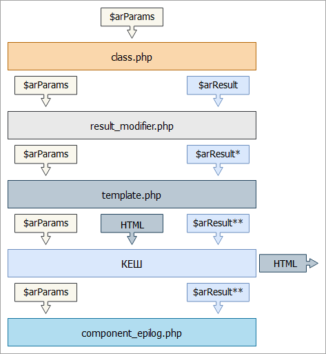

Компоненты в Bitrix Framework — это основной инструмент для отображения информации. Они позволяют настраивать вывод данных и добавлять функциональность в систему.

## Что такое компонент

Компонент — это виджет, который берет данные из различных источников Bitrix Framework и преобразует их в HTML для веб-страниц. Он состоит из двух частей: логики и шаблона. Логика обрабатывает данные с помощью API модулей, а шаблон отображает их на странице.

### Как работают компоненты

Компонент выполняется в таком порядке:

1. Система передает в логику компонента — `class.php` или `component.php` — массив параметров `$arParams`. Логика выбирает данные и записывает их в массив `$arResult`.

2. Файл шаблона `result_modifier.php`, если он есть, получает `$arParams` и `$arResult` и может изменить `$arResult` перед выводом.

3. Файл `template.php` получает `$arParams` и `$arResult` и формирует HTML.

4. Если кеширование включено, система сохраняет в кеш HTML шаблона и ключи `$arResult`, перечисленные в `setResultCacheKeys()`. Без вызова `setResultCacheKeys()` в кеш попадает весь `$arResult`. При следующем вызове с теми же параметрами система выводит HTML из кеша. Код внутри блока `if ($this->startResultCache())`, `result_modifier.php` и `template.php` при этом не выполняются. Методы `onPrepareComponentParams()` и `executeComponent()` и код вне блока кеширования выполняются на каждом вызове.

   Если вызывался `setResultCacheKeys()`, после подключения шаблона в `$arResult` остаются только перечисленные ключи. Это действует и при выключенном кеше.

5. Файл шаблона `component_epilog.php`, если он есть, выполняется при каждом вызове, в том числе при выводе из кеша. Он получает `$arParams` и сохраненные в кеше ключи `$arResult`.

{width=473px height=513px}

### Когда использовать компоненты

Компоненты подходят для:

-  часто используемых областей, например, форм авторизации и подписки.

-  динамически обновляемой информации: новостные ленты, случайные фото.

-  любых операций с данными.

Компонент создает какую-либо область на одной странице. Раздел сайта из нескольких страниц, например новости или каталог товаров, строит комплексный компонент. Он разбирает адрес запроса, выбирает нужную страницу — список элементов, раздел инфоблока или детальную страницу — и подключает ее шаблон, а шаблон вызывает простые компоненты. Так устроены системные компоненты `bitrix:news` и `bitrix:catalog`.

Если раздел только отдает данные по HTTP-маршрутам или AJAX-запросам и не выводит страницы через шаблоны компонентов, используйте [контроллер](./controllers.md). AJAX-действия внутри компонента описаны в разделе [Работа с контроллерами](#component-controllers).

На странице может быть несколько компонентов, каждый выполняет свою задачу. Один компонент можно использовать на разных страницах и сайтах в одной установке.

## Структура компонента {#component-structure}

Компонент в Bitrix Framework хранит все необходимые файлы в одной папке. Эти файлы не могут использоваться отдельно.

Папка компонента может содержать:

-  `/lang/` — языковые файлы для переводов.

-  `/templates/` — шаблоны отображения компонента. Может отсутствовать, если шаблонов нет.

-  `.description.php` — название, описание и положение компонента в дереве визуального редактора. Обязателен для использования в редакторе.

-  `.parameters.php` — входные параметры компонента для редактора. Обязателен для использования в редакторе. Параметры в логике будут работать и без файла.

-  `class.php` — логика работы компонента.

-  `component.php` — логика работы компонента без класса. Такой вариант встречается в системных компонентах, например `bitrix:news.list` и `bitrix:news.detail`. Система подключает `component.php`, если в папке компонента нет класса из `class.php`.

## Размещение и подключение компонентов {#component-placement-and-connection}

В Bitrix Framework компоненты размещаются в определенных папках:

-  Системные компоненты находятся в `/bitrix/components/bitrix/`. Эта папка обновляется системой, изменять ее нельзя.

-  Пользовательские компоненты следует хранить в `/local/components/`.

Система ищет компонент сначала в `/local/components/`, затем в `/bitrix/components/`. Если компонент с тем же полным именем есть в обеих папках, используется копия из `/local/components/`.

### Именование

Название подпапки в `/local/components/` образует пространство имен (namespace) компонентов. Например, системные компоненты находятся в пространстве имен `bitrix`. Для пользовательских компонентов необходимо создать свое пространство имен.

Имена компонентов имеют вид `идентификатор1.идентификатор2...`. Например, `catalog`, `catalog.list`, `catalog.section.element`. Рекомендуется строить имена иерархически, начиная с общего понятия и заканчивая конкретным назначением компонента. Полное имя компонента включает пространство имен: `пространство_имен:имя_компонента`. Например, `bitrix:catalog.list`.

### Как подключить компонент {#include-component}

Компонент подключает метод `$APPLICATION->IncludeComponent()` класса `CMain`. Сигнатура метода:

```php
public function IncludeComponent(
    $componentName,
    $componentTemplate,
    $arParams = [],
    $parentComponent = null,
    $arFunctionParams = [],
    $returnResult = false
)
```

*Обязательные параметры обозначены \*.*

#|
|| **Параметр** | **Тип** | **Описание** ||
|| `$componentName`* | `string` | Полное имя компонента с пространством имен, например `bitrix:menu` ||
|| `$componentTemplate`* | `string` | Имя шаблона компонента. Пустая строка — шаблон `.default` ||
|| `$arParams` | `array` | Массив параметров компонента. По умолчанию пустой массив ||
|| `$parentComponent` | `CBitrixComponent` или `null` | Объект родительского компонента. Передавайте `$component` при вызове внутри шаблона комплексного компонента ||
|| `$arFunctionParams` | `array` | Настройки вызова. Метод учитывает два ключа:

- `HIDE_ICONS` — если `Y`, в режиме правки не выводятся кнопки управления компонентом,
- `ACTIVE_COMPONENT` — если `N`, компонент не выполняется ||
|| `$returnResult` | `bool` | Если `true`, метод возвращает массив `$arResult` компонента. По умолчанию `false` ||
|#

Метод возвращает:

-  то, что вернул метод `executeComponent()` компонента, если `$returnResult` равен `false`,
-  массив `$arResult`, если `$returnResult` равен `true`. Если компонент вызывал `setResultCacheKeys()`, массив содержит только перечисленные ключи,
-  `false`, если имя компонента некорректно,
-  `null`, если компонент не найден или выключен ключом `ACTIVE_COMPONENT`.

Пример подключения компонента меню:

```php
<?php
$APPLICATION->IncludeComponent(
    "bitrix:menu",
    "horizontal_multilevel",
    [
        "ROOT_MENU_TYPE" => "top",
        "MAX_LEVEL" => "3",
        "CHILD_MENU_TYPE" => "left",
        "USE_EXT" => "Y",
        "MENU_CACHE_TYPE" => "A",
        "MENU_CACHE_TIME" => "3600",
        "MENU_CACHE_USE_GROUPS" => "Y",
        "MENU_CACHE_GET_VARS" => []
    ]
);?>
```

## Файл class.php

Файл содержит логику компонента. Объявите в нем класс-наследник `CBitrixComponent`. Имя класса произвольное. Система подключает `class.php` и использует объявленный в нем наследник `CBitrixComponent`. Основной метод — `executeComponent()`. Базовая реализация метода только подключает `component.php`, поэтому в классе метод переопределяют.

Метод `startResultCache()` берет время жизни кеша из параметра `CACHE_TIME`. Если параметр не передан, время равно нулю и данные из кеша не читаются. Передайте `CACHE_TIME` при вызове компонента, задайте значение по умолчанию в `onPrepareComponentParams()` или передайте время первым аргументом метода, например `startResultCache(3600)`.

### Пример файла class.php

```php
<?php

if (!defined('B_PROLOG_INCLUDED') || B_PROLOG_INCLUDED !== true)
{
    die();
}

class MyComponent extends CBitrixComponent
{
    public function onPrepareComponentParams($arParams)
    {
        // Без CACHE_TIME кеш не работает, задаем значение по умолчанию
        $arParams['CACHE_TIME'] = (int)($arParams['CACHE_TIME'] ?? 3600);

        return $arParams;
    }

    public function executeComponent()
    {
        // Проверяем кеш. Если кеша нет, startResultCache() вернет true
        // и код внутри условия выполнится для генерации данных
        // Если кеш есть — вернет false, и данные будут взяты из кеша
        if ($this->startResultCache())
        {
            // Формируем массив $arResult
            $this->initResult();
            // Подключаем шаблон компонента
            $this->includeComponentTemplate();
        }
    }

    private function initResult(): void
    {
        $this->arResult['KEY'] = 'value';
    }
}
```

### Пояснение к коду

1. Проверка константы `B_PROLOG_INCLUDED` прерывает выполнение, если файл открыть по прямому адресу.

2. Метод `startResultCache()` проверяет кеш. Если кеш есть, метод выводит сохраненный HTML и возвращает `false`.

3. Если кеша нет, метод возвращает `true`. Компонент вызывает `initResult()` и формирует массив `$arResult`.

4. Метод `includeComponentTemplate()` подключает шаблон. Шаблон использует `$arResult` для генерации HTML.

5. Система сохраняет HTML шаблона и `$arResult` в кеш на время из параметра `CACHE_TIME`.

## Файл .description.php

Файл `.description.php` используется для описания компонента и его отображения в визуальном редакторе и других инструментах Bitrix. Этот файл не участвует в работе компонента на странице.



Визуальный редактор — это специальный инструмент для редактирования информации на сайте. Позволяет выполнять задачи от простого набора текста и вставки изображений до настройки компонентов.



### Пример файла .description.php

```php
<?php
use Bitrix\Main\Localization\Loc;

$arComponentDescription = [
    "NAME" => Loc::getMessage("COMP_NAME"),
    "DESCRIPTION" => Loc::getMessage("COMP_DESCR"),
    "ICON" => "/images/icon.gif",
    "PATH" => [
        "ID" => "content",
        "CHILD" => [
            "ID" => "catalog",
            "NAME" => "Каталог товаров"
        ]
    ],
    "AREA_BUTTONS" => [
        [
            'URL' => "javascript:alert('Это кнопка!!!');",
            'SRC' => '/images/button.jpg',
            'TITLE' => "Это кнопка!"
        ],
    ],
    "CACHE_PATH" => "Y",
    "COMPLEX" => "Y"
];
?>
```

### Массив \$arComponentDescription

Файл содержит массив `$arComponentDescription`, который описывает основные характеристики компонента. Ключи массива:

-  `NAME` — название компонента,

-  `DESCRIPTION` — описание компонента,

-  `ICON` — путь к значку,

-  `PATH` — массив описывает расположение в дереве компонентов:

   -  `ID` — уникальный код ветки,

   -  `NAME` — название ветки,

   -  `CHILD` — подчиненная ветка,

-  `AREA_BUTTONS` — пользовательские кнопки для режима редактирования. Ключ `URL` задает действие кнопки, `TITLE` — подпись, `SRC` — путь к значку от папки компонента: система добавляет к нему путь компонента,

-  `CACHE_PATH` — любое непустое значение показывает в режиме правки кнопку очистки кеша компонента. Кнопку видят пользователи с правом `cache_control`,

-  `COMPLEX` — `Y` для комплексного компонента, для обычного компонента ключ значения не имеет.

### Особенности

**PATH**. Если этот ключ не задан, компонент не будет отображаться в визуальном редакторе.\
**Дерево компонентов.** Ограничено тремя уровнями. Чаще всего оно двухуровневое. Для первого уровня есть стандартные ветки `content`, `service`, `communication`, `e-store` и `utility`. Если указать один из этих кодов в `PATH.ID`, система подставит стандартное название и сортировку ветки. Для собственной ветки задайте свой код и название в ключе `NAME`.

## Файл .parameters.php {#parameters-file}

Файл `.parameters.php` содержит описание входных параметров компонента. Параметры необходимы для создания формы ввода свойств компонента в визуальном редакторе и других инструментах среды Bitrix. Описание параметров не используется при непосредственной работе компонента на странице.

### Пример файла .parameters.php

**Пример.** Файл получает список активных типов инфоблоков методом `CIBlockParameters::GetIBlockTypes()`, как системный компонент `bitrix:news.list`. Метод возвращает массив, где ключ — код типа, а значение — строка `[код] название` на текущем языке:

```php
<?php
use Bitrix\Main\Loader;
use Bitrix\Main\Localization\Loc;

if (!defined('B_PROLOG_INCLUDED') || B_PROLOG_INCLUDED !== true)
{
    die();
}

if (!Loader::includeModule('iblock'))
{
    return;
}

$arIblockType = CIBlockParameters::GetIBlockTypes();

$arComponentParameters = [
    'GROUPS' => [
        'SETTINGS' => [
            'NAME' => Loc::getMessage('SETTINGS_PHR'),
        ],
        'PARAMS' => [
            'NAME' => Loc::getMessage('PARAMS_PHR'),
        ],
    ],
    'PARAMETERS' => [
        'IBLOCK_TYPE_ID' => [
            'PARENT' => 'SETTINGS',
            'NAME' => Loc::getMessage('INFOBLOCK_TYPE_PHR'),
            'TYPE' => 'LIST',
            'ADDITIONAL_VALUES' => 'Y',
            'VALUES' => $arIblockType,
            'REFRESH' => 'Y',
        ],
        'BASKET_PAGE_TEMPLATE' => [
            'PARENT' => 'PARAMS',
            'NAME' => Loc::getMessage('BASKET_LINK_PHR'),
            'TYPE' => 'STRING',
            'MULTIPLE' => 'N',
            'DEFAULT' => '/personal/basket.php',
            'COLS' => 25,
        ],
        'SET_TITLE' => [],
        'CACHE_TIME' => [],
        'VARIABLE_ALIASES' => [
            'IBLOCK_ID' => [
                'NAME' => Loc::getMessage('CATALOG_ID_VARIABLE_PHR'),
            ],
            'SECTION_ID' => [
                'NAME' => Loc::getMessage('SECTION_ID_VARIABLE_PHR'),
            ],
        ],
        'SEF_MODE' => [
            'list' => [
                'NAME' => Loc::getMessage('CATALOG_LIST_PATH_TEMPLATE_PHR'),
                'DEFAULT' => 'index.php',
                'VARIABLES' => [],
            ],
            'section1' => [
                'NAME' => Loc::getMessage('SECTION_LIST_PATH_TEMPLATE_PHR'),
                'DEFAULT' => '#IBLOCK_ID#',
                'VARIABLES' => ['IBLOCK_ID'],
            ],
            'section2' => [
                'NAME' => Loc::getMessage('SUB_SECTION_LIST_PATH_TEMPLATE_PHR'),
                'DEFAULT' => '#IBLOCK_ID#/#SECTION_ID#',
                'VARIABLES' => ['IBLOCK_ID', 'SECTION_ID'],
            ],
        ],
    ],
];
```

### Массив \$arComponentParameters

Файл содержит массив `$arComponentParameters`, который описывает входные параметры компонента. Он может включать выборку дополнительных данных, например, для формирования выпадающего списка типов информационных блоков.

#### Ключ GROUPS

Массив групп параметров компонента. Группы помогают организовать параметры в визуальных средствах Bitrix. Пример группы:

```php
"SETTINGS" => [
  "NAME" => "Настройки",
  "SORT" => 100
]
```

**Перечень стандартных групп**

| Код | Сортировка | Название | Описание |
| --- | ---------- | -------- | -------- |
| BASE | 100 | Основные параметры | Базовые параметры для работы компонента |
| DATA_SOURCE | 200 | Источник данных | Параметры, указывающие, откуда выбирать данные для компонента |
| VISUAL | 300 | Настройки внешнего вида | Параметры, отвечающие за внешний вид |
| USER_CONSENT | 350 | Согласие пользователя | Настройка параметров на получение согласия пользователя согласно законодательству РФ |
| URL_TEMPLATES | 400 | Шаблоны ссылок | Служебная |
| SEF_MODE | 500 | Управление адресами страниц | Группа для всех параметров, связанных с использованием ЧПУ |
| AJAX_SETTINGS | 550 | Управление режимом AJAX | Все, что касается AJAX |
| CACHE_SETTINGS | 600 | Настройки кеширования | Появляется при указании параметра `CACHE_TIME` |
| ADDITIONAL_SETTINGS | 700 | Дополнительные настройки | Группа появляется, например, при указании параметра `SET_TITLE` |


#### Ключ PARAMETERS

Массив параметров компонента. Ключ элемента — код параметра, по нему значение попадает в `$arParams`. Значение — массив с описанием поля формы:

-  `PARENT` — код группы из `GROUPS`. Если ключ не задан или группа не объявлена в `GROUPS` и не входит в стандартные, система помещает параметр в группу `ADDITIONAL_SETTINGS`,
-  `NAME` — название параметра на текущем языке,
-  `TYPE` — тип элемента управления. Значения описаны ниже в разделе о параметре `TYPE`,
-  `REFRESH` — `Y`, чтобы перезагружать форму после изменения значения,
-  `MULTIPLE` — `Y` для множественного значения, `N` для одиночного,
-  `VALUES` — массив значений для списка `TYPE = LIST`, где ключ — значение, а элемент — подпись,
-  `ADDITIONAL_VALUES` — `Y`, чтобы показать поле для значений, вводимых вручную,
-  `SIZE` — число строк, если нужен не выпадающий список,
-  `DEFAULT` — значение по умолчанию,
-  `COLS` — ширина поля в символах.

**Пример.** Описание параметра-списка с перезагрузкой формы:

```php
'IBLOCK_TYPE_ID' => [
    'PARENT' => 'SETTINGS',
    'NAME' => Loc::getMessage('INFOBLOCK_TYPE_PHR'),
    'TYPE' => 'LIST',
    'VALUES' => $arIblockType,
    'ADDITIONAL_VALUES' => 'Y',
    'REFRESH' => 'Y',
],
```

**Параметр TYPE**

Тип элемента управления `TYPE` может принимать значения:

-  `LIST` — выпадающий список,

-  `STRING` — текстовое поле ввода,

-  `CHECKBOX` — переключатель да/нет,

-  `CUSTOM` — [кастомные элементы управления](#custom-type),

-  `FILE` — выбор файла,

-  `COLORPICKER` — выбор цвета:

   ```php
   $arComponentParameters["PARAMETERS"]["COLOR"] = [
       "PARENT" => "BASE",
       "NAME" => 'Выбор цвета',
       "TYPE" => "COLORPICKER",
       "DEFAULT" => 'FFFF00'
   ];
   ```

**Пример использования параметра REFRESH**

Параметр `REFRESH` со значением `Y` перезагружает форму параметров после выбора значения. После перезагрузки файл `.parameters.php` выполняется снова, а текущие значения формы доступны в массиве `$arCurrentValues`. Так можно строить список одного параметра по значению другого.

**Пример.** Фрагмент `.parameters.php` добавляет список свойств выбранного инфоблока. Модуль `iblock` подключен выше в файле через `Loader::includeModule('iblock')`:

```php
if (isset($arCurrentValues['IBLOCK_ID']) && (int)$arCurrentValues['IBLOCK_ID'] > 0)
{
    $arPropList = [];
    $rsProps = CIBlockProperty::GetList([], ['IBLOCK_ID' => $arCurrentValues['IBLOCK_ID']]);

    while ($arProp = $rsProps->Fetch())
    {
        $arPropList[$arProp['ID']] = $arProp['NAME'];
    }

    $arComponentParameters['PARAMETERS']['PROP_LIST'] = [
        'NAME' => 'Список свойств',
        'TYPE' => 'LIST',
        'VALUES' => $arPropList,
    ];
}
```

**Особые параметры**

-  `SET_TITLE` и `CACHE_TIME` — стандартизованные параметры компонентов, которые не требуют полного описания. `SET_TITLE` управляет заголовком страницы, а `CACHE_TIME` определяет время кеширования.

-  `VARIABLE_ALIASES` — описывает переменные, которые комплексный компонент может получать из HTTP-запроса. Каждый элемент массива имеет вид:

   ```php
   "внутреннее название переменной" => [
       "NAME" => "название переменной на текущем языке",
   ];
   ```

-  `SEF_MODE` — описывает шаблоны путей в режиме ЧПУ. Каждый элемент массива имеет вид:

   ```php
   "код шаблона пути" => [
       "NAME" => "название шаблона пути на текущем языке",
       "DEFAULT" => "шаблон пути по умолчанию",
       "VARIABLES" => "массив внутренних названий переменных, которые могут использоваться в шаблоне"
   ];
   ```

#### Тип параметров CUSTOM {#custom-type}

В параметре `TYPE` используйте значение `CUSTOM`, когда стандартных настроек компонента недостаточно. Например, в форму настроек нужно добавить интерактивный элемент: кнопку, карту или ползунок.

Для `TYPE=CUSTOM` укажите три параметра:

-  `JS_FILE` — путь к JS-файлу с кодом отрисовки интерфейса,

-  `JS_EVENT` — имя функции, которую система вызывает после загрузки файла.

-  `JS_DATA` — дополнительные данные для функции, которая указана в `JS_EVENT`.

Функция `JS_EVENT` получает объект с данными.

```javascript
{
    data: JS_DATA,                      // JS_DATA из .parameters.php
    oCont: td,                          // контейнер для отрисовки интерфейса
    oInput: input,                      // input, в котором передается значение параметра на сервер при сохранении
    propertyID: "MAP_DATA",             // название параметра
    propertyParams: { /*...*/ },        // полное описание параметра из .parameters.php
    fChange: function() { /*...*/ },    // callback для вызова при изменении параметра
    getElements: function() { /*...*/ } // возвращает объект со всеми параметрами компонента
}
```

Пример массива `$arComponentParameters` с `TYPE=CUSTOM` можно посмотреть в системном компоненте `map.google.view`.

**Пример.** Сокращенный файл `.parameters.php` компонента `map.google.view` с параметром `MAP_DATA`. Параметр типа `CUSTOM`, как и остальные параметры, находится внутри ключа `PARAMETERS`:

```php
<?php
use Bitrix\Main\Localization\Loc;

$arComponentParameters = [
    'GROUPS' => [],
    'PARAMETERS' => [
        // ...
        'MAP_DATA' => [
            'NAME' => Loc::getMessage('MYMS_PARAM_DATA'),
            'TYPE' => 'CUSTOM',
            'JS_FILE' => '/bitrix/components/bitrix/map.google.view/settings/settings.js',
            'JS_EVENT' => 'OnGoogleMapSettingsEdit',
            'JS_DATA' => LANGUAGE_ID . '||' . Loc::getMessage('MYMS_PARAM_DATA_SET'),
            'DEFAULT' => serialize([
                'google_lat' => Loc::getMessage('MYMS_PARAM_DATA_DEFAULT_LAT'),
                'google_lon' => Loc::getMessage('MYMS_PARAM_DATA_DEFAULT_LON'),
                'google_scale' => 13,
            ]),
            'PARENT' => 'BASE',
        ],
        // ...
    ],
];
```

Файл с кодом интерфейса — `/bitrix/components/bitrix/map.google.view/settings/settings.js`. Система вызывает функцию `OnGoogleMapSettingsEdit()`, указанную в `JS_EVENT`, и передает в нее объект с данными. Функция создает объект `JCEditorOpener`, а он добавляет в контейнер `oCont` кнопку, которая открывает окно с настройками карты.

**Пример.** Сокращенный код из `settings.js`:

```javascript
function OnGoogleMapSettingsEdit(arParams)
{
    window.jsGoogleCEOpener = new JCEditorOpener(arParams);
}

function JCEditorOpener(arParams)
{
    this.jsOptions = arParams.data.split('||'); // Значение JS_DATA
    this.arParams = arParams;

    var obButton = document.createElement('INPUT');
    obButton.type = 'button';
    obButton.value = this.jsOptions[1]; // Текст кнопки из JS_DATA
    this.arParams.oCont.appendChild(obButton);

    obButton.onclick = BX.delegate(this.btnClick, this);
    this.saveData = BX.delegate(this.__saveData, this);
}
```

Код файла `/bitrix/components/bitrix/map.google.view/settings/settings.php` определяет внешний вид окна.

```php
<!-- Заголовок и описание -->
<?php
use Bitrix\Main\Localization\Loc;

$obJSPopup->ShowTitlebar();
$obJSPopup->StartDescription('bx-edit-menu');
?>
    <p><b><?= Loc::getMessage('MYMV_SET_POPUP_WINDOW_TITLE') ?></b></p>
    <p class="note"><?= Loc::getMessage('MYMV_SET_POPUP_WINDOW_DESCRIPTION') ?></p>

<!-- Блок контента  -->
<?php
$obJSPopup->StartContent();
?>
...

<!-- Блок кнопок  -->
<?php
$obJSPopup->StartButtons();
?>

<!-- Кнопка сохранения настроек  -->
<input type="submit" value="<?= Loc::getMessage('MYMV_SET_SUBMIT'); ?>" onclick="return jsGoogleCE.__saveChanges();" class="adm-btn-save"/>

<!-- Кнопка отмены  -->
<?php
$obJSPopup->ShowStandardButtons(['cancel']);
$obJSPopup->EndButtons();
?>
```

Функция `__saveChanges()` собирает, сериализует данные в строку и записывает в `oInput`. Код сериализации можно посмотреть в файле `settings_load.js`. Десериализация происходит  из `$arParams['~MAP_DATA']`.

Все надписи для типа `CUSTOM` выводите через `Loc::getMessage()` и размещайте в папке компонента в файле `lang/ru/.parameters.php`.

## Папки локализаций

Компоненты и их шаблоны поддерживают вывод сообщений на разных языках, автоматически отображая текст на языке пользователя.

### Структура языковых файлов

-  Каждой языковой версии соответствует своя папка:  `/ru/`, `/en/` и так далее.

-  Языковые файлы называют так, как и файлы компонента.

-  В языковых файлах описаны массивы. Ключи массивов — идентификаторы констант, а значения ключей — сами константы, переведенными на соответствующий язык.

-  Файлы располагают в той же иерархии относительно `/lang/код языка/`, что и исходные файлы относительно папки компонента.

Папки локализаций создаются отдельно для компонентов и для каждого из шаблонов.

Подробнее про работу с локализацией читайте в разделе [Локализация](./../advanced/localization.md).

### Подсказки в параметрах компонента

Bitrix Framework позволяет добавлять подсказки к параметрам компонента. Для этого в языковой папке `/lang/` создайте массив `$MESS`, где ключи — это параметры компонента с суффиксом `_TIP`, а значения — сами подсказки.

```php
$MESS["IBLOCK_TYPE_TIP"] = "Это подсказка для типа инфоблока";
$MESS["IBLOCK_ID_TIP"] = "Это подсказка для ID инфоблока";
$MESS["SORT_BY1_TIP"] = "Это подсказка для первой сортировки";
```

Подсказки сохраняются в языковом файле `.parameters.php` как для компонента, так и для его шаблона. Пустую подсказку система пропускает: параметр выводится в настройках компонента без подсказки.

## Шаблоны компонента {#templates}

Шаблон компонента в Bitrix Framework — это программный код, который преобразует подготовленные компонентом данные в HTML-код для отображения на веб-странице.

### Виды шаблонов

1. **Системные шаблоны**: поставляются вместе с дистрибутивом и находятся в подпапке `templates` папки компонента.

2. **Пользовательские шаблоны**: изменены под нужды конкретного сайта и должны находиться в папках шаблонов сайтов, например, `/local/templates/шаблон_сайта/`. При копировании средствами системы шаблон попадает в папку `components/namespace/название_компонента/название_шаблона/` шаблона сайта. Если шаблон сайта лежит в `/local/templates/`, копия появится там, иначе — в `/bitrix/templates/шаблон_сайта/`.

### Определение шаблонов

-  Шаблоны компонента определяются по именам. Шаблон по умолчанию имеет имя `.default`. Остальные шаблоны могут называться произвольно. Если в настройках компонента не указывается имя шаблона, то вызывается шаблон по умолчанию.

-  Шаблоны являются папками с файлами.

-  Каждый шаблон компонента является неделимым целым. Если требуется изменить системный шаблон под конкретный сайт, то его нужно целиком скопировать в папку шаблона сайта и только потом изменить под потребности проекта.

### Переменные в шаблоне {#template-variables}

-  `$templateFile` — путь к шаблону относительно корня сайта.

-  `$arResult` — массив результатов работы компонента.

-  `$arParams` — массив входящих параметров компонента.

-  `$templateFolder` — путь к папке с шаблоном от `DOCUMENT_ROOT`.

-  `$parentTemplateFolder` — путь к папке шаблона родительского компонента.

-  `$component` — ссылка на текущий вызванный компонент.

-  `$this` — ссылка на текущий шаблон.

-  `$templateName` — имя шаблона.

-  `$componentPath` — путь к папке с компонентом от `DOCUMENT_ROOT`.

-  `$templateData` — массив для передачи данных из `template.php` в `component_epilog.php`. Данные кешируются, так как файл `component_epilog.php` исполняется на каждом хите.

-  `$APPLICATION`, `$USER`, `$DB` — глобальные переменные.

В `template.php` переменной `$arLangMessages` нет: система передает массив языковых сообщений только функции стороннего шаблонизатора.

### Структура шаблона

-  `/lang/` — файлы языковых сообщений.

-  `result_modifier.php` — подключается перед шаблоном для изменения `$arResult` и `$arParams`.

-  `component_epilog.php` — подключается после исполнения шаблона.

-  `style.css` — определяет стили.

-  `script.js` — определяет и подключает JavaScript.

-  `.description.php` — содержит название и описание шаблона. Пример файла:

   ```php
   <?php
   use Bitrix\Main\Localization\Loc;

   if (!defined('B_PROLOG_INCLUDED') || B_PROLOG_INCLUDED !== true)
   {
       die();
   }

   $arTemplateDescription = [
       'NAME' => Loc::getMessage('MY_TEMPLATE_NAME'),
       'DESCRIPTION' => Loc::getMessage('MY_TEMPLATE_DESC'),
   ];
   ```

-  `.parameters.php` — описание дополнительных параметров шаблона. Файл заполняет массив `$arTemplateParameters` в том же формате, что и ключ `PARAMETERS` в `.parameters.php` компонента. Визуальный редактор добавляет эти параметры в форму настройки компонента, когда выбран шаблон. Текущие значения параметров формы доступны в массиве `$arCurrentValues`.

   **Пример.** Шаблон добавляет режим отображения и параметр, который зависит от выбранного режима:

   ```php
   <?php
   use Bitrix\Main\Localization\Loc;

   if (!defined('B_PROLOG_INCLUDED') || B_PROLOG_INCLUDED !== true)
   {
       die();
   }

   /** @var array $arCurrentValues */

   $arTemplateParameters = [
       'DISPLAY_MODE' => [
           'NAME' => Loc::getMessage('MY_TEMPLATE_DISPLAY_MODE'),
           'PARENT' => 'VISUAL',
           'TYPE' => 'LIST',
           'VALUES' => [
               'list' => Loc::getMessage('MY_TEMPLATE_DISPLAY_MODE_LIST'),
               'tile' => Loc::getMessage('MY_TEMPLATE_DISPLAY_MODE_TILE'),
           ],
           'DEFAULT' => 'list',
           'REFRESH' => 'Y',
       ],
   ];

   if (($arCurrentValues['DISPLAY_MODE'] ?? 'list') === 'tile')
   {
       $arTemplateParameters['TILE_COLUMNS'] = [
           'NAME' => Loc::getMessage('MY_TEMPLATE_TILE_COLUMNS'),
           'PARENT' => 'VISUAL',
           'TYPE' => 'STRING',
           'DEFAULT' => '3',
       ];
   }
   ```

   Ключ `REFRESH` со значением `Y` перезагружает форму после изменения параметра, поэтому поле `TILE_COLUMNS` появляется сразу после выбора режима `tile`.

-  `template.php` — основной файл шаблона.

-  Дополнительные ресурсы, например, папка `/images/`.

### Поиск шаблона системой {#template-search}

Система ищет подходящий шаблон по алгоритму.

1. Ищет в `/local/templates/текущий_шаблон_сайта/components/`.

2. Если не найден, ищет в `/local/templates/.default/components/`.

3. Если не найден, ищет в папке `templates` компонента в `/local/components/`, например `/local/components/пространство_имен/название_компонента/templates/`.

4. Если не найден, ищет в `/bitrix/templates/текущий_шаблон_сайта/components/`.

5. Если не найден, ищет в `/bitrix/templates/.default/components/`.

6. Если не найден, ищет среди системных шаблонов в `/bitrix/components/`.

Особенности:

-  Если имя шаблона не задано, ищется `.default`.

-  Если шаблон задан именем папки, ищется файл`template.ext`. Расширение ext сначала принимается равным php, а затем расширениям других доступных на сайте движков шаблонизации.

Если компонент вызывается в составе комплексного компонента, то его шаблон сначала ищется в составе шаблона родительского компонента, а потом — в собственных шаблонах. Чтобы это правило работало, при вызове компонентов в составе комплексных компонентов не забывайте указывать четвертым параметром переменную `$component`, указывающую на родительский компонент:

```php
$APPLICATION->IncludeComponent("custom:catalog.element", "", [...], $component);
```



В одной папке, например, `/bitrix/templates/текущий_шаблон_сайта/components/` есть шаблоны двух компонентов:

-  `catalog` — комплексный компонент, в нем есть catalog.section,

-  `catalog.section` — обычный компонент.

По условиям работы сайта необходимо, чтобы для двух вхождений `catalog.section` использовался один единственный шаблон. В этом случае нужно, чтобы этот шаблон имел имя, отличное от `.default`, иначе он не будет подхвачен.



### Режим AJAX_MODE

Если в параметрах компонента `AJAX_MODE` равен `Y`, переходы по ссылкам и отправка форм внутри компонента перезагружают только область компонента. Режим работает для любого компонента, который подключен через `IncludeComponent()`. Отдельные AJAX-действия компонента описаны в разделе [Работа с контроллерами](#component-controllers).

После перезагрузки области система обновляет на странице заголовок и цепочку навигации. Она ищет элементы по `id` во всем документе:

-  `pagetitle` — элемент с заголовком страницы: текст заголовка заменяет его первый дочерний узел,

-  `navigation` — элемент с цепочкой навигации: ее HTML заменяет содержимое элемента.

Если элемента нет на странице, система его пропускает.

Заголовок и цепочка навигации выводятся вне компонента. Разместите элементы в шаблоне сайта, например в `header.php`.

**Пример.** Заголовок и цепочка навигации в `header.php` шаблона сайта:

```php
<div id="navigation">
    <?php $APPLICATION->ShowNavChain(); ?>
</div>

<h1 id="pagetitle"><?php $APPLICATION->ShowTitle(false); ?></h1>
```

## Файл result_modifier.php

Файл `result_modifier.php` позволяет модифицировать данные компонента. Разработчик создает его самостоятельно. Файл выполняется перед шаблоном, когда данных компонента нет в кеше. Изменения `$arResult` попадают в кеш, если ключ входит в [набор ключей кеша](#component-epilog-file).

### Как работать с result_modifier.php

В `result_modifier.php` можно запросить дополнительные данные и добавить их в массив `$arResult`. Это полезно, если нужно вывести дополнительные данные без изменения компонента, сохраняя его поддержку и обновления.



Если данные компонента есть в кеше, система не подключает шаблон и не выполняет `result_modifier.php`. Поэтому в нем нельзя устанавливать динамические свойства, такие как `title`, `keywords`, `description`. Устанавливайте их в `component_epilog.php`.



### Переменные в result_modifier.php

-  `$arParams` — параметры для чтения и изменения. Изменения влияют на `$arParams` в `template.php`, но не на одноименный член компонента.

-  `$arResult` — результат для чтения и изменения. Изменения затрагивают одноименный член класса компонента.

-  `$APPLICATION`, `$USER`, `$DB` — глобальные переменные.

-  `$this` — ссылка на текущий шаблон (объект типа `CBitrixComponentTemplate`).

## Файл component_epilog.php {#component-epilog-file}

Файл `component_epilog.php` позволяет модифицировать данные компонента при включенном кешировании. Разработчик создает его самостоятельно.

### Как работать с component_epilog.php

Файл  `component_epilog.php` подключается после выполнения шаблона. Родительский компонент:

1. Сохраняет в своем кеше список файлов эпилогов всех дочерних компонентов.

2. Подключает файлы при хите в кеш в том же порядке, как они исполнялись без кеширования.

При вызове дочерних компонентов в шаблоне нужно передавать значение `$component`.

В `component_epilog.php` доступны `$arParams` и `$arResult`, но их значения берутся из кеша. Метод `setResultCacheKeys()` задает набор ключей массива `$arResult`, которые попадают в кеш, и так ограничивает размер кеша. Каждый вызов дополняет набор ключей, а не заменяет его.

**Пример.** Набор ключей в `class.php`:

```php
$this->setResultCacheKeys([
    "ID",
    "IBLOCK_TYPE_ID",
    "LIST_PAGE_URL",
    "NAV_CACHED_DATA",
    "NAME",
    "SECTION",
    "ELEMENTS",
]);
```

Код системного компонента изменять нельзя. Если системный компонент задает набор ключей кеша, а нужный ключ добавляет `result_modifier.php`, вызовите `setResultCacheKeys()` там же. В `result_modifier.php` переменная `$this` — объект шаблона, объект компонента возвращает метод `$this->getComponent()`.



Если компонент не вызывал `setResultCacheKeys()`, в кеш попадает весь `$arResult`. Вызов из `result_modifier.php` сократит набор до переданных ключей, и остальные ключи не попадут в `component_epilog.php`.



**Пример.** `result_modifier.php` добавляет заголовок в `$arResult` и ключ `MY_TITLE` в набор ключей кеша:

```php
<?php

if (!defined('B_PROLOG_INCLUDED') || B_PROLOG_INCLUDED !== true)
{
    die();
}

$arResult['MY_TITLE'] = $arResult['NAME'];

$this->getComponent()->setResultCacheKeys(['MY_TITLE']);
```

Если системный компонент ограничил набор ключей кеша, без этого вызова в `component_epilog.php` не будет ключа `MY_TITLE`, и [пример файла component_epilog.php](#component-epilog-example) не установит заголовок.



В `component_epilog.php` может быть любой код, но он будет исполняться на каждом хите, независимо от наличия кеша.



### Переменные в component_epilog.php

-  `$arParams` — копия параметров компонента. Изменения копии не влияют на компонент.

-  `$arResult` — копия результата компонента. Если компонент вызывал `setResultCacheKeys()`, копия содержит только перечисленные ключи, даже при выключенном кеше. Изменения копии не влияют на компонент.

-  `$componentPath` — путь к папке с компонентом от `DOCUMENT_ROOT`.

-  `$component` — ссылка на `$this`.

-  `$this` — ссылка на текущий компонент, можно использовать все методы класса `CBitrixComponent`.

-  `$epilogFile` — путь к `component_epilog.php` относительно `DOCUMENT_ROOT`.

-  `$templateName` — имя шаблона компонента.

-  `$templateFile` — путь к файлу шаблона от `DOCUMENT_ROOT`.

-  `$templateFolder` — путь к папке с шаблоном от `DOCUMENT_ROOT`.

-  `$templateData` —  массив для передачи данных из `template.php` в `component_epilog.php`. Данные  кешируются и доступны на каждом хите.

-  `$APPLICATION`, `$USER`, `$DB` — глобальные переменные.

### Пример файла component_epilog.php {#component-epilog-example}

**Пример.** `component_epilog.php` устанавливает заголовок страницы из ключа `MY_TITLE`, который добавил `result_modifier.php`:

```php
<?php

if (!defined('B_PROLOG_INCLUDED') || B_PROLOG_INCLUDED !== true)
{
    die();
}

global $APPLICATION;
if (isset($arResult['MY_TITLE']))
{
    $APPLICATION->SetTitle($arResult['MY_TITLE']);
}
```

### Пример работы с переменной \$templateData

В файле `template.php`:

```php
<?php
// Предположим, что мы собираем какие-то данные в шаблоне
$templateData = [
    'ITEM_COUNT' => count($arResult['ITEMS']),
    'LAST_UPDATED' => $arResult['LAST_UPDATED'],
];
?>
```

В файле `component_epilog.php`:

```php
<?php

if (!defined('B_PROLOG_INCLUDED') || B_PROLOG_INCLUDED !== true)
{
    die();
}

// Проверяем, что $templateData определена и содержит данные
if (isset($templateData) && is_array($templateData))
{
    // Используем данные из $templateData
    $itemCount = $templateData['ITEM_COUNT'];
    $lastUpdated = $templateData['LAST_UPDATED'];

    // Например, логируем количество элементов и дату последнего обновления
    AddMessage2Log("Компонент обработал {$itemCount} элементов. Последнее обновление: {$lastUpdated}.");
}
```

### Особенности использования component_epilog.php

Файл `component_epilog.php` подключается сразу после выполнения шаблона. Если в компоненте после подключения шаблона идут другие операции, они выполнятся после `component_epilog.php`. В случае совпадения изменяемых данных выведутся только последние данные, то есть из кода компонента.

**Пример.** Метод `executeComponent()` в `class.php` устанавливает заголовок после подключения шаблона:

```php
global $APPLICATION;

$this->includeComponentTemplate();
if ($this->arParams['SET_TITLE'] === 'Y')
{
    $APPLICATION->SetTitle($this->arResult['NAME']);
}
```

В этом случае выведутся данные компонента, а не `component_epilog.php`. Если компонент вызывал `setResultCacheKeys()`, ключ `NAME` должен входить в набор, иначе после подключения шаблона его в `$arResult` не будет.

### Особенности подключения языковых файлов

Если языковые фразы в `component_epilog.php` должны отличаться от фраз в компоненте, создайте файл `/lang/ru/component_epilog.php` и подключите его:

```php
use Bitrix\Main\Localization\Loc;

Loc::loadLanguageFile(__FILE__);
Loc::getMessage("MY_MESS");
```

## Кеширование компонентов {#component-caching}

В  массиве`$arParams` содержится набор параметров компонента. Файл `class.php` работает с входными параметрами запроса и базой данных, формируя результат в массив `$arResult`. Шаблон компонента преобразует результат в HTML.

При первом хите сформированный HTML попадает в кеш. При последующих хитах запросов в базу не делается или делается мало, данные читаются из кеша.

### Режим и время кеширования

Режим кеширования компонента задает параметр `CACHE_TYPE`:

-  `A` — компонент кеширует данные, если включено автокеширование,

-  `Y` — компонент кеширует данные независимо от автокеширования,

-  `N` — компонент не кеширует данные.

Если параметр не передан или имеет другое значение, компонент использует `A`. Автокеширование включают и отключают на весь сайт в административной части *Настройки > Настройки продукта > Автокеширование*. По умолчанию автокеширование включено — опция `component_cache_on` модуля `main` равна `Y`.

Время кеширования в секундах задает параметр `CACHE_TIME`. Если параметр не передан, `startResultCache()` использует время `0`, и компонент не кеширует данные. Указывайте время кеширования для каждого компонента, исходя из потребностей проекта.

### Устройство и место хранения

Кеш компонентов хранится в `/bitrix/cache/`. Идентификатор кеша формируется на основе:

-  `ID` текущего сайта,

-  языка,

-  шаблона сайта,

-  имени компонента,

-  имени шаблона компонента,

-  параметров компонента,

-  смещения часового пояса пользователя, если оно не равно нулю,

-  дополнительного идентификатора, который передан вторым аргументом `startResultCache()`,

-  номера вызова компонента на странице, если компонент вызван на странице больше одного раза.

Группы пользователя система в идентификатор кеша не добавляет. Если результат зависит от прав, передайте группы вторым аргументом.

**Пример.** Отдельный кеш для каждого набора групп пользователя в методе `executeComponent()`:

```php
global $USER;

if ($this->startResultCache(false, $USER->GetGroups()))
{
    // Выборка данных и подключение шаблона
}
```

Кеш сбрасывается по истечении времени кеширования или вручную. Метод `$this->clearResultCache()` удаляет кеш текущего вызова компонента. Если кеш создан с дополнительным идентификатором, передайте в `clearResultCache()` тот же идентификатор первым аргументом. Статический метод `CBitrixComponent::clearComponentCache('my:user.card')` — весь кеш компонента.



При сбросе кеша страницы учитывайте, что компонент может использовать привязку к группам, и незарегистрированные пользователи будут видеть устаревший вариант страницы.



При включенном кешировании шаблон выполняется только при записи кеша. Код в шаблоне, который меняет страницу, например устанавливает заголовок через `$APPLICATION->SetTitle()`, при выводе из кеша не сработает. Такой код размещайте в `component_epilog.php` или в `executeComponent()` после блока `if ($this->startResultCache()) { ... }`, вне него. Нужные ключи `$arResult` добавьте в `setResultCacheKeys()`.

## Работа с контроллерами {#component-controllers}

Внутри компонента можно использовать контроллеры.

### Реализация в class.php

Обработчик запросов в классе компонента (файл `class.php`) позволяет инкапсулировать весь код в одном классе, повторно использовать методы, данные и параметры компонента, а также использовать языковые фразы и шаблоны компонента.

Чтобы класс компонента обрабатывал запросы, выполните три шага:

1. Реализуйте в классе интерфейс `\Bitrix\Main\Engine\Contract\Controllerable`.

2. Определите методы-действия с суффиксом `Action`. Действие `greet` вызывает метод `greetAction()`.

3. Реализуйте метод `configureActions()`. Он возвращает массив настроек фильтров для каждого действия.

Если `configureActions()` возвращает пустой массив, к каждому действию применяются [фильтры по умолчанию](./pre-post-filters.md#default-filters). Фильтр `Authentication` пропускает только авторизованных пользователей, `HttpMethod` — только запросы GET и POST, `Csrf` проверяет токен сессии. Чтобы открыть действие для гостей, уберите фильтр аутентификации ключом `-prefilters`:

```php
public function configureActions()
{
    return [
        'greet' => [
            '-prefilters' => [
                \Bitrix\Main\Engine\ActionFilter\Authentication::class,
            ],
        ],
    ];
}
```

Чтобы действие возвращало ошибки в ответе, реализуйте в классе интерфейс `\Bitrix\Main\Errorable` с методами `getErrors()` и `getErrorByCode()`. Ошибки из коллекции попадают в ключ `errors` ответа, а статус ответа становится `error`.

При AJAX-запросе система создает объект компонента, вызывает `onPrepareComponentParams()` и сразу вызывает действие. Метод `executeComponent()` и шаблон не выполняются.

**Пример.** Компонент с действием `greet` и действием, которое возвращает ошибку:

```php
<?php
// /local/components/my/example/class.php
use Bitrix\Main\Engine\Contract\Controllerable;
use Bitrix\Main\Error;
use Bitrix\Main\ErrorCollection;
use Bitrix\Main\Errorable;

if (!defined('B_PROLOG_INCLUDED') || B_PROLOG_INCLUDED !== true)
{
    die();
}

class ExampleComponent extends CBitrixComponent implements Controllerable, Errorable
{
    /** @var ErrorCollection */
    protected $errorCollection;

    public function configureActions()
    {
        // Если действия не нужно конфигурировать, возвращаем пустой массив
        return [];
    }

    public function onPrepareComponentParams($arParams)
    {
        $this->errorCollection = new ErrorCollection();
        // Подготовка параметров
        // Этот код выполняется при запуске AJAX-действий

        // Метод должен вернуть параметры, иначе компонент их потеряет
        return $arParams;
    }

    public function executeComponent()
    {
        // Внимание! Этот код не выполняется при запуске AJAX-действий
    }

    // В параметр $person автоматически подставляются данные из REQUEST
    public function greetAction($person = 'guest')
    {
        return "Hi {$person}!";
    }

    // Пример обработки ошибок
    public function showMeYourErrorAction(): ?string
    {
        if (rand(3, 43) === 42)
        {
            $this->errorCollection[] = new Error('Random error');
            // В ответе будут ошибки, и статус ответа будет 'error'
            return null;
        }

        return 'Ok';
    }

    /**
     * Получение массива ошибок.
     * @return Error[]
     */
    public function getErrors()
    {
        return $this->errorCollection->toArray();
    }

    /**
     * Получение ошибки по коду.
     * @param string $code Код ошибки.
     * @return Error
     */
    public function getErrorByCode($code)
    {
        return $this->errorCollection->getErrorByCode($code);
    }
}
```

### Реализация в ajax.php

Обработчик в файле `ajax.php` отделяет обработку AJAX-запросов от логики компонента. Создайте в корне папки компонента файл `ajax.php` и объявите в нем класс-наследник `\Bitrix\Main\Engine\Controller`. Имя класса произвольное, система берет наследник `Controller`, объявленный в файле. Методы-действия называйте с суффиксом `Action`. Параметры компонента в `ajax.php` недоступны, фильтры по умолчанию те же, что у контроллера.

Чтобы вызвать действие из `ajax.php`, передайте в `BX.ajax.runComponentAction()` параметр `mode: 'ajax'` или не передавайте `mode` — это значение по умолчанию.

**Пример.** Контроллер в `ajax.php` с двумя действиями:

```php
<?php
if (!defined('B_PROLOG_INCLUDED') || B_PROLOG_INCLUDED !== true)
{
    die();
}

class ExampleAjaxController extends \Bitrix\Main\Engine\Controller
{
    // В параметр $person автоматически подставляются данные из REQUEST
    public function sayByeAction($person = 'guest')
    {
        return "Goodbye {$person}";
    }

    public function listUsersAction(array $filter)
    {
        // Логика действия
    }
}
```

### Взаимодействие с JavaScript

Взаимодействие между компонентами Bitrix и JavaScript часто требует передачи параметров и выполнения AJAX-запросов. Ниже описаны основные шаги для организации такого взаимодействия.

#### Подготовка параметров для AJAX

Чтобы передать параметры из компонента в JavaScript, перечислите их ключи в методе `listKeysSignedParameters()`. Система подписывает исходные значения этих параметров при подключении компонента, до `onPrepareComponentParams()`. Значения по умолчанию из `onPrepareComponentParams()` в подпись не попадают: при AJAX-запросе метод выполняется снова для распакованных параметров. При AJAX-запросе в режиме `class` система проверяет подпись и собирает `$arParams` только из подписанных ключей. Параметров, которых нет в списке, в действии не будет.

**Пример.** Компонент подписывает два параметра:

```php
class ExampleComponent extends CBitrixComponent implements Controllerable, Errorable
{
    // configureActions(), действия и методы Errorable — как в примере выше

    protected function listKeysSignedParameters()
    {
        return [
            'STORAGE_ID',
            'PATH_TO_SOME_ENTITY',
        ];
    }
}
```

Это фрагмент класса из примера выше. Интерфейс `Controllerable` требует метод `configureActions()`, без него PHP выдаст фатальную ошибку.

#### Передача параметров в JavaScript

В шаблоне компонента получите подписанные параметры методом `getSignedParameters()` и передайте их в JavaScript-класс компонента.

**Пример.** Шаблон передает подписанные параметры и имя компонента в JavaScript-класс `BX.ExampleComponent`. Класс объявлен в `script.js` шаблона, который система подключает автоматически:

```php
<script>
    new BX.ExampleComponent({
        signedParameters: '<?= CUtil::JSEscape($this->getComponent()->getSignedParameters()) ?>',
        componentName: '<?= CUtil::JSEscape($this->getComponent()->getName()) ?>',
    });
</script>
```

**Пример.** Минимальный класс `BX.ExampleComponent` в `script.js`:

```javascript
BX.ExampleComponent = class
{
    constructor(options)
    {
        this.signedParameters = options.signedParameters;
        this.componentName = options.componentName;
    }

    greet(person)
    {
        return BX.ajax.runComponentAction(this.componentName, 'greet', {
            mode: 'class',
            signedParameters: this.signedParameters,
            data: { person },
        });
    }
};
```

#### Выполнение AJAX-запросов

Для выполнения AJAX-запросов используйте `BX.ajax.runComponentAction()`. Передайте имя компонента, имя действия без суффикса `Action` и объект настроек:

-  `mode` — где находится действие. `class` — метод класса из `class.php`, класс реализует `Controllerable`. `ajax` — метод контроллера из `ajax.php`,
-  `signedParameters` — подписанные параметры компонента для режима `class`. Без них `$arParams` в действии будет пустым,
-  `method` — HTTP-метод запроса, по умолчанию `POST`. Для режима `class` с `signedParameters` оставьте `POST`: сервер читает подписанные параметры только из тела запроса,
-  `data` — данные запроса. Ключи `data` подставляются в одноименные аргументы метода-действия.

Метод возвращает Promise. При успехе ответ содержит `status: 'success'`, результат действия в `data` и пустой массив `errors`. При ошибке Promise отклоняется, а ответ содержит `status: 'error'` и список ошибок в `errors`.

**Пример.** Код внутри метода класса `BX.ExampleComponent` вызывает действие `greet` из `class.php` и обрабатывает ответ и ошибки. Свойства `this.componentName` и `this.signedParameters` класс получил из шаблона:

```javascript
BX.ajax.runComponentAction(this.componentName, 'greet', {
    mode: 'class',
    signedParameters: this.signedParameters,
    data: {
        person: 'Admin',
    },
}).then((response) => {
    console.log(response.data); // Hi Admin!
}).catch((response) => {
    console.error(response.errors);
});
```

## Замечания по \$arParams и \$arResult

`$arParams` и `$arResult` — это ключевые переменные для работы с компонентами. Они играют важную роль в передаче данных и результатов между компонентом и его шаблоном.

### \$arParams {#arparams}

Переменная `$arParams` — это массив входных параметров компонента. Ключи массива — названия параметров, значения — их содержимое.

Перед выполнением компонента система экранирует значения параметров функцией `htmlspecialcharsEx`. Исходные значения сохраняются в том же массиве с префиксом `~`. Например, `$arParams["NAME"]` — экранированное значение, а `$arParams["~NAME"]` — исходное.

Экранирование работает по правилам:

-  строка экранируется, только если содержит один из символов `;`, `&`, `<`, `>` или `"`. Функция заменяет `<`, `>`, `"` и уже закодированные сущности, а одиночные `&` и `;` оставляет без изменений,
-  в параметре-массиве строки первого уровня вложенности экранируются всегда, без проверки символов, а вложенные массивы остаются без изменений,
-  для компонента с `class.php` экранирование выполняется после `onPrepareComponentParams()`. Внутри этого метода значения еще не экранированы, а ключей с префиксом `~` нет.

В `component.php`, `result_modifier.php` и `template.php` переменная `$arParams` — псевдоним свойства `arParams` компонента. В методах `class.php` локальной переменной `$arParams` нет, обращайтесь к `$this->arParams`.

Проверьте входные параметры, задайте значения по умолчанию и приведите их к нужному типу до основной логики. В `class.php` это делают в методе `onPrepareComponentParams()`, в `component.php` — в начале файла. Эти изменения будут доступны в шаблоне, поэтому дублировать подготовку параметров в шаблоне не нужно.

### \$arResult

Переменная `$arResult` — это массив с результатами работы компонента для передачи в шаблон. При инициализации компонента, до выполнения его логики, `$arResult` — пустой массив.

В `component.php`, `result_modifier.php` и `template.php` переменная `$arResult` — псевдоним свойства `arResult` компонента, поэтому передавать ее в шаблон не нужно. В методах `class.php` обращайтесь к `$this->arResult`.

Значения массива `$arResult` автоматически не экранируются. Перед выводом строковых значений в HTML применяйте функцию `htmlspecialcharsbx`.

### Ссылки в PHP

Ссылки (references) в PHP позволяют обращаться к одним и тем же данным по разным именам. Если `$arParams` и `$arResult` изменены в коде компонента, они будут доступны измененными и в шаблоне.

Учтите следующие нюансы:

-  Если написать `$arParams = & $arSomeArray;`, то `$arParams` будет отвязана от члена класса компонента и привязана к `$arSomeArray`. В этом случае изменения `$arParams` не попадут в шаблон.

-  Если написать `unset($arParams);`, это разорвет связь между `$arParams` и членом класса компонента.

## Что делать, если компонент не работает

-  **На странице пусто, метод вернул `false`.** Имя компонента содержит недопустимые символы. В имени разрешены латинские буквы, цифры, `_`, `-` и `.`, двоеточие отделяет пространство имен. Метод `IncludeComponent()` возвращает `false` без сообщения об ошибке.

-  **Ошибка `'<имя>' is not a component`.** В папке компонента нет ни `class.php`, ни `component.php`. Проверьте имя и папку в `/local/components/` или `/bitrix/components/`. Имя без пространства имен, например `menu`, система ищет в корне папки `components/` и тоже выводит эту ошибку. Метод `IncludeComponent()` возвращает `null`.

-  **Ошибка `Cannot find '<шаблон>' template with page '<страница>'`.** Система не нашла файл шаблона по [порядку поиска](#template-search). Запись кеша при этом отменяется.

-  **Изменения в шаблоне или данных не видны.** Компонент выводит HTML из кеша. Очистите кеш компонента или передайте `'CACHE_TYPE' => 'N'`.

-  **После `includeComponentTemplate()` в `$arResult` нет нужного ключа.** Компонент вызывал `setResultCacheKeys()`, и система оставила в `$arResult` только перечисленные ключи. Добавьте нужный ключ в набор.

-  **AJAX-запрос в режиме `class` завершается ошибкой о `Controllerable`.** Класс компонента не реализует интерфейс `\Bitrix\Main\Engine\Contract\Controllerable`.

-  **AJAX-запрос в режиме `ajax` завершается ошибкой `Could not find ajax class`.** В папке компонента нет `ajax.php` или в нем не объявлен наследник `\Bitrix\Main\Engine\Controller`.

-  **Действие возвращает ошибку доступа для гостя.** Сработал фильтр `Authentication` по умолчанию. Уберите его для действия в `configureActions()`.

-  **В действии из `class.php` пустой `$arParams`.** В запрос не переданы подписанные параметры `signedParameters`, запрос отправлен методом `GET` или нужные ключи не перечислены в `listKeysSignedParameters()`.

## Что дальше

-  [Создание компонента](../get-started/create-component.md) — пошаговый пример собственного компонента с параметрами, кешем и шаблоном.
-  [Контроллеры](./controllers.md) — обработка AJAX-запросов и HTTP-маршрутов вне компонента.
-  [Пре- и постфильтры](./pre-post-filters.md) — настройка доступа к действиям.
-  [Кеширование](../performance/caching.md) — механизмы кеширования и их очистка.
-  [Расширения](./extensions.md) — подключение JS и CSS, которые нужны нескольким компонентам.
