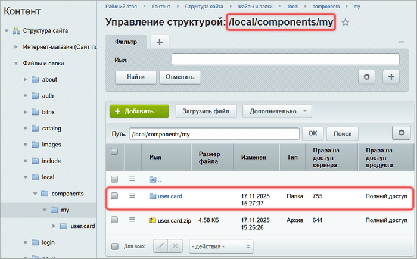
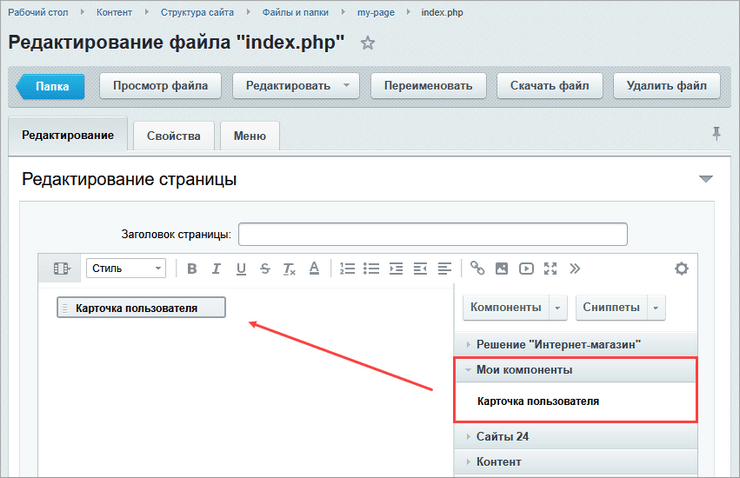
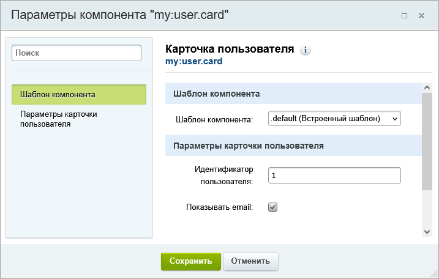

Компонент выводит данные на странице сайта: получает параметры, выбирает данные и показывает их через шаблон. Собственный компонент создают, когда системных компонентов не хватает для задачи проекта. Порядок создания показан на примере компонента *Карточка пользователя* `my:user.card`:

-  компонент выводит имя, аватар и, если включен параметр, email пользователя,
-  при клике на аватар фотография открывается в новом окне,
-  результат выборки кешируется на час.

Для работы примера нужен установленный продукт. Собственный код размещается в папке `/local/` — ее назначение описано в статье [Структура директорий](./directory-structure.md#local). Устройство компонентов подробно описано в статье [Компоненты](../framework/components.md).

## Размещение и именование компонента

Пользовательские компоненты размещают в папке `/local/components/`. Это отделяет их от системных и упрощает обновление системы.

Имена компонентов строят иерархически в формате `идентификатор1.идентификатор2...`. Начинают с общего понятия и заканчивают конкретным назначением компонента. Полное имя  включает пространство имен: `пространство_имен:имя_компонента`.

Компонент Карточка пользователя можно назвать `my:user.card`. Для этого создайте папки:

-  `my` в `/local/components/`,

-  `user.card` в `/local/components/my/`.

## Структура компонента

Создайте следующие папки и файлы для компонента:

```
/local/components/my/user.card/
├── .description.php        // Описание компонента
├── .parameters.php         // Параметры компонента
├── class.php               // Логика компонента
├── lang/
│   └── ru/
│       └── class.php       // Локализация class.php
└── templates/
    └── .default/
        ├── lang/
        │   └── ru/
        │       └── template.php // Локализация шаблона
        ├── template.php          // Шаблон вывода
        ├── script.js             // Логика для карточки
        └── style.css             // Стили карточки
```

Файл `component.php` не нужен, потому что логика находится в классе в `class.php`. Система создает объект класса-наследника `CBitrixComponent` из `class.php`. Если в классе не переопределен метод `executeComponent()`, базовая реализация подключит `component.php`.



Каждый исполняемый PHP-файл компонента и шаблона начинается с проверки константы `B_PROLOG_INCLUDED`, как в примерах ниже. Проверка прерывает выполнение, если файл открыть по прямому адресу из браузера. Языковые файлы содержат только массив `$MESS` и проверку не требуют.



### Файл .description.php

Файл `.description.php` содержит массив `$arComponentDescription` с основными характеристиками компонента. Визуальный редактор показывает эти данные в панели компонентов. Задайте в массиве ключи:

-  `NAME` — название компонента,
-  `DESCRIPTION` — описание,
-  `PATH` — раздел панели компонентов. Ключ `ID` задает код раздела, ключ `NAME` — его название.

**Пример.** Компонент появится в панели компонентов в разделе *Мои компоненты*:

```php
<?php

if (!defined('B_PROLOG_INCLUDED') || B_PROLOG_INCLUDED !== true)
{
    die();
}

$arComponentDescription = [
    'NAME' => 'Карточка пользователя',
    'DESCRIPTION' => 'Выводит небольшую карточку с информацией об указанном пользователе',
    'PATH' => [
        'ID' => 'my',
        'NAME' => 'Мои компоненты',
    ],
];
```

### Файл .parameters.php

Файл `.parameters.php` содержит массив `$arComponentParameters`, который описывает входные параметры компонента. Визуальный редактор строит по нему форму настройки компонента. Массив состоит из двух ключей:

-  `GROUPS` — группы параметров в форме, ключ группы — ее код, `NAME` — название,
-  `PARAMETERS` — параметры. Для каждого параметра задайте `NAME` — подпись в форме, `TYPE` — тип поля, `PARENT` — код группы и при необходимости `DEFAULT` — значение по умолчанию. Все типы полей и ключи параметров описаны в разделе [Файл .parameters.php](../framework/components.md#parameters-file) статьи «Компоненты».

Добавьте в массив группу `USER_CARD` и три параметра:

-  `USER_ID` — обязательный. Поле типа `STRING` для идентификатора пользователя. Если параметр не передан, `onPrepareComponentParams()` подставит `0`, и компонент выведет ошибку «Пользователь не найден»,
-  `SHOW_EMAIL` — поле типа `CHECKBOX`, которое определяет, показывать ли email. Значение параметра — строка `Y` или `N`, по умолчанию `Y`,
-  `CACHE_TIME` — время кеширования в секундах, по умолчанию 3600. Для этого ключа достаточно указать `DEFAULT`. Система сама добавит в форму поля *Тип кеширования* и *Время кеширования* в группе настроек кеширования.

**Пример.** Форма настройки компонента получит группу *Параметры карточки пользователя* и настройки кеширования:

```php
<?php

if (!defined('B_PROLOG_INCLUDED') || B_PROLOG_INCLUDED !== true)
{
    die();
}

$arComponentParameters = [
    'GROUPS' => [
        'USER_CARD' => [
            'NAME' => 'Параметры карточки пользователя',
        ],
    ],
    'PARAMETERS' => [
        'USER_ID' => [
            'NAME' => 'Идентификатор пользователя',
            'TYPE' => 'STRING',
            'PARENT' => 'USER_CARD',
        ],
        'SHOW_EMAIL' => [
            'NAME' => 'Показывать email',
            'TYPE' => 'CHECKBOX',
            'DEFAULT' => 'Y',
            'PARENT' => 'USER_CARD',
        ],
        'CACHE_TIME' => [
            'DEFAULT' => 3600,
        ],
    ],
];
```

### Файл class.php {#class-php}

Файл `class.php` — основной файл логики компонента. Объявите в нем класс-наследник `CBitrixComponent`. Имя класса произвольное, но должно быть уникальным в проекте. Если в двух компонентах объявлен класс с одним полным именем, при их подключении на одной странице PHP выдаст фатальную ошибку. Класс можно объявить и в пространстве имен. Система подключает `class.php` и использует объявленный в нем наследник `CBitrixComponent`.

В классе переопределите два метода:

-  `onPrepareComponentParams($arParams)` — получает параметры вызова и возвращает их с подставленными значениями по умолчанию. Результат система записывает в `$this->arParams`, а затем экранирует строки, в которых есть символы `;`, `&`, `<`, `>` или `"`. В параметрах-массивах строки первого уровня экранируются всегда, вложенные массивы остаются без изменений. Исходные значения доступны по ключам с префиксом `~`, например `$arParams['~USER_ID']`. Подробнее в разделе [$arParams](../framework/components.md#arparams) статьи «Компоненты»,
-  `executeComponent()` — выполняет компонент. Базовая реализация метода только подключает `component.php` и ничего не кеширует.

Кеширование в примере включает метод `startResultCache()`. Метод берет время жизни кеша из параметра `CACHE_TIME`. Если параметр не задан, время равно нулю и данные из кеша не читаются, поэтому `onPrepareComponentParams()` подставляет значение 3600 секунд. Ключ кеша система строит по значениям `$arParams`, поэтому карточки разных пользователей кешируются отдельно.

Метод `startResultCache()` возвращает:

-  `true` — кеша нет или кеширование выключено. Компонент вызывает приватный метод `initResult()` и подключает шаблон методом `includeComponentTemplate()`,
-  `false` — кеш найден. Метод уже вывел сохраненный HTML, компонент ничего не делает.

Кеширование выключено, если параметр `CACHE_TYPE` равен `N` или равен `A` при выключенном автокешировании — опция `component_cache_on` модуля `main` равна `N`. Если `CACHE_TYPE` не передан или не равен `Y` и `N`, система подставляет `A`. Значения `CACHE_TYPE` описаны в разделе [Исходный код страницы](#page-source).

Метод `includeComponentTemplate()` сам завершает запись кеша и сохраняет `$arResult` и вывод шаблона. Вызывать `endResultCache()` не нужно.

Метод `initResult()` не входит в API `CBitrixComponent`, его создают в классе компонента. Метод выбирает поля `NAME`, `EMAIL` и `PERSONAL_PHOTO` пользователя через ORM-запрос `\Bitrix\Main\UserTable::query()`. Построение таких запросов описано в статье [Выборка данных](../orm/querying-data.md). Метод заполняет `$arResult` ключами:

-  `NAME` — имя пользователя,
-  `EMAIL` — email пользователя,
-  `PERSONAL_PHOTO_SRC` — путь к файлу аватара от корня сайта. Путь возвращает метод `CFile::GetPath()`. Ключ заполняется, только если у пользователя указано фото. Если файл не найден, значение равно `null`, поэтому шаблон проверяет ключ через `isset()`.

Если `USER_ID` меньше единицы или пользователь не найден, `$arResult` остается пустым. Тогда компонент отменяет запись кеша методом `abortResultCache()` и выводит ошибку функцией `ShowError()`.

Компонент автоматически подключает только языковой файл `lang/<код языка>/component.php`. Поэтому `class.php` загружает свои фразы сам вызовом `Loc::loadMessages(__FILE__)` класса `Bitrix\Main\Localization\Loc`, а текст ошибки берет из файла `lang/ru/class.php`. Названия в `.description.php` и `.parameters.php` для краткости записаны в примерах прямо в коде, в рабочем компоненте их тоже выносят в языковые файлы.

Скрипт шаблона использует JS-ядро `main.core`. Класс подключает его вызовом `Extension::load('main.core')` класса `Bitrix\Main\UI\Extension` до `startResultCache()`, потому что при выводе из кеша шаблон не выполняется.

**Пример.** Класс компонента с кешированием результата:

```php
<?php

if (!defined('B_PROLOG_INCLUDED') || B_PROLOG_INCLUDED !== true)
{
    die();
}

use Bitrix\Main\Localization\Loc;
use Bitrix\Main\UI\Extension;

Loc::loadMessages(__FILE__);

class UserCardComponent extends CBitrixComponent
{
    /**
     * Подготавливаем входные параметры
     *
     * @param  array $arParams
     *
     * @return array
     */
    public function onPrepareComponentParams($arParams)
    {
        $arParams['USER_ID'] ??= 0;
        $arParams['SHOW_EMAIL'] ??= 'Y';
        $arParams['CACHE_TIME'] ??= 3600;

        return $arParams;
    }

    /**
     * Основной метод выполнения компонента
     *
     * @return void
     */
    public function executeComponent()
    {
        // JS-ядро нужно скрипту шаблона и при выводе из кеша
        Extension::load('main.core');

        // Время жизни кеша берется из $arParams['CACHE_TIME']
        if ($this->startResultCache())
        {
            $this->initResult();

            // Если ничего не найдено, отменяем кеширование
            if (empty($this->arResult))
            {
                $this->abortResultCache();
                ShowError(Loc::getMessage('USER_CARD_NOT_FOUND'));

                return;
            }

            $this->includeComponentTemplate();
        }
    }

    /**
     * Инициализируем результат
     *
     * @return void
     */
    private function initResult(): void
    {
        $userId = (int)$this->arParams['USER_ID'];
        if ($userId < 1)
        {
            return;
        }

        $user =
            \Bitrix\Main\UserTable::query()
                ->setSelect([
                    'NAME',
                    'EMAIL',
                    'PERSONAL_PHOTO',
                ])
                ->where('ID', $userId)
                ->fetch()
        ;

        if (empty($user))
        {
            return;
        }

        $this->arResult = [
            'NAME' => $user['NAME'],
            'EMAIL' => $user['EMAIL'],
        ];

        // Получаем путь до аватара, если он указан
        if (!empty($user['PERSONAL_PHOTO']))
        {
            $this->arResult['PERSONAL_PHOTO_SRC'] = \CFile::GetPath($user['PERSONAL_PHOTO']);
        }
    }
}
```

### Файл template.php

Файл `templates/.default/template.php` содержит шаблон по умолчанию и определяет внешний вид карточки пользователя. Система передает в шаблон переменные `$arParams`, `$arResult`, `$APPLICATION`, `$component`, `$this` — объект шаблона, `$templateFolder` — путь к папке шаблона и другие. Полный список приведен в разделе [Переменные в шаблоне](../framework/components.md#template-variables) статьи «Компоненты».

Используйте ключи `NAME`, `EMAIL` и `PERSONAL_PHOTO_SRC` из `$arResult`, чтобы вывести имя, email и аватар. Email выводите, только если параметр `SHOW_EMAIL` равен `Y`. Подпись к email шаблон берет из языкового файла вызовом `Loc::getMessage('USER_CARD_EMAIL_LABEL')`.



Значения массива `$arResult` автоматически не экранируются. Перед выводом строковых значений в HTML применяйте функцию `htmlspecialcharsbx`, чтобы предотвратить XSS и HTML-инъекции. Подробнее о массивах `$arParams` и `$arResult` читайте в статье [Компоненты](../framework/components.md).



**Пример.** Шаблон выводит аватар, имя и email с экранированием значений:

```php
<?php

if (!defined('B_PROLOG_INCLUDED') || B_PROLOG_INCLUDED !== true)
{
    die();
}

use Bitrix\Main\Localization\Loc;

/**
 * @var array $arParams
 * @var array $arResult
 * @var CMain $APPLICATION
 * @var CBitrixComponent $component
 * @var CBitrixComponentTemplate $this
 */

?>
<div class="my-user-card">
    <?php if (isset($arResult['PERSONAL_PHOTO_SRC'])): ?>
        <div class="my-user-card__avatar">
            "
                alt="<?= htmlspecialcharsbx($arResult['NAME']) ?>"
            >
        </div>
    <?php endif; ?>

    <div class="my-user-card__info">
        <h2 class="my-user-card__name">
            <?= htmlspecialcharsbx($arResult['NAME']) ?>
        </h2>
        <?php if ($arParams['SHOW_EMAIL'] === 'Y'): ?>
            <p class="my-user-card__email">
                <span><?= Loc::getMessage('USER_CARD_EMAIL_LABEL') ?></span>
                <span><?= htmlspecialcharsbx($arResult['EMAIL']) ?></span>
            </p>
        <?php endif; ?>
    </div>
</div>
```

### Файл script.js

Файл `templates/.default/script.js` содержит скрипт для обработки событий. Система подключает `script.js` и `style.css` из папки шаблона автоматически при выводе шаблона, в том числе когда HTML берется из кеша. Подключать их вручную через `$APPLICATION` или `Asset` не нужно.

Скрипт использует функции `BX.ready()` и `BX.Event.bind()` из JS-ядра `main.core`. Ядро подключает класс компонента, как описано в разделе [Файл class.php](#class-php). В `template.php` такой вызов не подходит.

**Пример.** Скрипт открывает фотографию пользователя в новом окне при клике на аватар:

```js
BX.ready(() => {
    document.querySelectorAll('.js-my-user-card-avatar-show-in-new-page').forEach((item) => {
        BX.Event.bind(item, 'click', () => {
            window.open(item.src, '_blank');
        });
    });
});
```

### Файл style.css

Файл `templates/.default/style.css` содержит стили компонента.

**Пример.** Стили задают фон, отступы и размеры карточки:

```css
.my-user-card {
    background: #cff9f2;
    padding: 15px;
    width: 230px;
}
.my-user-card__avatar {
    margin: 0 0 15px 0;
}
.my-user-card__avatar img {
    cursor: pointer;
    max-width: 200px;
}
.my-user-card__info {
    text-align: left;
}
.my-user-card__name {
    font-size: 1.5rem;
    margin: 0 0 10px 0;
}
.my-user-card__email {
    font-size: 1rem;
}
```

### Файл templates/.default/lang/ru/template.php

Файл `templates/.default/lang/ru/template.php` содержит фразы шаблона на русском языке. Языковой файл шаблона лежит в папке `lang/<код языка>/` внутри папки шаблона и называется так же, как файл шаблона. Шаблон подключает свой языковой файл автоматически, поэтому `Loc::getMessage()` в `template.php` работает без вызова `Loc::loadMessages()`. Для другого языка создайте файл с теми же ключами в папке `lang/<код языка>/`, например `lang/en/template.php`.

**Пример.** Языковой файл задает подпись к email по ключу `USER_CARD_EMAIL_LABEL`:

```php
<?php
$MESS['USER_CARD_EMAIL_LABEL'] = 'E-mail:';
```

### Файл lang/ru/class.php

Файл `lang/ru/class.php` в папке компонента содержит фразы класса. Класс загружает его вызовом `Loc::loadMessages(__FILE__)` в начале `class.php`.

**Пример.** Языковой файл задает текст ошибки по ключу `USER_CARD_NOT_FOUND`:

```php
<?php
$MESS['USER_CARD_NOT_FOUND'] = 'Пользователь не найден';
```

## Архив с примером компонента

Все файлы компонента `user.card` можно [скачать в архиве](https://dev.1c-bitrix.ru/docs/chm_files/user.card.zip). Для работы распакуйте архив в папку `/local/components/my/`. После распаковки в файловом менеджере административного раздела в папке `/local/components/my/` появится папка `user.card`.

{width=700px height=435px}

## Как добавить компонент на страницу

Сначала создайте страницу, например `/my-page/index.php`. Порядок описан в статье [Создание страницы](./create-page.md).

Разместите на странице и настройте новый компонент.

1. Откройте страницу `/my-page/index.php` на редактирование в визуальном редакторе.

2. В панели компонентов раскройте раздел *Мои компоненты*.

3. Переместите компонент *Карточка пользователя* в рабочую область страницы.

   {width=740px height=478px}

4. Откроется форма с параметрами компонента. Выполните настройки.

   -  *Идентификатор пользователя* — введите идентификатор пользователя, карточку которого нужно вывести.

      Чтобы вывести карточку текущего пользователя, в параметре укажите `={$USER->GetID()}`.

   -  *Показывать email* — отметьте опцию, чтобы в карточке был показан email.

   {width=717px height=456px}

В результате на странице `/my-page/index.php` появится карточка с аватаром, именем и email пользователя.

{width=261px height=401px}

### Исходный код страницы {#page-source}

Метод `$APPLICATION->IncludeComponent()` подключает компонент. Передайте в него имя компонента, имя шаблона и массив параметров. Пустое имя шаблона означает шаблон `.default`.

**Пример.** Страница `/my-page/index.php` выводит карточку пользователя с ID 1:

```php
<?php
require($_SERVER['DOCUMENT_ROOT'] . '/bitrix/header.php');
$APPLICATION->SetTitle('Карточка пользователя');

$APPLICATION->IncludeComponent(
    'my:user.card',
    '',
    [
        'USER_ID' => 1, // Для текущего пользователя передайте $USER->GetID()
        'SHOW_EMAIL' => 'Y',
        'CACHE_TYPE' => 'A',
        'CACHE_TIME' => 3600,
    ]
);

require($_SERVER['DOCUMENT_ROOT'] . '/bitrix/footer.php');
```

Параметр `CACHE_TYPE` управляет кешированием:

-  `A` — кеш работает, если включено автокеширование компонентов — опция `component_cache_on` модуля `main` равна `Y`, это ее значение по умолчанию. `A` — значение `CACHE_TYPE` по умолчанию,
-  `Y` — кеш работает всегда,
-  `N` — кеш выключен.

## Что делать, если компонент не работает

-  **Ошибка вида `Cannot find '' template with page ''`.** Система не нашла файл шаблона. В кавычках выводится имя шаблона из вызова. При пустом имени система ищет шаблон `.default` в папках шаблона сайта, а затем в папке компонента `templates/.default/template.php`. Проверьте путь и имя файла.

-  **Ошибка `'my:user.card' is not a component`.** В папке `/local/components/my/user.card/` нет ни `class.php`, ни `component.php`. Проверьте имя компонента в вызове и путь к папке.

-  **На странице пусто, ошибок нет.** Имя компонента содержит недопустимые символы. В имени разрешены латинские буквы, цифры, `_`, `-` и `.`, двоеточие отделяет пространство имен. Метод `IncludeComponent()` в этом случае возвращает `false` без сообщения.

-  **Пустое место на странице или предупреждение вида `include(.../user.card/component.php): Failed to open stream`.** Файл `class.php` есть, но в нем нет класса-наследника `CBitrixComponent` или класс не переопределяет `executeComponent()`. При стандартных настройках обработки ошибок предупреждение не выводится, и на странице остается пустое место. Проверьте объявление класса.

-  **Изменения в шаблоне или данных не видны.** Компонент выводит HTML из кеша. Очистите кеш компонента вызовом `CBitrixComponent::clearComponentCache('my:user.card')` или временно передайте параметр `'CACHE_TYPE' => 'N'`.

-  **Выводится «Пользователь не найден».** В параметре `USER_ID` передан идентификатор меньше единицы или пользователя с таким ID нет.

## Что дальше

-  Перенести компонент в собственный модуль и устанавливать его вместе с модулем — статья [Создание модуля](./create-module.md).
-  Добавить действие, которое обрабатывает AJAX-запрос, — статья [Создание контроллера](./create-controller.md).
-  Изучить шаблоны, кеширование и AJAX в компонентах — статья [Компоненты](../framework/components.md).
