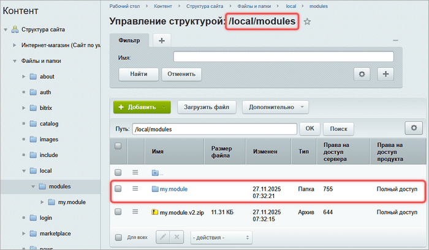
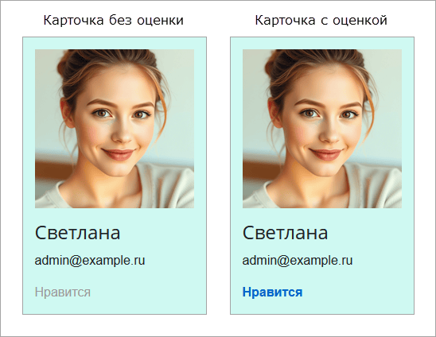

Контроллер в Bitrix Framework — это PHP-класс, который обрабатывает AJAX-запросы от браузера. Он получает данные, выполняет бизнес-логику и формирует ответ.

В статье приведен пример, как в компонент `my:user.card` добавить функционал лайков. Для этого создадим контроллер, который будет:

-  принимать запросы на добавление и удаление лайков,

-  сохранять отметки в cookie-файлах,

-  возвращать текущее состояние.



Пример основан на модуле `my.module` и компоненте `my:user.card`, которые описаны в статьях:

-  [Создание модуля](./create-module.md)

-  [Создание компонента](./create-component.md)



## Как работает вызов контроллера

Bitrix Framework связывает JavaScript-вызов и PHP-метод по имени — без дополнительной настройки. Это работает, когда соблюдаете три правила:

-  размещаете контроллер в папке `/lib/Controller/` модуля,

-  объявляете класс в правильном пространстве имен,

-  вызываете действие контроллера по шаблону `vendor:module.ControllerName.actionName`.

В примере модуль называется `my.module`. Bitrix Framework преобразует его имя в пространство имен. Первая часть `my` становится `My`, вторая `module` — `Module`, итого: `My\Module`.

Создайте файл контроллера, например, `/lib/Controller/User.php` со следующим содержимым:

```php
namespace My\Module\Controller;

class User extends \Bitrix\Main\Engine\Controller
{
    public function likeAction()
    {
        // …
    }
}
```

Теперь можно вызвать метод из JavaScript:

```javascript
BX.ajax.runAction('my:module.User.like', { /* данные */ });
```

Система разбирает имя действия по частям:

-  `my` — первая часть символьного кода модуля `my.module`,

-  `module` — вторая часть символьного кода,

-  `User` — имя класса контроллера с тем же регистром, что в имени файла,

-  `like` — имя метода `likeAction()` без суффикса `Action`.

В результате система находит класс `\My\Module\Controller\User` и запускает метод `likeAction()`.

Сохраняйте регистр `Controller/User.php` в пути и `User` в AJAX-вызове. Это нужно для автозагрузки на файловых системах с учетом регистра. Подробнее о соответствии пространства имен и пути читайте в статье [Автозагрузка классов](./../framework/autoloading.md).

Сопоставление работает, если в файле модуля `.settings.php` указан параметр `defaultNamespace`. Без этого Bitrix Framework не найдет класс и вернет ошибку.



Подробнее о правилах читайте в статье [Контроллеры](./../framework/controllers.md).



## Структура модуля с контроллером

В структуре модуля `my.module` создайте файлы контроллера:

-  `/lib/Services/LikeService.php` — для класса-сервиса лайков,

-  `/lib/Controller/User.php` — для описания контроллера.

Ниже приведена полная структура модуля после добавления контроллера. Регистр каталогов `Controller` и `Services` соответствует частям пространств имен `My\Module\Controller` и `My\Module\Services`.

```
/local/modules/my.module/
├── install/
│   ├── components/
│   │   └── my/
│   │       └── user.card/          // Компонент карточки пользователя
│   │           ├── .description.php
│   │           ├── .parameters.php
│   │           ├── class.php
│   │           ├── templates/
│   │           │   └── .default/
│   │           │       ├── template.php
│   │           │       ├── script.js
│   │           │       ├── style.css
│   │           │       └── lang/
│   │           │           └── ru/
│   │           │               └── template.php
│   ├── index.php                   // Файл установки
│   ├── step.php                    // Экран результата установки
│   ├── unstep.php                  // Экран результата удаления
│   └── version.php                 // Версия модуля
├── lib/
│   ├── Controller/
│   │   └── User.php                // Контроллер для обработки лайков
│   └── Services/
│       └── LikeService.php         // Сервис для бизнес-логики
├── lang/
│   └── ru/
│       └── install/
│           └── index.php           // Языковой файл установки
├── include.php                     // Файл подключения модуля
└── .settings.php                   // Настройка пространства имен контроллеров
```

## Сервис для бизнес-логики

В файле `/lib/Services/LikeService.php` опишите класс `LikeService` для реализации логики работы с лайками. Чтобы обрабатывать лайки пользователей, добавьте в класс:

-  константу `COOKIE_NAME` — имя cookie для хранения `ID` пользователей, в чьих карточках поставлены лайки.

-  метод `isLiked` — проверяет, поставлен ли лайк в карточке пользователя с идентификатором `userId`.

-  метод `likeUser` — добавляет идентификатор пользователя в список пользователей, в чьих карточках поставлен лайк. Если пользователь уже в списке, он не будет добавлен повторно.

-  метод `dislikeUser` — удаляет идентификатор пользователя из списка пользователей, которым поставлен лайк.

-  метод `getLikedUsersIds` — извлекает и декодирует список идентификаторов пользователей из cookie.

-  метод `setLikedUsersIds` — кодирует массив идентификаторов пользователей в формат JSON и сохраняет его в cookie, которые будут храниться 30 дней.

```php
<?php

namespace My\Module\Services;

use Bitrix\Main\ArgumentException;
use Bitrix\Main\Context;
use Bitrix\Main\Web\Cookie;
use Bitrix\Main\Web\Json;

class LikeService
{
    public const COOKIE_NAME = 'liked_users';

    public function isLiked(int $userId): bool
    {
        return in_array($userId, $this->getLikedUsersIds(), true);
    }

    public function likeUser(int $userId): void
    {
        $likedUsers = $this->getLikedUsersIds();
        $likedUsers[] = $userId;

        $this->setLikedUsersIds(
            array_values(array_unique($likedUsers))
        );
    }

    public function dislikeUser(int $userId): void
    {
        $likedUsers = array_filter($this->getLikedUsersIds(), static fn($i) => (int)$i !== $userId);

        $this->setLikedUsersIds(
            array_values(array_unique($likedUsers))
        );
    }

    private function getLikedUsersIds(): array
    {
        try
        {
            $cookieValue = Context::getCurrent()->getRequest()->getCookie(self::COOKIE_NAME);
            if (empty($cookieValue))
            {
                return [];
            }

            $value = Json::decode($cookieValue);
            if (!is_array($value))
            {
                return [];
            }

            return array_map('intval', $value);
        }
        catch (ArgumentException)
        {
            return [];
        }
    }

    private function setLikedUsersIds(array $likedUsers): void
    {
        Context::getCurrent()->getResponse()->addCookie(
            new Cookie(
                self::COOKIE_NAME,
                Json::encode($likedUsers),
                time() + 60 * 60 * 24 * 30 // 30 дней
            )
        );
    }
}
```

## Контроллер обработки лайков

В файле `/lib/Controller/User.php` опишите контроллер `User`, который управляет действиями для обработки лайков.

Контроллер наследуется от `\Bitrix\Main\Engine\Controller`. Он не содержит бизнес-логику — только маршрутизацию, валидацию и вызов сервиса.

Добавьте два метода:

-  `getDefaultPreFilters` — определяет стандартные фильтры для всех действий,

-  `likeAction` — обрабатывает действие лайка пользователя.

```php
<?php

namespace My\Module\Controller;

use Bitrix\Main\Engine\Controller;
use Bitrix\Main\Engine\ActionFilter;
use Bitrix\Main\Error;
use My\Module\Services\LikeService;

class User extends Controller
{
    /**
     * Настройка фильтров для действий
     *
     * @return array
     */
    protected function getDefaultPreFilters()
    {
        return [
            // Разрешает запросы только авторизованным пользователям
            new ActionFilter\Authentication(),

            // Принимает только POST-запросы
            new ActionFilter\HttpMethod([
                ActionFilter\HttpMethod::METHOD_POST,
            ]),

            // Проверяет CSRF-токен — защищает от подделки запроса
            new ActionFilter\Csrf(),
        ];
    }

    /**
     * Действие для обработки лайков
     *
     * @param LikeService $service
     * @param int $likedUserId
     *
     * @return array|null
     */
    public function likeAction(LikeService $service, int $likedUserId)
    {
        // Базовая валидация: ID должен быть положительным целым
        if ($likedUserId < 1)
        {
            $this->addError(new Error('Неверный ID пользователя'));

            return null;
        }

        // Если лайка нет — добавляем, иначе удаляем
        $isLikeAction = !$service->isLiked($likedUserId);
        if ($isLikeAction)
        {
            $service->likeUser($likedUserId);
        }
        else
        {
            $service->dislikeUser($likedUserId);
        }

        // Возвращаем состояние после изменения
        return [
            'liked' => $isLikeAction,
        ];
    }
}
```

## Интеграция с компонентом

Компонент `my:user.card` был создан [ранее](./create-component.md). Чтобы показывать информацию о лайках, внесите изменения в файлы компонента.

Пути ниже указаны относительно папки модуля `/local/modules/my.module/`. Если модуль уже установлен, после правок обновите рабочую копию компонента по инструкции [Как разместить компонент на сайте](#как-разместить-компонент-на-сайте).

### Шаблон template.php

В файле `/install/components/my/user.card/templates/.default/template.php` добавьте блок лайка с текстом Нравится.

В файле `/install/components/my/user.card/templates/.default/lang/ru/template.php` добавьте к существующему переводу подписи email языковую фразу для текста лайка:

```php
<?php

$MESS['USER_CARD_EMAIL_LABEL'] = 'E-mail:';
$MESS['USER_CARD_LIKE_BUTTON'] = 'Нравится';
```

-  Атрибут `data-user-id` хранит идентификатор пользователя, карточку которого лайкают. Он нужен JavaScript.

-  Класс `my-user-card__like-text--liked` определяет внешний вид активного лайка.

```php
<?php
use Bitrix\Main\Localization\Loc;

if (!defined('B_PROLOG_INCLUDED') || B_PROLOG_INCLUDED !== true)
{
    die();
}

/**
 * @var array $arParams
 * @var array $arResult
 * @var CMain $APPLICATION
 * @var CBitrixComponent $component
 * @var CBitrixComponentTemplate $this
 */

$additionalUserCardContainers = $arResult['HAS_LIKE']
    ? 'my-user-card__like-text--liked'
    : '';
?>

<div class="my-user-card">
    <?php if (isset($arResult['PERSONAL_PHOTO_SRC'])): ?>
    <div class="my-user-card__avatar">
        "
            alt="<?= htmlspecialcharsbx($arResult['NAME']) ?>"
        >
    </div>
    <?php endif; ?>

    <div class="my-user-card__info">
        <h2 class="my-user-card__name">
            <?= htmlspecialcharsbx($arResult['NAME']) ?>
        </h2>

        <?php if ($arParams['SHOW_EMAIL'] === 'Y'): ?>
        <p class="my-user-card__email">
            <span><?= Loc::getMessage('USER_CARD_EMAIL_LABEL') ?></span>
            <span><?= htmlspecialcharsbx($arResult['EMAIL']) ?></span>
        </p>
        <?php endif; ?>
    </div>
    <?php if ($arResult['IS_AUTHORIZED']): ?>
    <div class="my-user-card__like-container">
        <span
            class="my-user-card__like-text js-my-user-card-like <?= $additionalUserCardContainers ?>"
            data-user-id="<?= (int)$arParams['USER_ID'] ?>"
        >
            <?= Loc::getMessage('USER_CARD_LIKE_BUTTON') ?>
        </span>
    </div>
    <?php endif; ?>
</div>
```

### Скрипт script.js

В файл `/install/components/my/user.card/templates/.default/script.js` добавьте обработку клика на текст Нравится.

```javascript
BX.ready(() => {
    // Обработка клика на аватар
    document.querySelectorAll('.js-my-user-card-avatar-show-in-new-page').forEach((item) => {
        BX.Event.bind(item, 'click', () => {
            window.open(item.src, '_blank');
        });
    });

    // Обработка клика на текст "Нравится"
    document.querySelectorAll('.js-my-user-card-like').forEach((element) => {
        BX.Event.bind(element, 'click', () => {
            const userId = element.dataset.userId;

            // Отправляем AJAX-запрос к контроллеру
            BX.ajax.runAction(
                'my:module.User.like',
                {
                    data: { likedUserId: userId },
                }
            ).then((response) => {
                // Успешный ответ: обновляем внешний вид
                if (response.status === 'success')
                {
                    if (response.data.liked)
                    {
                        element.classList.add('my-user-card__like-text--liked');
                    }
                    else
                    {
                        element.classList.remove('my-user-card__like-text--liked');
                    }
                }
            }).catch((response) => {
                console.error('Error:', response.errors);
            });
        });
    });
});
```

### Стили style.css

В файл `/install/components/my/user.card/templates/.default/style.css` добавьте стили для текста лайка .

```css
.my-user-card {
    background: #cff9f2;
    padding: 15px;
    width: 230px;
}

.my-user-card__avatar {
    margin: 0 0 15px 0;
}

.my-user-card__avatar img {
    cursor: pointer;
    max-width: 200px;
}

.my-user-card__info {
    text-align: left;
}

.my-user-card__name {
    font-size: 1.5rem;
    margin: 0 0 10px 0;
}

.my-user-card__email {
    font-size: 1rem;
}

.my-user-card__like-container {
    margin-top: 10px;
}

.my-user-card__like-text {
    cursor: pointer;
    transition: color 0.3s ease, font-weight 0.3s ease;
    user-select: none;
    color: #999;
    font-weight: normal;
}

.my-user-card__like-text:hover {
    text-decoration: underline;
}

/* Активный лайк — синий и жирный */
.my-user-card__like-text--liked {
    color: #0066cc;
    font-weight: bold;
}
```

### Класс компонента class.php

Внесите изменения в основной класс компонента `/install/components/my/user.card/class.php`:

-  подключите `ServiceLocator` и `LikeService`,

-  в выборку пользователя добавьте поле `ID`,

-  в `arResult` добавьте признак авторизации `IS_AUTHORIZED` и проверку лайков `HAS_LIKE`,

-  в дополнительный идентификатор кеша добавьте признак авторизации и cookie с лайками,

-  добавьте метод `isUserLiked()`, который проверяет лайк через `LikeService`.

Персональные данные должны влиять на идентификатор кеша. Иначе в кеш попадут состояние лайка и признак авторизации первого посетителя, а остальные посетители увидят тот же результат.

Класс `LikeService` не нужно регистрировать в настройках сервисов. В метод `get()` передается полное имя существующего класса, поэтому Service Locator создает его объект в режиме Autowire. Объект повторно используется только в рамках текущего HTTP-запроса. Состояние лайков между запросами сохраняет cookie, а не Service Locator.

```php
<?php
use Bitrix\Main\Context;
use Bitrix\Main\DI\ServiceLocator;
use Bitrix\Main\Loader;
use Bitrix\Main\UserTable;
use My\Module\Services\LikeService;

if (!defined('B_PROLOG_INCLUDED') || B_PROLOG_INCLUDED !== true)
{
    die();
}

class UserCardComponent extends CBitrixComponent
{
    /**
     * Подготавливаем входные параметры
     *
     * @param array $arParams
     *
     * @return array
     */
    public function onPrepareComponentParams($arParams)
    {
        $arParams['USER_ID'] ??= 0;
        $arParams['SHOW_EMAIL'] ??= 'Y';

        return $arParams;
    }

    /**
     * Основной метод выполнения компонента
     *
     * @return void
     */
    public function executeComponent()
    {
        /** @global CUser $USER */
        global $USER;

        if (!Loader::includeModule('my.module'))
        {
            ShowError('Модуль my.module не установлен');

            return;
        }

        $additionalCacheId = [
            'isAuthorized' => $USER->IsAuthorized(),
            'likedUsers' => Context::getCurrent()
                ->getRequest()
                ->getCookie(LikeService::COOKIE_NAME),
        ];

        // Кешируем результат, чтобы не делать постоянные запросы к базе
        if ($this->startResultCache(false, $additionalCacheId))
        {
            $this->initResult($additionalCacheId['isAuthorized']);

            // Если ничего не найдено, отменяем кеширование
            if (empty($this->arResult))
            {
                $this->abortResultCache();
                ShowError('Пользователь не найден');

                return;
            }

            $this->includeComponentTemplate();
        }
    }

    /**
     * Инициализируем результат
     *
     * @param bool $isAuthorized
     *
     * @return void
     */
    private function initResult(bool $isAuthorized): void
    {
        $userId = (int)$this->arParams['USER_ID'];
        if ($userId < 1)
        {
            return;
        }

        $user = UserTable::query()
            ->setSelect([
                'ID',
                'NAME',
                'EMAIL',
                'PERSONAL_PHOTO',
            ])
            ->where('ID', $userId)
            ->fetch()
        ;

        if (empty($user))
        {
            return;
        }

        $this->arResult = [
            'NAME' => $user['NAME'],
            'EMAIL' => $user['EMAIL'],
            'IS_AUTHORIZED' => $isAuthorized,
            'HAS_LIKE' => $this->isUserLiked((int)$user['ID']),
        ];

        // Получаем путь до аватара, если он указан
        if (!empty($user['PERSONAL_PHOTO']))
        {
            $this->arResult['PERSONAL_PHOTO_SRC'] = \CFile::GetPath($user['PERSONAL_PHOTO']);
        }
    }

    /**
     * Проверяем, поставил ли текущий пользователь лайк
     *
     * @return bool
     */
    private function isUserLiked(int $userId): bool
    {
        /**
         * @var LikeService $service
         */

        // Service Locator автоматически создает объект по имени класса
        $service = ServiceLocator::getInstance()->get(LikeService::class);

        return $service->isLiked($userId);
    }
}
```

## Настройка .settings.php

Файл `/local/modules/my.module/.settings.php` обязателен для работы контроллеров. Добавьте регистрацию контроллера. В результате становится возможен вызов `my:module.User.like`.

-  `defaultNamespace` должен соответствовать пространству имен контроллера.

-  Двойные обратные слеши `\\` — экранирование в PHP-строках.

-  `readonly: true` запрещает изменение настроек через интерфейс.

```php
<?php
return [
    'controllers' => [
        'value' => [
            'defaultNamespace' => '\\My\\Module\\Controller',
        ],
        'readonly' => true,
    ]
];
```

## Архив модуля с контроллером

Готовый модуль с контроллером можно [скачать в архиве](https://dev.1c-bitrix.ru//docs/chm_files/my.module.v2.zip). Для работы распакуйте архив в папку `/local/modules/`.

{width=700px height=409px}

### Как разместить компонент на сайте

1. В административном разделе откройте страницу *Marketplace > Установленные решения*.

2. Установите модуль *Мой модуль (my.module)*.

   Если модуль уже установлен после предыдущей статьи, скопируйте содержимое папки `/local/modules/my.module/install/components/my/user.card/` в `/local/components/my/user.card/` с заменой файлов. Так вы обновите рабочую копию компонента без переустановки модуля. Распаковка архива или изменение файлов в папке установки модуля сами по себе рабочую копию не обновляют.

3. Откройте страницу с компонентом из предыдущей статьи или создайте страницу и разместите на ней компонент *Карточка пользователя*.

После настройки компонента авторизованные пользователи увидят текст «Нравится» в карточке. Изначально текст будет серым, но, если поставить лайк, цвет изменится на синий.

{width=548px height=424px}
