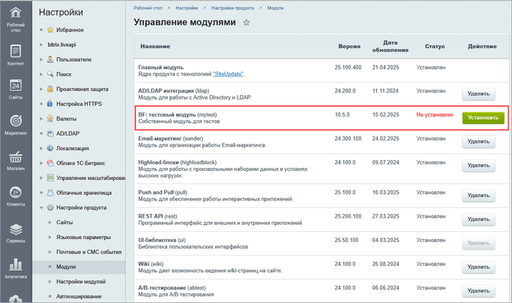
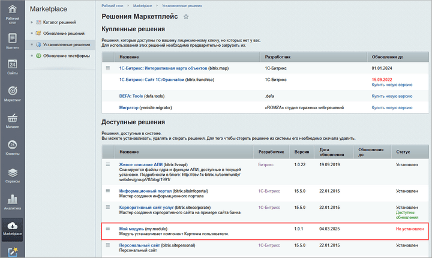
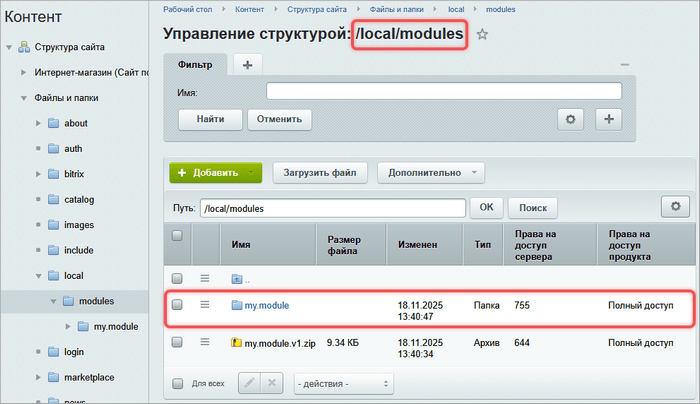
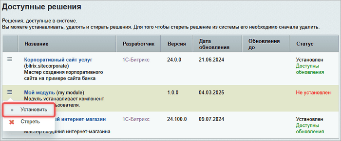
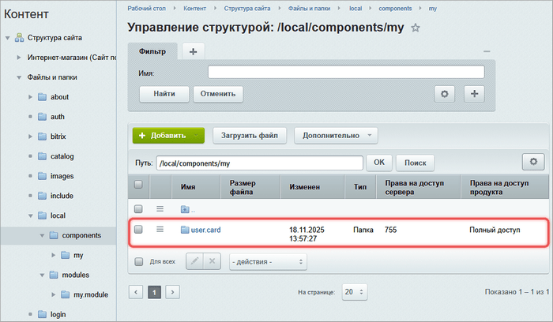

Bitrix Framework состоит из модулей. Каждый модуль отвечает за отдельную область системы: управление контентом, email-рассылки, рекламу или пользовательскую функциональность проекта.

## Что такое модуль

Модуль — это автономный блок кода, который может включать:

-  API для данных, бизнес-логики, интерфейса,

-  HTML-верстку,

-  компоненты,

-  административные разделы.

Большинство модулей работают автономно, но часть из них расширяет функциональность других:

-  *Торговый каталог* добавляет к *Информационным блокам* функции цен, скидок и наценок.

-  *Документооборот* работает с данными из *Информационных блоков* и *Управления структурой*.

## Пользовательские модули

Разработчики могут создавать свои модули в Bitrix Framework. Пользовательские модули размещают в папке `/local/modules/`. Это обеспечивает четкое разделение между системными файлами и кастомизацией. Папка `/local/` не перезаписывается при обновлениях системы, поэтому ваши разработки останутся нетронутыми.

Для каждого модуля нужно создать отдельную папку в `/local/modules/`. Название корневой папки модуля совпадает с идентификатором модуля.



Идентификатор модуля должен соответствовать правилам:

-  задан в нижнем регистре,

-  первый символ не является цифрой,

-  не содержит знака нижнего подчеркивания `_`.



Пользовательские модули можно разделить на собственные и партнерские.

### Собственные модули

Собственный модуль — это модуль, который разрабатывают и используют в рамках своего веб-проекта. При его создании соблюдают правило: идентификатор, название папки и класса одинаковы и написаны одним словом, например, `mytest`.

Собственные модули устанавливают из списка на странице *Настройки > Настройки продукта > Модули.*

{width=720px height=426px}

### Партнерские модули

Партнерский модуль — это модуль, который разрабатывают партнеры 1С-Битрикс и размещают на [Маркетплейсе](https://marketplace.1c-bitrix.ru/) после модерации. Любой клиент 1С-Битрикс может установить такой модуль в свой проект.

Идентификатор партнерского модуля — это уникальный код вида `partner.module`. Он состоит из кода партнера и названия модуля, которые разделены точкой.

Чтобы создать название класса, в идентификаторе модуля замените точку на нижнее подчеркивание: `partner_module`.

Для модуля с идентификатором `partner.module` пространство имен будет `\Partner\Module`. Здесь точка заменяется на обратный слеш `\`, и каждое слово начинается с заглавной буквы.

В файле `/install/index.php` для партнерского модуля укажите свойства `PARTNER_NAME` и `PARTNER_URI`. Они задают имя автора модуля и ссылку на сайт партнера. Эти данные видны клиенту в списке модулей.

Партнерские модули можно установить со страницы *Marketplace > Установленные решения*.

{width=720px height=430px}

## Пример создания модуля

Добавим в систему модуль `my.module`. Он установит компонент *Карточка пользователя*.

В примере используется партнерский формат идентификатора, чтобы показать структуру модуля с пространством имен `\My\Module`. Для собственного модуля используйте идентификатор без точки, например `mytest`, и задайте такое же имя папки и класса установщика.

### Структура модуля

1. Создайте папку `my.module` в `/local/modules/`.

2. Добавьте папки и файлы с описанием, версией, языковыми файлами и конфигурацией модуля в `/local/modules/my.module/`.

3. В папке `/local/modules/my.module/install/components/` создайте компонент `my:user.card`. Подробности читайте в статье [Создание компонента](./create-component.md).

```
/local/modules/my.module/
├── install/
│   ├── components/
│   │   └── my/
│   │       └── user.card/        // Компонент Карточка пользователя
│   │           ├── .description.php
│   │           ├── .parameters.php
│   │           ├── class.php
│   │           ├── templates/
│   │           │   └── .default/
│   │           │       ├── lang/
│   │           │       │   └── ru/
│   │           │       │       └── template.php
│   │           │       ├── script.js
│   │           │       ├── style.css
│   │           │       └── template.php
│   ├── index.php                 // Основной файл установки
│   ├── step.php                  // Экран результата установки
│   ├── unstep.php                // Экран результата удаления
│   └── version.php               // Версия модуля
├── lang/
│   └── ru/
│       └── install/
│           └── index.php         // Языковой файл установки
├── include.php                   // Файл подключения модуля
└── .settings.php                 // Файл с конфигурацией
```

#### Основной файл установки

Файл `/install/index.php` описывает класс модуля. Класс `my_module` состоит из следующих частей:

-  конструктора — загружает файл `version.php`, название и описание модуля,

-  методов установки и удаления: `DoInstall()` и `DoUninstall()`,

-  методов работы с базой данных: `InstallDB()` и `UnInstallDB()`,

-  методов работы с файлами: `InstallFiles()` и `UnInstallFiles()`.

Установщик сочетает актуальный объектный API и классический API. Класс `CModule` и метод `$APPLICATION->IncludeAdminFile()` входят в классический контракт установки модулей. Прямой замены для них в актуальном объектном API нет.

Функция `CopyDirFiles()` рекурсивно копирует файлы установки. В классе `Bitrix\Main\IO\Directory` нет метода для такого копирования. Для регистрации модуля, локализации и удаления каталога компонента используются классы `ModuleManager`, `Loc` и `Directory`.

В метод `InstallFiles()` добавьте вызов `CopyDirFiles`. Он скопирует компонент `my:user.card` из папки установки модуля в рабочую папку `/local/components/`.

В методе `UnInstallFiles()` удалите только каталог установленного компонента `/local/components/my/user.card`. Не удаляйте каталог пространства имен `/local/components/my`, потому что в нем могут находиться компоненты других модулей.

```php
<?php

use Bitrix\Main\Application;
use Bitrix\Main\IO\Directory;
use Bitrix\Main\Localization\Loc;
use Bitrix\Main\ModuleManager;

Loc::loadMessages(__FILE__);

class my_module extends CModule
{
    public $MODULE_ID = 'my.module';
    public $MODULE_VERSION;
    public $MODULE_VERSION_DATE;
    public $MODULE_NAME;
    public $MODULE_DESCRIPTION;
    public $PARTNER_NAME = 'My Company';
    public $PARTNER_URI = 'https://example.com';

    public function __construct()
    {
        include __DIR__ . '/version.php';

        if (isset($arModuleVersion['VERSION'], $arModuleVersion['VERSION_DATE']))
        {
            $this->MODULE_VERSION = $arModuleVersion['VERSION'];
            $this->MODULE_VERSION_DATE = $arModuleVersion['VERSION_DATE'];
        }

        $this->MODULE_NAME = Loc::getMessage('MY_MODULE_MODULE_NAME');
        $this->MODULE_DESCRIPTION = Loc::getMessage('MY_MODULE_MODULE_DESCRIPTION');
    }

    public function DoInstall()
    {
        global $USER, $APPLICATION;

        if (!$USER->IsAdmin())
        {
            return;
        }

        ModuleManager::registerModule($this->MODULE_ID);

        $this->InstallDB();
        $this->InstallFiles();

        $APPLICATION->IncludeAdminFile(
            'Установка модуля ' . $this->MODULE_NAME,
            __DIR__ . '/step.php'
        );
    }

    public function DoUninstall()
    {
        global $USER, $APPLICATION;

        if (!$USER->IsAdmin())
        {
            return;
        }

        $this->UnInstallFiles();
        $this->UnInstallDB();

        ModuleManager::unRegisterModule($this->MODULE_ID);

        $APPLICATION->IncludeAdminFile(
            'Удаление модуля ' . $this->MODULE_NAME,
            __DIR__ . '/unstep.php'
        );
    }

    public function InstallDB()
    {
        // Здесь можно зарегистрировать обработчики событий, агентов
        // и пользовательские поля модуля
        return true;
    }

    public function UnInstallDB()
    {
        // Здесь нужно удалить обработчики событий и пользовательские поля модуля
        return true;
    }

    public function InstallFiles()
    {
        CopyDirFiles(
            $_SERVER['DOCUMENT_ROOT'] . '/local/modules/my.module/install/components',
            $_SERVER['DOCUMENT_ROOT'] . '/local/components',
            true,
            true
        );
    }

    public function UnInstallFiles()
    {
        Directory::deleteDirectory(
            Application::getDocumentRoot() . '/local/components/my/user.card'
        );

        return true;
    }
}
?>
```



Методы `InstallDB()` и `UnInstallDB()` — точки расширения установщика. Добавьте в них регистрацию и удаление обработчиков событий, пользовательских полей и других данных, если они нужны модулю. Передавайте идентификатор модуля при регистрации агентов. Метод `ModuleManager::unRegisterModule()` автоматически удалит такие агенты при удалении модуля.



#### Файл результата установки

Файл `/install/step.php` выводит сообщение после установки модуля. Его подключает метод `DoInstall()` через `$APPLICATION->IncludeAdminFile()`.

```php
<?php
if (!check_bitrix_sessid())
{
    return;
}

CAdminMessage::ShowNote('Модуль установлен');
?>
```

#### Файл результата удаления

Файл `/install/unstep.php` выводит сообщение после удаления модуля. Его подключает метод `DoUninstall()` через `$APPLICATION->IncludeAdminFile()`.

```php
<?php
if (!check_bitrix_sessid())
{
    return;
}

CAdminMessage::ShowNote('Модуль удален');
?>
```

#### Файл с версией

Файл `/install/version.php` содержит информацию о версии модуля. Версия не может быть равна нулю.

```php
<?php
$arModuleVersion = [
    'VERSION' => '1.0.0',
    'VERSION_DATE' => '2025-03-04 16:10:25'
];
?>
```

#### Файл подключения модуля

Файл `include.php` подключается при вызове `Loader::includeModule('my.module')`. В нем регистрируют классы и функции, которые должны быть доступны после подключения модуля. Если модулю не нужны собственные классы или функции, файл можно оставить пустым.



Подробнее о подключении модуля и регистрации классов читайте в статье [Автозагрузка классов](./../framework/autoloading.md).



#### Файл с базовой конфигурацией

Файл `.settings.php` описывает настройки модуля. В настройках для контроллеров укажите пространство имен.

```php
<?php
return [
    'controllers' => [
        'value' => [
            'defaultNamespace' => '\\My\\Module\\Controller',
        ],
        'readonly' => true,
    ]
];
?>
```

#### Языковой файл описания модуля

Файл `/lang/ru/install/index.php` содержит переводы текстов, которые используются в файле `/install/index.php`. Языковые файлы повторяют структуру исходных PHP-файлов. Поэтому для `/install/index.php` используйте только путь `/lang/<код_языка>/install/index.php`.

```php
<?php
$MESS['MY_MODULE_MODULE_NAME'] = 'Мой модуль';
$MESS['MY_MODULE_MODULE_DESCRIPTION'] = 'Модуль устанавливает компонент Карточка пользователя.';
?>
```

В конструкторе класса модуля значения свойств `MODULE_NAME` и `MODULE_DESCRIPTION` получают из этих языковых фраз. Система выводит значения свойств как название и описание модуля на странице *Настройки > Настройки продукта > Модули*. Если языковой файл расположен по другому пути или коды фраз не совпадают, модуль не получит название и описание.

Модуль создан. Следующие шаги — добавить контроллер или изучить архитектуру модулей.



[Создание контроллера](./create-controller.md)

[Архитектура модулей](./../modules/architecture.md)



## Архив с примером модуля

Файлы модуля можно [скачать в архиве](https://dev.1c-bitrix.ru/docs/chm_files/my.module.v1.zip).

1. Распакуйте архив в папку `/local/modules/`.

   {width=700px height=404px}

2. Откройте страницу *Marketplace > Установленные решения*.

3. В блоке Доступные решения для модуля нажмите Установить.

   {width=700px height=291px}

В результате модуль установит компонент `my:user.card`.

{width=700px height=408px}
