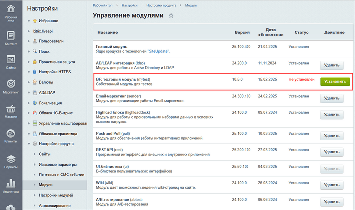
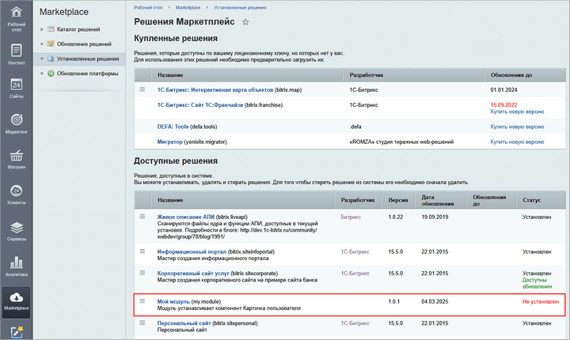
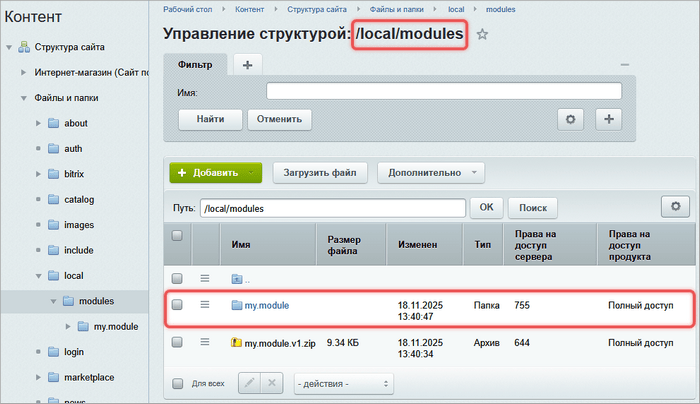
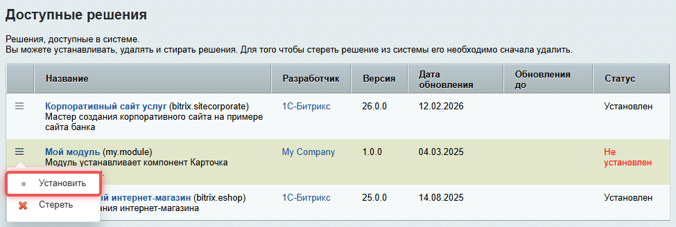
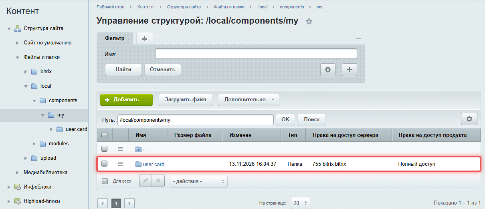

Bitrix Framework состоит из модулей. Каждый модуль отвечает за отдельную область системы: управление контентом, email-рассылки, рекламу или пользовательскую функциональность проекта.

Статья показывает, как создать собственный модуль в папке `/local/modules/`: выбрать идентификатор, написать установщик на классе `CModule`, зарегистрировать модуль и при установке скопировать в проект компонент. Модуль нужен, когда компонент, классы, контроллеры и настройки нужно устанавливать и удалять одним пакетом или переносить между проектами.



Пример использует компонент `my:user.card` из статьи [Создание компонента](./create-component.md).



## Что такое модуль

Модуль — это автономный блок кода, который может включать:

-  API для данных, бизнес-логики, интерфейса,

-  HTML-верстку,

-  компоненты,

-  административные разделы.

Большинство модулей работают автономно, но часть из них расширяет функциональность других:

-  *Торговый каталог* добавляет к *Информационным блокам* функции цен, скидок и наценок.

-  *Документооборот* работает с данными из *Информационных блоков* и *Управления структурой*.

## Пользовательские модули

Разработчики могут создавать свои модули в Bitrix Framework. Пользовательские модули размещают в папке `/local/modules/`. Это обеспечивает четкое разделение между системными файлами и кастомизацией. Папка `/local/` не перезаписывается при обновлениях системы, поэтому ваши разработки останутся нетронутыми.

Для каждого модуля нужно создать отдельную папку в `/local/modules/`. Название корневой папки модуля совпадает с идентификатором модуля.



Идентификатор модуля должен соответствовать правилам:

-  состоит из латинских букв, цифр и точки: с дефисом, пробелом или другим символом, кроме `_`, модуль не появится в списке,

-  задан в нижнем регистре: `Loader::includeModule()` приводит имя модуля к нижнему регистру и ищет папку с таким именем,

-  первый символ не является цифрой: из идентификатора строится имя PHP-класса установщика,

-  не содержит знака нижнего подчеркивания `_`. Система технически допускает `_`, но это обязательное соглашение: в имени класса точка заменяется на `_`, и идентификаторы `a.b` и `a_b` дали бы одно имя класса `a_b`.



Из идентификатора система выводит остальные имена модуля:

| Идентификатор | Папка | Класс установщика | Пространство имен классов из `lib/` | Где устанавливать |
|---|---|---|---|---|
| `mytest` — без точки | `/local/modules/mytest/` | `mytest` | `Bitrix\Mytest` | *Настройки > Настройки продукта > Модули* |
| `partner.module` — с точкой | `/local/modules/partner.module/` | `partner_module` | `Partner\Module` | *Marketplace > Установленные решения* |

Страницу установки определяет наличие точки в идентификаторе: модули без точки система показывает в списке *Модули*, с точкой — в *Установленных решениях*.

Пользовательские модули можно разделить на собственные и партнерские.

### Собственные модули

Собственный модуль — это модуль, который разрабатывают и используют в рамках своего веб-проекта. При его создании соблюдают правило: идентификатор, название папки и класса одинаковы и написаны одним словом, например, `mytest`.

Собственные модули устанавливают из списка на странице *Настройки > Настройки продукта > Модули*. Классы такого модуля из папки `lib/` находятся в пространстве имен `Bitrix\` + имя модуля с заглавной буквы, например `Bitrix\Mytest`.

{width=720px height=426px}

### Партнерские модули

Партнерский модуль — это модуль, который разрабатывают партнеры 1С-Битрикс и размещают на [Маркетплейсе](https://marketplace.1c-bitrix.ru/) после модерации. Любой клиент 1С-Битрикс может установить такой модуль в свой проект.

Идентификатор партнерского модуля — это уникальный код вида `partner.module`. Он состоит из кода партнера и названия модуля, которые разделены точкой.

Чтобы создать название класса, в идентификаторе модуля замените точку на нижнее подчеркивание: `partner_module`.

Для модуля с идентификатором `partner.module` пространство имен будет `\Partner\Module`. Здесь точка заменяется на обратный слеш `\`, и каждое слово начинается с заглавной буквы.

В файле `/install/index.php` для партнерского модуля укажите свойства `PARTNER_NAME` и `PARTNER_URI`. Они задают имя автора модуля и ссылку на сайт партнера. Имя автора видно клиенту в колонке *Разработчик* на странице *Установленные решения*.

Партнерские модули можно установить со страницы *Marketplace > Установленные решения*.

{width=720px height=430px}

## Пример создания модуля

Добавим в систему модуль `my.module`. Он установит компонент *Карточка пользователя*.

В примере используется формат идентификатора с точкой, чтобы показать структуру модуля с пространством имен `\My\Module`. Поэтому модуль появится на странице *Marketplace > Установленные решения*. Для модуля без точки используйте идентификатор вида `mytest` и такие же имена папки и класса установщика — он появится в списке *Модули*.

### Структура модуля

1. Создайте папку `my.module` в `/local/modules/`.

2. Создайте в `/local/modules/my.module/` файлы `install/index.php`, `install/step.php`, `install/unstep.php`, `install/version.php`, `lang/ru/install/index.php`, `.settings.php` и при необходимости `include.php`. Содержимое каждого файла описано в разделах ниже.

3. В папке `/local/modules/my.module/install/components/` создайте компонент `my:user.card`. Подробности читайте в статье [Создание компонента](./create-component.md).

```
/local/modules/my.module/
├── install/
│   ├── components/
│   │   └── my/
│   │       └── user.card/        // Компонент Карточка пользователя
│   │           ├── .description.php
│   │           ├── .parameters.php
│   │           ├── class.php
│   │           ├── templates/
│   │           │   └── .default/
│   │           │       ├── lang/
│   │           │       │   └── ru/
│   │           │       │       └── template.php
│   │           │       ├── script.js
│   │           │       ├── style.css
│   │           │       └── template.php
│   ├── index.php                 // Основной файл установки
│   ├── step.php                  // Экран результата установки
│   ├── unstep.php                // Экран результата удаления
│   └── version.php               // Версия модуля
├── lang/
│   └── ru/
│       └── install/
│           └── index.php         // Языковой файл установки
├── lib/                          // Классы модуля, пространство имен \My\Module
├── include.php                   // Файл подключения модуля, необязательный
└── .settings.php                 // Файл с конфигурацией
```

Папка `lib/` в примере пустая: в ней размещают классы модуля, например контроллеры из статьи [Создание контроллера](./create-controller.md).

#### Файл install/index.php {#install-index}

Файл `/install/index.php` описывает класс модуля. Класс `my_module` состоит из следующих частей:

-  конструктора — загружает файл `version.php`, название и описание модуля,

-  методов установки и удаления: `DoInstall()` и `DoUninstall()`,

-  методов работы с базой данных: `InstallDB()` и `UnInstallDB()`,

-  методов работы с файлами: `InstallFiles()` и `UnInstallFiles()`.

Свойства класса:

`MODULE_ID` нужен для установки и проверки статуса, остальные свойства — для отображения модуля в списке. Без них модуль устанавливается, но выводится без названия или версии.

| Свойство | Значение | Если не заполнить |
|---|---|---|
| `MODULE_ID` | Идентификатор модуля, совпадает с именем папки | Модуль не установить и не проверить статус |
| `MODULE_VERSION`, `MODULE_VERSION_DATE` | Версия и дата версии из файла `version.php` | Модуль выводится без версии |
| `MODULE_NAME` | Название из языкового файла | Модуль выводится без названия |
| `MODULE_DESCRIPTION` | Описание из языкового файла | Модуль выводится без описания |
| `PARTNER_NAME`, `PARTNER_URI` | Имя автора и ссылка на его сайт, нужны партнерским модулям | Колонка *Разработчик* пустая |

Порядок вызовов в примере:

-  установка: `registerModule()` → `InstallDB()` → `InstallFiles()` → `IncludeAdminFile()`,

-  удаление: `UnInstallFiles()` → `UnInstallDB()` → `unRegisterModule()` → `IncludeAdminFile()`.

Метод `ModuleManager::registerModule()` добавляет модуль в список установленных и отправляет событие `OnAfterRegisterModule`. После этого `Loader::includeModule('my.module')` возвращает `true`. Метод `ModuleManager::unRegisterModule()` удаляет агенты модуля и права групп на модуль, исключает модуль из списка установленных и отправляет событие `OnAfterUnRegisterModule`. Обработчики событий модуля метод не удаляет — их удаляют в `UnInstallDB()`.

Если `InstallDB()` обращается к классам модуля через `Loader::includeModule()`, регистрируйте модуль до `InstallDB()`, как в примере. Если `InstallDB()` только выполняет SQL-скрипт, модуль можно регистрировать после, как в статье [Архитектура модулей](./../modules/architecture.md).

Методы `DoInstall()` и `DoUninstall()` выполняются только для администратора: проверка `$USER->IsAdmin()`. Для другого пользователя метод передает текст ошибки через `$APPLICATION->ThrowException()` и возвращает `false`. Важно вернуть именно `false`: страница *Установленные решения* считает установку успешной при любом другом значении, в том числе при пустом `return;`.

Значения, которые возвращают `InstallDB()` и `InstallFiles()`, пример не проверяет: `return false` установку не прервет. Чтобы прервать установку при ошибке, проверьте результат, не вызывайте `registerModule()`, передайте текст ошибки через `$APPLICATION->ThrowException('Текст ошибки')` и верните `false` из `DoInstall()` до вызова `IncludeAdminFile()`. Страница *Установленные решения* выведет этот текст. Страница *Модули* результат `DoInstall()` не проверяет.



Метод `$APPLICATION->IncludeAdminFile()` выводит страницу результата и завершает выполнение скрипта. Код после его вызова не выполнится, поэтому вызывайте метод последним.



Установщик сочетает актуальный объектный API и классический API. Класс `CModule` и метод `$APPLICATION->IncludeAdminFile()` входят в классический контракт установки модулей. Прямой замены для них в актуальном объектном API нет.

Функция `CopyDirFiles()` рекурсивно копирует файлы установки. В классе `Bitrix\Main\IO\Directory` нет метода для такого копирования. Для регистрации модуля, локализации и удаления каталога компонента используются классы `ModuleManager`, `Loc` и `Directory`.

В метод `InstallFiles()` добавьте вызов `CopyDirFiles`. Он скопирует компонент `my:user.card` из папки установки модуля в рабочую папку `/local/components/`. Аргументы:

1. Исходная папка. Путь строится от `__DIR__`, поэтому копирование работает, где бы ни лежал модуль.

2. Папка назначения — `Application::getDocumentRoot() . '/local/components'`. Метод `Application::getDocumentRoot()` возвращает абсолютный путь к корню сайта.

3. `true` — перезаписывать существующие файлы.

4. `true` — копировать вложенные папки. По умолчанию `false`: без этого аргумента папки `templates/` и `lang/` компонента не скопируются.

В методе `UnInstallFiles()` удалите только каталог установленного компонента `/local/components/my/user.card`. Не удаляйте каталог пространства имен `/local/components/my`, потому что в нем могут находиться компоненты других модулей.



При повторной установке компонент в `/local/components/my/user.card` перезаписывается, а при удалении модуля каталог удаляется вместе со всеми правками. Не меняйте установленную копию компонента: шаблон кастомизируйте в шаблоне сайта.



```php
<?php

use Bitrix\Main\Application;
use Bitrix\Main\IO\Directory;
use Bitrix\Main\Localization\Loc;
use Bitrix\Main\ModuleManager;

Loc::loadMessages(__FILE__);

class my_module extends CModule
{
    public $MODULE_ID = 'my.module';
    public $MODULE_VERSION;
    public $MODULE_VERSION_DATE;
    public $MODULE_NAME;
    public $MODULE_DESCRIPTION;
    public $PARTNER_NAME = 'My Company';
    public $PARTNER_URI = 'https://example.com';

    public function __construct()
    {
        include __DIR__ . '/version.php';

        if (isset($arModuleVersion['VERSION'], $arModuleVersion['VERSION_DATE']))
        {
            $this->MODULE_VERSION = $arModuleVersion['VERSION'];
            $this->MODULE_VERSION_DATE = $arModuleVersion['VERSION_DATE'];
        }

        $this->MODULE_NAME = Loc::getMessage('MY_MODULE_MODULE_NAME');
        $this->MODULE_DESCRIPTION = Loc::getMessage('MY_MODULE_MODULE_DESCRIPTION');
    }

    public function DoInstall()
    {
        global $USER, $APPLICATION;

        if (!$USER->IsAdmin())
        {
            $APPLICATION->ThrowException(Loc::getMessage('MY_MODULE_ACCESS_DENIED'));

            return false;
        }

        ModuleManager::registerModule($this->MODULE_ID);

        $this->InstallDB();
        $this->InstallFiles();

        $APPLICATION->IncludeAdminFile(
            Loc::getMessage('MY_MODULE_INSTALL_TITLE'),
            __DIR__ . '/step.php'
        );
    }

    public function DoUninstall()
    {
        global $USER, $APPLICATION;

        if (!$USER->IsAdmin())
        {
            $APPLICATION->ThrowException(Loc::getMessage('MY_MODULE_ACCESS_DENIED'));

            return false;
        }

        $this->UnInstallFiles();
        $this->UnInstallDB();

        ModuleManager::unRegisterModule($this->MODULE_ID);

        $APPLICATION->IncludeAdminFile(
            Loc::getMessage('MY_MODULE_UNINSTALL_TITLE'),
            __DIR__ . '/unstep.php'
        );
    }

    public function InstallDB()
    {
        // Здесь можно зарегистрировать обработчики событий, агентов
        // и пользовательские поля модуля
        return true;
    }

    public function UnInstallDB()
    {
        // Здесь нужно удалить обработчики событий и пользовательские поля модуля
        return true;
    }

    public function InstallFiles()
    {
        CopyDirFiles(
            __DIR__ . '/components',
            Application::getDocumentRoot() . '/local/components',
            true, // перезаписывать существующие файлы
            true  // копировать вложенные папки
        );

        return true;
    }

    public function UnInstallFiles()
    {
        Directory::deleteDirectory(
            Application::getDocumentRoot() . '/local/components/my/user.card'
        );

        return true;
    }
}
?>
```



Методы `InstallDB()` и `UnInstallDB()` — точки расширения установщика. Добавьте в них регистрацию и удаление обработчиков событий, пользовательских полей и других данных, если они нужны модулю. Передавайте идентификатор модуля при регистрации агентов. Метод `ModuleManager::unRegisterModule()` автоматически удалит такие агенты при удалении модуля. Как регистрировать обработчики — в статье [События](./../framework/events.md), агенты — в статье [Агенты и фоновые задачи](./../framework/background-jobs.md).



#### Файл install/step.php

Файл `/install/step.php` выводит сообщение после установки модуля. Его подключает метод `DoInstall()` через `$APPLICATION->IncludeAdminFile()`. Функция `check_bitrix_sessid()` проверяет идентификатор сессии в запросе и защищает страницу от подделки запроса. Текст сообщения в примере задан строкой для краткости, в рабочем модуле берите его из языкового файла через `Loc::getMessage()`.

```php
<?php
if (!check_bitrix_sessid())
{
    return;
}

CAdminMessage::ShowNote('Модуль установлен');
?>
```

#### Файл install/unstep.php

Файл `/install/unstep.php` выводит сообщение после удаления модуля. Его подключает метод `DoUninstall()` через `$APPLICATION->IncludeAdminFile()`.

```php
<?php
if (!check_bitrix_sessid())
{
    return;
}

CAdminMessage::ShowNote('Модуль удален');
?>
```

#### Файл install/version.php

Файл `/install/version.php` задает массив `$arModuleVersion`. Ключ `VERSION` — номер версии в формате `X.Y.Z`, ключ `VERSION_DATE` — дата версии в формате `ГГГГ-ММ-ДД ЧЧ:ММ:СС`. Конструктор установщика читает оба ключа.

```php
<?php
$arModuleVersion = [
    'VERSION' => '1.0.0',
    'VERSION_DATE' => '2025-03-04 16:10:25',
];
?>
```

#### Файл include.php

При вызове `Loader::includeModule('my.module')` система регистрирует папку `lib/` модуля для пространства имен `My\Module`, и классы из нее загружаются автоматически. Регистрировать их вручную не нужно.

Файл `include.php` необязателен. Если он есть, система подключает его после регистрации `lib/`. В нем подключают функции и классы, которые лежат вне `lib/`. Если файл вернет `false`, модуль не подключится.



Подробнее о подключении модуля и регистрации классов читайте в статье [Автозагрузка классов](./../framework/autoloading.md).



#### Файл .settings.php

Файл `.settings.php` описывает настройки модуля. Каждая секция задается массивом с ключами `value` — значение настроек и `readonly` — запрет менять секцию через API. В секции `controllers` ключ `defaultNamespace` задает пространство имен контроллеров модуля. Без него вызов действия из JavaScript через `BX.ajax.runAction('my:module.…')` не найдет контроллер. Секция понадобится в статье [Создание контроллера](./create-controller.md). Подробнее о структуре и защите секций — в статье [Конфигурация ядра](./../framework/settings.md).

```php
<?php
return [
    'controllers' => [
        'value' => [
            'defaultNamespace' => '\\My\\Module\\Controller',
        ],
        'readonly' => true,
    ],
];
?>
```

#### Файл lang/ru/install/index.php

Файл `/lang/ru/install/index.php` содержит переводы текстов, которые используются в файле `/install/index.php`. Система ищет ближайшую к файлу папку `lang` и внутри нее повторяет оставшийся путь. В модулях принято хранить переводы в корневой папке `lang/`, поэтому для `/install/index.php` используйте путь `/lang/<код_языка>/install/index.php`. Файл подключает вызов `Loc::loadMessages(__FILE__)` в начале `/install/index.php`. Подробнее — в статье [Локализация](./../advanced/localization.md).

| Ключ | Где используется |
|---|---|
| `MY_MODULE_MODULE_NAME` | Свойство `MODULE_NAME` — название модуля в списке |
| `MY_MODULE_MODULE_DESCRIPTION` | Свойство `MODULE_DESCRIPTION` — описание модуля в списке |
| `MY_MODULE_INSTALL_TITLE` | Заголовок страницы результата установки |
| `MY_MODULE_UNINSTALL_TITLE` | Заголовок страницы результата удаления |
| `MY_MODULE_ACCESS_DENIED` | Ошибка, если установку или удаление запускает не администратор |

```php
<?php
$MESS['MY_MODULE_MODULE_NAME'] = 'Мой модуль';
$MESS['MY_MODULE_MODULE_DESCRIPTION'] = 'Модуль устанавливает компонент Карточка пользователя.';
$MESS['MY_MODULE_INSTALL_TITLE'] = 'Установка модуля';
$MESS['MY_MODULE_UNINSTALL_TITLE'] = 'Удаление модуля';
$MESS['MY_MODULE_ACCESS_DENIED'] = 'Установить и удалить модуль может только администратор';
?>
```

В конструкторе класса модуля значения свойств `MODULE_NAME` и `MODULE_DESCRIPTION` получают из этих языковых фраз. Система выводит значения свойств как название и описание модуля в списке модулей. Если файла нет по ожидаемому пути или коды фраз не совпадают, `MODULE_NAME` и `MODULE_DESCRIPTION` будут пустыми.

## Установка и проверка

Готовые файлы модуля можно [скачать в архиве](https://dev.1c-bitrix.ru/docs/chm_files/my.module.v1.zip).

1. Распакуйте архив или скопируйте свои файлы в папку `/local/modules/`.

   {width=700px height=404px}

2. Откройте страницу *Marketplace > Установленные решения*.

3. В блоке *Доступные решения* в меню модуля «Мой модуль (my.module)» нажмите *Установить*.

   {width=700px height=235px}

После установки модуль скопирует компонент `my:user.card` в папку `/local/components/my/user.card/`.

{width=700px height=302px}

Проверить установку из кода можно так:

```php
use Bitrix\Main\ModuleManager;

$installed = ModuleManager::isModuleInstalled('my.module'); // true после установки
```

Чтобы удалить модуль, в меню модуля на той же странице выберите *Удалить*. После удаления `ModuleManager::isModuleInstalled('my.module')` возвращает `false`, а каталог `/local/components/my/user.card/` удален.

Если модуля нет в списке *Установленные решения* или *Модули*, проверьте:

-  имя класса установщика соответствует идентификатору: для `my.module` — `my_module`. Иначе система не создаст объект модуля и не покажет его в списке,

-  модуль ищут на нужной странице: с точкой в идентификаторе — в *Установленных решениях*, без точки — в *Модулях*.

Другие типовые проблемы:

-  `MODULE_ID` не совпадает с именем папки — модуль виден в списке с идентификатором из `MODULE_ID`, но *Установить* ничего не делает: страница ищет установщик в папке с именем `MODULE_ID` и не находит его,

-  установку запускает не администратор — на странице *Установленные решения* появится ошибка из `ThrowException()`,

-  синтаксическая ошибка в `/install/version.php` или `/install/index.php` — страница списка модулей завершается ошибкой PHP,

-  в `version.php` нет ключей `VERSION` и `VERSION_DATE` — модуль отображается без версии.

## Что дальше

-  [Создание контроллера](./create-controller.md) — добавить в модуль контроллер и вызвать его из JavaScript,

-  [Архитектура модулей](./../modules/architecture.md) — административные страницы, настройки и установка таблиц модуля.
