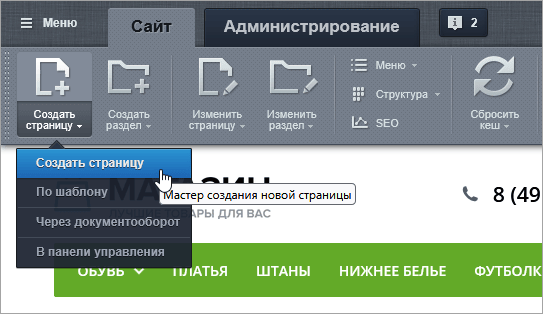
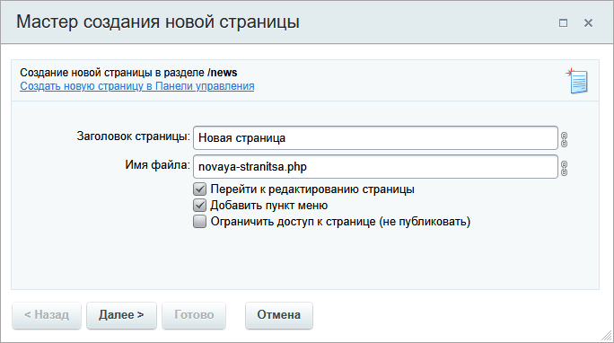
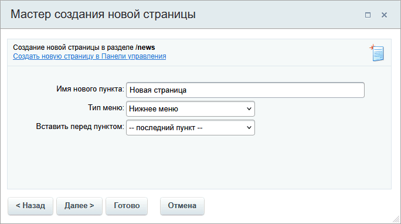
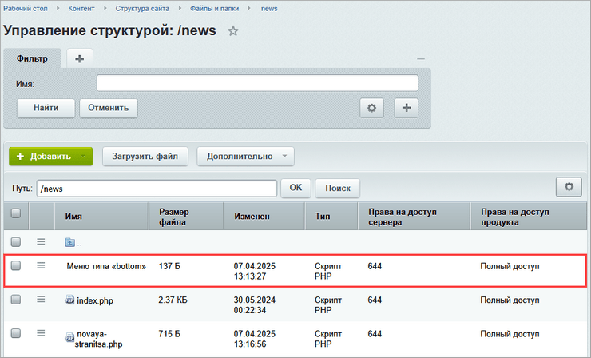
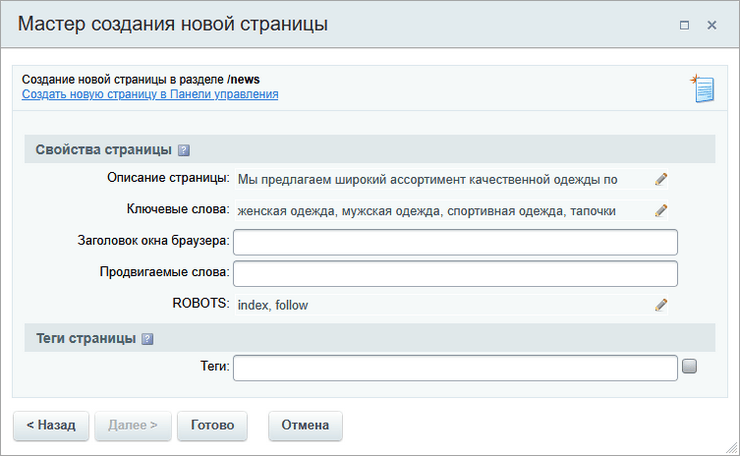
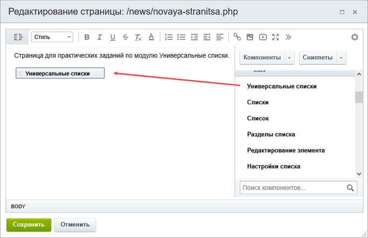
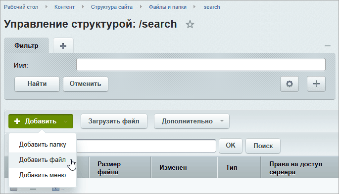
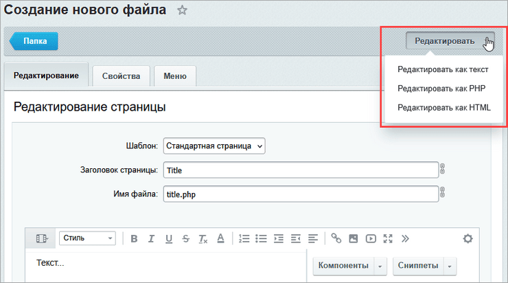
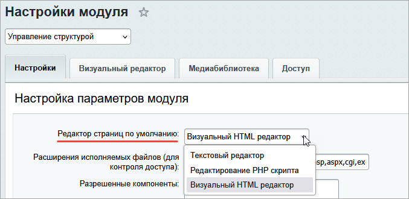

Физические страницы — PHP-файлы в структуре сайта. Они составляют основу CMS и большинства проектов на Bitrix Framework. Создайте такую страницу, чтобы подключить шаблон сайта и разместить компоненты.

Для нового кода используйте контроллеры и роутинг. Подробнее о подходах к обработке запросов читайте в статье [Архитектура](../framework/architecture.md#request-handling).

Физическую страницу можно создать двумя способами.

-  Через файловую систему — для кастомных страниц и разработки.

-  С помощью интерфейса системы — чтобы быстро создать контент.

## Как создать страницу вручную

1. Перейдите в нужную директорию сайта или создайте новую папку. Например, `my-page`.

2. Внутри папки создайте файл, например `index.php`.

3. Подключите `/bitrix/header.php` в начале файла и `/bitrix/footer.php` в конце.

4. Добавьте содержимое страницы между подключениями.

**Пример.** Файл `/my-page/index.php` выводит страницу в шаблоне сайта и задает заголовок «Моя страница».

```php
<?php
// header.php — верхняя часть сайта
require($_SERVER['DOCUMENT_ROOT'] . '/bitrix/header.php');
$APPLICATION->SetTitle('Моя страница');
?>

<!-- содержимое страницы -->

<?php
// footer.php — нижняя часть сайта
require($_SERVER['DOCUMENT_ROOT'] . '/bitrix/footer.php');
?>
```

При подключении `/bitrix/header.php` система определяет текущий сайт и выбирает его шаблон с учетом условий применения. Затем она подключает `header.php` выбранного шаблона, а `/bitrix/footer.php` подключает его `footer.php`. Подробнее читайте в статье [Шаблоны сайтов](../cms-basics/site-templates.md).

Переменная `$APPLICATION` — объект класса `CMain`. Пролог создает его при подключении `/bitrix/header.php`, поэтому вызывайте методы `$APPLICATION` после этой строки.

Метод `SetTitle()` задает основной заголовок страницы. Метод `ShowTitle()` в шаблоне сайта подставляет заголовок в конце формирования страницы, после выполнения ее кода. Поэтому `SetTitle()` можно вызвать после подключения `/bitrix/header.php`, хотя шаблон выводит заголовок выше по коду.

Если страница не должна использовать шаблон сайта, например для обработчика AJAX-запроса, подключите вместо `/bitrix/header.php` и `/bitrix/footer.php` служебные файлы `/bitrix/modules/main/include/prolog_before.php` и `/bitrix/modules/main/include/epilog_after.php`. Порядок подключений описан в статье [Жизненный цикл запроса](../framework/request-lifecycle.md#start-page-lifecycle).

### Заголовок страницы и заголовок окна браузера

У страницы два заголовка. Их задают разные методы, а шаблон сайта выводит их в разных местах.

-  Основной заголовок. Метод `SetTitle()` задает его, а шаблон выводит вызовом `$APPLICATION->ShowTitle(false)`, обычно в теге `<h1>`.

-  Заголовок окна браузера — значение свойства `title`. Метод `SetPageProperty('title', ...)` задает его для страницы, ключ `title` массива `$arDirProperties` в файле `.section.php` — для папки. Шаблон выводит его вызовом `$APPLICATION->ShowTitle()` в теге `<title>`.

Метод `ShowTitle()` без аргументов выводит свойство `title` страницы. Если у страницы свойства нет, метод берет его из `.section.php` текущей папки, затем родительских папок до корня сайта. Если свойство не задано нигде, метод выводит основной заголовок из `SetTitle()`.

**Пример.** Код задает основной заголовок «Типы документов» и заголовок окна браузера «Типы документов и их статусы».

```php
<?php
require($_SERVER['DOCUMENT_ROOT'] . '/bitrix/header.php');
$APPLICATION->SetTitle('Типы документов');
$APPLICATION->SetPageProperty('title', 'Типы документов и их статусы');
?>
```

Подробнее о выводе заголовков и их приоритете читайте в статье [Заголовки страницы: на сайте и в браузере](../cms-basics/titles.md).

### Настройка раздела в файле .section.php

Файл `.section.php` задает название и свойства раздела — папки сайта. Свойства действуют на страницы папки и вложенных папок, если страница не задает собственное значение.

1. Создайте файл `.section.php` в папке страницы, например `/my-page/.section.php`.

2. Задайте в нем название раздела и свойства раздела.

**Пример.** Файл `/my-page/.section.php` задает название раздела для навигационной цепочки, свойства для метатегов и заголовок окна браузера.

```php
<?php
$sSectionName = 'Название раздела';
$arDirProperties = [
    'title' => 'SEO заголовок',
    'description' => 'Описание страницы',
    'keywords' => 'Ключевые слова',
];
?>
```

Файл задает переменные:

-  `$sSectionName` — строка, название раздела в навигационной цепочке. Если строка не пустая, цепочка получает пункт со ссылкой на папку. Переменная не меняет заголовок страницы и свойство `title`.

-  `$arDirProperties` — массив свойств раздела. Ключ массива — код свойства, элемент — его значение. Регистр кода не важен, система приводит код к верхнему регистру.

Система читает `.section.php` текущей папки и всех родительских папок до корня сайта. Если одно свойство задано в нескольких файлах, действует значение из ближайшей к странице папки. Свойство страницы с тем же кодом важнее свойства раздела.

Шаблон выводит свойства `robots`, `keywords` и `description` в метатеги, если вызывает `$APPLICATION->ShowHead()`. Пример такого шаблона есть в разделе [Минимальный шаблон](../cms-basics/site-templates.md#minimal-template).



Ключ `title` в `$arDirProperties` задает заголовок окна браузера для всех страниц папки и вложенных папок. На этих страницах вкладка браузера показывает значение `title`, а не заголовок из `SetTitle()`, пока страница не задаст собственное свойство `title`.



Форма *Свойства папки* в административном разделе записывает в этот же файл поле Заголовок в `$sSectionName` и заполненные свойства в `$arDirProperties`. Форма перезаписывает файл целиком, поэтому другой код в `.section.php` при сохранении теряется.

Подробнее о свойствах раздела читайте в статье [Свойства страницы и раздела](../cms-basics/properties.md#section-properties-api), о навигационной цепочке — в статье [Хлебные крошки](../cms-basics/breadcrumbs.md).

## Как создать страницу через интерфейс

Страницу можно создать с помощью инструментов публичного и административного разделов сайта.

### Публичный раздел

В публичном разделе сайта страницу создает мастер. Перейдите в нужный раздел сайта и на административной панели нажмите *Создать страницу > Создать страницу*. Мастер создает страницу в открытом разделе.

{width=543px height=314px}

#### Мастер создания страницы {#page-wizard}

1. Заполните основные параметры.

   -  Заголовок страницы — основной заголовок, который пользователи видят на странице сайта.

   -  Имя файла — название файла в папке раздела. По умолчанию мастер формирует его из заголовка транслитерацией, например `novaya-stranitsa.php` для заголовка «Новая страница».

   Отметьте нужные флаги:

   -  Перейти к редактированию страницы — если флаг отмечен, после мастера открывается визуальный редактор страницы. Если флаг снят, мастер создает страницу и не открывает редактор.

   -  Добавить пункт меню — если флаг отмечен, мастер добавляет в меню пункт со ссылкой на страницу. Чтобы страница не отображалась в меню, снимите флаг.

   -  Ограничить доступ к странице — запрещает просмотр страницы всем пользователям, кроме редакторов сайта или выбранных групп. Мастер записывает правила для файла страницы в `.access.php` папки. Если флаг снят, мастер не меняет права, и для страницы действуют права папки.

   Флаг Добавить пункт меню добавляет шаг настройки меню. Если флаг снят, кнопка Готово доступна уже на первом шаге. Кнопка Далее ведет к шагу свойств страницы, если в настройках модуля Управление структурой заданы типы свойств, у раздела есть свойства или установлен модуль Поиск.

   {width=684px height=382px}

2. Настройте пункт меню. Шаг доступен, если на первом шаге отмечен флаг Добавить пункт меню.

   -  Имя нового пункта — название пункта в меню.

   -  Тип меню — меню, в которое мастер добавит пункт.

   -  Вставить перед пунктом — пункт, перед которым мастер вставит новый.

   {width=684px height=382px}

   Мастер добавляет пункт в файл меню выбранного типа в папке страницы, например `.bottom.menu.php`. Если такого файла в папке нет, мастер создает его с одним новым пунктом. Новое меню заменяет меню родительской папки по правилам [наследования меню](../cms-basics/menu.md#menu-inheritance). Проверьте меню и при необходимости добавьте в него остальные пункты.

   {width=740px height=448px}

3. Настройте свойства страницы. При необходимости измените значения, унаследованные от раздела.

   -  Описание страницы и Ключевые слова — свойства `description` и `keywords` для метатегов поисковых систем.

   -  Заголовок окна браузера — свойство `title`, текст на вкладке браузера.

   -  Продвигаемые слова и ROBOTS — настройки для SEO.

   -  Теги — для внутреннего поиска. Поле активно, если отмечен флаг справа от него.

   {width=740px height=456px}

4. Нажмите Готово. Мастер создает PHP-файл страницы и записывает заголовок в вызов `$APPLICATION->SetTitle()`, а свойства — в вызовы `$APPLICATION->SetPageProperty()` после подключения `/bitrix/header.php`.

5. Если на первом шаге отмечен флаг Перейти к редактированию страницы, мастер открывает визуальный редактор. Добавьте текст, а компоненты перетащите на страницу из списка Компоненты справа.

   {width=740px height=479px}

#### Страницы по шаблону

Для однотипных страниц используйте шаблоны страниц. Создайте шаблон заранее, как описано в статье [Шаблоны страницы](../cms-basics/page-templates.md).

1. На административной панели нажмите *Создать страницу > По шаблону*.

2. Выберите шаблон.

3. Пройдите шаги мастера.

Мастер создает страницу с содержимым выбранного шаблона.

### Административный раздел

1. Откройте *Контент > Структура сайта > Файлы и папки* и перейдите в папку, где нужно создать страницу.

2. Нажмите *Добавить > Добавить файл*.

   {width=685px height=393px}

3. Заполните поля формы. На вкладке Редактирование задайте шаблон страницы, заголовок и имя файла, на вкладках Свойства и Меню — свойства страницы и пункт меню. Поля повторяют параметры [мастера создания страницы](#page-wizard).

4. Добавьте содержимое страницы в редакторе. Чтобы сменить редактор, нажмите Редактировать и выберите *Редактировать как текст*, *Редактировать как PHP* или *Редактировать как HTML*.

   {width=740px height=412px}

   Параметр Редактор страниц по умолчанию в настройках модуля Управление структурой задает редактор, который открывается по умолчанию. Параметр находится на странице *Настройки > Настройки продукта > Настройки модулей > Управление структурой*. Для режимов *Редактировать как текст* и *Редактировать как PHP* доступна подсветка синтаксиса и нумерация строк.

   {width=677px height=330px}

## Что делать, если страница не работает

-  **Ошибка `Call to a member function SetTitle() on null`.** Переменная `$APPLICATION` не определена. Файл не подключает `/bitrix/header.php` или вызывает метод раньше подключения. Подключите `/bitrix/header.php` первой строкой PHP-кода.

-  **Страница выводится без нижней части шаблона.** Файл не подключает `/bitrix/footer.php`. Без него система не подключает `footer.php` шаблона сайта и не вызывает обработчики события `OnEpilog`. Подключите `/bitrix/footer.php` в конце файла.

-  **Во вкладке браузера другой текст, а не заголовок из `SetTitle()`.** Свойство `title` задано в `.section.php` папки страницы или родительской папки. Задайте странице собственное свойство `title` или удалите ключ `title` из `$arDirProperties`.

-  **Вместо страницы открывается форма авторизации или сообщение о запрете доступа.** Пролог проверяет право на чтение файла страницы до выполнения ее кода. Права задают файлы `.access.php` папки страницы и родительских папок. Проверьте права групп пользователя, как описано в статье [Права доступа](../security/access-control.md#file-folder-permissions).

-  **Кириллица на странице отображается нечитаемыми символами.** Пролог передает браузеру кодировку сайта в HTTP-заголовке `Content-Type`, а файл страницы сохранен в другой кодировке. Сохраните файл в кодировке сайта, которую задают региональные настройки.

-  **Раздел не появляется в навигационной цепочке.** Переменная `$sSectionName` в `.section.php` папки пустая или не задана. Задайте название раздела. Если цепочка не выводится совсем, проверьте свойство `not_show_nav_chain`. Значение `Y` скрывает цепочку. Подробнее — в статье [Хлебные крошки](../cms-basics/breadcrumbs.md).

## Что дальше

-  Разместить на странице собственный компонент — статья [Создание компонента](./create-component.md#add-component-to-page).
-  Обработать запрос в контроллере вместо физической страницы — статья [Создание контроллера](./create-controller.md).
-  Настроить вывод заголовков и метатегов в шаблоне — статьи [Заголовки страницы: на сайте и в браузере](../cms-basics/titles.md) и [Шаблоны сайтов](../cms-basics/site-templates.md).
