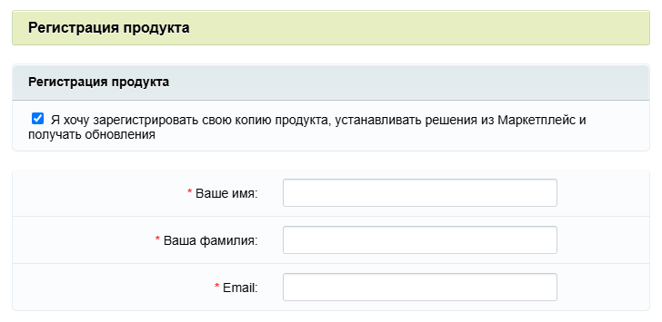
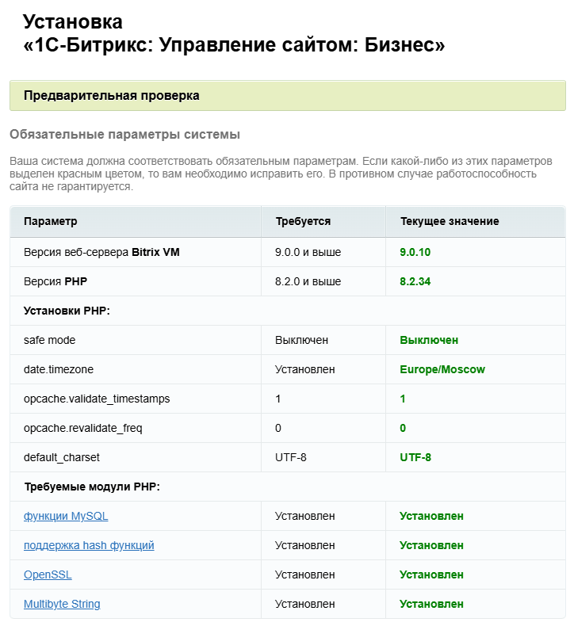
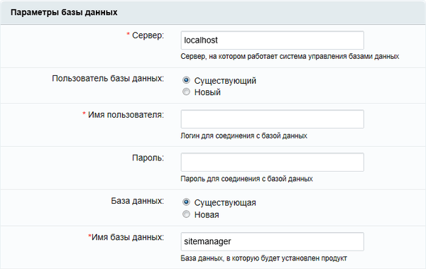
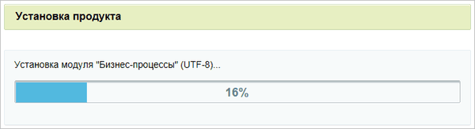
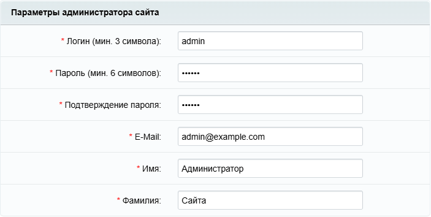

Дистрибутив устанавливают после [подготовки окружения](./install-env.md). Файлы продукта попадают в корневую папку сайта, затем мастер установки создает таблицы в базе данных, устанавливает модули и учетную запись администратора. После этого запускается мастер решения, для Битрикс24 — мастер настройки портала. Оба описаны в статье [Установка решения](./install-solution.md).

| Способ | Как работает | Когда выбрать |
|---|---|---|
| [Скрипт bitrixsetup.php](#bitrixsetup) | Скрипт скачивает и распаковывает дистрибутив на сервере, затем запускает мастер установки | Сервер имеет доступ в интернет. Самый простой способ |
| [Архив с сайта](#archive) | Архив выбранной редакции скачивают и распаковывают вручную, затем открывают сайт в браузере | Нужна конкретная редакция или установка без скрипта |
| [Быстрая установка](#short-install) | Режим мастера, который включает константа `SHORT_INSTALL` в `dbconn.php`: мастер пропускает шаги «Начало установки», «Предварительная проверка» и «Создание базы данных» и берет подключение из готовых файлов конфигурации | Параметры базы данных известны заранее, установку нужно повторять или автоматизировать |

## Скрипт bitrixsetup.php {#bitrixsetup}

1. Скачайте скрипт `bitrixsetup.php` в корневую папку сайта.

   

   В BitrixVM корневая папка дефолтного сайта находится по пути `/home/bitrix/www/`. Если сайтов несколько — у каждого будет своя корневая папка. Например, `/home/bitrix/www/s1/` для первого сайта и `/home/bitrix/www/s2/` — для второго.

   Далее установка показана на примере дефолтного сайта в BitrixVM.

   

   Для разных пользователей команды отличаются.

   -  Для пользователя `root`:

      ```bash prompt="$"
      # переходим в корневую папку сайта
      $ cd /home/bitrix/www/

      # скачиваем скрипт
      $ wget https://www.1c-bitrix.ru/download/scripts/bitrixsetup.php

      # меняем владельца файла на пользователя bitrix
      $ chown bitrix:bitrix bitrixsetup.php
      ```

      Файл должен принадлежать пользователю, под которым работает веб-сервер. Поэтому меняем владельца файла на пользователя `bitrix` командой `chown`.

   -  Для пользователя `bitrix`:

      ```bash prompt="$"
      # переходим в корневую папку сайта
      $ cd /home/bitrix/www/

      # скачиваем скрипт
      $ wget https://www.1c-bitrix.ru/download/scripts/bitrixsetup.php
      ```

2. Введите в браузере адрес сайта и путь к скрипту `http://[адрес_сайта]/bitrixsetup.php`.

3. Выберите продукт и лицензию. Для демонстрационной версии рекомендуем выбрать лицензию:

   -  бизнес — для 1С-Битрикс: Управление сайтом,

   -  корпоративный портал — для 1С-Битрикс24.

   

   От языка BitrixSetup зависят доступные продукты и дистрибутив для загрузки. Скрипт выбирает язык по настройкам браузера.

   Для лицензии российской линейки выберите русский язык. Дистрибутивы «1С-Битрикс: Управление сайтом» и редакция «Корпоративный портал» доступны только в русской версии BitrixSetup, в английской и немецкой версиях есть только Битрикс24. Если русского языка нет в списке, добавьте параметр `?lang=ru` к адресу скрипта: `http://[адрес_сайта]/bitrixsetup.php?lang=ru`

   Перед загрузкой коммерческой версии убедитесь, что редакция соответствует ключу. При ошибке `403 Доступ запрещен` проверьте язык, редакцию и ключ.

   

4. После загрузки запустится [мастер установки](#wizard) продукта.

## Архив с сайта {#archive}

Скачать дистрибутив можно с официального сайта:

-  [1С-Битрикс: Управление сайтом](https://www.1c-bitrix.ru/download/cms.php#tab-subsection-3)

-  [Коробочная версия Битрикс24](https://www.1c-bitrix.ru/download/intranet.php)

Разместите архив в корневой папке сайта на сервере. Чтобы скачать архив в папку `/home/bitrix/www/` используйте команды:

```bash prompt="$"
# переходим в папку сайта
$ cd /home/bitrix/www/

# скачиваем дистрибутив по ссылке
$ wget https://www.1c-bitrix.ru/download/business_encode.tar.gz
```

Имя архива зависит от редакции: в примере `business_encode.tar.gz` — архив редакции «Бизнес». Ссылку на архив другой редакции скопируйте на странице загрузки.

Распакуйте скачанный архив. Чтобы распаковать архив в формате `.tar.gz`, выполните команду:

```bash prompt="$"
$ tar -xf business_encode.tar.gz
```

Если команды выполнялись от пользователя `root`, передайте файлы сайта пользователю `bitrix`, под которым работает веб-сервер:

```bash prompt="$"
$ chown -R bitrix:bitrix /home/bitrix/www/
```

Откройте сайт в браузере. Запустится мастер установки.

## Мастер установки {#wizard}

Мастер работает в одном из двух режимов: обычная установка или [быстрая установка](#short-install). Набор шагов зависит от режима.

| Шаг | Обычная установка | Быстрая установка |
|---|---|---|
| [Начало установки](#welcome) | Да | Нет |
| [Лицензионное соглашение](#agreement) | Да | Да |
| [Регистрация продукта](#registration) | Да | Да |
| [Предварительная проверка](#requirements) | Да | Нет, основные требования проверяются на шаге регистрации |
| [Создание базы данных](#database) | Да | Нет, параметры берутся из готовых файлов |
| [Установка продукта](#install) | Да | Да |
| [Обновление продукта](#update) | Да | Да |
| [Создание администратора](#admin) | Да | Да |

Названия шагов в таблице и в заголовках ниже совпадают с заголовками, которые показывает мастер.

При быстрой установке не проверяются кодировка `mbstring.internal_encoding` и работа PHP-сессий, эти проверки есть только на шаге «Предварительная проверка».

### Тип базы данных и файл install.config {#install-config}

Тип базы данных в мастере не выбирают: его задает дистрибутив. Мастер работает с PostgreSQL, если в XML-файле `/install.config` в корне сайта задан параметр `pgsql` со значением `yes`. Иначе мастер работает с MySQL. Для MySQL в PHP нужно расширение `mysqli`, для PostgreSQL — расширение `pgsql`.

Минимальный файл `/install.config` для дистрибутива с PostgreSQL:

```xml
<?xml version="1.0" encoding="UTF-8"?>
<config>
    <pgsql>yes</pgsql>
</config>
```

Основные ключи `/install.config`:

| Ключ | Действие |
|---|---|
| `pgsql` | `yes` — установка на PostgreSQL |
| `debug` | `yes` — режим отладки: `debug` = `true` в `.settings.php` и `$DBDebug = true` в `dbconn.php` |
| `error_log` | Путь к логу исключений — блок `log` в секции `exception_handling` |
| `debug_log` | Путь к логу отладки — константа `LOG_FILENAME` в `dbconn.php` |
| `LANGUAGE_ID` | Язык мастера, например `ru` |
| `skipInstallModules` | Модули через запятую, которые мастер не устанавливает, например `eshopapp,im` |
| `options` | Опции модулей, которые мастер записывает при установке модулей. Формат: `<options><main><option><name>имя</name><value>значение</value></option></main></options>`, пустые значения и `0` не записываются |

Мастер удаляет `/install.config` в конце установки.

### Начало установки {#welcome}

Мастер показывает начальный экран. Нажмите *Далее*. При быстрой установке шага нет.

### Лицензионное соглашение {#agreement}

Прочитайте Лицензионное соглашение. Чтобы продолжить установку, отметьте опцию *Я принимаю лицензионное соглашение*.

### Регистрация продукта {#registration}

{width=728px height=355px}

Поля шага зависят от версии продукта.

| Поле | Версия | Обязательное | Что указать |
|---|---|---|---|
| Лицензионный ключ | Коммерческая | Да | Ключ вида `XXX-XX-XXXXXXXXXXXX`, затем кнопка *Активировать ключ* |
| Установка для разработки | Коммерческая | Нет | Отметьте, если копия предназначена для разработки и не будет использоваться как рабочий сайт |
| *Я хочу зарегистрировать свою копию продукта, устанавливать решения из Маркетплейс и получать обновления* | Демоверсия | Нет | По умолчанию отмечена. Оставьте, чтобы получать обновления и устанавливать решения из Маркетплейс |
| Ваше имя, Ваша фамилия, Email | Демоверсия | Да, если отмечена опция регистрации | Данные, по которым мастер получит ключ |

Для проверки коммерческого ключа и получения ключа демоверсии мастер обращается к серверу 1С-Битрикс. Если сервер недоступен, коммерческий ключ не проверяется. Мастер сохраняет ключ в файл `/bitrix/license_key.php`. В демоверсии без опции регистрации или если ключ получить не удалось, в файл записывается ключ `DEMO`.

Ошибки шага:

-  «Вы ввели неправильный лицензионный ключ» — ключ не соответствует формату,

-  «Лицензионный ключ не найден или не активирован» — ключ не активирован, нажмите *Активировать ключ*.

Подробнее о лицензии для разработки — в уроке [Установка для разработки](https://dev.1c-bitrix.ru/learning/course/index.php?COURSE_ID=135&LESSON_ID=8471) учебного курса.

### Предварительная проверка {#requirements}

Мастер проверяет настройки окружения для успешной работы продукта. Обязательные требования, без которых установка не продолжится:

-  PHP не ниже 8.2.0 с заданным `date.timezone`,

-  поддержка UTF-8: расширение `mbstring`, `default_charset` = `UTF-8`, а `mbstring.internal_encoding` пустой или совпадает с `default_charset`,

-  работающие PHP-сессии,

-  функции `hash`, `token_get_all`, `openssl_encrypt`, `mb_strlen` и `mbstring.func_overload` = `0`,

-  веб-сервер: Apache не ниже 2.0 — модуль `mod_rewrite` мастер проверяет, когда PHP работает модулем Apache, — nginx не ниже 1.22.0, в BitrixVM — версия BitrixVM не ниже 9.0.0. Окружение BitrixVM мастер определяет по переменной окружения `BITRIX_VA_VER`. Ее задает и Docker-окружение `env-docker`, поэтому там мастер проверяет версию BitrixVM, а не nginx. Версию других веб-серверов мастер не проверяет,

-  расширение PHP для базы данных: `mysqli` для MySQL или `pgsql` для PostgreSQL,

-  доступ скриптов сайта на чтение и запись к файлам сайта.

Проверить сервер до установки можно скриптом `bitrix_server_test.php` — подробнее в разделе [Проверка окружения](./install-env.md#check).

Результаты проверки отображаются цветами:

-  зеленый — значения удовлетворяют требованиям системы,

-  красный — значения не удовлетворяют требованиям системы.

{width=724px height=790px}

-  **Обязательные параметры.** Параметры, которым должна соответствовать система. Исправьте параметры, которые выделены красным цветом.

-  **Проверка доступа к диску.** Скрипты сайта должны иметь доступ на чтение и запись к файлам сайта.

-  **Рекомендуемые установки.** Параметры, которые обеспечат полную совместимость с требованиями продукта. Сайт будет работать, если некоторые параметры не соответствуют рекомендациям, но часть функционала может быть недоступна.

Проверить настройки позже можно в административном разделе на странице *Настройки > Инструменты > Проверка системы*.

### Создание базы данных {#database}

На этом шаге заполните параметры подключения к MySQL или PostgreSQL. Тип базы задает дистрибутив, см. раздел [Тип базы данных и файл install.config](#install-config).

{width=600px height=379px}

| Поле | Обязательное | Что указать |
|---|---|---|
| Сервер | Да | Адрес сервера СУБД. По умолчанию `localhost` |
| Пользователь базы данных | Выбор, по умолчанию — существующий | Создать нового пользователя или использовать существующего |
| Имя пользователя | Да | Логин для доступа к базе данных. Пустое значение мастер не принимает |
| Пароль | Нет | Пароль пользователя базы данных |
| База данных | Выбор, по умолчанию — существующая | Создать новую базу или использовать существующую. При выборе «Новая» поле имени называется «Новая база данных» |
| Имя базы данных | Да | По умолчанию `sitemanager`. Имя без символов `/`, `\`, `.` и без пробела в конце, для MySQL — не длиннее 64 символов, для PostgreSQL — 63. При нарушении мастер показывает ошибку «Неверное имя базы данных» |
| Логин в блоке «Параметры администратора базы данных» | Если выбран новый пользователь или новая база | Учетная запись с правами на создание базы данных и пользователя и на выдачу привилегий `GRANT` |
| Пароль в блоке «Параметры администратора базы данных» | Нет | Пароль этой учетной записи |

В блоке *Дополнительные параметры* задаются права доступа:

| Поле | Что указать |
|---|---|
| Права на доступ к файлам сайта | Права доступа к создаваемым файлам. По умолчанию `0644` |
| Права на доступ к папкам сайта | Права доступа к создаваемым папкам. По умолчанию `0755` |

Частые ошибки шага:

-  «В базу данных … уже установлен продукт» — укажите другую базу данных,

-  «База … уже существует» — выбрано «Новая», но база с таким именем есть: выберите «Существующая» или другое имя,

-  «Ошибка соединения с сервером баз данных» — неверные сервер, логин или пароль. Для PostgreSQL ошибка появляется и тогда, когда выбрана «Существующая» база, а ее нет или к ней нет доступа,

-  «Ошибка соединения с базой …» — только MySQL: выбрано «Существующая», но базы нет или у пользователя нет к ней доступа,

-  «Не удается создать таблицу в базе данных» или «Не удается изменить таблицу в базе данных» — у пользователя нет прав на создание или изменение таблиц,

-  «Не удалось установить указанную кодировку для базы данных» — только MySQL: у пользователя нет права на `ALTER DATABASE`.

На этом шаге мастер проверяет сервер базы данных:

-  MySQL — версия не ниже 8.0, `default_storage_engine` = `InnoDB`, `innodb_default_row_format` = `DYNAMIC` и `innodb_large_prefix` = `ON`, если такая переменная есть в версии сервера,

-  PostgreSQL — версия не ниже 13, `standard_conforming_strings` = `on` и `ac_ignore_maclabel` = `true`, если такая настройка есть в сборке PostgreSQL.

Требования к существующей базе PostgreSQL:

-  установлено расширение `pgcrypto`, иначе ошибка «В указанную базу данных необходимо установить расширение pgcrypto»,

-  `LC_CTYPE` базы — локаль с кодировкой UTF-8, например `C.UTF-8`, иначе ошибка «Указанная база данных имеет несовместимый LC_TYPE».

При создании новой базы PostgreSQL мастер подключает `pgcrypto` сам.

Для установки на удаленном сервере или хостинге запросите данные для подключения у службы поддержки удаленного сервера или хостинга.

На этом шаге мастер создает файлы конфигурации:

-  `/bitrix/.settings.php` — параметры подключения в секции `connections` и настройки ядра,

-  `/bitrix/php_interface/dbconn.php` — константы прав на файлы и папки `BX_FILE_PERMISSIONS` и `BX_DIR_PERMISSIONS` и другие константы классического ядра,

-  `/bitrix/php_interface/after_connect_d7.php` — только для MySQL, настройка кодировки соединения. Существующий файл мастер перезаписывает.

Для MySQL мастер также переводит базу на кодировку `utf8mb4`.

Изменить параметры после установки можно вручную, подробнее в статье [Конфигурация ядра](../framework/settings.md). При [быстрой установке](#short-install) эти файлы готовят заранее.



Если используете окружение `env-docker`, заполните параметры подключения.

-  Для MySQL в поле *Сервер* укажите `mysql`, используйте существующего пользователя `root` и пароль из параметра `MYSQL_ROOT_PASSWORD` файла `.env_mysql`.

-  Для PostgreSQL используйте пароль из параметра `POSTGRES_PASSWORD` файла `.env_postgresql`. Имя сервера и пользователя указаны в README `env-docker`.

Подробнее об установке с MySQL и PostgreSQL — в [README env-docker](https://github.com/bitrix-tools/env-docker?tab=readme-ov-file#установка-дистрибутивов).



### Установка продукта {#install}

Мастер устанавливает продукт: создает таблицы в базе данных и копирует файлы системы.

{width=600px height=163px}

Если модуль не установился, мастер показывает «Повторите установку текущего шага. В случае повторения ошибки пропустите шаг» и кнопки *Повторить шаг* и *Пропустить шаг*.

### Обновление продукта {#update}

Мастер проверяет и устанавливает обновления модулей. В демоверсии без опции регистрации шаг пропускается.

### Создание администратора {#admin}

Заполните поля, чтобы создать учетную запись администратора.

{width=600px height=302px}

| Поле | Требование |
|---|---|
| Логин | Обязательное, не короче 3 символов. По умолчанию `admin` |
| Пароль и подтверждение пароля | Обязательные, не короче 6 символов, значения должны совпадать |
| E-Mail | Обязательное, корректный адрес электронной почты администратора |
| Имя и Фамилия | Обязательные |

Если поле заполнено неверно, мастер показывает ошибку и не переходит к следующему шагу.

Далее мастер настраивает решение, а в Битрикс24 — портал. Этот этап описан в статье [Установка решения](./install-solution.md).



При переходе к мастеру решения мастер установки удаляет из корня сайта `bitrixsetup.php`, `install.config`, `readme.html` и `restore.php`. Скрипт `bitrixsetup.php` сам удаляет загруженный архив после распаковки. Если вы распаковывали архив дистрибутива вручную, удалите его сами, как и скрипт проверки `bitrix_server_test.php`, если вы его размещали. Если `bitrixsetup.php` остался, например из-за прав на файл, удалите его: оставленный скрипт относится к опасным файлам — подробнее в статье [Проактивная защита](../security/proactive-security.md).



## Быстрая установка {#short-install}

Быстрая установка пропускает шаги мастера «Начало установки», «Предварительная проверка» и «Создание базы данных». Мастер начинает с лицензионного соглашения и ключа, затем сразу устанавливает модули, создает администратора и запускает мастер решения.

Для быстрой установки до запуска мастера подготовьте:

1. Файлы дистрибутива в корневой папке сайта, например распакованные из [архива](#archive). Подготовьте файлы конфигурации до того, как откроете мастер в браузере.

2. Пустую базу данных и пользователя с доступом к ней. Мастер не создает базу при быстрой установке и останавливается с ошибкой, если в базе уже установлен продукт. Для PostgreSQL установите в базе расширение `pgcrypto` и используйте `LC_CTYPE` с кодировкой UTF-8: при быстрой установке мастер это не проверяет. Команды ниже повторяют то, что делает мастер при обычной установке.

   PostgreSQL, команды для `psql` от суперпользователя:

   ```sql
   CREATE USER bitrix_user WITH PASSWORD 'db_password';
   CREATE DATABASE sitemanager LC_CTYPE 'C.UTF-8' TEMPLATE template0;
   GRANT ALL PRIVILEGES ON DATABASE sitemanager TO bitrix_user;
   \c sitemanager
   CREATE EXTENSION pgcrypto;
   GRANT CREATE ON SCHEMA public TO bitrix_user; -- обязательно для PostgreSQL 15+
   ```

   MySQL:

   ```sql
   CREATE DATABASE sitemanager CHARACTER SET utf8mb4 COLLATE utf8mb4_0900_ai_ci;
   CREATE USER 'bitrix_user'@'%' IDENTIFIED BY 'db_password';
   GRANT ALL PRIVILEGES ON sitemanager.* TO 'bitrix_user'@'%';
   GRANT SESSION_VARIABLES_ADMIN ON *.* TO 'bitrix_user'@'%'; -- мастер выдает эту привилегию при обычной установке
   ```

3. PHP с поддержкой UTF-8: расширение `mbstring` и `default_charset = UTF-8`. Иначе мастер останавливается с ошибкой «UTF-8 не поддерживается в PHP».

4. Файл `/bitrix/.settings.php` с параметрами подключения в секции `connections`.

5. Файл `/bitrix/php_interface/dbconn.php` с константой `SHORT_INSTALL`. Мастер включает быструю установку, только если константа определена.

Файл `/bitrix/php_interface/dbconn.php`:

```php
<?php
define('SHORT_INSTALL', true); // включает быструю установку

// необязательно: права на файлы и папки, которые создает мастер
define('BX_FILE_PERMISSIONS', 0644);
define('BX_DIR_PERMISSIONS', 0755);
```

Без констант `BX_FILE_PERMISSIONS` и `BX_DIR_PERMISSIONS` мастер не меняет права создаваемых файлов и папок.

При быстрой установке мастер не перезаписывает `dbconn.php`: файл остается рабочим в том виде, в каком его подготовили. При обычной установке мастер пишет в него набор настроек. Чтобы получить такой же файл при быстрой установке, используйте:

```php
<?php
define('SHORT_INSTALL', true);

$DBDebug = false;
$DBDebugToFile = false;

define('BX_FILE_PERMISSIONS', 0644);
define('BX_DIR_PERMISSIONS', 0755);
@umask(~(BX_FILE_PERMISSIONS | BX_DIR_PERMISSIONS) & 0777);

// только если текущий memory_limit меньше, для Битрикс24 — 1024M
@ini_set('memory_limit', '512M');

define('BX_DISABLE_INDEX_PAGE', true);

mb_internal_encoding('UTF-8');
```

Пример файла `/bitrix/.settings.php` для MySQL. Структура совпадает с файлом, который создает мастер при обычной установке. Мастер дополнительно записывает секции `crypto` и `messenger`. Ключ `log` в секции `exception_handling` мастер записывает всегда. Путь к логу в нем появляется, только если задан ключ `error_log` в файле `/install.config`, иначе значение `NULL`:

```php
<?php
return [
    // кеширование: время жизни кеша настроек модулей в секундах
    'cache_flags' => [
        'value' => [
            'config_options' => 3600,
        ],
        'readonly' => false,
    ],
    // параметры cookies
    'cookies' => [
        'value' => [
            'secure' => false, // передавать cookies только по HTTPS
            'http_only' => true, // запретить доступ к cookies из JavaScript
        ],
        'readonly' => false,
    ],
    // обработка ошибок
    'exception_handling' => [
        'value' => [
            'debug' => false, // режим отладки: показывать ошибки на странице
            // маска ошибок, которые обрабатывает ядро
            'handled_errors_types' => E_ERROR | E_PARSE | E_CORE_ERROR | E_COMPILE_ERROR | E_USER_ERROR | E_RECOVERABLE_ERROR,
            // маска ошибок, при которых выбрасывается исключение
            'exception_errors_types' => E_ERROR | E_PARSE | E_CORE_ERROR | E_COMPILE_ERROR | E_USER_ERROR | E_RECOVERABLE_ERROR,
            'ignore_silence' => false, // учитывать ошибки, подавленные оператором @
            'assertion_throws_exception' => true, // преобразовывать assert в исключения
            'assertion_error_type' => E_USER_ERROR, // тип ошибки для assert
            // необязательно: лог исключений, каталог должен быть доступен на запись
            'log' => [
                'settings' => [
                    'file' => '/var/log/php/exceptions.log', // путь к лог-файлу
                    'log_size' => 1000000, // максимальный размер лога в байтах
                ],
            ],
        ],
        'readonly' => false,
    ],
    // подключение к базе данных
    'connections' => [
        'value' => [
            'default' => [
                'className' => '\\Bitrix\\Main\\DB\\MysqliConnection', // драйвер MySQL
                'host' => 'localhost', // адрес сервера БД
                'database' => 'sitemanager', // имя пустой базы данных
                'login' => 'bitrix_user', // пользователь БД
                'password' => 'db_password', // пароль пользователя БД
                'options' => 2, // 2 — отложенное соединение
            ],
        ],
        'readonly' => true,
    ],
];
```

Обязательна только секция `connections`, остальные секции необязательны. Значения `host`, `database`, `login` и `password` замените на параметры своей базы данных.

Для дистрибутива с PostgreSQL в секции `connections` укажите другой драйвер и кодировку:

```php
'default' => [
    'className' => '\\Bitrix\\Main\\DB\\PgsqlConnection', // драйвер PostgreSQL
    'host' => 'localhost',
    'database' => 'sitemanager',
    'login' => 'bitrix_user',
    'password' => 'db_password',
    'options' => 2,
    'charset' => 'utf8', // кодировка соединения
],
```

Драйвер в `className` должен соответствовать типу базы дистрибутива: `PgsqlConnection` — только если в `/install.config` задан параметр `pgsql` со значением `yes`. Правило выбора типа базы описано в разделе [Тип базы данных и файл install.config](#install-config).

Параметр `readonly` определяет, можно ли менять секцию через API. Если `true`, изменить настройки секции нельзя. Описание всех секций — в статье [Конфигурация ядра](../framework/settings.md).

После подготовки файлов откройте сайт в браузере. На шаге с лицензионным ключом мастер проверяет требования к системе и подключение к базе данных. Если проверка не прошла, мастер показывает ошибку на этом шаге:

-  «Не могу соединиться с базой данных. Проверьте правильность введенных параметров» — проверьте `host`, `database`, `login` и `password` в `.settings.php`, что база существует и у пользователя есть к ней доступ,

-  «В базу данных … уже установлен продукт» — укажите в `database` пустую базу,

-  ошибки требований к системе — исправьте параметры сервера по списку шага [Предварительная проверка](#requirements),

-  ошибки требований к MySQL или PostgreSQL — настройте сервер базы данных по требованиям шага [Создание базы данных](#database).

Для MySQL мастер переводит базу на кодировку `utf8mb4` и создает `/bitrix/php_interface/after_connect_d7.php`, если файла еще нет.

## Что дальше

-  [Установка решения](./install-solution.md) — мастер решения, который запускается после установки продукта,

-  [Структура директорий](./directory-structure.md) — где лежат ядро, модули и собственный код проекта,

-  [Конфигурация ядра](../framework/settings.md) — настройки `.settings.php` и `dbconn.php`.
