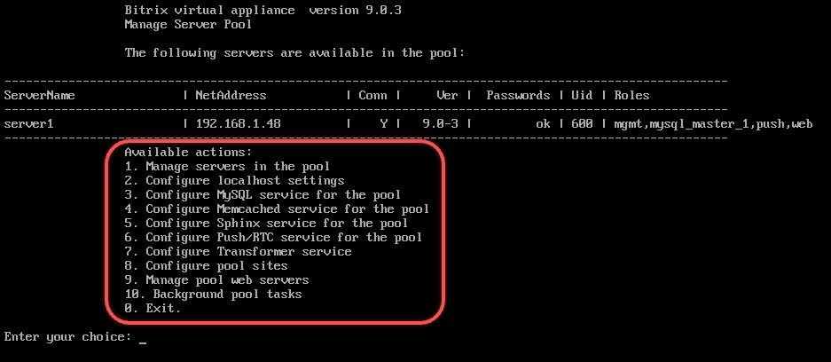
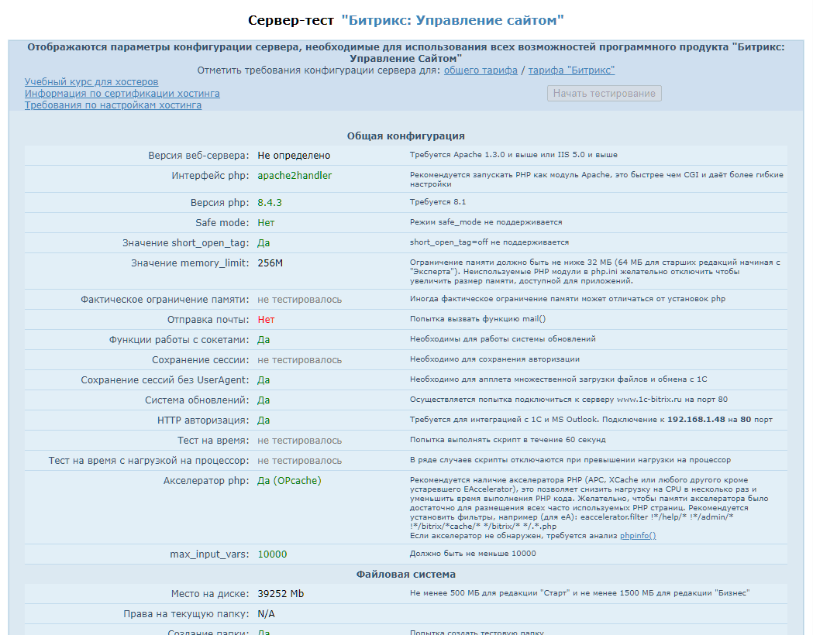

Окружение — это веб-сервер, PHP, база данных и сервисы, на которых работают 1С-Битрикс: Управление сайтом и коробочный Битрикс24. Окружение настраивают до установки дистрибутива продукта. Компания 1С-Битрикс предлагает готовое окружение в нескольких вариантах.

| Вариант | Что это | Когда выбрать |
|---|---|---|
| [BitrixVM](#bitrixvm) | Образ виртуальной машины с настроенным окружением | Нужно быстро запустить продукт на своем компьютере или в системе виртуализации |
| [BitrixEnv](#bitrixenv) | Скрипт `bitrix-env-9.sh`, который ставит и настраивает пакеты на сервер | Есть выделенный сервер с чистой ОС семейства RHEL 9 |
| [Amazon EC2](#amazon-ec2) | AMI-образы BitrixVM для облака Amazon | Проект размещается в Amazon Elastic Compute Cloud |
| [Docker-окружение](#docker-images) | Контейнеры из репозитория `env-docker` | Нужна среда для разработки и тестирования на компьютере с Docker |
| [Кастомная настройка](#custom) | Окружение, собранное вручную | Нужна другая ОС или своя конфигурация сервера |

После настройки окружения переходите к [установке дистрибутива](./install-distr.md).

## Виртуальная машина BitrixVM {#bitrixvm}

Виртуальная машина BitrixVM — это предустановленная виртуальная машина для быстрого запуска проектов на 1С-Битрикс. Готова к работе через несколько минут после развертывания. Поддерживает демо-версии продуктов и перенос существующих проектов.



[Список образов BitrixVM](https://www.1c-bitrix.ru/download/vmbitrix.php#tab-section-1)

[Запуск виртуальной машины BitrixVM](https://dev.1c-bitrix.ru/learning/course/index.php?COURSE_ID=37&LESSON_ID=29238)



## Окружение BitrixEnv для выделенного сервера {#bitrixenv}

Если у вас есть выделенный сервер, установите и настройте окружение скриптом `bitrix-env-9.sh`. Скрипт ставит веб-сервер, PHP, Percona Server, PostgreSQL и пакет `bitrix-env` с меню управления.

Требования к серверу:

-  операционная система CentOS Stream 9, Rocky Linux 9, AlmaLinux 9 или Oracle Linux 9,

-  архитектура x86_64,

-  запуск от пользователя `root`.

Скрипт проверяет ОС, ее основную версию, архитектуру и пользователя. Если сервер не подходит, установка завершается с ошибкой, например:

-  `This script has been tested only on Rocky Linux, Alma Linux, Oracle Linux, CentOS Stream. Current OS: ...` — неподдерживаемая ОС,

-  `This script needs to be run as root to avoid errors.` — скрипт запущен не от `root`.

Используйте чистую операционную систему с официального сайта. Установка на кастомные сборки может вызвать ошибки.

### Установка на CentOS Stream 9

Рассмотрим установку окружения на примере операционной системы CentOS Stream 9. Установка на другие операционные системы выполняется аналогично, с учетом особенностей операционной системы.

1. Войдите под пользователем `root`.

2. Обновите пакеты.

   ```bash prompt="$"
   $ dnf clean all && dnf update
   ```

3. Установите утилиту `wget`, если ее нет на сервере.

   ```bash prompt="$"
   $ dnf install wget
   ```

4. Скачайте и запустите скрипт `bitrix-env-9.sh`.

   ```bash prompt="$"
   $ wget http://repo.bitrix24.tech/dnf/bitrix-env-9.sh && chmod +x bitrix-env-9.sh && ./bitrix-env-9.sh
   ```

5. Если SELinux включен, скрипт предложит его отключить и остановится. Согласитесь на отключение и перезагрузите сервер.

   ```bash prompt="$"
   $ reboot
   ```

6. После перезагрузки снова запустите скрипт и завершите установку.

   ```bash prompt="$"
   $ ./bitrix-env-9.sh
   ```

   При успешной установке скрипт выводит сообщение `Bitrix Environment bitrix-env has been installed successfully.`

7. Откройте [меню управления](#menu) командой `/root/menu.sh` и выполните [обязательные настройки](#required-settings). Корневая папка сайта — `/home/bitrix/www/`.

### Тихая установка

Установить BitrixEnv можно в тихом режиме, то есть без участия пользователя. Укажите ключи в команде запуска скрипта, чтобы автоматически создать пул, включить Push-сервер и задать пароли к базам данных. Для тихой установки укажите `-s` и `-M`, остальные ключи необязательны.

Синтаксис команды запуска скрипта:

```bash prompt="$"
$ ./bitrix-env-9.sh [-h] [-s] [-p -H hostname] [-P] [-t] [-M mysql_root_password] [-m 8.0|8.4] [-G postgres_password] [-g 15|16]
```

| Ключ | Значение | Без ключа |
|---|---|---|
| `-s` | Тихий режим: скрипт не задает вопросов | Скрипт запрашивает данные в диалоге |
| `-p` | Создать пул серверов. Без пула меню управления содержит только два пункта | Пул создают позже через меню |
| `-H hostname` | Имя сервера в пуле. Указывайте вместе с `-p` | Значение по умолчанию скрипт не задает |
| `-P` | Запустить Push-сервер. Без `-p` установка останавливается с ошибкой `Create management pool before run push server. Exit.` | Push-сервер не запускается |
| `-t` | Установить окружение из тестового репозитория | Используется стабильный репозиторий |
| `-M mysql_root_password` | Пароль пользователя `root` MySQL. Скрипт сохраняет пароль в `/root/.my.cnf` | В диалоге скрипт берет временный пароль MySQL или запрашивает его. В тихом режиме, если скрипт не может подобрать пароль, установка завершается с ошибкой, поэтому вместе с `-s` задавайте `-M` |
| `-m 8.0` или `-m 8.4` | Версия Percona Server | `8.0` |
| `-G postgres_password` | Пароль суперпользователя `postgres` PostgreSQL. Ключ доступен с версии BitrixVM 9.0.8 | Скрипт генерирует случайный пароль и сохраняет его в `/root/.pgpass` |
| `-g 15` или `-g 16` | Версия PostgreSQL. Ключ доступен с версии BitrixVM 9.0.8 | `13`. Версию 13 ключом не задают: она ставится, когда ключа нет |
| `-h` | Показать справку и выйти | — |

Пример команды с MySQL:

```bash prompt="$"
$ ./bitrix-env-9.sh -s -p -H server1 -P -m 8.4 -M 'BX123bx@#MYSQL'
# запустить установку окружения в тихом режиме
# запустить Push сервер и создать пул с именем хоста server1
# установить Percona 8.4 и задать пароль root для MySQL
```

Пример команды с PostgreSQL 16:

```bash prompt="$"
$ ./bitrix-env-9.sh -s -p -H server1 -P -M 'BX123bx@#MYSQL' -g 16 -G 'BX123bx@#PGSQL'
# запустить установку в тихом режиме, создать пул и запустить Push сервер
# задать пароль root для MySQL
# установить PostgreSQL 16 и задать пароль пользователя postgres
```

Запрос на отключение SELinux скрипт показывает и в тихом режиме. Чтобы установка прошла без вопросов, отключите SELinux и перезагрузите сервер до запуска скрипта.

## Amazon Elastic Compute Cloud {#amazon-ec2}

Amazon Elastic Compute Cloud (EC2) — веб-сервис с масштабируемыми вычислительными мощностями для быстрого развертывания веб-приложений в облаках Amazon. Компания 1С-Битрикс подготовила настроенные AMI-образы BitrixVM для запуска продуктов в Amazon EC2.



[Список AMI-образов](https://www.1c-bitrix.ru/download/vmbitrix.php#tab-section-3)



## Управление BitrixVM и BitrixEnv {#menu}

Окружение BitrixEnv, виртуальная машина BitrixVM и AMI-образы BitrixVM в Amazon EC2 управляются через меню. Запустить меню можно командой `/root/menu.sh`. В Docker-окружении меню и пул серверов не используются.

В начале настройки меню содержит только два пункта: создание пула и настройку localhost. После создания пула появляются все пункты. Чтобы выбрать пункт меню, введите число и нажмите Enter. Для выхода из меню нажмите `0` или `Ctrl+C`.

Полное меню после создания пула:

-  *1\. Manage servers in the pool* — серверы пула, пароль пользователя `bitrix`,

-  *2\. Configure localhost settings* — настройки текущего сервера,

-  *3\. Configure MySQL service for the pool* — сервис MySQL,

-  *4\. Configure Memcached service for the pool* — сервис Memcached,

-  *5\. Configure Sphinx service for the pool* — поисковый сервис Sphinx,

-  *6\. Configure Push/RTC service for the pool* — Push-сервер,

-  *7\. Configure Transformer service* — сервис конвертации файлов,

-  *8\. Configure pool sites* — сайты пула,

-  *9\. Manage pool web servers* — веб-серверы пула,

-  *10\. Background pool tasks* — фоновые задачи пула.

{width=937px height=408px}

## Обязательные настройки BitrixVM и BitrixEnv {#required-settings}

Выполните настройки в меню `/root/menu.sh` после установки BitrixEnv или первого запуска BitrixVM. Если при тихой установке указан ключ `-p`, пул уже создан — пропустите шаг 1. Если указаны `-p` и `-P`, Push-сервер тоже запущен — переходите к шагу 3.

1. Создайте пул сервера пунктом *1\. Create Management pool of server*. После создания пула пункт заменится на *1\. Manage servers in the pool* и станет доступно полное меню.

   После создания пула открываются порты для работы продуктов:

   -  22 — ssh доступ,

   -  HTTP 80, HTTPS 443 — web-сервер,

   -  HTTP 8890, HTTPS 8891 — NTLM,

   -  HTTP 8893, HTTPS 8894 — сервер мгновенных сообщений.

2. Подключите Push-сервис для уведомлений пунктом *6\. Configure Push/RTC service for the pool*.

3. В BitrixEnv установите пароль пользователя `bitrix` пунктом *1\. Manage servers in the pool > 3. Change 'bitrix' user password*. В BitrixVM пароль указывается при первом запуске.

## Docker-окружение env-docker {#docker-images}

Контейнерное окружение для Битрикс — решение на базе технологий [Docker](https://www.docker.com/), которое позволяет быстро настроить среду для тестирования и разработки. Официальный репозиторий и подробная документация по проекту находятся на [GitHub](https://github.com/bitrix-tools/env-docker).

Для работы нужны Docker и Docker Compose: Docker Desktop для Windows, macOS и Linux или Docker Engine для Linux. В современные версии Docker плагин Docker Compose уже входит. Окружение запускает в том числе контейнеры `nginx`, `php`, `cron`, `mysql`, `postgres`, `redis`, `memcached`, `sphinx` и Push-сервер.

Чтобы поднять окружение, выполните следующие шаги.

1. Склонируйте официальный репозиторий `env-docker`.

   ```bash prompt="$"
   # перейдите в папку, где будет лежать окружение
   $ cd my-project

   # склонируйте репозиторий и перейдите в его папку
   $ git clone https://github.com/bitrix-tools/env-docker.git
   $ cd ./env-docker
   ```

2. Настройте обязательные параметры перед запуском в папке `env-docker`.

   -  Задайте пароль пользователя `root` MySQL в параметре `MYSQL_ROOT_PASSWORD` файла `.env_mysql`.

   -  Задайте пароль пользователя `postgres` PostgreSQL в параметре `POSTGRES_PASSWORD` файла `.env_postgresql`.

   -  Укажите секретный ключ для Push-сервера в параметре `PUSH_SECURITY_KEY` файла `.env_push`.

   

   Подробнее о том, как сгенерировать уникальные пароли и ключ, в инструкциях.

   -  [Пароли к базам данных MySQL и PostgreSQL](https://github.com/bitrix-tools/env-docker?tab=readme-ov-file#пароли-к-базам-данных-mysql-и-postgresql)

   -  [Секретный ключ для Push-сервера](https://github.com/bitrix-tools/env-docker?tab=readme-ov-file#секретный-ключ-для-push-сервера)

   

3. Запустите контейнеры и проверьте их состояние. Все контейнеры должны быть в состоянии `running`.

   ```bash prompt="$"
   $ docker compose up -d
   $ docker compose ps
   ```

   Если контейнер не запустился или сайт не открывается, посмотрите логи командой `docker compose logs nginx php`.

4. Скачайте скрипт `bitrixsetup.php` в корневую папку сайта `/opt/www` внутри контейнера `php`.

   ```bash prompt="$"
   # войдите в sh-консоль контейнера php под пользователем bitrix
   $ docker compose exec --user=bitrix php sh

   # перейдите в папку сайта
   $ cd /opt/www/

   # скачайте скрипт для установки продукта
   $ wget https://www.1c-bitrix.ru/download/scripts/bitrixsetup.php
   ```

5. Откройте в браузере адрес `http://10.0.1.119:8588/bitrixsetup.php`. Замените `10.0.1.119` на IP-адрес компьютера, где запущено Docker-окружение, в локальной сети. Можно использовать домен, который указывает на этот компьютер.

   Порт `8588` для HTTP и порт `8589` для HTTPS публикует контейнер `nginx`. Порты заданы в файле `docker-compose.yml` строками `"8588:80"` и `"8589:443"` в секции `ports` сервиса `nginx`. Если порт на компьютере занят, замените число слева от двоеточия и перезапустите контейнеры командой `docker compose up -d`.

   Контейнер `lego` для выпуска сертификатов Let's Encrypt публикует порт `80` компьютера строкой `"80:80"` в секции `ports` сервиса `lego`. Если порт 80 занят, контейнер не запустится. Измените или закомментируйте эту строку.

   

   Не используйте `localhost` и `127.0.0.1` для работы с сайтом на локальной машине. Это требование описано в [разделе «Доступ к сайту» README `env-docker`](https://github.com/bitrix-tools/env-docker#доступ-к-сайту).

   

6. Следуйте инструкциям [мастера установки](./install-distr.md). На шаге [Создание базы данных](./install-distr.md#database) для MySQL укажите сервер `mysql`, пользователя `root` и пароль из параметра `MYSQL_ROOT_PASSWORD` файла `.env_mysql`. Для PostgreSQL используйте пароль из параметра `POSTGRES_PASSWORD` файла `.env_postgresql`, остальные параметры подключения описаны в [разделе «Установка дистрибутивов» README `env-docker`](https://github.com/bitrix-tools/env-docker?tab=readme-ov-file#установка-дистрибутивов).

Файлы сайта хранятся в Docker-томе `dev_www_data`, который подключен в контейнеры `php`, `nginx` и `cron` как папка `/opt/www/`. Имя тома состоит из имени проекта `dev` из параметра `COMPOSE_PROJECT_NAME` файла `.env` и имени тома `www_data`. Это не папка проекта на компьютере, работайте с файлами через контейнер `php`. В Docker Engine на Linux путь к тому покажет команда `docker volume inspect dev_www_data`. В Docker Desktop для Windows и macOS том находится внутри виртуальной машины Docker и с компьютера напрямую недоступен.

Команды управления окружением выполняйте в папке `env-docker`:

| Команда | Что делает |
|---|---|
| `docker compose stop` | Останавливает контейнеры. Данные сайта и баз сохраняются |
| `docker compose down` | Останавливает и удаляет контейнеры. Тома с данными сохраняются |
| `docker compose down -v` | Удаляет контейнеры и тома. Файлы сайта и базы данных удаляются безвозвратно |

## Кастомная настройка {#custom}

Настроить окружение можно самостоятельно на основе CentOS Stream 9 или других операционных систем. Требования продукта к серверу покажет скрипт из раздела [Проверка окружения](#check).



Подробнее в статье [Установка 1С-Битрикс: Управление сайтом и коробочной версии Битрикс24 на другие окружения](https://dev.1c-bitrix.ru/learning/course/index.php?COURSE_ID=135&CHAPTER_ID=020866).



## Проверка окружения {#check}

Проверить, подходит ли сервер для продукта, поможет скрипт [bitrix_server_test.php](https://dev.1c-bitrix.ru/download/scripts/bitrix_server_test.php). Скрипт особенно нужен при кастомной настройке. Разместите его в корневой папке сайта.

В BitrixEnv и BitrixVM корневая папка сайта — `/home/bitrix/www/`:

```bash prompt="$"
# переходим в корневую папку сайта
$ cd /home/bitrix/www/

# скачиваем скрипт
$ wget https://dev.1c-bitrix.ru/download/scripts/bitrix_server_test.php
```

В Docker-окружении корневая папка сайта — `/opt/www/` внутри контейнера `php`:

```bash prompt="$"
# входим в контейнер php под пользователем bitrix
$ docker compose exec --user=bitrix php sh

# переходим в корневую папку сайта и скачиваем скрипт
$ cd /opt/www/
$ wget https://dev.1c-bitrix.ru/download/scripts/bitrix_server_test.php
```

Откройте страницу `bitrix_server_test.php` в браузере. Скрипт выводит таблицу параметров сервера: версию PHP, `memory_limit`, `max_input_vars`, ускоритель PHP, работу сессий и сокетов, отправку почты, место на диске. Для каждого параметра указаны текущее значение и требование продукта. Часть проверок, например тест на время, выполняется только после нажатия кнопки *Начать тестирование*: до этого в строке стоит «не тестировалось». Сравните значения с требованиями и исправьте несоответствия до установки дистрибутива.

{width=1049px height=820px}

## Что дальше

Окружение готово к установке продукта. Следующие шаги:

-  [Установка дистрибутива](./install-distr.md) — загрузка продукта скриптом `bitrixsetup.php` и мастер установки,

-  [Отладка с Xdebug](./debug-xdebug.md) — подключение IDE к Docker-окружению или BitrixVM,

-  [Структура директорий](./directory-structure.md) — где лежат ядро, модули и собственный код проекта.
