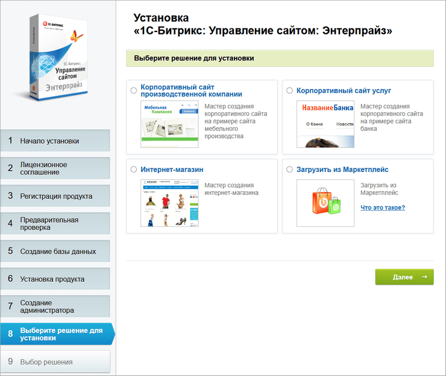
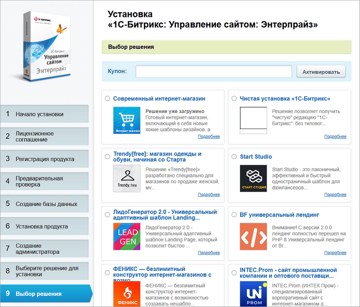
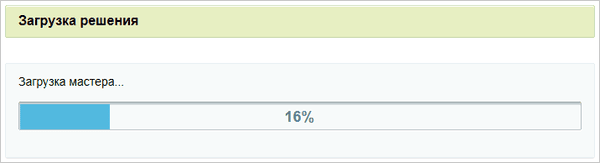

Решение — это функциональный пакет, который расширяет возможности системы. Оно содержит модули для новых функций, шаблоны дизайна, компоненты и демоданные. Решения разворачивают интернет-магазины, корпоративные сайты, лендинги и другие типы сайтов. У каждого решения свой мастер установки — мастер решения.

После шага [Создание администратора](./install-distr.md#admin) мастер установки *1С-Битрикс: Управление сайтом* показывает шаг *Выберите решение для установки*. На нем можно выбрать готовое решение или завершить установку без него.



В мастере *1С-Битрикс24* установка решений недоступна. После создания администратора запускается мастер настройки Битрикс24.



## Чистая установка

Чистая установка — продукт без решения. Мастер установки создает базу данных и учетную запись администратора, устанавливает модули, но не добавляет шаблон, страницы и демоданные решения. Если решение не требуется:

1. Остановитесь на шаге *Выберите решение для установки*. Не выбирайте решение, не нажимайте *Далее* и закройте мастер установки.

2. Удалите файл `/index.php` из корня сайта.

3. Удалите из корня сайта файлы `bitrixsetup.php`, `install.config`, `readme.html` и `restore.php`, если они есть.

4. Создайте собственную главную страницу `/index.php` по статье [Создание страницы](./create-page.md).

### Почему удаляют index.php

Пока решение не выбрано, файл `/index.php` в корне сайта остается файлом мастера установки. Если его оставить, при открытии сайта в браузере снова запускается мастер установки.

Мастер установки перезаписывает `/index.php`, только когда переходит к мастеру решения. В файл он записывает код запуска выбранного мастера. При чистой установке перехода нет, поэтому файл удаляют вручную.

Служебные файлы `bitrixsetup.php`, `install.config`, `readme.html` и `restore.php` мастер установки тоже удаляет только при переходе к мастеру решения. При чистой установке они остаются в корне сайта. Оставленный `bitrixsetup.php` относится к опасным файлам — подробнее в статье [Проактивная защита](../security/proactive-security.md).

Удаление `/index.php` не затрагивает базу данных, установленные модули и учетную запись администратора. Административный раздел открывается по адресу `/bitrix/admin/`.

### Как установить решение позже {#install-later}

Решение можно установить и после чистой установки. Мастер установки добавляет на [панель администрирования](../cms-basics/admin-panel.md) кнопку *Протестировать новое решение*. Если на сайте есть модуль `intranet`, например в Битрикс24, кнопки нет.

Кнопка доступна администратору в публичной части сайта. По нажатию она:

1. Создает новый сайт в папке `/site_<ID>/`, где `<ID>` — двухбуквенный идентификатор нового сайта.

2. Открывает в этой папке шаг *Выберите решение для установки* с теми же вариантами, включая *Загрузить из Маркетплейс*.

Мастер решения устанавливает решение в новый сайт. Существующий сайт и его `/index.php` кнопка не меняет.

В меню кнопки есть пункт *Удалить эту кнопку* — он убирает кнопку с панели администрирования.

## Установка готового решения

Решение выбирают на шаге *Выберите решение для установки*. Мастер установки показывает на нем решения из дистрибутива — папки мастеров решений с файлом `.description.php`:

-  `/bitrix/wizards/<партнер>/<мастер>/`,

-  `/bitrix/modules/<модуль>/install/wizards/<партнер>/<мастер>/`.

Последний вариант в списке — *Загрузить из Маркетплейс*.

{width=740px height=623px}

1. Выберите вариант для установки. Набор решений зависит от дистрибутива, например:

   -  Корпоративный сайт производственной компании — пример сайта мебельного производства,

   -  Корпоративный сайт услуг — пример сайта банка,

   -  Интернет-магазин — пример магазина одежды,

   -  Загрузить из Маркетплейс — переход к каталогу решений, описан в разделе [Установка решения из Маркетплейс](#marketplace).

2. Нажмите *Далее*. Если решение лежит в модуле, мастер установки копирует мастер решения из папки модуля в `/bitrix/wizards/`. Затем мастер установки записывает в `/index.php` код запуска мастера решения и открывает его.

3. Пройдите шаги мастера решения. Шаги задает само решение.

Если на шаге не выбран вариант, мастер установки показывает ошибку «Не указан мастер установки». Если файл `/index.php` недоступен для записи, мастер показывает ошибку «Ошибка запуска мастера. Файл /index.php недоступен для записи» — дайте веб-серверу право на запись в файл и повторите шаг.

Шаг выбора можно пропустить. Если в файле [`/install.config`](./install-distr.md#install-config) задан ключ `demoWizardName` с именем мастера в формате `партнер:мастер`, например `bitrix:demo`, после создания администратора мастер установки сразу запускает указанный мастер решения.

### Установка решения из Маркетплейс {#marketplace}

Решения из Маркетплейс можно установить на сайты с действующей лицензией. Для демоверсии необходимо получить [пробный лицензионный ключ](#activation) — например, оставить отмеченной опцию регистрации на шаге [Регистрация продукта](./install-distr.md#registration) мастера установки.

Решение из Маркетплейс устанавливают во время установки продукта или позже, кнопкой *Протестировать новое решение* — подробнее в разделе [Как установить решение позже](#install-later).

Техподдержка компании 1С-Битрикс не обслуживает решения от партнеров.

В продукт встроена защита от переустановки решения ради бесконечной пробной версии. Удаление модуля через файловую систему блокирует повторную установку пробной версии.

#### Выбор решения

Если на шаге *Выберите решение для установки* выбрать *Загрузить из Маркетплейс* и нажать *Далее*, мастер показывает шаг *Выбор решения* с каталогом решений. В карточке решения есть название, описание и ссылка *Подробнее* на страницу решения в Маркетплейс. Отметка *Решение уже загружено* означает, что модуль решения уже есть на сайте, отметка *Решение куплено* — что решение куплено.

1. Если у вас есть купон на решение, введите его в поле *Купон* и нажмите *Активировать*. Поле есть только при коммерческой лицензии. После активации мастер показывает сообщение «Купон на решение активирован. Выберите необходимое решение из списка».

2. Отметьте решение в каталоге.

3. Нажмите *Далее*.

Последняя карточка каталога — *Не загружать*. Если выбрать ее или нажать *Далее* без выбора, мастер возвращается к шагу *Выберите решение для установки*.

{width=740px height=630px}

#### Загрузка решения

На шаге *Загрузка решения* мастер показывает индикатор выполнения и подпись текущего этапа. Дождитесь завершения загрузки. Мастер выполняет этапы по порядку:

1. Скачивает модуль решения, если его еще нет на сайте.

2. Устанавливает модуль.

3. Загружает мастер решения — подпись «Загрузка мастера».

{width=600px height=163px}

После загрузки мастер переходит дальше по числу мастеров в модуле решения:

-  один мастер — сразу открывается мастер решения,

-  несколько мастеров — открывается шаг *Установка решения*, на нем выберите мастер и нажмите *Далее*,

-  мастера нет — мастер возвращается к шагу *Выберите решение для установки*.

Если загрузка или установка модуля не удалась, мастер останавливает загрузку и показывает текст ошибки, например «Модуль не может быть установлен», «Ошибка установки базы данных модуля» или «Ошибка установки файлов модуля».

## Активация лицензии {#activation}

Лицензионный ключ подтверждает право на использование продукта. Активируйте ключ перед использованием коммерческой версии. В мастере установки ключ вводят на шаге [Регистрация продукта](./install-distr.md#registration).



Один лицензионный ключ работает для двух установок. Одна установка должна быть для разработки без публичного доступа.



Коммерческие версии поставляются с открытым исходным кодом. В демоверсиях ключевые файлы защищены, чтобы скрыть их содержимое.



[Регистрация коммерческого продукта](https://dev.1c-bitrix.ru/learning/course/index.php?COURSE_ID=135&LESSON_ID=1945)

[Регистрация демоверсии пробным ключом](https://dev.1c-bitrix.ru/learning/course/index.php?COURSE_ID=135&LESSON_ID=1946)

[Регистрация демоверсии коммерческим ключом](https://dev.1c-bitrix.ru/learning/course/index.php?COURSE_ID=135&LESSON_ID=1947)

[Ограниченная лицензия](https://dev.1c-bitrix.ru/learning/course/index.php?COURSE_ID=135&LESSON_ID=12856)

[Продление лицензии](https://dev.1c-bitrix.ru/learning/course/index.php?COURSE_ID=135&LESSON_ID=25720)



## Что дальше

-  [Структура директорий](./directory-structure.md) — где лежат ядро, модули и собственный код проекта,

-  [Создание страницы](./create-page.md) — как создать главную страницу после чистой установки,

-  [Composer](./composer.md) — автозагрузчик и установка сторонних пакетов,

-  [Панель администрирования](../cms-basics/admin-panel.md) — кнопки публичной части, включая *Протестировать новое решение*.
