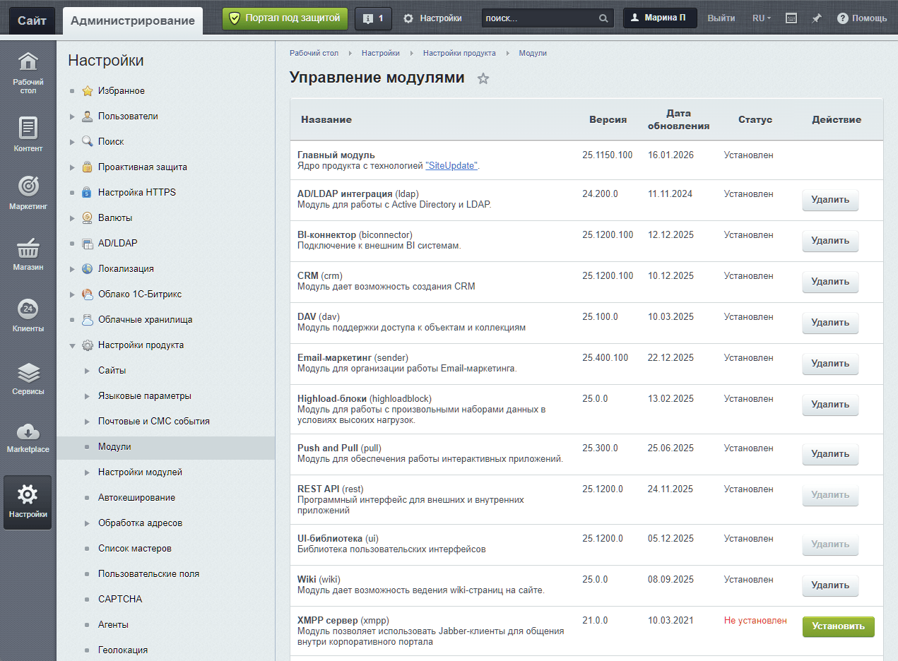
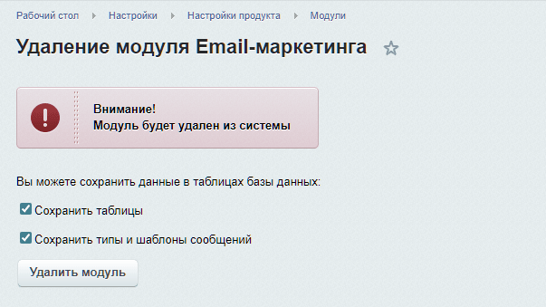
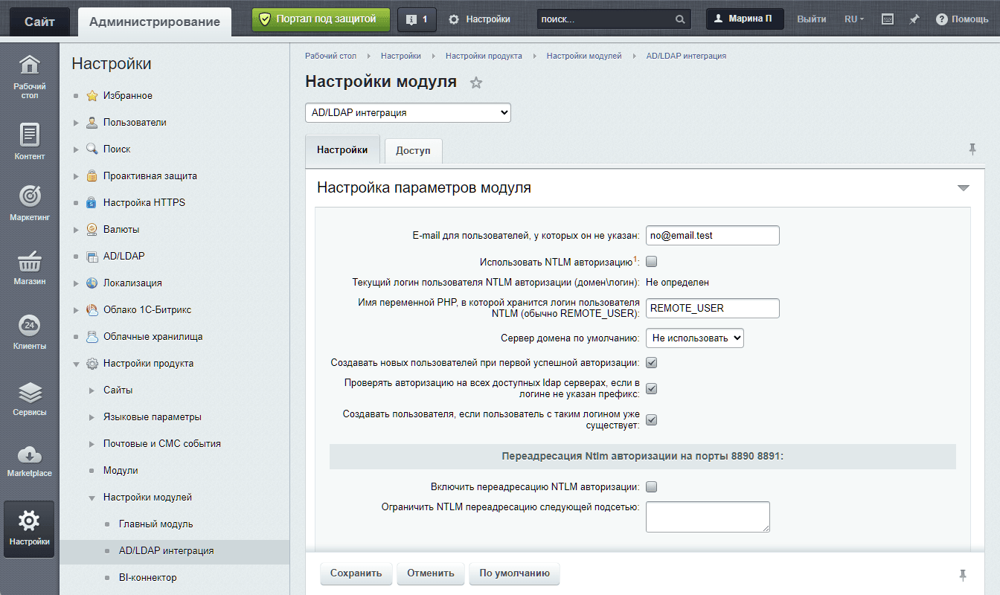
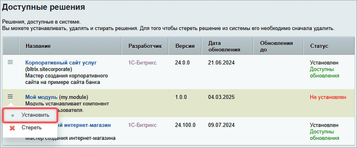
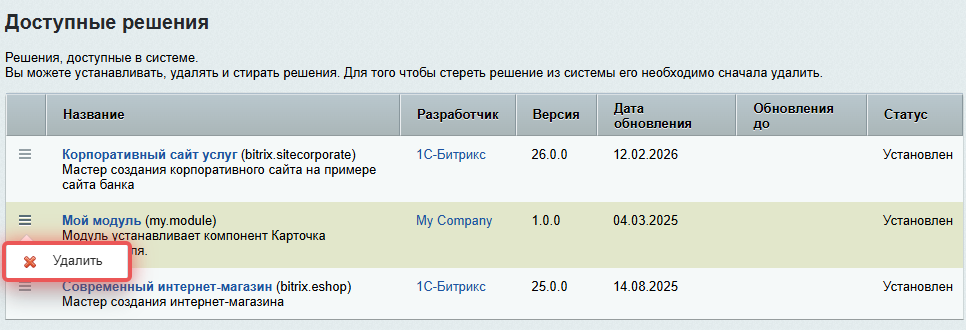
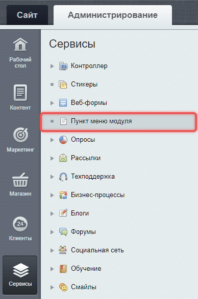

Bitrix Framework состоит из модулей. Модуль — это автономный компонент системы, который реализует определенную функциональность.

Модуль включает в себя:

-  бизнес-логику,

-  административный интерфейс,

-  компоненты для публичной части,

-  обработчики событий,

-  другие элементы, необходимые для работы отдельной части сайта.

Некоторые модули расширяют функционал уже установленных модулей. Например, модуль *Торговый каталог* добавляет функции работы с товарами к модулю *Информационные блоки*.

Устройство модуля складывается из структуры папок, установщика, параметров, административных страниц, языковых файлов и меню. Все примеры ниже написаны для модуля с идентификатором `company.module` в папке `/local/modules/company.module/`. Пошаговое создание модуля с нуля описано в статье [Создание модуля](../get-started/create-module.md).

## Управление модулями в системе

Модули видны в административном разделе на двух страницах:

-  *Настройки > Настройки продукта > Модули* — модули без точки в идентификаторе, например `iblock` или `sale`,
-  *Marketplace > Установленные решения* — модули с точкой в идентификаторе, например `company.module`. Здесь устанавливают и удаляют собственные и партнерские модули.

{width=1271px height=936px}

Неиспользуемый модуль можно удалить. Для некоторых модулей перед удалением система может предложить сохранить таблицы базы данных и другие данные модуля.

{width=603px height=339px}

### Настройки модуля

У модуля может быть собственная страница настроек в административном разделе *Настройки > Настройки продукта > Настройки модулей > \[Название конкретного модуля\]*. Модуль появляется в этом списке, если модуль установлен, в его папке есть файлы `install/index.php` и `options.php`, а у пользователя есть право на модуль не ниже `R` и операция `view_other_settings` или `edit_other_settings`.

{width=1344px height=800px}

## Подключить модуль

Чтобы использовать функции модуля, подключите его методом `Loader::includeModule()`. Метод возвращает `true`, если модуль подключен, и `false`, если модуль не установлен, папки модуля нет или файл `include.php` модуля вернул `false`. Если имя модуля пустое или содержит недопустимые символы, метод выбрасывает исключение `Bitrix\Main\LoaderException`.

**Пример.** Код подключает модуль и использует его классы, только если модуль установлен:

```php
<?php
use Bitrix\Main\Loader;

if (Loader::includeModule('company.module'))
{
    // В этой области доступны классы и функции модуля
}
```

Если без модуля нельзя продолжать выполнение сценария, используйте `Loader::requireModule()`. Метод выбрасывает исключение `Bitrix\Main\LoaderException`, если модуль не подключен. Если исключение не обработано, выполнение сценария прерывается.

**Пример.** Код прерывает выполнение, если модуль не подключен:

```php
<?php
use Bitrix\Main\Loader;

Loader::requireModule('company.module');

// После успешного подключения доступны классы и функции модуля
```

## Структура файлов модуля

Стандартные модули располагаются в `/bitrix/modules/ID_модуля/`. Собственные модули рекомендуется размещать в `/local/modules/ID_модуля/`, чтобы обновления продукта не затрагивали их. При подключении модуля система сначала ищет папку в `/local/modules/`, затем в `/bitrix/modules/`.



Подробнее о папке Local в статье [Структура директорий](./../get-started/directory-structure.md)



-  `/admin/` — файлы для административного раздела.

   -  `menu.php` — пункты меню для административного раздела.

-  `/install/` — файлы для установки и удаления.

   -  `/admin/` — вспомогательные скрипты для установки.

   -  `/js/` — JavaScript файлы модуля.

   -  `/db/` — SQL-скрипты для создания таблиц для разных баз данных, например, `/mysql/` или `/pgsql/`.

   -  `/images/` — изображения модуля.

   -  `/components/` — компоненты.

   -  `/panel/` — стили для административной панели.

   -  `/themes/` — стили и иконки модуля для темы административного раздела.

   -  `index.php` — главный файл с описанием модуля.

   -  `version.php` — файл с версией модуля.

-  `/lang/код_языка/` — языковые файлы.

-  `/lib/` — классы модуля на D7, например сервисы, ORM-классы таблиц и контроллеры. Система загружает их автоматически, правила описаны в разделе [Классы модуля](#module-classes).

-  `.settings.php` — конфигурация модуля, например сервисы для [Service Locator](../framework/service-locator.md), [контроллеры](../framework/controllers.md) и [консольные команды](../framework/console-commands.md). Формат файла описан в статье [Конфигурация ядра](../framework/settings.md).

-  `include.php` — подключение основных классов и функций модуля.

-  `default_option.php` — настройки модуля по умолчанию.

-  `options.php` — страница настроек модуля.

-  `prolog.php` — общий пролог административных скриптов модуля. Ядро его не подключает, скрипты модуля подключают файл сами после `prolog_admin_before.php`.

В Bitrix Framework существуют две архитектуры ядра — классическое ядро и ядро D7. В старых модулях, которые используют классический API, может быть папка `/classes/`.

-  `/general/` — классы для любой базы данных.

-  `/mysql/`, `/mssql/`, `/oracle/`, `/pgsql/` — классы для конкретных СУБД.



Модуль может содержать классы классического ядра и D7 одновременно, но в новом коде рекомендуется использовать только D7.



### Классы модуля {#module-classes}

При подключении модуля система регистрирует папку `/lib/` как корень автозагрузки для пространства имен модуля. После этого классы модуля загружаются автоматически при соблюдении правил. Подробно механизм описан в статье [Автозагрузка классов](../framework/autoloading.md).

1. **Имена файлов и классов**. Путь внутри `/lib/` повторяет пространство имен после базового пространства модуля и имя класса. Автозагрузчик сначала ищет путь в регистре пространства имен и класса, затем — полностью строчными буквами. Например, класс `Company\Module\MyService` можно разместить в `/lib/MyService.php` или `/lib/myservice.php`, а `Company\Module\Search\IndexManager` — в `/lib/Search/IndexManager.php` или `/lib/search/indexmanager.php`.

2. **Пространства имен**. Класс должен находиться в пространстве имен, которое соответствует идентификатору модуля. Для модуля `company.module` пространство имен будет `Company\Module`. Для модуля без точки в идентификаторе, например `iblock`, пространство имен начинается с `Bitrix\`, то есть `Bitrix\Iblock`.

   **Пример.** Класс `MyService` модуля `company.module`:

   ```php
   <?php
   // Файл: /local/modules/company.module/lib/myservice.php
   namespace Company\Module;

   class MyService
   {
       // Логика класса
   }
   ```

3. **Подключение модуля**. Перед использованием классов модуль нужно подключить.

   **Пример.** Код подключает модуль и создает объект его класса:

   ```php
   <?php
   use Bitrix\Main\Loader;
   use Company\Module\MyService;

   if (Loader::includeModule('company.module'))
   {
       // Теперь можно использовать классы модуля
       $service = new MyService();
   }
   ```

   Если код не должен работать без модуля, подключите модуль методом `Loader::requireModule()`.

   **Пример.** Код создает объект класса модуля после обязательного подключения:

   ```php
   <?php
   use Bitrix\Main\Loader;
   use Company\Module\MyService;

   Loader::requireModule('company.module');

   $service = new MyService();
   ```

## Описание модуля {#module-description}

Чтобы зарегистрировать модуль в системе, создайте файл описания `index.php` в папке `/local/modules/ID_модуля/install/`. Файл должен содержать класс — наследник базового класса `CModule` из Главного модуля. Имя класса должно совпадать с `ID` модуля с заменой точки на нижнее подчеркивание.

**Пример.** Для модуля `company.module` имя класса будет `company_module`.

В классе задайте свойства модуля:

-  `MODULE_ID` — идентификатор модуля, обязательное свойство,
-  `MODULE_VERSION` — версия модуля из трех чисел, разделенных точками, например `1.0.0`,
-  `MODULE_VERSION_DATE` — дата выпуска версии в формате `ГГГГ-ММ-ДД ЧЧ:МИ:СС`,
-  `MODULE_NAME` — название модуля,
-  `MODULE_DESCRIPTION` — описание модуля,
-  `MODULE_GROUP_RIGHTS` — необязательное свойство. Значение `Y` указывает, что модуль использует собственные права доступа и его можно настроить в правах групп пользователей. Права обозначаются буквами по возрастанию, например `D` — доступ закрыт, `R` — чтение, `W` — запись. Метод `$APPLICATION->GetGroupRight()` возвращает администратору право `W`, остальным пользователям без настроенных прав — значение параметра `GROUP_DEFAULT_RIGHT` модуля, по умолчанию `D`. Этот параметр хранится в базе данных, его задают в настройках прав модуля или через `Option::set()` при установке. Значение из `default_option.php` для него не используется. Без `MODULE_GROUP_RIGHTS` права групп на модуль в интерфейсе не настраиваются,
-  `MODULE_SORT` — необязательный порядок сортировки модуля в списках, по умолчанию `10000`,
-  `PARTNER_NAME` и `PARTNER_URI` — необязательные название и сайт разработчика модуля.

Значения `MODULE_NAME` и `MODULE_DESCRIPTION` рекомендуется хранить в языковом файле. Для класса из `/install/index.php` языковой файл должен находиться по пути `/lang/<код_языка>/install/index.php`. При построении списка модулей система создает объект класса модуля и выводит значения этих свойств.

В классе реализуйте два метода:

-  `DoInstall()` — устанавливает модуль,
-  `DoUninstall()` — удаляет модуль.

Страница *Установленные решения* проверяет результат этих методов. Если метод вернул `false`, страница показывает сообщение об ошибке и текст исключения из `$APPLICATION->GetException()`. Любой другой результат, в том числе отсутствие `return`, страница считает успешным и перезагружается с сообщением об успешной установке или удалении.

**Пример.** Файл `/install/index.php` создает таблицы, копирует файлы и регистрирует модуль. Если SQL-скрипт завершился с ошибкой, модуль не регистрируется, и метод `DoInstall()` возвращает `false`:

```php
<?php

use Bitrix\Main\Application;
use Bitrix\Main\IO\File;
use Bitrix\Main\Localization\Loc;
use Bitrix\Main\ModuleManager;

Loc::loadMessages(__FILE__);

/**
 * Класс для модуля `company.module`, вместо точки `.` используется подчеркивание `_`
 */
class company_module extends CModule
{
    public $MODULE_ID = 'company.module';

    public function __construct()
    {
        $this->MODULE_NAME = Loc::getMessage('COMPANY_MODULE_MODULE_NAME');
        $this->MODULE_DESCRIPTION = Loc::getMessage('COMPANY_MODULE_MODULE_DESC');

        include(__DIR__ . '/version.php');

        if (isset($arModuleVersion['VERSION']))
        {
            $this->MODULE_VERSION = $arModuleVersion['VERSION'];
            $this->MODULE_VERSION_DATE = $arModuleVersion['VERSION_DATE'] ?? null;
        }
    }

    public function DoInstall()
    {
        if (!$this->InstallDB())
        {
            return false;
        }

        $this->InstallFiles();

        ModuleManager::registerModule($this->MODULE_ID);

        return true;
    }

    public function DoUninstall()
    {
        $this->UnInstallDB();
        $this->UnInstallFiles();

        ModuleManager::unRegisterModule($this->MODULE_ID);

        return true;
    }

    /**
     * Выполнение SQL-скрипта для создания таблиц модуля
     *
     * @return bool
     */
    public function InstallDB()
    {
        global $APPLICATION;

        $db = Application::getConnection();
        $errors = $db->executeSqlBatch(
            File::getFileContents(__DIR__ . '/db/' . $db->getType() . '/install.sql')
        );
        if (!empty($errors))
        {
            $APPLICATION->ThrowException(implode(', ', $errors));

            return false;
        }

        return true;
    }

    /**
     * Выполнение SQL-скрипта для удаления таблиц модуля
     *
     * @return bool
     */
    public function UnInstallDB()
    {
        global $APPLICATION;

        $db = Application::getConnection();
        $errors = $db->executeSqlBatch(
            File::getFileContents(__DIR__ . '/db/' . $db->getType() . '/uninstall.sql')
        );
        if (!empty($errors))
        {
            $APPLICATION->ThrowException(implode(', ', $errors));

            return false;
        }

        return true;
    }

    /**
     * Копирование ресурсов, компонентов и оберток административных скриптов
     *
     * @return bool
     */
    public function InstallFiles()
    {
        CopyDirFiles(__DIR__ . '/js', $_SERVER['DOCUMENT_ROOT'] . '/local/js', true, true);
        CopyDirFiles(__DIR__ . '/admin', $_SERVER['DOCUMENT_ROOT'] . '/bitrix/admin', true);
        CopyDirFiles(__DIR__ . '/themes', $_SERVER['DOCUMENT_ROOT'] . '/bitrix/themes', true, true);
        CopyDirFiles(__DIR__ . '/components', $_SERVER['DOCUMENT_ROOT'] . '/local/components', true, true);

        return true;
    }

    /**
     * Удаление установленных файлов модуля
     *
     * @return bool
     */
    public function UnInstallFiles()
    {
        // Файлы первого уровня: обертки админ-страниц и CSS темы
        DeleteDirFiles(__DIR__ . '/admin', $_SERVER['DOCUMENT_ROOT'] . '/bitrix/admin');
        DeleteDirFiles(__DIR__ . '/themes/.default', $_SERVER['DOCUMENT_ROOT'] . '/bitrix/themes/.default');

        // Папки модуля удаляются целиком
        DeleteDirFilesEx('/bitrix/themes/.default/icons/company.module/');
        DeleteDirFilesEx('/local/js/company/module/');
        DeleteDirFilesEx('/local/components/company/module.list/');

        return true;
    }
}
```

Методы `InstallFiles()` и `UnInstallFiles()` рассчитаны на такую структуру папки `/install/`:

-  `/js/company/module/` — JS-расширения модуля, копируются в `/local/js/company/module/`,
-  `/admin/` — обертки административных страниц, копируются в `/bitrix/admin/`,
-  `/themes/.default/company.module.css` и `/themes/.default/icons/company.module/` — стили и иконки для темы административного раздела. Система ищет стили модулей только в `/bitrix/themes/`, поэтому файлы копируются туда,
-  `/components/company/module.list/` — компонент модуля `company:module.list`, копируется в `/local/components/company/module.list/`.

Удаляйте только папки, которые создал модуль. Папки `/local/js/company/` и `/local/components/company/` могут содержать файлы других модулей того же разработчика, поэтому в примере удаляются вложенные папки модуля.

Функция `CopyDirFiles()` с четвертым аргументом `true` копирует вложенные папки. Функция `DeleteDirFiles()` удаляет только файлы первого уровня, которые есть в исходной папке, поэтому папки удаляют функцией `DeleteDirFilesEx()` с путем от корня сайта.

Методы `InstallDB()` и `UnInstallDB()` читают SQL из файлов `/install/db/<тип_БД>/install.sql` и `uninstall.sql`. Метод `executeSqlBatch()` принимает текст запросов, поэтому содержимое файла нужно получить через `File::getFileContents()`. Если SQL-файла нет, метод `File::getFileContents()` выбрасывает исключение `FileNotFoundException`, и установка прерывается с ошибкой PHP. Метод `executeSqlBatch()` не останавливается на ошибке и выполняет остальные запросы, поэтому после ошибки часть таблиц может остаться созданной.

Классы модуля из папки `/lib/` доступны только после `ModuleManager::registerModule()` и `Loader::includeModule()`. Код, который использует эти классы, например создание демонстрационных данных через ORM-класс модуля, выполняйте после регистрации модуля. Метод `ModuleManager::unRegisterModule()` при удалении также удаляет агенты модуля и права групп пользователей на модуль.

### Информация о версии

Файл `install/version.php` содержит информацию о версии модуля. Он подключается в конструкторе класса модуля.

**Пример.** Файл `install/version.php` модуля версии `1.0.0`:

```php
<?php
$arModuleVersion = [
    'VERSION' => '1.0.0',
    'VERSION_DATE' => '2023-12-01 12:00:00',
];
```

## Установить модуль

Перед установкой разместите файлы модуля в папке `/local/modules/company.module/`. Затем перейдите в раздел *Marketplace > Установленные решения* и нажмите *Установить* для нужного модуля. Устанавливать и удалять модули может пользователь с операцией `edit_other_settings`, например администратор.

{width=700px height=291px}

Во время установки система запускает метод `DoInstall()` из класса модуля. Метод выполняет действия, описанные в классе модуля. Например, в классе модуля можно описать:

-  регистрацию модуля в системе с помощью `ModuleManager::registerModule()`,

-  создание необходимых таблиц в базе данных,

-  регистрацию обработчиков событий.

### Пошаговая установка

Если перед установкой нужно получить параметры от администратора, разбейте установку на шаги. На первом шаге `DoInstall()` показывает административную форму через `$APPLICATION->IncludeAdminFile()`. Форма передает скрытые поля `install=Y`, `step=2` и параметры установки. На втором шаге `DoInstall()` читает значения из запроса и выполняет установку, то есть создает таблицы, регистрирует модуль, копирует файлы и добавляет обработчики событий.

Метод `IncludeAdminFile()` выводит административный пролог, подключает файл формы, выводит эпилог и завершает скрипт через `die()`. Код после вызова не выполняется, поэтому `return` после него не нужен.

Для пошаговой установки создайте два файла:

-  `/install/install_step1.php` — форма первого шага,

-  `/install/index.php` — файл описания модуля с классом, который показывает форму и обрабатывает второй шаг.

В форме служебные поля управляют сценарием установки, а поле `create_demo_data` передает параметр установки — создавать ли демонстрационные данные:

- `id` — указывает модуль,
- `install=Y` — сохраняет действие установки,
- `step=2` — переводит установщик ко второму шагу,
- `lang` — сохраняет язык административного интерфейса,
- `sessid` — CSRF-токен, его выводит функция `bitrix_sessid_post()`. Без него страница *Установленные решения* не вызывает `DoInstall()`.

**Пример.** Файл `/install/install_step1.php` с формой первого шага установки:

```php
<?php
// Файл: /local/modules/company.module/install/install_step1.php
?>
<form action="<?= $APPLICATION->GetCurPage() ?>">
    <?= bitrix_sessid_post() ?>
    <input type="hidden" name="lang" value="<?= LANGUAGE_ID ?>">
    <input type="hidden" name="id" value="company.module">
    <input type="hidden" name="install" value="Y">
    <input type="hidden" name="step" value="2">

    <p>
        <input type="checkbox" name="create_demo_data" id="create_demo_data" value="Y">
        <label for="create_demo_data">Создать демонстрационные данные</label>
    </p>

    <input type="submit" name="inst" value="Установить модуль">
</form>
```

**Пример.** Обработка шагов установки в файле `/install/index.php`. Методы `InstallDB()` и `InstallFiles()` взяты без изменений из примера установщика выше. Если создание таблиц завершилось ошибкой, модуль не регистрируется. Демонстрационные данные метод `InstallDemoData()` создает после регистрации и подключения модуля, когда классы из `/lib/` уже доступны:

```php
<?php
use Bitrix\Main\Loader;
use Bitrix\Main\ModuleManager;

class company_module extends CModule
{
    public $MODULE_ID = 'company.module';

    public function InstallDemoData()
    {
        // Создание демонстрационных данных через ORM-классы модуля
    }

    public function DoInstall()
    {
        global $APPLICATION;

        if (!check_bitrix_sessid())
        {
            return false;
        }

        $step = (int)($_REQUEST['step'] ?? 1);

        if ($step < 2)
        {
            // Метод выводит форму и завершает скрипт
            $APPLICATION->IncludeAdminFile(
                'Установка модуля',
                __DIR__ . '/install_step1.php'
            );
        }

        if (!$this->InstallDB())
        {
            return false;
        }

        $this->InstallFiles();

        ModuleManager::registerModule($this->MODULE_ID);

        if (($_REQUEST['create_demo_data'] ?? 'N') === 'Y' && Loader::includeModule($this->MODULE_ID))
        {
            $this->InstallDemoData();
        }

        return true;
    }
}
```

## Удалить модуль

Чтобы удалить модуль, на странице *Установленные решения* выберите действие *Удалить* в меню установленного модуля. Система вызовет метод `DoUninstall()` класса модуля.

Действие *Стереть* доступно только у неустановленного модуля. После подтверждения оно удаляет папку модуля с диска и `DoUninstall()` не вызывает.

{width=966px height=330px}

При удалении система запускает метод `DoUninstall()`. Метод выполняет действия, описанные в классе модуля. Например, в классе модуля можно описать:

-  снятие регистрации модуля через `ModuleManager::unRegisterModule()`,

-  удаление таблиц модуля из базы данных, если нет подтверждения о сохранении данных.



Через страницу *Модули* нельзя удалить модули:

-  главный модуль `main`, он выводится в списке без кнопки удаления,

-  управление структурой `fileman`,

-  UI-библиотека `ui`,

-  проактивная защита `security`,

-  интранет `intranet`,

-  управление персоналом `humanresources`,

-  `rest` и `socialnetwork`, если установлен модуль `intranet`.



### Пошаговое удаление с сохранением данных

Если перед удалением модуля нужно спросить администратора, сохранять ли таблицы базы данных или другие данные модуля, разбейте удаление на шаги.

Для пошагового удаления создайте три файла:

-  `/install/uninstall_step1.php` — форма с вопросом о сохранении данных,

-  `/install/index.php` — файл описания модуля с классом, который показывает форму, читает `savedata` и выполняет удаление,

-  `/install/uninstall_step2.php` — экран результата удаления.

На первом шаге метод `DoUninstall()` показывает административную форму. В форме передайте скрытые поля `uninstall=Y`, `step=2` и поле с флагом сохранения данных, например `savedata=Y`.

Поля формы удаления:

- `id` — указывает модуль,
- `uninstall=Y` — сохраняет действие удаления,
- `step=2` — переводит удаление ко второму шагу,
- `savedata=Y` — передает решение администратора сохранить данные,
- `sessid` — CSRF-токен, его выводит функция `bitrix_sessid_post()`. Без него страница не вызывает `DoUninstall()`.

**Пример.** Файл `/install/uninstall_step1.php` с формой первого шага удаления:

```php
<?php
// Файл: /local/modules/company.module/install/uninstall_step1.php
?>
<form action="<?= $APPLICATION->GetCurPage() ?>">
    <?= bitrix_sessid_post() ?>
    <input type="hidden" name="lang" value="<?= LANGUAGE_ID ?>">
    <input type="hidden" name="id" value="company.module">
    <input type="hidden" name="uninstall" value="Y">
    <input type="hidden" name="step" value="2">

    <p>Вы можете сохранить данные в таблицах базы данных:</p>
    <p>
        <input type="checkbox" name="savedata" id="savedata" value="Y" checked>
        <label for="savedata">Сохранить таблицы</label>
    </p>

    <input type="submit" name="inst" value="Удалить модуль">
</form>
```

На втором шаге `DoUninstall()` получает значение `savedata` из запроса и передает его в метод удаления базы данных. Если администратор оставил флаг `savedata=Y`, метод `UnInstallDB()` не удаляет таблицы. Если флага нет или он отличается от `Y`, метод удаляет данные модуля.

**Пример.** Обработка шагов удаления в файле `/install/index.php`. Метод `UnInstallFiles()` описан в примере установщика выше. Метод `UnInstallDB()` здесь заменяет метод из того примера и удаляет таблицу через `dropTable()`. Метод `dropTable()` выбрасывает исключение, если таблицы нет, поэтому перед ним стоит проверка `isTableExists()`:

```php
<?php
use Bitrix\Main\Application;
use Bitrix\Main\ModuleManager;

class company_module extends CModule
{
    public $MODULE_ID = 'company.module';

    public function DoUninstall()
    {
        if (!check_bitrix_sessid())
        {
            return false;
        }

        global $APPLICATION;

        $step = (int)($_REQUEST['step'] ?? 1);

        if ($step < 2)
        {
            // Метод выводит форму и завершает скрипт
            $APPLICATION->IncludeAdminFile(
                'Удаление модуля',
                __DIR__ . '/uninstall_step1.php'
            );
        }

        $this->UnInstallDB([
            'savedata' => $_REQUEST['savedata'] ?? 'N',
        ]);
        $this->UnInstallFiles();

        ModuleManager::unRegisterModule($this->MODULE_ID);

        // Метод выводит экран результата и завершает скрипт
        $APPLICATION->IncludeAdminFile(
            'Удаление модуля',
            __DIR__ . '/uninstall_step2.php'
        );
    }

    public function UnInstallDB(array $params = [])
    {
        if (($params['savedata'] ?? 'N') === 'Y')
        {
            return true;
        }

        $connection = Application::getConnection();
        if ($connection->isTableExists('company_module_item'))
        {
            $connection->dropTable('company_module_item');
        }

        return true;
    }
}
```

Файл `uninstall_step2.php` нужен, чтобы показать результат удаления. Если при удалении возникли ошибки, передайте их через `$APPLICATION->ThrowException()` или глобальную переменную и выведите на этом экране вместо сообщения об успешном завершении. Свойства объекта модуля в этом файле недоступны: файл подключается внутри `$APPLICATION->IncludeAdminFile()`, и `$this` в нем указывает на `$APPLICATION`.

**Пример.** Файл `/install/uninstall_step2.php` с экраном результата:

```php
<?php
// Файл: /local/modules/company.module/install/uninstall_step2.php

if (!check_bitrix_sessid())
{
    return;
}
?>
<p>Удаление модуля завершено.</p>

<form action="<?= $APPLICATION->GetCurPage() ?>">
    <input type="hidden" name="lang" value="<?= LANGUAGE_ID ?>">
    <input type="submit" value="Вернуться к списку модулей">
</form>
```

## Параметры модуля

Параметры модулей система хранит в базе данных. Параметры можно задавать через административный интерфейс или в коде.

### Файлы параметров

Файл `default_option.php` содержит значения параметров по умолчанию. Имя массива состоит из идентификатора модуля с заменой точек на `_` и суффикса `_default_option`. Для модуля `company.module` используйте `$company_module_default_option`.

**Пример.** Файл `default_option.php` задает три параметра по умолчанию:

```php
<?php
// Файл: /local/modules/company.module/default_option.php
$company_module_default_option = [
    'API_KEY' => '',
    'CACHE_TIME' => 3600,
    'ENABLE_LOG' => 'Y',
];
```

Метод `Option::get()` сначала возвращает сохраненное значение. Если его нет, метод возвращает непустой аргумент `$default`. При `$default`, равном пустой строке, метод ищет значение в `default_option.php`. Если значения нет и в файле, метод возвращает `$default`.

Идентификатор модуля и имя параметра не зависят от регистра. Ключ `API_KEY` в `default_option.php` и вызов `Option::get('company.module', 'api_key')` обращаются к одному параметру.

### Страница настроек

Файл `options.php` содержит форму и логику сохранения параметров. Система подключает его из `/bitrix/admin/settings.php` после служебной части пролога `prolog_admin_before.php`, но до вывода шапки административного раздела. Вывод файла система буферизует, поэтому в `options.php` можно выполнить редирект после сохранения. В момент подключения доступны `$APPLICATION`, `$USER`, идентификатор выбранного модуля `$mid` и константа языка интерфейса `LANGUAGE_ID`. Повторно подключать пролог и эпилог в `options.php` не нужно.

Создайте `/local/modules/company.module/options.php`. Для доступа к странице `settings.php` нужна операция `view_other_settings` или `edit_other_settings`. Пользователю также нужен доступ на чтение файла `/bitrix/admin/settings.php`, который определяют права на файлы и каталоги сайта.

В примере пользователь с правом `R` на модуль может просматривать параметры, а с правом `W` и операцией `edit_other_settings` — сохранять их.

Форма отправляет POST-запрос на страницу настроек. Поле `mid` выбирает модуль, а `lang` сохраняет язык интерфейса. Функция `bitrix_sessid_post()` добавляет CSRF-токен, который код проверяет через `check_bitrix_sessid()` перед сохранением.

**Пример.** Файл `options.php` выводит флажок `ENABLE_LOG` и сохраняет его значение:

```php
<?php
use Bitrix\Main\Config\Option;
use Bitrix\Main\Context;

if (!defined('B_PROLOG_INCLUDED') || B_PROLOG_INCLUDED !== true)
{
    return;
}

$moduleId = 'company.module';
$moduleRight = $APPLICATION->GetGroupRight($moduleId);

if ($moduleRight < 'R')
{
    $APPLICATION->AuthForm('Доступ запрещен');
    return;
}

$canSave = $moduleRight >= 'W' && $USER->CanDoOperation('edit_other_settings');
$request = Context::getCurrent()->getRequest();

if ($request->isPost() && $canSave && check_bitrix_sessid())
{
    Option::set($moduleId, 'ENABLE_LOG', $request->getPost('ENABLE_LOG') === 'Y' ? 'Y' : 'N');
}

$enableLog = Option::get($moduleId, 'ENABLE_LOG');
?>
<form method="post" action="/bitrix/admin/settings.php">
    <?= bitrix_sessid_post() ?>
    <input type="hidden" name="mid" value="<?= htmlspecialcharsbx($moduleId) ?>">
    <input type="hidden" name="lang" value="<?= htmlspecialcharsbx(LANGUAGE_ID) ?>">

    <p>
        <label>
            <input type="checkbox" name="ENABLE_LOG" value="Y"<?= $enableLog === 'Y' ? ' checked' : '' ?><?= !$canSave ? ' disabled' : '' ?>>
            Включить журналирование
        </label>
    </p>
    <input type="submit" value="Сохранить"<?= !$canSave ? ' disabled' : '' ?>>
</form>
```

Вызов `Option::get()` без третьего аргумента использует значение `ENABLE_LOG` из `default_option.php`, пока администратор не сохранит параметр.

### Работа с параметрами через код

Для работы с параметрами модуля используют класс `\Bitrix\Main\Config\Option`.

#### Получить параметр

Метод `get($moduleId, $name, $default = "", $siteId = false)` возвращает значение параметра. Значение, сохраненное в базе данных, метод возвращает строкой. Значение из `default_option.php` и аргумент `$default` метод возвращает без приведения типа.

-  `$moduleId` — идентификатор модуля.

-  `$name` — имя параметра.

-  `$default` — значение для отсутствующего параметра. Непустое значение имеет приоритет перед `default_option.php`.

-  `$siteId` — идентификатор сайта, необязательный параметр. По умолчанию `false` — метод ищет значение для текущего сайта, а если его нет, возвращает общее значение для всех сайтов.

**Пример.** Код получает ключ API модуля или значение `default_value`, если параметр не сохранен:

```php
$apiKey = \Bitrix\Main\Config\Option::get('company.module', 'api_key', 'default_value');
```

Если `$moduleId` или `$name` пустые, метод выбрасывает исключение `\Bitrix\Main\ArgumentNullException`.

#### Установить значение параметра

Метод `set($moduleId, $name, $value = "", $siteId = "")` устанавливает значение параметра `$value`. Если параметр существует — обновляет его, иначе создает новый. Если `$siteId` не указан, параметр считается общим для всех сайтов. Пустой `$moduleId` или `$name` вызывает исключение `\Bitrix\Main\ArgumentNullException`.

**Пример.** Код сохраняет общий ключ API и время кеширования для сайта `s1`:

```php
\Bitrix\Main\Config\Option::set('company.module', 'api_key', 'new_secret_key');
\Bitrix\Main\Config\Option::set('company.module', 'cache_time', 3600, 's1'); // Для конкретного сайта
```

После сохранения метод отправляет два события модуля `main`:

-  `OnAfterSetOption_<имя параметра>` — имя параметра строчными буквами, например `OnAfterSetOption_api_key`. Параметр события — `value`,
-  `OnAfterSetOption` — параметры события `moduleId`, `name`, `value` и `siteId`. Идентификатор модуля и имя параметра передаются строчными буквами.

Подписка на события описана в статье [События](../framework/events.md).

#### Удалить параметр

Метод `delete($moduleId, array $filter = [])` удаляет параметры по фильтру. Фильтр может содержать ключи:

-  `name` — имя параметра для удаления,

-  `site_id` — идентификатор сайта. Если ключ не указан, метод удаляет общее значение и значения для всех сайтов. Если указана пустая строка, метод удаляет только общее значение.

Пустое значение `name` вызывает исключение `\Bitrix\Main\ArgumentNullException`, другие ключи фильтра — исключение `\Bitrix\Main\ArgumentException`.

**Пример.** Код удаляет параметр для всех сайтов, затем для одного сайта, затем все параметры модуля:

```php
// Удалить конкретный параметр для всех сайтов
\Bitrix\Main\Config\Option::delete('company.module', ['name' => 'api_key']);

// Удалить параметр только для конкретного сайта
\Bitrix\Main\Config\Option::delete('company.module', [
    'name' => 'api_key',
    'site_id' => 's1',
]);

// Удалить все параметры модуля
\Bitrix\Main\Config\Option::delete('company.module');
```

## Административные скрипты

Административные скрипты — это PHP-файлы, которые создают интерфейс управления модулем в административной панели. Для пользовательского модуля разместите их в папке `/local/modules/ID_модуля/admin/`.

Административные страницы открываются из папки `/bitrix/admin/`, поэтому для каждого административного скрипта модуля нужен скрипт-обертка в этой папке. Скрипты в папке модуля не предназначены для прямого вызова через браузер. Для `/bitrix/modules/` прямой доступ закрывает файл `.htaccess` при работе с Apache. Для `/local/modules/` закройте доступ настройками веб-сервера.

-  Основной скрипт — `/local/modules/company.module/admin/my_page.php`.

-  Обертка — `/bitrix/admin/company_module_my_page.php`.

**Пример.** Содержимое обертки подключает основной скрипт модуля:

```php
<?php
require_once($_SERVER['DOCUMENT_ROOT'] . '/local/modules/company.module/admin/my_page.php');
```

Разместите обертки в `/local/modules/company.module/install/admin/`. При установке метод `InstallFiles()` модуля должен скопировать их в `/bitrix/admin/`, как в примере установщика выше. Метод `UnInstallFiles()` удаляет установленные обертки из этой же папки.

В каждом административном скрипте модуля определите константу `ADMIN_MODULE_NAME` с идентификатором модуля. Административная панель использует константу в двух местах:

-  кнопка *Настройки* на панели ведет на страницу настроек этого модуля. Кнопку видят пользователи с операцией `view_other_settings` или `edit_other_settings`,
-  ссылка на справку административной страницы строится по идентификатору модуля.

Права доступа константа не проверяет. Проверяйте их в скрипте, например методом `$APPLICATION->GetGroupRight()`, как в примере страницы настроек.

**Пример.** Файл `prolog.php` модуля задает константу:

```php
<?php
define('ADMIN_MODULE_NAME', 'company.module');
```

Административный скрипт подключает файлы ядра в определенном порядке:

1. `prolog_admin_before.php` — подключает ядро и требует авторизации пользователя, но ничего не выводит. После него можно проверить права и сделать редирект.
2. `prolog.php` модуля — задает константу `ADMIN_MODULE_NAME`.
3. `prolog_admin_after.php` — выводит шапку и меню административного раздела.
4. Содержимое страницы.
5. `epilog_admin.php` — выводит подвал страницы.

**Пример.** Основной скрипт `/local/modules/company.module/admin/my_page.php` проверяет право на модуль и выводит страницу:

```php
<?php
require_once($_SERVER['DOCUMENT_ROOT'] . '/bitrix/modules/main/include/prolog_admin_before.php');
require_once($_SERVER['DOCUMENT_ROOT'] . '/local/modules/company.module/prolog.php');

use Bitrix\Main\Loader;
use Bitrix\Main\Localization\Loc;

Loc::loadMessages(__FILE__);

if ($APPLICATION->GetGroupRight('company.module') < 'R')
{
    $APPLICATION->AuthForm(Loc::getMessage('COMPANY_MODULE_ACCESS_DENIED'));
}

Loader::requireModule('company.module');

$APPLICATION->SetTitle(Loc::getMessage('COMPANY_MODULE_PAGE_TITLE'));

require_once($_SERVER['DOCUMENT_ROOT'] . '/bitrix/modules/main/include/prolog_admin_after.php');
?>
<p><?= Loc::getMessage('COMPANY_MODULE_PAGE_TEXT') ?></p>
<?php
require_once($_SERVER['DOCUMENT_ROOT'] . '/bitrix/modules/main/include/epilog_admin.php');
```

Для вывода таблицы записей на такой странице используйте административные списки, они описаны ниже.

### Административные списки

Административный список — таблица с записями модуля на странице из папки `/admin/`. Пример такой страницы в ядре — список пользователей в разделе *Настройки > Пользователи > Список пользователей*. Страница настроек `options.php` к административным скриптам не относится. Это форма параметров модуля, она описана в разделе «Параметры модуля».

В модуле `main` доступны два класса для вывода списков:

-  `CAdminList` — базовый класс для вывода списков элементов в интерфейсе административного раздела. Класс выводит таблицу с сортировкой, фильтрацией и действиями с элементами.

-  `CAdminUiList` — наследник `CAdminList`, выводит список через [грид](../ui/main-ui-grid.md) и фильтр современного административного интерфейса. Класс применяют в новых модулях и интерфейсах.

Примеры ниже — фрагменты основного административного скрипта, например `/local/modules/company.module/admin/my_page.php`. Код выполняется после `prolog_admin_before.php` и до `prolog_admin_after.php`, а переменная `$lAdmin` содержит объект списка из примера в разделе о режимах работы.

#### Режимы работы грида

Грид — это компонент для вывода данных в виде таблицы с поддержкой сортировки, фильтрации, редактирования и других действий без перезагрузки страницы. Поддерживает несколько режимов работы:

-  простой вывод списка элементов (открытие страницы),

-  обработка быстрого редактирования элементов,

-  обновление грида без перезагрузки страницы, например сортировка,

-  выгрузка в формат для Excel,

-  показ формы настроек грида.

Конструктор списка определяет режим по параметру `mode` запроса. Если параметр не передан или содержит неизвестное значение, список работает в режиме обычного вывода страницы. Чтобы узнать текущий режим, вызовите метод `getCurrentMode()`.

**Пример.** Код создает список и проверяет режим выгрузки в Excel:

```php
$sTableID = 'tbl_company_module_item'; // Уникальный идентификатор таблицы списка модуля
$lAdmin = new CAdminUiList($sTableID); // Создаем экземпляр списка

$mode = $lAdmin->getCurrentMode(); // Получаем текущий режим работы
$excelMode = $mode === CAdminList::MODE_EXPORT; // Проверяем, включен ли режим экспорта в Excel
```

Метод вернет одну из констант класса `CAdminList`:

-  `public const MODE_PAGE = 'normal';` — обычный вывод страницы,

-  `public const MODE_LIST = 'list';` — обновление грида без полной перезагрузки,

-  `public const MODE_ACTION = 'frame';` — обработка результатов быстрого редактирования,

-  `public const MODE_EXPORT = 'excel';` — выгрузка в Excel,

-  `public const MODE_CONFIG = 'settings';` — показ формы настроек.

#### Вспомогательные методы

Чтобы не писать большой объем кода для сравнения с константой, используйте вспомогательные методы:

-  `public function isPageMode(): bool` — возвращает `true`, если страница с гридом открывается в браузере,

-  `public function isExportMode(): bool` — возвращает `true` в режиме выгрузки в Excel,

-  `public function isAjaxMode(): bool` — возвращает `true` при обновлении грида и обработке быстрого редактирования, то есть в режимах `MODE_LIST` и `MODE_ACTION`,

-  `public function isConfigMode(): bool` — возвращает `true` при показе окна настроек,

-  `public function isActionMode(): bool` — возвращает `true` при обработке результатов inline-редактирования,

-  `public function isListMode(): bool` — возвращает `true` при обновлении блока грида без обновления страницы.

**Пример.** Проверка режима экспорта через вспомогательный метод.

```php
$excelMode = $lAdmin->isExportMode(); // То же, что сравнение с CAdminList::MODE_EXPORT
```

#### Обработка inline-редактирования элементов

Пользователь меняет значения прямо в таблице, а страница получает измененные поля без перезагрузки.

**Пример.** Сохранение результатов inline-редактирования.

```php
// Проверить, было ли отправлено inline-редактирование
if ($lAdmin->EditAction())
{
    // Добавить загруженные файлы в список изменяемых полей
    $lAdmin->ConvertFilesToEditFields();

    // Обработать каждую измененную запись
    foreach ($lAdmin->GetEditFields() as $id => $fields)
    {
        // Сохранить изменения для записи с ID $id
        // $fields содержит новые значения полей
    }
}
```

Методы:

-  `public function GetEditFields(): array` — возвращает массив измененных записей. Ключ массива — ID записи, значение — новые значения полей. Записи с пустым ID и записи без изменений метод пропускает.

-  `public function ConvertFilesToEditFields(): void` — добавляет загруженные файлы в общий массив полей.

#### Групповые операции

Групповая операция применяет одно действие сразу к нескольким выбранным элементам списка.

Метод `GroupAction()` возвращает массив идентификаторов выбранных элементов. Если действие не выбрано, элементы не отмечены или проверка сессии не прошла, метод вернет `false`. В классе `CAdminList` для действия `edit` метод тоже возвращает `false` и включает режим редактирования выбранных строк. В классе `CAdminUiList` отдельной обработки `edit` нет, метод возвращает идентификаторы, как для любого действия.

Если пользователь отметил пункт *Для всех*, метод `GroupAction()` вернет массив с одной пустой строкой. В этом случае получите идентификаторы всех элементов списка самостоятельно выборкой с текущим фильтром списка.

**Пример.** Обработка группового действия. Класс `\Company\Module\ItemTable` — ORM-класс таблицы записей модуля, `$filter` — массив фильтра, по которому построен список:

```php
// Получить идентификаторы выбранных элементов
$itemIds = $lAdmin->GroupAction();

if ($itemIds)
{
    // Получить выбранное действие
    $actionId = $lAdmin->GetAction();

    // Для действия «Для всех» выбрать идентификаторы по текущему фильтру
    if ($lAdmin->IsGroupActionToAll())
    {
        $itemIds = array_column(
            \Company\Module\ItemTable::getList([
                'filter' => $filter,
                'select' => ['ID'],
            ])->fetchAll(),
            'ID'
        );
    }

    // Обработать каждый элемент
    foreach ($itemIds as $itemId)
    {
        switch ($actionId)
        {
            case 'delete':
                // Удалить элемент
                break;
            case 'update':
                // Обновить элемент
                break;
            default:
                // Другое действие
        }
    }
}
```

Методы:

-  `public function GetAction()` — возвращает идентификатор группового действия или `null`, если действие не передано,

-  `public function IsGroupActionToAll()` — возвращает `true`, если пользователь отметил в гриде пункт *Для всех*.

## Языковые файлы

Языковые файлы хранят текстовые сообщения модуля для разных языков. Для пользовательского модуля разместите их в папке `/local/modules/ID_модуля/lang/ID_языка/`, повторяя структуру основных файлов.

**Пример.** Структура языковых файлов для `/local/modules/company.module/admin/my_page.php`:

```text
/local/modules/company.module/
├── admin/
│   └── my_page.php
└── lang/
    ├── en/
    │   └── admin/
    │       └── my_page.php
    └── ru/
        └── admin/
            └── my_page.php
```

Содержимое языкового файла — это массив `$MESS`. Система автоматически ищет и загружает фразы из него.

**Пример.** Языковой файл `/lang/ru/admin/my_page.php`:

```php
<?php
$MESS['COMPANY_MODULE_PAGE_TITLE'] = 'Управление модулем компании';
$MESS['COMPANY_MODULE_PAGE_TEXT'] = 'Здесь будут записи модуля';
$MESS['COMPANY_MODULE_ACCESS_DENIED'] = 'Доступ запрещен';
```

### Подключить языковые файлы

Подключить языковой файл можно методом `Loc::loadMessages()`.

**Пример.** Административная страница подключает свой языковой файл и выводит фразу:

```php
<?php
// В файле: /local/modules/company.module/admin/my_page.php
use Bitrix\Main\Localization\Loc;

Loc::loadMessages(__FILE__);

echo Loc::getMessage('COMPANY_MODULE_PAGE_TITLE');
```

Параметр `__FILE__` передает путь к текущему файлу, что позволяет системе найти соответствующий языковой файл в папке `lang`.

Структура внутри папки языка должна повторять путь исходного PHP-файла относительно корня модуля.

```text
/install/index.php
└── /lang/ru/install/index.php

/admin/my_page.php
└── /lang/ru/admin/my_page.php
```



Подробнее в статье [Локализация](./../advanced/localization.md).



## Административное меню

Модуль может добавлять пункты в административное меню. Для этого создайте файл `/admin/menu.php` в папке модуля. Система ищет файл только по этому пути. Файл возвращает массив одного раздела меню с ключом `parent_menu` или список таких массивов.

Ключи раздела меню:

-  `parent_menu` — раздел верхнего уровня, в который попадает пункт, например `global_menu_services` или `global_menu_settings`,
-  `sort` — порядок сортировки внутри раздела,
-  `text` и `title` — текст пункта и всплывающая подсказка,
-  `url` — адрес административной страницы относительно `/bitrix/admin/`,
-  `icon` — CSS-класс иконки,
-  `items_id` — идентификатор раздела, если у пункта есть вложенные пункты,
-  `items` — массив вложенных пунктов с теми же ключами `text`, `url`, `title`.

**Пример.** Файл меню модуля `company.module` добавляет пункт в раздел *Сервисы*:

```php
<?php
// Файл: /local/modules/company.module/admin/menu.php

use Bitrix\Main\Localization\Loc;

Loc::loadMessages(__FILE__);

// Не показывать пункт пользователям без права на модуль
if ($APPLICATION->GetGroupRight('company.module') < 'R')
{
    return false;
}

return [
    [
        'parent_menu' => 'global_menu_services',
        'sort' => 100,
        'text' => Loc::getMessage('COMPANY_MODULE_MENU_TITLE'),
        'title' => Loc::getMessage('COMPANY_MODULE_MENU_TOOLTIP'),
        'url' => 'company_module_my_page.php?lang=' . LANGUAGE_ID,
        'icon' => 'company_menu_icon',
        'items_id' => 'menu_company_module',
    ],
];
```

Система автоматически собирает пункты меню из всех установленных модулей.

{width=388px height=584px}

## Взаимодействие модулей

Модули могут взаимодействовать между собой несколькими способами.

1. **Прямое взаимодействие.** После подключения модуля функции и методы классов вызываются напрямую.

   **Пример.** Код подключает модуль `iblock` и находит идентификатор инфоблока с кодом `news`. Если инфоблока нет, метод `fetch()` возвращает `false`:

   ```php
   <?php
   use Bitrix\Iblock\IblockTable;
   use Bitrix\Main\Loader;

   if (Loader::includeModule('iblock'))
   {
       $iblock = IblockTable::getList([
           'filter' => ['=CODE' => 'news'],
           'select' => ['ID'],
       ])->fetch();

       if ($iblock)
       {
           $iblockId = (int)$iblock['ID'];
           // Дальнейшая работа с инфоблоком
       }
   }
   ```

   Если модуль обязателен для дальнейшей работы, используйте `Loader::requireModule()`.

   **Пример.** Код прерывает выполнение исключением `LoaderException`, если модуль `iblock` не установлен:

   ```php
   <?php
   use Bitrix\Iblock\IblockTable;
   use Bitrix\Main\Loader;

   Loader::requireModule('iblock');

   $iblock = IblockTable::getList([
       'filter' => ['=CODE' => 'news'],
       'select' => ['ID'],
   ])->fetch();
   ```

2. **Взаимодействие через события.** Модуль генерирует событие в определенный момент. Другие модули могут подписаться на это событие и выполнить свой код.

   

   Подробнее в статье [События](./../framework/events.md).

   

3. **Взаимодействие через конфигурацию модулей.** Один модуль может читать настройки другого модуля через `\Bitrix\Main\Config\Option` и менять свое поведение на основе этих значений. Такой способ подходит для интеграций, где модуль не вызывает чужие классы напрямую, а использует сохраненные параметры: включение функции, идентификатор инфоблока, код сайта или другие настройки.

   **Пример.** Код читает идентификатор инфоблока из параметров модуля `company.module`. Сохраненное значение `Option::get()` возвращает строкой, поэтому значение приводится к числу:

   ```php
   <?php
   $iblockId = (int)\Bitrix\Main\Config\Option::get('company.module', 'news_iblock_id');

   if ($iblockId > 0 && \Bitrix\Main\Loader::includeModule('iblock'))
   {
       // Работа с инфоблоком, который выбран в настройках модуля
   }
   ```

## Что дальше

- [Создание модуля](../get-started/create-module.md) — пошаговый пример модуля с установщиком и компонентом.
- [Автозагрузка классов](../framework/autoloading.md) — правила размещения классов в `/lib/`.
- [Конфигурация ядра](../framework/settings.md) — формат файлов `.settings.php`.
- [События](../framework/events.md) — регистрация обработчиков событий модуля.
- [Локализация](../advanced/localization.md) — языковые файлы и класс `Loc`.
- [Таблица main.ui.grid](../ui/main-ui-grid.md) — грид для административных списков.
