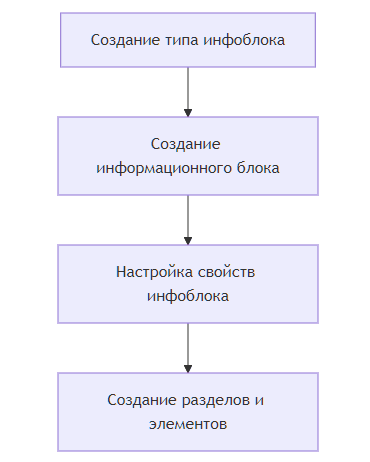
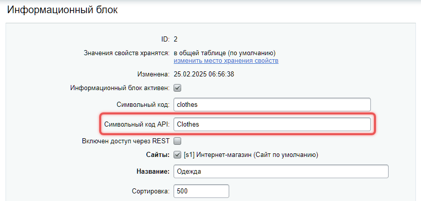
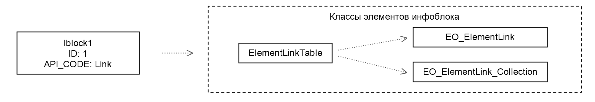
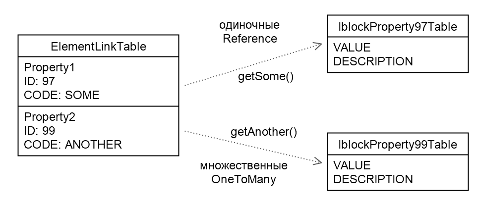
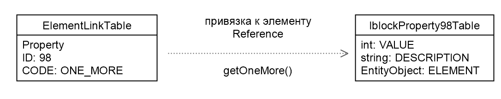

В Bitrix Framework есть два типа контента.

-  Статический — данные, которые редко меняются: текст страниц, контакты.

-  Динамический — данные, которые обновляются регулярно: каталог товаров, новости.

Модуль Информационные блоки предназначен для работы с динамическим контентом. Он задает структуру и позволяет управлять однотипными данными. Система использует объектную модель ORM и дает методы API для работы с данными без написания сложных SQL-запросов.

Применять модуль можно для создания каталогов товаров, новостных лент, справочников и любых других структурированных данных.

Ниже собраны термины модуля, настройка в административном разделе, символьные коды, представление инфоблоков в ORM и правило выбора API. Элементы и разделы читайте через ORM, а добавляйте, изменяйте и удаляйте методами `CIBlockElement` и `CIBlockSection`. Код для конкретных задач приведен в статьях цикла, список — в разделе [API модуля](#module-api).

## Основные термины

**Тип информационного блока** — группа для инфоблоков с похожей структурой. Тип определяет, можно ли создавать разделы. Примеры: каталог товаров или публикации.

**Информационный блок** — основной объект модуля для хранения однотипных элементов. Его можно представить как таблицу в базе данных. Система автоматически создает такую таблицу и управляет ею. Инфоблок содержит фиксированный набор полей и список свойств, которые создает пользователь. Создание типов, инфоблоков и свойств в коде описано в статье [Создание и настройка инфоблоков](./setup.md).

**Элемент** — запись в инфоблоке. Основная единица динамического контента — один товар, одна новость, одна статья. Работа с элементами в коде описана в статье [Работа с элементами инфоблока](./elements.md).

**Раздел** — группа для элементов. Разделы поддерживают иерархию. У раздела могут быть подразделы, например, у инфоблока *Каталог* может быть раздел *Электроника* и подраздел *Смартфоны*. Работа с разделами в коде описана в статье [Работа с разделами инфоблока](./sections.md).

**Свойство** — дополнительная характеристика элемента. Свойства настраиваются для каждого инфоблока отдельно. Они бывают разных типов: строка, число, список, привязка к другим элементам и так далее. Чтение и запись значений описаны в статье [Значения свойств элементов инфоблока](./property-values.md).

## Настройки в интерфейсе продукта

Работа с информационными блоками состоит из нескольких шагов. Сначала создают тип инфоблока, затем сам инфоблок. Для созданного инфоблока настраивают свойства, создают структуру разделов и добавляют элементы.

{width=370px height=462px}

Чтобы опубликовать данные из инфоблока, используйте компоненты. Компоненты извлекают информацию и выводят на сайте в заданном формате.



Подробнее в статье [Компоненты](./../../framework/components.md). Как дополнить данные стандартных компонентов новостей, описано в статье [Вывод данных инфоблока компонентами](./components.md).



### Настроить модуль

Модуль установлен в системе по умолчанию. Настроить модуль можно в разделе *Настройки > Настройки продукта > Настройки модулей > Информационные блоки*.

### Создать и редактировать тип инфоблока

Работайте с типами инфоблоков в разделе *Контент > Инфоблоки > Типы инфоблоков*. Здесь вы создаете новые типы и изменяете существующие.

### Создать и редактировать инфоблок

Информационными блоками можно управлять в разделе *Контент > Инфоблоки > Типы инфоблоков* > *\[нужный\_тип\]*. Можно создать новый инфоблок или изменить параметры существующего. В форме редактирования инфоблока свойства настраиваются в подразделе *Свойства*, права доступа на вкладке *Доступ*.

### Работать с инфоблоком

После создания инфоблока вы можете добавлять и редактировать разделы и элементы по пути *Контент > \[Название типа инфоблока\] > \[Название вашего инфоблока\]*.

## Связи между данными {#data-links}

Информационные блоки независимы друг от друга. Каждый блок можно использовать в разных разделах сайта. Связи между блоками устанавливают через специальные свойства.

**Привязка к элементам.** Свойство, которое связывает элемент с другим элементом любого инфоблока. Используют для связей товар-товар, статья-товар, похожие материалы и так далее.

**Привязка к разделам.** Свойство, которое связывает элемент с разделом любого инфоблока. Используют для дополнительной категоризации. Свойство не может быть привязано к разделу того же информационного блока.

Значение такого свойства — `ID` связанного элемента или раздела. Классический API возвращает значения множественного свойства массивом `ID`, ORM — коллекцией объектов значений.

## Символьные коды {#symbolic-codes}

**Символьный код** — символьный идентификатор объекта.

Символьный код используют для обращения к объектам в PHP-коде. Каждый объект, с которым нужно работать, должен иметь заполненный символьный код: инфоблок и его свойства, разделы, элементы.

Правила для символьного кода зависят от объекта.

-  **Элементы и разделы.** Система не ограничивает набор символов. Используйте латинские буквы, цифры и дефис — такой код подходит для адресов страниц.

   Код генерирует форма элемента или раздела, если генерация включена в настройках поля. При генерации пробелы и другие символы по умолчанию заменяются на дефис. Метод `CIBlockElement::Add()` код не генерирует, как сформировать символьный код программно, описано в разделе [Подготовить поля](./elements.md#prepare-fields).

   Уникальность кода в пределах инфоблока система проверяет, только если в настройках поля Символьный код включена опция *Если код задан, то проверять на уникальность*.

-  **Свойства.** Методы `CIBlockProperty::Add()` и `Update()` и форма свойства проверяют код при сохранении: можно использовать только латинские буквы, цифры и символ подчеркивания, код не может начинаться с цифры. Дефис в коде свойства недопустим. Подробнее в разделе [Ограничения при создании и обновлении свойства](./architecture.md#property-limits).

**Символьный код API** — символьный идентификатор инфоблока для использования в ORM и обращения к REST API. Это строка от 1 до 50 символов, должна начинаться с буквы и состоять из латинских букв и цифр.

Система автоматически генерирует классы ORM на основе `API_CODE` при первом обращении к ним. Имя класса формируется с учетом регистра. Рекомендуется использовать CamelCase для `API_CODE` — он обеспечит читаемые имена сгенерированных классов.

Чтобы создать аннотации к сгенерированным классам, перейдите в папку `/bitrix/` проекта и выполните команду `php bitrix.php orm:annotate -m iblock`. С ключом `-m iblock` команда компилирует ORM-классы всех инфоблоков с символьным кодом API и добавляет их в файл аннотаций.



Подробнее в статье [Аннотации классов](./../../orm/annotations.md)



Символьный код API указывают в поле Символьный код API на вкладке настроек инфоблока *Контент > Инфоблоки > \[нужный\_инфоблок\]* или в поле `API_CODE` при создании инфоблока методом `CIBlock::Add()`, способ описан в разделе [Создать инфоблок](./setup.md#create-iblock).

Метод `CIBlock::Add()` и форма настроек инфоблока проверяют, что код уникален среди всех инфоблоков. Без символьного кода API ORM-класса элементов у инфоблока нет.

{width=832px height=397px}

**Пример.** Класс для работы с элементами инфоблока формируется по шаблону `Element{ApiCode}Table`. Укажем для каталога Одежда символьный код API — `Clothes`. Тогда система создаст класс `ElementClothesTable` для работы с элементами этого инфоблока.

## Представление инфоблоков в ORM {#iblock-orm}

ORM (Object-Relational Mapping) позволяет работать с базой данных через объекты без прямых SQL-запросов.



Подробнее в разделе [ORM](./../../orm/orm-concepts.md)



Для каждого инфоблока с заданным символьным кодом API система создает свой ORM-класс элементов. Имя класса включает значение `API_CODE`, поэтому классы разных инфоблоков не совпадают. Например, для инфоблока с символьным кодом API `Link` система создает три класса:

-  `ElementLinkTable` — ORM-класс элементов, через него строят запросы,

-  `EO_ElementLink` — объект одного элемента,

-  `EO_ElementLink_Collection` — коллекция элементов.

Все классы находятся в пространстве имен `Bitrix\Iblock\Elements`.

{width=778px height=135px}

Каждое свойство инфоблока в ORM — отдельный связанный ORM-класс значений:

-  класс значений — `IblockProperty{ID}Table`, где `{ID}` — `ID` свойства,

-  поля значения — `VALUE`, а если у свойства включено описание `WITH_DESCRIPTION` — еще `DESCRIPTION`,

-  объект значения свойства с кодом `SOME` возвращает метод `get('SOME')` или `getSome()` объекта элемента, само значение — метод `getValue()`, например `$element->getSome()?->getValue()`.

Подробнее — в статье [Значения свойств элементов инфоблока](./property-values.md#read-values). Тип связи зависит от множественности свойства:

-  одиночное свойство связано с элементом отношением `Reference`, класс поля — `PropertyReference`. Метод `get()` с кодом свойства возвращает один объект значения,

-  множественное свойство связано с элементом отношением `OneToMany`, класс поля — `PropertyOneToMany`. Метод `get()` с кодом свойства возвращает коллекцию значений.

{width=481px height=210px}

У некоторых типов свойств есть дополнительные поля. Например, у значения свойства Привязка к элементу есть поле `ELEMENT` — объект связанного элемента. Поле появляется, если у инфоблока, к которому ведет привязка, задан символьный код API.

{width=543px height=108px}

Ориентироваться среди большого количества свойств помогают аннотации, способ создать их описан в разделе [Символьные коды](#symbolic-codes).

## API модуля {#module-api}

Модуль дает два слоя API — D7 с ORM-классами и классический API с классами `CIBlock`, `CIBlockElement`, `CIBlockSection`. Слои делят работу так:

-  элементы и разделы читайте через ORM,

-  элементы и разделы добавляйте, изменяйте и удаляйте методами классического API. ORM-методы записи выполняют только часть его работы, например не обновляют поиск и не вызывают события классического API,

-  значения свойств существующего элемента можно записывать через ORM, способ описан в статье [Значения свойств элементов инфоблока](./property-values.md).

Какой API выбрать для каждой задачи, описано в статье [Как выбрать API инфоблоков](./api.md#api-boundaries).

Перед работой подключите модуль методом `Loader::includeModule('iblock')`. Метод `IblockTable::compileEntity()` принимает символьный код API и возвращает описание ORM-класса. Метод `getDataClass()` этого описания возвращает имя ORM-класса элементов. Если инфоблока с таким кодом нет, метод `compileEntity()` возвращает `false`, поэтому пример проверяет результат до обращения к классу.

**Пример.** Добавьте элемент в каталог Одежда и прочитайте его через ORM-класс.

```php
use Bitrix\Iblock\IblockTable;
use Bitrix\Main\Loader;

if (!Loader::includeModule('iblock'))
{
    throw new \RuntimeException('Не удалось подключить модуль iblock');
}

// Clothes — символьный код API каталога Одежда
$iblock = IblockTable::getRow([
    'select' => ['ID'],
    'filter' => ['=API_CODE' => 'Clothes'],
]);
$elementEntity = IblockTable::compileEntity('Clothes');

if ($iblock === null || $elementEntity === false)
{
    throw new \RuntimeException('Инфоблок с символьным кодом API Clothes не найден');
}

$iblockId = (int)$iblock['ID'];

// Добавить элемент методом классического API
$elementApi = new \CIBlockElement();
$elementId = $elementApi->Add([
    'IBLOCK_ID' => $iblockId,
    'NAME' => 'Футболка',
    'PREVIEW_TEXT' => 'Описание товара',
]);

if (!$elementId)
{
    throw new \RuntimeException($elementApi->getLastError());
}

// Прочитать элемент через ORM-класс ElementClothesTable
$elementClass = $elementEntity->getDataClass();
$element = $elementClass::getByPrimary($elementId, [
    'select' => ['ID', 'NAME', 'PREVIEW_TEXT'],
])->fetchObject();
```

Переменная `$element` содержит объект элемента класса `EO_ElementClothes` с полями `ID`, `NAME` и `PREVIEW_TEXT` или `null`, если элемент не найден.

Работа с объектами модуля описана в статьях цикла:

-  [Создание и настройка инфоблоков](./setup.md) — типы, инфоблоки, свойства и права,

-  [Работа с разделами инфоблока](./sections.md) — дерево разделов и запись разделов,

-  [Работа с элементами инфоблока](./elements.md) и [Выборка элементов инфоблока](./element-queries.md) — запись, получение и выборка элементов,

-  [Значения свойств элементов инфоблока](./property-values.md) — запись и чтение свойств,

-  [SEO-шаблоны инфоблока](./seo.md) и [События инфоблоков](./events.md) — SEO-свойства и обработчики событий,

-  [Фасетный индекс и умный фильтр](./faceted-index.md) — индекс значений свойств для умного фильтра,

-  [Вывод данных инфоблока компонентами](./components.md) — дополнение данных стандартных компонентов,

-  [Схема работы инфоблоков и основные объекты](./architecture.md) — классы и поля таблиц,

-  [Производительность и частые ошибки](./performance.md) — ускорение выборок и разбор типовых ошибок.

## Версии хранения свойств инфоблоков {#property-storage-versions}

Bitrix Framework поддерживает две версии хранения свойств. Версию задают при создании инфоблока в поле `VERSION`, по умолчанию `1`. После создания метод `CIBlock::Update()` версию не меняет.

1. Версия `1` — каждое свойство хранится в отдельной строке общей таблицы `b_iblock_element_property`.

2. Версия `2` — значения свойств хранятся в выделенных таблицах инфоблока. Одиночные свойства и кешированные значения множественных свойств хранятся в таблице `b_iblock_element_prop_s{IBLOCK_ID}`, где `{IBLOCK_ID}` — идентификатор инфоблока. Значения множественных свойств хранятся в таблице `b_iblock_element_prop_m{IBLOCK_ID}`. Выборка элементов со всеми свойствами выполняется быстро. Версию `2` не рекомендуется использовать, если у инфоблока больше 50 свойств.

API чтения и записи элементов одинаковый для обеих версий хранения. Версия `2` ускоряет выборку элементов со всеми свойствами, но не рекомендуется, если у инфоблока больше 50 свойств. Выбирайте версию при создании инфоблока — метод `CIBlock::Update()` ее не меняет.



Для инфоблоков версии 2 методы `PropertyTable::add()`, `PropertyTable::update()` и `PropertyTable::delete()` выполняются без ошибки, но не меняют таблицы значений. Значения свойства, добавленного через `PropertyTable::add()`, не сохраняются, а после `PropertyTable::delete()` в таблице остается колонка. Управляйте свойствами таких инфоблоков методами классического API `CIBlockProperty` или в административном интерфейсе, способ описан в разделе [Выбрать API для настройки](./setup.md#choose-api).

