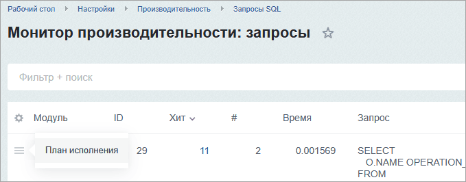

Проблемы при работе с API инфоблоков усиливаются по мере роста проекта: увеличиваются объем данных и число посещений. Сначала замедляется отдача страниц, затем растет нагрузка на базу данных. В итоге возникают сбои при сохранении данных и дубли в поисковой индексации.

Первая часть статьи — приемы оптимизации выборок и кеша, вторая — разбор частых ошибок по их признакам. Перед работой подключите модуль `iblock` методом `\Bitrix\Main\Loader::includeModule('iblock')`. В примерах переменная `$iblockId` содержит `ID` инфоблока.

## Оптимизировать производительность инфоблоков {#optimize}

При работе с инфоблоками большинство проблем с производительностью возникает из-за избыточных данных: лишние поля, повторяющиеся запросы, неоптимальные фильтры. Начните оптимизацию с контроля над тем, что и как запрашиваете.

### Ограничить выборку {#limit-select}

Избыточный объем данных увеличивает время выполнения и потребление памяти. Указывайте только те поля, которые действительно нужны.

#### В компонентах {#in-components}

В компонентах избыточная выборка замедляет отдачу страницы и увеличивает размер кеша.

В стандартных компонентах, например `bitrix:news.list`, код выборки не меняют — состав выборки задают параметры `FIELD_CODE` и `PROPERTY_CODE`, подробнее — в разделе [Настроить выборку списка](./components.md#list-params). Шаги ниже относятся к своему компоненту.

Например:

-  в `$arSelect` или `select` есть поля, которые не используются в шаблоне компонента,

-  выборка включает свойства `PROPERTY_*` или служебные поля, которые не нужны для отображения.

Выполните проверку полей и внесите исправления.

1. Откройте папку с шаблоном компонента.

2. Найдите все обращения к `$arResult`, особенно в циклах.

   ```php
   <?= $arResult['ITEMS'][0]['ID'] ?>
   <?= $arResult['ITEMS'][0]['NAME'] ?>
   ```

3. Укажите в `$arSelect` или `select` поля из `$arResult`.

   -  В классическом API:

   ```php
   // Получить ID и название без свойств и лишних полей
   CIBlockElement::GetList(
       [],
       ['IBLOCK_ID' => $iblockId],
       false,
       false,
       ['ID', 'NAME']
   );
   ```

   -  В ORM:

   ```php
   \Bitrix\Iblock\ElementTable::getList([
       'select' => ['ID', 'NAME'],
       'filter' => ['=IBLOCK_ID' => $iblockId],
       'limit' => 20,
       'cache' => [
           'ttl' => 3600,
           'cache_joins' => true,
       ]
   ]);
   ```

   Ключ `cache` включает кеш ORM-запроса — `ttl` задает время жизни в секундах, `cache_joins` со значением `true` кеширует и запросы с JOIN. Подробнее — в разделе [Кешировать запрос](./element-queries.md#query-cache). Такой кеш эффективен, если данные обновляются не чаще одного раза в час. При частом изменении элементов кеширование отключают.

### Кешировать результат вне компонентов {#cache-outside-components}

Код вне компонентов, например в агенте или своем контроллере, кешируйте сам классом `Bitrix\Main\Data\Cache` и привязывайте кеш к тегу инфоблока `iblock_id_<ID>`.

**Пример.** Функция кеширует на час количество активных элементов, опубликованных за последние сутки. Кеш привязан к тегу инфоблока и сбрасывается при изменении его элементов.

```php
use Bitrix\Iblock\ElementTable;
use Bitrix\Main\Application;
use Bitrix\Main\Data\Cache;
use Bitrix\Main\Type\DateTime;

function getRecentActiveElementsCount(int $iblockId): int
{
    $cache = Cache::createInstance();
    $cacheDir = '/stats/';

    if ($cache->initCache(3600, 'active_elements_count_' . $iblockId, $cacheDir))
    {
        return (int)$cache->getVars()['count'];
    }

    $count = 0;
    if ($cache->startDataCache())
    {
        // Регистрируем тег инфоблока для сброса кеша при изменении элементов
        $taggedCache = Application::getInstance()->getTaggedCache();
        $taggedCache->startTagCache($cacheDir);
        $taggedCache->registerTag('iblock_id_' . $iblockId);

        // COUNT(*) на стороне базы, без выборки строк
        $count = ElementTable::getCount([
            '=IBLOCK_ID' => $iblockId,
            '=ACTIVE' => 'Y',
            '>=ACTIVE_FROM' => (new DateTime())->add('-1 day'),
        ]);

        $taggedCache->endTagCache();
        $cache->endDataCache(['count' => $count]);
    }

    return $count;
}
```

Метод `CIBlock::clearIblockTagCache()` сбрасывает тег `iblock_id_<ID>`. Его вызывают методы классического API `CIBlockElement::Add()`, `Update()`, `Delete()` и ORM-классы `Element{ApiCode}Table` при изменении полей элемента. Метод сбрасывает тег, только если определена константа `BX_COMP_MANAGED_CACHE`.

Если данные меняются в обход этих методов, например через ORM-запись только свойств или прямым SQL-запросом, сбросьте тег инфоблока вручную.

```php
\Bitrix\Main\Application::getInstance()->getTaggedCache()->clearByTag('iblock_id_' . $iblockId);
```

Кеш самого ORM-запроса, заданный ключом `cache` в `getList()` или методом `setCacheTtl()`, работает отдельно от тегированного кеша. Когда он сбрасывается, описано в разделе [Кешировать запрос](./element-queries.md#query-cache).

Если значение нужно пересчитывать по расписанию, вызывайте функцию из агента. Пока кеш не истек, функция возвращает сохраненное значение, поэтому агент сначала очищает кеш методом `clean()` с тем же ключом и каталогом. Функция агента должна вернуть строку своего вызова. Иначе система удалит агента или заменит его имя на возвращенное значение, и функция больше не выполнится. Агенты описаны в статье [Агенты и фоновые задачи](./../../framework/background-jobs.md).

**Пример.** Агент пересчитывает количество для инфоблока с `ID` `5`.

```php
function updateRecentActiveElementsCountAgent(): string
{
    $iblockId = 5;

    if (\Bitrix\Main\Loader::includeModule('iblock'))
    {
        \Bitrix\Main\Data\Cache::createInstance()->clean('active_elements_count_' . $iblockId, '/stats/');
        getRecentActiveElementsCount($iblockId);
    }

    return 'updateRecentActiveElementsCountAgent();';
}
```

### Выбрать подходящий метод получения данных {#fetch-vs-getnext}

Метод `GetNext()` приводит данные к безопасному виду и обрабатывает шаблоны ссылок на элемент, раздел, инфоблок.

Метод `Fetch()` работает быстрее, чем `GetNext()`, но данные нужно обработать вручную.

**Пример.** Экранируйте название после `Fetch()`. Переменная `$result` содержит результат `CIBlockElement::GetList()`.

```php
$row = $result->Fetch();
if ($row)
{
    $row['NAME'] = \Bitrix\Main\Text\HtmlFilter::encode($row['NAME']);
}
```

ORM-методы `fetch()`, `fetchObject()` и `fetchCollection()` тоже возвращают значения без HTML-экранирования. Экранируйте их тем же методом `\Bitrix\Main\Text\HtmlFilter::encode()`.

### Контролировать состав результата кеширования {#component-cache-size}

Если компонент не вызывает `SetResultCacheKeys()`, он кеширует весь массив `$arResult`. Если `$arResult` содержит много полей или вложенных данных, размер кеш-файла растет, а скорость чтения падает.

Проверьте размер кеша.

1. В папке `/bitrix/cache/` найдите папку кеша для компонента, например, `news.list`.

2. Откройте самый свежий файл.

3. Посмотрите его размер. Если файл больше 1 МБ — кеш избыточен.

Сократите размер кеша своего компонента за три шага. Код стандартного компонента не меняйте — способ для него приведен ниже.

1. В файле `component.php` объявите только нужные поля:

   ```php
   $this->SetResultCacheKeys(['ID', 'NAME', 'DATE_ACTIVE_FROM']);
   ```

2. Убедитесь, что в `$arResult` нет лишних полей.

3. Обновите страницу и проверьте размер нового файла кеша.

Если в файле `result_modifier.php` формируют данные для `component_epilog.php`, их можно включить в кеш:

-  поместите данные в `$arResult`, например `$arResult['IDS'] = [...]`,

-  добавьте ключ в набор ключей кеша. В своем компоненте вызовите `SetResultCacheKeys(['IDS'])` в `component.php`. В стандартном компоненте вызовите метод в `result_modifier.php` через объект компонента:

   ```php
   $this->getComponent()->setResultCacheKeys(['IDS']);
   ```

   Подробнее — в разделе [Файл component_epilog.php](./../../framework/components.md#component-epilog-file).

### Использовать nTopCount вместо nPageSize {#ntopcount}

В методе `CIBlockElement::GetList()` четвертый параметр — это настройки навигации. Они позволяют ограничить выборку двумя способами:

-  `nPageSize` — задает количество элементов на странице при постраничной навигации,

   ```php
   // Выполняет два запроса: COUNT (сколько всего) + SELECT (данные)
   CIBlockElement::GetList([], ['IBLOCK_ID' => $iblockId], false, ['nPageSize' => 10], ['ID', 'NAME']);
   ```

-  `nTopCount` — ограничивает общее число записей в результате запроса.

   ```php
   // Выполняет один запрос: SELECT … LIMIT 10
   CIBlockElement::GetList([], ['IBLOCK_ID' => $iblockId], false, ['nTopCount' => 10], ['ID', 'NAME']);
   ```

   `nTopCount` ограничивает число строк SQL-запроса, а не число элементов. Если инфоблок хранит свойства в общей таблице и в `$arSelect` указано множественное свойство, каждое его значение дает отдельную строку. Например, чтобы получить два элемента, у которых множественное свойство содержит два и три значения, установите `nTopCount = 5`.

Используйте `nTopCount` в следующих ситуациях:

-  на странице нет постраничной навигации,

-  не нужно знать общее количество элементов,

-  на странице выводят фиксированное число элементов.

Разница в скорости заметна при большом количестве элементов в инфоблоке. В ORM-запросе тому же служит `setLimit()`, особенности ограничения выборки с множественными свойствами описаны в разделе [Ограничить выборку](./element-queries.md#limit).

### Избегать LIKE в фильтрах {#avoid-like}

Фильтр-массив без оператора, например `'CODE' => 'news'`, для строковых полей превращается в `LIKE`. Так работают и классический `CIBlockElement::GetList()`, и ORM-метод `getList()` с ключом `filter`. Значение при этом считается шаблоном: символы `%` и `_` в нем работают как подстановочные. Это замедляет запрос.

Чтобы отфильтровать записи по точному значению, укажите оператор `=`. Метод `where()` в `query()` без оператора сравнивает значения через `=`.

```php
// Классический API
CIBlockElement::GetList([], [
    '=CODE' => 'news'
]);

// ORM
\Bitrix\Iblock\ElementTable::getList([
    'filter' => ['=CODE' => 'news']
]);

// where() без оператора сравнивает через =
\Bitrix\Iblock\ElementTable::query()
    ->where('CODE', 'news')
    ->exec()
;
```

Соответствие ключей классического фильтра и условий ORM-запроса приведено в разделе [Заменить фильтр](./element-queries.md#classic-filter-replacements).

### Проанализировать SQL-запросы {#analyze-sql}

1. Откройте страницу *Настройки > Производительность > SQL-запросы*.

2. Найдите запросы внутри циклов. Это видно по повторяющемуся SQL-коду и большому количеству записей с одинаковым значением в столбце Компонент.

   Чтобы исправить, соберите все идентификаторы в массив и сделайте один запрос: в ORM — условие `whereIn('ID', $ids)`, в классическом API — фильтр `['ID' => $ids]`.

3. Проверьте использование индексов.

   -  Выберите подозрительный запрос и откройте План исполнения.

      {width=679px height=266px}

   -  Если в строке `key` указано `<null>`, а в столбце `Extra` указано `Using filesort` или `Using temporary`, запрос не использует индекс.

   -  Добавьте составной индекс по полям, которые часто фильтруют вместе: `IBLOCK_ID`, `ACTIVE`, `SORT` или `IBLOCK_ID`, `CODE`.

4. Найдите лишние подсчеты.

   -  Ищите запросы вида `SELECT COUNT(*) FROM b_iblock_element`. Если на странице нет постраничной навигации, такой запрос избыточен.

   -  Замените `nPageSize` на `nTopCount` в параметрах навигации.

### Вынести настройки выборки в параметры компонента {#select-params}

Когда один и тот же компонент используют на разных страницах, объем данных часто различается. Например:

-  на главной — только `ID` и `NAME` для слайдера,

-  в каталоге — `NAME`, `PREVIEW_TEXT`, `DETAIL_PAGE_URL`.

Если указать список полей напрямую в коде, нужно создать копии компонента или внести правки в код под каждую задачу.

Чтобы избежать этого, вынесите список запрашиваемых полей в параметры компонента `.parameters.php`. Тогда состав выборки можно настроить в визуальном редакторе без изменения кода.

**Пример.** Добавьте в `.parameters.php` своего компонента параметр со списком полей.

```php
$arComponentParameters = [
    'PARAMETERS' => [
        'SELECT_FIELDS' => [
            'PARENT' => 'DATA_SOURCE',
            'NAME' => 'Выбираемые поля',
            'TYPE' => 'LIST',
            'MULTIPLE' => 'Y',
            'VALUES' => [
                'ID' => 'ID',
                'NAME' => 'Название',
                'CODE' => 'Символьный код',
                'ACTIVE_FROM' => 'Дата начала активности',
            ],
            'DEFAULT' => ['ID', 'NAME'],
        ],
    ],
];
```

**Пример.** Выберите в `component.php` только поля из параметра `SELECT_FIELDS`. Если параметр не заполнен, код выбирает `ID` и `NAME`.

```php
$select = !empty($arParams['SELECT_FIELDS']) ? $arParams['SELECT_FIELDS'] : ['ID', 'NAME'];

$elements = \Bitrix\Iblock\ElementTable::getList([
    'select' => $select,
    'filter' => $filter,
])->fetchAll();
```

Переменная `$filter` содержит фильтр выборки компонента в формате ORM, например `['=IBLOCK_ID' => $iblockId, '=ACTIVE' => 'Y']`.

Выполните настройку параметров компонента. Компонент будет запрашивать только те поля, которые действительно используются. Это сокращает объем передаваемых данных и ускоряет отдачу.

## Частые ошибки при работе с инфоблоками {#common-errors}

Ошибки при работе с инфоблоками имеют четкие признаки и стандартные решения. Таблица помогает найти раздел по признаку ошибки.

| Признак | Причина | Раздел |
|---|---|---|
| `Class "CIBlockElement" not found` или `Class "Bitrix\Iblock\ElementTable" not found` | Модуль `iblock` не подключен | [Не подключен модуль](#module-not-included) |
| `Class "Bitrix\Iblock\Elements\Element...Table" not found` | У инфоблока нет символьного кода API `API_CODE`, модуль `iblock` не подключен или имя класса не совпадает с кодом API по регистру | [Не найден ORM-класс](#orm-class-not-found) |
| Умный фильтр долго строится | Фасетный индекс не построен или требует пересчета | [Умный фильтр работает медленно](#slow-smart-filter) |
| Не сохраняется значение свойства Список или Привязка к элементу | Передан текст, внешний код или символьный код вместо `ID` | [Не сохраняются значения свойств](#property-not-saved) |
| `Call to a member function GetNextElement() on ...`, например `on bool` | Неверный порядок или тип параметров `CIBlockElement::GetList()` | [Переменная не является объектом](#not-an-object) |
| Несуществующая страница элемента отдает `200 OK` | Не включены параметры `SET_STATUS_404` и `SHOW_404` | [Страница возвращает неверный код](#wrong-status-code) |

### Не подключен модуль {#module-not-included}

Если возникает ошибка `Class "Bitrix\Iblock\ElementTable" not found` или `Class "CIBlockElement" not found`, модуль `iblock` не подключен. В PHP 7 те же сообщения выводятся с одинарными кавычками.

Добавьте в начало скрипта:

```php
\Bitrix\Main\Loader::includeModule('iblock');
```

Подключайте модуль, когда читаете или записываете элементы и разделы, работаете со свойствами, правами доступа, SEO-полями или связями между инфоблоками.

### Не найден ORM-класс {#orm-class-not-found}

Если возникает ошибка вида `Class "Bitrix\Iblock\Elements\ElementNewsTable" not found`, проверьте три причины:

-  у инфоблока не указан символьный код API,

-  модуль `iblock` не подключен — класс создается при первом обращении, только если модуль подключен,

-  имя класса не совпадает с кодом API по регистру, например `ElementclothesTable` при коде `Clothes`.

Укажите символьный код API `API_CODE` в настройках инфоблока и скомпилируйте класс методом `IblockTable::compileEntity()`, способ описан в разделе [Получить ORM-класс элементов](./property-values.md#get-orm-class).

### Умный фильтр работает медленно {#slow-smart-filter}

Если компонент `bitrix:catalog.smart.filter` долго строит фильтр, проверьте фасетный индекс инфоблока. Без индекса или когда индекс требует пересчета, компонент работает через обычные запросы к элементам. Как проверить состояние индекса и построить его, описано в статье [Фасетный индекс и умный фильтр](./faceted-index.md#troubleshooting).

### Не сохраняются значения свойств {#property-not-saved}

Если свойства типа `Список` или `Привязка к элементу` не сохраняются, проверьте формат передаваемых значений и настройки инфоблока. Примеры ниже меняют свойства существующего элемента через ORM — объект `$element` получен способом из раздела [Получить ORM-класс элементов](./property-values.md#get-orm-class). Новый элемент создавайте методом `CIBlockElement::Add()` и передавайте значения в `PROPERTY_VALUES` в том же формате.

#### Свойство типа Список {#enum-property}

Передайте `ID` варианта списка, а не его текст или внешний код. Числовой `ID` варианта на разных сайтах разный, поэтому находите его по внешнему коду `XML_ID`.

**Пример.** Задайте новости источник с внешним кодом `press`.

```php
use Bitrix\Iblock\PropertyEnumerationTable;

$sourceEnum = PropertyEnumerationTable::getRow([
    'select' => ['ID'],
    'filter' => [
        '=PROPERTY.IBLOCK_ID' => $iblockId,
        '=PROPERTY.CODE' => 'SOURCE',
        '=XML_ID' => 'press',
    ],
]);

if ($sourceEnum === null)
{
    throw new \RuntimeException('Вариант списка с внешним кодом press не найден');
}

$element->set('SOURCE', (int)$sourceEnum['ID']);
$result = $element->save();

if (!$result->isSuccess())
{
    throw new \RuntimeException(implode('; ', $result->getErrorMessages()));
}
```

Переменная `$iblockId` содержит `ID` инфоблока новостей.

Поиск варианта подробно описан в разделе [Найти вариант списка](./property-values.md#find-enum-by-xml-id).

#### Свойство типа Привязка к элементу {#element-link-property}

Передайте `ID` целевого элемента. ORM хранит значение такого свойства как целое число, поэтому `XML_ID` или символьный код передать нельзя: строка превратится в `0`, и элемент ни к чему не будет привязан.

**Пример.** Привяжите новость к товару, если известен только внешний код товара.

```php
use Bitrix\Iblock\ElementTable;

$product = ElementTable::getRow([
    'select' => ['ID'],
    'filter' => [
        '=IBLOCK_ID' => $productsIblockId,
        '=XML_ID' => 'product-2026',
    ],
]);

if ($product !== null)
{
    // RELATED_ITEM — код свойства типа Привязка к элементу
    $element->set('RELATED_ITEM', (int)$product['ID']);
    $result = $element->save();

    if (!$result->isSuccess())
    {
        throw new \RuntimeException(implode('; ', $result->getErrorMessages()));
    }
}
```

Переменная `$productsIblockId` содержит `ID` инфоблока товаров.

Если у целевого инфоблока задан `API_CODE`, у значения свойства появляется связь `ELEMENT`. Через `RELATED_ITEM.ELEMENT` можно прочитать поля связанного элемента. На запись это не влияет.

Проверьте:

-  у свойства типа `Привязка к элементу` указан инфоблок привязки `LINK_IBLOCK_ID`,

-  целевой элемент существует и активен,

-  для множественных свойств используйте `addTo()` вместо `set()`, например `$element->addTo('RELATED_ITEMS', (int)$product['ID'])`, подробнее — в разделе [Записать значения](./property-values.md#write-values).

### Переменная не является объектом {#not-an-object}

Если возникает ошибка `Call to a member function GetNextElement() on a non-object` — в PHP 8 вместо `a non-object` указан тип значения, например `bool`, — нарушен порядок или тип параметров в вызове `CIBlockElement::GetList()`.

Используйте правильную сигнатуру:

```php
CIBlockElement::GetList(
    [],           // сортировка
    $arFilter,    // фильтр
    false,        // группировка: только true/false
    false,        // параметры навигации: массив или false
    $arSelect     // выборка полей
);
```

### Страница возвращает неверный код {#wrong-status-code}

Если несуществующая страница элемента возвращает код состояния `200 OK`, поисковые системы ее индексируют.

Не проверяйте это в шаблоне компонента. Шаблон выполняется только при построении кеша: при попадании в кеш компонент выводит сохраненный HTML, и проверка не сработает.

Для `bitrix:news.detail` включите параметры компонента:

-  `SET_STATUS_404 = Y` — установить код ответа 404,

-  `SHOW_404 = Y` — показать страницу 404, файл задают в параметре `FILE_404`.

Если элемент не найден, компонент не сохраняет результат в кеш и выполняет обработку 404 при каждом запросе. В комплексном компоненте `bitrix:news` те же параметры отдают код 404 для неизвестных адресов внутри раздела, пример приведен в разделе [Вывести новости с ЧПУ](./components.md#news-sef).

Если нужна собственная проверка, выполните ее в `component_epilog.php` шаблона. Этот файл выполняется при каждом вызове компонента, в том числе при попадании в кеш. В нем доступны только ключи `$arResult`, перечисленные в `SetResultCacheKeys()`.

```php
// component_epilog.php
if (empty($arResult['ID']))
{
    \Bitrix\Iblock\Component\Tools::process404('Элемент не найден', true, true, true);
}
```

Метод `process404()` принимает текст сообщения и три флага — определить константу `ERROR_404`, установить статус ответа 404 и показать страницу `/404.php`. Пятым аргументом можно передать другой файл страницы ошибки.
