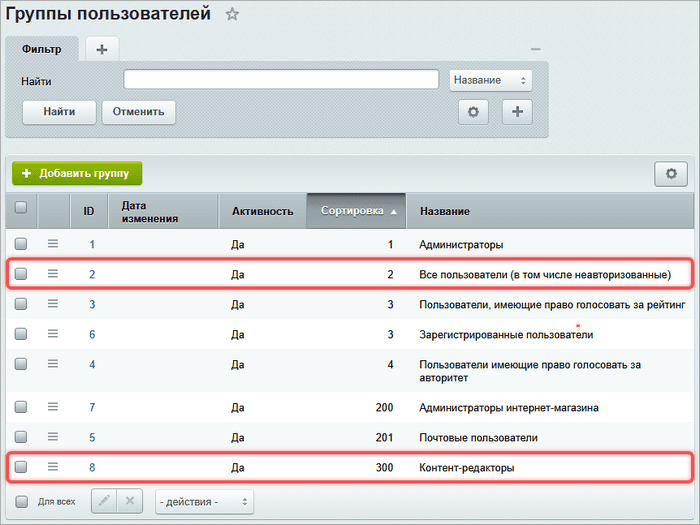

Структуру инфоблоков обычно настраивают в административном разделе, а из кода создают при установке модуля, в миграциях и при развертывании проекта на новом сайте. Структура состоит из нескольких объектов:

-  тип инфоблоков — группа инфоблоков с общими названиями разделов и элементов,

-  инфоблок — хранилище однотипных элементов с настройками полей, привязкой к сайтам и правами,

-  свойства инфоблока — дополнительные характеристики элементов,

-  варианты списка — значения свойства типа Список.

Для типа инфоблоков и вариантов списка есть методы D7 — объектного API ядра Bitrix Framework. Инфоблок, свойства и права создавайте классическим API, потому что D7-методы для них выполняют только часть работы. Различия собраны в разделе [Выбрать API для настройки](#choose-api). Читать структуру можно через ORM-классы `IblockTable`, `PropertyTable` и `PropertyEnumerationTable`.

Перед работой подключите модуль `iblock`. Примеры создают структуру инфоблока новостей, которая используется в статьях цикла. Переменная `$iblockId` содержит идентификатор инфоблока. Термины и устройство таблиц описаны в статье [Схема работы инфоблоков и основные объекты](./architecture.md).

Примеры разделов показывают отдельные вызовы. Код, который можно запускать повторно, например в установщике модуля, собран в разделе [Подготовить повторяемую миграцию](#idempotent-setup). Установщик модуля описан в статье [Создание модуля](./../../get-started/create-module.md).

Классы `CIBlockType`, `CIBlock` и `CIBlockProperty` вызывают методы `Add()` и `Update()` у объекта, потому что объект хранит текст ошибки для `getLastError()`. Методы `Delete()`, `SetPermission()` и `GetFields()` вызывают статически.

## Выбрать API для настройки {#choose-api}

Таблица показывает, какой API выполняет операцию полностью, сводная таблица для всего модуля приведена в статье [Как выбрать API инфоблоков](./api.md). События, которые вызывают методы `CIBlock` и `CIBlockProperty`, перечислены в разделе [События разделов, свойств и инфоблоков](./events.md#other-events). Поведение проверено для обеих [версий хранения свойств](./overview.md#property-storage-versions).

| Операция | Используйте | Что не делает D7-метод |
|---|---|---|
| Создать тип инфоблоков | `TypeTable::add()` и `TypeLanguageTable::add()` | — |
| Удалить тип инфоблоков | `CIBlockType::Delete()` | Метод `TypeTable::delete()` удаляет инфоблоки типа методом `IblockTable::delete()`, который оставляет свойства инфоблока |
| Создать инфоблок | `CIBlock::Add()` | Метод `IblockTable::add()` не создает таблицы значений свойств для версии 2, не привязывает инфоблок к сайтам, не назначает права и не вызывает событие `OnAfterIBlockAdd` |
| Изменить инфоблок | `CIBlock::Update()` | Метод `IblockTable::update()` меняет только переданные поля. Права, привязку к сайтам и настройки полей он не обрабатывает |
| Удалить инфоблок | `CIBlock::Delete()` | Метод `IblockTable::delete()` оставляет свойства, элементы и разделы инфоблока |
| Добавить, изменить и удалить свойство | `CIBlockProperty::Add()`, `Update()`, `Delete()` | Методы `PropertyTable` не меняют таблицу значений инфоблока версии 2. Значения свойства, добавленного через `PropertyTable::add()`, не сохраняются, а после `PropertyTable::delete()` в таблице остается колонка |
| Добавить вариант списка | `PropertyEnumerationTable::add()` | Метод не создает внешний код `XML_ID`, если он не передан. Код должен быть уникальным среди вариантов всех свойств, ограничения описаны в разделе [Добавить варианты в существующий список](#add-enum-values) |
| Назначить права | `CIBlock::SetPermission()`, `CIBlockRights` | D7-методов для прав нет |

Для чтения структуры используйте D7-методы вместо классических:

-  `CIBlock::GetList()` — `IblockTable::getList()` или `IblockTable::resolveIdByCode()`, способ описан в разделе [Найти инфоблок по коду](#find-iblock),

-  `CIBlockProperty::GetList()` — `PropertyTable::getList()`, способ описан в разделе [Получить свойства инфоблока](#get-properties),

-  `CIBlockPropertyEnum::GetList()` — `PropertyEnumerationTable::getList()`, способ описан в разделе [Найти вариант списка](./property-values.md#find-enum-by-xml-id).

## Создать тип инфоблоков {#create-type}

Тип инфоблоков создают двумя D7-вызовами. Метод `Bitrix\Iblock\TypeTable::add()` добавляет тип, метод `Bitrix\Iblock\TypeLanguageTable::add()` — названия типа, его разделов и элементов на одном языке. Названия задают для каждого языка, на котором работает административный раздел.

Метод `TypeTable::add()` принимает `ID` типа, признак разделов `SECTIONS` и сортировку `SORT`. Метод `TypeLanguageTable::add()` принимает `IBLOCK_TYPE_ID` — `ID` типа, `LANGUAGE_ID` — код языка, например `ru`, и названия — `NAME` для типа, `SECTIONS_NAME` для разделов и `ELEMENTS_NAME` для элементов.

Идентификатор типа `ID` — строка из латинских букв, цифр и подчеркивания длиной до 50 символов. Метод `TypeTable::add()` проверяет только длину, допустимые символы проверьте в коде сами. Если тип с таким `ID` уже есть, метод `TypeTable::add()` выбрасывает исключение `Bitrix\Main\DB\DuplicateEntryException`, поэтому проверьте существование типа до вызова.

**Пример.** Создайте тип `news` с названиями на русском и английском языках.

```php
use Bitrix\Iblock\TypeLanguageTable;
use Bitrix\Iblock\TypeTable;
use Bitrix\Main\Loader;

if (!Loader::includeModule('iblock'))
{
    throw new \RuntimeException('Не удалось подключить модуль iblock');
}

if (TypeTable::getByPrimary('news')->fetch() === false)
{
    $result = TypeTable::add([
        'ID' => 'news',
        'SECTIONS' => 'Y',
        'SORT' => 100,
    ]);

    if (!$result->isSuccess())
    {
        throw new \RuntimeException(implode('; ', $result->getErrorMessages()));
    }

    $names = [
        'ru' => ['Новости', 'Разделы', 'Новости'],
        'en' => ['News', 'Sections', 'News items'],
    ];

    foreach ($names as $languageId => [$name, $sectionsName, $elementsName])
    {
        $languageResult = TypeLanguageTable::add([
            'IBLOCK_TYPE_ID' => 'news',
            'LANGUAGE_ID' => $languageId,
            'NAME' => $name,
            'SECTIONS_NAME' => $sectionsName,
            'ELEMENTS_NAME' => $elementsName,
        ]);

        if (!$languageResult->isSuccess())
        {
            throw new \RuntimeException(implode('; ', $languageResult->getErrorMessages()));
        }
    }
}
```

Поле `SECTIONS` со значением `Y` разрешает инфоблокам типа иметь разделы. Тип и его названия видны в административном разделе и в классическом методе `CIBlockType::GetByIDLang()`.

## Создать инфоблок {#create-iblock}

Метод `CIBlock::Add()` создает инфоблок по массиву полей. Метод вызывают у объекта класса `CIBlock`. Метод возвращает `ID` нового инфоблока или `false`, текст ошибки возвращает метод `getLastError()`.

Таблица перечисляет поля, которые нужны для типового инфоблока. Полный список полей приведен в разделе «Информационный блок» статьи [Схема работы инфоблоков и основные объекты](./architecture.md).

*Обязательные поля обозначены \*.*

| Ключ | Описание |
|---|---|
| `IBLOCK_TYPE_ID`*<br>`string` | Идентификатор типа инфоблоков. Тип должен существовать |
| `NAME`*<br>`string` | Название инфоблока |
| `LID`*<br>`array` | Идентификаторы сайтов, к которым привязан инфоблок. Без привязки компоненты сайта не выводят инфоблок |
| `CODE`<br>`string` | Символьный код инфоблока. Метод не проверяет уникальность кода |
| `API_CODE`<br>`string` | Символьный код API. Без него у инфоблока нет ORM-класса элементов `Element{ApiCode}Table`. Строка от 1 до 50 символов из латинских букв и цифр, начинается с буквы. Код уникален среди всех инфоблоков установки, повторный код метод отклоняет |
| `VERSION`<br>`int` | Версия хранения свойств. Значение `1` — общая таблица, `2` — отдельные таблицы инфоблока. По умолчанию `1`. Версию задают только при создании, `CIBlock::Update()` ее не меняет. Выбор описан в разделе [Версии хранения свойств](./overview.md#property-storage-versions) |
| `WORKFLOW`<br>`string` | Участие в документообороте, `Y` или `N`. Если ключ не передан, метод записывает `Y`. Передайте `N`, если документооборот не нужен |
| `INDEX_ELEMENT`, `INDEX_SECTION`<br>`string` | Индексация элементов и разделов в поиске. По умолчанию `Y` для элементов и `N` для разделов |
| `LIST_PAGE_URL`, `SECTION_PAGE_URL`, `DETAIL_PAGE_URL`<br>`string` | Шаблоны адресов списка, раздела и элемента, например `#SITE_DIR#/news/#ELEMENT_CODE#/`. По ним компоненты и метод `GetNext()` формируют ссылки |
| `IPROPERTY_TEMPLATES`<br>`array` | SEO-шаблоны инфоблока, формат описан в статье [SEO-шаблоны инфоблока](./seo.md#set-templates) |
| `ACTIVE`<br>`string` | Активность, `Y` или `N`. По умолчанию `Y` |
| `GROUP_ID`<br>`array` | Простые права доступа — массив вида `ID группы => буква права`, подробнее — в разделе [Назначить простые права](#simple-rights) |
| `RIGHTS_MODE`<br>`string` | Режим прав, `S` — простые права, `E` — расширенные. По умолчанию `S`, а если передан ключ `RIGHTS` — `E` |
| `RIGHTS`<br>`array` | Расширенные права в формате метода `CIBlockRights::SetRights()`. Ключ работает с `RIGHTS_MODE` со значением `E`, подробнее — в разделе [Назначить расширенные права](#extended-rights) |
| `FIELDS`<br>`array` | Настройки полей элементов и разделов, например обязательность и проверка уникальности символьного кода. Формат совпадает с результатом `CIBlock::GetFields()`, пример — в разделе [Изменить настройки инфоблока](#update-iblock) |

**Пример.** Создайте инфоблок новостей версии 2 для сайта `s1` с доступом на чтение для всех пользователей.

```php
$iblockApi = new \CIBlock();

$iblockId = $iblockApi->Add([
    'IBLOCK_TYPE_ID' => 'news',
    'NAME' => 'Новости',
    'CODE' => 'news',
    'API_CODE' => 'News',
    'VERSION' => 2,
    'LID' => ['s1'],
    'ACTIVE' => 'Y',
    'WORKFLOW' => 'N',
    'GROUP_ID' => [
        2 => \CIBlockRights::PUBLIC_READ,
    ],
]);

if (!$iblockId)
{
    throw new \RuntimeException($iblockApi->getLastError());
}
```

Метод создает инфоблок, для версии 2 — таблицы значений свойств, привязывает инфоблок к сайтам, назначает права и вызывает событие `OnAfterIBlockAdd`. Группа с `ID` `2` — все пользователи, включая неавторизованных.

Ключ `WORKFLOW` со значением `N` отключает документооборот. Без него метод включает документооборот, и ORM-запросы к элементам такого инфоблока возвращают копии из истории, если не добавить условия из раздела [Учесть, что отбирает ORM-запрос](./elements.md#orm-query-scope).

Метод не проверяет, есть ли инфоблок с таким кодом `CODE`. Чтобы повторный запуск не создал второй инфоблок, используйте схему из раздела [Подготовить повторяемую миграцию](#idempotent-setup).

Инфоблок торгового каталога после создания нужно зарегистрировать в модуле `catalog`, порядок описан в статье [Работа с товарами и торговыми предложениями](./../catalog/products-and-offers.md).

### Найти инфоблок по коду {#find-iblock}

Числовой `ID` инфоблока на разных сайтах разный, поэтому в коде проекта находите инфоблок по символьному коду. Метод `IblockTable::resolveIdByCode()` возвращает `ID` инфоблока по коду `CODE` или `null`. Вторым аргументом можно передать сайт, тогда метод вернет `ID`, только если инфоблок привязан к этому сайту.

**Пример.** Получите `ID` инфоблока новостей для сайта `s1`.

```php
use Bitrix\Iblock\IblockTable;

$iblockId = IblockTable::resolveIdByCode('news', 's1');

if ($iblockId === null)
{
    throw new \RuntimeException('Инфоблок не найден');
}
```

ORM-класс элементов можно получить сразу по символьному коду API, способ описан в разделе [Получить элемент](./elements.md#get-element).

### Изменить настройки инфоблока {#update-iblock}

Метод `CIBlock::Update()` принимает `ID` инфоблока и массив изменяемых полей в формате метода `Add()`. Метод возвращает `true` или `false`, текст ошибки возвращает `getLastError()`.

**Пример.** Сделайте символьный код элементов обязательным и уникальным с созданием из названия.

```php
$iblockApi = new \CIBlock();

$fields = \CIBlock::GetFields($iblockId);
$fields['CODE']['IS_REQUIRED'] = 'Y';
$fields['CODE']['DEFAULT_VALUE']['UNIQUE'] = 'Y';
$fields['CODE']['DEFAULT_VALUE']['TRANSLITERATION'] = 'Y';

if (!$iblockApi->Update($iblockId, ['FIELDS' => $fields]))
{
    throw new \RuntimeException($iblockApi->getLastError());
}
```

Метод `CIBlock::GetFields()` возвращает текущие настройки полей, поэтому пример меняет только нужные ключи. Настройки полей применяют формы административного раздела и методы классического API, например `CIBlockElement::Add()` проверяет обязательность и уникальность кода. Создание кода из названия при записи через API описано в разделе [Подготовить поля](./elements.md#prepare-fields).

Ключ `GROUP_ID` в `Update()` заменяет весь набор простых прав. Группы, которых нет в массиве, теряют доступ.

После изменения `API_CODE` имя ORM-класса элементов меняется. Код, который получает класс по прежнему коду API, перестает работать, а `IblockTable::compileEntity()` с прежним кодом возвращает `false`. Меняйте код API вместе с кодом проекта, который к нему обращается.

## Добавить свойства {#iblock-properties}

Метод `CIBlockProperty::Add()` создает свойство инфоблока. Для инфоблока версии 2 метод добавляет колонку в таблицу значений, поэтому свойства создавайте только через него. Метод вызывают у объекта класса `CIBlockProperty`, он возвращает `ID` свойства или `false`, текст ошибки возвращает `getLastError()`.

Основные поля свойства:

-  `IBLOCK_ID` — идентификатор инфоблока, обязательное поле,

-  `NAME` — название свойства, обязательное поле,

-  `CODE` — символьный код свойства, по нему ORM-класс и примеры статей цикла обращаются к свойству,

-  `PROPERTY_TYPE` — базовый тип, `S` — строка, `N` — число, `L` — список, `F` — файл, `E` — привязка к элементам, `G` — привязка к разделам. По умолчанию `S`,

-  `MULTIPLE` — множественность, `Y` или `N`. По умолчанию `N`,

-  `IS_REQUIRED` — обязательность, `Y` или `N`. По умолчанию `N`,

-  `WITH_DESCRIPTION` — описание к каждому значению, `Y` или `N`. По умолчанию `N`,

-  `LINK_IBLOCK_ID` — инфоблок, элементы или разделы которого выбирают в свойстве типа `E` или `G`,

-  `SMART_FILTER` — показывать свойство в умном фильтре, `Y` или `N`. Ключ работает, если у инфоблока включена привязка свойств к разделам, подробнее — в разделе [Включить свойство в умный фильтр](./faceted-index.md#add-property-to-filter).

Остальные поля свойства, например `SORT` и `DEFAULT_VALUE`, приведены в разделе [Свойства инфоблока](./architecture.md#property-fields).

Код свойства может содержать только латинские буквы, цифры и подчеркивание и не может начинаться с цифры. Метод `Add()` не проверяет, что код свободен, и создаст второе свойство с тем же кодом. Перед созданием проверьте, что свойства с таким кодом нет, способом из раздела [Подготовить повторяемую миграцию](#idempotent-setup). Не используйте коды, совпадающие с полями элемента, например `TAGS`, `CODE` или `SORT`. ORM-класс не добавляет такие свойства, подробнее — в разделе [Получить ORM-класс элементов](./property-values.md#get-orm-class). Ограничения кода описаны в разделе [Ограничения при создании и обновлении свойства](./architecture.md#property-limits).

### Создать свойства базовых типов {#base-type-properties}

**Пример.** Создайте свойства Автор — строка, Ключевые слова — множественная строка и Фото — файл с описанием.

```php
$propertyApi = new \CIBlockProperty();

$properties = [
    ['NAME' => 'Автор', 'CODE' => 'AUTHOR', 'PROPERTY_TYPE' => 'S'],
    ['NAME' => 'Ключевые слова', 'CODE' => 'KEYWORDS', 'PROPERTY_TYPE' => 'S', 'MULTIPLE' => 'Y'],
    ['NAME' => 'Фото', 'CODE' => 'PHOTO', 'PROPERTY_TYPE' => 'F', 'WITH_DESCRIPTION' => 'Y'],
];

foreach ($properties as $fields)
{
    $fields['IBLOCK_ID'] = $iblockId;

    if (!$propertyApi->Add($fields))
    {
        throw new \RuntimeException($propertyApi->getLastError());
    }
}
```

### Создать свойство-привязку {#link-property}

Свойство типа `E` хранит `ID` элементов, свойство типа `G` — `ID` разделов. Поле `LINK_IBLOCK_ID` ограничивает выбор одним инфоблоком. Если у этого инфоблока задан символьный код API, ORM-класс элементов дает доступ к полям связанного элемента через связь `ELEMENT`, способ описан в разделе [Отфильтровать по свойству](./element-queries.md#filter-by-property).

**Пример.** Создайте множественное свойство Связанные новости, которое ссылается на элементы того же инфоблока.

```php
$propertyApi = new \CIBlockProperty();

$relatedPropertyId = $propertyApi->Add([
    'IBLOCK_ID' => $iblockId,
    'NAME' => 'Связанные новости',
    'CODE' => 'RELATED_NEWS',
    'PROPERTY_TYPE' => 'E',
    'MULTIPLE' => 'Y',
    'LINK_IBLOCK_ID' => $iblockId,
]);

if (!$relatedPropertyId)
{
    throw new \RuntimeException($propertyApi->getLastError());
}
```

### Создать свойство-список {#list-property}

Варианты списка передайте вместе со свойством в ключе `VALUES`. Каждый вариант — массив с ключами `VALUE` — текст, `XML_ID` — внешний код и `SORT` — сортировка. Каждому варианту задайте внешний код `XML_ID`. По нему код проекта находит вариант, не завися от `ID` и текста. Поиск варианта по коду описан в разделе [Найти вариант списка](./property-values.md#find-enum-by-xml-id).

**Пример.** Создайте список Источник с двумя вариантами.

```php
$propertyApi = new \CIBlockProperty();

$sourcePropertyId = $propertyApi->Add([
    'IBLOCK_ID' => $iblockId,
    'NAME' => 'Источник',
    'CODE' => 'SOURCE',
    'PROPERTY_TYPE' => 'L',
    'VALUES' => [
        ['VALUE' => 'Пресс-служба', 'XML_ID' => 'press', 'SORT' => 100],
        ['VALUE' => 'Партнер', 'XML_ID' => 'partner', 'SORT' => 200],
    ],
]);

if (!$sourcePropertyId)
{
    throw new \RuntimeException($propertyApi->getLastError());
}
```

### Добавить варианты в существующий список {#add-enum-values}

Метод `Bitrix\Iblock\PropertyEnumerationTable::add()` добавляет вариант к существующему свойству-списку. Метод возвращает объект результата, `ID` варианта возвращает `getId()`.

**Пример.** Добавьте вариант Редакция в список Источник. Переменная `$sourcePropertyId` содержит `ID` свойства Источник из предыдущего примера.

```php
use Bitrix\Iblock\PropertyEnumerationTable;

$result = PropertyEnumerationTable::add([
    'PROPERTY_ID' => $sourcePropertyId,
    'VALUE' => 'Редакция',
    'XML_ID' => 'editorial',
    'SORT' => 300,
]);

if (!$result->isSuccess())
{
    throw new \RuntimeException(implode('; ', $result->getErrorMessages()));
}
```

У D7-метода два отличия от классического `CIBlockPropertyEnum::Add()`:

-  внешний код `XML_ID` должен быть уникальным среди вариантов всех свойств-списков установки, а не только этого свойства — если такой код уже есть у другого списка, метод вернет ошибку,

-  если `XML_ID` не передан, вариант сохраняется без внешнего кода, а классический метод создает случайный код.

Если одинаковые коды вариантов нужны в разных свойствах, например `Y` и `N`, добавляйте варианты классическим методом `CIBlockPropertyEnum::Add()` или в ключе `VALUES` при создании свойства.

### Создать свойство пользовательского типа {#user-type-property}

Пользовательский тип расширяет базовый тип своей обработкой значения. Тип задает пара полей `PROPERTY_TYPE` и `USER_TYPE`, настройки типа — поле `USER_TYPE_SETTINGS`. Список типов приведен в разделе [Пользовательские типы свойств](./architecture.md#user-property-types).

Свойство типа Справочник работает с готовым Highload-блоком, у которого есть поле `UF_XML_ID`. Highload-блок задают ключом `TABLE_NAME` в `USER_TYPE_SETTINGS` — имя таблицы блока. Подготовка такого блока описана в статье [Связи и справочники на Highload-блоках](./../highloadblocks/relations-and-directories.md).

**Пример.** Создайте свойство Итог для HTML-текста и свойство Рубрика со значениями из Highload-блока с таблицей `b_news_categories`.

```php
$propertyApi = new \CIBlockProperty();

$summaryPropertyId = $propertyApi->Add([
    'IBLOCK_ID' => $iblockId,
    'NAME' => 'Итог',
    'CODE' => 'SUMMARY',
    'PROPERTY_TYPE' => 'S',
    'USER_TYPE' => 'HTML',
]);

if (!$summaryPropertyId)
{
    throw new \RuntimeException($propertyApi->getLastError());
}

$categoryPropertyId = $propertyApi->Add([
    'IBLOCK_ID' => $iblockId,
    'NAME' => 'Рубрика',
    'CODE' => 'CATEGORY',
    'PROPERTY_TYPE' => 'S',
    'USER_TYPE' => 'directory',
    'USER_TYPE_SETTINGS' => [
        'TABLE_NAME' => 'b_news_categories',
    ],
]);

if (!$categoryPropertyId)
{
    throw new \RuntimeException($propertyApi->getLastError());
}
```

Формат значения HTML-свойства описан в разделе [Записать HTML-свойство](./property-values.md#write-html-property). Свойство типа Справочник хранит внешний код `UF_XML_ID` записи Highload-блока.

### Получить свойства инфоблока {#get-properties}

Метод `Bitrix\Iblock\PropertyTable::getList()` читает описание свойств. Чтение работает для обеих версий хранения.

**Пример.** Получите коды и типы активных свойств инфоблока и соответствие кода свойства и `ID`.

```php
use Bitrix\Iblock\PropertyTable;

$propertyRows = PropertyTable::getList([
    'select' => ['ID', 'CODE', 'NAME', 'PROPERTY_TYPE', 'USER_TYPE', 'MULTIPLE'],
    'filter' => ['=IBLOCK_ID' => $iblockId, '=ACTIVE' => 'Y'],
    'order' => ['SORT' => 'ASC', 'ID' => 'ASC'],
])
    ->fetchAll()
;

$propertyIdsByCode = array_column($propertyRows, 'ID', 'CODE');
$keywordsPropertyId = (int)($propertyIdsByCode['KEYWORDS'] ?? 0);
$photoPropertyId = (int)($propertyIdsByCode['PHOTO'] ?? 0);
```

Если свойства с кодом нет среди активных, переменная получит `0`. Проверьте значение перед изменением свойства.

### Изменить и удалить свойство {#update-delete-property}

Метод `CIBlockProperty::Update()` меняет поля свойства, метод `CIBlockProperty::Delete()` удаляет свойство вместе со значениями у всех элементов и возвращает `false`, если удаление не выполнено. Для инфоблока версии 2 оба метода меняют таблицу значений.

**Пример.** Сделайте свойство Ключевые слова обязательным, затем удалите свойство Фото. Переменные `$keywordsPropertyId` и `$photoPropertyId` содержат `ID` свойств, их получают по коду свойства способом из раздела [Получить свойства инфоблока](#get-properties).

```php
$propertyApi = new \CIBlockProperty();

if (!$propertyApi->Update($keywordsPropertyId, ['IS_REQUIRED' => 'Y']))
{
    throw new \RuntimeException($propertyApi->getLastError());
}

if (!\CIBlockProperty::Delete($photoPropertyId))
{
    throw new \RuntimeException('Свойство не удалено');
}
```

Если ORM-класс элементов уже скомпилирован в текущем запросе методом `IblockTable::compileEntity()`, он не увидит свойства, добавленные после компиляции. Компиляция класса описана в разделе [Получить ORM-класс элементов](./property-values.md#get-orm-class). Повторный вызов `IblockTable::compileEntity()` в том же запросе возвращает прежний класс, поэтому обновить уже скомпилированный класс нельзя. Вызывайте `compileEntity()` только после изменения свойств или обращайтесь к новой структуре в следующем запросе.

## Подготовить повторяемую миграцию {#idempotent-setup}

Код настройки запускают на каждом сайте и окружении, поэтому он должен находить уже созданные объекты, а не создавать их заново. Ищите объекты по стабильным кодам, а не по `ID`, который на разных сайтах разный:

-  тип — по `ID` типа методом `TypeTable::getByPrimary()`,

-  инфоблок — по символьному коду методом `IblockTable::resolveIdByCode()`,

-  свойство — по `IBLOCK_ID` и `CODE` через `PropertyTable::getList()`,

-  вариант списка — по `XML_ID` способом из раздела [Найти вариант списка](./property-values.md#find-enum-by-xml-id).

**Пример.** Создайте инфоблок и его свойства, только если их еще нет. Тип `news` создается раньше способом из раздела [Создать тип инфоблоков](#create-type). Переменная `$siteIds` — параметр миграции с идентификаторами сайтов окружения, например `['s1']`.

```php
use Bitrix\Iblock\IblockTable;
use Bitrix\Iblock\PropertyTable;
use Bitrix\Main\Loader;

if (!Loader::includeModule('iblock'))
{
    throw new \RuntimeException('Не удалось подключить модуль iblock');
}

$iblockId = IblockTable::resolveIdByCode('news');

if ($iblockId === null)
{
    $iblockApi = new \CIBlock();

    $iblockId = $iblockApi->Add([
        'IBLOCK_TYPE_ID' => 'news',
        'NAME' => 'Новости',
        'CODE' => 'news',
        'API_CODE' => 'News',
        'VERSION' => 2,
        'LID' => $siteIds,
        'WORKFLOW' => 'N',
        'GROUP_ID' => [2 => \CIBlockRights::PUBLIC_READ],
    ]);

    if (!$iblockId)
    {
        throw new \RuntimeException($iblockApi->getLastError());
    }
}

$existingCodes = array_column(
    PropertyTable::getList([
        'select' => ['CODE'],
        'filter' => ['=IBLOCK_ID' => $iblockId],
    ])
        ->fetchAll(),
    'CODE'
);

$propertyApi = new \CIBlockProperty();

$properties = [
    ['NAME' => 'Автор', 'CODE' => 'AUTHOR', 'PROPERTY_TYPE' => 'S'],
    ['NAME' => 'Ключевые слова', 'CODE' => 'KEYWORDS', 'PROPERTY_TYPE' => 'S', 'MULTIPLE' => 'Y'],
];

foreach ($properties as $fields)
{
    if (in_array($fields['CODE'], $existingCodes, true))
    {
        continue;
    }

    $fields['IBLOCK_ID'] = $iblockId;

    if (!$propertyApi->Add($fields))
    {
        throw new \RuntimeException($propertyApi->getLastError());
    }
}
```

Второй запуск примера находит инфоблок и свойства и ничего не создает. Тот же код переносит структуру на другой сайт или окружение, потому что идентификаторы сайтов приходят параметром `$siteIds`, а объекты ищутся по кодам. Если сразу после миграции код в том же запросе пишет элементы через ORM, компилируйте ORM-класс элементов после создания свойств, причина описана в разделе [Изменить и удалить свойство](#update-delete-property).

Пример только создает недостающие объекты. Если в новой версии миграции изменились настройки существующего свойства или инфоблока, примените их методами `CIBlockProperty::Update()` и `CIBlock::Update()`. Новые варианты списка добавляйте после поиска по `XML_ID`. Методы `SetPermission()` и `SetRights()` заменяют набор прав целиком, поэтому их можно вызывать при каждом запуске. Для разового переноса структуры вместе с данными в административном разделе модуля есть экспорт и импорт инфоблоков в формате XML.

## Настроить права доступа {#permissions}

Инфоблок работает в одном из двух режимов прав, режим хранит поле `RIGHTS_MODE`:

-  `S` — простые права, один уровень доступа для группы на весь инфоблок,

-  `E` — расширенные права, отдельные права для разделов и элементов.

Методы записи и ORM-классы права пользователя не проверяют. Проверка прав в коде описана в разделе [Проверить права пользователя](./elements.md#check-permissions).

### Назначить простые права {#simple-rights}

Уровень доступа обозначает буква:

-  `D` — нет доступа. Метод `SetPermission()` не сохраняет эту букву, поэтому, чтобы закрыть доступ, не включайте группу в набор,

-  `R` — чтение,

-  `S` — просмотр в административном разделе,

-  `T` — добавление в административном разделе,

-  `U` — работа с документооборотом или бизнес-процессами,

-  `W` — изменение,

-  `X` — полный доступ, включая изменение прав.

Константы `CIBlockRights::PUBLIC_READ`, `EDIT_ACCESS` и `FULL_ACCESS` содержат буквы `R`, `W` и `X`.

Метод `CIBlock::SetPermission()` заменяет права инфоблока набором `ID группы => буква`. Группы, которых нет в наборе, теряют доступ.

**Пример.** Дайте всем пользователям чтение, а группе с `ID` `8` — изменение. Группа `1` — администраторы, у них полный доступ независимо от прав инфоблока. Идентификаторы остальных групп на каждом сайте свои.

```php
\CIBlock::SetPermission($iblockId, [
    2 => \CIBlockRights::PUBLIC_READ,
    8 => \CIBlockRights::EDIT_ACCESS,
]);

$permissions = \CIBlock::GetGroupPermissions($iblockId);

if (($permissions[8] ?? null) !== \CIBlockRights::EDIT_ACCESS)
{
    throw new \RuntimeException('Права инфоблока не сохранены');
}
```

Метод `SetPermission()` ничего не возвращает, поэтому пример проверяет права методом `CIBlock::GetGroupPermissions()`. Метод возвращает набор в том же формате `ID группы => буква`.

Идентификаторы групп возвращает ORM-класс `Bitrix\Main\GroupTable`. В административном разделе они видны на странице *Настройки > Пользователи > Группы пользователей*. На скриншоте выделены группы из примеров — `2` Все пользователи и `8` Контент-редакторы.

{width=700px height=525px}

### Назначить расширенные права {#extended-rights}

В расширенном режиме права задают объекты `CIBlockRights` для инфоблока, `CIBlockSectionRights` для раздела и `CIBlockElementRights` для элемента. Право связывает код субъекта, например `G2` для группы с `ID` `2`, с задачей доступа — именованным набором операций, который соответствует букве уровня доступа. Каждое право — массив с ключами `GROUP_CODE` — код субъекта и `TASK_ID` — `ID` задачи. Метод `CIBlockRights::LetterToTask()` возвращает `ID` задачи по букве.

**Пример.** Переведите инфоблок в расширенный режим и дайте всем пользователям чтение, а группе с `ID` `8` — изменение. Идентификаторы групп, кроме `1` и `2`, на каждом сайте свои, их возвращает ORM-класс `Bitrix\Main\GroupTable`.

```php
$iblockApi = new \CIBlock();

if (!$iblockApi->Update($iblockId, ['RIGHTS_MODE' => 'E']))
{
    throw new \RuntimeException($iblockApi->getLastError());
}

$rights = new \CIBlockRights($iblockId);

$isSaved = $rights->SetRights([
    'n0' => ['GROUP_CODE' => 'G2', 'TASK_ID' => \CIBlockRights::LetterToTask('R')],
    'n1' => ['GROUP_CODE' => 'G8', 'TASK_ID' => \CIBlockRights::LetterToTask('W')],
]);

if (!$isSaved)
{
    throw new \RuntimeException('Права инфоблока не сохранены');
}
```

Ключи `n0`, `n1` обозначают новые права. Метод `SetRights()` заменяет весь набор прав инфоблока и возвращает `true` при успехе или `false` при ошибке, текущий набор возвращает `GetRights()`. Расширенные права можно задать и при создании инфоблока, передав в `CIBlock::Add()` ключи `RIGHTS_MODE` со значением `E` и `RIGHTS` с тем же массивом.



При переключении режима прав текущие права не переносятся. После перехода в расширенный режим задайте права методом `SetRights()`, после возврата в простой — методом `CIBlock::SetPermission()`. Иначе инфоблок останется без прав для групп, кроме администраторов.



## Удалить инфоблок и тип {#delete}

Метод `CIBlock::Delete()` удаляет инфоблок вместе с элементами, разделами, свойствами, таблицами значений и правами. Метод `CIBlockType::Delete()` удаляет тип и все его инфоблоки тем же способом. Оба метода возвращают `false`, если удаление не выполнено.

**Пример.** Удалите инфоблок, затем тип.

```php
if (!\CIBlock::Delete($iblockId))
{
    throw new \RuntimeException('Инфоблок не удален');
}

if (!\CIBlockType::Delete('news'))
{
    throw new \RuntimeException('Тип инфоблоков не удален');
}
```

Удаление необратимо. Не удаляйте инфоблоки и типы D7-методами `IblockTable::delete()` и `TypeTable::delete()`, потому что они оставляют свойства, элементы и разделы.

## Проверить результат {#check-result}

После выполнения кода настройки проверьте структуру:

1. Откройте тип и инфоблок в административном разделе и убедитесь, что названия на всех языках, привязка к сайтам и права заданы.

2. Получите ORM-класс элементов по символьному коду API и убедитесь, что метод `IblockTable::compileEntity()` не вернул `false`.

3. Добавьте тестовый элемент со значениями всех свойств и прочитайте их через ORM способами из статьи [Значения свойств элементов инфоблока](./property-values.md).

4. Запустите код настройки повторно и убедитесь, что он находит существующие тип, инфоблок и свойства и не создает дубли.

5. Проверьте доступ к инфоблоку под пользователем без прав администратора.

Дальнейшая работа со структурой описана в статьях [Работа с разделами инфоблока](./sections.md) и [Работа с элементами инфоблока](./elements.md).
