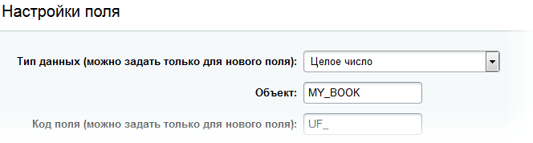

ORM (Object-Relational Mapping) — это технология, которая позволяет работать с базой данных через объекты в коде вместо написания SQL-запросов вручную. Это упрощает взаимодействие с данными и делает код более читаемым и поддерживаемым.

В Bitrix Framework ORM позволяет разработчикам оперировать сущностями. Например, вместо того чтобы вручную писать запрос для добавления записи в таблицу, вы можете создать объект сущности и сохранить его.

В разделе [Пример создания сущности](#book-model) описана модель каталога книг: на нее опираются примеры всех статей раздела ORM. Там же показано, как подключить модуль с сущностями и создать таблицы при установке.

## Концепция сущностей

Сущность — это таблица в базе данных. Каждая сущность состоит из полей, которые соответствуют колонкам таблицы. Например, сущность «Пользователь» может включать поля: ID, Имя, Фамилия, Пароль, Логин.

Вместо программирования каждой сущности их описывают в формате, который ядро системы воспринимает как конфигурацию.

Условная схема для каталога книг. Она описывает правила полей словами, а не кодом ORM. Как те же поля описывает класс `BookTable`, читайте в разделе [Пример создания сущности](#book-model).

```sql
Book
    ID int [autoincrement, primary]
    ISBN str [match: /[0-9X-]+/]
    TITLE str [max_length: 50]
    PUBLISH_DATE date
```

Здесь:

-  `ID` — уникальный идентификатор книги, который генерируется автоматически,

-  `ISBN` — строка, которая должна соответствовать определенному формату,

-  `TITLE` — название книги, ограниченное 50 символами,

-  `PUBLISH_DATE` — дата публикации.

Система автоматически проверяет корректность и целостность данных на основе описанных правил.

## Типизация полей

Для описания сущностей используется PHP. Это обеспечивает гибкость и позволяет использовать возможности языка для настройки сущностей.

Пример определения типов данных:

```php
namespace SomePartner\MyBooksCatalog;

use Bitrix\Main\ORM\Data\DataManager;
use Bitrix\Main\ORM\Fields\DateField;
use Bitrix\Main\ORM\Fields\IntegerField;
use Bitrix\Main\ORM\Fields\StringField;

class BookTable extends DataManager
{
    public static function getTableName(): string
    {
        return 'my_book';
    }

    public static function getMap(): array
    {
        return [
            new IntegerField('ID'),
            new StringField('ISBN'),
            new StringField('TITLE'),
            new DateField('PUBLISH_DATE'),
        ];
    }
}
```

Здесь:

-  Класс `BookTable` описывает сущность «Книга».

   Имя класса сущности должно заканчиваться на `Table`, например `BookTable`: ORM получает имя сущности, отрезая от имени класса последние пять символов. Имя без окончания, `Book`, занимает класс объекта записи — о нем читайте в статье [Объекты](./objects.md).

-  Имя таблицы можно задать в методе `getTableName`, например, `my_book`. Если метод не определен, имя таблицы формируется автоматически из неймспейса и названия класса, например, `b_somepartner_mybookscatalog_book`.

-  Скалярное поле — объект класса-наследника `Bitrix\Main\ORM\Fields\ScalarField`, оно соответствует колонке таблицы. Например, `IntegerField` — для целых чисел, `StringField` — для строк, `DateField` — для дат. Вычисляемые поля `ExpressionField` и поля связей наследуют другие классы.

-  Метод `getMap()` описывает структуру сущности и возвращает массив полей.



Классы ORM находятся в пространстве имен `Bitrix\Main\ORM`. В старом коде встречаются имена из `Bitrix\Main\Entity`: `Entity\DataManager`, `Entity\IntegerField`, `Entity\Validator\RegExp`. Это алиасы для совместимости, они продолжают работать. В новом коде используйте классы из `Bitrix\Main\ORM`.

Алиасы есть не у всех классов. Например, у `ArrayField`, `DecimalField` и `SecretField` их нет, эти поля доступны только из `Bitrix\Main\ORM\Fields`.



Настройки поля задавайте методами `configure*()`. Методы возвращают объект поля, поэтому вызовы можно объединять в цепочку. Исключение — `SecretField::configureSecretLength()`: метод ничего не возвращает, о нем читайте в описании `SecretField` ниже. Массив параметров во втором аргументе конструктора остался для совместимости.

**Пример.** Поле `ID` настроено цепочкой как первичный ключ с автоинкрементом.

```php
use Bitrix\Main\ORM\Fields\IntegerField;

(new IntegerField('ID'))
    ->configurePrimary()
    ->configureAutocomplete()
;
```

### Типы полей

Все классы полей из списка находятся в пространстве имен `Bitrix\Main\ORM\Fields`.

-  `IntegerField` — поле для хранения целых чисел.

   **Пример.** Код создает целочисленное поле размером восемь байт.

   ```php
   use Bitrix\Main\ORM\Fields\IntegerField;

   (new IntegerField('NAME'))
       ->configureSize(8) // Размер в байтах: 2, 4 или 8
   ;
   ```

   Методы настройки:

   `configureSize($size)` — задает размер поля в байтах. При создании таблицы в MySQL размер `2` дает колонку `smallint`, `4` — `int`, `8` — `bigint`. Для других значений и по умолчанию колонка получает тип `int`. В PostgreSQL те же размеры дают `smallint`, `integer` и `bigint`, по умолчанию — `integer`.

-  `FloatField` — поле для хранения чисел с плавающей точкой.

   **Пример.** Код создает поле с точностью десять знаков, из них два после запятой.

   ```php
   use Bitrix\Main\ORM\Fields\FloatField;

   (new FloatField('NAME'))
       ->configurePrecision(10) // Общая точность числа
       ->configureScale(2) // Количество знаков после запятой
   ;
   ```

   Методы настройки:

   `configurePrecision($precision)` — задает общую точность числа.

   `configureScale($scale)` — задает количество знаков после запятой.

-  `DecimalField` — поле для хранения чисел с фиксированной точностью.

   **Пример.** Код создает поле с фиксированной точностью: десять знаков, из них два после запятой.

   ```php
   use Bitrix\Main\ORM\Fields\DecimalField;

   (new DecimalField('NAME'))
       ->configurePrecision(10) // Общая точность числа
       ->configureScale(2) // Количество знаков после запятой
   ;
   ```

   Методы настройки:

   `configurePrecision($precision)` — задает общую точность числа.

   `configureScale($scale)` — задает количество знаков после запятой.

-  `StringField` — поле для коротких строк.

   Длину колонки и проверку длины задает валидатор `LengthValidator`. При создании таблицы колонка получает тип `varchar` с наименьшим значением `max` из валидаторов `LengthValidator` этого поля. Если таких валидаторов нет, колонка получает тип `varchar(255)`. При записи слишком длинного значения `LengthValidator` возвращает ошибку в объект результата.

   **Пример.** Поле принимает только латинские буквы, длина значения и колонки — до 100 символов.

   ```php
   use Bitrix\Main\ORM\Fields\StringField;
   use Bitrix\Main\ORM\Fields\Validators\LengthValidator;

   (new StringField('NAME'))
       ->configureFormat('/^[a-zA-Z]+$/') // Регулярное выражение для валидации
       ->addValidator(new LengthValidator(null, 100)) // Колонка varchar(100), проверка длины до 100 символов
   ;
   ```

   Методы настройки:

   `configureFormat($format)` — задает регулярное выражение для валидации.

   `configureSize($size)` — обрезает значение до `$size` символов, когда его задают через объект ORM: методом `set()` или сеттером вида `setTitle()`. Методы `add()` и `update()` с массивом данных значение не обрезают. На длину колонки метод не влияет.

   

   Метод `configureSize()` обрезает значение без ошибки и предупреждения: лишние символы теряются. Чтобы при слишком длинном значении операция завершилась ошибкой валидации, используйте `LengthValidator`.

   

-  `TextField` — поле для текста, который не нужно ограничивать размером `StringField`.

   Метод `configureLong()` определяет тип колонки в MySQL. По умолчанию колонка получает тип `text`, после вызова `configureLong()` — `longtext`. В PostgreSQL колонка всегда получает тип `text`.

   **Пример.** Код создает поле для длинного текста.

   ```php
   use Bitrix\Main\ORM\Fields\TextField;

   (new TextField('NAME'))
       ->configureLong() // Использовать longtext вместо text
   ;
   ```

   

   `text` хранит до 65 535 байт данных.

   `longtext` хранит до 4 294 967 295 байт данных.

   Это лимиты в байтах, а не гарантированное количество символов.

   Фактическое число символов зависит от кодировки: в многобайтовых кодировках один символ может занимать несколько байт.

   Например, если каждый символ занимает 2 байта, в `text` поместится примерно 32 000 символов. Если каждый символ занимает 4 байта, — примерно 16 000 символов.

   

   Методы настройки:

   `configureLong($long)` — переключает тип хранения:

   -  `configureLong(true)` использует `longtext`,

   -  `configureLong(false)` оставляет `text`.

-  `DateField` — поле для хранения даты.

   **Пример.** Поле разбирает дату из строки по формату `Y-m-d`.

   ```php
   use Bitrix\Main\ORM\Fields\DateField;

   (new DateField('NAME'))
       ->configureFormat('Y-m-d') // Формат для дат, переданных строкой
   ;
   ```

   Методы настройки:

   `configureFormat($format)` — задает формат, по которому поле разбирает дату-строку, если значение задают через объект ORM: методом `set()` или сеттером вида `setPublishDate()`. В `add()` и `update()` с массивом данных передавайте объект `Bitrix\Main\Type\Date`: строку валидатор поля отклонит.

-  `DatetimeField` — поле для хранения даты и времени.

   **Пример.** Поле без учета часовых поясов, по умолчанию — текущие дата и время.

   ```php
   use Bitrix\Main\ORM\Fields\DatetimeField;

   (new DatetimeField('NAME'))
       ->configureUseTimezone(false) // Не учитывать часовые пояса, по умолчанию учитываются
       ->configureDefaultValueNow() // По умолчанию — текущие дата и время
   ;
   ```

   Методы настройки:

   `configureUseTimezone($use)` — включает или отключает использование временных зон.

   `configureDefaultValueNow()` — устанавливает значение по умолчанию как текущую дату и время.

-  `BooleanField` — поле для хранения логических значений.

   **Пример.** Поле хранит `false` как `N`, а `true` как `Y`.

   ```php
   use Bitrix\Main\ORM\Fields\BooleanField;

   (new BooleanField('NAME'))
       ->configureValues('N', 'Y') // N — false, Y — true
   ;
   ```

   Методы настройки:

   `configureValues($falseValue, $trueValue)` — задает значения для хранения в БД: первым аргументом для `false`, вторым для `true`. Метод `configureStorageValues()` делает то же самое: `configureValues()` — его короткий алиас.

   `booleanizeValue($value)` — преобразует любое значение в строгое логическое.

-  `EnumField` — поле для хранения значения из предопределенного списка.

   **Пример.** Поле принимает одно из трех значений.

   ```php
   use Bitrix\Main\ORM\Fields\EnumField;

   (new EnumField('NAME'))
       ->configureValues(['VALUE1', 'VALUE2', 'VALUE3']) // Список допустимых значений
   ;
   ```

   Методы настройки:

   `configureValues($values)` — задает список допустимых значений.

-  `ArrayField` — поле для хранения массивов данных.

   **Пример.** Поле хранит массив в формате JSON.

   ```php
   use Bitrix\Main\ORM\Fields\ArrayField;

   (new ArrayField('NAME'))
       ->configureSerializationJson() // Хранить массив в JSON
   ;
   ```

   Методы настройки:

   `configureSerializationJson()` — использует JSON для сериализации.

   `configureSerializationPhp()` — использует PHP для сериализации.

   `configureSerializeCallback($callback)` — задает пользовательский метод сериализации.

   `configureUnserializeCallback($callback)` — задает пользовательский метод десериализации.

-  `CryptoField` — поле для хранения зашифрованных данных, которые нужно расшифровывать, например токенов.

   У поля нет методов `configure*()` для шифрования: конструктор сразу подключает шифрование по параметрам `crypto_enabled` и `crypto_key`. Поэтому настройки передавайте массивом в конструктор. Если ключ не передан, поле берет его из настроек системы.

   **Пример.** Поле шифрует значение ключом из параметра `crypto_key`.

   ```php
   use Bitrix\Main\ORM\Fields\CryptoField;

   new CryptoField('NAME', [
       'crypto_enabled' => true, // Включить шифрование (по умолчанию true)
       'crypto_key' => 'mysecretkey', // Ключ шифрования
   ]);
   ```

   Методы настройки:

   `encrypt($data)` — шифрует данные перед сохранением.

   `decrypt($data)` — расшифровывает данные при чтении.

   `getDefaultKey()` — получает ключ шифрования из настроек системы.

-  `SecretField` — поле для хранения зашифрованных данных, которые не должны быть доступны в открытом виде, например пароля.

   Метод `configureSecretLength()` не возвращает объект поля, поэтому в цепочке и в массиве `getMap()` его использовать нельзя: вместо поля в карту попадет `null`. Длину секрета в карте полей задавайте параметром `secret_length` конструктора.

   **Пример.** Код создает поле с секретом длиной 16 байт.

   ```php
   use Bitrix\Main\ORM\Fields\SecretField;

   new SecretField('NAME', [
       'secret_length' => 16, // Длина секрета в байтах
   ]);
   ```

   Методы настройки:

   `configureSecretLength($length)` — задает длину секрета у уже созданного объекта поля.

   `getRandomBytes()` — генерирует случайные байты для секрета.

Поля рекомендуется называть в верхнем регистре. Они должны быть уникальными в рамках сущности. Конструктор поля принимает имя поля первым параметром.

## Первичный ключ, обязательные поля и NULL значения

Первичный ключ (Primary Key) — это уникальный идентификатор записи в таблице. Обычно это поле с автоинкрементом, которое автоматически увеличивается при добавлении новой записи.

В большинстве случаев у сущности есть первичный ключ по одному полю. Указав поле как первичный ключ `primary`, сущность контролирует вставку данных, не позволяя добавить запись без значения ключа. При обновлении и удалении записи идентифицируются по первичному ключу.

Если значение поля не задается явно, а генерируется базой данных после добавления записи, вызовите метод `configureAutocomplete()`.

```php
use Bitrix\Main\ORM\Fields\IntegerField;

(new IntegerField('ID'))
    ->configurePrimary() // Первичный ключ
    ->configureAutocomplete() // Автоинкремент
;
```

Любое поле можно сделать обязательным. Например, чтобы нельзя было добавить книгу без указания ISBN, вызовите метод `configureRequired()`.

```php
use Bitrix\Main\ORM\Fields\StringField;

(new StringField('ISBN'))
    ->configureRequired()
;
```

Метод `configureRequired()` считает пустым значение, которое при приведении к строке дает пустую строку, например `null` и `''`. Значения `0` и `'0'` проходят проверку. При `update()` ORM проверяет обязательность только у полей, которые переданы в массиве данных: обновление без обязательного поля завершится успешно.

Если для поля `0` недопустим, добавьте валидатор `RangeValidator` с нижней границей.

**Пример.** Поле `PUBLISHER_ID` не принимает пустое значение и `0`.

```php
use Bitrix\Main\ORM\Fields\IntegerField;
use Bitrix\Main\ORM\Fields\Validators\RangeValidator;

(new IntegerField('PUBLISHER_ID'))
    ->configureRequired()
    ->addValidator(new RangeValidator(1)) // Значение не меньше 1
;
```

Метод `configureNullable()` разрешает полю значение `NULL`.

```php
use Bitrix\Main\ORM\Fields\StringField;

(new StringField('TITLE'))
    ->configureNullable()
;
```

## Значения по умолчанию

Для полей сущностей можно задать значения по умолчанию. Они применяются, если значение для этих полей не указано при добавлении новой записи.

Метод `configureDefaultValue()` задает значение по умолчанию. Метод принимает готовое значение или callable: массив с классом и методом либо анонимную функцию. Строку с именем функции ORM не вызывает и записывает в поле как обычное значение.

Callable получает объект записи `Bitrix\Main\ORM\Objectify\EntityObject`, а не массив данных. ORM вычисляет значения по умолчанию при создании объекта записи. При `add()` это происходит до того, как в объект попадут переданные поля. Поэтому в callable не опирайтесь на значения других полей из массива `add()`.

### Пример установки значения по умолчанию

**Пример.** Код задает текущую дату значением по умолчанию поля `PUBLISH_DATE`.

```php
use Bitrix\Main\ORM\Fields\DateField;
use Bitrix\Main\Type\Date;

(new DateField('PUBLISH_DATE'))
    ->configureDefaultValue(static function (): Date
    {
        return new Date();
    })
;
```

Теперь, если при добавлении записи не указать дату издания, она будет равна текущему дню.

```php
$result = BookTable::add([
    'ISBN' => '9780321127426', // Указываем ISBN книги без дефисов
    'TITLE' => 'Some new book', // Указываем название книги
]);
```

Если книги обычно выходят по пятницам, но добавляются позже, можно установить дату последней пятницы.

```php
use Bitrix\Main\ORM\Fields\DateField;
use Bitrix\Main\Type\Date;

(new DateField('PUBLISH_DATE'))
    ->configureDefaultValue(static function (): Date
    {
        // Определяем дату последней пятницы
        $lastFriday = date('Y-m-d', strtotime('last friday'));

        return new Date($lastFriday, 'Y-m-d');
    })
;
```

Метод `configureDefaultValueNow()` задает полю `DatetimeField` текущие дату и время по умолчанию. Метод вычисляет значение при создании объекта записи: при `add()` — в момент вызова, при работе с объектом — в момент вызова `createObject()` или `new`, а не `save()`.

```php
use Bitrix\Main\ORM\Fields\DatetimeField;

(new DatetimeField('CREATED_AT'))
    ->configureDefaultValueNow()
;
```

## Маппинг имени колонки

Если вы хотите изменить название колонки в таблице, используйте метод `configureColumnName()`. Например, в таблице книг поле ISBN изначально называлось ISBNCODE, и старый код использует это название в SQL-запросах. Чтобы в новом API использовать название ISBN, примените `configureColumnName()`.

```php
use Bitrix\Main\ORM\Fields\StringField;

(new StringField('ISBN'))
    ->configureRequired()
    ->configureColumnName('ISBNCODE')
;
```

Иногда в одной колонке таблицы могут храниться разные значения. В этом случае можно создать несколько полей сущности с одинаковым именем колонки.

## Выражения ExpressionField

Данные можно не только хранить, но и преобразовывать при выборке. Например, чтобы вместе с датой издания получать возраст книги в днях, не нужно хранить это число в БД и обновлять его ежедневно. Можно вычислить возраст на стороне базы данных.

```sql
SELECT DATEDIFF(NOW(), PUBLISH_DATE) AS AGE_DAYS FROM my_book
```

Здесь `DATEDIFF(NOW(), PUBLISH_DATE)` — SQL-выражение, которое вычисляет разницу между текущей датой и датой публикации.

В сущности создается виртуальное поле, основанное на SQL-выражении.

```php
use Bitrix\Main\ORM\Fields\ExpressionField;

new ExpressionField('AGE_DAYS', 'DATEDIFF(NOW(), %s)', ['PUBLISH_DATE']);
```

Первый параметр — имя поля, второй — SQL-выражение с плейсхолдерами вместо полей, третий — массив имен полей в порядке, указанном в выражении. Плейсхолдер `%s` заменяется на значение поля `PUBLISH_DATE`.



Используйте плейсхолдеры `%s` или `%1$s`, `%2$s` и так далее, подставляя значения в определенные позиции:

-  `%s` последовательно подставляет значения в том порядке, в котором они переданы,

-  `%1$s` и `%2$s` явно указывают порядок подстановки значений.

Например, когда в выражении EXPR участвует несколько полей `(FIELD_X + FIELD_Y) * FIELD_X`, то выражение можно описать так: `'(%s + %s) * %s', [FIELD_X, FIELD_Y, FIELD_X];` или так: `'(%1$s + %2$s) * %1$s', [FIELD_X, FIELD_Y]`.





ORM подставляет текст выражения в SQL без изменений. Функция `DATEDIFF()` из примера есть только в MySQL, на PostgreSQL запрос с таким полем завершится ошибкой. Если модуль должен работать с обеими СУБД, замените функции MySQL по правилам из статьи [Как писать код, совместимый с PostgreSQL](./../database/postgresql/compatible-code.md). Класс [SqlHelper](./../database/sql-helper-and-expression.md) возвращает функции текущей даты и арифметику дат для текущей СУБД.



Выражения ExpressionField используются только при выборке данных для фильтрации, группировки и сортировки. Поскольку физически таких колонок в таблице нет, записать значение поля невозможно, и система выдаст исключение.

## Пользовательские поля

Пользовательские поля настраиваются через административный интерфейс и не требуют описания в сущности. Для их использования нужно указать идентификатор сущности.

```php
namespace SomePartner\MyBooksCatalog;

use Bitrix\Main\ORM\Data\DataManager;

class BookTable extends DataManager
{
    // getTableName() и getMap() — как в разделе «Пример создания сущности»

    public static function getUfId(): string
    {
        return 'MY_BOOK';
    }
}
```

Метод `getUfId()` возвращает уникальный идентификатор `'MY_BOOK'`, который используется для прикрепления пользовательских полей к сущности.

{width=664px height=178px}



С версии 20.5.200 Главного модуля добавлена поддержка [SqlExpression](./entity-operations.md#sql-expression) для пользовательских полей в ORM.



Таким образом, можно выбирать и обновлять значения пользовательских полей так же, как и значения стандартных полей сущности.

## Валидаторы {#validators}

Валидаторы используются для проверки данных перед их записью в базу данных. Они помогают убедиться, что данные соответствуют правилам и форматам.

Метод `addValidator()` добавляет валидатор к полю. Валидаторы запускаются только тогда, когда действительно необходимо проверить данные, например, перед их сохранением в базу данных. При выборке данных из базы данных валидация не требуется, так как данные уже считаются корректными.

В качестве валидатора можно использовать наследника класса `Bitrix\Main\ORM\Fields\Validators\Validator` или любой callable. Объект callable должен вернуть `true`, текст ошибки или объект `Bitrix\Main\ORM\Fields\FieldError` для собственного кода ошибки.



Валидаторы ORM и система валидации `Bitrix\Main\Validation` из статьи [Валидация](./../framework/validation.md) — разные механизмы. При `add()` и `update()` ORM запускает только валидаторы полей. Атрибуты и валидаторы из `Bitrix\Main\Validation` к полям ORM не применяются, но такой валидатор можно вызвать внутри callable-валидатора — пример в разделе [Проверить email](#email).



### Стандартные валидаторы

Валидаторы работают при добавлении и обновлении записей. Как проверить значение только при добавлении, читайте в разделе [Проверить значение только при добавлении](#add-only).

Часть валидаторов поле подключает само:

-  `BooleanField` — `BooleanValidator`, проверяет, что значение допустимо для логического поля,

-  `DateField` и `DatetimeField` — `DateValidator`, проверяет, что значение — корректная дата,

-  `EnumField` — `EnumValidator`, проверяет, что значение входит в список допустимых.

Добавлять эти валидаторы через `addValidator()` не нужно: проверка выполнится дважды. Поле подключает встроенный валидатор, если у поля не задан устаревший параметр `validation` в конструкторе.

Остальные стандартные валидаторы добавляйте сами:

-  `LengthValidator` — проверяет длину строкового значения. Как валидатор влияет на длину колонки, описано в разделе о `StringField`.

   **Пример.** Название книги — не длиннее 255 символов.

   ```php
   use Bitrix\Main\ORM\Fields\StringField;
   use Bitrix\Main\ORM\Fields\Validators\LengthValidator;

   (new StringField('TITLE'))
       ->configureRequired()
       ->addValidator(new LengthValidator(null, 255))
   ;
   ```

-  `RangeValidator` — проверяет, находится ли числовое значение в заданном диапазоне.

   **Пример.** Число страниц — от 1 до 5000 включительно.

   ```php
   use Bitrix\Main\ORM\Fields\IntegerField;
   use Bitrix\Main\ORM\Fields\Validators\RangeValidator;

   (new IntegerField('PAGES'))
       ->configureRequired()
       ->addValidator(new RangeValidator(1, 5000))
   ;
   ```

-  `RegExpValidator` — проверяет, соответствует ли значение регулярному выражению.

   **Пример.** ISBN — ровно 13 цифр без дефисов, как в модели `BookTable`.

   ```php
   use Bitrix\Main\ORM\Fields\StringField;
   use Bitrix\Main\ORM\Fields\Validators\RegExpValidator;

   (new StringField('ISBN'))
       ->configureRequired()
       ->addValidator(new RegExpValidator('/^\d{13}$/'))
   ;
   ```

-  `ForeignValidator` — проверяет, существует ли значение в связанной таблице (внешний ключ).

   **Пример.** Поле `GROUP_ID` принимает только идентификатор существующей группы пользователей.

   ```php
   use Bitrix\Main\GroupTable;
   use Bitrix\Main\ORM\Fields\IntegerField;
   use Bitrix\Main\ORM\Fields\Validators\ForeignValidator;

   (new IntegerField('GROUP_ID'))
       ->configureRequired()
       ->addValidator(new ForeignValidator(GroupTable::getEntity()->getField('ID')))
   ;
   ```

-  `UniqueValidator` — проверяет, является ли значение уникальным.

   **Пример.** Значение поля `UNIQUE_CODE` не повторяется в таблице.

   ```php
   use Bitrix\Main\ORM\Fields\StringField;
   use Bitrix\Main\ORM\Fields\Validators\UniqueValidator;

   (new StringField('UNIQUE_CODE'))
       ->configureRequired()
       ->addValidator(new UniqueValidator())
   ;
   ```

Эти валидаторы нельзя применять к пользовательским полям — проверка значений пользовательских полей настраивается через административный интерфейс.

### Проверить email {#email}

В ORM нет отдельного валидатора email. Проверьте адрес валидатором `EmailValidator` из `Bitrix\Main\Validation`: вызовите его внутри callable-валидатора и верните текст ошибки, если проверка не прошла. Параметр `strict: true` включает строгую проверку формата адреса.

**Пример.** Поле `CONTACT_EMAIL` принимает только корректный адрес email.

```php
use Bitrix\Main\ORM\Fields\StringField;
use Bitrix\Main\Validation\Validator\EmailValidator;

(new StringField('CONTACT_EMAIL'))
    ->addValidator(static function ($value)
    {
        $result = (new EmailValidator(strict: true))->validate($value);

        if ($result->isSuccess())
        {
            return true;
        }

        return implode('; ', $result->getErrorMessages());
    })
;
```

### Пример использования валидаторов

Рассмотрим пример использования валидаторов для проверки поля ISBN в каталоге книг. ISBN — это уникальный идентификатор книги. Сделаем поле ISBN обязательным и зададим шаблон проверки: код поля должен состоять минимум из 13 символов и содержать только цифры и дефисы. Примеры этого раздела показывают варианты для ISBN с дефисами.

Модель `BookTable` хранит ISBN без дефисов и проверяет его шаблоном `/^\d{13}$/`.

**Пример.** Поле ISBN обязательно и принимает от 13 цифр и дефисов.

```php
use Bitrix\Main\ORM\Fields\StringField;
use Bitrix\Main\ORM\Fields\Validators\RegExpValidator;

(new StringField('ISBN'))
    ->configureRequired() // Поле обязательно для заполнения
    ->configureColumnName('ISBNCODE') // Имя столбца в базе данных
    ->addValidator(new RegExpValidator('/[\d-]{13,}/')) // Проверка формата ISBN
;
```

Чтобы проверить, что в ISBN ровно 13 цифр, создайте свой валидатор.

```php
use Bitrix\Main\ORM\Fields\StringField;

(new StringField('ISBN'))
    ->configureRequired()
    ->configureColumnName('ISBNCODE')
    ->addValidator(static function ($value)
    {
        $clean = str_replace('-', '', $value); // Удаляем дефисы из значения

        if (preg_match('/^\d{13}$/', $clean))
        {
            return true; // Значение состоит из 13 цифр, валидация успешна
        }

        return 'Код ISBN должен содержать 13 цифр.'; // Сообщение об ошибке
    })
;
```

Валидатор принимает значение поля `$value`, но также можно использовать дополнительную информацию.

```php
use Bitrix\Main\ORM\Fields\StringField;

(new StringField('ISBN'))
    ->addValidator(static function ($value, $primary, $row, $field)
    {
        // $value — значение поля
        // $primary — массив с первичным ключом, например ['ID' => 1], при add() — null
        // $row — массив значений полей записи, которые проверяет операция
        // $field — объект проверяемого поля StringField('ISBN')

        return true;
    })
;
```

### Проверить значение только при добавлении {#add-only}

Чтобы проверить значение только при добавлении, используйте второй аргумент валидатора: при `add()` в `$primary` приходит `null`, при `update()` — массив первичного ключа.

**Пример.** Дату издания в будущем нельзя указать при добавлении книги. При обновлении записи проверка не выполняется.

```php
use Bitrix\Main\ORM\Fields\DateField;
use Bitrix\Main\Type\Date;

(new DateField('PUBLISH_DATE'))
    ->addValidator(static function ($value, $primary)
    {
        if ($primary !== null)
        {
            return true; // Обновление записи — не проверяем
        }

        if ($value instanceof Date && $value->getTimestamp() > time())
        {
            return 'Дата издания не может быть в будущем.';
        }

        return true;
    })
;
```

Значение можно проверить и в обработчиках событий `OnBeforeAdd` и `OnBeforeUpdate`. Как вернуть из обработчика ошибку, читайте в статье [Операции с сущностями и события](./entity-operations.md#events).

### Коды ошибок

Если у поля несколько валидаторов и нужно узнать, какой из них сработал, можно использовать код ошибки. По умолчанию есть два стандартных кода ошибок:

-  `BX_INVALID_VALUE` — если сработал валидатор,

-  `BX_EMPTY_REQUIRED` — если не указано обязательное поле.

Например, у поля ISBN последняя цифра — контрольная. Добавим валидатор для ее проверки и обработаем результат.

```php
use Bitrix\Main\ORM\Fields\FieldError;
use Bitrix\Main\ORM\Fields\StringField;

// описываем валидатор в поле сущности
(new StringField('ISBN'))
    ->configureRequired()
    ->configureColumnName('ISBNCODE')
    ->addValidator(static function ($value)
    {
        $clean = str_replace('-', '', $value); // Удаляем дефисы из значения

        if (preg_match('/^\d{13}$/', $clean))
        {
            return true; // Значение состоит из 13 цифр, валидация успешна
        }

        return 'Код ISBN должен содержать 13 цифр.';
    })
    ->addValidator(static function ($value, $primary, $row, $field)
    {
        // Здесь можно добавить логику проверки контрольной цифры ISBN
        // Если контрольная цифра неправильная, возвращаем ошибку
        return new FieldError(
            $field, 'Контрольная цифра ISBN не сошлась', 'MY_ISBN_CHECKSUM'
        );
    })
;
```

**Пример.** Код обновляет запись и находит ошибку валидатора контрольной цифры по коду `MY_ISBN_CHECKSUM`.

```php
// выполняем операцию
$result = BookTable::update(...);
if (!$result->isSuccess())
{
    // Получаем список ошибок
    $errors = $result->getErrors();

    foreach ($errors as $error)
    {
        if ($error->getCode() == 'MY_ISBN_CHECKSUM')
        {
            // Обработка ошибки, связанной с нашим валидатором контрольной цифры ISBN
        }
    }
}
```

## Кеширование

Кеширование ускоряет работу с данными, но в некоторых случаях его нужно отключать. Например, если данные часто изменяются.



С версии 24.100.0 Главного модуля появилась возможность отключать кеширование в ORM-таблицах.



Чтобы отключить кеширование, добавьте в описание таблицы код:

```php
public static function isCacheable(): bool
{
    return false;
}
```

## Пример создания сущности {#book-model}

Все примеры раздела ORM используют сущности модуля `somepartner.mybookscatalog` из пространства имен `SomePartner\MyBooksCatalog`. Центральная сущность — книга `BookTable`. Ее полное описание:

```php
namespace SomePartner\MyBooksCatalog;

use Bitrix\Main\ORM\Data\DataManager;
use Bitrix\Main\ORM\Fields\ArrayField;
use Bitrix\Main\ORM\Fields\BooleanField;
use Bitrix\Main\ORM\Fields\DateField;
use Bitrix\Main\ORM\Fields\ExpressionField;
use Bitrix\Main\ORM\Fields\IntegerField;
use Bitrix\Main\ORM\Fields\Relations\ManyToMany;
use Bitrix\Main\ORM\Fields\Relations\OneToMany;
use Bitrix\Main\ORM\Fields\Relations\Reference;
use Bitrix\Main\ORM\Fields\StringField;
use Bitrix\Main\ORM\Fields\Validators\RegExpValidator;
use Bitrix\Main\ORM\Query\Join;
use Bitrix\Main\Type\Date;

class BookTable extends DataManager
{
    public static function getTableName(): string
    {
        return 'my_book';
    }

    public static function getUfId(): string
    {
        return 'MY_BOOK';
    }

    public static function getMap(): array
    {
        return [
            (new IntegerField('ID'))
                ->configurePrimary() // Первичный ключ
                ->configureAutocomplete(), // Автоинкремент

            (new StringField('ISBN'))
                ->configureRequired() // Поле обязательно для заполнения
                ->configureColumnName('ISBNCODE') // Имя колонки в базе данных
                ->addValidator(new RegExpValidator('/^\d{13}$/')), // 13 цифр без дефисов

            (new StringField('TITLE'))
                ->configureRequired(),

            (new DateField('PUBLISH_DATE'))
                ->configureDefaultValue(static function (): Date
                {
                    return new Date(); // По умолчанию — текущая дата
                }),

            new IntegerField('PUBLISHER_ID'),

            // Издательство книги, связь «многие к одному»
            (new Reference(
                'PUBLISHER',
                PublisherTable::class,
                Join::on('this.PUBLISHER_ID', 'ref.ID')
            ))
                ->configureJoinType('inner'),

            (new BooleanField('IS_ARCHIVED'))
                ->configureValues('N', 'Y'),

            (new ArrayField('EDITIONS_ISBN'))
                ->configureSerializationJson(), // Массив ISBN хранится в JSON

            (new IntegerField('READERS_COUNT'))
                ->configureDefaultValue(0),

            // Возраст книги в днях, выражение только для MySQL
            new ExpressionField('AGE_DAYS', 'DATEDIFF(NOW(), %s)', ['PUBLISH_DATE']),

            // Авторы книги, связь «многие ко многим»
            (new ManyToMany('AUTHORS', AuthorTable::class))
                ->configureTableName('my_book_author'),

            // Наличие книги в магазинах, связь «один ко многим»
            new OneToMany('STORE_ITEMS', StoreBookTable::class, 'BOOK'),
        ];
    }
}
```

Поля `PUBLISHER`, `AUTHORS` и `STORE_ITEMS` ссылаются на связанные сущности того же модуля:

-  `PublisherTable` — издательство: поля `ID`, `TITLE` и связь `BOOKS` с книгами издательства,

-  `AuthorTable` — автор: поля `ID`, `NAME`, `LAST_NAME` и связь `BOOKS` с книгами автора,

-  `StoreTable` — магазин: поля `ID`, `TITLE` и связь `BOOK_ITEMS` с наличием книг,

-  `StoreBookTable` — наличие книги в магазине: ключи `STORE_ID` и `BOOK_ID`, связи `STORE` и `BOOK`, количество `QUANTITY`.

Как описать эти связи, читайте в статье [Отношения между сущностями](./entity-relations.md).



Метод `getMap` используется для получения первичной конфигурации сущности. Чтобы получить актуальный список полей, используйте `BookTable::getEntity()->getFields()`.



### Подключить модуль сущности {#include-module}

Код сущности сохраните в файле `/local/modules/somepartner.mybookscatalog/lib/booktable.php`, связанные сущности — в соседних файлах по имени класса: `publishertable.php`, `authortable.php`. Автозагрузчик подключает классы по правилам из статьи [Автозагрузка классов](./../framework/autoloading.md).

Для класса с окончанием `Table` автозагрузчик ищет файл и по имени без этого окончания, например `book.php`. Это имя занимает собственный класс объекта `Book` из статьи [Объекты](./objects.md), поэтому класс таблицы храните в файле с полным именем.



Перед обращением к `BookTable` вызовите `Loader::includeModule('somepartner.mybookscatalog')`. Этот вызов регистрирует пространство имен модуля `SomePartner\MyBooksCatalog` в автозагрузчике. Без него автозагрузчик не найдет класс сущности. Модуль должен быть установлен: для неустановленного модуля метод возвращает `false`.



**Пример.** Код подключает модуль и выбирает названия книг. О параметрах `getList()`, например `select`, читайте в статье [Выборка данных](./querying-data.md).

```php
use Bitrix\Main\Loader;
use SomePartner\MyBooksCatalog\BookTable;

if (Loader::includeModule('somepartner.mybookscatalog'))
{
    $books = BookTable::getList([
        'select' => ['ID', 'TITLE'],
    ])->fetchAll();
}
```

### Создать таблицу {#create-table}

Метод `createDbTable()` объекта сущности создает таблицу по описанию сущности: с первичным ключом, автоинкрементом и колонками по описанию полей.



Если таблица уже существует, метод `createDbTable()` ее не меняет: новые поля в существующую таблицу он не добавит. Для полей с `configureUnique()` метод еще и создает уникальные индексы. Повторный вызов для такой сущности может завершиться исключением `Bitrix\Main\DB\SqlQueryException`, потому что индекс уже есть.



Вызывайте `createDbTable()` в установщике модуля, в методе `InstallDB()`. Перед вызовом подключите модуль через `Loader::includeModule()`. Установщик из статьи [Создание модуля](./../get-started/create-module.md) регистрирует модуль до вызова `InstallDB()`, поэтому `includeModule()` его подключит.

Таблицу-связку для поля `ManyToMany` описывает служебная сущность. Метод `getMediatorEntity()` поля связи возвращает эту сущность, а метод `createDbTable()` создает по ней таблицу.

**Пример.** Установщик модуля создает таблицы всех сущностей каталога при установке и удаляет их при удалении модуля.

```php
use Bitrix\Main\Application;
use Bitrix\Main\Loader;
use SomePartner\MyBooksCatalog\AuthorTable;
use SomePartner\MyBooksCatalog\BookTable;
use SomePartner\MyBooksCatalog\PublisherTable;
use SomePartner\MyBooksCatalog\StoreBookTable;
use SomePartner\MyBooksCatalog\StoreTable;

class somepartner_mybookscatalog extends CModule
{
    public $MODULE_ID = 'somepartner.mybookscatalog';

    // ...

    public function InstallDB()
    {
        Loader::includeModule($this->MODULE_ID);

        foreach ($this->getEntities() as $entity)
        {
            $entity->createDbTable();
        }
    }

    public function UnInstallDB()
    {
        Loader::includeModule($this->MODULE_ID);

        $connection = Application::getConnection();

        foreach ($this->getEntities() as $entity)
        {
            $tableName = $entity->getDBTableName();

            if ($connection->isTableExists($tableName))
            {
                $connection->dropTable($tableName);
            }
        }
    }

    private function getEntities(): array
    {
        return [
            BookTable::getEntity(),
            PublisherTable::getEntity(),
            AuthorTable::getEntity(),
            StoreTable::getEntity(),
            StoreBookTable::getEntity(),
            // Таблица-связка книг и авторов
            BookTable::getEntity()->getField('AUTHORS')->getMediatorEntity(),
        ];
    }
}
```
