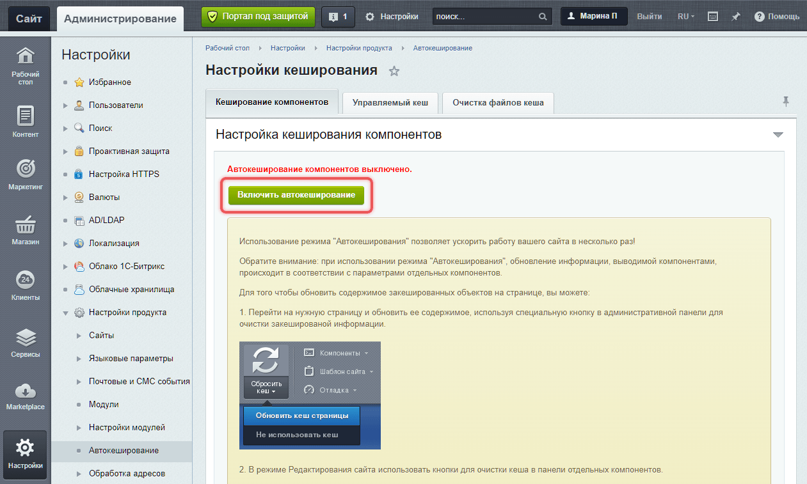
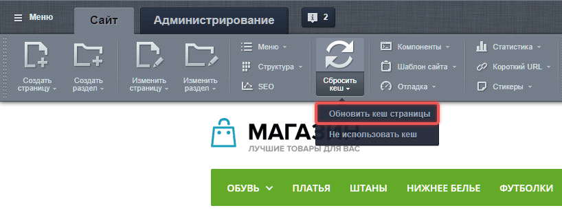
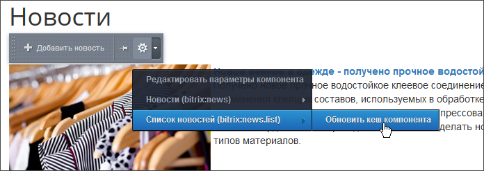

При больших объемах данных в базе могут возникать проблемы с производительностью. Основные причины:

-  **Конфликт запросов.** Одновременные запросы к базе данных могут конфликтовать друг с другом, создавая нагрузку на сервер.

-  **Очередь запросов.** Даже быстрые запросы могут накапливаться, образуя очередь и замедляя работу системы.

-  **Тяжелые запросы.** Медленные и частые запросы увеличивают нагрузку на сервер.

Кеширование помогает ускорить работу сайта и снизить нагрузку на базу данных. При правильно настроенном кешировании сайт использует сохраненные данные вместо того, чтобы заново обращаться к базе. Например, интернет-магазин может кешировать информацию о товарах.

Способ кеширования зависит от задачи:

-  сохранить результат своего кода на заданное время — [неуправляемый кеш](#unmanaged-cache) и класс `Cache`,

-  сбрасывать кеш при изменении данных — [управляемый](#managed-cache) или [тегированный кеш](#tagged-cache),

-  кешировать выборку ORM — параметр `cache` метода `getList()`, раздел [Кеширование запросов ORM](#orm-query-cache),

-  выбрать хранилище кеша из Redis, Memcached, APCu и файлов — секция `cache` файла `/bitrix/.settings.php`, раздел [Конфигурация кеша](#cache-config).

## Класс для кеширования

[Cache](https://docs.1c-bitrix.ru/api/classes/Bitrix-Main-Data-Cache.html) — основной класс для кеширования PHP-переменных и HTML-результатов.

### Основные методы класса

-  `createInstance()` — создает экземпляр класса с хранилищем из секции `cache` файла `.settings.php`.

-  `initCache($ttl, $uniqueString, $initDir = false, $baseDir = 'cache')` — ищет запись в кеше и возвращает `true`, если она найдена и не устарела:

   -  `$ttl` — время жизни кеша в секундах, при значении `0` и меньше метод возвращает `false`,

   -  `$uniqueString` — уникальный идентификатор кеша,

   -  `$initDir` — каталог записи, необязательный параметр. Если каталог не передан, метод использует каталог `default`,

   -  `$baseDir` — базовый каталог относительно `/bitrix/`, по умолчанию `cache`.

-  `getVars()` — возвращает данные, сохраненные в кеше.

-  `startDataCache()` — начинает запись кеша и перехват вывода, возвращает `true`. Принимает те же параметры, что `initCache()`. Без параметров берет значения из последнего вызова `initCache()`. Если запись уже есть в кеше, метод выводит сохраненный HTML и возвращает `false`.

-  `endDataCache($vars = false)` — сохраняет в кеш данные `$vars` и перехваченный вывод. Если `startDataCache()` не начал запись, например при TTL `0`, метод ничего не сохраняет.

-  `abortDataCache()` — отменяет запись кеша и выводит перехваченный буфер. Вызывайте его при ошибках или если данные недействительны.

-  `clean()` и `cleanDir()` — удаляют запись или каталог кеша, подробнее — в разделе [Как очистить неуправляемый кеш](#clean-cache).

## Примеры работы

**Пример.** Получите экземпляр кеша одним из двух способов:

```php
// Получить экземпляр кеша через статический метод Cache::createInstance()
$cache = Bitrix\Main\Data\Cache::createInstance();

// Получить экземпляр кеша через объект приложения
$cache = Bitrix\Main\Application::getInstance()->getCache();
```

**Пример.** Прочитайте данные из кеша, а если записи нет, получите их из базы и сохраните в кеш:

```php
$cache = Bitrix\Main\Data\Cache::createInstance();

// Проверяем наличие кеша
if ($cache->initCache(3600, 'cache_key'))
{
    // Получаем данные из кеша
    $data = $cache->getVars();
}
elseif ($cache->startDataCache())
{
    // Если кеша нет, получаем данные из базы
    $data = getDataFromDatabase();

    // Сохраняем результаты в кеш
    $cache->endDataCache($data);
}
```

**Пример.** Передайте каталог кеша и отмените запись, если полученные данные недействительны:

```php
// Инициализация кеша с дополнительными параметрами
if ($cache->initCache(
    $cacheTime, // Время жизни кеша в секундах
    $cacheId, // Уникальный идентификатор кеша
    $cacheDir // Путь к подкаталогу в кеше
))
{
    $result = $cache->getVars();
}
elseif ($cache->startDataCache())
{
    $result = [];
    // Если данные недействительны, отменяем кеширование
    if ($isInvalid)
    {
        $cache->abortDataCache();
    }
    else
    {
        // Сохраняем валидные данные
        $cache->endDataCache($result);
    }
}
```

**Пример.** Закешируйте HTML-вывод. Если запись уже есть в кеше, метод `startDataCache()` выведет сохраненный HTML и вернет `false`. Без вызова `initCache()` передайте в `endDataCache()` пустой массив: запись без данных `null` метод `initCache()` при следующем запросе не прочитает:

```php
$cache = Bitrix\Main\Data\Cache::createInstance();

// Если есть закешированные данные, они выведутся в буфер в методе Cache::startDataCache
if ($cache->startDataCache(3600, 'document_type_menu'))
{
    echo 'Какой-нибудь HTML';

    $cache->endDataCache([]);
}
```

## Технологии кеширования

Bitrix Framework поддерживает несколько технологий кеширования:

-  неуправляемое кеширование,

-  управляемое кеширование,

-  композитный сайт,

-  автокеширование компонентов.

Для максимальной эффективности можно совмещать разные технологии. Каждый компонент сайта можно кешировать отдельно, выбирая подходящий метод для конкретной задачи.

### Неуправляемое кеширование {#unmanaged-cache}

Кеширование называется неуправляемым, потому что кеш не перестраивается автоматически после модификации исходных данных и действует в течение указанного времени после создания.

Неуправляемое кеширование сохраняет результаты работы ресурсоемких частей страниц в файлы. По умолчанию файлы хранятся в папке `/bitrix/cache/`. Корневой каталог для этой папки задает параметр `root_directory`, подробнее — в разделе [Files](#files).

Как работает:

1. Система сохраняет результат выполнения кода в файл.

2. При следующем запросе вместо выполнения кода отдает сохраненный файл.

3. Файл хранится указанное время, после чего удаляется.

**Пример.** Используйте неуправляемый кеш через объект приложения:

```php
use Bitrix\Main\Application;

$cache = Application::getInstance()->getCache();

// Проверяем наличие кеша
if ($cache->initCache(3600, 'cache_key'))
{
    // Получаем данные из кеша
    $data = $cache->getVars();
}
elseif ($cache->startDataCache())
{
    // Если кеша нет, получаем данные из базы
    $data = getDataFromDatabase();

    // Сохраняем результаты в кеш
    $cache->endDataCache($data);
}
```

#### Как очистить неуправляемый кеш {#clean-cache}

Чтобы удалить запись неуправляемого кеша раньше истечения TTL, вызовите методы объекта `Cache`:

-  `clean($uniqueString, $initDir = false, $baseDir = 'cache')` — удаляет одну запись по идентификатору и каталогу,

-  `cleanDir($initDir = false, $baseDir = 'cache')` — удаляет все записи каталога.

Передайте в `clean()` те же идентификатор, каталог и базовый каталог, что и в `initCache()`. Если в `initCache()` каталог не передан, запись хранится в каталоге `default`. Вызов `clean()` без каталога такую запись не удалит, поэтому передайте вторым аргументом `'default'`.

Метод `cleanDir()` без аргументов очищает весь неуправляемый кеш в `/bitrix/cache/`.

Методы не возвращают результат очистки. Файловое хранилище переименовывает очищаемый каталог, поэтому старые записи сразу перестают читаться. Сами файлы оно удаляет позже, в фоновой задаче.

**Пример.** Удалите одну запись и весь каталог кеша типов документов:

```php
use Bitrix\Main\Data\Cache;

$cache = Cache::createInstance();
$cacheDir = 'document_types';

// Удаляем запись с идентификатором document_type_list
$cache->clean('document_type_list', $cacheDir);

// Удаляем все записи каталога document_types
$cache->cleanDir($cacheDir);
```



Статический метод `Cache::clearCache()` устарел. Он вызывает `cleanDir()`, только если первым аргументом передан `true` или имя каталога. Без аргументов метод ничего не очищает. В новом коде вызывайте `cleanDir()` у объекта кеша.



### Управляемое кеширование {#managed-cache}

Управляемое кеширование дает методы для точечного сброса кеша. При файловом хранении управляемый кеш находится в папке `/bitrix/managed_cache/`.

В отличие от неуправляемого кеша, разработчик может удалить не только одну запись, но и группу записей, связанную с таблицей ORM или другим каталогом кеша.

Преимущества:

-  Кеш можно сбрасывать по ключу или каталогу, не очищая весь кеш.

-  Кеш работает с хранилищами Redis, Memcached, APCu и с файлами.

Как включить:

1. Войдите в административный раздел сайта.

2. Перейдите в *Настройки > Настройки продукта > Автокеширование.*

3. Включите управляемый кеш.

Управляемый кеш обновляется автоматически в тех сценариях, где код знает, какой кеш нужно очистить. Например, ORM очищает кеш выборок после вызова методов `add`, `update` и `delete`.

Если разработчик использует `ManagedCache` напрямую и не передает в метод `read()` третий аргумент с каталогом кеша, кеш не связан с таблицей ORM. Такой кеш нужно очищать вручную или ждать истечения TTL.

Для часто обновляемых данных управляемое кеширование может не дать преимущества: кеш будет часто сбрасываться и пересоздаваться. Если данные должны быть всегда актуальными, лучше не кешировать их. Если небольшая задержка допустима, используйте неуправляемый кеш с коротким TTL или управляемый кеш с заданным правилом сброса.



Не все компоненты поддерживают управляемое кеширование. Проверяйте поддержку в настройках компонента.



**Пример.** Сохраните данные в управляемый кеш без привязки к таблице:

```php
use Bitrix\Main\Application;

$managedCache = Application::getInstance()->getManagedCache();
$cacheKey = 'user_list';

// Проверяем наличие кеша с помощью read
if ($managedCache->read(3600, $cacheKey))
{
    // Получаем данные из кеша с помощью get
    $data = $managedCache->get($cacheKey);
}
else
{
    // Если кеша нет, загружаем данные и сохраняем их в кеш
    $data = loadUsers();
    $managedCache->set($cacheKey, $data);
}
```

В примере кеш живет 3600 секунд. При изменении пользователей система не очистит запись автоматически, потому что в методе `read()` не указан каталог кеша. Чтобы обновить данные раньше, очистите запись по ключу:

```php
use Bitrix\Main\Application;

$managedCache = Application::getInstance()->getManagedCache();
$managedCache->clean('user_list');
```

Если нужно сохранить данные сразу, а не в конце хита, используйте `setImmediate`. Перед записью вызовите `read()`, чтобы объект кеша подготовил запись:

```php
use Bitrix\Main\Application;

$managedCache = Application::getInstance()->getManagedCache();
$cacheKey = 'user_list';

if (!$managedCache->read(3600, $cacheKey))
{
    $data = loadUsers();
    $managedCache->setImmediate($cacheKey, $data);
}
```

Чтобы запись `ManagedCache` сбрасывалась вместе с кешем ORM-таблицы, передайте третьим параметром каталог этой таблицы. Каталог формируется по схеме `orm_<имя_таблицы>`. Кеш в таком каталоге сбросится, когда ORM очистит кеш таблицы. Например, когда ORM вызывает очистку после изменения данных через `add`, `update` или `delete`.

**Пример.** Свяжите запись управляемого кеша с кешем таблицы пользователей:

```php
use Bitrix\Main\Application;

$managedCache = Application::getInstance()->getManagedCache();
$cacheKey = 'active_user_list';
$cacheDir = 'orm_b_user';

// Проверяем наличие кеша с помощью read
if ($managedCache->read(3600, $cacheKey, $cacheDir))
{
    $users = $managedCache->get($cacheKey);
}
else
{
    $users = loadActiveUsers();
    $managedCache->set($cacheKey, $users);
}
```

Чтобы сбросить кеш таблицы ORM вручную, вызовите статический метод `cleanCache()` ее ORM-класса:

```php
\Bitrix\Main\UserTable::cleanCache();
```

### Кеширование запросов ORM {#orm-query-cache}

ORM сохраняет результаты выборки, если в параметре `cache` метода `getList()` указан положительный `ttl` — время жизни кеша в секундах.

**Пример.** Сохраните список активных пользователей в кеше на час:

```php
use Bitrix\Main\UserTable;

$users = UserTable::getList([
    'select' => ['ID', 'LOGIN'],
    'filter' => ['=ACTIVE' => 'Y'],
    'cache' => ['ttl' => 3600],
])->fetchAll();
```

По умолчанию ORM не кеширует запросы с `JOIN`. Для такой выборки добавьте в массив `cache` параметр `'cache_joins' => true` вместе с `ttl`. Он разрешает кеширование соединений, но не связывает результат с очисткой кеша присоединенных таблиц. Если изменились только связанные данные, очистите кеш основного ORM-класса вручную или дождитесь истечения TTL.

Подробнее о параметрах и сбросе кеша — в статье [Выборка данных](../orm/querying-data.md).

### Композитный сайт

Технология Композитный сайт делит страницу на статичные и динамические части. При первом посещении:

1. Создается кеш статичной части.

2. Добавляется JavaScript для загрузки динамического контента.

При повторном посещении:

1. Отдается готовый статичный кеш.

2. Загружается только динамический контент.

Подробнее о технологии — в статье [Композитный сайт](./composite-site.md).

### Автокеширование компонентов

Автокеширование автоматически обновляет данные компонентов согласно их настройкам. Это помогает ускорить работу сайта при высокой нагрузке.

Как включить:

1. Откройте административную панель.

2. Перейдите в *Настройки > Настройки продукта > Автокеширование.*

3. Нажмите Включить автокеширование.

{width=1261px height=757px}

В результате компоненты с режимом Авто + Управляемое кеширование берут данные из созданного кеша без запросов к базе данных.

### Кеш меню

Компонент `bitrix:menu` настраивает кеш отдельно. Используйте следующие параметры.

-  `MENU_CACHE_TYPE` задает режим кеширования.

-  `MENU_CACHE_TIME` задает время жизни кеша в секундах.

-  `MENU_CACHE_USE_GROUPS` включает учет групп пользователя в ключе кеша.

-  `MENU_CACHE_GET_VARS` перечисляет GET-параметры, от которых зависит состав меню.

Если видимость пунктов зависит от групп пользователей, оставьте `MENU_CACHE_USE_GROUPS = Y`. Для персональных условий одного учета групп недостаточно. Примеры настройки и ограничения кеша меню — в статье [Меню](../cms-basics/menu.md).

## Конфигурация кеша {#cache-config}

Настройки кеширования хранятся в файле `/bitrix/.settings.php` в секции `cache`. Общее устройство файла описано в статье [Конфигурация ядра](../framework/settings.md).

### Параметр type

Параметр `type` выбирает хранилище кеша. Его задают строкой или массивом. Если параметр не задан, кеш хранится в файлах.

**Строка.** Значение — имя хранилища:

-  `files` — файлы на диске, класс `CacheEngineFiles`,

-  `redis` — Redis через PHP-расширение `redis`, класс `CacheEngineRedis`,

-  `memcache` — сервер Memcached через PHP-расширение `memcache`, класс `CacheEngineMemcache`,

-  `memcached` — сервер Memcached через PHP-расширение `memcached`, класс `CacheEngineMemcached`,

-  `apc` или `apcu` — APCu через PHP-расширение `apcu`, класс `CacheEngineApc`,

-  `none` или любое другое значение — кеширование отключено, класс `CacheEngineNone`.

**Массив.** Подключает класс хранилища по имени, в том числе собственный класс. Ключи массива:

-  `class_name` — полное имя класса, который реализует интерфейс `Bitrix\Main\Data\CacheEngineInterface`, например `\Bitrix\Main\Data\CacheEngineRedis`,

-  `extension` — необязательное имя PHP-расширения, без которого класс не подключается, например `'extension' => 'redis'`,

-  `required_file` — необязательный путь к файлу с классом относительно папки `/local/` или `/bitrix/`, файл сначала ищется в `/local/`,

-  `required_remote_file` — необязательный абсолютный путь к файлу с классом.

Строка и массив с классом ядра подключают одно и то же хранилище. Например, строка `'redis'` и массив с `class_name` `\Bitrix\Main\Data\CacheEngineRedis` выбирают класс `CacheEngineRedis`.



Если расширение из `extension` не загружено, класс не найден или хранилище недоступно, система отключает кеширование и выдает предупреждение PHP `Cache engine is not found` или `Cache engine is not available`. Сайт продолжает работать без кеша, поэтому после смены `type` проверьте журнал ошибок.



### Параметр cache_flags

Параметр `cache_flags` задает границы времени жизни кеша ORM-запросов для отдельных таблиц.

**Пример.** Ограничьте время жизни кеша для таблицы `b_group`:

```php
'cache_flags' => array(
    'value' => array(
        'b_group_max_ttl' => 200,
        'b_group_min_ttl' => 100,
    ),
),
```

-  `b_group_max_ttl` — устанавливает максимальное время жизни кеша. Например, значение `86400` означает один день. Значение `0` полностью отключает кеширование для этой таблицы.

-  `b_group_min_ttl` — устанавливает минимальное время жизни кеша. Если код пытается установить меньший срок, система будет использовать это значение.

### Параметр sid

SID (Site ID) нужен для уникальной идентификации кеша каждого сайта. Хранилища Redis, Memcache, Memcached и APCu добавляют его в начало ключей. Если `sid` не задан, они используют префикс `BX`. Файловый кеш параметр `sid` не использует. Значение `sid` формируется так:

```php
$_SERVER['DOCUMENT_ROOT'] . '#01'
```

-  `$_SERVER['DOCUMENT_ROOT']` — путь к корневой директории сайта.

-  `#01` — уникальный суффикс для разделения сайтов.

Примеры:

-  `/var/www/html/#01` — для одного сайта.

-  `/var/www/html/#ru` и `/var/www/html/#en` — для разных языков.

-  `/var/www/html/#example.com` и `/var/www/html/#blog.com` — для разных доменов.

Неправильная конфигурация `SID` может привести к конфликтам кеша между сайтами.



При изменении формата SID нужно очистить старый кеш, так как система не сможет его использовать.



### Дополнительные параметры Redis и Memcache

Для механизмов кеширования Redis и Memcache нужно указать массив с адресом и портом сервера. Имя секции совпадает со строковым значением `type` или со значением ключа `extension`, если `type` задан массивом. Для сервера с паролем добавьте в секцию ключ `password`. Например, для Redis:

```php
'redis' => array(
    'host' => '127.0.0.1', // Адрес сервера Redis
    'port' => '6379', // Порт сервера Redis
),
```

### Примеры настроек

Ниже приведены примеры настроек для каждого механизма кеширования.

#### Redis

**Пример.** Подключите Redis, задав `type` массивом:

```php
'cache' => array(
    'value' => array(
        'type' => array(
            'class_name' => '\\Bitrix\\Main\\Data\\CacheEngineRedis', // Класс для работы с Redis
            'extension' => 'redis', // Требуется расширение PHP redis
        ),
        'redis' => array(
            'host' => '127.0.0.1', // Адрес сервера Redis
            'port' => '6379', // Порт сервера Redis
        ),
        'sid' => $_SERVER['DOCUMENT_ROOT'] . '#01', // Уникальный идентификатор для разделения кеша между сайтами
    ),
),
```

#### Memcache

**Пример.** Подключите Memcached через расширение `memcache`, задав `type` массивом:

```php
'cache' => array(
    'value' => array(
        'type' => array(
            'class_name' => '\\Bitrix\\Main\\Data\\CacheEngineMemcache', // Класс для работы с Memcache
            'extension' => 'memcache', // Требуется расширение PHP memcache
        ),
        'memcache' => array(
            'host' => '127.0.0.1', // Адрес сервера Memcache
            'port' => '11211', // Порт сервера Memcache
        ),
        'sid' => $_SERVER['DOCUMENT_ROOT'] . '#01', // Уникальный идентификатор для разделения кеша между сайтами
    ),
),
```

**Пример.** Задайте настройки Memcached в файле `/bitrix/.settings_extra.php`. Здесь `type` указан строкой `memcache`, она выбирает тот же класс `CacheEngineMemcache`:

```php
<?php
return array(
    'cache' => array(
        'value' => array(
            'type' => 'memcache',
            'memcache' => array(
                'host' => 'unix:///tmp/memcached.sock', // Unix-сокет сервера Memcached
                'port' => '0', // Порт не используется при работе через сокет
            ),
            'sid' => $_SERVER['DOCUMENT_ROOT'] . '#01', // Уникальный идентификатор для разделения кеша между сайтами
        ),
    ),
);
```

Файл `.settings.php` хранит основной массив настроек. API класса [`Bitrix\Main\Config\Configuration`](../api-reference/main/config/configuration/index.md) может сохранять изменения в этом файле.

В `.settings_extra.php` можно вычислять значения средствами PHP. Система загружает его после `.settings.php` и заменяет одноименные секции целиком. Поэтому при переопределении `cache` укажите в `.settings_extra.php` всю секцию. API конфигурации не перезаписывает `.settings_extra.php`.

#### APCu

Класс `CacheEngineApc` работает с расширением `apcu` и вызывает функции `apcu_*`.

**Пример.** Настройте хранение кеша в APCu:

```php
'cache' => array(
    'value' => array(
        'type' => array(
            'class_name' => '\\Bitrix\\Main\\Data\\CacheEngineApc', // Класс для работы с APCu
            'extension' => 'apcu', // Требуется расширение PHP apcu
        ),
        'sid' => $_SERVER['DOCUMENT_ROOT'] . '#01', // Уникальный идентификатор для разделения кеша между сайтами
    ),
),
```

#### Files {#files}

**Пример.** Храните файлы кеша в отдельном корневом каталоге:

```php
'cache' => array(
    'value' => array(
        'type' => array(
            'class_name' => '\\Bitrix\\Main\\Data\\CacheEngineFiles', // Класс для работы с файловым кешированием
        ),
        'root_directory' => '/user_cache_dir/', // Корневой каталог вместо корня сайта
        'sid' => $_SERVER['DOCUMENT_ROOT'] . '#01', // Уникальный идентификатор для разделения кеша между сайтами
    ),
),
```

С версии главного модуля 24.100.0 можно задать корневой каталог файлового кеша параметром `root_directory`. Параметр заменяет корень сайта в пути к файлам кеша, а не папку `/bitrix/cache/`. В примере файлы неуправляемого кеша попадут в `/user_cache_dir/bitrix/cache/`. По умолчанию корневым каталогом служит корень сайта.

## Блокирующий режим кеширования

Блокирующий режим уменьшает число одновременных пересозданий кеша в хранилищах Redis и Memcached. Когда срок жизни кеша истекает, один запрос получает блокировку и обновляет данные. Остальные запросы продолжают получать устаревшее значение, пока хранилище его сохраняет. Они не ждут завершения первого запроса. Если старого значения уже нет, каждый запрос вычисляет данные самостоятельно.

### Как включить режим

В секции `cache.value` файла `/bitrix/.settings.php` задайте `use_lock => true`.

**Пример.** Включите блокирующий режим для `CacheEngineMemcache`:

```php
'cache' => [
    'value' => [
        'type' => [
            'class_name' => '\\Bitrix\\Main\\Data\\CacheEngineMemcache',
            'extension' => 'memcache',
        ],
        'memcache' => ['host' => '127.0.0.1', 'port' => '11211'],
        'use_lock' => true, // Включаем блокирующий режим
        'sid' => 'bxMemcache',
    ],
],
```

Компоненты создают объект кеша с параметром `['actual_data' => false]`, который также включает этот режим в поддерживающем его хранилище. Для собственного объекта используйте тот же параметр:

```php
$cache = Bitrix\Main\Data\Cache::createInstance(['actual_data' => false]);
```

### Как долго доступен устаревший кеш

Параметр `ttl_multiplier` задает множитель времени физического хранения записи. По умолчанию при включенной блокировке он равен двум. Данные с TTL 3600 секунд хранятся 7200 секунд и после первого часа могут служить устаревшим значением на время обновления.

После очистки по ключу, каталогу или тегу система может использовать старые данные еще до `ttlOld` секунд, если они сохранились в хранилище. По умолчанию — до 60 секунд. Для сохранения старого значения при очистке объект кеша тоже должен использовать блокирующий режим.

Используйте режим, только если допустимо временно показывать устаревшие данные. Он не гарантирует единственное вычисление при отсутствии старого значения.

## Тегированный кеш {#tagged-cache}

Главный модуль поддерживает тегированный кеш (Cache Dependencies).

1. Разработчик отмечает данные тегами при создании кеша.

2. При сбросе тега система находит связанные с ним каталоги кеша и очищает их.

### Особенности тегирования

-  Теги можно вкладывать друг в друга.

-  Теги из вложенных блоков применяются к родительским.

-  Дубликаты тегов автоматически удаляются.

### Где использовать

Тегированный кеш подходит:

-  для данных, которые редко обновляются,

-  для данных, кеш которых нужно сбрасывать сразу после изменения.

Не используйте его для данных, которые часто меняются, или для сложных запросов с высокой нагрузкой.

### Основной класс

Класс `Bitrix\Main\Data\TaggedCache` работает с тегами.

### Пример тегированного кеша

**Пример.** Пометьте запись кеша тегом `my_tag` при ее создании:

```php
use Bitrix\Main\Application;

$cache = Application::getInstance()->getCache();
$cacheDir = 'my_cache_dir';
$taggedCache = Application::getInstance()->getTaggedCache();

// Проверяем наличие кеша
if ($cache->initCache(3600, 'cache_key', $cacheDir))
{
    // Получаем данные из кеша
    $data = $cache->getVars();
}
elseif ($cache->startDataCache())
{
    // Если кеша нет, получаем данные из базы
    $data = getDataFromDatabase();

    // Помечаем кеш тегом
    $taggedCache->startTagCache($cacheDir);
    $taggedCache->registerTag('my_tag');
    $taggedCache->endTagCache();

    // Сохраняем результаты в кеш
    $cache->endDataCache($data);
}
```

Чтобы очистить кеш, связанный с тегом `my_tag`, вызовите метод `clearByTag()`:

```php
use Bitrix\Main\Application;

Application::getInstance()->getTaggedCache()->clearByTag('my_tag');
```

Тег привязан к каталогу, переданному в `startTagCache()`. В примере это `my_cache_dir`. Метод `clearByTag()` очищает этот каталог и другие каталоги с тем же тегом целиком. Чтобы независимо сбрасывать разные наборы данных, храните их в отдельных каталогах.

### Теги инфоблоков

Для кеша, который зависит от инфоблока, используйте тег `iblock_id_N`, где `N` — ID инфоблока. Зарегистрируйте тег между `startTagCache()` и `endTagCache()` при создании кеша. При изменении данных через API инфоблоков система сбрасывает соответствующий тег.

Для ручного сброса используйте `CIBlock::clearIblockTagCache($iblockId)`. Метод работает при включенном управляемом кеше компонентов — когда определена константа `BX_COMP_MANAGED_CACHE` — и разрешенной очистке тегов инфоблоков.

**Пример.** Сбросьте тег инфоблока, ID которого передан в `$iblockId`, после подключения пролога:

```php
if (\Bitrix\Main\Loader::includeModule('iblock'))
{
    CIBlock::clearIblockTagCache($iblockId);
}
```

Пример регистрации тега при создании кеша — в статье [Производительность инфоблоков](../modules/iblocks/performance.md).

## Обновление кеша компонентов

Поведение компонентов при обновлении кеша зависит от их настроек:

-  **Авто + Управляемое.** Система автоматически обновляет кеш по истечении заданного времени или при изменении данных.

-  **Кешировать.** Система обновляет кеш только по истечении указанного времени.

-  **Не кешировать.** Компоненты работают без кеширования.

### Как обновить кеш вручную

1. **В панели инструментов.** Нажмите кнопку Сбросить кеш на нужной странице сайта.

   {width=818px height=319px}

   

   Если компонент учитывает права доступа, кеш хранится отдельно для каждой группы пользователей. Сброс кеша затронет только те группы, к которым принадлежит текущий пользователь.

   

2. **В режиме правки сайта.** Включите режим правки сайта. Используйте кнопки очистки кеша в панелях отдельных компонентов, чтобы целенаправленно обновлять конкретные части страницы.

   {width=696px height=247px}

## Очистка файлов кеша

Чтобы очистить кеш через административную панель:

1. Перейдите в *Настройки > Настройки продукта > Автокеширование*.

2. Выберите вкладку Очистка файлов кеша.

### Варианты очистки

-  Только устаревшие — удаляет файлы, срок действия которых истек.

-  Все — очищает весь кеш.

-  Меню — очищает кеш меню. Используется при проверке прав доступа к пунктам меню.

-  Весь управляемый — удаляет содержимое директории `/bitrix/managed_cache/`.

   

   Не удаляйте файлы из этой директории вручную. Для очистки используйте вариант Весь управляемый.

   

-  Все страницы HTML-кеша — удаляет сохраненные версии страниц.

-  Сайты24 — удаляет кеш лендингов.

### Что происходит после очистки

-  Отображаемые данные обновляются до актуального состояния.

-  Новые файлы кеша создаются автоматически при обращении к страницам.

### Решение проблемы роста папки /bitrix/cache/

При удалении файлов кеша файловое хранилище подавляет ошибки. Если права каталогов кеша не дают пользователю веб-сервера удалить файл, файл остается на диске, и папка `/bitrix/cache/` растет.

Права новых каталогов кеша задает константа `BX_DIR_PERMISSIONS`, а права новых файлов определяет маска процесса `umask`. Чтобы согласовать их, задайте права в файле `dbconn.php`:

1. Откройте файл `/bitrix/php_interface/dbconn.php`.

2. Определите константы прав и после них вызовите `umask()`:

   ```php
   define('BX_FILE_PERMISSIONS', 0644);
   define('BX_DIR_PERMISSIONS', 0755);
   @umask(~(BX_FILE_PERMISSIONS | BX_DIR_PERMISSIONS) & 0777);
   ```

3. Сохраните изменения.

Файл `dbconn.php` подключается раньше, чем ядро задает значения по умолчанию `0644` и `0755`. Без `define()` вызов `umask()` обратится к неопределенной константе.



Не вызывайте `umask(000)`. С нулевой маской PHP создает файлы с правами `0666`, и их может изменить любой пользователь сервера. Если файлы кеша создают процессы разных пользователей, например веб-сервер и cron, объедините пользователей в одну группу и задайте в константах права `0664` и `0775`.


