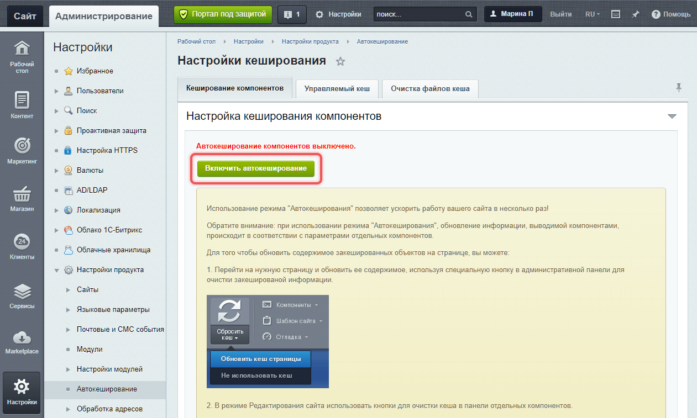
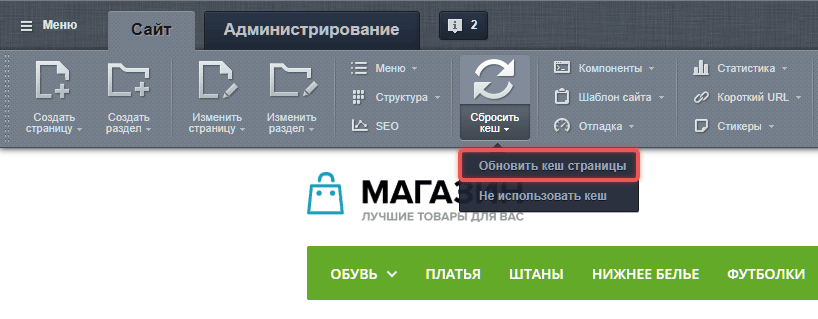
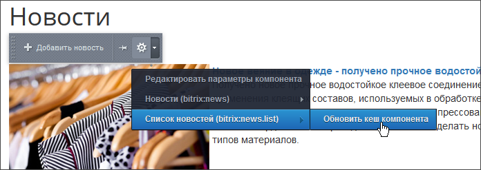

При больших объемах данных в базе могут возникать проблемы с производительностью. Основные причины:

1. **Конфликт запросов**. Одновременные запросы к базе данных могут конфликтовать друг с другом, создавая нагрузку на сервер.

2. **Очередь запросов.** Даже быстрые запросы могут накапливаться, образуя очередь и замедляя работу системы.

3. **Тяжелые запросы**. Медленные и частые запросы увеличивают нагрузку на сервер.

Кеширование помогает ускорить работу сайта и снизить нагрузку на базу данных. При правильно настроенном кешировании сайт использует сохраненные данные вместо того, чтобы заново обращаться к базе. Например, интернет-магазин может кешировать информацию о товарах.

## Класс для кеширования

[Cache](https://docs.1c-bitrix.ru/api/classes/Bitrix-Main-Data-Cache.html) — основной класс для кеширования PHP-переменных и HTML-результатов.

### Основные методы класса

-  `createInstance()` — создает экземпляр класса.

-  `initCache($time, $id, $dir)` — проверяет наличие кеша:

   -  `$time` — время жизни кеша в секундах,

   -  `$id` — уникальный идентификатор кеша,

   -  `$dir` — каталог хранения, необязательный параметр.

-  `getVars()` — получает данные из кеша.

-  `startDataCache()` — начинает создание нового кеша.

-  `endDataCache($data)` — сохраняет данные в кеш.

-  `abortDataCache()` — отменяет создание кеша. Применяется в случае ошибок или если данные недействительны.

## Примеры работы

Получить экземпляр кеша:

```php
// Получить экземпляр кеша через статический метод Cache::createInstance()
$cache = Bitrix\Main\Data\Cache::createInstance();

// Получить экземпляр кеша через объект приложения
$cache = Bitrix\Main\Application::getInstance()->getCache();
```

Проверить наличие кеша:

```php
// Проверяем наличие кеша
if ($cache->initCache(3600, 'cache_key'))
{
    // Получаем данные из кеша
    $data = $cache->getVars();
}
elseif ($cache->startDataCache())
{
    // Если кеша нет, получаем данные из базы
    $data = getDataFromDatabase();

    // Сохраняем результаты в кеш
    $cache->endDataCache($data);
}
```

Инициализировать кеш с дополнительными параметрами:

```php
// Инициализация кеша с дополнительными параметрами
if ($cache->initCache(
    $cacheTime, // Время жизни кеша в секундах
    $cacheId, // Уникальный идентификатор кеша
    $cacheDir // Путь к подкаталогу в кеше
))
{
    $result = $cache->getVars();
}
elseif ($cache->startDataCache())
{
    $result = [];
    // Если данные недействительны, отменяем кеширование
    if ($isInvalid)
    {
        $cache->abortDataCache();
    }
    else
    {
        // Сохраняем валидные данные
        $cache->endDataCache($result);
    }
}
```

Пример с кешированием буфера вывода.

```php
$cache = Bitrix\Main\Data\Cache::createInstance();

// Если есть закешированные данные, они выведутся в буфер в методе Cache::startDataCache
if ($cache->startDataCache(3600, 'xxxx'))
{
    echo 'Какой-нибудь HTML';

    $cache->endDataCache();
}
```

## Технологии кеширования

Bitrix Framework поддерживает несколько технологий кеширования:

1. Неуправляемое

2. Управляемое

3. Композитный сайт

4. Автокеширование компонентов

Для максимальной эффективности можно совмещать разные технологии. Каждый компонент сайта можно кешировать отдельно, выбирая подходящий метод для конкретной задачи.

### Неуправляемое кеширование

Кеширование называется неуправляемым, потому что кеш не перестраивается автоматически после модификации исходных данных и действует в течение указанного времени после создания.

Неуправляемое кеширование сохраняет результаты работы ресурсоемких частей страниц в файлы. По умолчанию используется папка `/bitrix/cache/`, но можно задать любую другую директорию. Кеш действует определенное время и не обновляется автоматически при изменении данных.

Как работает:

1. Система сохраняет результат выполнения кода в файл.

2. При следующем запросе вместо выполнения кода отдает сохраненный файл.

3. Файл хранится указанное время, после чего удаляется.

Пример использования неуправляемого кеширования:

```php
use Bitrix\Main\Application;

$cache = Application::getInstance()->getCache();

// Проверяем наличие кеша
if ($cache->initCache(3600, 'cache_key'))
{
    // Получаем данные из кеша
    $data = $cache->getVars();
}
elseif ($cache->startDataCache())
{
    // Если кеша нет, получаем данные из базы
    $data = getDataFromDatabase();

    // Сохраняем результаты в кеш
    $cache->endDataCache($data);
}
```

### Управляемое кеширование

Управляемое кеширование дает методы для точечного сброса кеша. При файловом хранении управляемый кеш находится в папке `/bitrix/managed_cache/`.

В отличие от неуправляемого кеша, разработчик может удалить не только одну запись, но и группу записей, связанную с таблицей ORM или другим каталогом кеша.

Преимущества:

-  Можно сбрасывать кеш по ключу или каталогу, не очищая весь кеш.

-  Поддержка различных хранилищ: Redis, Memcached, APCu, файлы.

Как включить:

1. Войдите в административный раздел сайта.

2. Перейдите в *Настройки > Настройки продукта > Автокеширование.*

3. Включите управляемый кеш.

Управляемый кеш обновляется автоматически в тех сценариях, где код знает, какой кеш нужно очистить. Например, ORM очищает кеш выборок после вызова методов `add`, `update` и `delete`.

Если разработчик использует `ManagedCache` напрямую и не передает в метод `read()` третий аргумент с каталогом кеша, кеш не связан с таблицей ORM. Такой кеш нужно очищать вручную или ждать истечения TTL.

Для часто обновляемых данных управляемое кеширование может не дать преимущества: кеш будет часто сбрасываться и пересоздаваться. Если данные должны быть всегда актуальными, лучше не кешировать их. Если небольшая задержка допустима, используйте неуправляемый кеш с коротким TTL или управляемый кеш с заданным правилом сброса.



Не все компоненты поддерживают управляемое кеширование. Проверяйте поддержку в настройках компонента.



Пример управляемого кеша без привязки к таблице:

```php
use Bitrix\Main\Application;

$managedCache = Application::getInstance()->getManagedCache();
$cacheKey = 'user_list';

// Проверяем наличие кеша с помощью read
if ($managedCache->read(3600, $cacheKey))
{
    // Получаем данные из кеша с помощью get
    $data = $managedCache->get($cacheKey);
}
else
{
    // Если кеша нет, загружаем данные и сохраняем их в кеш
    $data = loadUsers();
    $managedCache->set($cacheKey, $data);
}
```

В примере кеш живет 3600 секунд. При изменении пользователей система не очистит запись автоматически, потому что в методе `read()` не указан каталог кеша. Чтобы обновить данные раньше, очистите запись по ключу:

```php
use Bitrix\Main\Application;

$managedCache = Application::getInstance()->getManagedCache();
$managedCache->clean('user_list');
```

Если нужно сохранить данные сразу, а не в конце хита, используйте `setImmediate`. Перед записью вызовите `read()`, чтобы объект кеша подготовил запись:

```php
use Bitrix\Main\Application;

$managedCache = Application::getInstance()->getManagedCache();
$cacheKey = 'user_list';

if (!$managedCache->read(3600, $cacheKey))
{
    $data = loadUsers();
    $managedCache->setImmediate($cacheKey, $data);
}
```

Чтобы запись `ManagedCache` сбрасывалась вместе с кешем ORM-таблицы, передайте третьим параметром каталог этой таблицы. Каталог формируется по схеме `orm_<имя_таблицы>`. Кеш в таком каталоге сбросится, когда ORM очистит кеш таблицы. Например, когда ORM вызывает очистку после изменения данных через `add`, `update` или `delete`.

```php
use Bitrix\Main\Application;

$managedCache = Application::getInstance()->getManagedCache();
$cacheKey = 'active_user_list';
$cacheDir = 'orm_b_user';

// Проверяем наличие кеша с помощью read
if ($managedCache->read(3600, $cacheKey, $cacheDir))
{
    $users = $managedCache->get($cacheKey);
}
else
{
    $users = loadActiveUsers();
    $managedCache->set($cacheKey, $users);
}
```

Также сбросить кеш таблицы ORM можно вручную:

```php
\Bitrix\Main\UserTable::cleanCache();
```

### Кеширование запросов ORM

ORM сохраняет результаты выборки, если в параметре `cache` метода `getList()` указан положительный `ttl` — время жизни кеша в секундах.

**Пример.** Сохраните список активных пользователей в кеше на час:

```php
use Bitrix\Main\UserTable;

$users = UserTable::getList([
    'select' => ['ID', 'LOGIN'],
    'filter' => ['=ACTIVE' => 'Y'],
    'cache' => ['ttl' => 3600],
])->fetchAll();
```

По умолчанию ORM не кеширует запросы с `JOIN`. Для такой выборки добавьте в массив `cache` параметр `'cache_joins' => true` вместе с `ttl`. Он разрешает кеширование соединений, но не связывает результат с очисткой кеша присоединенных таблиц. Если изменились только связанные данные, очистите кеш основного ORM-класса вручную или дождитесь истечения TTL.

Подробнее о параметрах и сбросе кеша — в статье [Выборка данных](../orm/querying-data.md).

### Композитный сайт

Технология Композитный сайт делит страницу на статичные и динамические части. При первом посещении:

1. создается кеш статичной части,

2. добавляется JavaScript для загрузки динамического контента.

При повторном посещении:

1. отдается готовый статичный кеш,

2. загружается только динамический контент.

Подробнее о технологии — в статье [Композитный сайт](./composite-site).

### Автокеширование компонентов

Автокеширование автоматически обновляет данные компонентов согласно их настройкам. Это помогает ускорить работу сайта при высокой нагрузке.

Как включить:

1. Откройте административную панель.

2. Перейдите в *Настройки > Настройки продукта > Автокеширование.*

3. Нажмите Включить автокеширование.

{width=1261px height=757px}

Результат: компоненты с режимом Авто + Управляемое кеширование начинают работать без запросов к базе данных, используя созданный кеш.

### Кеш меню

Компонент `bitrix:menu` настраивает кеш отдельно. Используйте следующие параметры.

-  `MENU_CACHE_TYPE` задает режим кеширования.

-  `MENU_CACHE_TIME` задает время жизни кеша в секундах.

-  `MENU_CACHE_USE_GROUPS` включает учет групп пользователя в ключе кеша.

-  `MENU_CACHE_GET_VARS` перечисляет GET-параметры, от которых зависит состав меню.

Если видимость пунктов зависит от групп пользователей, оставьте `MENU_CACHE_USE_GROUPS = Y`. Для персональных условий одного учета групп недостаточно. Примеры настройки и ограничения кеша меню — в статье [Меню](../cms-basics/menu.md).

## Конфигурация кеша

Настройки кеширования хранятся в файле `/bitrix/.settings.php` в секции `cache`.

### Параметр type

Параметр `type` определяет механизм кеширования.

-  **redis** — использует Redis для хранения кеша. Требует установленного PHP-расширения `redis`.

-  **memcache** — использует сервер Memcached через `CacheEngineMemcache`. Требует установленного PHP-расширения `memcache`.

-  **apc** — использует APCu для хранения кеша через `CacheEngineApc`. Требует установленного PHP-расширения `apcu`.

-  **files** — хранит кеш в файлах на диске.

-  **none** — отключает кеширование.

В параметре `type` указывается массив с настройками.

-  `class_name` — класс, реализующий интерфейс ICacheEngine. Например, `\Bitrix\Main\Data\CacheEngineRedis`.

-  `required_file` — путь к файлу с классом относительно папки `/bitrix/` или `/local/`. Не обязательный.

-  `required_remote_file`  — абсолютный путь к файлу с классом. Не обязательный.

-  `extension` — Название PHP-расширения, которое должно быть установлено для корректной работы. Например, `'extension' => 'redis'`.

### Параметр cache_flags

Параметр `cache_flags` управляет правилами кеширования для разных таблиц.

Пример для таблицы `b_group`:

```php
'cache_flags' => array(
    'value' => array(
        'b_group_max_ttl' => 200,
        'b_group_min_ttl' => 100,
    ),
),
```

-  `b_group_max_ttl` — устанавливает максимальное время жизни кеша. Например, значение `86400` означает 1 день. Значение `0` полностью отключает кеширование для этой таблицы.

-  `b_group_min_ttl` устанавливает минимальное время жизни кеша. Если код пытается установить меньший срок, система будет использовать это значение.

### Параметр sid

SID (Site ID) нужен для уникальной идентификации кеша каждого сайта. Формируется так:

```php
$_SERVER['DOCUMENT_ROOT'] . '#01'
```

-  `$_SERVER['DOCUMENT_ROOT']` — путь к корневой директории сайта.

-  `#01` — уникальный суффикс для разделения сайтов.

Примеры:

-  `/var/www/html/#01` — для одного сайта.

-  `/var/www/html/#ru` и `/var/www/html/#en` — для разных языков.

-  `/var/www/html/#example.com` и `/var/www/html/#blog.com` — для разных доменов.

Неправильная конфигурация `SID` может привести к конфликтам кеша между сайтами.



При изменении формата SID нужно очистить старый кеш, так как система не сможет его использовать.



### Дополнительные параметры Redis и Memcache

Для механизмов кеширования Redis и Memcache нужно указать массив с адресом и портом сервера. Название параметра соответствует названию механизма. Например, для Redis:

```php
'redis' => array(
    'host' => '127.0.0.1', // Адрес сервера Redis
    'port' => '6379', // Порт сервера Redis
),
```

### Примеры настроек

Ниже приведены примеры настроек для каждого механизма кеширования.

#### Redis

```php
'cache' => array(
    'value' => array(
        'type' => array(
            'class_name' => '\\Bitrix\\Main\\Data\\CacheEngineRedis', // Класс для работы с Redis
            'extension' => 'redis', // Требуется расширение PHP redis
        ),
        'redis' => array(
            'host' => '127.0.0.1', // Адрес сервера Redis
            'port' => '6379', // Порт сервера Redis
        ),
        'sid' => $_SERVER['DOCUMENT_ROOT'] . '#01', // Уникальный идентификатор для разделения кеша между сайтами
    ),
),
```

#### Memcache

```php
'cache' => array(
    'value' => array(
        'type' => array(
            'class_name' => '\\Bitrix\\Main\\Data\\CacheEngineMemcache', // Класс для работы с Memcache
            'extension' => 'memcache', // Требуется расширение PHP memcache
        ),
        'memcache' => array(
            'host' => '127.0.0.1', // Адрес сервера Memcache
            'port' => '11211', // Порт сервера Memcache
        ),
        'sid' => $_SERVER['DOCUMENT_ROOT'] . '#01', // Уникальный идентификатор для разделения кеша между сайтами
    ),
),
```

Настройки memcache могут задаваться так же в файле `/bitrix/.settings_extra.php`.

```php
<?php
return array(
    'cache' => array(
        'value' => array(
            'type' => 'memcache',
            'memcache' => array(
                'host' => 'unix:///tmp/memcached.sock', // Unix-сокет сервера Memcached
                'port' => '0', // Порт не используется при работе через сокет
            ),
            'sid' => $_SERVER['DOCUMENT_ROOT'] . '#01', // Уникальный идентификатор для разделения кеша между сайтами
        ),
    ),
);
```

Файл `.settings.php` хранит основной массив настроек. API класса `Bitrix\Main\Config\Configuration` может сохранять изменения в этом файле.

В `.settings_extra.php` можно вычислять значения средствами PHP. Система загружает его после `.settings.php` и заменяет одноименные секции целиком. Поэтому при переопределении `cache` укажите в `.settings_extra.php` всю секцию. API конфигурации не перезаписывает `.settings_extra.php`.

#### APCu

Класс `CacheEngineApc` работает с расширением `apcu` и вызывает функции `apcu_*`.

**Пример.** Настройте хранение кеша в APCu:

```php
'cache' => array(
    'value' => array(
        'type' => array(
            'class_name' => '\\Bitrix\\Main\\Data\\CacheEngineApc', // Класс для работы с APCu
            'extension' => 'apcu', // Требуется расширение PHP apcu
        ),
        'sid' => $_SERVER['DOCUMENT_ROOT'] . '#01', // Уникальный идентификатор для разделения кеша между сайтами
    ),
),
```

#### Files

```php
'cache' => array(
    'value' => array(
        'type' => array(
            'class_name' => '\\Bitrix\\Main\\Data\\CacheEngineFiles', // Класс для работы с файловым кешированием
        ),
        'root_directory' => '/user_cache_dir/', // Директория для хранения файлов кеша
        'sid' => $_SERVER['DOCUMENT_ROOT'] . '#01', // Уникальный идентификатор для разделения кеша между сайтами
    ),
),
```

С версии главного модуля 24.100.0, можно использовать произвольную директорию для файлового кеширования через параметр `root_directory`. По умолчанию используется `/bitrix/cache/`.

## Блокирующий режим кеширования

Блокирующий режим уменьшает число одновременных пересозданий кеша в хранилищах Redis и Memcached. Когда срок жизни кеша истекает, один запрос получает блокировку и обновляет данные. Остальные запросы продолжают получать устаревшее значение, пока хранилище его сохраняет. Они не ждут завершения первого запроса. Если старого значения уже нет, каждый запрос вычисляет данные самостоятельно.

### Как включить режим

В секции `cache.value` файла `/bitrix/.settings.php` задайте `use_lock => true`.

**Пример.** Включите блокирующий режим для `CacheEngineMemcache`:

```php
'cache' => [
    'value' => [
        'type' => [
            'class_name' => '\\Bitrix\\Main\\Data\\CacheEngineMemcache',
            'extension' => 'memcache',
        ],
        'memcache' => ['host' => '127.0.0.1', 'port' => '11211'],
        'use_lock' => true, // Включаем блокирующий режим
        'sid' => 'bxMemcache',
    ],
],
```

Компоненты создают объект кеша с параметром `['actual_data' => false]`, который также включает этот режим в поддерживающем его хранилище. Для собственного объекта используйте тот же параметр:

```php
$cache = Bitrix\Main\Data\Cache::createInstance(['actual_data' => false]);
```

### Как долго доступен устаревший кеш

Параметр `ttl_multiplier` задает множитель времени физического хранения записи. По умолчанию при включенной блокировке он равен двум. Данные с TTL 3600 секунд хранятся 7200 секунд и после первого часа могут служить устаревшим значением на время обновления.

После очистки по ключу, каталогу или тегу система может использовать старые данные еще до `ttlOld` секунд, если они сохранились в хранилище. По умолчанию — до 60 секунд. Для сохранения старого значения при очистке объект кеша тоже должен использовать блокирующий режим.

Используйте режим, только если допустимо временно показывать устаревшие данные. Он не гарантирует единственное вычисление при отсутствии старого значения.

## Тегированный кеш

Главный модуль поддерживает тегированный кеш (Сache Dependencies).

1. Данные отмечаются тегами.

2. При сбросе тега система находит связанные с ним каталоги кеша и очищает их.

### Особенности тегирования

-  Теги можно вкладывать друг в друга.

-  Теги из вложенных блоков применяются к родительским.

-  Дубликаты тегов автоматически удаляются.

### Где использовать

Тегированный кеш подходит:

-  для данных, которые редко обновляются,

-  если нужно мгновенное обновление кеша при изменениях.

Не используйте его для данных, которые часто меняются, или для сложных запросов с высокой нагрузкой.

### Основной класс

Класс `Bitrix\Main\Data\TaggedCache` работает с тегами.

### Пример тегированного кеша

```php
use Bitrix\Main\Application;

$cache = Application::getInstance()->getCache();
$cacheDir = 'my_cache_dir';
$taggedCache = Application::getInstance()->getTaggedCache();

// Проверяем наличие кеша
if ($cache->initCache(3600, 'cache_key', $cacheDir))
{
    // Получаем данные из кеша
    $data = $cache->getVars();
}
elseif ($cache->startDataCache())
{
    // Если кеша нет, получаем данные из базы
    $data = getDataFromDatabase();

    // Помечаем кеш тегом
    $taggedCache->startTagCache($cacheDir);
    $taggedCache->registerTag('my_tag');
    $taggedCache->endTagCache();

    // Сохраняем результаты в кеш
    $cache->endDataCache($data);
}
```

Вызовите `clearByTag('my_tag')`, чтобы очистить кеш, связанный с тегом `my_tag`. Тег привязан к каталогу, переданному в `startTagCache()`. В примере это `my_cache_dir`. Система очистит этот каталог и другие каталоги с тем же тегом целиком. Чтобы независимо сбрасывать разные наборы данных, храните их в отдельных каталогах.

```php
use Bitrix\Main\Application;

Application::getInstance()->getTaggedCache()->clearByTag('my_tag');
```

### Теги инфоблоков

Для кеша, который зависит от инфоблока, используйте тег `iblock_id_N`, где `N` — ID инфоблока. Зарегистрируйте тег между `startTagCache()` и `endTagCache()` при создании кеша. При изменении данных через API инфоблоков система сбрасывает соответствующий тег.

Для ручного сброса используйте `CIBlock::clearIblockTagCache($iblockId)`. Метод работает при включенном управляемом кеше компонентов — когда определена константа `BX_COMP_MANAGED_CACHE` — и разрешенной очистке тегов инфоблоков.

**Пример.** Сбросьте тег инфоблока, ID которого передан в `$iblockId`, после подключения пролога:

```php
if (\Bitrix\Main\Loader::includeModule('iblock'))
{
    CIBlock::clearIblockTagCache($iblockId);
}
```

Пример регистрации тега при создании кеша — в статье [Производительность инфоблоков](../modules/iblocks/performance.md).

## Обновление кеша компонентов

Поведение компонентов при обновлении кеша зависит от их настроек:

-  **Авто + Управляемое.** Система автоматически обновляет кеш по истечении заданного времени или при изменении данных.

-  **Кешировать**. Система обновляет кеш только по истечении указанного времени.

-  **Не кешировать**. Компоненты работают без кеширования.

### Как обновить кеш вручную

1. **В панели инструментов.** Нажмите кнопку Сбросить кеш на нужной странице сайта.

   {width=818px height=319px}

   

   Если компонент учитывает права доступа, кеш хранится отдельно для каждой группы пользователей. Сброс кеша затронет только те группы, к которым принадлежит текущий пользователь.

   

2. **В режиме правки сайта.** Включите режим правки сайта. Используйте кнопки очистки кеша в панелях отдельных компонентов, чтобы целенаправленно обновлять конкретные части страницы.

   {width=696px height=247px}

## Очистка файлов кеша

Чтобы очистить кеш через административную панель:

1. перейдите в *Настройки > Настройки продукта > Автокеширование,*

2. выберите вкладку Очистка файлов кеша.

### Варианты очистки

-  Только устаревшие — удаляет файлы, срок действия которых истек.

-  Все — полная очистка кеша.

-  Меню — очищает кеш меню. Используется при проверке прав доступа к пунктам меню.

-  Весь управляемый — удаляет содержимое директории `/bitrix/managed_cache/`.

   

   Не рекомендуется ручное удаление файлов из этой директории

   

-  Все страницы HTML-кеша — удаляет сохраненные версии страниц.

-  Сайты24 — удаляет кеш лендингов.

### Что происходит после очистки

-  Отображаемые данные обновляются до актуального состояния.

-  Новые файлы кеша создаются автоматически при обращении к страницам.

### Решение проблемы роста папки /bitrix/cache/

Файлы неуправляемого кеширования могут создаваться с неправильными правами доступа, что мешает их удалению. Это приводит к увеличению размера папки `/bitrix/cache/`.

Решение:

1. Откройте файл /bitrix/php_interface/dbconn.php.

2. Добавьте строки:

   ```php
   umask(000);
   @umask(~BX_DIR_PERMISSIONS);
   ```

3. Сохраните изменения.



Права на файлы обычно определяются константами `BX_FILE_PERMISSIONS` и `BX_DIR_PERMISSIONS` в файле dbconn.php, но часто применяется маска сервера. Эти изменения помогут избежать проблем с правами доступа.


