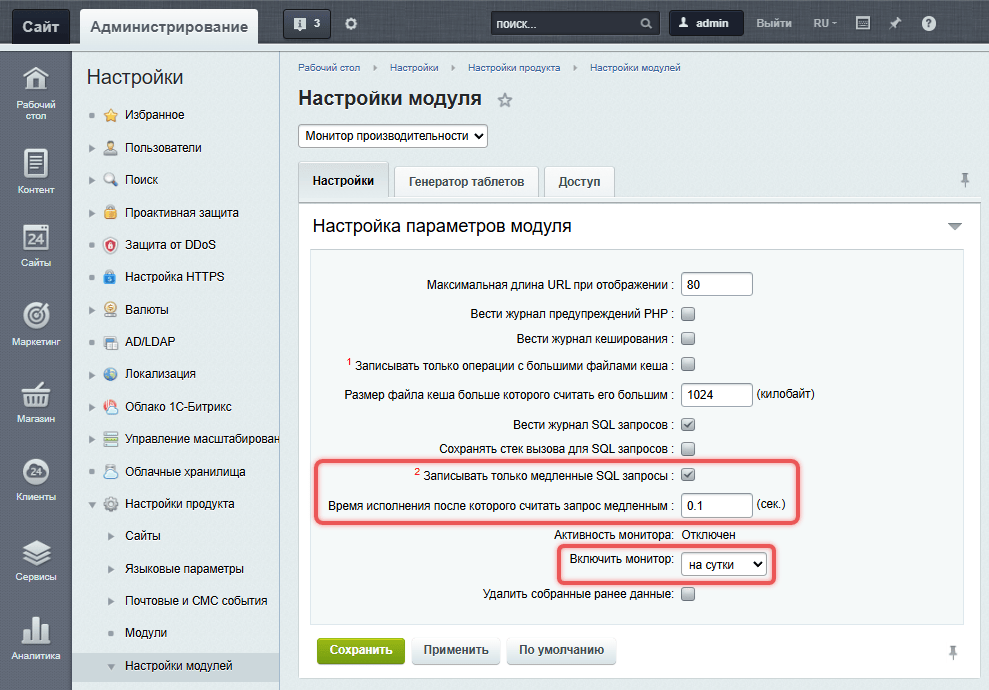
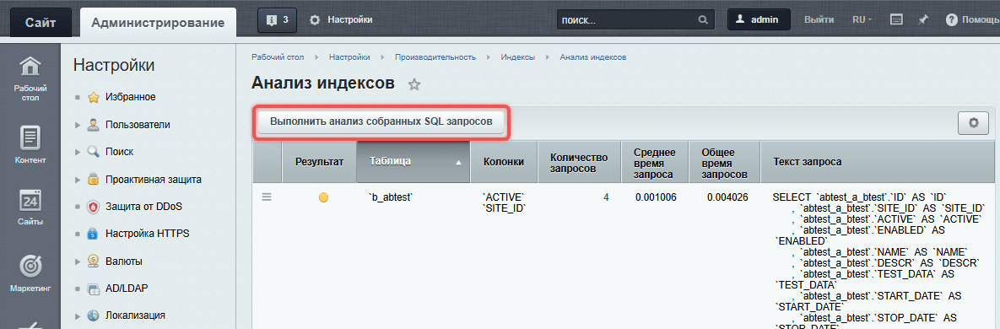
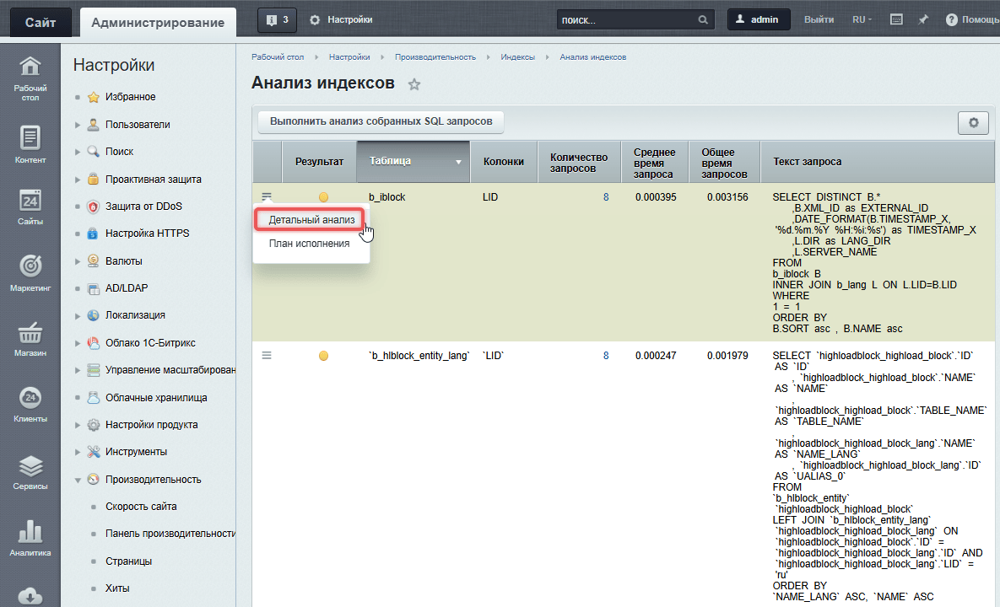
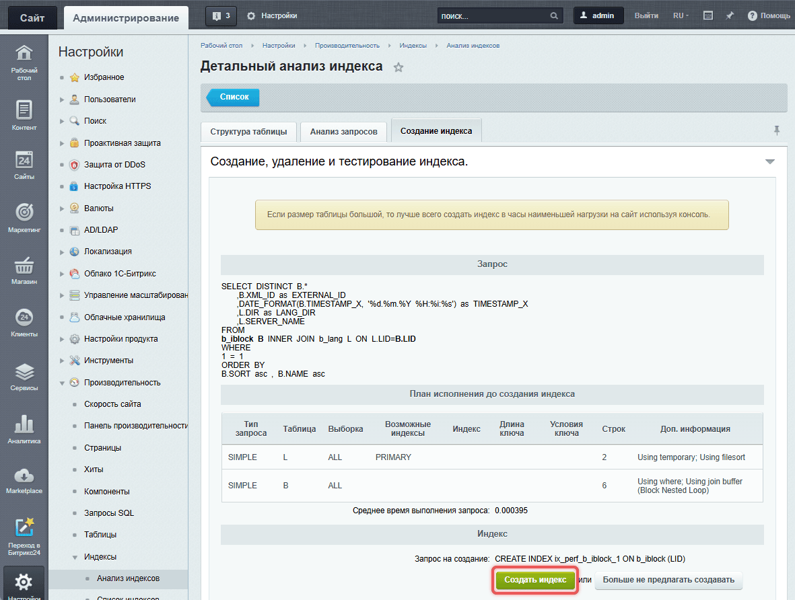
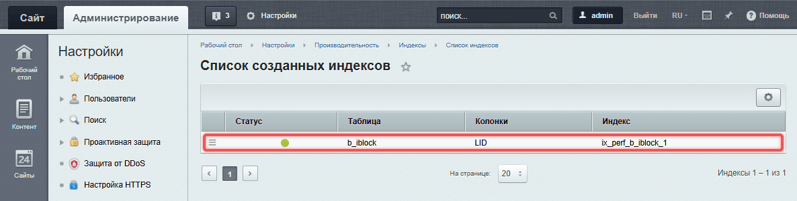

Оптимизация запросов к базе данных ускоряет работу сайта, снижает нагрузку на сервер и помогает избежать сбоев при высокой посещаемости. Даже небольшие улучшения могут значительно повысить производительность.

Примеры выполняются в контексте загруженного ядра. Перед работой с элементами инфоблока подключите модуль `iblock` через `Loader::includeModule()`:

```php
if (!\Bitrix\Main\Loader::includeModule('iblock'))
{
    throw new \RuntimeException('Модуль iblock недоступен');
}
```

Класс `Bitrix\Iblock\ElementTable` используйте для чтения базовых полей элементов. Для работы со свойствами нужен ORM-класс конкретного инфоблока — подробнее в статье [API инфоблоков](../modules/iblocks/api.md#элементы).

## Уменьшить количество запросов

Множественные запросы в цикле создают лишнюю нагрузку. Лучше собрать данные заранее и выполнить один запрос.

### Пример запроса для товаров

-  **Пример.** Запрос в цикле: для каждого товара в корзине код отдельно обращается к базе данных. Массив `$arResult['ORDERS']` содержит заказы, а `BASKET_ITEMS` — позиции корзины с идентификаторами товаров в `PRODUCT_ID`.

   ```php
   foreach ($arResult['ORDERS'] as $order)
   {
       foreach ($order['BASKET_ITEMS'] as $item)
       {
           $rsEls = CIBlockElement::GetByID($item['PRODUCT_ID']); // Запрос в цикле
       }
   }
   ```

-  **Пример.** Групповая выборка через классический API: код собирает уникальные ID товаров, читает результат одного запроса и добавляет названия в позиции корзины. Условие перед запросом исключает выборку с пустым списком ID.

   ```php
   $productIds = [];

   foreach ($arResult['ORDERS'] as $order)
   {
       foreach ($order['BASKET_ITEMS'] as $item)
       {
           $productIds[] = (int)$item['PRODUCT_ID'];
       }
   }

   $productIds = array_values(array_unique($productIds));
   $productsById = [];

   if ($productIds !== [])
   {
       $rsEls = CIBlockElement::GetList(
           [],
           ['ID' => $productIds],
           false,
           false,
           ['ID', 'NAME']
       );

       while ($product = $rsEls->Fetch())
       {
           $productsById[$product['ID']] = $product;
       }
   }

   foreach ($arResult['ORDERS'] as $orderKey => $order)
   {
       foreach ($order['BASKET_ITEMS'] as $itemKey => $item)
       {
           $arResult['ORDERS'][$orderKey]['BASKET_ITEMS'][$itemKey]['PRODUCT_NAME'] =
               $productsById[$item['PRODUCT_ID']]['NAME'] ?? null;
       }
   }
   ```

Для D7 замените блок выборки `CIBlockElement::GetList()` и чтения результата следующим кодом. Массивы `$productIds` и `$productsById` подготовьте как в предыдущем примере. Параметр `filter` с оператором `@ID` задает список идентификаторов, а `select` — поля результата:

```php
if ($productIds !== [])
{
    $result = \Bitrix\Iblock\ElementTable::getList([
        'select' => ['ID', 'NAME'],
        'filter' => ['@ID' => $productIds],
    ]);

    while ($product = $result->fetch())
    {
        $productsById[$product['ID']] = $product;
    }
}
```

## Использовать специализированные методы вместо универсальных

Для изменения данных используйте методы объектной модели модуля. Если для операции есть специализированный метод, выбирайте его, чтобы явно указать назначение действия. Сам по себе такой выбор не гарантирует уменьшения количества SQL-запросов.

Для изменения статуса конкретной оплаты используйте метод `Bitrix\Sale\Payment::setPaid('Y')`. Получите оплату из коллекции заказа, проверьте результат изменения и сохраните заказ через `Order::save()`. Метод `setPaid()` вызывает `setField('PAID', ...)`, поэтому его преимущество здесь — явное назначение операции. Универсальный метод `setFields()` также вызывает `setField()` для каждого поля.

**Пример.** Код отмечает существующую оплату как оплаченную. Передайте в `$orderId` идентификатор заказа, а в `$paymentId` — идентификатор оплаты этого заказа. Подключите модуль `sale` через `Loader::includeModule()`:

```php
if (!\Bitrix\Main\Loader::includeModule('sale'))
{
    throw new \RuntimeException('Модуль sale недоступен');
}

$order = \Bitrix\Sale\Order::load($orderId);
if ($order === null)
{
    throw new \RuntimeException('Заказ не найден');
}

$paymentCollection = $order->getPaymentCollection();
$payment = $paymentCollection->getItemById($paymentId);
if ($payment === null)
{
    throw new \RuntimeException('Оплата не найдена в заказе');
}

$result = $payment->setPaid('Y');
if (!$result->isSuccess())
{
    throw new \RuntimeException(implode('; ', $result->getErrorMessages()));
}

$result = $order->save();
if (!$result->isSuccess())
{
    throw new \RuntimeException(implode('; ', $result->getErrorMessages()));
}
```

Сохраняйте изменения оплаты через заказ, чтобы согласованно сохранить связанные объекты. Подробнее — в статье [Оплаты и платежные системы](../modules/sale/payments.md).

## Оптимизировать выборку данных

Ограничивайте состав полей и получайте связанные данные в основном запросе, если они нужны для обработки результата.

### Заменить метод GetByID на GetList

Метод [CIBlockElement::GetByID](https://dev.1c-bitrix.ru/api_help/iblock/classes/ciblockelement/getbyid.php) загружает все поля, даже если они не нужны. Используйте [CIBlockElement::GetList](https://dev.1c-bitrix.ru/api_help/iblock/classes/ciblockelement/getlist.php), указывая только необходимые поля.

**Пример.** Запрос выбирает ID и названия товаров. Непустой массив `$productIds` содержит идентификаторы из предыдущего примера:

```php
$rsEls = CIBlockElement::GetList(
    [],
    ['ID' => $productIds],
    false,
    false,
    ['ID', 'NAME']
);
```

В примере указываем, какие поля нужно получить из базы данных. Это уменьшает объем обрабатываемых данных и ускоряет выполнение запроса.

В ORM метод `getById()` по умолчанию выбирает все базовые поля. Для ограничения полей передайте `select` в `getList()`. В параметре `filter` укажите ID элемента `$productId`:

```php
$result = \Bitrix\Iblock\ElementTable::getList([
    'select' => ['ID', 'NAME'],
    'filter' => ['=ID' => $productId],
]);
$product = $result->fetch();
```

### Оптимизировать основной запрос

Избегайте лишних запросов для получения связанных данных. Получайте все данные сразу, если это возможно.

**Пример.** Классический API выбирает книги и данные автора через свойство `AUTHOR` типа Привязка к элементам. В переменной `$iblockId` передайте идентификатор инфоблока книг. Параметр сортировки задает порядок по ID, фильтр отбирает активные элементы:

```php
// Получаем данные о книгах и авторах одним запросом
$rs = CIBlockElement::GetList(
    ['ID' => 'ASC'],
    [
        'IBLOCK_ID' => $iblockId,
        'ACTIVE' => 'Y'
    ],
    false,
    false,
    [
        'ID',
        'NAME',
        'PREVIEW_PICTURE',
        'PREVIEW_TEXT',
        'PROPERTY_AUTHOR.NAME', // Данные автора
        'PROPERTY_AUTHOR.PREVIEW_PICTURE' // Фото автора
    ]
);

// Сохраняем результаты
while ($ar = $rs->GetNext())
{
    $arResult['ITEMS'][] = $ar;
}
```

В ORM связанные поля укажите в `select` через имя связи. Параметр `order` задает сортировку, а `filter` — условия отбора.

**Пример.** Запрос получает элементы инфоблока `$iblockId` и название основного раздела через связь `IBLOCK_SECTION`. Псевдоним `SECTION_NAME` задает ключ в результате:

```php
$result = \Bitrix\Iblock\ElementTable::getList([
    'select' => ['ID', 'NAME', 'SECTION_NAME' => 'IBLOCK_SECTION.NAME'],
    'filter' => ['=IBLOCK_ID' => $iblockId, '=ACTIVE' => 'Y'],
    'order' => ['ID' => 'ASC'],
]);
$items = $result->fetchAll();
```

Для выборки свойств и связанных через них элементов используйте ORM-класс конкретного инфоблока. Класс `ElementTable` не содержит свойства `AUTHOR`. Подготовка ORM-класса описана в статье [API инфоблоков](../modules/iblocks/api.md).

## Использовать точные фильтры вместо LIKE

Фильтр `LIKE` позволяет находить данные, которые частично совпадают с заданным значением. Фильтр использует специальный символ `%`, который заменяет любое количество других символов.

Если поиск по части строки не требуется, используйте точное сравнение: оператор `=` в массиве `filter` или вызов `where('CODE', 'xxx')`. Такой фильтр не ищет частичное совпадение. Скорость запроса зависит также от индексов и плана выполнения.

-  **Пример.** Точное сравнение через оператор `=` в параметре `filter`:

   ```php
   $result = \Bitrix\Iblock\ElementTable::getList([
       'select' => ['ID', 'NAME', 'CODE'],
       'filter' => ['=CODE' => 'xxx'],
   ]);
   ```

   В примере мы используем точный фильтр `['=CODE' => 'xxx']` и получаем данные только для элементов с конкретным значением поля `CODE`.

-  **Пример.** Точное сравнение через метод `where()`:

   ```php
   $result =
       \Bitrix\Iblock\ElementTable::query()
           ->setSelect(['ID', 'NAME', 'CODE'])
           ->where('CODE', 'xxx')
           ->exec()
   ;
   ```

   Здесь фильтр `where('CODE', 'xxx')` отбирает элементы, у которых поле `CODE` равно `'xxx'`.

## Ограничить количество записей

Передайте в `getList()` параметр `limit`, чтобы получить только нужное количество записей. Параметр `offset` задает, сколько записей пропустить. Укажите устойчивую сортировку в `order`, например по уникальному полю `ID`, чтобы порядок страниц был определен.

**Пример.** Запрос выбирает первые 20 активных элементов инфоблока `$iblockId`:

```php
$result = \Bitrix\Iblock\ElementTable::getList([
    'select' => ['ID', 'NAME'],
    'filter' => ['=IBLOCK_ID' => $iblockId, '=ACTIVE' => 'Y'],
    'order' => ['ID' => 'ASC'],
    'limit' => 20,
]);
$items = $result->fetchAll();
```

Для постраничной выборки используйте класс [PageNavigation](../cms-basics/page-navigation-class.md). Метод `setPageSize()` задает размер страницы, а `initFromUri()` читает ее номер из адреса. Методы `getLimit()` и `getOffset()` возвращают ограничения для запроса.

**Пример.** Код подсчитывает активные элементы инфоблока `$iblockId` и получает одну страницу. Идентификатор `elements` связывает параметры адреса с этим списком. Передайте общее количество записей в `setRecordCount()` до вызова `initFromUri()`, чтобы навигация ограничила номер страницы доступным диапазоном:

```php
$filter = ['=IBLOCK_ID' => $iblockId, '=ACTIVE' => 'Y'];

$navigation = new \Bitrix\Main\UI\PageNavigation('elements');
$navigation->setPageSize(20);
$navigation->setRecordCount(\Bitrix\Iblock\ElementTable::getCount($filter));
$navigation->initFromUri();

$result = \Bitrix\Iblock\ElementTable::getList([
    'select' => ['ID', 'NAME'],
    'filter' => $filter,
    'order' => ['ID' => 'ASC'],
    'limit' => $navigation->getLimit(),
    'offset' => $navigation->getOffset(),
]);
$items = $result->fetchAll();
```

Метод `ElementTable::getCount($filter)` выполняет отдельный запрос подсчета. Передайте одинаковый фильтр в `getCount()` и `getList()`, чтобы количество записей соответствовало выборке. Подсчитывайте записи, когда интерфейсу нужно общее число записей или страниц. Вывод ссылок описан в статье [Постраничная навигация](../cms-basics/page-navigation.md).

## Кешировать результаты ORM-запросов

Для повторяющихся выборок, в которых допустимо использовать сохраненные данные, передайте в `getList()` параметр `cache`. Ключ `ttl` задает время жизни кеша в секундах.

**Пример.** Запрос кеширует выборку первых 20 активных элементов инфоблока `$iblockId` на 300 секунд:

```php
$result = \Bitrix\Iblock\ElementTable::getList([
    'select' => ['ID', 'NAME'],
    'filter' => ['=IBLOCK_ID' => $iblockId, '=ACTIVE' => 'Y'],
    'order' => ['ID' => 'ASC'],
    'limit' => 20,
    'cache' => ['ttl' => 300],
]);
$items = $result->fetchAll();
```

По умолчанию ORM не кеширует запросы со связями `JOIN`. Для такой выборки дополнительно передайте `'cache_joins' => true` внутри `cache`. Выбирайте время жизни с учетом допустимой задержки обновления данных и учитывайте способ сброса кеша. Подробнее — в разделе [Кеширование выборки](../orm/querying-data.md#кеширование-выборки) и статье [Кеширование](./caching.md).

## Создать поисковые индексы

Поисковый индекс — это структура данных, которая помогает базе данных быстрее находить нужную информацию. Без индексов поиск по большим таблицам может занимать много времени.

В каждом проекте медленные запросы зависят от структуры данных и частоты использования. Например, на сайте с большим количеством товаров медленным может быть запрос на поиск по цене и категории. В таких случаях помогает составной индекс, он создается сразу по нескольким полям таблицы.

### Как определить, какие индексы нужны

#### Настроить монитор производительности

Монитор производительности — это инструмент, который помогает находить медленные  запросы SQL.

1. Откройте административный раздел сайта.

2. Перейдите в *Настройки > Настройки продукта > Настройки модулей > Монитор производительности.*

3. Включите опцию «Записывать только медленные SQL-запросы».

4. Укажите время, после которого запрос считается медленным. По умолчанию это 0,1 секунды.

5. Установите время работы монитора. Рекомендуем запускать его на одни сутки.

6. Нажмите «Сохранить». Запустится монитор производительности. Через сутки вы сможете проанализировать медленные запросы.

{width=989px height=690px}

#### Проанализировать результаты

После завершения работы монитора производительности:

1. Откройте административный раздел сайта.

2. Перейдите в *Настройки > Производительность > Индексы > Анализ индексов.*

3. Нажмите «Выполнить анализ собранных SQL-запросов».

{width=1185px height=390px}

В результатах обратите внимание:

-  на запросы с наибольшим временем выполнения,

-  запросы, которые выполняются чаще всего.

Не для каждого запроса нужно создавать индекс, так как это может увеличить нагрузку на базу данных. Иногда проблема в коде компонента. Например, если компонент делает слишком много запросов к базе данных, их можно оптимизировать.

### Как создать индекс

Чтобы создать индекс для конкретного запроса:

1. Перейдите в *Настройки > Производительность > Индексы > Анализ индексов.*

2. Выберите нужный запрос, откройте меню и нажмите «Детальный анализ». Откроется страница с детальным анализом запроса.

3. Перейдите во вкладку «Создание индекса» и нажмите «Создать индекс».

{width=1185px height=720px}

{width=1181px height=892px}

Созданный индекс появится на странице *Настройки > Производительность > Индексы > Список индексов.* Проверьте его эффективность, выполнив повторный анализ запросов.

{width=1186px height=301px}

