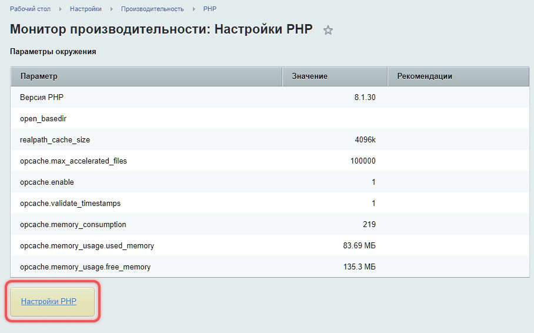
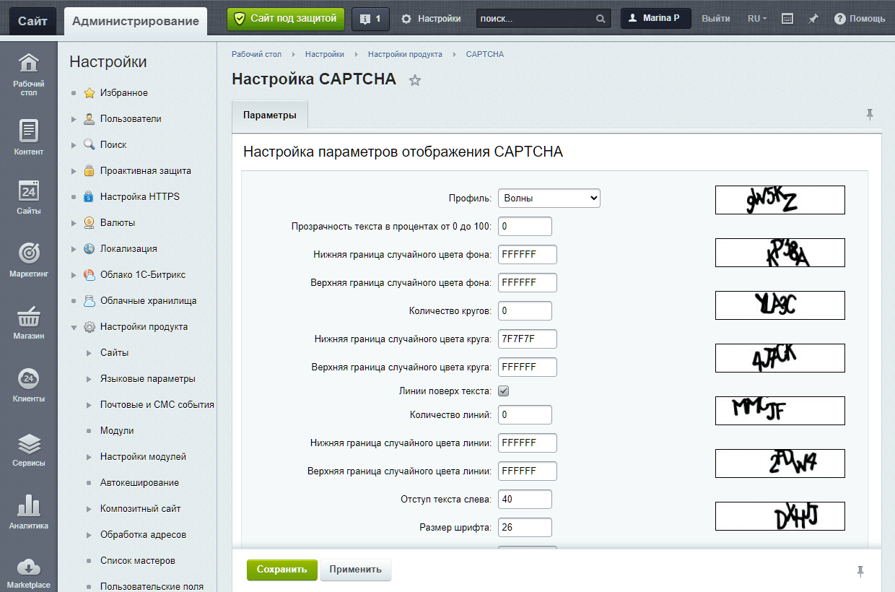

CAPTCHA (Completely Automated Public Turing test to tell Computers and Humans Apart) защищает сайт от действий роботов, например от автоматической регистрации или отправки формы.

## Требования для работы CAPTCHA

Для работы CAPTCHA на сервере должны быть установлены библиотеки FreeType и GD. Они нужны для работы с изображениями и генерации CAPTCHA.

Для создания изображений CAPTCHA используются функции библиотек:

-  `imagecreatetruecolor` — создает изображение.

-  `imagejpeg` — сохраняет его в формате JPEG.

Проверить наличие библиотек можно в административном разделе продукта:

1. Откройте страницу *Настройки > Производительность > PHP .*

2. Перейдите по ссылке Настройки PHP.

{width=908px height=566px}

## Настроить CAPTCHA

Настроить CAPTCHA и включить защиту от автоматических регистраций можно в разделе *Настройки > Настройки продукта > CAPTCHA*.

{width=1240px height=820px}

### Основные параметры

В поле Профиль можно выбрать шаблон настроек или указать их вручную. Рекомендации по основным параметрам:

-  Прозрачность текста — 40–50%.

-  Угол отклонения от вертикали — от -30 до 30 градусов.

-  Нелинейные искажения — рекомендуем включить. Это искажение символов CAPTCHA, чтобы усложнить распознавание для роботов. Например, изгибы или волны.

-  Шрифт  — используйте `bitrix_captcha.ttf` или другой нестандартный шрифт. Шрифт `bitrix_captcha.ttf` доступен в системе по умолчанию. Если вы хотите использовать другой шрифт, загрузите его в папку `/bitrix/modules/main/fonts/`. Поддерживаются файлы шрифтов в формате `.ttf`.

## Подключить CAPTCHA

CAPTCHA можно подключить несколькими способами. Выберите подходящий вариант в зависимости от ваших задач.

### В настройках модуля

Показ CAPTCHA можно включить в настройках модулей: Главный, Блоги и Wiki.

В Главном модуле есть две опции, которые отвечают за авторизацию пользователя:

1. Использовать CAPTCHA при восстановлении пароля

2. Использовать CAPTCHA при регистрации

### В параметрах компонента

Показ CAPTCHA можно подключить для отдельных компонентов, которые отвечают за отправку форм. Например, в параметрах компонента Форма обратной связи есть опция *Использовать защиту от автоматических сообщений (CAPTCHA) для неавторизованных пользователей*.

### В настройках групп пользователей

В настройках групп пользователей можно включить показ CAPTCHA после неудачных попыток ввода пароля.

1. Перейдите в раздел *Настройки > Пользователи > Группы пользователей*.

2. Выберите группу и откройте вкладку Безопасность.

3. Найдите опцию *Количество попыток ввода пароля до показа CAPTCHA*:

   -  Если значение равно нулю или выбрана опция Не переопределять, CAPTCHA отключена.

   -  Если значение больше нуля, CAPTCHA включается после указанного числа попыток.



Убедитесь, что шаблон компонента авторизации поддерживает отображение CAPTCHA. Иначе после указанного числа попыток система потребует ввода CAPTCHA, но шаблон ее не отобразит, и пользователь не сможет авторизоваться.



### В своих скриптах

Примеры выполняйте после подключения пролога Bitrix Framework. В отдельном обработчике подключите `/bitrix/modules/main/include/prolog_before.php`. Класс `CCaptcha` загружается автоматически, подключать файл класса напрямую не нужно.

Для новой формы используйте `captcha_sid` и методы объекта `$APPLICATION`, описанные ниже. Вариант с `captcha_code` нужен при доработке формы, которая уже передает такое поле. Не смешивайте имена полей в форме, URL изображения и обработчике.

Чтобы подготовить CAPTCHA для формы с полем `captcha_code`, создайте объект `CCaptcha` и вызовите `SetCodeCrypt()`:

```php
<?php
$cpt = new CCaptcha();
$cpt->SetCodeCrypt();
$code = $cpt->GetCodeCrypt();
?>
```

В обычном режиме `SetCodeCrypt()` сохраняет проверочный код в базе данных, а `GetCodeCrypt()` возвращает идентификатор записи. Настройка `captcha_password` для этих вызовов не нужна.



Если определена константа `CAPTCHA_COMPATIBILITY`, поведение отличается: `SetCodeCrypt()` шифрует код с паролем из сессии, а `GetCodeCrypt()` возвращает зашифрованное значение. В этом режиме проверяйте `captcha_code` методом `CheckCodeCrypt()` у объекта `CCaptcha`. Метод `$APPLICATION->CaptchaCheckCode()` предназначен для `captcha_sid`. В обычном режиме оба способа используют базу данных.



Добавьте в форму три элемента:

```php
<!-- Скрытое поле с кодом CAPTCHA -->
<input name="captcha_code" value="<?= htmlspecialcharsbx($code) ?>" type="hidden">

<!-- Поле для ввода CAPTCHA -->
<input id="captcha_word" name="captcha_word" type="text">

<!-- Изображение CAPTCHA -->
" alt="CAPTCHA">
```

Чтобы проверить ответ для поля `captcha_code`, создайте объект `CCaptcha` в обработчике формы и вызовите `CheckCodeCrypt()`. Метод поддерживает обычный режим и режим совместимости:

```php
<?php
$cpt = new CCaptcha();
if (!$cpt->CheckCodeCrypt($_POST['captcha_word'] ?? '', $_POST['captcha_code'] ?? ''))
{
    // Неправильное значение
    echo 'CAPTCHA введена неверно. Попробуйте еще раз.';
}
else
{
    // Правильное значение
    echo 'CAPTCHA введена верно.';
}
?>
```

## Методы работы с CAPTCHA

Для формы с полем `captcha_sid` используйте методы класса `CMain`. Это нестатические методы: вызывайте их у объекта `$APPLICATION`, доступного после подключения пролога.

-  `CaptchaGetCode` — создает CAPTCHA и возвращает ее идентификатор для поля `captcha_sid`.

-  `CaptchaCheckCode` — проверяет ответ пользователя по идентификатору CAPTCHA.

### Пример использования методов

Получите идентификатор перед выводом формы:

```php
// Получаем идентификатор CAPTCHA
$code = $APPLICATION->CaptchaGetCode();
```

Добавьте в форму скрытое поле с идентификатором, поле для ответа и изображение. Скрипт `/bitrix/tools/captcha.php` сформирует изображение по переданному `captcha_sid`:

```php
<!-- Скрытое поле для хранения идентификатора CAPTCHA -->
<input type="hidden" name="captcha_sid" value="<?= htmlspecialcharsbx($code) ?>" />

<!-- Поле для ввода ответа -->
<input type="text" name="captcha_word" id="captcha_word" />

<!-- Отображение картинки CAPTCHA -->
" alt="CAPTCHA" />
```

В обычном режиме `CaptchaGetCode()` создает запись с проверочным кодом в базе данных. Скрипт изображения читает эту запись по `captcha_sid` и рисует CAPTCHA. При определенной константе `CAPTCHA_COMPATIBILITY` вариант с `captcha_sid` хранит код в сессии.

Для проверки кода CAPTCHA при обработке формы используйте метод `CaptchaCheckCode`.

```php
// Проверяем введенный пользователем код CAPTCHA
if (!$APPLICATION->CaptchaCheckCode($_POST['captcha_word'] ?? '', $_POST['captcha_sid'] ?? ''))
{
    echo 'Неверный код CAPTCHA';
}
```

### Как изменить настройки CAPTCHA

Чтобы задать длину проверочного кода для отдельной формы, используйте класс `CCaptcha`. Вызовите `SetCodeLength()` перед генерацией кода:

```php
// Создаем объект CAPTCHA
$cpt = new CCaptcha();

// Устанавливаем длину кода (по умолчанию 5 символов)
$cpt->SetCodeLength(6);

// Генерируем новый код
$cpt->SetCode();

// Получаем идентификатор CAPTCHA
$code = $cpt->GetSID();
```

#### Настройки в отдельном файле

Для отдельного оформления изображения создайте свой скрипт в `/local/`. Системный файл `/bitrix/tools/captcha.php` оставьте без изменений. Правила размещения доработок описаны в статье [Как правильно и безопасно кастомизировать коробочные продукты](../get-started/how-customize.md#where-to-place-changes).

1. Создайте файл `/local/tools/captcha.php` и скопируйте в него содержимое `/bitrix/tools/captcha.php`.

2. Сохраните подключения пролога и эпилога через `$_SERVER['DOCUMENT_ROOT']`, а также получение кода по `captcha_sid` или `captcha_code`. Настройте отображение изображения перед вызовом `Output()`.

3. Укажите путь `/local/tools/captcha.php` в форме. Например, для варианта с `captcha_sid`:

```php
<!-- Скрытое поле для хранения идентификатора CAPTCHA -->
<input type="hidden" name="captcha_sid" value="<?= htmlspecialcharsbx($code) ?>" />

<!-- Отображение картинки CAPTCHA через свой скрипт -->
" alt="CAPTCHA" />
```

Обновления ядра не обновляют копию в `/local/`. После обновлений сравнивайте ее с системным скриптом и переносите необходимые изменения.
