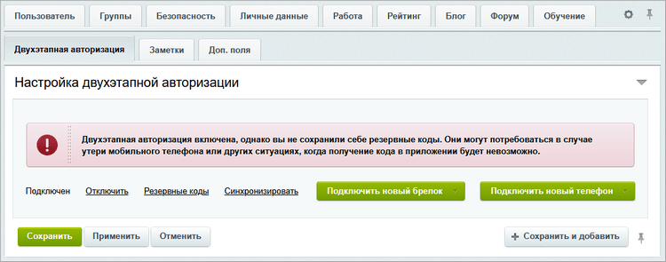
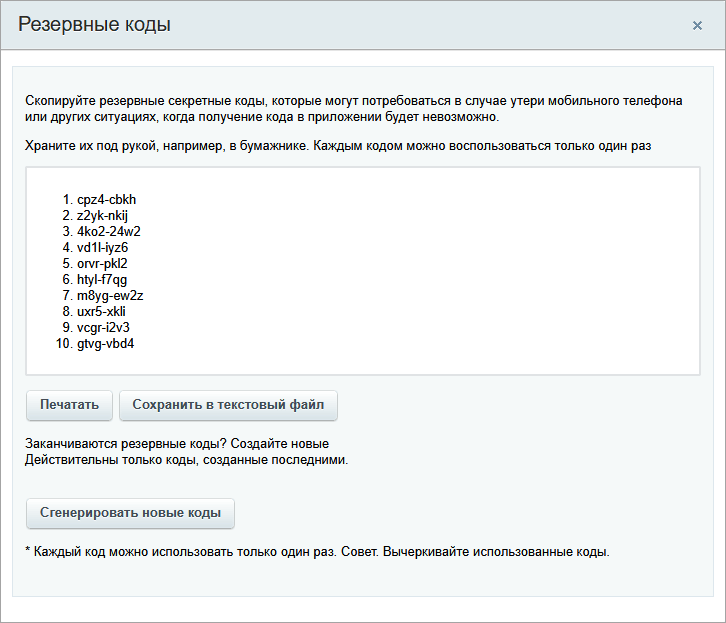
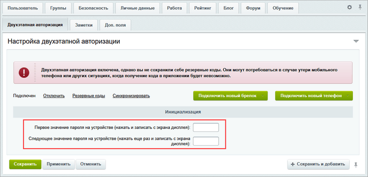

Двухэтапная авторизация добавляет ко входу по логину и паролю второй шаг — одноразовый пароль с устройства пользователя. Механизм входит в модуль Проактивная защита `security`. Общие настройки модуля описаны в статье [Проактивная защита](proactive-security.md).

Администратор включает двухэтапную авторизацию в настройках модуля, а пользователи подключают устройства в профиле. Разработчик может вывести формы подключения устройства и резервных кодов на страницах сайта, а в коде — проверить и изменить двухэтапную авторизацию пользователя и настройки механизма.

## Система одноразовых паролей

Одноразовый пароль, OTP — это пароль, который действителен только для одного входа. Некоторые алгоритмы также ограничивают срок действия пароля.

Пароль нельзя использовать повторно, поэтому система не принимает пароль, перехваченный после входа.

### Принцип работы

При каждой авторизации пользователь получает новый одноразовый пароль:

1. Пользователь вводит логин и пароль в форме авторизации.

2. Приложение на смартфоне показывает одноразовый пароль.

3. Пользователь вводит пароль в поле *Введите одноразовый код*.

{width=750px height=270px}

### Алгоритмы генерации паролей

Система поддерживает три алгоритма:

-  HMAC-Based One-time Password, HOTP — по счетчику:

   -  код действителен до тех пор, пока пользователь не запросит новый,

   -  счетчик увеличивается при каждой генерации кода,

   -  количество действующих кодов ограничивает параметр *Размер окна проверки паролей* в настройках двухэтапной авторизации.

      {width=682px height=520px}

-  Time-based One-time Password, TOTP — по времени:

   -  код зависит от текущего времени и меняется каждые 30 секунд,

   -  система проверяет код в текущем интервале, в двух интервалах до него и в двух после, чтобы компенсировать расхождение часов устройства и сервера,

   -  система не принимает код из интервала, который уже использовали для входа, и из более ранних интервалов.

-  Мобильный push:

   -  алгоритм доступен в 1С-Битрикс24 с версии 25.0.0 модуля Проактивная защита,

   -  система отправляет push-уведомление в мобильное приложение Битрикс24,

   -  после ввода логина и пароля пользователь получает уведомление с запросом подтвердить или отклонить вход,

   -  если приложение недоступно, пользователь может получить одноразовый пароль по СМС или на резервный email, как описано в разделе [Одноразовый пароль по СМС и email](#otp-by-sms-email).

### Секретный ключ и счетчик

Генератор OTP использует два параметра:

-  секретный ключ — начальное значение для генератора,

-  счетчик — текущее значение счетчика для HOTP или текущее время для TOTP.

Секретный ключ хранится и на устройстве пользователя, и на сервере. Если счетчик на устройстве разошелся со счетчиком на сервере, устройство нужно [синхронизировать](#device-sync).

## Включить двухэтапную авторизацию {#enable-otp}

Механизм работает после настройки модуля Проактивная защита. Затем пользователи подключают устройства для генерации одноразовых паролей.

1. Перейдите на страницу *Настройки > Проактивная защита > Двухэтапная авторизация*.

2. Нажмите кнопку *Включить двухэтапную авторизацию*.

3. Настройте параметры двухэтапной авторизации.

   -  Установите *Размер окна проверки паролей* для алгоритма HOTP. Если пользователь нажмет кнопку на устройстве больше раз, чем указано в параметре, система не примет код. Тогда устройство придется синхронизировать. По умолчанию `10`, рекомендуемое значение — от 5 до 10 кодов.

   -  Выберите *Алгоритм генерации паролей по умолчанию* — HOTP по счетчику, TOTP по времени или Мобильный push. По умолчанию TOTP. Вариант Мобильный push доступен только в 1С-Битрикс24, если установлен модуль Мобильное приложение и работает сервер очередей модуля Push and Pull.

   -  Отметьте *Разрешить запоминание одноразового пароля*, чтобы пользователь не вводил код повторно на том же компьютере. Система сохраняет признак в cookie. Срок хранения и маску сети задают параметры группы *Срок хранения авторизации, запомненной на компьютере пользователя* и *Маска сети для привязки сохраненной авторизации*. Параметры описаны в статье [Группы пользователей](../cms-basics/user-groups.md).

   -  Отметьте *Разрешить использование резервных кодов*, чтобы пользователь мог войти без устройства. По умолчанию опция выключена.

   -  Отметьте *Разрешить отправку одноразового пароля по СМС*, чтобы пользователь с алгоритмом Мобильный push мог получить код в СМС. По умолчанию опция включена. Код уходит на подтвержденный номер телефона пользователя.

   -  Отметьте *Разрешить отправку одноразового пароля по email*, чтобы пользователь с алгоритмом Мобильный push мог получить код на резервный email. По умолчанию опция выключена. Для отправки также нужны резервный email пользователя и включенный почтовый шаблон. Остальные условия описаны в разделе [Одноразовый пароль по СМС и email](#otp-by-sms-email).

   -  Отметьте *Требовать двухэтапную авторизацию*, чтобы подключение устройства стало обязательным для выбранных пользователей. По умолчанию опция выключена.

   -  Укажите *Количество дней для подключения* — срок, в течение которого пользователь без устройства еще может войти на сайт. Отсчет начинается с первого входа пользователя после включения требования. По умолчанию `10`. После этого срока система не дает пользователю войти на сайт, пока он не подключит устройство.

   -  В поле *Пользователи с обязательной двухэтапной авторизацией* выберите пользователей и группы. По умолчанию выбрана группа администраторов.

   -  В группе *Журналирование* отметьте *Занести попытку запроса одноразового пароля в журнал*, чтобы система записывала в журнал событий запросы одноразового пароля. По умолчанию опция включена.

   -  В той же группе отметьте *Занести отправку одноразового пароля (по СМС, email) в журнал*, чтобы система записывала в журнал событий каждую отправку одноразового пароля по СМС и email. По умолчанию опция включена.

   {width=683px height=691px}

Пока двухэтапная авторизация выключена в модуле, система не запрашивает одноразовый пароль даже у пользователей с подключенным устройством.

## Подключить устройства {#connect-devices}

Пользователь выбирает один из трех способов входа и подключает для него устройство — мобильное приложение Битрикс24 для push-уведомлений, мобильное OTP-приложение или аппаратное устройство.

Перед подключением мобильного устройства проверьте, что на нем верно установлены время и часовой пояс.

В административной части сайта устройства подключают на вкладке *Двухэтапная авторизация* карточки пользователя. Пользователь видит эту вкладку в своей карточке. В карточке другого пользователя вкладку видит только тот, кому разрешена операция `security_edit_user_otp` — изменение двухэтапной авторизации пользователей.

Операция `security_edit_user_otp` входит в уровни доступа модуля Проактивная защита *Управление одноразовыми паролями* и *Полный административный доступ*. Уровень доступа группе назначают в настройках модуля, как описано в статье [Права доступа](access-control.md#module-permissions).



Одновременно можно использовать только одно устройство. Если пользователь подключит новое устройство, старое перестанет работать для входа.



### Мобильные push-уведомления



Мобильные push-уведомления работают только в 1С-Битрикс24. Чтобы их использовать, настройте модули Push and Pull и Мобильное приложение.



Чтобы самостоятельно подключить мобильное приложение Битрикс24 в публичной части сайта:

1. Откройте форму *Безопасность* в профиле.

2. Отсканируйте QR-код и установите на смартфон приложение Битрикс24.

Чтобы подключить приложение в административной части сайта:

1. Перейдите на страницу *Настройки > Пользователи > Список пользователей*.

2. Выберите пользователя и перейдите на вкладку *Двухэтапная авторизация*.

3. Нажмите кнопку *Подключить телефон*.

4. Выберите Мобильный push.

5. Отсканируйте QR-код и установите на смартфон приложение Битрикс24.

### Мобильное OTP-приложение

В публичной части сайта пользователь подключает приложение-аутентификатор, например Bitrix OTP, на странице с компонентом [Подключение устройства OTP](#otp-init-component).

Чтобы самостоятельно подключить приложение в публичной части сайта:

1. Установите на смартфон приложение для генерации одноразовых паролей.

2. Отсканируйте QR-код или введите данные вручную.

3. Введите код подтверждения, который выведет приложение.

Чтобы подключить приложение в административной части сайта:

1. Перейдите на страницу *Настройки > Пользователи > Список пользователей*.

2. Выберите пользователя и перейдите на вкладку *Двухэтапная авторизация*.

3. Нажмите кнопку *Подключить телефон*.

4. Выберите алгоритм генерации паролей — HOTP по счетчику или TOTP по времени.

5. Отсканируйте QR-код приложением. Если QR-код не сканируется, введите в приложении вручную:

   -  адрес сайта, например `www.example.com`,

   -  email пользователя,

   -  секретный ключ с картинки без учета пробелов,

   -  тип ключа.

6. Введите коды из приложения — для HOTP первый и второй сгенерированные коды, для TOTP один код.

### Аппаратное устройство

Для двухэтапной авторизации можно использовать аппаратные устройства, например USB-токены JaCarta и Рутокен. Аппаратное устройство подключают в административной части сайта.

Чтобы подключить аппаратное устройство:

1. Перейдите на страницу *Настройки > Пользователи > Список пользователей*.

2. Выберите пользователя и перейдите на вкладку *Двухэтапная авторизация*.

3. Нажмите кнопку *Подключить брелок*.

4. Выберите алгоритм генерации паролей по документации к устройству — HOTP по счетчику или TOTP по времени.

5. Укажите секретный ключ и данные с устройства:

   -  для HOTP — первое и следующее значения кода на устройстве,

   -  для TOTP — начальное значение счетчика времени в формате Unix Timestamp и первое значение кода на устройстве.

   По умолчанию начальное значение счетчика `0` — дата 01.01.1970. Если устройство отсчитывает время от другой даты, укажите ее значение, например `946684800` для 01.01.2000.

### Действия после подключения

После подключения устройства можно:

-  отключить двухэтапную авторизацию на срок или без срока, в том числе [из кода](#change-user-otp),

-  получить [резервные коды](#recovery-codes) для входа,

-  [синхронизировать устройство](#device-sync) с сервером,

-  подключить новое устройство кнопками *Подключить новый брелок* и *Подключить новый телефон*.

{width=750px height=295px}

## Резервные коды {#recovery-codes}

По резервному коду пользователь входит на сайт, когда устройство двухэтапной авторизации недоступно.



Резервные коды работают, если в настройках двухэтапной авторизации отмечена опция *Разрешить использование резервных кодов*.



### Сгенерировать резервные коды

Резервные коды получают на вкладке *Двухэтапная авторизация* карточки пользователя. Доступ к вкладке описан в разделе [Подключить устройства](#connect-devices).

Чтобы получить резервные коды:

1. Перейдите на страницу *Настройки > Пользователи > Список пользователей*.

2. Выберите пользователя и перейдите на вкладку *Двухэтапная авторизация*.

3. Нажмите ссылку *Резервные коды*.

4. Скопируйте коды из формы. Каждый код можно использовать только один раз.

{width=726px height=623px}

За один раз система создает десять кодов. Код состоит из двух групп по четыре символа через дефис — строчные латинские буквы и цифры. Пользователь вводит резервный код в то же поле, что и одноразовый пароль.

Храните коды в защищенном месте, например в менеджере паролей.

Чтобы отозвать текущие резервные коды, сгенерируйте новые. При новой генерации система удаляет все прежние коды пользователя, в том числе неиспользованные. Подключение нового устройства тоже удаляет резервные коды.

Если пользователь не может воспользоваться устройством и резервными кодами, администратор может отключить для него двухэтапную авторизацию на срок или без срока на вкладке *Двухэтапная авторизация* карточки пользователя или из кода методом [`deactivate()`](#change-user-otp).

## Одноразовый пароль по СМС и email {#otp-by-sms-email}

Пользователь с алгоритмом Мобильный push подтверждает вход в приложении Битрикс24. Если приложение недоступно, он может запросить одноразовый пароль по СМС или письмом на резервный email.



Запросить код по СМС или email можно в форме входа 1С-Битрикс24. В 1С-Битрикс: Управление сайтом готовой формы для этого нет.



Система отправляет код, если выполнены условия:

-  пользователь ввел логин и пароль, и система ждет подтверждения входа,

-  у пользователя подключено устройство с алгоритмом Мобильный push, и двухэтапная авторизация для него не отключена,

-  учетная запись пользователя активна,

-  установлен модуль Мобильное приложение и работает сервер очередей модуля Push and Pull,

-  в настройках двухэтапной авторизации отмечена опция нужного канала — *Разрешить отправку одноразового пароля по СМС* или *Разрешить отправку одноразового пароля по email*,

-  для СМС у пользователя есть подтвержденный номер телефона,

-  для email у пользователя задан резервный email и включен почтовый шаблон события `USER_OTP_AUTH_CODE`, как описано в разделе [Включить почтовые шаблоны](#otp-mail-templates).

Повторно запросить код по тому же каналу можно через 60 секунд после предыдущей отправки, даже если она завершилась ошибкой.

Чтобы настроить отправку кода по email:

1. Убедитесь, что у пользователя подключено устройство с алгоритмом Мобильный push.

2. Отметьте опцию *Разрешить отправку одноразового пароля по email* на странице *Настройки > Проактивная защита > Двухэтапная авторизация*.

3. Включите почтовые шаблоны `USER_OTP_AUTH_CODE` и `USER_OTP_EMAIL_CONFIRM`, как описано в разделе [Включить почтовые шаблоны](#otp-mail-templates).

4. Задайте пользователю резервный email, как описано в разделе [Задать резервный email](#otp-backup-email).

### Задать резервный email {#otp-backup-email}

Система хранит резервный email в данных двухэтапной авторизации пользователя, отдельно от адреса в профиле. Администратор задает адрес в карточке пользователя. Как задать адрес из кода, описано в разделе [Изменить двухэтапную авторизацию пользователя](#change-user-otp).

Система показывает поле для адреса, если:

-  двухэтапная авторизация включена в модуле,

-  у пользователя подключено устройство, и двухэтапная авторизация для него не отключена,

-  текущему пользователю доступна операция `security_edit_user_otp` — изменение двухэтапной авторизации пользователей,

-  установлен модуль Мобильное приложение и работает сервер очередей модуля Push and Pull.

Опция *Разрешить отправку одноразового пароля по email* на видимость поля не влияет.

Чтобы задать резервный email:

1. Перейдите на страницу *Настройки > Пользователи > Список пользователей*.

2. Выберите пользователя и перейдите на вкладку *Двухэтапная авторизация*.

3. В группе *Параметры* заполните поле *Резервный email для одноразовых паролей*. Чтобы удалить адрес, очистите поле.

4. Сохраните изменения. Если адрес некорректный, система показывает ошибку и не сохраняет его.

В 1С-Битрикс24 пользователь может подтвердить резервный email сам, если отмечена опция *Разрешить отправку одноразового пароля по email*. Система отправляет на указанный адрес письмо с кодом подтверждения из шести цифр и сохраняет адрес после ввода кода.

### Включить почтовые шаблоны {#otp-mail-templates}

Письма с кодами уходят только по активным шаблонам событий `USER_OTP_AUTH_CODE` и `USER_OTP_EMAIL_CONFIRM`. При установке модуля система создает эти шаблоны выключенными. Отметьте их активными на странице *Настройки > Настройки продукта > Почтовые и СМС события > Почтовые шаблоны*. Работа с шаблонами описана в статье [Почтовые события](../cms-basics/mail.md).

Система отправляет письма по почтовым событиям модуля Проактивная защита:

-  `USER_OTP_AUTH_CODE` — одноразовый пароль для входа. Шаблону доступны код `#CODE#`, логин `#LOGIN#`, дата `#DATE#`, сведения об устройстве `#DEVICE_INFO#`, IP-адрес `#IP#`, местоположение `#LOCATION#` и другие поля. Полный список полей приведен на странице *Настройки > Настройки продукта > Почтовые и СМС события > Типы событий*.

-  `USER_OTP_EMAIL_CONFIRM` — код подтверждения резервного email. Шаблону доступны код `#CODE#`, адрес `#EMAIL#`, идентификатор пользователя `#USER_ID#`, логин `#LOGIN#` и дата `#DATE#`.

Для СМС система использует СМС-событие `SMS_USER_OTP_AUTH_CODE`. Шаблон этого события система создает включенным. Работа с СМС описана в статье [Работа с СМС](../cms-basics/sms.md).

## Синхронизировать устройство {#device-sync}

Счетчик на устройстве расходится с сервером, если пользователь несколько раз сгенерировал пароль и не вошел с ним на сайт. Чтобы восстановить вход, выполните синхронизацию.

Ссылку *Синхронизировать* пользователь видит, только если ему доступна операция `security_edit_user_otp`. Это условие действует и в собственной карточке.

Чтобы синхронизировать устройство:

1. Перейдите на страницу *Настройки > Пользователи > Список пользователей*.

2. Выберите пользователя и перейдите на вкладку *Двухэтапная авторизация*.

3. Нажмите ссылку *Синхронизировать*.

4. Сгенерируйте на устройстве два последовательных одноразовых пароля и введите их в форму.

{width=750px height=361px}

Система синхронизирует счетчик на сервере со счетчиком устройства.

## Решение проблем {#troubleshooting}

Раздел описывает частые проблемы со входом и с доставкой одноразового пароля.

### Пользователь не может войти

Если пользователь не может войти на сайт, действуйте по алгоритму его устройства:

-  для алгоритма TOTP — проверьте синхронизацию времени между устройством пользователя и сервером,

-  для алгоритма HOTP — [синхронизируйте устройство](#device-sync) или подключите его заново,

-  для алгоритма Мобильный push — проверьте условия отправки кода по СМС и email в разделе [Одноразовый пароль по СМС и email](#otp-by-sms-email).

### Письмо с кодом не приходит

Если письмо с одноразовым паролем не приходит, проверьте:

-  включен ли шаблон почтового события `USER_OTP_AUTH_CODE`, как описано в разделе [Включить почтовые шаблоны](#otp-mail-templates),

-  отмечена ли опция *Разрешить отправку одноразового пароля по email*,

-  задан ли пользователю резервный email,

-  подключено ли у пользователя устройство с алгоритмом Мобильный push,

-  не отключена ли двухэтапная авторизация для пользователя,

-  активна ли учетная запись пользователя,

-  установлен ли модуль Мобильное приложение и работает ли сервер очередей модуля Push and Pull,

-  прошло ли 60 секунд с предыдущей отправки,

-  запрашивает ли пользователь код в форме входа 1С-Битрикс24.

Общая настройка отправки писем описана в статье [Почтовые события](../cms-basics/mail.md).

### Проверить отправку в журнале

Чтобы узнать, уходил ли код по СМС или email, откройте журнал событий на странице *Настройки > Инструменты > Журнал событий*. Если отмечена опция *Занести отправку одноразового пароля (по СМС, email) в журнал*, система записывает каждую отправку с типом `SECURITY_OTP_SENDING`. В записи указаны идентификатор пользователя и номер телефона или адрес.

### CAPTCHA при вводе кода

Если пользователь несколько раз ввел неверный одноразовый пароль, система запрашивает CAPTCHA вместе со следующим кодом. Порог задает параметр группы *Количество попыток ввода пароля до показа CAPTCHA*. Параметр описан в статье [Группы пользователей](../cms-basics/user-groups.md).

## Компоненты {#otp-components}

В модуле Проактивная защита доступны компоненты Подключение устройства OTP `bitrix:security.user.otp.init` и Резервные коды OTP `bitrix:security.user.recovery.codes`. С их помощью администратор может создать страницы, где пользователи будут самостоятельно подключать устройства и получать резервные коды.

Компоненты работают с текущим пользователем. Неавторизованному посетителю они показывают сообщение об ошибке вместо формы.

### Подключение устройства OTP {#otp-init-component}

Компонент Подключение устройства OTP `bitrix:security.user.otp.init` выводит форму подключения нового устройства и задает заголовок страницы «Настройка дополнительной защиты». При каждом открытии страницы компонент формирует новый секретный ключ и QR-код по алгоритму из настройки *Алгоритм генерации паролей по умолчанию*.

Компонент сохраняет устройство, когда пользователь вводит код подтверждения. Если у пользователя уже было устройство, новое заменяет его, а система удаляет резервные коды.

Показывайте ссылку на страницу, только если метод `Otp::isOtpEnabled()` возвращает `true`. Компонент не проверяет, включена ли двухэтапная авторизация в модуле. Пример проверки приведен в разделе [Проверить устройство пользователя](#check-user-otp).

Чтобы вывести форму на сайте:

1. Создайте страницу, например «Двухэтапная авторизация».

2. Разместите на странице компонент Подключение устройства OTP.

3. Создайте ссылку на эту страницу, например в меню личного кабинета пользователя.

**Пример.** Страница `/personal/otp/index.php` выводит форму подключения устройства и после подключения переводит пользователя на страницу резервных кодов:

```php
<?php
require $_SERVER['DOCUMENT_ROOT'] . '/bitrix/header.php';

$APPLICATION->IncludeComponent(
    'bitrix:security.user.otp.init',
    '',
    [
        'SUCCESSFUL_URL' => '/personal/recovery-codes/',
        'SHOW_DESCRIPTION' => 'Y',
    ]
);

require $_SERVER['DOCUMENT_ROOT'] . '/bitrix/footer.php';
```

Все параметры компонента необязательные.

| Параметр | Тип | Описание |
|---|---|---|
| `SUCCESSFUL_URL` | `string` | Адрес, на который компонент переводит пользователя после подключения устройства. Значение должно начинаться с `/`, `http://` или `https://`, иначе компонент использует `/`. По умолчанию `/` |
| `SHOW_DESCRIPTION` | `string` | Показывать ли описание над формой. Значения `Y` и `N`, по умолчанию `Y` |
| `REDIRECT_AFTER_CONNECTION` | `string` | Переводить ли пользователя на адрес из `SUCCESSFUL_URL` после подключения устройства. Значения `Y` и `N`, по умолчанию `Y`. Параметра нет в настройках компонента в визуальном редакторе, передавайте его в коде |

После подключения устройства шаблон компонента вызывает JS-событие `BX.Security.UserOtpInit:afterOtpSetup` у объекта `window`. Подпишитесь на него через `BX.addCustomEvent`, если передаете `REDIRECT_AFTER_CONNECTION` со значением `N` и страница должна реагировать на подключение без перехода. Обработчик получает один аргумент — JS-объект формы компонента.

**Пример.** Скрипт на странице с компонентом показывает сообщение после подключения устройства:

```js
BX.addCustomEvent(window, 'BX.Security.UserOtpInit:afterOtpSetup', function (otpForm) {
    console.log('Устройство подключено', otpForm);
});
```

### Резервные коды OTP

Компонент Резервные коды OTP `bitrix:security.user.recovery.codes` выводит резервные коды текущего пользователя с кнопками генерации новых кодов, печати и сохранения в файл. Если у пользователя еще нет кодов, компонент генерирует десять кодов при первом открытии страницы. Компонент задает заголовок страницы «Резервные коды».

Кроме случая с неавторизованным посетителем, компонент показывает сообщение об ошибке вместо кодов, если:

-  у пользователя не подключено устройство или двухэтапная авторизация для него отключена,

-  в настройках двухэтапной авторизации не отмечена опция *Разрешить использование резервных кодов*.

Чтобы вывести резервные коды на сайте:

1. Создайте страницу, например «Резервные коды».

2. Разместите на странице компонент Резервные коды OTP.

3. Создайте ссылку на эту страницу, например в меню личного кабинета пользователя.

**Пример.** Страница `/personal/recovery-codes/index.php` выводит форму с резервными кодами:

```php
<?php
require $_SERVER['DOCUMENT_ROOT'] . '/bitrix/header.php';

$APPLICATION->IncludeComponent(
    'bitrix:security.user.recovery.codes',
    '',
    []
);

require $_SERVER['DOCUMENT_ROOT'] . '/bitrix/footer.php';
```

В визуальном редакторе у компонента нет настроек. В коде компоненту можно передать необязательные параметры.

| Параметр | Тип | Описание |
|---|---|---|
| `MODE` | `string` | Режим вывода. `print` — версия для печати с неиспользованными кодами, `download` — текстовый файл `recovery_codes.txt` с неиспользованными кодами. По умолчанию пустая строка — форма со всеми кодами пользователя, включая использованные |
| `PATH_TO_CODES` | `string` | Путь к странице с компонентом для кнопки сохранения кодов в файл. Компонент добавляет к пути параметр запроса `codesAction=download`. По умолчанию пустая строка — кнопка ведет на текущую страницу |

Кнопка печати открывает текущую страницу с параметром запроса `codesAction=print`.

## Работать с двухэтапной авторизацией из кода

Класс `Bitrix\Security\Mfa\Otp` модуля `security` хранит данные двухэтапной авторизации пользователя, читает и записывает настройки механизма. Перед вызовом методов подключите модуль через `Loader::includeModule('security')`.

Пользователь подключает устройство в карточке пользователя или на странице с компонентом [Подключение устройства OTP](#otp-init-component).

### Проверить устройство пользователя {#check-user-otp}

Статический метод `Otp::getByUser($userId)` возвращает объект `Otp` для пользователя с идентификатором `$userId`. Если пользователь не подключал устройство, метод все равно возвращает объект, и его метод `isActivated()` возвращает `false`. Если `$userId` после приведения к целому числу не больше нуля, метод выбрасывает исключение `Bitrix\Main\ArgumentTypeException`.

Методы объекта `Otp`:

-  `isActivated()` — возвращает `true`, если у пользователя подключено устройство и двухэтапная авторизация для него не отключена.

-  `getType()` — возвращает алгоритм устройства, значение перечисления `Bitrix\Security\Mfa\OtpType` — `OtpType::Hotp`, `OtpType::Totp` или `OtpType::Push`. Строковое значение `hotp`, `totp` или `push` хранится в свойстве `value`.

-  `getDeactivateUntil()` — возвращает дату `Bitrix\Main\Type\DateTime`, до которой отключена двухэтапная авторизация, или `null`, если дата не задана.

-  `getEmail()` — возвращает резервный email для одноразовых паролей или `null`, если адрес не задан.

**Пример.** Код показывает ссылку на страницу подключения устройства, если двухэтапная авторизация включена в модуле, а у текущего пользователя нет активного устройства:

```php
<?php
use Bitrix\Main\Loader;
use Bitrix\Security\Mfa\Otp;

global $USER;

if (
    $USER->IsAuthorized()
    && Loader::includeModule('security')
    && Otp::isOtpEnabled()
)
{
    $otp = Otp::getByUser($USER->GetID());

    if (!$otp->isActivated())
    {
        echo '<a href="/personal/otp/">Подключить двухэтапную авторизацию</a>';
    }
}
```

### Изменить двухэтапную авторизацию пользователя {#change-user-otp}

Методы объекта `Otp`, который возвращает `Otp::getByUser($userId)`, отключают и включают двухэтапную авторизацию и задают резервный email:

-  `deactivate($days = 0)` — отключает двухэтапную авторизацию пользователя на `$days` дней и возвращает тот же объект `Otp`. Значение `0` отключает ее без срока. Метод сам записывает изменение в базу данных. Если `isActivated()` возвращает `false`, то есть устройство не подключено или двухэтапная авторизация уже отключена, метод выбрасывает исключение `Bitrix\Security\Mfa\OtpException`.

-  `activate()` — снова включает двухэтапную авторизацию для подключенного устройства и возвращает тот же объект `Otp`. Метод сам записывает изменение в базу данных. Если у пользователя нет секретного ключа, метод выбрасывает исключение `Bitrix\Security\Mfa\OtpException`.

-  `setEmail(?string $email)` — задает резервный email для одноразовых паролей, значение `null` удаляет адрес. Метод не проверяет формат адреса и меняет только объект.

-  `save()` — записывает данные объекта в базу данных. Возвращает `true`, если запись сохранилась, иначе `false`. Вызывайте метод после `setEmail()`.

Когда срок отключения истекает, агент модуля снова включает двухэтапную авторизацию. Агент запускается раз в час, пока двухэтапная авторизация включена в модуле. До запуска агента авторизация остается отключенной. После `deactivate(0)` агент авторизацию не включает, для этого вызовите `activate()`. Как запускаются агенты, описано в статье [Агенты и фоновые задачи](../framework/background-jobs.md#run-agent).

Резервные коды выпускает статический метод `Bitrix\Security\Mfa\RecoveryCodesTable::regenerateCodes($userId)`. Метод удаляет прежние коды пользователя, создает десять новых и возвращает `true`. Если `$userId` после приведения к целому числу не больше нуля, метод выбрасывает исключение `Bitrix\Main\ArgumentTypeException`. Метод не проверяет опцию *Разрешить использование резервных кодов*.

Перед вызовом этих методов проверьте право текущего пользователя через `$USER->CanDoOperation('security_edit_user_otp')`. Методы `deactivate()`, `activate()`, `setEmail()`, `save()` и `regenerateCodes()` права не проверяют.

**Пример.** Код отключает двухэтапную авторизацию пользователю с идентификатором `$userId` на семь дней, если у текущего пользователя есть право менять двухэтапную авторизацию:

```php
<?php
use Bitrix\Main\Loader;
use Bitrix\Security\Mfa\Otp;
use Bitrix\Security\Mfa\OtpException;

global $USER;

$userId = 5;

if (
    Loader::includeModule('security')
    && $USER->CanDoOperation('security_edit_user_otp')
)
{
    $otp = Otp::getByUser($userId);

    try
    {
        $otp->deactivate(7);
    }
    catch (OtpException $e)
    {
        echo 'Двухэтапная авторизация пользователя не активна';
    }
}
```

**Пример.** Код задает резервный email пользователю с идентификатором `$userId`. Перед записью код проверяет право текущего пользователя, формат адреса и то, что у пользователя активно устройство с алгоритмом Мобильный push:

```php
<?php
use Bitrix\Main\Loader;
use Bitrix\Security\Mfa\Otp;
use Bitrix\Security\Mfa\OtpType;

global $USER;

$userId = 5;
$email = trim(' otp-backup@example.com ');

if (
    Loader::includeModule('security')
    && $USER->CanDoOperation('security_edit_user_otp')
    && check_email($email, true)
)
{
    $otp = Otp::getByUser($userId);

    if ($otp->isActivated() && $otp->getType() === OtpType::Push)
    {
        $otp->setEmail($email);

        if (!$otp->save())
        {
            echo 'Не удалось сохранить резервный email';
        }
    }
}
```

Функция `trim()` в примере убирает пробелы по краям адреса. Со вторым аргументом `true` функция `check_email()` пробелы не обрезает и не извлекает адрес из строки вида `Имя <адрес>`.

Условия отправки кода на резервный email описаны в разделе [Одноразовый пароль по СМС и email](#otp-by-sms-email).

### Прочитать и изменить настройки механизма

Статические методы класса `Otp` читают и записывают настройки модуля `security`. Те же значения администратор задает на странице *Настройки > Проактивная защита > Двухэтапная авторизация*.

Следующие методы только читают настройки. Методов записи для этих опций в классе нет, опции задают на странице настроек.

-  `isOtpEnabled()` — возвращает `true`, если двухэтапная авторизация включена в модуле. По умолчанию выключена.

-  `isRecoveryCodesEnabled()` — возвращает `true`, если разрешены резервные коды. По умолчанию запрещены.

-  `isSmsEnabled()` — возвращает `true`, если разрешена отправка одноразового пароля по СМС. По умолчанию разрешена.

-  `isEmailEnabled()` — возвращает `true`, если разрешена отправка одноразового пароля по email. По умолчанию запрещена.

Следующие методы читают и записывают настройки:

-  `getDefaultType()` и `setDefaultType(OtpType $value)` — возвращают и задают алгоритм по умолчанию. По умолчанию `OtpType::Totp`. Значение `OtpType::Push` работает только в 1С-Битрикс24.

-  `isMandatoryUsing()` и `setMandatoryUsing($isMandatory = true)` — возвращают и задают, обязательна ли двухэтапная авторизация. По умолчанию необязательна.

-  `getMandatoryRights()` и `setMandatoryRights(array $rights)` — возвращают и задают массив кодов доступа пользователей, для которых двухэтапная авторизация обязательна. Метод `setMandatoryRights()` заменяет весь сохраненный массив. Код группы состоит из буквы `G` и идентификатора группы, например `G1` — группа администраторов. Код отдельного пользователя состоит из буквы `U` и идентификатора пользователя, например `U5`. По умолчанию `['G1']`. Идентификатор группы можно найти в списке групп. Работа с группами описана в статье [Группы пользователей](../cms-basics/user-groups.md).

-  `getSkipMandatoryDays()` и `setSkipMandatoryDays($days = 2)` — возвращают и задают количество дней на подключение устройства. Отсчет начинается с первого входа пользователя после включения требования. Значение `0` означает, что система потребует устройство при следующем входе пользователя. Значение настройки по умолчанию — `10`. Если вызвать `setSkipMandatoryDays()` без аргумента, метод запишет `2`.

**Пример.** Код заменяет список кодов доступа группой администраторов, включает требование и дает пять дней на подключение устройства. Прежние коды доступа при этом пропадают из списка:

```php
<?php
use Bitrix\Main\Loader;
use Bitrix\Security\Mfa\Otp;

if (Loader::includeModule('security'))
{
    Otp::setMandatoryRights(['G1']);
    Otp::setSkipMandatoryDays(5);
    Otp::setMandatoryUsing(true);
}
```

Чтобы дополнить список, а не заменить его, используйте следующий пример.

**Пример.** Код добавляет пользователя с идентификатором `5` к списку кодов доступа и сохраняет прежние коды. Затем код включает требование. Требование действует для всех кодов списка:

```php
<?php
use Bitrix\Main\Loader;
use Bitrix\Security\Mfa\Otp;

if (Loader::includeModule('security'))
{
    $rights = Otp::getMandatoryRights();
    $rights[] = 'U5';

    Otp::setMandatoryRights(array_values(array_unique($rights)));
    Otp::setMandatoryUsing(true);
}
```

Требование действует, только если двухэтапная авторизация включена в модуле, то есть метод `Otp::isOtpEnabled()` возвращает `true`.
