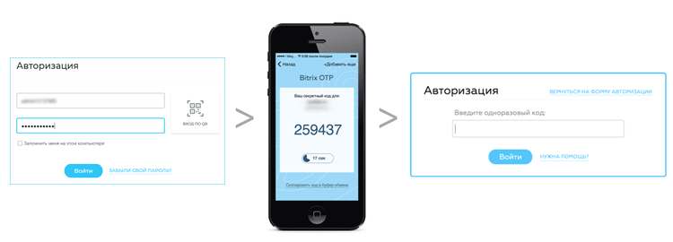
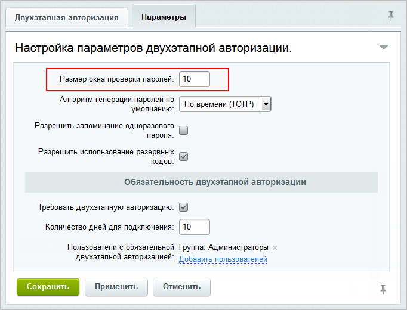
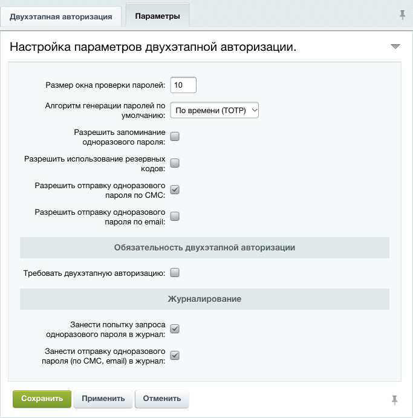

Двухэтапная авторизация добавляет ко входу по логину и паролю второй шаг — одноразовый пароль с устройства пользователя. Механизм входит в модуль Проактивная защита `security`. Общие настройки модуля описаны в статье [Проактивная защита](proactive-security.md).

Администратор включает двухэтапную авторизацию в настройках модуля, а пользователи подключают устройства в профиле. Разработчик может вывести формы подключения устройства и резервных кодов на страницах сайта и проверить состояние двухэтапной авторизации пользователя в коде.

## Система одноразовых паролей

Одноразовый пароль, OTP — это пароль, который действителен только для одного сеанса аутентификации. Его действие также может быть ограничено определенным промежутком времени.

OTP обеспечивает безопасность, так как пароль невозможно использовать повторно. Пароль, перехваченный после входа, система больше не принимает.

### Принцип работы

При каждой авторизации пользователь получает новый секретный код, который необходимо ввести для входа.

{width=750px height=270px}

### Алгоритмы генерации паролей

1. HMAC-Based One-time Password, HOTP — по счетчику:

   -  код действителен до тех пор, пока пользователь не запросит новый,

   -  счетчик увеличивается при каждой генерации кода,

   -  количество действующих кодов ограничено параметром *Размер окна проверки паролей* в настройках двухэтапной авторизации, по умолчанию `10`.

      {width=682px height=520px}

2. Time-based One-time Password, TOTP — по времени:

   -  код действителен 30 секунд, после чего автоматически обновляется,

   -  основан на текущем времени,

   -  чтобы компенсировать расхождение часов устройства и сервера, система проверяет код в двух интервалах до и после текущего. Код из интервала, который уже использовали для входа, и из более ранних интервалов система не принимает.

3. Мобильный push:

   -  алгоритм доступен с версии 25.0.0 модуля Проактивная защита,

   -  система отправляет push-уведомление в мобильное приложение Битрикс24,

   -  после ввода логина и пароля пользователь получает уведомление с запросом подтвердить или отклонить вход.

   

   Алгоритм доступен только в 1С-Битрикс24.

   

### О технологии OTP

Генератор OTP использует два параметра:

-  секретный ключ — начальное значение для генератора,

-  счетчик — текущее значение счетчика для HOTP или текущее время для TOTP.

Особенности:

-  начальное значение секретного ключа хранится и на устройстве пользователя, и на сервере,

-  если нарушена синхронизация счетчика на устройстве и сервере, ее можно восстановить. Для этого администратор или пользователь генерирует на устройстве два последовательных пароля и вводит их в форму на сайте. Порядок действий описан в разделе [Синхронизация устройства для двухэтапной авторизации](#device-sync).

## Механизм двухэтапной авторизации

Чтобы использовать двухэтапную авторизацию, необходимо сначала включить механизм в модуле Проактивная защита, а затем подключить устройство для генерации одноразовых паролей.

### Как включить механизм двухэтапной авторизации

1. Перейдите на страницу *Настройки > Проактивная защита > Двухэтапная авторизация*.

2. Нажмите кнопку *Включить двухэтапную авторизацию*.

3. Настройте параметры двухэтапной авторизации.

   -  Установите *Размер окна проверки паролей*, если используется алгоритм HOTP. Если пользователь нажмет кнопку на устройстве больше раз, чем указано в параметре, система не примет код, и устройство придется синхронизировать. По умолчанию `10`, рекомендуется указывать 5–10 кодов.

   -  Выберите *Алгоритм генерации паролей по умолчанию* — HOTP (по счетчику), TOTP (по времени) или Мобильный push. По умолчанию TOTP. Вариант Мобильный push доступен, если установлен модуль Мобильное приложение и работает сервер очередей модуля Push and Pull.

   -  Отметьте *Разрешить запоминание одноразового пароля*, чтобы пользователь не вводил код повторно на том же компьютере. Система сохраняет признак в cookie. Срок хранения и маску сети задают параметры группы *Срок хранения авторизации, запомненной на компьютере пользователя* и *Маска сети для привязки сохраненной авторизации*. Параметры описаны в статье [Группы пользователей](../cms-basics/user-groups.md).

   -  Отметьте *Разрешить использование резервных кодов*, чтобы пользователь мог войти без устройства.

   -  Отметьте *Требовать двухэтапную авторизацию*, чтобы подключение устройства стало обязательным для выбранных пользователей.

   -  Укажите *Количество дней для подключения* — срок, в течение которого пользователь без устройства еще может войти на сайт. Отсчет начинается с первого входа пользователя после включения требования. По умолчанию `10`. После этого срока система не пускает пользователя на сайт, пока он не подключит устройство.

   -  Выберите *Пользователей с обязательной двухэтапной авторизацией* — пользователей и группы. По умолчанию выбрана группа администраторов.

   -  Включите *Журналирование*, чтобы система записывала в журнал событий запросы одноразового пароля. Запись включена по умолчанию.

   {width=592px height=625px}

Теперь пользователи должны подключить свои устройства для генерации паролей.

Пока двухэтапная авторизация выключена в модуле, система не запрашивает одноразовый пароль даже у пользователей с подключенным устройством.

### Решение проблем

Если пользователь не может войти на сайт, выполните следующие действия:

-  для алгоритма TOTP — проверьте синхронизацию времени между устройством пользователя и сервером,

-  для алгоритма HOTP — [синхронизируйте устройство](#device-sync) или повторно подключите его.

Если пользователь несколько раз ввел неверный одноразовый пароль, система запрашивает CAPTCHA вместе со следующим кодом. Порог задает параметр группы *Количество попыток ввода пароля до показа CAPTCHA*. Параметр описан в статье [Группы пользователей](../cms-basics/user-groups.md).

## Подключить устройства

В системе доступно три метода аутентификации — push-уведомления, мобильные OTP-приложения и аппаратные устройства.

Если используете мобильное устройство, проверьте на нем корректность времени и часового пояса перед подключением двухэтапной авторизации.



Одновременно можно использовать только один способ. Если пользователь подключит новое устройство, авторизация с помощью старого станет невозможной.



### Мобильные push-уведомления



Чтобы для 1С-Битрикс24 использовать мобильные push-уведомления, настройте модули Push and Pull и Мобильное приложение.



В публичной части проекта можно самостоятельно подключить мобильное приложение Битрикс24.

1. Откройте форму Безопасность в профиле.

2. Отсканируйте QR-код и установите на смартфон приложение Битрикс24.

В административной части сайта подключение приложения доступно пользователям с соответствующими правами.

1. Откройте страницу *Настройки > Пользователи > Список пользователей*.

2. Выберите пользователя и перейдите на вкладку Двухэтапная авторизация.

3. Нажмите кнопку Подключить телефон.

4. Выберите Мобильный push.

5. Отсканируйте QR-код и установите на смартфон приложение Битрикс24.

### Мобильное OTP-приложение

В публичной части веб-проекта пользователи могут самостоятельно подключить приложение-аутентификатор, например Bitrix24 OTP.

1. Установите на смартфон приложение для генерации одноразовых паролей.

2. Отсканируйте QR-код или введите данные вручную.

3. Введите код подтверждения, который выведет приложение.

В административной части сайта подключение приложения доступно пользователям с соответствующими правами.

1. Перейдите на страницу *Настройки > Пользователи > Список пользователей*.

2. Выберите пользователя и перейдите на вкладку Двухэтапная авторизация.

3. Нажмите кнопку Подключить телефон.

4. Выберите алгоритм генерации паролей: по счетчику (HOTP) или по времени (TOTP).

5. Отсканируйте QR-код с помощью приложения.

   -  Для HOTP введите первый и второй сгенерированные коды.

   -  Для TOTP введите сгенерированный код в единственное поле.

6. Если сканирование QR-кода невозможно, введите данные вручную.

   -  Адрес сайта, например `www.example.com`.

   -  E-mail пользователя.

   -  Секретный ключ, который указан на картинке. Можно не обращать внимания на пробелы.

   -  Тип ключа.

### Аппаратное устройство

Для двухэтапной авторизации можно использовать аппаратные устройства, например USB-токены JaCarta и Рутокен. Устройство подключает в административной части администратор или пользователь с необходимыми правами.

1. Перейдите на страницу *Настройки > Пользователи > Список пользователей*.

2. Выберите пользователя и перейдите на вкладку Двухэтапная авторизация.

3. Нажмите кнопку Подключить брелок.

4. Выберите алгоритм генерации паролей в соответствии с документацией к устройству: по счетчику (HOTP) или по времени (TOTP).

5. Для алгоритма HOTP укажите:

   -  секретный ключ,

   -  первое значение кода на устройстве,

   -  следующее значение кода на устройстве.

6. Для алгоритма TOTP укажите:

   -  секретный ключ,

   -  начальное значение счетчика времени в формате Unix Timestamp. По умолчанию `0` — дата 01.01.1970. Если устройство отсчитывает время от другой даты, укажите ее значение, например `946684800` для 01.01.2000,

   -  первое значение кода на устройстве.

### Действия после подключения

После подключения устройства можно выполнить следующие действия:

-  отключить двухэтапную авторизацию навсегда или на определенный срок,

-  получить резервные коды для входа,

-  синхронизировать устройство с сервером,

-  подключить новый брелок или телефон.

{width=750px height=295px}

## Резервные коды

Резервные коды позволяют пользователям войти на сайт, когда устройство двухэтапной авторизации недоступно.



Функционал резервных кодов доступен, если в настройках двухэтапной авторизации отмечена опция *Разрешить использование резервных кодов*.



### Как сгенерировать резервные коды

Резервные коды может получить администратор или самостоятельно пользователь при наличии прав доступа.

1. Перейдите на страницу *Настройки > Пользователи > Список пользователей*.

2. Выберите пользователя и перейдите на вкладку Двухэтапная авторизация.

3. Нажмите ссылку Резервные коды.

4. Скопируйте коды из формы. Каждый код можно использовать только один раз, поэтому генерируйте новые коды по необходимости.

{width=726px height=623px}

Система генерирует десять кодов за раз. Код состоит из двух групп по четыре символа через дефис — строчные латинские буквы и цифры. Пользователь вводит резервный код в то же поле, что и одноразовый пароль. Храните коды в защищенном месте, например в менеджере паролей.

Текущие резервные коды можно отозвать в любой момент и сгенерировать новые. При новой генерации система удаляет все прежние коды пользователя, в том числе неиспользованные. Подключение нового устройства тоже удаляет резервные коды.

Если пользователь не может воспользоваться устройством и резервными кодами, администратор вправе временно отключить для него двухэтапную авторизацию.

## Синхронизация устройства для двухэтапной авторизации {#device-sync}

Синхронизация нужна, если счетчик на устройстве разошелся со счетчиком на сервере. Так бывает, если пользователь несколько раз сгенерировал пароль на устройстве и не вошел с ним на сайт.

### Как выполнить синхронизацию

Синхронизацию может выполнить администратор или самостоятельно пользователь при наличии прав доступа.

1. Перейдите на страницу *Настройки > Пользователи > Список пользователей*.

2. Выберите пользователя и перейдите на вкладку Двухэтапная авторизация.

3. Нажмите ссылку Синхронизировать.

4. Сгенерируйте два последовательных OTP на устройстве и введите их в форму.

{width=750px height=361px}

Система приводит счетчик на сервере в соответствие с устройством.

## Компоненты

В модуле Проактивная защита доступны компоненты Подключение устройства OTP `bitrix:security.user.otp.init` и Резервные коды OTP `bitrix:security.user.recovery.codes`. С их помощью администратор может создать страницы, где пользователи будут самостоятельно подключать устройства и получать резервные коды.

Компоненты работают с текущим пользователем. Неавторизованному посетителю они показывают сообщение об ошибке вместо формы.

### Подключение устройства OTP

Компонент Подключение устройства OTP `bitrix:security.user.otp.init` выводит форму подключения нового устройства. При каждом открытии страницы компонент формирует новый секретный ключ и QR-код по алгоритму из настройки *Алгоритм генерации паролей по умолчанию*. Устройство сохраняется, когда пользователь вводит код подтверждения. Если у пользователя уже было устройство, новое заменяет его, а резервные коды удаляются.

Компонент задает заголовок страницы «Настройка дополнительной защиты» и не проверяет, включена ли двухэтапная авторизация в модуле. Показывайте ссылку на страницу, только если метод `Otp::isOtpEnabled()` возвращает `true`. Пример проверки приведен в разделе [Проверить устройство пользователя](#check-user-otp).

1. Создайте новую страницу. Например, Двухэтапная авторизация.

2. Разместите на странице компонент Подключение устройства OTP.

3. Создайте ссылку на эту страницу. Например, в меню личного кабинета пользователя.

**Пример.** Страница `/personal/otp/index.php` выводит форму подключения устройства и после подключения переводит пользователя на страницу резервных кодов:

```php
<?php
require $_SERVER['DOCUMENT_ROOT'] . '/bitrix/header.php';

$APPLICATION->IncludeComponent(
    'bitrix:security.user.otp.init',
    '',
    [
        'SUCCESSFUL_URL' => '/personal/recovery-codes/',
        'SHOW_DESCRIPTION' => 'Y',
    ]
);

require $_SERVER['DOCUMENT_ROOT'] . '/bitrix/footer.php';
```

Все параметры компонента необязательные.

| Параметр | Тип | Описание |
|---|---|---|
| `SUCCESSFUL_URL` | `string` | Адрес, на который компонент переводит пользователя после подключения устройства. Значение должно начинаться с `/`, `http://` или `https://`, иначе компонент использует `/`. По умолчанию `/` |
| `SHOW_DESCRIPTION` | `string` | Показывать ли описание над формой. Значения `Y` и `N`, по умолчанию `Y` |
| `REDIRECT_AFTER_CONNECTION` | `string` | Переводить ли пользователя на адрес из `SUCCESSFUL_URL` после подключения устройства. Значения `Y` и `N`, по умолчанию `Y`. Параметра нет в настройках компонента в визуальном редакторе, передавайте его в коде |

После подключения устройства шаблон компонента вызывает JS-событие `BX.Security.UserOtpInit:afterOtpSetup` у объекта `window`. Подпишитесь на него через `BX.addCustomEvent`, если передаете `REDIRECT_AFTER_CONNECTION` со значением `N` и страница должна реагировать на подключение без перехода.

### Резервные коды OTP

Компонент Резервные коды OTP `bitrix:security.user.recovery.codes` выводит резервные коды текущего пользователя с кнопками генерации новых кодов, печати и сохранения в файл. Если у пользователя еще нет кодов, компонент генерирует десять кодов при первом открытии страницы. Компонент задает заголовок страницы «Резервные коды».

Вместо кодов компонент показывает сообщение об ошибке, если:

-  посетитель не авторизован,

-  у пользователя не подключено устройство или двухэтапная авторизация для него отключена,

-  в настройках двухэтапной авторизации не отмечена опция *Разрешить использование резервных кодов*.

1. Создайте новую страницу. Например, Резервные коды.

2. Разместите на странице компонент Резервные коды OTP.

3. Создайте ссылку на эту страницу. Например, в меню личного кабинета пользователя.

**Пример.** Страница `/personal/recovery-codes/index.php` выводит форму с резервными кодами:

```php
<?php
require $_SERVER['DOCUMENT_ROOT'] . '/bitrix/header.php';

$APPLICATION->IncludeComponent(
    'bitrix:security.user.recovery.codes',
    '',
    []
);

require $_SERVER['DOCUMENT_ROOT'] . '/bitrix/footer.php';
```

В визуальном редакторе у компонента нет настроек. Кнопки печати и сохранения открывают ту же страницу с параметром запроса `codesAction=print` или `codesAction=download`. В коде компоненту можно передать необязательные параметры.

| Параметр | Тип | Описание |
|---|---|---|
| `MODE` | `string` | Режим вывода. `print` — версия для печати с неиспользованными кодами, `download` — текстовый файл `recovery_codes.txt` с неиспользованными кодами. По умолчанию пустая строка — форма со всеми кодами пользователя, включая использованные |
| `PATH_TO_CODES` | `string` | Путь к странице с компонентом для кнопки сохранения кодов в файл. Компонент добавляет к пути `?codesAction=download&ncc=1`. По умолчанию пустая строка — кнопка ведет на текущую страницу |

## Работать с двухэтапной авторизацией из кода

Класс `Bitrix\Security\Mfa\Otp` модуля `security` хранит данные двухэтапной авторизации пользователя и читает настройки механизма. Перед вызовом методов подключите модуль через `Loader::includeModule('security')`.

### Проверить устройство пользователя {#check-user-otp}

Статический метод `Otp::getByUser($userId)` возвращает объект `Otp` для пользователя с идентификатором `$userId`. Если пользователь не подключал устройство, метод все равно возвращает объект, и его метод `isActivated()` возвращает `false`. Если `$userId` после приведения к целому числу не больше нуля, метод выбрасывает исключение `Bitrix\Main\ArgumentTypeException`.

Методы объекта `Otp`:

-  `isActivated()` — возвращает `true`, если у пользователя подключено устройство и двухэтапная авторизация для него не отключена.

-  `getType()` — возвращает алгоритм устройства, значение перечисления `Bitrix\Security\Mfa\OtpType`: `OtpType::Hotp`, `OtpType::Totp` или `OtpType::Push`. Строковое значение `hotp`, `totp` или `push` хранится в свойстве `value`.

-  `getDeactivateUntil()` — возвращает дату `Bitrix\Main\Type\DateTime`, до которой отключена двухэтапная авторизация, или `null`, если дата не задана.

-  `deactivate($days = 0)` — отключает двухэтапную авторизацию пользователя на `$days` дней, значение `0` отключает ее без срока. Если устройство не подключено, метод выбрасывает исключение `Bitrix\Security\Mfa\OtpException`.

-  `activate()` — снова включает двухэтапную авторизацию для подключенного устройства. Если у пользователя нет секретного ключа, метод выбрасывает исключение `Bitrix\Security\Mfa\OtpException`.

**Пример.** Код показывает ссылку на страницу подключения устройства, если двухэтапная авторизация включена в модуле, а у текущего пользователя устройство не подключено:

```php
<?php
use Bitrix\Main\Loader;
use Bitrix\Security\Mfa\Otp;

global $USER;

if (
    $USER->IsAuthorized()
    && Loader::includeModule('security')
    && Otp::isOtpEnabled()
)
{
    $otp = Otp::getByUser($USER->GetID());

    if (!$otp->isActivated())
    {
        echo '<a href="/personal/otp/">Подключить двухэтапную авторизацию</a>';
    }
}
```

Методы `deactivate()` и `activate()` не проверяют права текущего пользователя. Административный интерфейс модуля разрешает менять двухэтапную авторизацию другого пользователя, только если `$USER->CanDoOperation('security_edit_user_otp')` возвращает `true`. Выполняйте ту же проверку в своем коде.

### Прочитать и изменить настройки механизма

Статические методы класса `Otp` читают и записывают настройки модуля `security`. Те же значения администратор задает на странице *Настройки > Проактивная защита > Двухэтапная авторизация*.

-  `isOtpEnabled()` — возвращает `true`, если двухэтапная авторизация включена в модуле. По умолчанию выключена.

-  `isRecoveryCodesEnabled()` — возвращает `true`, если разрешены резервные коды. По умолчанию запрещены.

-  `getDefaultType()` и `setDefaultType(OtpType $value)` — возвращают и задают алгоритм по умолчанию. По умолчанию `OtpType::Totp`.

-  `isMandatoryUsing()` и `setMandatoryUsing($isMandatory = true)` — возвращают и задают, обязательна ли двухэтапная авторизация. По умолчанию не обязательна.

-  `getMandatoryRights()` и `setMandatoryRights(array $rights)` — возвращают и задают массив кодов доступа пользователей, для которых двухэтапная авторизация обязательна. Код группы имеет вид `G` и идентификатор группы, например `G1` — группа администраторов. По умолчанию `['G1']`.

-  `getSkipMandatoryDays()` и `setSkipMandatoryDays($days = 2)` — возвращают и задают количество дней на подключение устройства. Значение `0` означает, что система потребует устройство при следующем входе пользователя. По умолчанию `10`.

Идентификатор группы можно найти в списке групп. Работа с группами описана в статье [Группы пользователей](../cms-basics/user-groups.md).

**Пример.** Код делает двухэтапную авторизацию обязательной для группы администраторов и дает пять дней на подключение устройства:

```php
<?php
use Bitrix\Main\Loader;
use Bitrix\Security\Mfa\Otp;

if (Loader::includeModule('security'))
{
    Otp::setMandatoryRights(['G1']);
    Otp::setSkipMandatoryDays(5);
    Otp::setMandatoryUsing(true);
}
```

Требование действует, только если двухэтапная авторизация включена в модуле и `Otp::isOtpEnabled()` возвращает `true`.
