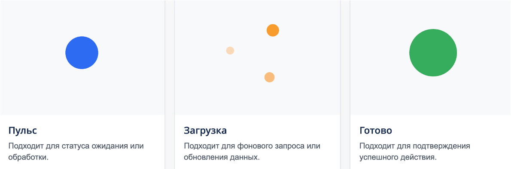

Lottie-анимации хранятся в формате JSON. Формат применяют для интерактивных элементов интерфейса: загрузочных экранов, индикаторов и других визуальных эффектов. Анимации не зависят от разрешения экрана и не нагружают сеть, в отличие от видео и растровых изображений.

В Bitrix Framework на базе библиотеки Lottie 5.13 доступно расширение `ui.lottie`. Расширение позволяет подключать анимации в интерфейсе и управлять воспроизведением из JavaScript-кода.

{width=740px height=360px}

## Подключить расширение

Подключите расширение `ui.lottie` в шаблон компонента или страницы.

В JavaScript-коде:

```javascript
import { Lottie } from 'ui.lottie';
```

В PHP-коде:

```php
\Bitrix\Main\UI\Extension::load('ui.lottie');
```

Импорт `Lottie` и глобальное имя `BX.UI.Lottie` указывают на один и тот же объект. В модульном JavaScript обращайтесь к импортированному `Lottie`, а во встроенном скрипте страницы, где `import` недоступен, — к `BX.UI.Lottie`.

## Загрузить анимацию

Вызовите метод `Lottie.loadAnimation()` и передайте параметры в виде объекта.

-  `container` — HTML-элемент, в который нужно вставить анимацию. Обязательный параметр.

-  `path` — путь к JSON-файлу с анимацией. Используйте, если файл загружается по URL. Файл должен быть доступен браузеру.

-  `animationData` — данные анимации в виде загруженного JSON-объекта. Альтернатива параметру `path`.

-  `renderer` — тип отрисовки. Возможные значения: `svg`, `canvas`, `html`. Для векторной графики используйте `svg`.

-  `loop` — зацикливание анимации. Передайте `true` для бесконечного повтора или число для фиксированного количества циклов.

-  `autoplay` — автовоспроизведение. Возможные значения: `true` — воспроизведение сразу после загрузки, `false` — по событию.

-  `name` — имя экземпляра анимации. Укажите имя, чтобы управлять анимацией через `Lottie.play(name)` и аналогичные методы.

Для загрузки анимации передайте один источник данных: `path` или `animationData`.

**Пример.** Модульный код загружает анимацию из JSON-файла и выводит ошибку в консоль, если файл не загрузился.

```javascript
import { Lottie } from 'ui.lottie';

const animation = Lottie.loadAnimation({
    container: document.getElementById('lottie-container'),
    path: '/local/assets/animations/loader.json',
    renderer: 'svg',
    loop: true,
    autoplay: true
});

animation.addEventListener('data_failed', () => {
    console.error('Не удалось загрузить Lottie-анимацию');
});
```



Элемент `container` должен существовать в DOM на момент вызова `loadAnimation`. Если элемент отсутствует, анимация не отображается.



## Передать данные анимации

Используйте параметр `animationData`, когда JSON-объект уже получен из API или встроен в JavaScript-код. Такой способ не требует отдельного файла с анимацией.

**Пример.** Скрипт PHP-страницы загружает анимацию из переменной `animationData`. Скрипт встроен в страницу без сборки, поэтому обращается к глобальному `BX.UI.Lottie`. Перед вызовом `loadAnimation()` подставьте в переменную JSON-объект Lottie.

```php
<?php
\Bitrix\Main\UI\Extension::load('ui.lottie');
?>

<div id="lottie-container" style="width: 120px; height: 120px;"></div>

<script>
BX.ready(() => {
    const container = document.getElementById('lottie-container');
    const animationData = {
        // JSON-объект Lottie-анимации
    };

    if (!container)
    {
        return;
    }

    const animation = BX.UI.Lottie.loadAnimation({
        container,
        animationData,
        renderer: 'svg',
        loop: true,
        autoplay: true,
    });

    animation.addEventListener('data_failed', () => {
        console.error('Не удалось обработать Lottie-анимацию');
    });
});
</script>
```

## Настроить анимацию

Метод `loadAnimation` возвращает объект `AnimationItem`. Используйте методы объекта `AnimationItem`, чтобы управлять анимацией программно.

-  `play()` — запускает воспроизведение.

-  `stop()` — останавливает воспроизведение и возвращает к первому кадру.

-  `pause()` — приостанавливает на текущем кадре.

-  `togglePause()` — переключает паузу.

-  `setSpeed(speed)` — изменяет скорость. Значение `1` — нормальная скорость, `0.5` — вдвое медленнее, `2` — вдвое быстрее.

-  `setDirection(direction)` — меняет направление. Значение `1` — обычное направление, `-1` — обратное направление.

-  `goToAndStop(value, isFrame)` — переходит к указанному времени или кадру, если `isFrame` принимает `true`, и останавливает воспроизведение.

-  `goToAndPlay(value, isFrame)` — переходит к указанному времени или кадру, если `isFrame` принимает `true`, и продолжает воспроизведение.

## Удалить анимацию и освободить память

Удалите анимацию из DOM и остановите все внутренние таймеры, когда анимация больше не нужна.

```javascript
// Полностью уничтожить экземпляр, например, при смене страницы
animation.destroy();
```

## Подписаться на события

Подпишитесь на события через `addEventListener`, чтобы синхронизировать анимацию с логикой приложения.

-  `complete` — анимация завершена.

-  `loopComplete` — завершен очередной цикл, актуально при `loop: true`.

-  `enterFrame` — событие на каждый кадр.

-  `drawnFrame` — кадр отрендерен и отображен на экране.

-  `segmentStart` — смена сегмента анимации.

-  `config_ready` — конфигурация загружена.

-  `data_ready` — JSON с анимацией загружен и обработан.

-  `DOMLoaded` — анимация добавлена в DOM-дерево страницы.

-  `destroy` — анимация удалена.

-  `data_failed` — произошла ошибка при загрузке или обработке данных анимации.

-  `loaded_images` — все внешние изображения успешно загружены.

**Пример.** Обработчики выводят сообщение в консоль, когда анимация завершается и когда завершается очередной цикл.

```javascript
animation.addEventListener('complete', () => {
    console.log('Анимация завершена');
});

animation.addEventListener('loopComplete', () => {
    console.log('Завершен один цикл');
});
```
