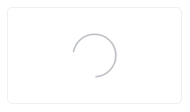

Расширение `main.loader` выводит вращающийся круговой индикатор загрузки. Индикатор показывают, пока выполняется запрос или загружается содержимое блока, например список документов, вкладка или превью файла.

За индикатор отвечает класс `Loader`. Он вставляет индикатор в указанный контейнер и плавно показывает и скрывает его.

Если на время загрузки нужно показать заготовку будущего содержимого, а не индикатор, используйте [скелетон загрузки ui.system.skeleton](./system-skeleton.md). Если нужно показать долю выполненной работы, используйте [индикаторы прогресса ui.progressbar и ui.progressround](./ui-progress.md).

## Подключить расширение

Если вы подключаете расширение из PHP, загрузите `main.loader`.

```php
\Bitrix\Main\UI\Extension::load('main.loader');
```

В модульном JavaScript импортируйте класс `Loader`.

```js
import { Loader } from 'main.loader';
```

Вне модульного JavaScript класс доступен как `BX.Loader`.

## Показать индикатор

Создайте экземпляр `Loader`, передайте контейнер в параметре `target` и вызовите `show()`. Метод `hide()` скрывает индикатор. Вызывайте `hide()` и при ошибке запроса, иначе индикатор останется на странице.

**Пример.** Пока загружается список документов, в центре блока списка вращается индикатор. Код скрывает индикатор после ответа, в том числе после ошибки.

```js
import { Loader } from 'main.loader';

// Контейнеру нужно позиционирование, например position: relative
const container = document.getElementById('documents');
const loader = new Loader({ target: container });

loader.show();

// loadDocuments() — функция вашего модуля, которая возвращает Promise с HTML списка
loadDocuments()
    .then((html) => {
        container.innerHTML = html;
    })
    .finally(() => {
        loader.hide();
    });
```

Индикатор с параметрами по умолчанию — серое вращающееся кольцо в центре контейнера.

{width=392px height=232px}

По умолчанию индикатор размещается по центру контейнера с абсолютным позиционированием. Задайте контейнеру позиционирование, например `position: relative`, иначе индикатор встанет по центру ближайшего позиционированного предка.

Индикатор не перекрывает контейнер подложкой и не блокирует клики по его содержимому. Если на время загрузки действия нужно запретить, отключите элементы управления сами.



Вызывайте методы `show()` и `hide()` без ожидания. Методы возвращают `Promise`, который никогда не выполняется и не отклоняется, поэтому код после ожидания через `await`, `then()`, `catch()` или `finally()` не выполнится.

Класс `Loader` не вызывает событий, поэтому завершение анимации показа и скрытия отследить нельзя.



## Передать параметры

Все параметры необязательны.

| Параметр | Тип | Описание |
|---|---|---|
| `target` | `HTMLElement` | Контейнер, в который класс вставляет индикатор. Без контейнера в конструкторе или в `show()` индикатор не появится на странице, хотя `isShown()` вернет `true` |
| `size` | `number` | Ширина и высота индикатора в пикселях. По умолчанию `110` |
| `color` | `string` | CSS-цвет линии индикатора. По умолчанию `#BFC3C8` |
| `strokeWidth` | `number` | Толщина линии в единицах SVG, а не в пикселях. Линия масштабируется вместе с `size`. По умолчанию `1.5` |
| `mode` | `string` | Режим размещения — `inline` или `custom`. Если не передан, индикатор стоит по центру контейнера |
| `offset` | `object` | Сдвиг индикатора — строки CSS в полях `top` и `left`, например `{ top: '20px' }`. Числа не применяются |

Режим размещения задает, как индикатор стоит в контейнере.

-  Без `mode` — индикатор стоит по центру контейнера. Значения `offset` сдвигают его через отступы `margin-top` и `margin-left`.

-  `inline` — индикатор встает в поток содержимого, как обычный элемент, и не перекрывает соседние элементы. Значения `offset` сдвигают его относительно места в потоке через свойства `top` и `left`.

-  `custom` — индикатор стоит в левом верхнем углу контейнера, а `offset` задает свойства `top` и `left`, то есть точное положение.

**Пример.** Небольшой индикатор встает в поток рядом с подписью «Сохраняем».

```js
import { Loader } from 'main.loader';

const loader = new Loader({
    target: document.getElementById('save-status'),
    size: 20,
    mode: 'inline',
    color: '#2fc6f6',
});

loader.show();
```

В режиме `inline` индикатор стоит в строке рядом с текстом.

{width=136px height=52px}

## Управлять индикатором

Методы экземпляра:

-  `show(target)` — показывает индикатор. Если передан контейнер, переносит индикатор в него. Повторный вызов на показанном индикаторе ничего не меняет.

-  `hide()` — скрывает индикатор. Элемент индикатора остается в контейнере, и повторный `show()` показывает его снова.

-  `isShown()` — возвращает `true`, если последним вызывали `show()`. Значение `true` не гарантирует, что индикатор виден на странице.

-  `setOptions(options)` — меняет размер, цвет, толщину линии, режим и сдвиг уже созданного индикатора.

-  `destroy()` — удаляет элемент индикатора со страницы. Экземпляр остается рабочим, и следующий `show()` вернет индикатор в прежний контейнер.

Если не передать контейнер ни в конструктор, ни в `show()`, индикатор не появится на странице, хотя `isShown()` вернет `true`.

Передавайте `mode` в каждом вызове `setOptions()`, иначе индикатор выходит из режима `inline`. Метод `setOptions()` не отменяет режим `custom`. Чтобы вернуть индикатор в центр контейнера, создайте новый экземпляр.

Свойство `layout` возвращает элемент индикатора. Используйте его, если индикатор нужно вставить в разметку самостоятельно.

Индикатор не задает атрибуты доступности. Если экранная читалка должна сообщить о загрузке, добавьте элементу `layout` атрибут `role` сами.

## Связанные материалы

-  [Скелетон загрузки](./system-skeleton.md)

-  [Индикаторы прогресса ui.progressbar и ui.progressround](./ui-progress.md)

-  [Вкладки ui.tabs](./ui-tabs.md)

-  [Расширения](../framework/extensions.md)
