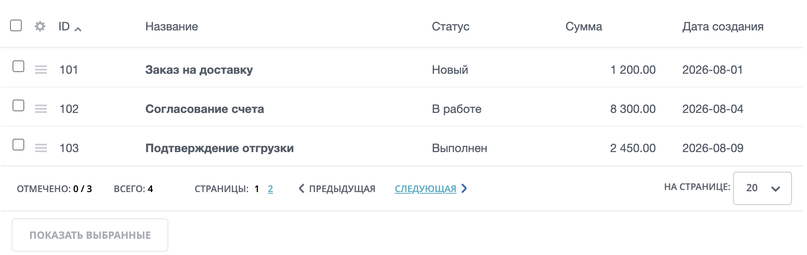
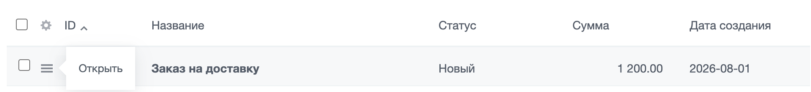

`main.ui.grid` выводит данные в виде интерактивной таблицы. Компонент подходит для списков элементов, отчетов и административных интерфейсов, где нужны колонки, сортировка, постраничная навигация, действия строк и групповые операции.

Компонент отвечает за интерфейс таблицы и пользовательские настройки колонок. Данные, сортировку, фильтрацию и права готовит серверный код страницы. Если на странице есть [фильтр `main.ui.filter`](./main-ui-filter.md), используйте общий идентификатор грида и фильтра.

## Вывести таблицу

Минимальный вызов требует `GRID_ID` и `COLUMNS`. Если строк пока нет, передайте пустой массив `ROWS`.

```php
<?php

$gridId = 'orders_grid';

$columns = [
    [
        'id' => 'ID',
        'name' => 'ID',
        'sort' => 'ID',
        'default' => true,
    ],
    [
        'id' => 'TITLE',
        'name' => 'Название',
        'sort' => 'TITLE',
        'default' => true,
    ],
];

$rows = [
    [
        'id' => 1,
        'data' => [
            'ID' => 1,
            'TITLE' => 'Заказ на доставку',
        ],
    ],
];

$APPLICATION->IncludeComponent(
    'bitrix:main.ui.grid',
    '',
    [
        'GRID_ID' => $gridId,
        'COLUMNS' => $columns,
        'ROWS' => $rows,
        'AJAX_MODE' => 'Y',
        'AJAX_OPTION_JUMP' => 'N',
        'AJAX_OPTION_HISTORY' => 'N',
    ]
);
```

{width=768px height=243px}

Основные параметры:

| Параметр | Тип | Описание |
|---|---|---|
| `GRID_ID` | `string` | Обязательный строковый идентификатор таблицы. По нему компонент хранит настройки колонок и состояние грида |
| `COLUMNS` | `array` | Обязательный массив колонок. Для совместимости компонент также принимает `HEADERS`, но в новом коде используйте `COLUMNS` |
| `ROWS` | `array` | Массив строк. Если не передать массив, компонент подготовит пустой набор строк |
| `SORT` | `array` | Текущая сортировка в формате `['FIELD' => 'asc']` или `['FIELD' => 'desc']` |
| `NAV_OBJECT` | `Bitrix\Main\UI\PageNavigation` | Объект постраничной навигации |
| `TOTAL_ROWS_COUNT` | `int` | Общее количество записей |
| `AJAX_MODE` | `string` | `Y` включает AJAX-режим компонента. Ядро передает компоненту идентификатор `AJAX_ID`, и грид добавляет его к своим запросам |
| `AJAX_OPTION_JUMP` | `string` | `N` отключает прокрутку страницы к таблице после AJAX-обновления. По умолчанию прокрутка включена. Действует при `AJAX_MODE`, равном `Y` |
| `AJAX_OPTION_STYLE` | `string` | `N` отключает загрузку CSS-файлов, которые компонент подключил при AJAX-обновлении. По умолчанию загрузка включена. Действует при `AJAX_MODE`, равном `Y` |
| `AJAX_OPTION_HISTORY` | `string` | `N` отключает запись состояния страницы в историю браузера после AJAX-обновления. По умолчанию запись включена. Действует при `AJAX_MODE`, равном `Y` |

Компонент не получает данные из базы сам. Подготовьте строки, фильтр, сортировку и лимит до вызова `IncludeComponent()`.

## Описать колонки

Каждая колонка — массив с обязательным `id`. Заголовок задается в `name`.

```php
<?php

$column = [
    'id' => 'STATUS',
    'name' => 'Статус',
    'sort' => 'STATUS',
    'default' => true,
    'width' => 160,
    'align' => 'left',
];
```

Основные ключи колонки:

| Ключ | Тип | Описание |
|---|---|---|
| `id` | `string` | Обязательный идентификатор колонки. Он должен совпадать с ключом значения в `ROWS[].data`, если колонка выводит обычное поле |
| `name` | `string` | Заголовок колонки |
| `type` | `string` | Тип колонки для серверного слоя `Bitrix\Main\Grid\Column\Column`. Если тип не передан, используется текстовый тип |
| `sort` | `string` | Поле сортировки. По нему компонент связывает заголовок с направлением сортировки |
| `first_order` | `string` | Первое направление сортировки: `asc` или `desc` |
| `default` | `bool` | `true` показывает колонку по умолчанию |
| `width` | `int` | Ширина колонки в пикселях |
| `align` | `string` | Выравнивание содержимого. Поддерживаются значения `left`, `center`, `right` и `justify` |
| `showname` | `bool` | `false` скрывает текст заголовка |
| `resizeable` | `bool` | `false` запрещает менять ширину колонки |
| `sticked` | `bool` | Закрепляет колонку, если включен режим закрепленных колонок |
| `prevent_default` | `bool` | Отменяет стандартное выделение строки при клике по ячейке |
| `editable` | `array` или `bool` | Параметры инлайн-редактирования или `true` для стандартной настройки по типу колонки. Подробнее — в разделе [Редактировать строки в таблице](#inline-edit) |
| `color` | `string` | CSS-цвет или CSS-класс цвета для оформления колонки |
| `hint`, `hintHtml`, `hintInteractivity` | `string` или `bool` | Параметры подсказки в заголовке |

Чтобы закрепить колонку, включите `ALLOW_STICKED_COLUMNS` в параметрах компонента и задайте `sticked` только тем колонкам, которые должны оставаться слева при горизонтальной прокрутке.

Не используйте внутренние CSS-классы шаблона грида для оформления страницы. Для внешнего вида задавайте параметры компонента или собственные CSS-классы.

## Описать строки

Строка содержит идентификатор и данные для колонок. Значения из `data` выводятся по ключам колонок.

```php
<?php

$row = [
    'id' => 42,
    'data' => [
        'ID' => 42,
        'TITLE' => 'Заказ на доставку',
        'STATUS' => 'Новый',
    ],
];
```

Основные ключи строки:

| Ключ | Тип | Описание |
|---|---|---|
| `id` | `int` или `string` | Обязательный идентификатор строки. Он нужен для выбора, действий и обновления строки |
| `data` | `array` | Обязательные исходные значения строки |
| `columns` | `array` | Подготовленное содержимое ячеек. Используйте этот ключ, если в ячейке нужен HTML или форматирование, отличное от значения в `data` |
| `actions` | `array` | Пункты меню строки |
| `editable` | `bool` | `false` запрещает выбирать и редактировать строку. Флажок строки недоступен |
| `editableColumns` | `array` | Колонки, которые нельзя редактировать в этой строке, в формате `['STATUS' => false]`. Колонка, которой нет в массиве, редактируется |
| `attrs` | `array` | HTML-атрибуты строки |
| `columnClasses` | `array` | CSS-классы отдельных ячеек |
| `parent_group_id` | `int` или `string` | Идентификатор группы, в которую входит строка. Как собрать группы, описано в разделе [Сгруппировать строки](#sgruppirovat-stroki) |

Если в `columns` выводится HTML, экранируйте пользовательские данные до передачи в компонент.

```php
<?php

use Bitrix\Main\Text\HtmlFilter;

$row = [
    'id' => 42,
    'data' => [
        'TITLE' => $title,
    ],
    'columns' => [
        'TITLE' => '<strong>' . HtmlFilter::encode($title) . '</strong>',
    ],
];
```

## Сгруппировать строки

Грид выводит строки группами. Над группой стоит строка-заголовок на всю ширину таблицы с кнопкой, которая сворачивает и разворачивает группу. Группировку собирает серверный код. Он добавляет в `ROWS` строки-заголовки и помечает обычные строки идентификатором группы.



Группы сворачиваются, только если в параметрах компонента передан `'ENABLE_COLLAPSIBLE_ROWS' => true`. Без него грид выводит строку-заголовок без кнопки, а ключ `expand` не действует.



У строки-заголовка свой набор ключей.

*Обязательные ключи обозначены \*.*

| Ключ | Описание |
|---|---|
| id\*<br>`string` | Идентификатор строки-заголовка. Он должен отличаться от идентификаторов обычных строк, например `group_new` |
| custom\*<br>`string` | HTML заголовка. Строка занимает всю ширину таблицы и не выводит ячейки колонок. Компонент выводит HTML как есть, поэтому экранируйте пользовательские данные. Без непустого `custom` компонент выводит строку как обычную |
| group_id<br>`int` или `string` | Идентификатор группы. Обычные строки ссылаются на него в ключе `parent_group_id` |
| has_child<br>`bool` | `true` выводит кнопку сворачивания группы |
| attrs<br>`array` | Передайте `'data-group-id' => <идентификатор группы>`. Сам компонент этот атрибут не выводит |
| expand<br>`bool` | `false` выводит группу свернутой. По умолчанию группа развернута |

Чтобы отнести обычную строку к группе, передайте оба ключа:

-  `parent_group_id` — `group_id` строки-заголовка. По нему компонент на сервере скрывает строки свернутой группы. Компонент сравнивает значения с учетом типа, поэтому передавайте `group_id` и `parent_group_id` одного типа — оба строкой или оба числом.

-  `attrs` с `'data-group-id' => <идентификатор группы>` — по этому атрибуту JS-часть грида находит строки группы, когда пользователь нажимает кнопку сворачивания.

Грид выводит строки в порядке массива `ROWS`, поэтому ставьте строку-заголовок перед строками своей группы.

**Пример.** Заказы сгруппированы по статусу. Группа «Выполненные» при первом выводе свернута.

```php
<?php

use Bitrix\Main\Text\HtmlFilter;

// $columns — колонки грида, $ordersByStatus — заказы, разложенные по ключам new и done
$groups = [
    'new' => ['title' => 'Новые', 'expand' => true],
    'done' => ['title' => 'Выполненные', 'expand' => false],
];

$rows = [];

foreach ($groups as $groupId => $group)
{
    $rows[] = [
        'id' => 'group_' . $groupId,
        'group_id' => $groupId,
        'has_child' => true,
        'custom' => HtmlFilter::encode($group['title']),
        'attrs' => [
            'data-group-id' => $groupId,
        ],
        'expand' => $group['expand'],
    ];

    foreach ($ordersByStatus[$groupId] as $order)
    {
        $rows[] = [
            'id' => $order['ID'],
            'parent_group_id' => $groupId,
            'attrs' => [
                'data-group-id' => $groupId,
            ],
            'data' => [
                'ID' => $order['ID'],
                'TITLE' => $order['TITLE'],
            ],
        ];
    }
}

$APPLICATION->IncludeComponent(
    'bitrix:main.ui.grid',
    '',
    [
        'GRID_ID' => 'orders_grid',
        'COLUMNS' => $columns,
        'ROWS' => $rows,
        'ENABLE_COLLAPSIBLE_ROWS' => true,
    ]
);
```

### Свернуть группу при первом выводе

Если в строке-заголовке передан `expand => false`, грид скрывает все строки, у которых `parent_group_id` совпадает с `group_id` этой группы.



Ключ `expand` у строк-заголовков действует с версии главного модуля 26.1000.0. В более ранних версиях грид при первом выводе разворачивает все группы.



Значение из `ROWS` действует, пока пользователь сам не свернет или не развернет группу. После этого грид сохраняет в сессии пользователя список свернутых групп для текущего `GRID_ID` — идентификаторы `id` их строк-заголовков. Дальше сохраненный список перекрывает `expand` из `ROWS`, даже если пользователь развернул все группы и список пуст. Когда сессия заканчивается, грид снова берет состояние из `ROWS`.

## Добавить сортировку

Чтобы колонка стала сортируемой, передайте ей ключ `sort` и включите `ALLOW_SORT`. Текущее направление сортировки передайте в `SORT`.

Если передан `ROW_LAYOUT`, компонент отключает сортировку колонок и строк.

Текущую сортировку получите методом `getSorting()` класса `Bitrix\Main\Grid\Options`.

```php
<?php

use Bitrix\Main\Grid\Options;

$gridOptions = new Options($gridId);
$sorting = $gridOptions->getSorting([
    'sort' => [
        'ID' => 'desc',
    ],
    'vars' => [
        'by' => 'by',
        'order' => 'order',
    ],
]);

$sort = $sorting['sort'];
```

Полученный `$sort` примените к выборке данных, а затем передайте в компонент.

```php
<?php

$APPLICATION->IncludeComponent(
    'bitrix:main.ui.grid',
    '',
    [
        'GRID_ID' => $gridId,
        'COLUMNS' => $columns,
        'ROWS' => $rows,
        'SORT' => $sort,
        'ALLOW_SORT' => true,
    ]
);
```

Компонент показывает состояние сортировки в заголовке, но данные должны прийти уже отсортированными. Если источник данных — ORM, передайте `$sort` в параметр `order` метода `getList()`.

## Добавить пагинацию

Для постраничной навигации подготовьте объект `Bitrix\Main\UI\PageNavigation`, задайте количество записей и передайте объект в `NAV_OBJECT`.

```php
<?php

use Bitrix\Main\Grid\Options;
use Bitrix\Main\UI\PageNavigation;

$gridOptions = new Options($gridId);
$navParams = $gridOptions->getNavParams([
    'nPageSize' => 20,
]);

$nav = new PageNavigation('orders');
$nav->allowAllRecords(false)
    ->setPageSize((int)$navParams['nPageSize'])
    ->initFromUri()
;

$nav->setRecordCount($totalCount);

$APPLICATION->IncludeComponent(
    'bitrix:main.ui.grid',
    '',
    [
        'GRID_ID' => $gridId,
        'COLUMNS' => $columns,
        'ROWS' => $rows,
        'NAV_OBJECT' => $nav,
        'TOTAL_ROWS_COUNT' => $totalCount,
        'SHOW_PAGINATION' => true,
        'SHOW_TOTAL_COUNTER' => true,
        'PAGE_SIZES' => [
            ['NAME' => '10', 'VALUE' => '10'],
            ['NAME' => '20', 'VALUE' => '20'],
            ['NAME' => '50', 'VALUE' => '50'],
        ],
        'SHOW_PAGESIZE' => true,
    ]
);
```

Примените к выборке значения `$nav->getLimit()` и `$nav->getOffset()`. Компонент выводит навигацию, но не ограничивает исходные данные сам.

## Добавить действия

Меню строки задается в ключе `actions`. Пункт меню может содержать текст, ссылку `href`, JavaScript-обработчик `onclick` или вложенные пункты.

```php
<?php

$row = [
    'id' => 42,
    'data' => [
        'ID' => 42,
        'TITLE' => 'Заказ на доставку',
    ],
    'actions' => [
        [
            'text' => 'Открыть',
            'onclick' => 'BX.SidePanel.Instance.open("/orders/42/");',
        ],
    ],
];
```

{width=768px height=88px}

Групповая панель задается параметром `ACTION_PANEL`. Чтобы пользователь мог выбрать строки и увидеть панель, передайте параметры `SHOW_ROW_CHECKBOXES`, `SHOW_ACTION_PANEL` и `SHOW_SELECTED_COUNTER` со значением `true`.

```php
<?php

$actionPanel = [
    'GROUPS' => [
        [
            'ITEMS' => [
                [
                    'TYPE' => 'BUTTON',
                    'TEXT' => 'Удалить',
                    'ONCHANGE' => [
                        [
                            'ACTION' => 'CALLBACK',
                            'DATA' => [
                                [
                                    'JS' => 'BX.UI.Notification.Center.notify({content: "Действие запущено"});',
                                ],
                            ],
                        ],
                    ],
                ],
            ],
        ],
    ],
];

$APPLICATION->IncludeComponent(
    'bitrix:main.ui.grid',
    '',
    [
        'GRID_ID' => $gridId,
        'COLUMNS' => $columns,
        'ROWS' => $rows,
        'ACTION_PANEL' => $actionPanel,
        'SHOW_ACTION_PANEL' => true,
        'SHOW_ROW_CHECKBOXES' => true,
        'SHOW_SELECTED_COUNTER' => true,
    ]
);
```

Кнопка из примера показывает уведомление методом `BX.UI.Notification.Center.notify()` из расширения [ui.notification](./ui-notification.md). Грид это расширение не загружает, поэтому подключите его на странице вызовом `\Bitrix\Main\UI\Extension::load('ui.notification')`.

Обработчики действий строки и групповых операций должны проверять права и состояние записей на сервере. Кнопка или пункт меню только запускают действие из интерфейса.

## Обработать действия на сервере {#server-actions}

Групповые действия, сохранение отредактированных строк и действия строк грид отправляет POST-запросом на адрес текущей страницы. Страница обрабатывает запрос до вызова компонента и выводит таблицу заново, а грид заменяет строки на странице строками из ответа.

### Добавить стандартные кнопки панели {#panel-snippet}

Класс `Bitrix\Main\Grid\Panel\Snippet` возвращает готовые элементы для `ITEMS` панели групповых действий. Обработчик нажатия в них уже задан. Методы класса:

-  `getEditButton()` — кнопка «Редактировать». Переводит выбранные строки в режим редактирования и показывает кнопки «Сохранить» и «Отменить». Как подготовить колонки, описано в разделе [Редактировать строки в таблице](#inline-edit).

-  `getRemoveButton()` — кнопка «Удалить». Спрашивает подтверждение и отправляет на сервер выбранные строки с действием `delete`.

-  `getForAllCheckbox()` — флажок «Для всех». После подтверждения выбирает все строки страницы и передает на сервер признак, что действие относится ко всем записям по фильтру, в том числе на других страницах.

-  `getSendSelectedButton($confirmMessage)` — кнопка «Применить». Отправляет на сервер выбранные строки и значения элементов панели. Если передан текст `$confirmMessage`, кнопка сначала показывает его в окне подтверждения.

**Пример.** Панель с кнопками «Редактировать» и «Удалить» и флажком «Для всех».

```php
<?php

use Bitrix\Main\Grid\Panel\Snippet;

$snippet = new Snippet();

$actionPanel = [
    'GROUPS' => [
        [
            'ITEMS' => [
                $snippet->getEditButton(),
                $snippet->getRemoveButton(),
                $snippet->getForAllCheckbox(),
            ],
        ],
    ],
];
```

Передайте `$actionPanel` в параметр `ACTION_PANEL` вместе с `SHOW_ROW_CHECKBOXES`, `SHOW_ACTION_PANEL` и `SHOW_SELECTED_COUNTER`, как в разделе [Добавить действия](#dobavit-dejstviya).

В своих кнопках панели вызывайте методы грида строкой `Grid.<метод>()` в ключе `JS` действия `CALLBACK`. Панель подставляет вместо `Grid` объект своей таблицы и вызывает метод с одним аргументом — DOM-элементом контейнера элемента панели. Свои аргументы в скобках строки `JS` не указывайте — панель их не передает. Так устроены кнопки `Snippet`, например кнопка удаления вызывает `Grid.removeSelected()`.

Для метода с аргументами получите таблицу через `BX.Main.gridManager`, как в разделе [Получить объект таблицы](#get-grid).

### Параметры запроса

К каждому запросу грид добавляет в адрес параметры:

-  `grid_id` — значение `GRID_ID`,

-  `internal` — `true`,

-  `sessid` — идентификатор сессии,

-  `grid_action` — для запросов из этого раздела `showpage`.

Поля POST зависят от кнопки или метода, который отправил запрос.

| Кнопка или метод | `action_button_<GRID_ID>` | Другие поля POST |
|---|---|---|
| `getRemoveButton()`, метод `removeSelected()` | `delete` | `ID` — массив идентификаторов выбранных строк текущей страницы. `action_all_rows_<GRID_ID>` — `Y`, если отмечен флажок «Для всех», иначе `N` |
| Кнопка «Сохранить» в режиме редактирования | `edit` | `FIELDS` — значения полей ввода. Формат описан в разделе [Сохранить изменения](#inline-edit-save) |
| `getSendSelectedButton()`, метод `sendSelected()` | Не передается. Если у выпадающего списка панели `NAME` равен `action_button_<GRID_ID>`, его значение приходит в `controls` | `rows` — массив идентификаторов выбранных строк. `controls` — значения элементов панели по ключам `NAME`. К `NAME` флажка, в том числе флажка «Для всех», грид добавляет `GRID_ID` |
| Метод `sendRowAction(action, data)` | Значение `action` | Поля объекта `data` |
| Метод `removeRow(id, data)` | Не передается | `action` — `deleteRow`. `id` — идентификатор строки. `data` — второй аргумент метода |

### Обработать запрос {#server-request}

Класс `Bitrix\Main\Grid\UI\GridRequest` читает параметры запроса грида. Передайте в конструктор текущий HTTP-запрос. Основные методы возвращают:

-  `getGridId()` — `grid_id` из запроса,

-  `getPanelActionId()` — значение `action_button_<GRID_ID>` из POST,

-  `isSelectedAllPanelRows()` — `true`, если `action_all_rows_<GRID_ID>` равен `Y`,

-  `isSelectedAllPanelGroupRows()` — `true`, если `Y` пришел в `controls[action_all_rows_<GRID_ID>]`.

С этим классом работает и метод `processRequest()` из раздела [Использовать серверный слой Grid](#ispolzovat-servernyj-sloj-grid). Метод создает объект `GridRequest` из текущего запроса и передает его панели действий и строкам грида.

Функция `check_bitrix_sessid()` сверяет параметр `sessid`, который грид добавляет к каждому запросу. Без этой проверки не выполняйте действие.

**Пример.** Страница удаляет выбранные заказы или все заказы по фильтру, если пользователь отметил «Для всех». Функции `deleteOrders()` и `deleteOrdersByFilter()` обозначают код проекта, `$ormFilter` — условия выборки из раздела [Связать с фильтром](#svyazat-s-filtrom).

```php
<?php

use Bitrix\Main\Context;
use Bitrix\Main\Grid\UI\GridRequest;

$gridId = 'orders_grid';
$request = Context::getCurrent()->getRequest();
$gridRequest = new GridRequest($request);

if (
    $request->isPost()
    && $gridRequest->getGridId() === $gridId
    && check_bitrix_sessid()
)
{
    if ($gridRequest->getPanelActionId() === 'delete')
    {
        if ($gridRequest->isSelectedAllPanelRows())
        {
            deleteOrdersByFilter($ormFilter);
        }
        else
        {
            $ids = array_map('intval', (array)$request->getPost('ID'));
            deleteOrders($ids);
        }
    }
}

// дальше подготовьте строки и вызовите компонент bitrix:main.ui.grid
```

Код стоит до вызова компонента, поэтому в ответе грид получает уже измененный список.

### Показать результат действия

Сообщение для пользователя передайте в параметр компонента `MESSAGES`. Грид показывает сообщения во всплывающем окне при выводе и после обновления таблицы. Каждое сообщение — массив с ключами:

-  `TYPE` — тип сообщения, константа `Bitrix\Main\Grid\MessageType`, по умолчанию `MESSAGE`,

-  `TITLE` — заголовок,

-  `TEXT` — текст сообщения.

Тип задает цветовое оформление сообщения.

| Константа | Оформление |
|---|---|
| `MessageType::ERROR` | Красный текст на розовом фоне |
| `MessageType::WARNING` | Коричневый текст на желтом фоне |
| `MessageType::INFO` | Синий текст на голубом фоне |
| `MessageType::SUCCESS` | Зеленый текст на светло-зеленом фоне |
| `MessageType::MESSAGE` | Без цветового оформления |

**Пример.** Функция удаления вернула ошибку, и грид после обновления показывает сообщение.

```php
<?php

use Bitrix\Main\Grid\MessageType;

$messages = [];

// deleteOrders() — код проекта, возвращает false при ошибке
if (!deleteOrders($ids))
{
    $messages[] = [
        'TYPE' => MessageType::ERROR,
        'TITLE' => 'Заказы не удалены',
        'TEXT' => 'Не удалось удалить выбранные заказы',
    ];
}

$APPLICATION->IncludeComponent(
    'bitrix:main.ui.grid',
    '',
    [
        'GRID_ID' => 'orders_grid',
        'COLUMNS' => $columns,
        'ROWS' => $rows,
        'MESSAGES' => $messages,
    ]
);
```

## Редактировать строки в таблице {#inline-edit}

Грид выводит поля ввода прямо в ячейках выбранных строк. Пользователь отмечает строки, нажимает на панели «Редактировать», меняет значения и нажимает «Сохранить». Грид отправляет значения на сервер, а сохраняет их код страницы.

Редактирование работает, если:

-  у колонки задан ключ `editable`,

-  в параметрах компонента включены `SHOW_ROW_CHECKBOXES` и `SHOW_ACTION_PANEL`,

-  на панели есть кнопка `getEditButton()` из раздела [Добавить стандартные кнопки панели](#panel-snippet).

Параметр компонента `ALLOW_INLINE_EDIT` редактирование не включает и не выключает. Доступность редактирования компонент определяет по ключам `editable` колонок и строк.

### Разрешить редактирование колонки

Ключ `editable` колонки принимает `true` или массив настроек. Со значением `true` грид выбирает поле ввода по `type` колонки:

-  `text` или `type` не задан — строка `TEXT`,

-  `int`, `double`, `number` — число `NUMBER`,

-  `checkbox` — флажок `CHECKBOX`,

-  `date` — дата `DATE`,

-  `list` — выпадающий список `DROPDOWN`,

-  `multiselect` — множественный выбор `MULTISELECT`,

-  `money` — сумма с валютой `MONEY`.

Для выпадающего списка и множественного выбора передайте массив настроек с вариантами. Основные ключи массива:

-  `TYPE` — тип поля ввода, константа `Bitrix\Main\Grid\Editor\Types`. Допустимы значения из списка выше и `TEXTAREA` для многострочного текста. Если ключ не задан, грид выбирает тип по `type` колонки,

-  `items` — варианты для `DROPDOWN` и `MULTISELECT` в формате `[значение => подпись]`,

-  `PLACEHOLDER` — подсказка в пустом поле,

-  `DISABLED` — `true` выводит поле недоступным для ввода.

Поле ввода берет текущее значение из `data` строки — сначала из ключа `~<id колонки>`, затем из `<id колонки>`. Для выпадающего списка в `data` передайте значение варианта, например `new`, а подпись для ячейки — в `columns`. Если значения из `data` нет среди `items`, список показывает первый вариант, и при сохранении грид отправит его значение.

**Пример.** Колонка «Название» редактируется строкой, а колонка «Статус» — выпадающим списком из двух вариантов.

```php
<?php

$columns = [
    [
        'id' => 'ID',
        'name' => 'ID',
        'default' => true,
    ],
    [
        'id' => 'TITLE',
        'name' => 'Название',
        'default' => true,
        'editable' => true,
    ],
    [
        'id' => 'STATUS',
        'name' => 'Статус',
        'default' => true,
        'editable' => [
            'TYPE' => 'DROPDOWN',
            'items' => [
                'new' => 'Новый',
                'done' => 'Выполнен',
            ],
        ],
    ],
];

$rows = [
    [
        'id' => 42,
        'data' => [
            'ID' => 42,
            'TITLE' => 'Заказ на доставку',
            'STATUS' => 'new',
        ],
        'columns' => [
            'STATUS' => 'Новый',
        ],
    ],
];
```

### Запретить редактирование строки или ячейки

Два ключа строки ограничивают редактирование:

-  `'editable' => false` — флажок строки недоступен, поэтому строку нельзя выбрать и перевести в режим редактирования,

-  `'editableColumns' => ['<id колонки>' => false]` — ячейка колонки остается без поля ввода. Колонки, которых нет в массиве, редактируются по настройке колонки.

**Пример.** Заказ 41 нельзя выбрать и изменить, а у заказа 42 нельзя менять статус.

```php
<?php

$rows = [
    [
        'id' => 41,
        'editable' => false,
        'data' => [
            'ID' => 41,
            'TITLE' => 'Заказ на сборку',
            'STATUS' => 'done',
        ],
    ],
    [
        'id' => 42,
        'editableColumns' => [
            'STATUS' => false,
        ],
        'data' => [
            'ID' => 42,
            'TITLE' => 'Заказ на доставку',
            'STATUS' => 'new',
        ],
    ],
];
```

### Сохранить изменения {#inline-edit-save}

Кнопка «Сохранить» отправляет POST-запрос с `action_button_<GRID_ID>`, равным `edit`, и массивом `FIELDS`. Ключ первого уровня — `id` строки, второго — `id` колонки. В `FIELDS` приходят значения всех полей ввода выбранных строк, а не только измененных. Флажок передает `Y` или `N`.

**Пример.** Поля запроса после того, как пользователь сменил статус заказа 42.

```text
action_button_orders_grid = edit
FIELDS[42][TITLE] = Заказ на доставку
FIELDS[42][STATUS] = done
```

Ключи `FIELDS` приходят из браузера. Сохраняйте только колонки, которые разрешено редактировать, и проверяйте права на каждую запись.

**Пример.** Страница сохраняет название и статус заказов. Функция `updateOrder()` обозначает код проекта.

```php
<?php

use Bitrix\Main\Context;
use Bitrix\Main\Grid\UI\GridRequest;

$gridId = 'orders_grid';
$editableFields = ['TITLE', 'STATUS'];
$request = Context::getCurrent()->getRequest();
$gridRequest = new GridRequest($request);

if (
    $request->isPost()
    && $gridRequest->getGridId() === $gridId
    && $gridRequest->getPanelActionId() === 'edit'
    && check_bitrix_sessid()
)
{
    foreach ((array)$request->getPost('FIELDS') as $orderId => $values)
    {
        $values = array_intersect_key((array)$values, array_flip($editableFields));
        updateOrder((int)$orderId, $values);
    }
}
```

После сохранения грид обновляет таблицу, поэтому код должен стоять до вызова компонента, как в разделе [Обработать запрос](#server-request).

## Связать с фильтром

Используйте один идентификатор для фильтра и грида. Сначала получите значения фильтра, затем выберите строки с учетом условий и передайте эти строки в грид.

В примере функции `getOrders()` и `prepareGridRows()` обозначают код вашего проекта. Замените их на свой ORM-запрос и сборщик строк.

Функция `getOrders()` должна вернуть элементы с учетом фильтра и сортировки. Функция `prepareGridRows()` должна преобразовать элементы в массив `ROWS`.

```php
<?php

use Bitrix\Main\UI\Filter\Options as FilterOptions;
use Bitrix\Main\Grid\Options as GridOptions;

$gridId = 'orders_grid';
$filterFields = [
    ['id' => 'STATUS', 'name' => 'Статус', 'type' => 'list'],
];

$filterOptions = new FilterOptions($gridId);
$filter = $filterOptions->getFilter($filterFields);

$ormFilter = [];
if (!empty($filter['FIND']))
{
    $ormFilter['%TITLE'] = $filter['FIND'];
}
if (!empty($filter['STATUS']))
{
    $ormFilter['=STATUS'] = $filter['STATUS'];
}

$gridOptions = new GridOptions($gridId);
$sorting = $gridOptions->getSorting([
    'sort' => [
        'ID' => 'desc',
    ],
]);

$items = getOrders($ormFilter, $sorting['sort']);
$rows = prepareGridRows($items);

$APPLICATION->IncludeComponent(
    'bitrix:main.ui.filter',
    '',
    [
        'FILTER_ID' => $gridId,
        'GRID_ID' => $gridId,
        'FILTER' => $filterFields,
        'ENABLE_LABEL' => true,
    ]
);

$APPLICATION->IncludeComponent(
    'bitrix:main.ui.grid',
    '',
    [
        'GRID_ID' => $gridId,
        'COLUMNS' => $columns,
        'ROWS' => $rows,
        'SORT' => $sorting['sort'],
        'AJAX_MODE' => 'Y',
        'AJAX_OPTION_JUMP' => 'N',
        'AJAX_OPTION_HISTORY' => 'N',
    ]
);
```

В этом примере фильтр и грид используют один `GRID_ID`. После применения фильтра компонент обновляет связанную таблицу, а серверный код страницы каждый раз получает значения фильтра, применяет их к выборке и готовит новый набор строк.

## Использовать серверный слой Grid

Для сложных списков используйте серверный слой `Bitrix\Main\Grid`, если в модуле уже есть класс грида и провайдеры данных. Класс `Bitrix\Main\Grid\Component\ComponentParams` преобразует объект грида в параметры компонента.

В примере `$grid` — экземпляр класса вашего модуля, который наследует `Bitrix\Main\Grid\Grid` и описывает колонки, строки, фильтр, пагинацию и действия.

```php
<?php

use Bitrix\Main\Grid\Component\ComponentParams;

$grid->processRequest();
$grid->getPagination()->setRecordCount($totalCount);
$grid->setRawRows($items);

$APPLICATION->IncludeComponent(
    'bitrix:main.ui.grid',
    '',
    ComponentParams::get($grid)
);
```

`ComponentParams::get()` подготавливает для компонента `GRID_ID`, `ROWS`, `COLUMNS`, параметры пагинации, панель действий, сортировку, AJAX-настройки и меню настроек грида. Этот способ подходит, когда в модуле уже есть свой класс грида, провайдер колонок и сборщик строк.

## Управлять таблицей из JavaScript {#javascript-api}

На странице таблица представлена объектом `BX.Main.grid`. Компонент регистрирует объект в `BX.Main.gridManager` под значением `GRID_ID`. Через этот объект код страницы получает выбранные строки, обновляет таблицу и отправляет действия на сервер.

### Получить объект таблицы {#get-grid}

Два метода менеджера `BX.Main.gridManager` возвращают:

-  `getInstanceById(id)` — объект таблицы `BX.Main.grid` или `null`, если таблицы с таким `GRID_ID` на странице нет,

-  `getById(id)` — запись менеджера или `null`. Объект таблицы лежит в поле `instance` записи.

В новом коде получайте таблицу методом `getInstanceById()` — он сразу возвращает поле `instance` записи.

Метод менеджера `reload(id, url)` вызывает `reload(url)` у таблицы с указанным `GRID_ID`.



Компонент создает объект таблицы в обработчике `BX.ready`. Получайте объект в своем обработчике `BX.ready` и подключайте скрипт после вызова компонента. Иначе `getInstanceById()` вернет `null`.



**Пример.** Скрипт получает таблицу `orders_grid` и идентификаторы выбранных строк.

```js
BX.ready(() => {
    const grid = BX.Main.gridManager.getInstanceById('orders_grid');
    if (!grid)
    {
        return;
    }

    const selectedIds = grid.getRows().getSelectedIds();
});
```

### Методы таблицы

В таблице — основные методы `BX.Main.grid`.

| Метод | Параметры | Что делает |
|---|---|---|
| `getId()` | Нет | Возвращает `GRID_ID` таблицы |
| `getContainer()` | Нет | Возвращает корневой DOM-элемент таблицы |
| `getRows()` | Нет | Возвращает объект строк `BX.Grid.Rows` |
| `reload(url)` | `url` — необязательный адрес запроса. По умолчанию — адрес страницы, на которой создана таблица | Отправляет GET-запрос и заменяет заголовок, строки, постраничную навигацию и счетчики данными из ответа |
| `reloadTable(method, data, callback, url)` | `method` — `GET` или `POST`, по умолчанию `GET`. `data` — объект полей запроса. `callback` — функция, которую таблица вызывает после обновления. `url` — адрес запроса | Отправляет запрос с полями `data` и заменяет заголовок, строки, постраничную навигацию и счетчики данными из ответа |
| `sendSelected()` | Нет | Отправляет выбранные строки и значения панели POST-запросом и обновляет таблицу |
| `removeSelected()` | Нет | Отправляет выбранные строки с действием `delete` POST-запросом и обновляет таблицу |
| `sendRowAction(action, data)` | `action` — код действия. `data` — объект полей запроса | Добавляет в `data` поле `action_button_<GRID_ID>` со значением `action`, отправляет POST-запрос и обновляет таблицу |
| `updateRow(id, data, url, callback)` | `id` — идентификатор строки. `data` — данные для сервера. `url` — адрес запроса. `callback` — функция после обновления | Отправляет POST-запрос с `action`, равным `updateRow`, и заменяет строки таблицы строками из ответа |
| `removeRow(id, data, url, callback)` | `id` — идентификатор строки. `data` — данные для сервера. `url` — адрес запроса. `callback` — функция после обновления | Отправляет POST-запрос с `action`, равным `deleteRow`, и заменяет строки таблицы строками из ответа |
| `tableFade()` | Нет | Затемняет таблицу и показывает индикатор загрузки |
| `tableUnfade()` | Нет | Снимает затемнение и скрывает индикатор загрузки |
| `enableCheckAllCheckboxes()` | Нет | Делает флажок выбора всех строк в заголовке снова доступным |
| `getActionsPanel()` | Нет | Возвращает панель групповых действий, если в параметрах включен `SHOW_ACTION_PANEL` |

Все методы, которые отправляют запрос, обращаются к адресу страницы. Грид ищет в ответе свой контейнер по `GRID_ID`, поэтому страница должна снова вывести компонент с тем же идентификатором.

Метод `getRows()` возвращает объект `BX.Grid.Rows`. Его методы для работы с выбором возвращают:

-  `getSelectedIds()` — массив идентификаторов выбранных строк, которые не скрыты. Идентификаторы приходят строками, даже если в `ROWS` передано число,

-  `getSelected()` — массив объектов выбранных строк `BX.Grid.Row`,

-  `getById(id)` — объект строки или `null`. Метод сравнивает идентификатор как строку,

-  `isSelected()` — `true`, если выбрана хотя бы одна строка, которая не скрыта.

### Обновить таблицу после своего действия

Чтобы выполнить действие над выбранными строками без панели, получите их идентификаторы, отправьте запрос и обновите таблицу методом `reload()`. Функция `BX.ajax.runAction()` вызывает действие контроллера. Как создать контроллер, описано в статье [Контроллеры](../framework/controllers.md).

**Пример.** Функция переводит выбранные заказы в статус «Выполнен» и обновляет таблицу. Пока запрос идет, таблица затемнена.

```js
function completeSelectedOrders()
{
    const grid = BX.Main.gridManager.getInstanceById('orders_grid');
    if (!grid)
    {
        return;
    }

    const ids = grid.getRows().getSelectedIds();
    if (ids.length === 0)
    {
        return;
    }

    grid.tableFade();

    BX.ajax.runAction('example.Order.complete', {
        data: { ids },
    })
        .then(() => {
            grid.reload();
        })
        .catch(() => {
            grid.tableUnfade();
        });
}
```

## Обработать события таблицы {#grid-events}

Таблица вызывает глобальные события через `BX.onCustomEvent()`. Любая таблица страницы вызывает одни и те же события, поэтому в обработчике сравнивайте `getId()` таблицы из аргументов с нужным `GRID_ID`. Обработчик, подписанный через `BX.addCustomEvent()`, получает аргументы события отдельными параметрами.

| Событие | Когда срабатывает | Аргументы |
|---|---|---|
| `Grid::ready` | При создании объекта таблицы | `grid` |
| `Grid::beforeRequest` | При каждом запросе таблицы к серверу, до отправки | `gridData` — объект запроса `BX.Grid.Data`, `args` — объект с полями `gridId`, `url`, `method` и `data` |
| `BX.Main.Grid:onBeforeReload` | При получении ответа в `reload()` и `reloadTable()`, до замены строк | `grid` |
| `Grid::updated` | При обновлении таблицы после `reload()`, `reloadTable()`, перехода по страницам, кнопки «Показать еще», сортировки и методов `updateRow()` и `removeRow()` | `grid` |
| `Grid::selectRow` | При выборе одной строки флажком или кликом | `row` — объект `BX.Grid.Row`, `grid` |
| `Grid::unselectRow` | При снятии выбора с одной строки | `row`, `grid` |
| `Grid::selectRows`, `Grid::unselectRows` | При выборе диапазона строк кликом с клавишей Shift и при снятии выбора с диапазона | `rows` — массив `BX.Grid.Row`, `grid` |
| `Grid::thereSelectedRows` | При выборе или снятии выбора строки флажком или кликом, если после этого выбрана хотя бы одна строка | `grid` |
| `Grid::noSelectedRows` | При выборе или снятии выбора строки флажком или кликом, если выбранных строк не осталось | Нет |
| `Grid::allRowsSelected` | При выборе всех строк флажком в заголовке и при подтверждении флажка «Для всех» | `grid` для флажка в заголовке. Для флажка «Для всех» аргументов нет |
| `Grid::allRowsUnselected` | При снятии выбора флажком в заголовке и при снятии флажка «Для всех» | `grid` для флажка в заголовке. Для флажка «Для всех» аргументов нет |
| `Grid::thereEditedRows` | При переходе выбранных строк в режим редактирования | Нет |
| `Grid::noEditedRows` | При отмене редактирования кнопкой «Отменить» | Нет |
| `Grid::rowUpdated`, `Grid::rowRemoved` | При обновлении таблицы после `updateRow()` или `removeRow()` | Объект с полями `id`, `data`, `grid` и `response` |
| `BX.Main.grid:sort` | При обновлении таблицы после сортировки по колонке | `column` — описание колонки, `grid` |
| `Grid::disabled`, `Grid::enabled` | При затемнении таблицы методом `tableFade()` и при снятии затемнения методом `tableUnfade()` | `grid` |

Событие `Grid::ready` таблица вызывает в конструкторе, до регистрации в `BX.Main.gridManager`. В обработчике этого события берите таблицу из аргумента, потому что `getInstanceById()` для новой таблицы вернет `null`.

### Изменить запрос таблицы

Грид читает поля `url`, `method` и `data` второго аргумента `Grid::beforeRequest` после обработчиков. Обработчик меняет эти поля, и грид отправляет запрос с новыми значениями. Если присвоить полю `cancelRequest` значение `true`, грид не отправит запрос.



Перед запросом из `reload()` и `reloadTable()` грид затемняет таблицу. Если отменить запрос через `cancelRequest`, затемнение останется, а флажок выбора всех строк в заголовке — недоступным. Снимите затемнение методом `tableUnfade()` и включите флажок методом `enableCheckAllCheckboxes()`.



### Отследить выбор строк

Таблица вызывает четыре события, когда меняется наличие выбранных строк. Клик и флажок строки вызывают `Grid::thereSelectedRows` или `Grid::noSelectedRows`, флажок в заголовке — `Grid::allRowsSelected` или `Grid::allRowsUnselected`. После обновления таблица сбрасывает выбор без этих событий, поэтому подпишитесь и на `Grid::updated`.

У части событий нет аргументов, и по ним нельзя узнать таблицу. Поэтому в обработчике читайте состояние своей таблицы, а не аргументы.

**Пример.** Кнопка «Выполнить» вне таблицы доступна, только когда в таблице `orders_grid` выбрана хотя бы одна строка.

```js
function updateCompleteButton()
{
    const grid = BX.Main.gridManager.getInstanceById('orders_grid');
    const button = document.getElementById('orders-complete');
    if (!grid || !button)
    {
        return;
    }

    button.disabled = grid.getRows().getSelectedIds().length === 0;
}

[
    'Grid::thereSelectedRows',
    'Grid::noSelectedRows',
    'Grid::allRowsSelected',
    'Grid::allRowsUnselected',
    'Grid::updated',
].forEach((eventName) => {
    BX.addCustomEvent(eventName, updateCompleteButton);
});
```

## Связанные материалы

-  [Фильтр main.ui.filter](./main-ui-filter.md)

-  [Панель инструментов ui.toolbar](./ui-toolbar.md)

-  [Боковая панель main.sidepanel](./main-sidepanel.md)

-  [Всплывающие уведомления ui.notification](./ui-notification.md)

-  [JS-ядро main.core и события](./main-core.md)
