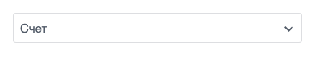
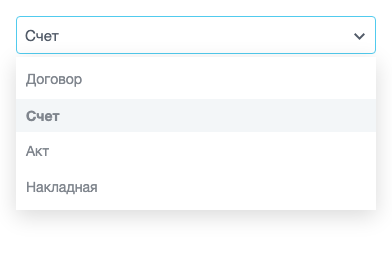
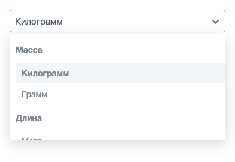
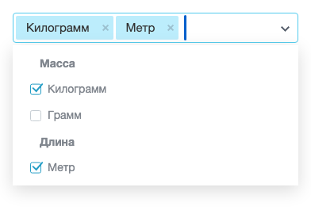

Выпадающий список `BX.Main.ui.select` — контрол главного модуля для выбора одного или нескольких пунктов из заранее заданного набора. Список поддерживает группировку пунктов под заголовками и поиск по пунктам.

На этом контроле построены поля-списки фильтра [main.ui.filter](./main-ui-filter.md), поля множественного выбора во встроенном редакторе [main.ui.grid](./main-ui-grid.md) и поле пользовательского свойства типа «Список» в форме редактирования.

В дизайн-системе есть отдельный компонент [ui.select](./ui-select.md) с классом `BX.Ui.Select`. Он поддерживает только одиночный выбор, а `BX.Main.ui.select` — одиночный и множественный. Для выбора объектов в дизайн-системе есть [диалог ui.entity-selector](./entity-selector/dialog.md). Он по умолчанию разрешает выбрать несколько элементов.

## Подключить расширение

Загрузите `ui` из PHP-кода страницы или шаблона компонента.

```php
\CJSCore::Init(['ui']);
```

Расширение `ui` подключает три расширения главного модуля:

-  `ui_select` — класс списка `BX.Main.ui.select` и всплывающее окно [main.popup](./main-popup.md), в котором открываются пункты,

-  `ui_factory` — фабрику `BX.Main.ui.Factory`, которая создает экземпляры списков, и функцию `BX.decl()` для сборки разметки,

-  `ui_date` — поле даты, которое использует та же фабрика.



Подключайте именно `ui`, а не только `ui_select`. Без фабрики из `ui_factory` клик по списку ничего не открывает, потому что экземпляр класса создает фабрика.



Расширение не экспортирует ES-модуль. Обращайтесь к классу и фабрике через глобальные имена `BX.Main.ui.select` и `BX.Main.ui.Factory`.

## Вывести список

Чтобы показать поле на странице, выполните два действия:

1. Соберите разметку функцией `BX.decl()`. Для одиночного выбора передайте блок `main-ui-select`, для множественного — `main-ui-multi-select`.

2. Вставьте полученный DOM-узел в страницу.

Экземпляр `BX.Main.ui.select` создает фабрика `BX.Main.ui.Factory`, когда пользователь первый раз кликает по полю или ставит в него фокус. Вызывать конструктор вручную не нужно.

**Пример.** Страница выводит одиночный список типов документов. Выбранным при загрузке показывается пункт «Счет».

```php
<?php
\CJSCore::Init(['ui']);
?>
<div id="document-type"></div>

<script>
BX.ready(() => {
    const items = [
        { NAME: 'Договор', VALUE: 'contract' },
        { NAME: 'Счет', VALUE: 'invoice' },
        { NAME: 'Акт', VALUE: 'act' },
        { NAME: 'Накладная', VALUE: 'waybill' },
    ];

    const node = BX.decl({
        block: 'main-ui-select',
        name: 'DOCUMENT_TYPE',
        items: items,
        value: items[1],
        params: { isMulti: false },
    });

    BX('document-type').appendChild(node);
});
</script>
```

Поле показывает подпись выбранного пункта.

{width=392px height=78px}

Клик по полю открывает окно со списком под полем и по его ширине. Выбранный пункт в окне выделен фоном и жирным шрифтом. Ширину поля экземпляр замеряет один раз, при создании, и после этого не обновляет.

{width=392px height=270px}

### Ключи декларации

Функция `BX.decl()` записывает пункты, значение и параметры в атрибуты `data-items`, `data-value` и `data-params` корневого узла.

*Обязательные ключи обозначены \*.*

| Ключ | Описание |
|---|---|
| block\*<br>`string` | Вид списка. `main-ui-select` — одиночный выбор, `main-ui-multi-select` — множественный. Без ключа функция `BX.decl()` возвращает `null` |
| items\*<br>`array` | Пункты списка. Состав полей пункта описан в разделе [Пункты списка](#punkty-spiska). Без ключа создание экземпляра завершается ошибкой разбора JSON |
| value<br>`object`, `array` | Начальное значение. Для одиночного списка — объект пункта, для множественного — массив пунктов. Список сопоставляет значение с пунктом по совпадению обоих полей `NAME` и `VALUE` |
| params<br>`object` | Параметры экземпляра — режим выбора, поиск и класс окна |
| name<br>`string` | Значение атрибута `data-name` корневого узла. Поле формы с этим именем список не создает |
| valueDelete<br>`boolean` | Добавляет в поле кнопку очистки. Во множественном списке кнопка снимает все выбранные пункты и скрыта, пока ничего не выбрано. В одиночном списке выбор не сбрасывает. Кнопка становится видна при наведении на поле. До первого клика по полю кнопка скрыта, даже если пункты выбраны |
| placeholder<br>`string` | Подсказка в строке ввода. Действует только для блока `main-ui-multi-select` |
| tabindex<br>`number` | Значение атрибута `tabindex` строки ввода |
| attrs<br>`object` | Дополнительные атрибуты корневого узла |

Список не создает поле `<input name="...">` и не отправляет значение с формой. Как передать выбор на сервер, показано в разделе [Получить выбранное значение](#poluchit-vybrannoe-znachenie).

### Пункты списка

Каждый элемент массива `items` — объект с полями в верхнем регистре.

-  `NAME` — подпись пункта. Список экранирует HTML в подписи.

-  `VALUE` — значение пункта, которое получает код.

-  `HTML` — разметка подписи вместо `NAME`. Действует только во множественном списке. Разметка выводится и в пункте, и в выбранном элементе поля.

-  `LEGEND` — при значении `true` пункт становится заголовком группы. Заголовок нельзя выбрать.

-  `DEPTH` — уровень вложенности. Список сдвигает пункт вправо на десять пикселей за каждый уровень.

Задавайте пунктам уникальные `VALUE` и `NAME`. При снятии пункта во множественном списке из значения уходят все пункты, у которых совпадает `VALUE` или `NAME`.

**Пример.** Пункты единиц измерения сгруппированы под двумя заголовками, а пункты внутри групп сдвинуты на один уровень.

```js
const units = [
    { NAME: 'Масса', VALUE: 'mass', LEGEND: true },
    { NAME: 'Килограмм', VALUE: 'kg', DEPTH: 1 },
    { NAME: 'Грамм', VALUE: 'g', DEPTH: 1 },
    { NAME: 'Длина', VALUE: 'length', LEGEND: true },
    { NAME: 'Метр', VALUE: 'm', DEPTH: 1 },
    { NAME: 'Сантиметр', VALUE: 'cm', DEPTH: 1 },
];
```

Заголовки групп выводятся жирным шрифтом, пункты групп сдвинуты вправо. Высота окна ограничена 177 пикселями, пункты сверх этой высоты прокручиваются.

{width=392px height=270px}

## Передать параметры экземпляра

Режим выбора, поиск и класс окна задают в ключе `params` декларации. Все параметры необязательны.

| Параметр | Тип | Описание |
|---|---|---|
| `isMulti` | `boolean` | Включает множественный выбор. Клик по пункту отмечает его или снимает отметку, а список остается открытым. По умолчанию `false` |
| `enableSearch` | `boolean` | Включает поиск по пунктам. Условия работы описаны в разделе [Включить поиск по пунктам](#vklyuchit-poisk-po-punktam). По умолчанию `false` |
| `classPopup` | `string` | Добавляет CSS-класс окну со списком. По умолчанию не задан |

Параметр `isMulti` задает поведение экземпляра, а ключ `block` — разметку поля. Для множественного списка передайте и блок `main-ui-multi-select`, и параметр `isMulti: true`.

Во множественном списке выбранные пункты выводятся в поле отдельными элементами с крестиком, а пункты в окне — с флажками.

{width=392px height=270px}

Остальные ключи `params` список сохраняет. Метод `getParams()` экземпляра возвращает объект `params` целиком, поэтому в нем можно передать свои данные для обработчика, например имя поля формы.

## Включить поиск по пунктам

Передайте `enableSearch: true` в `params`, чтобы пользователь отбирал варианты по введенному тексту.



Параметр `enableSearch` появился в главном модуле версии 26.900.0. Во множественном списке с `isMulti: true` поиск работает с версии 26.1000.0, в более ранних версиях параметр для такого списка не действует.



Поиск включается, только если в списке не меньше десяти пунктов. Заголовки с `LEGEND: true` в это число не входят. Порог задан в коде класса, параметром его не изменить.

Если пунктов меньше или поиск не включен, строка ввода работает в режиме быстрого перехода. Список подсвечивает первый пункт, подпись которого начинается с введенных символов, без учета регистра. Через секунду после последнего ввода список очищает строку ввода. Пункты при этом не скрываются.

**Пример.** Множественный список единиц измерения с поиском выводится в контейнер `units`. В нем 12 пунктов, поэтому поиск работает.

```js
const node = BX.decl({
    block: 'main-ui-multi-select',
    name: 'UNITS',
    items: [
        { NAME: 'Штука', VALUE: 'pcs' },
        { NAME: 'Упаковка', VALUE: 'pack' },
        { NAME: 'Килограмм', VALUE: 'kg' },
        { NAME: 'Грамм', VALUE: 'g' },
        { NAME: 'Тонна', VALUE: 't' },
        { NAME: 'Литр', VALUE: 'l' },
        { NAME: 'Миллилитр', VALUE: 'ml' },
        { NAME: 'Метр', VALUE: 'm' },
        { NAME: 'Сантиметр', VALUE: 'cm' },
        { NAME: 'Миллиметр', VALUE: 'mm' },
        { NAME: 'Квадратный метр', VALUE: 'm2' },
        { NAME: 'Кубический метр', VALUE: 'm3' },
    ],
    value: [],
    placeholder: 'Начните вводить единицу',
    valueDelete: true,
    params: {
        isMulti: true,
        enableSearch: true,
    },
});

BX('units').appendChild(node);
```

Поиск работает по пяти правилам.

-  При открытии списка фокус переходит в строку поиска. В одиночном списке строка поиска на время открытия заменяет подпись выбранного пункта.

-  Список оставляет пункты, подпись которых содержит запрос в любом месте, без учета регистра. Запрос `метр` найдет пункты «Метр», «Сантиметр», «Миллиметр», «Квадратный метр» и «Кубический метр».

-  Поиск не скрывает заголовки с `LEGEND: true`.

-  Список подсвечивает первый найденный пункт, клавиша `Enter` выбирает его. Если не найден ни один пункт, `Enter` ничего не выбирает.

-  При закрытии список сбрасывает запрос и в следующий раз открывается со всеми пунктами.

Во множественном списке после выбора клавишей `Enter` список очищает строку поиска, снова показывает все пункты и остается открытым. Пользователь может сразу ввести следующий запрос.

## Получить выбранное значение

Список хранит выбор в атрибуте `data-value` корневого узла в виде JSON. Одиночный список хранит объект пункта, множественный — массив пунктов.

Прочитать значение можно двумя способами.

-  Разобрать атрибут `data-value` узла. Способ работает в любой момент, в том числе до первого клика по полю, когда экземпляра еще нет.

-  Вызвать метод `getDataValue()` экземпляра. Он возвращает объект или массив выбранных пунктов, а если выбора нет — пустой объект `{}` для одиночного списка и пустой массив `[]` для множественного.

Метод `BX.Main.ui.Factory.get(node)` находит экземпляр по корневому узлу. Он возвращает объект с полями `node` и `instance` или `null`, если фабрика еще не создавала экземпляр для этого узла.

Фабрика не создает экземпляр по запросу. Если экземпляр нужен до первого клика, создайте его конструктором и добавьте в реестр `BX.Main.ui.Factory.data`, иначе при клике фабрика создаст для узла второй экземпляр. Узел к этому моменту должен быть на странице и виден, потому что ширину окна экземпляр замеряет в конструкторе. Событие `UiSelect::onCreatePopup` сработает сразу.

**Пример.** Код получает экземпляр списка или создает его, если фабрика еще этого не сделала.

```js
let control = BX.Main.ui.Factory.get(node);
if (!control)
{
    control = { node: node, instance: new BX.Main.ui.select(node) };
    BX.Main.ui.Factory.data.push(control);
}
```

**Пример.** Перед отправкой формы `units-form` обработчик читает выбранные единицы измерения из множественного списка и записывает их значения в скрытые поля `UNITS[]` внутри контейнера `units-values`.

```js
// Узел node создан в примере множественного списка с поиском
BX.bind(BX('units-form'), 'submit', () => {
    const selected = JSON.parse(node.dataset.value || '[]');
    const container = BX('units-values');

    BX.cleanNode(container);

    selected.forEach((item) => {
        container.appendChild(BX.create('input', {
            attrs: {
                type: 'hidden',
                name: 'UNITS[]',
                value: item.VALUE,
            },
        }));
    });
});
```

## Обработать выбор пункта

Список вызывает два глобальных события. Подписывайтесь на них функцией `BX.addCustomEvent()` на объекте `window`. Как устроены такие подписки, описано в статье [JS-ядро main.core](./main-core.md). Подписка через `EventEmitter.subscribe('UI::Select::change', handler)` тоже работает. В этом случае экземпляр и пункт приходят массивом в `event.getData()`.

| Событие | Аргументы обработчика | Когда срабатывает |
|---|---|---|
| `UI::Select::change` | Экземпляр `BX.Main.ui.select` и объект пункта | При выборе пункта кликом или клавишей `Enter`, а во множественном списке — и при снятии отметки кликом по пункту |
| `UiSelect::onCreatePopup` | Окно [`BX.Main.Popup`](./main-popup.md) и массив пунктов | При создании экземпляра, до первого показа окна |

Событие `UI::Select::change` передает в обработчик пункт, по которому кликнули, а не весь выбор. Во множественном списке текущий набор пунктов читайте методом `getDataValue()`.

Событие `UI::Select::change` не срабатывает, когда пользователь удаляет элемент поля крестиком или клавишей `Backspace` либо нажимает кнопку очистки из `valueDelete`. Если значение нужно отправить с формой, читайте его при отправке, как в разделе [Получить выбранное значение](#poluchit-vybrannoe-znachenie).

**Пример.** Обработчик реагирует только на свой список. Он сравнивает корневой узел экземпляра с узлом `node` и загружает шаблоны для выбранного типа документа.

```js
BX.addCustomEvent(window, 'UI::Select::change', (select, item) => {
    if (select.getNode() !== node)
    {
        return;
    }

    loadTemplates(item.VALUE);
});
```

Событие глобальное, поэтому обработчик получает выбор во всех списках `BX.Main.ui.select` на странице, включая поля фильтра. Метод `getNode()` возвращает корневой узел экземпляра — по нему обработчик отличает свой список от чужих.

Чтобы реагировать на любое изменение выбора, включая удаление крестиком и очистку, наблюдайте за атрибутом `data-value` через стандартный `MutationObserver` браузера. Так делает [фильтр main.ui.filter](./main-ui-filter.md).

**Пример.** Счетчик выбранных единиц измерения обновляется при каждом изменении выбора.

```js
const observer = new MutationObserver(() => {
    const selected = JSON.parse(node.dataset.value || '[]');
    updateUnitsCounter(selected.length);
});

observer.observe(node, { attributes: true, attributeFilter: ['data-value'] });
```

## Использовать клавиатуру

Пока фокус находится в строке ввода, список обрабатывает клавиши навигации и выбора.

| Клавиша | Действие |
|---|---|
| `ArrowDown`, `ArrowUp` | Подсвечивают следующий или предыдущий пункт. После последнего пункта подсветка переходит на первый. Без поиска подсветка проходит и по заголовкам групп. При включенном поиске переход идет только по найденным пунктам |
| `Enter` | Выбирает подсвеченный пункт |
| `Backspace` | Во множественном списке при пустой строке ввода первое нажатие выделяет последний выбранный элемент, второе снимает его выбор |

Клавиша `Esc` список не закрывает. Список закрывается, когда строка ввода теряет фокус, а одиночный список — еще и после выбора пункта.

## Изменить значение и пункты из кода

У списка нет методов, которые задают значение или заменяют пункты. Пункты из `data-items` экземпляр читает один раз, при создании. Неактивное состояние список тоже не поддерживает — у класса нет такого параметра или метода.

Чтобы задать новое значение или новый набор пунктов, соберите новый узел функцией `BX.decl()` и замените им старый. Событие `UI::Select::change` при этом не срабатывает.

**Пример.** Функция находит экземпляр старого списка методом `BX.Main.ui.Factory.get()`, удаляет его окно вызовом `getPopup().destroy()` и заменяет узел новым с переданными пунктами и значением.

```js
function rebuildSelect(oldNode, items, value)
{
    const control = BX.Main.ui.Factory.get(oldNode);
    if (control)
    {
        control.instance.getPopup().destroy();
    }

    const newNode = BX.decl({
        block: 'main-ui-select',
        name: 'DOCUMENT_TYPE',
        items: items,
        value: value,
        params: { isMulti: false },
    });

    BX.Dom.replace(oldNode, newNode);

    return newNode;
}
```

## Связанные материалы

-  [Выпадающий список ui.select](./ui-select.md)

-  [Фильтр main.ui.filter](./main-ui-filter.md)

-  [Таблица main.ui.grid](./main-ui-grid.md)

-  [Всплывающие окна и меню main.popup](./main-popup.md)

-  [Расширения](../framework/extensions.md)
