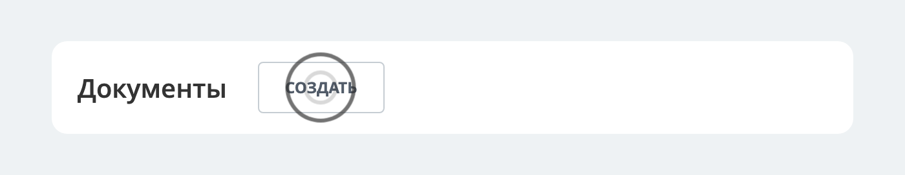
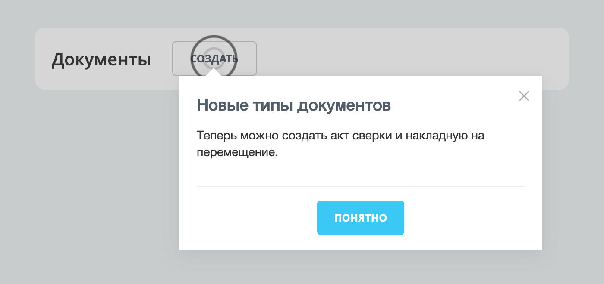

Расширение `spotlight` выводит пульсирующий круг рядом с элементом интерфейса. Круг привлекает внимание к новой кнопке или функции. Когда пользователь наводит на него курсор, расширение показывает окно с текстом и кнопкой «Понятно».

Подсказка состоит из трех частей:

-  JavaScript-класс `BX.SpotLight` рисует круг и окно. Объект `BX.SpotLight.Manager` создает подсказки и хранит их по идентификатору.
-  PHP-класс `Bitrix\Main\UI\Spotlight` проверяет, показывать ли подсказку пользователю — по отметке о просмотре, периоду, сроку жизни и дате регистрации.
-  Компонент `bitrix:spotlight` проверяет условия через класс `Spotlight` и выводит подсказку, если она доступна.

Расширение и PHP-класс связаны отметкой о просмотре. Расширение сохраняет ее в настройках пользователя на сервере, а PHP-класс читает оттуда же.

Выберите решение по задаче:

-  `spotlight` — пульсирующий круг-маркер у одного элемента с пояснением, которое пользователь открывает наведением курсора,
-  [пошаговый тур ui.tour](./ui-tour.md) — знакомство с интерфейсом из нескольких шагов, которое открывается без действия пользователя,
-  [подсказка](./hint.md) — постоянное пояснение, которое открывается при наведении на значок,
-  [системный хайлайтер](./system-highlighter.md) — выделение блока рамкой без окна с текстом.

На снимке пульсирующий круг в центре кнопки «Создать» на панели списка документов. Окно подсказки еще не открыто.

{width=700px height=136px}

## Подключить расширение

В PHP загрузите `spotlight` методом `Extension::load()`.

```php
\Bitrix\Main\UI\Extension::load('spotlight');
```

Расширение входит в модуль `main` и зарегистрировано без префикса модуля. Расширение не экспортирует классы для `import`. Классы `BX.SpotLight` и `BX.SpotLight.Manager` доступны только глобально.

Расширение загружает вместе с собой [окно сообщения ui.dialogs.messagebox](./dialogs-messagebox.md) и выводит в нем текст подсказки.

Если подсказку нужно вывести из шаблона без собственного JavaScript-кода, используйте компонент `bitrix:spotlight`. Он сам загружает расширение. Подробнее в разделе [Вывести подсказку компонентом](#component).

## Показать подсказку

Создайте подсказку методом `BX.SpotLight.Manager.create(options)` и вызовите метод `show()`. Передайте идентификатор подсказки в `id`, элемент — в `targetElement`, текст окна — в `content`. Параметры `id` и `targetElement` обязательны.

**Пример.** Подсказка у кнопки создания документа показывает текст о новых типах документов.

```js
BX.ready(() => {
    const spotlight = BX.SpotLight.Manager.create({
        id: 'documents-add-button-spotlight',
        targetElement: '#documents-add-button',
        targetVertex: 'middle-center',
        title: 'Новые типы документов',
        content: 'Теперь можно создать акт сверки и накладную на перемещение.',
    });

    spotlight.show();
});
```

Метод `show()` добавляет круг в `document.body` и ставит его в точку элемента из `targetVertex`. Подсказка ведет себя так:

1. Пока курсор не наведен, на странице виден только пульсирующий круг.
2. При наведении курсора на круг или касании круга на сенсорном экране расширение показывает окно с заголовком из `title`, текстом из `content` и кнопкой «Понятно». Окно модальное, страница под ним затемняется.
3. Когда пользователь нажимает «Понятно» или закрывает окно, например клавишей Esc, расширение закрывает окно и удаляет круг со страницы.

На снимке подсказка из примера после наведения курсора на круг. Страница затемнена, под кнопкой «Создать» окно с уголком, направленным к кругу. В окне заголовок «Новые типы документов», текст из `content`, крестик и кнопка «Понятно».

{width=700px height=330px}

Если `content` не передан, окно не появляется. Круг остается на странице, пока код не вызовет метод `close()`.

Расширение выводит строку из `content` как HTML. Пользовательские данные экранируйте методом `Text.encode()` из [main.core](./main-core.md).

Создавайте подсказку после загрузки разметки, например в обработчике `BX.ready`. Если элемента из `targetElement` еще нет на странице, конструктор выбрасывает `Error`. В коротких примерах ниже обертка `BX.ready` опущена.

Подсказку можно создать и конструктором `new BX.SpotLight(options)`. Такая подсказка не попадает в `Manager`, и найти ее по `id` методом `Manager.get()` нельзя.

### Параметры подсказки {#params}

*Обязательные параметры обозначены \*.*

| Параметр | Тип | Описание |
|---|---|---|
| `targetElement`* | `string`, `HTMLElement` | Элемент, рядом с которым выводится круг. Расширение ищет строку как CSS-селектор, а если элемент не найден — как `id`. Если элемента нет на странице, конструктор выбрасывает `Error` |
| `id`* | `string` | Идентификатор подсказки. По нему `Manager` хранит подсказку, а метод `save()` сохраняет отметку о просмотре. Обязателен для `Manager.create()`. В конструкторе `new BX.SpotLight()` необязателен, без него расширение создает случайный идентификатор вида `spotlight-...` |
| `content` | `string`, `HTMLElement` | Текст окна. Расширение выводит строку как HTML. Без параметра окно не показывается |
| `title` | `string` | Заголовок окна |
| `targetVertex` | `string` | Точка элемента, в которой выводится центр круга. Значения описаны в разделе [Расположить круг](#position). По умолчанию `top-left` |
| `left` | `number` | Сдвиг круга по горизонтали в пикселях. По умолчанию `0` |
| `top` | `number` | Сдвиг круга по вертикали в пикселях. По умолчанию `0` |
| `zIndex` | `number` | `z-index` круга. По умолчанию расширение проверяет родителей от элемента до `body`, берет ближайшего к `body` родителя с `z-index`, отличным от `auto`, и прибавляет к его `z-index` единицу |
| `color` | `string` | Цвет круга — любое значение CSS-свойства `color`. По умолчанию — цвет текста страницы |
| `lightMode` | `boolean` | Делает круг белым. Значение `color` имеет приоритет. По умолчанию `false` |
| `autoSave` | `boolean` | Сохраняет отметку о просмотре при наведении курсора на круг. По умолчанию `false` |
| `observerTimeout` | `number` | Интервал в миллисекундах, с которым расширение проверяет положение элемента и двигает круг за ним. Значение `0` отключает проверку. По умолчанию `1000` |
| `events` | `object` | Обработчики событий. Значение обработчика — функция или строка с именем глобальной функции, которую расширение находит при вызове `show()`. Состав описан в разделе [Обработать события](#events) |

## Расположить круг {#position}

Параметр `targetVertex` задает точку элемента, в которую расширение ставит центр круга. Значение состоит из положения по вертикали и по горизонтали:

-  `top-left`, `top-center`, `top-right` — верхний край элемента,
-  `middle-left`, `middle-center`, `middle-right` — середина элемента по высоте,
-  `bottom-left`, `bottom-center`, `bottom-right` — нижний край элемента.

Параметры `left` и `top` сдвигают круг от этой точки в пикселях. Отрицательное значение сдвигает круг влево или вверх.

**Пример.** Расширение выводит круг у правого верхнего угла пункта меню и сдвигает его на восемь пикселей внутрь пункта.

```js
const spotlight = BX.SpotLight.Manager.create({
    id: 'units-menu-item-spotlight',
    targetElement: document.getElementById('units-menu-item'),
    targetVertex: 'top-right',
    left: -8,
    top: 8,
    content: 'Справочник единиц измерения теперь в меню.',
});

spotlight.show();
```

Расширение пересчитывает положение круга при изменении размера окна браузера, после загрузки страницы и с интервалом из `observerTimeout`. При пересчете расширение скрывает круг, если элемент скрыт, и снова показывает его, когда элемент становится видимым.

Периодическая проверка запускает пересчет, только если изменились координаты элемента. Вызовите `adjustPosition()` сами в двух случаях:

-  код скрыл или показал элемент через `visibility` — координаты при этом не меняются,
-  проверка отключена через `observerTimeout: 0`, а элемент сдвинулся или скрылся через `display: none`.

Если элемент или один из его родителей закреплен через `position: fixed`, круг тоже закрепляется и не уходит при прокрутке страницы.

## Задать цвет круга

Круг по умолчанию окрашен в цвет текста страницы. Чтобы задать другой цвет, передайте его в `color`. На темном фоне передайте `lightMode: true`, и круг станет белым.

**Пример.** Круг на темной панели выводится белым, круг на светлой странице — цвета `#2fc6f6`.

```js
const darkPanelSpotlight = BX.SpotLight.Manager.create({
    id: 'status-panel-spotlight',
    targetElement: '#documents-status-panel',
    lightMode: true,
    content: 'Статус документа теперь виден на панели.',
});

const filterSpotlight = BX.SpotLight.Manager.create({
    id: 'documents-filter-spotlight',
    targetElement: '#documents-filter',
    color: '#2fc6f6',
    content: 'В фильтре появился отбор по статусу.',
});

darkPanelSpotlight.show();
filterSpotlight.show();
```

Метод `setColor(color)` меняет цвет уже показанного круга.

## Обработать события {#events}

Передайте обработчики в параметре `events` объектом, где ключ — короткое имя события. Расширение подписывает обработчики при вызове `show()`, когда круга еще нет на странице, и отписывает в `close()`.

| Событие | Когда срабатывает |
|---|---|
| `onShow` | При вызове `show()` |
| `onClose` | При закрытии подсказки — методом `close()` или после закрытия окна |
| `onTargetEnter` | При наведении курсора на круг или касании круга |
| `onTargetLeave` | При уходе курсора с круга |
| `onPopupShow` | При показе окна |
| `onPopupAccept` | При нажатии кнопки «Понятно». После обработчика расширение закрывает подсказку |
| `onPopupClose` | При закрытии окна клавишей Esc или методом `getPopup().close()`. Не срабатывает после кнопки «Понятно» и метода `close()` подсказки. Для них используйте `onPopupAccept` и `onClose` |

Обработчик получает экземпляр `BX.SpotLight` первым аргументом.

**Пример.** Обработчик отправляет событие в аналитику, когда пользователь нажимает «Понятно».

```js
const spotlight = BX.SpotLight.Manager.create({
    id: 'documents-add-button-spotlight',
    targetElement: '#documents-add-button',
    content: 'Теперь можно создать акт сверки и накладную на перемещение.',
    events: {
        onPopupAccept: (currentSpotlight) => {
            // sendAnalytics() — собственная функция, которая отправляет событие в аналитику
            sendAnalytics(currentSpotlight.getId() + '-accepted');
        },
    },
});

spotlight.show();
```

Чтобы подписаться после создания, передайте объект обработчиков в формате параметра `events` в метод `bindEvents(events)` подсказки. Метод `unbindEvents(events)` снимает их.

В модульном JavaScript подпишитесь методом `EventEmitter.subscribe()` из `main.core.events`. Передайте подсказку и полное имя события. Полное имя состоит из префикса `BX.SpotLight:` и короткого имени, например `EventEmitter.subscribe(spotlight, 'BX.SpotLight:onTargetEnter', handler)`. Такой обработчик получает объект события `BaseEvent`, а его метод `getData()` возвращает массив, первый элемент которого — экземпляр `BX.SpotLight`. Подробнее о подписке в разделе [Работать с событиями](./main-core.md#rabotat-s-sobytiyami) статьи о main.core.

### Показать свою подсказку вместо окна

Если стандартное окно не подходит, не передавайте `content` и откройте свое окно в обработчике `onTargetEnter`. Тогда расширение показывает только круг. Круг остается на странице, поэтому закройте его методом `close()` при открытии своей подсказки.

**Пример.** При наведении на круг код закрывает круг, загружает [ui.tour](./ui-tour.md#pokazat-podskazki-po-odnoj) и показывает подсказку из одного шага. Страница подключает расширение `spotlight` в PHP, а код загружает `ui.tour` методом `BX.Runtime.loadExtension()` только при наведении. Параметр `onEvents: true` включает в `ui.tour` режим подсказок по одной, поэтому тур показывает один шаг без кнопок перехода, а метод `showNextStep()` выводит этот шаг.

```js
BX.ready(() => {
    const target = document.getElementById('documents-add-button');

    const spotlight = BX.SpotLight.Manager.create({
        id: 'documents-add-button-spotlight',
        targetElement: target,
        targetVertex: 'middle-center',
        autoSave: true,
        events: {
            onTargetEnter: (currentSpotlight) => {
                currentSpotlight.close();

                BX.Runtime.loadExtension('ui.tour').then(({ Guide }) => {
                    const guide = new Guide({
                        onEvents: true,
                        steps: [
                            {
                                target,
                                title: 'Новые типы документов',
                                text: 'Теперь можно создать акт сверки и накладную на перемещение.',
                            },
                        ],
                    });

                    guide.showNextStep();
                });
            },
        },
    });

    spotlight.show();
});
```

Параметр `autoSave: true` сохраняет отметку о просмотре сразу после обработчика `onTargetEnter`, даже если обработчик уже закрыл круг. Подробнее в разделе [Показать подсказку один раз](#once).

## Управлять подсказкой

Объект `BX.SpotLight.Manager` хранит подсказки, созданные методом `create()`, и управляет ими методами:

-  `create(options)` — создает подсказку и возвращает ее, но не показывает. Выбрасывает `Error`, если `id` не передан или пустой, а также если подсказка с таким `id` уже есть.
-  `get(id)` — возвращает подсказку по идентификатору или `null`.
-  `remove(id)` — удаляет подсказку из `Manager`. Метод не убирает круг со страницы.

Метод `close()` подсказки не удаляет ее из `Manager`. Чтобы создать подсказку с тем же `id` заново, сначала вызовите `close()`, затем `Manager.remove(id)`.

**Пример.** Код закрывает подсказку, когда пользователь создал первый документ, и удаляет ее из `Manager`.

```js
// onDocumentCreated — собственный обработчик. Вызовите его, когда сервер подтвердил создание документа
function onDocumentCreated()
{
    const spotlight = BX.SpotLight.Manager.get('documents-add-button-spotlight');
    if (spotlight)
    {
        spotlight.close();
        BX.SpotLight.Manager.remove('documents-add-button-spotlight');
    }
}
```

Методы экземпляра `BX.SpotLight`:

-  `show()` — показывает круг и вызывает событие `onShow`. Повторный вызов пересчитывает положение круга и снова вызывает `onShow`.
-  `close()` — закрывает окно, удаляет круг со страницы и вызывает событие `onClose`. После `close()` подсказку можно показать снова методом `show()`.
-  `save()` — сохраняет отметку о просмотре.
-  `adjustPosition()` — пересчитывает положение круга.
-  `getId()` — возвращает идентификатор подсказки.
-  `getPopup()` — возвращает окно подсказки как экземпляр `Popup` из [main.popup](./main-popup.md). Если окна еще нет, метод создает его.

Методы `getPopup()` и `adjustPosition()` работают только с показанным кругом. До `show()` и после `close()` они выбрасывают `TypeError`.

Каждому параметру из раздела [Параметры подсказки](#params), кроме `events`, соответствует пара методов `get...()` и `set...()`, например `getContent()` и `setContent()`. Имена отличаются от параметра у `left`, `top` и `zIndex`: это `getOffsetLeft()` и `setOffsetLeft()`, `getOffsetTop()` и `setOffsetTop()`, `getZindex()` и `setZindex()`.

Методы `set...()` действуют в разные моменты:

-  `setTargetElement()`, `setTargetVertex()`, `setOffsetLeft()`, `setOffsetTop()`, `setZindex()` — при следующем пересчете положения,
-  `setColor()`, `setAutoSave()` — сразу,
-  `setLightMode()` — только до `show()`,
-  `setObserverTimeout()` — при следующем `show()`, если круга еще нет на странице,
-  `setContent()`, `setTitle()` — пока окно еще не создано,
-  `setId()` — сразу для `save()`, но ключ, под которым подсказка хранится в `Manager`, не меняется.

Чтобы сразу перенести круг к другому элементу, вызовите `adjustPosition()` после `setTargetElement()`.

## Показать подсказку один раз {#once}

Чтобы подсказка не повторялась, сохраните отметку о просмотре в JavaScript и проверьте ее в PHP перед выводом:

1. В JavaScript создайте подсказку с постоянным `id` и параметром `autoSave: true`. Расширение сохраняет время просмотра в пользовательскую настройку `view_date_<id>` категории `spotlight`, когда пользователь наводит курсор на круг.
2. В PHP создайте объект `Bitrix\Main\UI\Spotlight` с тем же `id` и вызовите `isViewed($userId)`. Метод возвращает `true`, если у пользователя есть отметка о просмотре.

Отметка привязана к пользователю. Выводите подсказку только авторизованным пользователям.

Метод `isViewed()` проверяет только отметку о просмотре. Если подсказку нужно ограничить периодом или аудиторией, проверяйте ее методом `isAvailable()`, как в разделе [Ограничить показ по времени и аудитории](#conditions).

**Пример.** Шаблон страницы выводит подсказку, только если текущий пользователь авторизован и еще не видел ее.

```php
<?php
use Bitrix\Main\Engine\CurrentUser;
use Bitrix\Main\UI\Extension;
use Bitrix\Main\UI\Spotlight;

$userId = (int)CurrentUser::get()->getId();
$spotlight = new Spotlight('documents-add-button-spotlight');
$showSpotlight = $userId > 0 && !$spotlight->isViewed($userId);

if ($showSpotlight)
{
    Extension::load('spotlight');
}
?>

<?php if ($showSpotlight): ?>
<script>
BX.ready(() => {
    const spotlight = BX.SpotLight.Manager.create({
        id: 'documents-add-button-spotlight',
        targetElement: '#documents-add-button',
        autoSave: true,
        content: 'Теперь можно создать акт сверки и накладную на перемещение.',
    });

    spotlight.show();
});
</script>
<?php endif; ?>
```

Чтобы сохранить отметку не при наведении, а после нажатия «Понятно», вызовите `save()` в обработчике `onPopupAccept` и не передавайте `autoSave`.

**Пример.** Подсказка сохраняет отметку о просмотре, когда пользователь нажимает «Понятно».

```js
const spotlight = BX.SpotLight.Manager.create({
    id: 'documents-add-button-spotlight',
    targetElement: '#documents-add-button',
    content: 'Теперь можно создать акт сверки и накладную на перемещение.',
    events: {
        onPopupAccept: (currentSpotlight) => currentSpotlight.save(),
    },
});

spotlight.show();
```

Объект `Spotlight` также управляет отметкой о просмотре:

-  `getViewDate($userId)` — возвращает момент просмотра в Unix-времени или `0`, если отметки нет.
-  `setViewDate($userId, $date)` — сохраняет отметку. Во втором аргументе передайте Unix-время целым числом. Без второго аргумента метод сохраняет текущее время.
-  `unsetViewDate($userId)` — удаляет отметку. После этого метод `isViewed()` снова возвращает `false`.

Методы работают с отметкой одного пользователя. Чтобы показать подсказку заново всем, например после доработки функции, задайте подсказке новый `id`.

Отметку, которую сохраняет расширение `spotlight`, проверяйте классом `Spotlight`. Классы `Bitrix\Main\UI\Tour` и `Bitrix\Main\UI\UiTour` наследуют `Spotlight` и отличаются только категорией настроек. [Пошаговый тур ui.tour](./ui-tour.md) использует эти классы.

## Ограничить показ по времени и аудитории {#conditions}

Метод `isAvailable($userId)` объекта `Spotlight` проверяет все условия показа сразу, включая отметку о просмотре. Он принимает ID пользователя, а без аргумента берет текущего, и возвращает `false`, если:

-  текущее время раньше даты из `setStartDate()` или позже даты из `setEndDate()`,
-  пользователь не авторизован,
-  у пользователя есть отметка о просмотре,
-  с даты активации подсказки прошло больше времени, чем задано в `setLifetime()`,
-  пользователь не подходит под тип из `setUserType()`.

Дата активации одна на подсказку для всех пользователей, в отличие от отметки о просмотре. Класс сохраняет ее в настройках `Option` под идентификатором `spotlight` при первом вызове `isAvailable()`, если пользователь прошел проверки периода, авторизации и просмотра. От этой даты класс отсчитывает срок жизни подсказки и границу между давними и новыми пользователями.



По умолчанию подсказка живет 30 дней с даты активации и показывается только давним пользователям — тем, кто зарегистрировался больше чем за 30 дней до активации. Чтобы показать подсказку всем, вызовите `setUserType(Spotlight::USER_TYPE_ALL)`.



Методы объекта `Spotlight` задают условия показа:

-  `setUserType($type)` — задает тип пользователей. `Spotlight::USER_TYPE_OLD` — давние, `Spotlight::USER_TYPE_NEW` — новые, включая зарегистрированных после активации, `Spotlight::USER_TYPE_ALL` — все. По умолчанию `Spotlight::USER_TYPE_OLD`.
-  `setUserTimeSpan($seconds)` — задает, сколько секунд до даты активации отделяет давних пользователей от новых. По умолчанию 30 дней.
-  `setLifetime($seconds)` — задает срок жизни подсказки в секундах. Значение `0` снимает ограничение. По умолчанию 30 дней.
-  `setStartDate($timestamp)` и `setEndDate($timestamp)` — задают период показа в Unix-времени. По умолчанию период не ограничен.
-  `activate($timestamp)` — задает дату активации. Без аргумента сохраняет текущее время.
-  `deactivate()` — удаляет дату активации. Класс активирует подсказку заново при следующем вызове `getActivationDate()` или при вызове `isAvailable()`, если пользователь прошел проверки периода, авторизации и просмотра. Класс отсчитывает срок из `setLifetime()` от новой даты активации.

Методы условий не сохраняют неподходящее значение, и тогда действует прежнее. Какое значение подходит, зависит от метода:

-  `setUserTimeSpan()` и `setLifetime()` принимают только неотрицательные целые числа. Строку, например `'2592000'`, методы не сохраняют.
-  `setStartDate()` принимает целое число или `null`, который снимает начало периода.
-  `setUserType()` принимает только значения констант `USER_TYPE_*`.
-  `setEndDate()` сохраняет любое целое число и любое непустое значение, даже строку. Метод не сохраняет значение `null`. Чтобы снять конец периода, передайте `0`.

Методы `getUserType()`, `getUserTimeSpan()`, `getLifetime()`, `getStartDate()`, `getEndDate()` и `getActivationDate()` возвращают текущие значения. Метод `getActivationDate()` активирует подсказку, если даты активации еще нет.

**Пример.** Код проверяет, доступна ли подсказка текущему пользователю. Подсказка доступна всем пользователям, которые ее еще не видели, до конца периода показа. Срок жизни подсказки не ограничен.

```php
<?php
use Bitrix\Main\Engine\CurrentUser;
use Bitrix\Main\UI\Spotlight;

$userId = (int)CurrentUser::get()->getId();
// Конец периода показа — через 14 дней, Unix-время целым числом
$periodEnd = time() + 14 * 24 * 3600;

$spotlight = new Spotlight('documents-add-button-spotlight');
$spotlight->setUserType(Spotlight::USER_TYPE_ALL);
$spotlight->setLifetime(0);
$spotlight->setEndDate($periodEnd);

$showSpotlight = $spotlight->isAvailable($userId);
```

Если `$showSpotlight` равно `true`, подключите расширение и выведите подсказку с тем же `id` и параметром `autoSave: true`, как в разделе [Показать подсказку один раз](#once). Без `autoSave` или вызова `save()` отметка о просмотре не сохранится, и метод `isAvailable()` продолжит возвращать `true`.

## Вывести подсказку компонентом {#component}

Компонент `bitrix:spotlight` объединяет проверку и вывод. Он создает объект `Spotlight` и вызывает метод `isAvailable()` для текущего пользователя. Если подсказка доступна, компонент загружает расширение, создает подсказку методом `BX.SpotLight.Manager.create()` и показывает ее методом `show()`.

**Пример.** Компонент выводит подсказку у фильтра списка документов всем пользователям в течение 14 дней с даты активации.

```php
<?php
use Bitrix\Main\UI\Spotlight;

$APPLICATION->IncludeComponent(
    'bitrix:spotlight',
    '',
    [
        'ID' => 'documents-filter-spotlight',
        'USER_TYPE' => Spotlight::USER_TYPE_ALL,
        'LIFETIME' => 14 * 24 * 3600,
        'JS_OPTIONS' => [
            'targetElement' => '#documents-filter',
            'targetVertex' => 'middle-center',
            'content' => 'В фильтре появился отбор по статусу.',
        ],
    ]
);
```

*Обязательные параметры обозначены \*.*

| Параметр | Тип | Описание |
|---|---|---|
| `ID`* | `string` | Идентификатор подсказки. Компонент передает его в объект `Spotlight` и в параметр `id` расширения. Без него компонент выводит ошибку и не показывает подсказку. Значение другого типа, например число, вызывает исключение `ArgumentTypeException` |
| `JS_OPTIONS` | `array` | Параметры расширения из раздела [Параметры подсказки](#params). Обязательный ключ — `targetElement`. Параметр `autoSave` по умолчанию равен `true`. Компонент заменяет параметр `id` значением `ID` |
| `USER_TYPE` | `string` | Тип пользователей — константа `Spotlight::USER_TYPE_OLD`, `Spotlight::USER_TYPE_NEW` или `Spotlight::USER_TYPE_ALL`. Компонент передает значение в `setUserType()`. Без параметра подсказку видят только давние пользователи |
| `USER_TIMESPAN` | `int` | Граница между давними и новыми пользователями в секундах. Компонент передает значение в `setUserTimeSpan()`. По умолчанию 30 дней |
| `LIFETIME` | `int` | Срок жизни подсказки в секундах. Компонент передает значение в `setLifetime()`. По умолчанию 30 дней |
| `START_DATE` | `int` | Начало периода показа в Unix-времени. Компонент передает значение в `setStartDate()`. По умолчанию период не ограничен |
| `END_DATE` | `int` | Конец периода показа в Unix-времени. Компонент передает значение в `setEndDate()`. По умолчанию период не ограничен |

Компонент показывает подсказку по событию `BX.ready`. Элемент из `targetElement` должен быть на странице к этому моменту. Если элемент не найден или подсказка с таким `ID` уже создана, подсказка не появляется, а компонент не выводит ошибку даже в консоль браузера.

Компонент выводит подсказку в динамической области [композитного сайта](../performance/composite-site.md). Такая область не попадает в общий кеш страницы, поэтому компонент проверяет условия показа для каждого пользователя отдельно.

Передайте обработчик события в ключе `events` массива `JS_OPTIONS` строкой с именем глобальной функции, например `'events' => ['onPopupAccept' => 'BX.Documents.onSpotlightAccept']`. Саму функцию через `JS_OPTIONS` передать нельзя. Расширение находит ее по имени при вызове `show()`, поэтому объявите функцию до `BX.ready`.

Компонент экранирует строки массива `JS_OPTIONS`, включая `title` и `content`. HTML в `content` компонент выводит как текст, а кавычки и угловые скобки в `title` — как HTML-сущности. Селектор в `targetElement` не должен содержать символы `>` и `"`.

Если подсказке нужен HTML в окне или селектор со сложной структурой, проверьте условия классом `Spotlight` и создайте подсказку в JavaScript, как в разделе [Показать подсказку один раз](#once).

## Связанные материалы

-  [Пошаговый тур ui.tour](./ui-tour.md)

-  [Подсказка](./hint.md)

-  [Системный хайлайтер](./system-highlighter.md)

-  [Окно сообщения](./dialogs-messagebox.md)

-  [Всплывающие окна и меню main.popup](./main-popup.md)

-  [JS-ядро main.core и события](./main-core.md)
