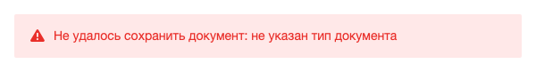
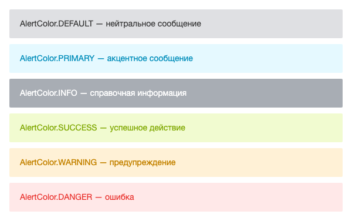
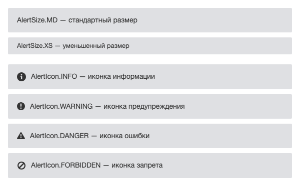
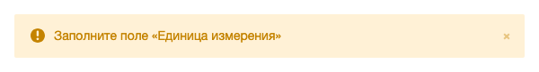

Расширение `ui.alerts` выводит на странице блок с сообщением, например ошибку при сохранении формы, предупреждение об ограничении или подсказку к разделу. Блок стоит в потоке страницы и не закрывается сам, в отличие от всплывающего уведомления [ui.notification](./ui-notification.md).

Алерт можно вывести двумя способами:

-  разметкой с CSS-классами расширения — в PHP-шаблоне, когда сообщение известно при формировании страницы,

-  классом `Alert` — в JavaScript, когда сообщение появляется после действия пользователя.

У дизайн-системы есть отдельный компонент [Системный алерт](./system-alert.md) из расширения `ui.system.alert`. У него нет серверной разметки, компонент создают только в JavaScript или Vue. Если сообщение известно при формировании страницы, выводите его разметкой `ui.alerts`.

Ошибку конкретного поля формы выводите классами поля из раздела [Показать ошибку](./ui-forms.md#show-error) статьи о полях форм. Алерт нужен для общего сообщения формы.

## Подключить расширение

В PHP загрузите `ui.alerts`.

```php
\Bitrix\Main\UI\Extension::load('ui.alerts');
```

В модульном JavaScript импортируйте класс `Alert` и константы.

```js
import { Alert, AlertColor, AlertSize, AlertIcon } from 'ui.alerts';
```

Вне модульного JavaScript класс и константы доступны как `BX.UI.Alert`, `BX.UI.AlertColor`, `BX.UI.AlertSize` и `BX.UI.AlertIcon`.

## Вывести алерт в PHP-шаблоне

Разметка алерта — блок с классом `ui-alert`, внутри которого текст в элементе с классом `ui-alert-message`. Цвет, размер и иконку задают дополнительные классы блока.

**Пример.** Шаблон компонента выводит ошибку сохранения документа с иконкой.

```php
<?php
\Bitrix\Main\UI\Extension::load('ui.alerts');
?>
<div class="ui-alert ui-alert-danger ui-alert-icon-danger">
    <span class="ui-alert-message"><?= htmlspecialcharsbx($errorMessage) ?></span>
</div>
```

Разметка выводит красный алерт с иконкой ошибки слева от текста.

{width=600px height=81px}

Текст ошибки экранируйте функцией `htmlspecialcharsbx()`, потому что разметка выводит содержимое как есть.

В разметке кнопка закрытия — элемент с классом `ui-alert-close-btn` внутри блока алерта. Расширение задает только ее вид, обработчик клика добавьте сами.

**Пример.** PHP-шаблон выводит предупреждение с кнопкой закрытия, которая удаляет блок со страницы.

```php
<div class="ui-alert ui-alert-warning" id="unit-warning">
    <span class="ui-alert-message"><?= htmlspecialcharsbx($warningText) ?></span>
    <span class="ui-alert-close-btn"></span>
</div>
<script>
BX.ready(() => {
    const alertNode = document.getElementById('unit-warning');
    BX.bind(alertNode.querySelector('.ui-alert-close-btn'), 'click', () => {
        BX.Dom.remove(alertNode);
    });
});
</script>
```

Для разметки есть еще два класса без констант:

-  `ui-alert-inline` — сжимает алерт по ширине содержимого,

-  `ui-alert-text-center` — выравнивает содержимое по центру.

В классе `Alert` эти классы передают в параметре `customClass`.

## Выбрать цвет, размер и иконку

Классы блока одинаковы для разметки и для класса `Alert`. Константы `AlertColor`, `AlertSize` и `AlertIcon` содержат имена тех же CSS-классов.

| Константа | CSS-класс | Вид |
|---|---|---|
| `AlertColor.DEFAULT` | `ui-alert-default` | Светло-серый фон, темный текст |
| `AlertColor.PRIMARY` | `ui-alert-primary` | Голубой фон, синий текст |
| `AlertColor.INFO` | `ui-alert-info` | Серый фон, белый текст |
| `AlertColor.SUCCESS` | `ui-alert-success` | Зеленый фон и текст |
| `AlertColor.WARNING` | `ui-alert-warning` | Оранжевый фон и текст |
| `AlertColor.DANGER` | `ui-alert-danger` | Красный фон и текст |
| `AlertSize.MD` | `ui-alert-md` | Стандартный размер |
| `AlertSize.XS` | `ui-alert-xs` | Уменьшенный размер |
| `AlertIcon.INFO` | `ui-alert-icon-info` | Иконка информации |
| `AlertIcon.WARNING` | `ui-alert-icon-warning` | Иконка предупреждения |
| `AlertIcon.DANGER` | `ui-alert-icon-danger` | Иконка ошибки |
| `AlertIcon.FORBIDDEN` | `ui-alert-icon-forbidden` | Иконка запрета |
| `AlertIcon.NONE` | Нет | Без иконки |

Цвет задает фон алерта и цвет текста. На снимке шесть цветов без иконки.

{width=600px height=376px}

Размер `AlertSize.XS` уменьшает высоту алерта и шрифт. Иконка выводится слева от текста и берет цвет текста.

{width=600px height=371px}

## Создать алерт в JavaScript

Создайте экземпляр `Alert` и вставьте его на страницу методом `renderTo(node)`. Метод добавляет алерт в конец переданного узла и возвращает DOM-элемент алерта. Если в `renderTo()` не передан DOM-элемент, метод ничего не вставляет и возвращает `null`.

**Пример.** После неудачного сохранения формы в блоке `form-errors` появляется предупреждение с кнопкой закрытия.

```js
import { Alert, AlertColor, AlertIcon } from 'ui.alerts';

const alert = new Alert({
    text: 'Заполните поле «Единица измерения»',
    color: AlertColor.WARNING,
    icon: AlertIcon.WARNING,
    closeBtn: true,
    animated: true,
});

alert.renderTo(document.getElementById('form-errors'));
```

Алерт выводится в цвете предупреждения, с иконкой слева и кнопкой закрытия справа.

{width=600px height=81px}

Метод `render()` возвращает DOM-элемент алерта, не вставляя его на страницу. Используйте его, если элемент нужно вставить в определенное место, например через `Dom.insertBefore()` из [main.core](./main-core.md).

Если действие контроллера вернуло ошибку, `Promise` из `BX.ajax.runAction()` отклоняется с объектом ответа. Тексты ошибок находятся в `response.errors[].message`. Класс `Alert` выводит текст как HTML, поэтому экранируйте сообщения методом `Text.encode()` из `main.core`.

**Пример.** Ошибки сохранения единицы измерения выводятся красным алертом в блок `form-errors`.

```js
import { Text } from 'main.core';
import { Alert, AlertColor, AlertIcon } from 'ui.alerts';

BX.ajax.runAction('my:module.Unit.save', {
    data: { code: 'kg' },
}).catch((response) => {
    const text = response.errors
        .map((error) => Text.encode(error.message))
        .join('<br>');

    new Alert({
        text,
        color: AlertColor.DANGER,
        icon: AlertIcon.DANGER,
    }).renderTo(document.getElementById('form-errors'));
});
```

### Параметры Alert

Конструктор `Alert` принимает объект с параметрами. Все параметры необязательны. Если `color`, `size` или `icon` не переданы, блок получает только класс `ui-alert` без класса цвета, размера или иконки.

| Параметр | Тип | Описание |
|---|---|---|
| `text` | `string` | Текст сообщения. Строка выводится как HTML |
| `color` | `string` | Цвет — значение `AlertColor` |
| `size` | `string` | Размер — значение `AlertSize` |
| `icon` | `string` | Иконка — значение `AlertIcon` |
| `closeBtn` | `boolean` | Показывает кнопку закрытия. Кнопка удаляет алерт со страницы. По умолчанию `false` |
| `animated` | `boolean` | Плавно раскрывает алерт при выводе и сворачивает при закрытии кнопкой. По умолчанию `false` |
| `customClass` | `string` | Дополнительный CSS-класс блока алерта |
| `beforeMessageHtml` | `HTMLElement` | Элемент, который выводится внутри элемента с текстом, перед текстом |
| `afterMessageHtml` | `HTMLElement` | Элемент, который выводится внутри элемента с текстом, после текста, например ссылка |

## Изменить алерт после вывода

Методы экземпляра меняют уже выведенный алерт:

-  `setText(text)` — заменяет текст. Пустую строку метод не принимает и оставляет прежний текст.

-  `setColor(color)`, `setSize(size)`, `setIcon(icon)` — меняют цвет, размер и иконку.

-  `hide()` — сворачивает алерт с анимацией при любом значении `animated` и удаляет его со страницы. Чтобы показать сообщение снова, создайте новый экземпляр `Alert`.

-  `destroy()` — сразу удаляет алерт со страницы и очищает ссылки на его элементы.

**Пример.** После повторной проверки формы предупреждение становится сообщением об успехе.

```js
import { AlertColor, AlertIcon } from 'ui.alerts';

// Экземпляр alert создан в предыдущем примере
alert.setText('Все поля заполнены');
alert.setColor(AlertColor.SUCCESS);
alert.setIcon(AlertIcon.NONE);
```

Методы `getText()`, `getColor()`, `getSize()` и `getIcon()` возвращают текущие значения. Метод `getContainer()` возвращает DOM-элемент алерта, метод `getTextContainer()` — элемент с текстом.

Кнопка закрытия и метод `hide()` удаляют алерт без события. Чтобы узнать, что пользователь закрыл алерт, подпишитесь на клик по кнопке. Метод `getCloseBtn()` возвращает ее элемент. В отличие от [системного алерта](./system-alert.md), кнопка `ui.alerts` удаляет алерт со страницы сама.

**Пример.** Обработчик клика по кнопке закрытия выводит сообщение в консоль.

```js
// Экземпляр alert создан с параметром closeBtn: true
BX.bind(alert.getCloseBtn(), 'click', () => {
    console.log('Алерт закрыт');
});
```

Расширение не добавляет алерту атрибут `role`. Если сообщение должны озвучивать экранные читалки, добавьте `role="alert"` в разметку или элементу, который возвращает `render()`.

Vue-компонента у `ui.alerts` нет. В шаблоне Vue выводите разметку с классами расширения или используйте [Vue-компонент системного алерта](./system-alert.md#ispolzovat-vue-komponent).

## Связанные материалы

-  [Системный алерт](./system-alert.md)

-  [Всплывающие уведомления ui.notification](./ui-notification.md)

-  [Пошаговое выполнение ui.stepprocessing](./ui-stepprocessing.md)

-  [JS-ядро main.core и события](./main-core.md)
