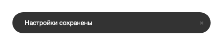
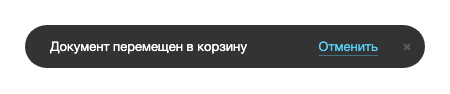
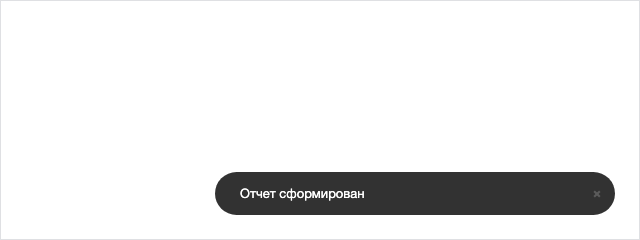

Расширение `ui.notification` показывает короткие всплывающие уведомления внутри страницы, например «Настройки сохранены», «Документ отправлен» или «Не удалось загрузить файл». Уведомление появляется в углу экрана и скрывается само через несколько секунд.

Уведомления показывает объект `Center` — экземпляр менеджера `Manager`. Каждое уведомление — экземпляр класса `Balloon`.



Расширение [ui.notification-manager](./notification-manager.md) решает другую задачу. Оно само выбирает, где показать уведомление — на странице, в браузере или в десктопном приложении, и умеет отправлять уведомления с сервера. Для сообщения о результате действия на текущей странице достаточно `ui.notification`. Внутри страницы расширение `ui.notification-manager` показывает уведомления через тот же объект `Center`, но со своей разметкой и скрытием через шесть секунд.



Если сообщение должно остаться на странице, пока пользователь его не закроет, выведите алерт в потоке страницы — [системный алерт](./system-alert.md) или [ui.alerts](./ui-alerts.md).

## Подключить расширение

В PHP-коде загрузите `ui.notification`.

```php
\Bitrix\Main\UI\Extension::load('ui.notification');
```

В модульном JavaScript импортируйте объект `Center`.

```js
import { Center } from 'ui.notification';
```

Вне модульного JavaScript тот же объект доступен как `BX.UI.Notification.Center`.

## Показать уведомление

Вызовите метод `Center.notify(options)` и передайте текст в параметре `content`.

**Пример.** После сохранения формы в правом верхнем углу экрана появляется уведомление и скрывается через восемь секунд.

```js
import { Center } from 'ui.notification';

Center.notify({
    content: 'Настройки сохранены',
});
```

Уведомление выглядит как темная плашка с текстом и крестиком закрытия.

{width=450px height=94px}

Метод возвращает экземпляр `Balloon` нового уведомления. Если уведомление с тем же `id` или `category` уже на экране, метод обновляет его и возвращает `undefined` — подробнее в разделе [Обновить уведомление вместо нового](#obnovit-uvedomlenie-vmesto-novogo).



Расширение выводит строку из `content` как HTML-разметку. Пользовательские данные экранируйте методом `Text.encode()` из [main.core](./main-core.md) или передайте в `content` DOM-узел с текстом в `textContent`.



## Передать параметры

Все поля объекта `options` необязательны.

| Параметр | Тип | Описание |
|---|---|---|
| `content` | `string`, `Element` | Текст или DOM-узел уведомления. Расширение выводит строку как HTML |
| `autoHide` | `boolean` | Скрывает уведомление по таймеру. По умолчанию `true` |
| `autoHideDelay` | `number` | Время до скрытия в миллисекундах. По умолчанию `8000` |
| `closeButton` | `boolean` | Показывает кнопку закрытия. По умолчанию `true` |
| `position` | `string` | Угол экрана, в котором появится уведомление. Значения перечислены в разделе [Выбрать место на экране](#vybrat-mesto-na-ekrane). По умолчанию `top-right` |
| `width` | `number`, `'auto'` | Ширина в пикселях или `'auto'`. По умолчанию `400` |
| `id` | `string` | Идентификатор уведомления. Если не передан, расширение создает случайный |
| `category` | `string` | Категория уведомления. На экране остается одно уведомление каждой категории |
| `actions` | `array` | Кнопки действий. Состав описан в разделе [Добавить кнопки действий](#dobavit-knopki-dejstvij) |
| `events` | `object` | Обработчики событий уведомления. Состав описан в разделе [Обработать события](#obrabotat-sobytiya) |
| `data` | `object` | Произвольные данные. Метод `getData()` уведомления возвращает их обратно |
| `blinkOnUpdate` | `boolean` | Включает мигание при обновлении уже показанного уведомления. По умолчанию `true` |
| `useAirDesign` | `boolean` | Включает [оформление Air](./ui-design-tokens.md#air-design). Если не задан `width`, ширина уведомления становится `339` пикселей. По умолчанию `false` |

Пока указатель мыши находится над уведомлением, таймер скрытия не идет. С версии модуля `ui` 26.700.0 таймер также стоит, пока фокус внутри уведомления или вкладка браузера скрыта.

Чтобы настроить скрытие всех уведомлений сайта, задайте ключи в файле `.settings.php`, в разделе `ui` → `notification`:

-  `autoHide` — отключает скрытие по таймеру со значением `false`,

-  `autoHideDelayFactor` — умножает время до скрытия на заданное число.

Настройки работают с версии модуля `ui` 26.700.0.

**Пример.** Раздел `ui` в файле `/bitrix/.settings.php` увеличивает время до скрытия всех уведомлений вдвое.

```php
'ui' => [
    'value' => [
        'notification' => [
            'autoHide' => true,
            'autoHideDelayFactor' => 2,
        ],
    ],
    'readonly' => true,
],
```

Множитель `autoHideDelayFactor` действует, только если это положительное число. Иначе расширение использует множитель `1`.

## Обновить уведомление вместо нового

Повторный вызов `notify()` по умолчанию добавляет еще одно уведомление. Чтобы вместо этого обновить уже показанное, передайте тот же `id` или ту же `category`.

-  `id` — обновляет конкретное уведомление.

-  `category` — обновляет уведомление той же категории, даже если `id` у него другой. Вариант подходит для серии однотипных сообщений, например о ходе загрузки.

Метод `notify()` применяет к найденному уведомлению новые параметры, показывает его снова и вызывает мигание. Чтобы обновить уведомление без мигания, передайте `blinkOnUpdate: false`.

**Пример.** Каждое следующее сообщение о ходе загрузки заменяет предыдущее, а не добавляет новое уведомление.

```js
import { Center } from 'ui.notification';

function showProgress(loaded, total)
{
    Center.notify({
        category: 'units-import',
        content: `Загружено единиц измерения: ${loaded} из ${total}`,
        blinkOnUpdate: false,
    });
}
```

## Добавить кнопки действий

Передайте в параметре `actions` массив. Каждый его элемент описывает кнопку и содержит поля:

-  `title` — текст кнопки.

-  `href` — адрес ссылки. Расширение делает кнопку ссылкой, только если у адреса нет схемы или схема `http:`, `https:`, `mailto:` или `tel:`. Для других схем кнопка остается кнопкой без перехода. Проверка работает с версии модуля `ui` 26.700.0.

-  `events` — обработчики событий кнопки, например `click`. Обработчик получает событие браузера, уведомление `Balloon` и кнопку `Action`.

-  `id` — идентификатор кнопки.

Если у уведомления есть кнопки, оно скрывается не раньше чем через 20 секунд, даже если `autoHideDelay` меньше. Правило действует с версии модуля `ui` 26.700.0. В более ранних версиях уведомление с кнопками скрывается через `autoHideDelay`, как и без них.

**Пример.** Уведомление об удалении документа содержит кнопку «Отменить», которая восстанавливает документ и закрывает уведомление.

```js
import { Center } from 'ui.notification';

Center.notify({
    content: 'Документ перемещен в корзину',
    actions: [
        {
            title: 'Отменить',
            events: {
                click: (event, balloon) => {
                    restoreDocument();
                    balloon.close();
                },
            },
        },
    ],
});
```

Расширение выводит кнопку ссылкой справа от текста уведомления.

{width=450px height=94px}

## Выбрать место на экране

Параметр `position` принимает одно из значений объекта `Position`.

| Константа | Значение | Место на экране |
|---|---|---|
| `Position.TOP_LEFT` | `top-left` | Слева сверху |
| `Position.TOP_CENTER` | `top-center` | По центру сверху |
| `Position.TOP_RIGHT` | `top-right` | Справа сверху |
| `Position.BOTTOM_LEFT` | `bottom-left` | Слева снизу |
| `Position.BOTTOM_CENTER` | `bottom-center` | По центру снизу |
| `Position.BOTTOM_RIGHT` | `bottom-right` | Справа снизу |

Уведомления в одном углу собираются в стопку. Метод `Center.setDefaultPosition(position)` меняет угол по умолчанию для всех следующих вызовов `notify()` без параметра `position`. Объект `Center` один на страницу, поэтому новый угол получат и уведомления других расширений.

**Пример.** Уведомление появляется в правом нижнем углу экрана.

```js
import { Center, Position } from 'ui.notification';

Center.notify({
    content: 'Отчет сформирован',
    position: Position.BOTTOM_RIGHT,
});
```

Уведомление выводится в правом нижнем углу окна.

{width=640px height=240px}

## Управлять уведомлением

Метод `notify()` возвращает экземпляр `Balloon`. У экземпляра есть методы:

-  `close()` — закрывает уведомление,

-  `update(options)` — применяет новые параметры и перерисовывает уведомление,

-  `getId()` — возвращает идентификатор,

-  `getData()` — возвращает объект из параметра `data`.

Метод `Center.getBalloonById(id)` находит показанное уведомление по идентификатору и возвращает `null`, если его нет. Используйте его, когда уведомление нужно закрыть из другого места кода.

**Пример.** Уведомление о долгой операции не скрывается само, а код закрывает его, когда операция завершилась.

```js
import { Center } from 'ui.notification';

Center.notify({
    id: 'report-building',
    content: 'Формируем отчет',
    autoHide: false,
});

buildReport().then(() => {
    Center.getBalloonById('report-building')?.close();
});
```

У объекта `Center` нет метода, который закрывает все уведомления сразу. Чтобы закрыть уведомления в одном углу экрана, получите стопку этого угла методом `Center.getStackByPosition()` и вызовите у нее метод `clear()`, например `Center.getStackByPosition(Position.TOP_RIGHT).clear()`.

## Обработать события

Передайте обработчики в параметре `events`. Обработчик получает объект события, а метод `getBalloon()` этого объекта возвращает уведомление.

| Событие | Когда срабатывает |
|---|---|
| `onOpen` | При первом показе уведомления. При обновлении через `notify()` событие не срабатывает |
| `onClose` | При закрытии уведомления по таймеру, кнопкой закрытия, клавишей Escape или методом `close()`. Закрытие клавишей Escape работает с версии модуля `ui` 26.700.0 |
| `onMouseEnter` | При наведении указателя на уведомление |
| `onMouseLeave` | При уходе указателя с уведомления |

**Пример.** После закрытия уведомления код снимает пометку с измененной строки таблицы.

```js
import { Center } from 'ui.notification';

Center.notify({
    content: 'Статус документа изменен',
    data: { rowId: 42 },
    events: {
        onClose: (event) => {
            const { rowId } = event.getBalloon().getData();
            unmarkRow(rowId);
        },
    },
});
```

## Связанные материалы

-  [Менеджер уведомлений](./notification-manager.md)

-  [Системный алерт](./system-alert.md)

-  [Алерты ui.alerts](./ui-alerts.md)

-  [JS-ядро main.core и события](./main-core.md)

-  [Таблица main.ui.grid](./main-ui-grid.md)
