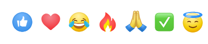
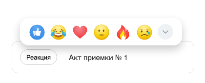
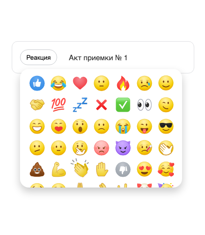

Реакция — это изображение эмодзи, которым пользователь отвечает на сообщение, комментарий или запись. Реакцию можно показать статичной картинкой или анимацией.

{width=410px height=88px}

В Bitrix Framework с реакциями работают два расширения:

-  `ui.reaction.item` выводит одну реакцию из фиксированного набора, запускает ее анимацию и содержит подписи реакций. Для Vue используйте расширение `ui.reaction.item.vue`.

-  `ui.reaction.picker` показывает окно, в котором пользователь выбирает реакцию.

Расширения только показывают реакции. Код, который сохраняет и считает реакции и показывает, кто их поставил, пишите сами — на сервере и в JavaScript.

Набор реакций задан в двух местах:

-  в JavaScript — константы `ReactionName` расширения `ui.reaction.item`,

-  в PHP — перечисление `Bitrix\UI\Public\Enum\Reaction\ReactionName` модуля `ui`.

Значения в них совпадают. Окно выбора передает выбранную реакцию значением из `ReactionName`, поэтому ее можно проверить и сохранить на сервере.

## Подключить расширения

Если страница или шаблон компонента формируется в PHP, загрузите нужные расширения. Расширение `ui.reaction.picker` загружает `ui.reaction.item` как зависимость, поэтому для окна выбора достаточно указать только его.

```php
\Bitrix\Main\UI\Extension::load([
    'ui.reaction.item',
    'ui.reaction.picker',
]);
```

В собственном JS-расширении, которое собирает команда `bitrix build`, импортируйте классы и константы обоих расширений. Подробнее о сборке — в статье [Расширения](../framework/extensions.md).

```js
import { Reaction, ReactionEvent, ReactionName, ReactionTitle } from 'ui.reaction.item';
import { ReactionPicker, ReactionPickerEvents } from 'ui.reaction.picker';
```

Во встроенном скрипте страницы, где `import` недоступен, используйте глобальные имена `BX.UI.Reaction.Item` и `BX.UI.Reaction.Picker`, например `BX.UI.Reaction.Item.Reaction` и `BX.UI.Reaction.Picker.ReactionPicker`.

## Вывести реакцию

Чтобы реакция появилась на странице, выполните четыре действия:

1. Создайте экземпляр `Reaction`.

2. Передайте значение из `ReactionName` в параметр `name`.

3. Получите DOM-узел методом `render()`.

4. Добавьте полученный узел на страницу.

**Пример.** Код выводит реакцию «Нравится» размером 24 пикселя.

```js
import { Reaction, ReactionName } from 'ui.reaction.item';

const reaction = new Reaction({
    name: ReactionName.like,
    size: 24,
});

document.getElementById('reaction-container').append(reaction.render());
```

Метод `render()` возвращает элемент `span` со статичной картинкой реакции. Подпись реакции, например «Нравится», попадает в атрибут `title` элемента, и браузер показывает ее при наведении указателя.

**Пример.** Скрипт PHP-страницы выводит реакцию через глобальное имя `BX.UI.Reaction.Item`.

```php
<?php
\Bitrix\Main\UI\Extension::load('ui.reaction.item');
?>
<span id="reaction-container"></span>

<script>
BX.ready(() => {
    const reaction = new BX.UI.Reaction.Item.Reaction({
        name: BX.UI.Reaction.Item.ReactionName.whiteHeavyCheckMark,
        size: 24,
    });

    BX('reaction-container').append(reaction.render());
});
</script>
```

Конструктор принимает параметры:

-  `name` — реакция, значение из `ReactionName`. Список значений — в разделе [Список реакций и подписи](#choose-reaction).

-  `size` — ширина и высота реакции в пикселях. Без параметра реакция занимает 32 пикселя.

-  `useAlternativeImage` — альтернативная картинка реакции. По умолчанию `false`. Подробнее — в разделе [Показать альтернативную картинку](#alternative-image).

-  `animation` — объект с ключами `animate` и `infinite`. Без параметра реакция не анимируется. Подробнее — в разделе [Анимировать реакцию](#animate-reaction).

Методы экземпляра:

-  `render()` — создает элемент реакции и возвращает его.

-  `playAnimation()`, `pauseAnimation()` и `setInfiniteAnimate(value)` — запускают анимацию, останавливают ее и включают или выключают повтор. Подробнее — в разделе [Управлять анимацией после создания](#reaction-animation-control).

-  `setSize(size)` и `destroy()` — меняют размер реакции и удаляют ее со страницы. Подробнее — в разделе [Изменить размер и удалить реакцию](#reaction-size-destroy).

## Анимировать реакцию {#animate-reaction}

У каждой реакции есть [Lottie-анимация](./lottie.md). Пока анимация загружается, на месте реакции видна статичная картинка. Если анимация не загрузилась, картинка не меняется.

Параметр `animation` задает анимацию двумя ключами:

-  `animate: true` — анимация запускается сразу после `render()`.

-  `infinite: true` — анимация повторяется, пока код не вызовет `pauseAnimation()` или `setInfiniteAnimate(false)`. Без этого ключа анимация проходит один цикл.

После последнего цикла реакция снова показывает статичную картинку и генерирует событие `ReactionEvent.animationFinish`.

**Пример.** Реакция «Огонь!» проигрывает анимацию один раз, затем обработчик выводит сообщение в консоль.

```js
import { Reaction, ReactionEvent, ReactionName } from 'ui.reaction.item';

const reaction = new Reaction({
    name: ReactionName.fire,
    size: 24,
    animation: {
        animate: true,
    },
});

reaction.subscribe(ReactionEvent.animationFinish, () => {
    console.log('Анимация реакции завершена');
});

document.getElementById('reaction-container').append(reaction.render());
```

Класс `Reaction` наследует `EventEmitter` и генерирует одно событие — `animationFinish`. Полное имя события — `UI.Reaction.Item:animationFinish`. Событие не передает данных.

Чтобы отписаться от события или подписаться на события всех экземпляров, используйте приемы из раздела [Работать с событиями](./main-core.md#rabotat-s-sobytiyami) статьи о `main.core`.

### Управлять анимацией после создания {#reaction-animation-control}

Методы экземпляра `Reaction` запускают и останавливают анимацию уже выведенной реакции:

-  `playAnimation()` — запускает анимацию. Без `infinite` анимация проходит один цикл.

-  `pauseAnimation()` — останавливает анимацию в конце текущего цикла, а не сразу. После остановки реакция показывает статичную картинку и генерирует `animationFinish`.

-  `setInfiniteAnimate(value)` — включает или выключает повтор. При `true` метод сразу запускает анимацию, при `false` анимация останавливается в конце текущего цикла.

**Пример.** Реакция «Сердечко» проигрывает анимацию, когда пользователь наводит на нее указатель.

```js
import { Event } from 'main.core';
import { Reaction, ReactionName } from 'ui.reaction.item';

const reaction = new Reaction({
    name: ReactionName.redHeart,
    size: 24,
});

const node = reaction.render();
document.getElementById('reaction-container').append(node);

Event.bind(node, 'mouseenter', () => {
    reaction.playAnimation();
});
```

## Изменить размер и удалить реакцию {#reaction-size-destroy}

Метод `setSize(size)` меняет ширину и высоту реакции в пикселях без повторной отрисовки.

Метод `destroy()` удаляет элемент реакции со страницы и освобождает анимацию. Вызовите его, когда реакция больше не нужна, например при удалении сообщения из списка.

**Пример.** Код увеличивает реакцию `reaction` из примеров выше до 32 пикселей, затем удаляет ее.

```js
reaction.setSize(32);

reaction.destroy();
```

## Показать альтернативную картинку {#alternative-image}

Параметр `useAlternativeImage: true` заменяет картинку реакции альтернативной. Альтернативная картинка есть только у реакции `nailPolish` — вариант картинки без кисточки. Для остальных реакций параметр картинку не меняет.

Параметр влияет только на статичную картинку. Анимация реакции остается прежней.

**Пример.** Код выводит реакцию «Ноготочки» с альтернативной картинкой.

```js
import { Reaction, ReactionName } from 'ui.reaction.item';

const reaction = new Reaction({
    name: ReactionName.nailPolish,
    size: 24,
    useAlternativeImage: true,
});

document.getElementById('reaction-container').append(reaction.render());
```

## Список реакций и подписи {#choose-reaction}

Передавайте в браузер и сохраняйте на сервере строковое значение реакции, например `like`. Это значение одинаково в JavaScript-константах и в PHP-перечислении `ReactionName`.

Объект `ReactionTitle` хранит подписи реакций на текущем языке интерфейса. Ключи объекта — значения из `ReactionName`. Подпись подходит для атрибута `aria-label` кнопки с реакцией. В PHP-перечислении `ReactionName` подписей нет.

**Пример.** Кнопка с реакцией получает подпись для скринридера.

```js
import { Reaction, ReactionName, ReactionTitle } from 'ui.reaction.item';

const button = document.createElement('button');
button.type = 'button';
button.setAttribute('aria-label', ReactionTitle[ReactionName.foldedHands]);

const reaction = new Reaction({
    name: ReactionName.foldedHands,
    size: 20,
});

button.append(reaction.render());
```

Атрибут `aria-label` кнопки получит значение «Спасибо».

Если значение реакции пришло из хранилища или от другого кода, проверьте его перед выводом.

**Пример.** Функция `isKnownReaction()` проверяет, есть ли значение в наборе реакций.

```js
import { ReactionName } from 'ui.reaction.item';

const isKnownReaction = (value) => Object.values(ReactionName).includes(value);
```

В таблице перечислены все реакции. Значение совпадает с ключом JavaScript-константы, например `ReactionName.faceWithTearsOfJoy`. Подписи в таблице — для русского языка интерфейса.



| Значение и ключ JS | Константа PHP | Подпись |
|---|---|---|
| `like` | `LIKE` | Нравится |
| `faceWithTearsOfJoy` | `FACE_WITH_TEARS_OF_JOY` | До слез |
| `redHeart` | `RED_HEART` | Сердечко |
| `neutralFace` | `NEUTRAL_FACE` | Равнодушен |
| `fire` | `FIRE` | Огонь! |
| `cry` | `CRY` | Жаль |
| `slightlySmilingFace` | `SLIGHTLY_SMILING_FACE` | Улыбаюсь |
| `winkingFace` | `WINKING_FACE` | Подмигиваю |
| `laugh` | `LAUGH` | Смеюсь |
| `kiss` | `KISS` | Восхищаюсь |
| `wonder` | `WONDER` | Шок |
| `slightlyFrowningFace` | `SLIGHTLY_FROWNING_FACE` | Грущу |
| `loudlyCryingFace` | `LOUDLY_CRYING_FACE` | Плачу |
| `faceWithStuckOutTongue` | `FACE_WITH_STUCK_OUT_TONGUE` | Язык |
| `faceWithStuckOutTongueAndWinkingEye` | `FACE_WITH_STUCK_OUT_TONGUE_AND_WINKING_EYE` | Дразнюсь |
| `smilingFaceWithSunglasses` | `SMILING_FACE_WITH_SUNGLASSES` | Круто |
| `confusedFace` | `CONFUSED_FACE` | Ну не знаю |
| `flushedFace` | `FLUSHED_FACE` | Смущаюсь |
| `thinkingFace` | `THINKING_FACE` | Сомневаюсь |
| `angry` | `ANGRY` | Злюсь |
| `smilingFaceWithHorns` | `SMILING_FACE_WITH_HORNS` | Злорадно |
| `faceWithThermometer` | `FACE_WITH_THERMOMETER` | Болею |
| `facepalm` | `FACEPALM` | Без комментариев |
| `poo` | `POO` | Фу |
| `saluteFace` | `SALUTE_FACE` | Салют |
| `sunny` | `SUNNY` | Сияешь! |
| `newMoonFace` | `NEW_MOON_FACE` | Ну-ну |
| `brokenHeart` | `BROKEN_HEART` | Разбитое сердце |
| `nailPolish` | `NAIL_POLISH` | Ноготочки |
| `meltingFace` | `MELTING_FACE` | Расплываюсь |
| `plusOne` | `PLUS_ONE` | +1 |
| `smilingFaceWithTear` | `SMILING_FACE_WITH_TEAR` | Растроган |
| `wiltedFlower` | `WILTED_FLOWER` | Увядающая роза |
| `smilingFaceWithHalo` | `SMILING_FACE_WITH_HALO` | Божественно |
| `flexedBiceps` | `FLEXED_BICEPS` | Мощно |
| `clappingHands` | `CLAPPING_HANDS` | Великолепно |
| `raisedHand` | `RAISED_HAND` | Дай пять |
| `dislike` | `DISLIKE` | Не нравится |
| `smilingFaceWithHeartEyes` | `SMILING_FACE_WITH_HEART_EYES` | Красота |
| `smilingFaceWithHearts` | `SMILING_FACE_WITH_HEARTS` | Обожаю |
| `pleadingFace` | `PLEADING_FACE` | Умоляю |
| `relievedFace` | `RELIEVED_FACE` | Дзен |
| `foldedHands` | `FOLDED_HANDS` | Спасибо |
| `okHand` | `OK_HAND` | ОК |
| `signHorns` | `SIGN_HORNS` | Рок! |
| `loveYouGesture` | `LOVE_YOU_GESTURE` | Все круто |
| `clownFace` | `CLOWN_FACE` | Клоун |
| `partyingFace` | `PARTYING_FACE` | Поздравляю |
| `questionMark` | `QUESTION_MARK` | Вопрос |
| `exclamationMark` | `EXCLAMATION_MARK` | Внимание |
| `lightBulb` | `LIGHT_BULB` | Идея |
| `bomb` | `BOMB` | Бомба |
| `sleepingSymbol` | `SLEEPING_SYMBOL` | Засыпаю |
| `crossMark` | `CROSS_MARK` | Отмена |
| `whiteHeavyCheckMark` | `WHITE_HEAVY_CHECK_MARK` | Готово |
| `eyes` | `EYES` | Глаза |
| `handshake` | `HANDSHAKE` | Договорились |
| `hundredPoints` | `HUNDRED_POINTS` | Поддерживаю |



## Использовать Vue-компонент

Vue-компонент `Reaction` доступен в расширении `ui.reaction.item.vue`, глобальное имя — `BX.UI.Reaction.Item.Vue`. Чтобы использовать компонент в собственном расширении, добавьте `ui.reaction.item.vue` в его зависимости. Константы `ReactionName` и `ReactionTitle` импортируйте из `ui.reaction.item`.

Компонент принимает свойства:

-  `name` — реакция, значение из `ReactionName`. Обязательное свойство. Валидатор свойства проверяет, что значение есть в `ReactionName`.

-  `size` — ширина и высота в пикселях. По умолчанию `16`, в отличие от класса `Reaction`, у которого 32.

-  `useAlternativeImage` — альтернативная картинка реакции. По умолчанию `false`.

-  `animate` — анимация. При смене на `true` компонент вызывает `playAnimation()`, при смене на `false` — `pauseAnimation()`. По умолчанию `false`.

-  `infiniteAnimate` — повтор анимации. По умолчанию `false`.

Компонент реагирует на изменение `size`, `animate` и `infiniteAnimate`. Свойства `name` и `useAlternativeImage` он читает один раз, при монтировании. Если реакцию нужно сменить, передайте значение `name` и в атрибут `key`, и Vue создаст компонент заново. При размонтировании компонент вызывает `destroy()` у своей реакции.

Методы `playAnimation()` и `pauseAnimation()` компонента работают так же, как одноименные методы класса. Вызывайте их через `ref`.

Когда анимация останавливается, компонент генерирует событие `animationFinish`. Если после цикла свойство `animate` осталось `true`, повторная передача `true` анимацию не запустит. Чтобы проиграть анимацию один раз, например при добавлении реакции, сбрасывайте `animate` в `false` в обработчике `animationFinish`.

**Пример.** Фрагмент шаблона сбрасывает `animate` после окончания анимации.

```js
template: `
    <Reaction
        :name="name"
        :animate="animate"
        @animationFinish="animate = false"
    />
`,
```

**Пример.** Кнопка проигрывает анимацию реакции, пока на нее наведен указатель.

```js
import { Reaction } from 'ui.reaction.item.vue';
import { ReactionName, ReactionTitle } from 'ui.reaction.item';

export const LikeButton = {
    components: {
        Reaction,
    },
    data()
    {
        return {
            name: ReactionName.like,
            animate: false,
        };
    },
    computed: {
        title()
        {
            return ReactionTitle[this.name];
        },
    },
    template: `
        <button
            type="button"
            :aria-label="title"
            @mouseenter="animate = true"
            @mouseleave="animate = false"
        >
            <Reaction
                :key="name"
                :name="name"
                :size="20"
                :animate="animate"
                :infiniteAnimate="true"
            />
        </button>
    `,
};
```

Свойство `infiniteAnimate` повторяет анимацию, пока на кнопку наведен указатель. Когда указатель уходит, `animate` становится `false`, и анимация останавливается в конце текущего цикла. Следующее наведение снова запускает ее.



Подробнее о работе с Vue в Bitrix Framework читайте в статье [Vue.js](../advanced/vue.md).



## Показать окно выбора реакции {#reaction-picker}

Класс `ReactionPicker` расширения `ui.reaction.picker` выводит окно выбора. Окно появляется рядом с элементом страницы, показывает реакции с анимацией и при выборе генерирует событие `select`.

{width=420px height=170px}

Чтобы дать пользователю выбрать реакцию, выполните четыре действия:

1. Создайте экземпляр `ReactionPicker` и передайте в параметр `target` элемент, рядом с которым откроется окно.

2. Подпишитесь на событие `ReactionPickerEvents.select`. Выбранная реакция приходит в ключе `reaction` данных события.

3. Покажите окно методом `show()`.

4. В обработчике выбора закройте окно методом `hide()`. Само окно при выборе реакции не закрывается.

**Пример.** Кнопка открывает окно выбора, а обработчик выводит выбранную реакцию в консоль.

```js
import { Event } from 'main.core';
import { ReactionPicker, ReactionPickerEvents } from 'ui.reaction.picker';

const button = document.getElementById('reaction-button');

const picker = new ReactionPicker({
    target: button,
});

picker.subscribe(ReactionPickerEvents.select, (event) => {
    const { reaction } = event.getData();
    console.log(reaction); // например, 'like'

    picker.hide();
});

Event.bind(button, 'click', () => {
    if (picker.isShown())
    {
        picker.hide();

        return;
    }

    picker.show();
});
```

Окно не отмечает реакцию, которую пользователь поставил раньше. В обработчике события `select` решите, что делать при повторном выборе той же реакции, — снять ее или оставить.

Конструктор принимает параметры:

-  `target` — элемент страницы или объект `{ top, left }` с координатами окна в пикселях относительно документа. Обязательный параметр.

-  `alignTargetLeft` — выравнивание окна по левому краю элемента `target`. По умолчанию `false`.

-  `reactions` — массив значений из `ReactionName`, которые покажет окно. По умолчанию все реакции, кроме `signHorns` и `faceWithStuckOutTongue`. Подробнее — в разделе [Выбрать набор реакций](#picker-reactions).

-  `priorityReaction` — значение из `ReactionName`, которое окно покажет первым, даже перед `like`. По умолчанию не задано.

-  `contextAction` — пункт контекстного меню реакции, объект с ключами `title` и `onClick`. Подробнее — в разделе [Добавить действие в контекстное меню](#picker-context-action).

-  `accessibilityTarget` — элемент, который получает атрибуты доступности и фокус после закрытия окна. По умолчанию `target`, если в нем передан элемент.

Параметры окна задает только конструктор. У экземпляра нет методов, которые их меняют.

Методы экземпляра:

-  `show({ focus })` — открывает окно. С `focus: true` переводит фокус на первую реакцию. Подробнее — в разделе [Управлять с клавиатуры](#picker-keyboard).

-  `hide()` — закрывает окно. Подробнее — в разделе [Закрыть и удалить окно](#picker-close).

-  `destroy()` — сразу удаляет окно. Подробнее — в разделе [Закрыть и удалить окно](#picker-close).

-  `isShown()` — возвращает `true`, если окно открыто.

-  `focus()` — переводит фокус на первую реакцию открытого окна.

-  `adjustPosition()` — заново выравнивает окно относительно `target`.

-  `getPopoverRect()` — возвращает размеры и положение окна или `undefined`, если окно еще не открывали или уже удалили.

### Открыть окно для списка записей {#picker-for-list}

Элемент `target` у экземпляра постоянный, поэтому, если кнопки реакций есть у каждой записи списка, создавайте экземпляр при открытии окна. Переменную с экземпляром очищайте в обработчике события `hide`.

**Пример.** Функция `openPicker()` открывает окно у кнопки записи и закрывает окно, открытое у другой записи.

```js
import { ReactionPicker, ReactionPickerEvents } from 'ui.reaction.picker';

let picker = null;

const openPicker = (button, recordId) => {
    picker?.hide();

    const instance = new ReactionPicker({
        target: button,
    });

    instance.subscribe(ReactionPickerEvents.select, (event) => {
        const { reaction } = event.getData();
        instance.hide();

        sendRecordReaction(recordId, reaction);
    });

    instance.subscribe(ReactionPickerEvents.hide, () => {
        if (picker === instance)
        {
            picker = null;
        }
    });

    picker = instance;
    instance.show();
};
```

Функция `sendRecordReaction()` в примере — ваш код, который отправляет реакцию на сервер, как в разделе [Выбрать, сохранить и показать реакцию](#full-example).

### Открыть окно наведением указателя {#picker-hover}

Показывайте окно с задержкой после наведения на кнопку и закрывайте по таймеру, когда указатель уходит. Обработчики событий окна `mouseenter` и `mouseleave` отменяют и снова запускают таймер закрытия, пока пользователь выбирает реакцию.

**Пример.** Окно открывается через 250 мс после наведения на кнопку и закрывается через 500 мс после того, как указатель покинул кнопку и окно.

```js
import { Event } from 'main.core';
import { ReactionPicker, ReactionPickerEvents } from 'ui.reaction.picker';

const SHOW_DELAY = 250;
const HIDE_DELAY = 500;

const button = document.getElementById('reaction-button');
let showTimer = 0;
let hideTimer = 0;

const picker = new ReactionPicker({
    target: button,
});

const startHideTimer = () => {
    clearTimeout(showTimer);
    hideTimer = setTimeout(() => picker.hide(), HIDE_DELAY);
};

const clearHideTimer = () => {
    clearTimeout(hideTimer);
};

picker.subscribe(ReactionPickerEvents.select, (event) => {
    const { reaction } = event.getData();
    picker.hide();

    console.log(reaction);
});
picker.subscribe(ReactionPickerEvents.mouseenter, clearHideTimer);
picker.subscribe(ReactionPickerEvents.mouseleave, startHideTimer);

Event.bind(button, 'mouseenter', () => {
    clearHideTimer();
    if (!picker.isShown())
    {
        showTimer = setTimeout(() => picker.show(), SHOW_DELAY);
    }
});
Event.bind(button, 'mouseleave', startHideTimer);
```

### Использовать окно во Vue-компоненте

Vue-компонента у окна выбора нет. Во Vue используйте класс `ReactionPicker`. Храните экземпляр вне реактивных данных, например в объекте, который возвращает `setup()`, и удаляйте окно методом `destroy()` в `beforeUnmount`.

**Пример.** Компонент кнопки открывает и закрывает окно и передает выбранную реакцию родителю.

```js
import { ReactionPicker, ReactionPickerEvents } from 'ui.reaction.picker';

export const RecordReactionButton = {
    emits: ['select'],
    setup()
    {
        return {
            picker: null,
        };
    },
    beforeUnmount()
    {
        this.picker?.destroy();
    },
    methods: {
        openPicker()
        {
            if (!this.picker)
            {
                this.picker = new ReactionPicker({
                    target: this.$refs.button,
                });

                this.picker.subscribe(ReactionPickerEvents.select, (event) => {
                    const { reaction } = event.getData();
                    this.picker.hide();

                    this.$emit('select', reaction);
                });
            }

            if (this.picker.isShown())
            {
                this.picker.hide();

                return;
            }

            this.picker.show();
        },
    },
    template: `
        <button ref="button" type="button" @click="openPicker">Реакция</button>
    `,
};
```

Подписка на `select` стоит в ветке создания экземпляра, поэтому обработчик не дублируется при повторном открытии.

Метод `hide()` убирает окно со страницы с задержкой, поэтому при удалении компонента вызывайте `destroy()`. Подробнее — в разделе [Закрыть и удалить окно](#picker-close).

### Расположить окно

Если в `target` передан элемент, окно открывается в таком месте:

-  По вертикали — обычно над элементом, а если сверху не хватает места, то под ним.

-  По горизонтали — с параметром `alignTargetLeft: true` левый край окна совпадает с левым краем элемента. Окно не выходит за правую границу видимой области.


Если в `target` переданы координаты, окно ставится левым верхним углом в эту точку, и расширение не проверяет, помещается ли оно на экране.

Окно не следит за элементом. Если элемент сдвинулся, например при прокрутке списка, вызовите `adjustPosition()`.

### Выбрать набор реакций {#picker-reactions}

Без параметра `reactions` окно показывает все реакции из `ReactionName`, кроме `signHorns` и `faceWithStuckOutTongue`. С параметром окно показывает только переданные реакции, и эти две тоже можно передать. Пустой массив работает так же, как отсутствие параметра. Значения, которых нет в `ReactionName`, окно пропускает без ошибки. Значение `priorityReaction`, которого нет в наборе, окно игнорирует.

Порядок реакций окно выбирает само: чаще выбранные пользователем реакции идут первыми. Порядок элементов массива `reactions` окно не учитывает. Реакция `like` стоит первой, если она есть в наборе, а реакция из `priorityReaction` встает перед ней.

В свернутом виде окно показывает до шести реакций в одной строке. Кнопка со стрелкой раскрывает остальные реакции. Подпись кнопки «Все реакции» видна во всплывающей подсказке и доступна скринридеру. После раскрытия окно генерирует событие `expand`.

{width=420px height=480px}

**Пример.** Окно для оценки задачи показывает пять реакций, первой — «Готово».

```js
import { ReactionName } from 'ui.reaction.item';
import { ReactionPicker } from 'ui.reaction.picker';

const picker = new ReactionPicker({
    target: document.getElementById('reaction-button'),
    reactions: [
        ReactionName.like,
        ReactionName.dislike,
        ReactionName.whiteHeavyCheckMark,
        ReactionName.crossMark,
        ReactionName.questionMark,
    ],
    priorityReaction: ReactionName.whiteHeavyCheckMark,
});
```

### Добавить действие в контекстное меню {#picker-context-action}

Параметр `contextAction` добавляет контекстное меню, которое открывается правой кнопкой мыши на реакции. Это `Menu` из [main.popup](./main-popup.md). В отличие от окна выбора, оно закрывается щелчком за его пределами. Единственный пункт меню описывают ключи объекта `contextAction`:

-  `title` — текст пункта,

-  `onClick(reaction)` — функция, которая получает значение реакции, на которой открыли меню.

После выбора пункта окно закрывается. Окно при этом не генерирует событие `select`. Если `title` пустой или `onClick` не функция, окно не добавляет меню и не сообщает об ошибке.

**Пример.** Пункт контекстного меню сохраняет реакцию по умолчанию.

```js
import { ReactionPicker } from 'ui.reaction.picker';

const picker = new ReactionPicker({
    target: document.getElementById('reaction-button'),
    contextAction: {
        title: 'Сделать реакцией по умолчанию',
        onClick: (reaction) => {
            saveDefaultReaction(reaction);
        },
    },
});
```

Функция `saveDefaultReaction()` в примере — ваш код. Сохраненную реакцию по умолчанию передавайте в `priorityReaction`, чтобы окно показывало ее первой. Параметр у существующего экземпляра не меняется, поэтому после смены реакции по умолчанию создайте окно заново, как в разделе [Открыть окно для списка записей](#picker-for-list).

### Управлять с клавиатуры {#picker-keyboard}

Реакции в окне — кнопки с ролью `menuitem` и подписью из `ReactionTitle`. Пользователь переходит между ними стрелками, выбирает клавишей `Enter` или пробелом и закрывает окно клавишей `Escape`.

Фокус переходит в окно в двух случаях:

-  Окно открыто с клавиатуры, и фокус находится внутри `accessibilityTarget`.

-  Метод вызван как `show({ focus: true })`.

В остальных случаях, например при открытии мышью, фокус остается на месте. Метод `focus()` переводит фокус на первую реакцию уже открытого окна.

Окно ставит элементу `accessibilityTarget` атрибуты `aria-haspopup="menu"` и `aria-expanded`. Атрибуты появляются, если элемент — кнопка, ссылка, элемент с атрибутом `tabindex` или с интерактивной ARIA-ролью, например `role="button"`.

Когда окно с фокусом закрывается, фокус возвращается на `accessibilityTarget`. Если элемент не может получить фокус, фокус возвращается туда, где был до открытия окна.

Передайте `accessibilityTarget: null`, если окно не должно менять атрибуты и возвращать фокус.

### Закрыть и удалить окно {#picker-close}

Щелчок за пределами окна не прячет его. Чтобы окно пряталось по такому щелчку, отслеживайте щелчок в своем коде и вызывайте `hide()`. Пользователь закрывает окно клавишей `Escape`, только если фокус находится в окне.

Окно выбора не построено на `Popup` из `main.popup`, поэтому параметры `Popup`, например `autoHide` и `closeByEsc`, к нему не применяются.

Метод `hide()` прячет окно и с задержкой убирает его со страницы. Экземпляр после этого можно снова показать методом `show()`.

Метод `destroy()` удаляет окно сразу, возвращает элементу `accessibilityTarget` прежние значения атрибутов и не генерирует событие `hide`.

Вызовите `destroy()`, если элемент, к которому привязано окно, удаляется со страницы, а окно не было закрыто. Иначе окно останется на странице. Если в нем побывал фокус, клавиша `Tab` со страницы снова заводит фокус в окно и не выпускает его.

### События окна

Класс `ReactionPicker` наследует `EventEmitter`. Объект `ReactionPickerEvents` хранит имена событий.

| Событие | Когда срабатывает | Данные события |
|---|---|---|
| `select` | При выборе реакции | `reaction` — значение из `ReactionName` |
| `show` | При вызове `show()` | — |
| `hide` | При закрытии окна методом `hide()`, клавишей `Escape` или пунктом контекстного меню. Метод `destroy()` событие не генерирует | — |
| `expand` | При нажатии кнопки «Все реакции» | `expandedListContainer` — элемент со списком раскрытых реакций |
| `mouseenter` | При входе указателя в окно или в его контекстное меню | — |
| `mouseleave` | При выходе указателя из окна или из его контекстного меню | — |

Полное имя события включает пространство имен `UI.ReactionPicker.V2`, например `UI.ReactionPicker.V2:select`. Подробнее о подписке — в разделе [Работать с событиями](./main-core.md#rabotat-s-sobytiyami) статьи о `main.core`.

Пример с `mouseenter` и `mouseleave` — в разделе [Открыть окно наведением указателя](#picker-hover).

## Проверить реакцию на сервере {#check-on-server}

Перечисление `Bitrix\UI\Public\Enum\Reaction\ReactionName` модуля `ui` задает набор реакций в PHP. Используйте его, чтобы не сохранять неизвестные реакции из запроса. Перед обращением к перечислению подключите модуль `ui` методом `Loader::includeModule('ui')`.

Методы перечисления:

-  `ReactionName::fromString($value)` — возвращает вариант перечисления или `null`, если реакции нет. Работает так же, как штатный метод `tryFrom()` строкового перечисления. Строковое значение варианта хранится в свойстве `value`.

-  `ReactionName::exists($value)` — возвращает `true`, если реакция есть в наборе.

-  `ReactionName::getAll()` — возвращает массив строковых значений всех реакций.

Методы `fromString()` и `exists()` принимают только строку, поэтому значение из запроса приведите к `string`, как в примере ниже.

**Пример.** Файл `/local/ajax/record-reaction.php` принимает реакцию на запись и сохраняет только значение из набора.

```php
<?php

require_once $_SERVER['DOCUMENT_ROOT'] . '/bitrix/modules/main/include/prolog_before.php';

use Bitrix\Main\Application;
use Bitrix\Main\Loader;
use Bitrix\UI\Public\Enum\Reaction\ReactionName;

Loader::includeModule('ui');

$request = Application::getInstance()->getContext()->getRequest();

global $USER;

if (!$request->isPost() || !check_bitrix_sessid() || !$USER->IsAuthorized())
{
    \CHTTP::setStatus('403 Forbidden');

    die();
}

$recordId = (int)$request->getPost('RECORD_ID');
$reaction = ReactionName::fromString((string)$request->getPost('REACTION'));

if ($recordId <= 0 || $reaction === null)
{
    \CHTTP::setStatus('400 Bad Request');

    die();
}

// Сохраняет строковое значение, например 'like'
saveRecordReaction($recordId, $reaction->value);
```

Обработчик — отдельный файл, поэтому до остального кода он подключает ядро через `prolog_before.php`.

Обработчик принимает POST-запрос с ключами:

-  `RECORD_ID` — идентификатор записи,

-  `REACTION` — значение реакции,

-  `sessid` — токен сессии.

Функция `check_bitrix_sessid()` сверяет `sessid` с сессией и защищает обработчик от подделки запроса. Подробнее о защите — в статье [CSRF и SSRF](../security/csrf-ssrf.md).

Обработчик отвечает кодом 403 на запрос другим методом, с неверным `sessid` или от неавторизованного пользователя. Если идентификатор записи некорректен или реакция неизвестна, обработчик отвечает кодом 400.

Функция `saveRecordReaction()` в примере — ваш код, который сохраняет реакцию в хранилище. Прежде чем сохранить реакцию, проверьте в этой функции, может ли текущий пользователь реагировать на запись.

Вместо отдельного файла обработчик можно оформить действием контроллера и вызывать его из JavaScript методом `BX.ajax.runAction`. Подробнее — в статье [Контроллеры](../framework/controllers.md) и в разделе [Вызвать действие контроллера](./main-core.md#vyzvat-dejstvie-kontrollera) статьи о `main.core`.

## Выбрать, сохранить и показать реакцию {#full-example}

Код объединяет оба расширения. Пользователь нажимает кнопку под записью и выбирает реакцию в окне. Скрипт отправляет реакцию обработчику из раздела [Проверить реакцию на сервере](#check-on-server) и после успешного ответа показывает ее с анимацией.

Код примера — часть собственного JS-расширения, которое загружено на странице.

**Пример.** Разметка содержит кнопку для открытия окна и контейнер для реакции.

```html
<button id="reaction-button" type="button">Реакция</button>
<span id="record-reaction"></span>
```

**Пример.** Скрипт расширения открывает окно по щелчку на кнопке, сохраняет выбранную реакцию и выводит ее в контейнер.

```js
import { Event } from 'main.core';
import { Reaction } from 'ui.reaction.item';
import { ReactionPicker, ReactionPickerEvents } from 'ui.reaction.picker';

const recordId = 42;
const button = document.getElementById('reaction-button');
const container = document.getElementById('record-reaction');
let currentReaction = null;

const picker = new ReactionPicker({
    target: button,
});

picker.subscribe(ReactionPickerEvents.select, async (event) => {
    const { reaction } = event.getData();
    picker.hide();

    const formData = new FormData();
    formData.append('RECORD_ID', recordId);
    formData.append('REACTION', reaction);
    formData.append('sessid', BX.bitrix_sessid());

    let response = null;
    try
    {
        response = await fetch('/local/ajax/record-reaction.php', {
            method: 'POST',
            body: formData,
        });
    }
    catch (error)
    {
        console.error(error);

        return;
    }

    if (!response.ok)
    {
        // Здесь покажите пользователю сообщение об ошибке
        return;
    }

    currentReaction?.destroy();
    currentReaction = new Reaction({
        name: reaction,
        size: 24,
        animation: {
            animate: true,
        },
    });
    container.append(currentReaction.render());
});

Event.bind(button, 'click', () => {
    if (picker.isShown())
    {
        picker.hide();

        return;
    }

    picker.show();
});
```

Метод `BX.bitrix_sessid()` возвращает токен сессии для ключа `sessid`. Значение `recordId` в примере задано числом. На странице передавайте идентификатор своей записи.

Реакцию, которую пользователь поставил раньше, выводите при загрузке страницы тем же классом `Reaction`. Значение из хранилища перед выводом проверьте, как в разделе [Список реакций и подписи](#choose-reaction).

## Связанные материалы

-  [Анимации Lottie](./lottie.md)

-  [JS-ядро main.core и события](./main-core.md)

-  [Расширения](../framework/extensions.md)

-  [Всплывающие окна и меню main.popup](./main-popup.md)

-  [Vue.js](../advanced/vue.md)
