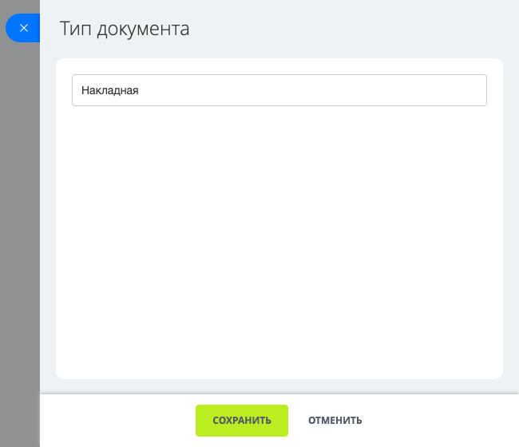
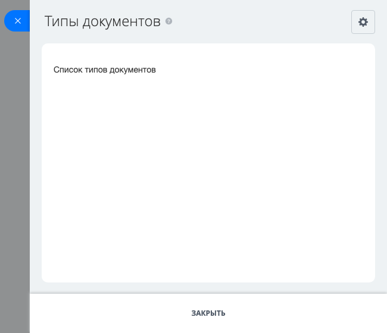
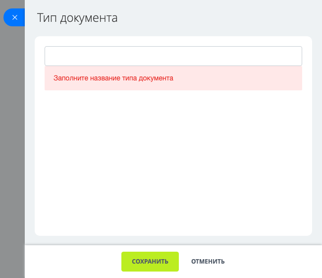
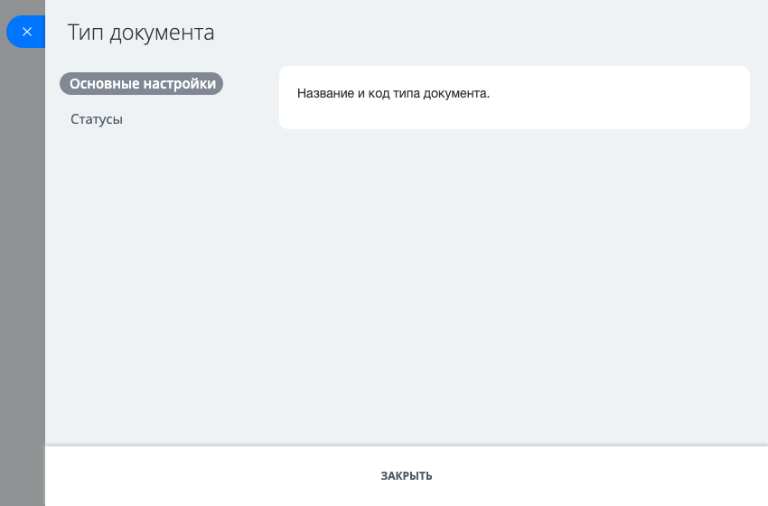
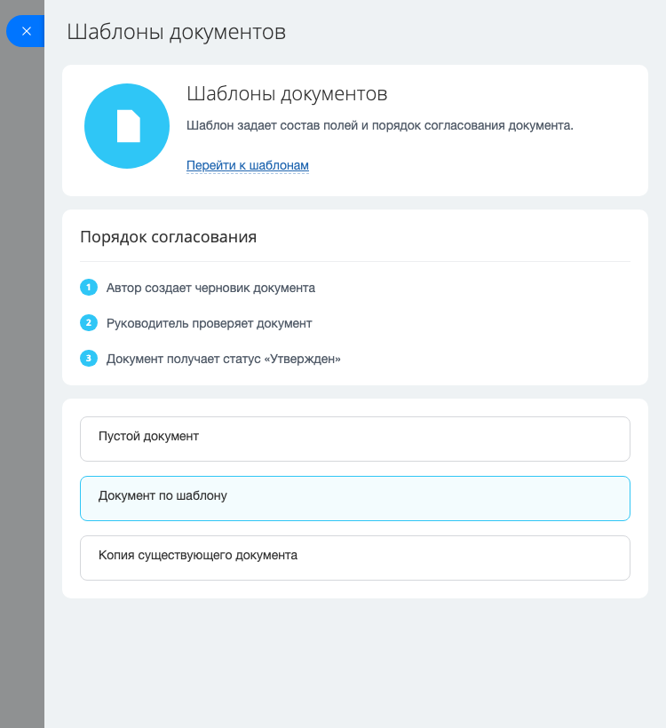
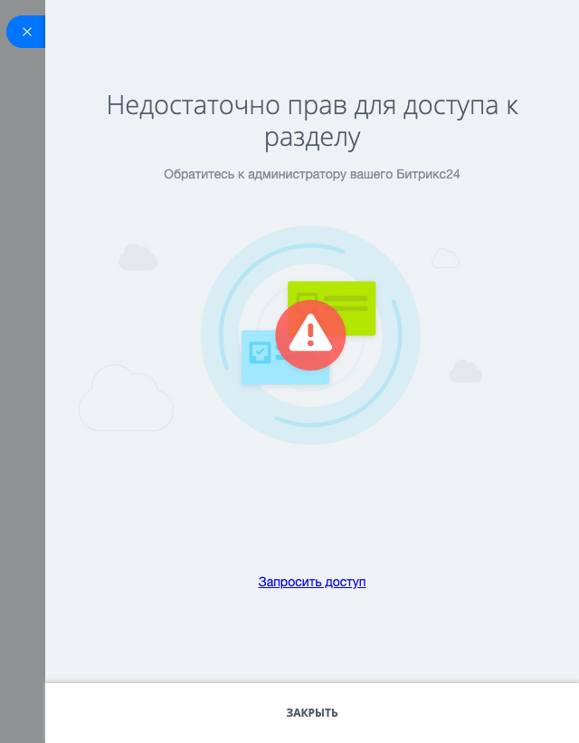

Расширение `ui.sidepanel.layout` строит стандартную разметку контентного слайдера — шапку с заголовком, область содержимого с отступами и закрепленную внизу панель кнопок. Контентный слайдер — это слайдер [боковой панели main.sidepanel](./main-sidepanel.md), который открывается без `iframe`. Его содержимое возвращает функция `contentCallback`. Используйте расширение, когда содержимое слайдера собирает JavaScript-код, например форму настроек, справку или результат запроса к серверу.

За разметку отвечает класс `Layout`. Он заполняет три области слайдера из параметров:

-  шапку — из `title` и `toolbar`,
-  содержимое — из `content`,
-  панель кнопок — из `buttons`.

Статический метод `createContent()` загружает нужные расширения и возвращает `Promise` с готовым DOM-элементом, который можно сразу вернуть из `contentCallback`.

Расширение `ui.sidepanel-content` дополняет разметку CSS-классами для секций, заголовков, абзацев и списков внутри слайдера. В нем же есть класс `StubNotAvailable`, который показывает заглушку «нет доступа» или «нет соединения».

Способ вывести содержимое в слайдере выбирайте по задаче:

-  `contentCallback` без `Layout` — своя разметка целиком, без стандартной шапки, отступов и панели кнопок,
-  `contentCallback` с `Layout` — стандартная разметка слайдера, расширения загружаются в верхнем окне браузера,
-  компонент `bitrix:ui.sidepanel.wrapper` — отдельная страница сайта во фрейме слайдера, содержимое выводит PHP-компонент. Компонент описан в разделе [Сделать страницу для слайдера](./main-sidepanel.md#slider-page).

## Подключить расширение

Если вы подключаете расширение из PHP, загрузите `ui.sidepanel.layout`.

```php
\Bitrix\Main\UI\Extension::load('ui.sidepanel.layout');
```

В модульном JavaScript импортируйте класс `Layout`.

```js
import { Layout } from 'ui.sidepanel.layout';
```

Вне модульного JavaScript, например в скрипте шаблона компонента, класс доступен как `BX.UI.SidePanel.Layout`. Чтобы перенести пример статьи в такой скрипт, уберите строки `import` и обращайтесь к классам через глобальные имена `BX.UI.SidePanel.Layout`, `BX.Tag` и `BX.Text`.

**Пример.** Скрипт без модульного JavaScript открывает слайдер с заголовком «Тип документа» и текстом «Накладная».

```js
BX.SidePanel.Instance.open('document-type-view', {
    width: 600,
    contentCallback: () => {
        return BX.UI.SidePanel.Layout.createContent({
            title: 'Тип документа',
            content: () => '<p>Накладная</p>',
        });
    },
});
```

Расширение `ui.sidepanel-content` отдельно подключать не нужно, если в слайдере включена белая секция содержимого. Этот режим включен по умолчанию, подробнее — в разделе [Настроить отступы и фон](#design).

## Открыть слайдер с разметкой {#open}

Вызовите `BX.SidePanel.Instance.open()` и верните из `contentCallback` результат `Layout.createContent()`. В параметрах `createContent()` передайте заголовок `title` и функцию `content`, которая возвращает содержимое слайдера.

**Пример.** Код открывает слайдер шириной 600 пикселей с заголовком «Тип документа» и полем ввода названия. Поле оформлено классами [расширения ui.forms](./ui-forms.md). Внизу слайдера выводятся кнопки «Сохранить» и «Отменить». Как сохранить введенное значение, описано в разделе [Сохранить данные формы](#save-form).

```js
import { Layout } from 'ui.sidepanel.layout';

BX.SidePanel.Instance.open('document-type-settings', {
    width: 600,
    cacheable: false,
    contentCallback: () => {
        return Layout.createContent({
            extensions: ['ui.forms'],
            title: 'Тип документа',
            content: () => {
                return `
                    <div class="ui-ctl ui-ctl-textbox ui-ctl-w100">
                        <input type="text" class="ui-ctl-element" name="name" value="Накладная">
                    </div>
                `;
            },
            buttons: ({ cancelButton, SaveButton }) => {
                return [
                    new SaveButton({
                        onclick: () => {
                            BX.SidePanel.Instance.close();
                        },
                    }),
                    cancelButton,
                ];
            },
        });
    },
});
```

Слайдер открывается справа поверх страницы. В шапке заголовок «Тип документа», ниже белая секция с полем ввода со значением «Накладная», внизу панель с кнопками «Сохранить» и «Отменить».

{width=650px height=560px}

Функция `buttons` получает классы кнопок и готовые кнопки. Класс `SaveButton` описывает кнопку «Сохранить», ее экземпляр создают через `new`. Объект `cancelButton` — уже готовая кнопка «Отменить». Подробнее — в разделе [Настроить кнопки](#buttons).

Кнопка «Сохранить» в этом примере только закрывает верхний слайдер. Как прочитать поля, отправить их на сервер и закрыть именно этот слайдер, показано в разделе [Сохранить данные формы](#save-form).

Первый аргумент `open()` в контентном слайдере служит идентификатором, а не адресом страницы. Параметры `width` и `cacheable` относятся к самому слайдеру и описаны в разделе [Передать параметры слайдера](./main-sidepanel.md#slider-params) статьи о боковой панели.

Метод `createContent()` выполняет два действия:

1. Загружает расширения из параметра `extensions` и служебные расширения разметки.
2. Создает экземпляр `Layout`, вызывает его метод `render()` и возвращает `Promise` с DOM-элементом слайдера.



Перечислите в параметре `extensions` все расширения, которые использует содержимое, например CSS-классы полей `ui.forms`, селекторы и уведомления.

Контентный слайдер встраивается в документ верхнего окна браузера, а не в текущий фрейм. Поэтому `Layout` загружает расширения методом `top.BX.Runtime.loadExtension()` в верхнем окне. Метод описан в разделе [Загрузить расширение по требованию](./main-core.md#zagruzit-rasshirenie-po-trebovaniyu) статьи о main.core.

Если открыть слайдер со страницы, которая сама открыта в слайдере, стили расширений, загруженных только на этой странице, останутся во фрейме. Содержимое слайдера выведется без них.



Метод `createContent()` всегда загружает расширения `ui.sidepanel.layout`, `ui.buttons` и `ui.sidepanel.menu`. Остальные служебные расширения он добавляет, только если они нужны параметрам:

-  `ui.sidepanel-content` — если белая секция содержимого включена, то есть `design.section` не равен `false`,
-  `ui.buttons.icons` — если передан `toolbar`,
-  `ui.hint` — если передан `hint`.

## Передать параметры

Передайте параметры в `createContent()` одним объектом. Все параметры необязательные.

| Параметр | Тип | Описание |
|---|---|---|
| `extensions` | `string[]` | Расширения, которые нужно загрузить в верхнем окне до отрисовки содержимого |
| `title` | `string` | Заголовок слайдера. Текст выводится как есть, HTML-теги не обрабатываются. Без заголовка `Layout` не выводит шапку, а вместе с ней панель `toolbar` и подсказку `hint` |
| `hint` | `string` | Текст [подсказки ui.hint](./hint.md). Значок подсказки выводится справа от заголовка, только если передан `title`. HTML-теги в тексте не обрабатываются |
| `toolbar` | `Function` | Получает объект `BX.UI` с классами кнопок. Возвращает массив кнопок `BX.UI.Button` и DOM-элементов для панели в шапке. Работает только вместе с `title`. Подробнее — в разделе [Настроить шапку](#header) |
| `content` | `Function` | Возвращает содержимое слайдера — строку, DOM-элемент или `Promise`. Если функция ничего не вернула, `render()` выбрасывает `TypeError`. Без параметра область содержимого остается пустой. Подробнее — в разделе [Вывести содержимое](#content) |
| `buttons` | `Function` | Получает объект `BX.UI` и готовые кнопки `closeButton` и `cancelButton`. Возвращает массив кнопок `BX.UI.Button` и DOM-элементов для панели внизу слайдера. Пустой массив убирает панель. Если параметр не передан, выводится кнопка «Закрыть». Подробнее — в разделе [Настроить кнопки](#buttons) |
| `design` | `object` | Отступы и фон области содержимого. Ключи `margin`, `section` и `alignButtonsLeft`. Подробнее — в разделе [Настроить отступы и фон](#design) |
| `menu` | `object` | Меню разделов слева от содержимого. Ключи `items` и `contentAttribute`. Подробнее — в разделе [Добавить меню разделов](#menu) |

Функции `content`, `toolbar` и `buttons` можно передать стрелочной функцией, выражением `function` или методом объекта.

В коротких примерах статьи показан только вызов `Layout.createContent()`. Возвращайте его результат из `contentCallback`, как в разделе [Открыть слайдер с разметкой](#open), иначе слайдер не откроется.

## Вывести содержимое {#content}

Функция `content` вызывается без аргументов и возвращает содержимое слайдера одним из трех способов:

-  строку — `Layout` вставляет ее в область содержимого как HTML,
-  DOM-элемент — `Layout` добавляет его в область содержимого,
-  `Promise` или `BX.Promise` — `Layout` выводит строку или DOM-элемент, которым завершится `Promise`.

Функция обязательно должна вернуть значение. Если она ничего не вернула, `render()` завершится ошибкой `TypeError`. Для пустой области верните пустую строку.

Строку `Layout` записывает в свойство `innerHTML` без экранирования. Если в разметку попадают данные пользователя, экранируйте их методом `Text.encode()` из [расширения main.core](./main-core.md) или соберите содержимое как DOM-элемент.

### Загрузить содержимое с сервера

Если содержимое зависит от данных сервера, верните из `content` цепочку `Promise`. Пока `Promise` не завершился, слайдер показывает индикатор загрузки. Запрос к серверу отправляет функция `BX.ajax.runAction()`, она описана в разделе [Вызвать действие контроллера](./main-core.md#vyzvat-dejstvie-kontrollera) статьи о main.core. Как написать действие на сервере, описано в статье [Контроллеры](../framework/controllers.md).

**Пример.** Код запрашивает список единиц измерения действием контроллера `my:module.Unit.list` и выводит названия списком. Действие возвращает массив единиц с полем `name`. Если запрос завершился ошибкой, слайдер показывает сообщение из [расширения ui.alerts](./ui-alerts.md).

```js
import { Layout } from 'ui.sidepanel.layout';
import { Tag, Text } from 'main.core';

BX.SidePanel.Instance.open('unit-list', {
    width: 500,
    cacheable: false,
    contentCallback: () => {
        return Layout.createContent({
            extensions: ['ui.alerts'],
            title: 'Единицы измерения',
            content: () => {
                return BX.ajax.runAction('my:module.Unit.list').then((response) => {
                    const items = response.data.map((unit) => {
                        return `<li>${Text.encode(unit.name)}</li>`;
                    });

                    return `<ul>${items.join('')}</ul>`;
                }).catch(() => {
                    return Tag.render`
                        <div class="ui-alert ui-alert-danger">
                            <span class="ui-alert-message">Не удалось загрузить список</span>
                        </div>
                    `;
                });
            },
        });
    },
});
```

Обработайте ошибку внутри `content`, как в примере. Если `Promise` завершится отказом, слайдер выведет вместо разметки значение отказа, приведенное к строке, а событие `onLoad` не наступит. Для ответа `BX.ajax.runAction()` на экране появится `[object Object]`. События слайдера описаны в разделе [Обработать события](./main-sidepanel.md#events) статьи о боковой панели.

### Изменить содержимое после открытия

Класс `Layout` отрисовывает содержимое один раз. Чтобы обновить часть слайдера, например список после действия в `toolbar`, сохраните ссылку на DOM-элемент, который вернула функция `content`, и меняйте его напрямую. Повторно вызывать `render()` не нужно.

Пример такого приема есть в разделе [Сохранить данные формы](#save-form). Код создает поля через `Tag.render` до вызова `createContent()` и хранит ссылки на них в переменных `nameInput` и `errorMessage`.

## Настроить шапку {#header}

Шапка выводится, если передан `title`. В ней размещаются заголовок, значок подсказки `hint` и панель кнопок `toolbar`.

Функция `toolbar` получает объект `BX.UI` с классами [расширения ui.buttons](./ui-buttons.md), например `Button`, `SaveButton` и `CancelButton`. Функция возвращает массив, элементами которого могут быть кнопки `BX.UI.Button` и DOM-элементы. Для элемента другого типа `Layout` выбрасывает исключение `BaseError`.

**Пример.** Шапка слайдера содержит заголовок, подсказку и кнопку с иконкой настроек. По клику кнопка выводит сообщение в консоль.

```js
import { Layout } from 'ui.sidepanel.layout';

BX.SidePanel.Instance.open('document-type-list', {
    width: 800,
    cacheable: false,
    contentCallback: () => {
        return Layout.createContent({
            title: 'Типы документов',
            hint: 'Типы документов доступны во всех разделах сайта',
            toolbar: ({ Button }) => {
                return [
                    new Button({
                        icon: Button.Icon.SETTING,
                        color: Button.Color.LIGHT_BORDER,
                        onclick: () => {
                            console.log('Открыть настройки');
                        },
                    }),
                ];
            },
            content: () => '<p>Список типов документов</p>',
        });
    },
});
```

Слева в шапке заголовок «Типы документов» и значок подсказки, справа кнопка с иконкой настроек. Параметр `buttons` не передан, поэтому внизу выводится кнопка «Закрыть».

{width=650px height=560px}

## Настроить кнопки {#buttons}

Панель кнопок закреплена внизу слайдера. Если параметр `buttons` не передан, `Layout` выводит одну кнопку «Закрыть».

Функция `buttons` получает объект `BX.UI` с классами расширения `ui.buttons` и два готовых экземпляра кнопок:

-  `closeButton` — кнопка «Закрыть», закрывает верхний слайдер методом `BX.SidePanel.Instance.close()`,
-  `cancelButton` — кнопка «Отменить», закрывает верхний слайдер тем же методом.

Функция возвращает массив, элементами которого могут быть кнопки `BX.UI.Button` и DOM-элементы. Для элемента другого типа `Layout` выбрасывает исключение `BaseError`. Класс `Layout` выводит кнопки в порядке массива. Как создать кнопку и задать ее оформление, описано в статье о [кнопках ui.buttons](./ui-buttons.md).

Чтобы убрать панель кнопок, верните пустой массив.

**Пример.** Слайдер выводит справку без панели кнопок.

```js
Layout.createContent({
    title: 'Справка',
    content: () => '<p>Статусы документа меняются по мере согласования.</p>',
    buttons: () => [],
});
```

Класс `Layout` выравнивает кнопки по центру панели. Чтобы выровнять их по левому краю, передайте `design.alignButtonsLeft: true`. Параметр `design` описан в разделе [Настроить отступы и фон](#design).

### Сохранить данные формы {#save-form}

Кнопка вызывает обработчик `onclick` и передает ему свой экземпляр первым аргументом. Чтобы прочитать значения полей, соберите содержимое как DOM-элемент и сохраните ссылки на поля.

Слайдер для закрытия возьмите из аргумента `contentCallback`. Метод `slider.close()` закрывает именно этот слайдер, а `BX.SidePanel.Instance.close()` — верхний.

Обработчик сохраняет форму в три шага:

1. Обработчик включает у кнопки состояние ожидания методом `setWaiting(true)`. Кнопка блокируется, и повторный клик не отправит второй запрос.
2. Обработчик отправляет значения полей на сервер.
3. После успешного ответа обработчик закрывает слайдер. После ошибки он выключает ожидание и показывает текст ошибки.

**Пример.** Форма отправляет название типа документа действием `my:module.DocumentType.save`. После успешного сохранения слайдер закрывается. Если сервер вернул ошибку, под полем появляется ее текст, а кнопка снова становится доступной. Текст ошибки оформлен классами [расширения ui.alerts](./ui-alerts.md), поэтому расширение `ui.alerts` указано в `extensions`.

```js
import { Layout } from 'ui.sidepanel.layout';
import { Tag } from 'main.core';

BX.SidePanel.Instance.open('document-type-edit', {
    width: 600,
    cacheable: false,
    contentCallback: (slider) => {
        const nameInput = Tag.render`<input type="text" class="ui-ctl-element" value="Накладная">`;
        const errorMessage = Tag.render`<span class="ui-alert-message"></span>`;
        // Атрибут hidden стоит на обертке: класс ui-alert задает display: flex и перекрыл бы его
        const errorNode = Tag.render`
            <div hidden>
                <div class="ui-alert ui-alert-danger">${errorMessage}</div>
            </div>
        `;

        return Layout.createContent({
            extensions: ['ui.forms', 'ui.alerts'],
            title: 'Тип документа',
            content: () => {
                return Tag.render`
                    <div>
                        <div class="ui-ctl ui-ctl-textbox ui-ctl-w100">${nameInput}</div>
                        ${errorNode}
                    </div>
                `;
            },
            buttons: ({ cancelButton, SaveButton }) => {
                return [
                    new SaveButton({
                        onclick: (button) => {
                            button.setWaiting(true);
                            errorNode.hidden = true;

                            BX.ajax.runAction('my:module.DocumentType.save', {
                                data: {
                                    name: nameInput.value,
                                },
                            }).then(() => {
                                slider.close();
                            }).catch((response) => {
                                const errors = response.errors || [];
                                button.setWaiting(false);
                                errorMessage.textContent = errors.map((error) => error.message).join(' ');
                                errorNode.hidden = false;
                            });
                        },
                    }),
                    cancelButton,
                ];
            },
        });
    },
});
```

На скриншоте пользователь очистил поле и нажал «Сохранить», а действие `my:module.DocumentType.save` вернуло ошибку «Заполните название типа документа». Под полем появляется красный блок `ui-alert-danger` с текстом ошибки, кнопка «Сохранить» снова доступна.

{width=650px height=560px}

У `Layout` нет действий после сохранения, как у параметров `CLOSE_AFTER_SAVE` и `RELOAD_GRID_AFTER_SAVE` [компонента-обертки bitrix:ui.sidepanel.wrapper](./main-sidepanel.md#slider-page). Чтобы обновить страницу, которая открыла слайдер, используйте один из способов:

-  передайте обработчик `onCloseComplete` в параметре `events` метода `open()` — события слайдера описаны в разделе [Обработать события](./main-sidepanel.md#events) статьи о боковой панели,
-  отправьте сообщение методом `BX.SidePanel.Instance.postMessage()` — отправка и прием описаны в разделе [Принять сообщение](./main-sidepanel.md#receive-message).

В том же разделе событий есть пример, как запретить закрытие слайдера с несохраненными изменениями через событие `onClose`.

## Настроить отступы и фон {#design}

Параметр `design` задает вид области содержимого.

| Параметр | Тип | Описание |
|---|---|---|
| `margin` | `boolean` `string` | Отступы области содержимого. `true` — стандартный отступ 20 пикселей, под шапкой отступа сверху нет. `false` — без отступов. Строка — значение CSS-свойства `margin`, например `'0 20px'`. По умолчанию `true` |
| `section` | `boolean` | Помещает содержимое в белую секцию с внутренними отступами — блок с классом `ui-slider-section` из расширения `ui.sidepanel-content`. Со значением `false` содержимое выводится прямо на фон слайдера, а расширение `ui.sidepanel-content` не загружается. По умолчанию `true` |
| `alignButtonsLeft` | `boolean` | Выравнивает кнопки панели внизу слайдера по левому краю. По умолчанию кнопки выровнены по центру |

Передайте `section: false`, если содержимое само делится на несколько секций или выводит собственный фон. Если при этом содержимое использует CSS-классы `ui.sidepanel-content`, добавьте расширение в `extensions`.

**Пример.** Слайдер выводит две белые секции, разметка которых задана в содержимом.

```js
Layout.createContent({
    extensions: ['ui.sidepanel-content'],
    title: 'Тип документа',
    design: {
        section: false,
    },
    content: () => {
        return `
            <div class="ui-slider-section">
                <div class="ui-slider-heading-4">Основные настройки</div>
                <p class="ui-slider-paragraph">Название и код типа документа.</p>
            </div>
            <div class="ui-slider-section">
                <div class="ui-slider-heading-4">Статусы</div>
                <p class="ui-slider-paragraph">Черновик, на согласовании, утвержден.</p>
            </div>
        `;
    },
});
```

## Добавить меню разделов {#menu}

Меню выводится слева от содержимого и переключает его блоки. Передайте в параметре `menu` массив пунктов `items`, а в содержимом пометьте блоки атрибутом `data-menu-item-id` со значением `id` пункта. При открытии слайдера и по клику на пункт `Layout` показывает блоки с `id` активного пункта и скрывает остальные блоки с атрибутом через свойство `hidden`.

**Пример.** Слайдер с меню из двух пунктов. При открытии активен первый пункт, поэтому видна секция пункта «Основные настройки».

```js
Layout.createContent({
    extensions: ['ui.sidepanel-content'],
    title: 'Тип документа',
    design: {
        section: false,
    },
    menu: {
        items: [
            { id: 'main', label: 'Основные настройки' },
            { id: 'statuses', label: 'Статусы' },
        ],
    },
    content: () => {
        return `
            <div class="ui-slider-section" data-menu-item-id="main">
                <p class="ui-slider-paragraph">Название и код типа документа.</p>
            </div>
            <div class="ui-slider-section" data-menu-item-id="statuses">
                <p class="ui-slider-paragraph">Черновик, на согласовании, утвержден.</p>
            </div>
        `;
    },
});
```

Слева меню с пунктами «Основные настройки» и «Статусы», серый фон отмечает активный пункт. Справа видна секция пункта «Основные настройки» с текстом «Название и код типа документа.». Секцию пункта «Статусы» `Layout` покажет после клика по этому пункту. Параметр `buttons` не передан, поэтому внизу кнопка «Закрыть».

{width=850px height=560px}

Если при создании меню ни один пункт не отмечен `active: true`, активным становится первый пункт. Если отмечено несколько пунктов, активным остается первый из них.

Клик по пункту с вложенными пунктами тоже переключает блоки — по `id` этого пункта. Если у такого пункта нет `id` или блока с этим значением, `Layout` скроет все блоки с атрибутом. Задайте родительскому пункту `id` и свой блок содержимого или отключите переключение через `contentAttribute`.

Параметр `menu` принимает два ключа:

-  `items` — массив пунктов меню,
-  `contentAttribute` — имя атрибута, по которому `Layout` находит блоки содержимого. По умолчанию `data-menu-item-id`. Со значением `null` или пустой строкой `Layout` не переключает блоки, и обработку клика задает разработчик.

Пункт меню принимает параметры из таблицы.

*Обязательные параметры обозначены \*.*

| Параметр | Тип | Описание |
|---|---|---|
| `label`* | `string` | Текст пункта |
| `id` | `string` | Идентификатор пункта. Совпадает со значением атрибута блоков содержимого, которые показывает пункт |
| `active` | `boolean` | Делает пункт активным при открытии слайдера. По умолчанию `false` |
| `notice` | `boolean` | Выводит рядом с текстом значок уведомления. По умолчанию `false` |
| `onclick` | `Function` | Обработчик клика. Вызывается после переключения блоков, без аргументов. Объект пункта доступен через `this`, поэтому передайте обычную функцию, а не стрелочную |
| `items` | `object[]` | Вложенные пункты. Пункт с вложенными пунктами раскрывается и сворачивается по клику |
| `actions` | `object[]` | Действия пункта. Каждое действие содержит `id`, текст `label` и обработчик `onclick`, который получает объект пункта. Если действия переданы, справа от пункта выводится значок, по клику на который открывается меню действий |

### Изменить меню после открытия

Чтобы менять пункты меню после отрисовки, получите объект `Layout` методом `Layout.createLayout()`. Метод загружает расширения так же, как `createContent()`, но возвращает `Promise` с экземпляром `Layout`, а не с DOM-элементом. Отрисуйте его методом `render()` и верните результат из `contentCallback`.

Передайте параметр `menu`, хотя бы пустым объектом `{}`. Без него `getMenu()` вернет `undefined`.

Метод `getMenu()` возвращает объект меню. Объект меню содержит методы:

-  `add(options)` — добавляет пункт и возвращает его объект,
-  `get(id)` — возвращает пункт по идентификатору,
-  `change(id, options)` — меняет параметры пункта,
-  `remove(id)` — удаляет пункт,
-  `setItems(items)` — заменяет все пункты. Первый пункт метод сам не активирует, передайте `active: true` нужному пункту. Если в меню уже был активный пункт, флаг `active` у новых пунктов сбросится. Метод не переключает блоки содержимого, `Layout` скрывает и показывает их только по клику на пункт,
-  `getActiveItem()` — возвращает активный пункт верхнего уровня.

**Пример.** Код открывает слайдер с пустым меню и после загрузки слайдера добавляет в меню два пункта. Обработчик события `click` меню выводит в консоль идентификатор пункта, по которому кликнули. Меню без пунктов не переключает блоки при открытии, поэтому блок «Статусы» скрыт атрибутом `hidden` в разметке.

```js
import { Layout } from 'ui.sidepanel.layout';

let menu = null;

BX.SidePanel.Instance.open('document-type-settings', {
    width: 800,
    cacheable: false,
    contentCallback: () => {
        return Layout.createLayout({
            title: 'Тип документа',
            menu: {},
            content: () => {
                return `
                    <div data-menu-item-id="main">Основные настройки</div>
                    <div data-menu-item-id="statuses" hidden>Статусы</div>
                `;
            },
        }).then((layout) => {
            menu = layout.getMenu();
            menu.subscribe('click', (event) => {
                const item = event.getData().item;
                console.log(item.getId());
            });

            return layout.render();
        });
    },
    events: {
        onLoad: () => {
            menu.setItems([
                { id: 'main', label: 'Основные настройки', active: true },
                { id: 'statuses', label: 'Статусы', notice: true },
            ]);
        },
    },
});
```

Чтобы обработать клик по любому пункту, подпишитесь на событие `click` объекта меню, как в примере. Обработчик получает объект события `BaseEvent` из расширения main.core.events, он описан в разделе [Работать с событиями](./main-core.md#rabotat-s-sobytiyami) статьи о main.core. Пункт лежит в поле `item` данных события `event.getData()`. Подписывайтесь в обработчике `then()` после `getMenu()`, потому что до завершения `createLayout()` объекта меню еще нет.

## Сверстать содержимое классами ui.sidepanel-content

Расширение `ui.sidepanel-content` содержит CSS-классы для типовой разметки слайдера. Классы работают и без `Layout`, например на странице, которую открывает [компонент bitrix:ui.sidepanel.wrapper](./main-sidepanel.md#slider-page). Фон и отступы такой страницы задают параметры обертки `USE_BACKGROUND_CONTENT` и `USE_PADDING`. Загрузите расширение из PHP.

```php
\Bitrix\Main\UI\Extension::load('ui.sidepanel-content');
```

### Секции и блоки

Секция — белый блок со скругленными углами и внутренним отступом 20 пикселей. Секции идут друг под другом с отступом 15 пикселей. Внутри секции содержимое делится на блоки.

| Класс | Описание |
|---|---|
| `ui-slider-section` | Секция |
| `--rounding` | Модификатор секции. Задает скругление углов из CSS-переменной `--ui-border-radius-md`, а при ее отсутствии — 10 пикселей |
| `ui-slider-content-box` | Блок внутри секции. Отделяется от следующего блока отступом 43 пикселя |

### Заголовки и текст

| Класс | Описание |
|---|---|
| `ui-slider-heading-1` | Заголовок голубого цвета размером 19 пикселей |
| `ui-slider-heading-2` | Заголовок размером 24 пикселя |
| `ui-slider-heading-3` | Заголовок размером 22 пикселя |
| `ui-slider-heading-4` | Заголовок размером 18 пикселей с линией снизу. Модификатор `--no-border-bottom` убирает линию |
| `ui-slider-heading-box` | Строка заголовка с линией снизу. Делит содержимое на левую часть `ui-slider-heading-main` и правую часть `ui-slider-heading-rest`, например для заголовка и кнопки |
| `ui-slider-subtitle` | Подзаголовок размером 16 пикселей |
| `ui-slider-paragraph` | Абзац размером 14 пикселей с отступом 25 пикселей снизу |
| `ui-slider-paragraph-2` | Абзац серого цвета, размер и отступ как у `ui-slider-paragraph`. Внутри секции `ui-slider-section-icon` отступ снизу 15 пикселей |
| `ui-slider-link` | Ссылка с пунктирным подчеркиванием |

### Секция с иконкой

Чтобы вывести круглую иконку слева от текста, добавьте секции класс `ui-slider-section-icon` или `ui-slider-section-icon-center`. Иконку задает элемент с классом `ui-slider-icon`.

| Класс | Описание |
|---|---|
| `ui-slider-section-icon` | Выводит иконку и текст в строку. Иконка выравнивается по верхнему краю текста |
| `ui-slider-section-icon-center` | Выводит иконку и текст в строку. Иконка выравнивается по центру текста |
| `ui-slider-section-column` | Выводит блоки секции с иконкой друг под другом. Используйте, когда под строкой с иконкой нужен еще один блок, например с кнопками |
| `ui-slider-icon` | Круглая иконка диаметром 96 пикселей с серым фоном |
| `--icon-sm` | Модификатор секции. Уменьшает иконку до 76 пикселей |
| `--icon-xs` | Модификатор секции. Уменьшает иконку до 40 пикселей |

**Пример.** Секция с иконкой по центру, заголовком, абзацем и ссылкой. Класс `ui-slider-icon` задает размер, форму и серый фон иконки. Изображение задайте своим CSS-классом.

```html
<div class="ui-slider-section ui-slider-section-icon-center">
    <span class="ui-slider-icon"></span>
    <div class="ui-slider-content-box">
        <div class="ui-slider-heading-3">Шаблоны документов</div>
        <p class="ui-slider-paragraph-2">Шаблон задает состав полей и порядок согласования документа.</p>
        <a href="/documents/templates/" class="ui-slider-link">Перейти к шаблонам</a>
    </div>
</div>
```

### Нумерованный список

Класс `ui-slider-list` выводит список с номерами в голубых кружках. Номера выводят стили расширения, в разметку их добавлять не нужно. Пункты списка задает класс `ui-slider-list-item`.

**Пример.** Секция с заголовком и списком из трех шагов.

```html
<div class="ui-slider-section">
    <div class="ui-slider-heading-4">Порядок согласования</div>
    <ul class="ui-slider-list">
        <li class="ui-slider-list-item">Автор создает черновик документа</li>
        <li class="ui-slider-list-item">Руководитель проверяет документ</li>
        <li class="ui-slider-list-item">Документ получает статус «Утвержден»</li>
    </ul>
</div>
```

### Рамки

Класс `ui-slider-frame` выводит блок в серой рамке с отступом 16 пикселей снизу. При наведении курсора рамка и фон блока подсвечиваются голубым.

| Класс | Описание |
|---|---|
| `ui-slider-frame` | Блок в рамке |
| `--no-hover` | Отключает подсветку при наведении курсора |
| `--active` | Выделяет блок голубой рамкой и фоном, например выбранный вариант |
| `--last-element` | Убирает отступ снизу у последнего блока |

**Пример.** Три варианта шаблона документа в рамках. Второй вариант выбран, у последнего нет отступа снизу.

```html
<div class="ui-slider-section">
    <div class="ui-slider-frame">Пустой документ</div>
    <div class="ui-slider-frame --active">Документ по шаблону</div>
    <div class="ui-slider-frame --last-element">Копия существующего документа</div>
</div>
```

На скриншоте разметка трех HTML-примеров раздела выведена в одном слайдере. Сверху секция с круглой иконкой, заголовком, абзацем и ссылкой, иконка выровнена по центру текста. Изображение иконки задает собственный CSS-класс. Ниже секция с заголовком и списком, номера шагов стоят в голубых кружках. Внизу секция с тремя рамками, модификатор `--active` выделяет вторую рамку.

{width=750px height=820px}

## Показать заглушку

Класс `StubNotAvailable` из расширения `ui.sidepanel-content` выводит заглушку с заголовком и описанием. Используйте его, когда содержимое слайдера нельзя показать, например у пользователя нет прав, инструмент отключен или сервер недоступен.

В модульном JavaScript импортируйте класс заглушки и перечисления видов и ссылок.

```js
import { StubNotAvailable, StubType, StubLinkType } from 'ui.sidepanel-content';
```

Вне модульного JavaScript класс `StubNotAvailable` и перечисления `StubType` и `StubLinkType` доступны в пространстве имен `BX.UI.Sidepanel.Content`. В нем `Sidepanel` пишется со строчной `p`, в отличие от `BX.UI.SidePanel.Layout`.

Вид заглушки задает параметр `type` со значением из `StubType`:

-  `StubType.notAvailable` — инструмент недоступен. Заглушка выводит картинку, заголовок и описание. Значение по умолчанию,
-  `StubType.noAccess` — у пользователя нет прав на раздел. Заглушка выводит заголовок, описание, картинку и ссылку `link`,
-  `StubType.noConnection` — нет соединения с сервисом. Заглушка выводит заголовок, описание, картинку и ссылку `link`.

**Пример.** Код открывает слайдер с заглушкой «нет доступа». Ссылка под картинкой ведет на страницу запроса прав.

```js
import { StubNotAvailable, StubType, StubLinkType } from 'ui.sidepanel-content';

const stub = new StubNotAvailable({
    type: StubType.noAccess,
    link: {
        text: 'Запросить доступ',
        value: '/documents/access-request/',
        type: StubLinkType.href,
    },
});

stub.openSlider();
```

Заглушка выводит заголовок «Недостаточно прав для доступа к разделу», описание «Обратитесь к администратору вашего Битрикс24», картинку и ссылку «Запросить доступ». Шапки в слайдере нет, внизу кнопка «Закрыть».

{width=640px height=820px}

Класс выводит заглушку тремя методами:

-  `openSlider()` — открывает слайдер с заглушкой,
-  `renderTo(container)` — добавляет заглушку в конец элемента `container` в своей разметке,
-  `render()` — возвращает DOM-элемент заглушки без вставки на страницу.

Метод `openSlider()` выводит заглушку через `Layout.createContent()` в слайдере со следующими свойствами:

-  ширина 590 пикселей, слайдер не кэшируется,
-  шапки нет, внизу выводится кнопка «Закрыть»,
-  заглушка `noAccess` выводится без белой секции, остальные виды — в белой секции,
-  идентификатор слайдера `sign:stub-no-connection` общий для всех заглушек, поэтому вторая заглушка поверх первой не откроется.

Конструктор принимает параметры из таблицы.

| Параметр | Тип | Описание |
|---|---|---|
| `type` | `string` | Вид заглушки, значение из `StubType`. С другим значением метод `render()` выбрасывает исключение `Error`. По умолчанию `StubType.notAvailable` |
| `title` | `string` | Заголовок. Класс экранирует текст. Если не передан, для `noAccess` выводится «Недостаточно прав для доступа к разделу», для остальных видов — «Доступ к этому инструменту закрыт для всех сотрудников» |
| `desc` | `string` | Описание. Класс экранирует текст. Если не передано, выводится «Обратитесь к администратору вашего Битрикс24» |
| `link` | `object` | Ссылка под картинкой для видов `noAccess` и `noConnection`. Вид `notAvailable` ссылку не выводит. Объект содержит ключи `text` — текст ссылки, `value` — адрес страницы или код статьи справки в зависимости от `type`, и `type` — действие ссылки |

Тексты по умолчанию упоминают Битрикс24. На сайте без Битрикс24 передайте свои `title` и `desc`.

Ключ `link.type` задает действие ссылки:

-  `StubLinkType.href` — ссылка ведет на адрес из `link.value`. Класс экранирует адрес, и символ `&` превращается в `&amp;`, поэтому адрес с несколькими параметрами запроса не сработает,
-  `StubLinkType.helpdesk` — ссылка открывает статью справки Битрикс24 с кодом из `link.value` через `BX.Helper.show()`.

Если `link.type` не передан, ссылка выводится, но по клику ничего не происходит.

## Методы Layout

-  `Layout.createContent(options)` — загружает расширения, отрисовывает разметку и возвращает `Promise` с DOM-элементом слайдера.

-  `Layout.createLayout(options)` — загружает расширения и возвращает `Promise` с экземпляром `Layout`. Разметку отрисовывает метод `render()`.

-  `render()` — отрисовывает разметку и возвращает DOM-элемент слайдера. Если `content` вернул `Promise`, метод тоже возвращает `Promise`, который завершится DOM-элементом. Вызывайте метод один раз. При повторном вызове панель кнопок внизу слайдера получит второй набор кнопок.

-  `getContainer()` — возвращает корневой элемент разметки.

-  `getFooterContainer()` — возвращает элемент панели кнопок.

-  `getMenu()` — возвращает объект меню или `undefined`, если параметр `menu` не передан.

Конструктор `new Layout(options)` не загружает расширения. Создавайте экземпляр через `createContent()` или `createLayout()`.

## Связанные материалы

-  [Боковая панель main.sidepanel](./main-sidepanel.md)

-  [Кнопки ui.buttons](./ui-buttons.md)

-  [Подсказка](./hint.md)

-  [Алерты ui.alerts](./ui-alerts.md)

-  [Поля форм ui.forms](./ui-forms.md)

-  [Контроллеры](../framework/controllers.md)

-  [JS-ядро main.core и события](./main-core.md)

-  [Расширения](../framework/extensions.md)
