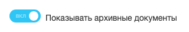
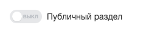
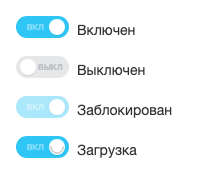

Расширение `ui.switcher` выводит переключатель с двумя состояниями — включено и выключено. Переключатель подходит для настроек, которые применяются сразу, например включить уведомления, показать архивные документы или сделать раздел публичным.

За переключатель отвечает класс `Switcher`. Его можно создать в JavaScript или вывести разметкой в PHP-шаблоне и затем инициализировать.

Обычный флажок или радиокнопку в разметке формы оформляет расширение `ui.forms`. Классы для них описаны в разделе [Флажок и переключатель](./ui-forms.md#flazhok-i-pereklyuchatel) статьи о полях форм.

## Подключить расширение

В PHP загрузите `ui.switcher` методом `Extension::load()`.

```php
\Bitrix\Main\UI\Extension::load('ui.switcher');
```

В модульном JavaScript импортируйте класс и константы.

```js
import { Switcher, SwitcherSize, SwitcherColor, AirSwitcherStyle } from 'ui.switcher';
```

Вне модульного JavaScript класс и константы доступны как `BX.UI.Switcher`, `BX.UI.SwitcherSize`, `BX.UI.SwitcherColor` и `BX.UI.AirSwitcherStyle`.

## Создать переключатель в JavaScript

Создайте экземпляр `Switcher` и вставьте его на страницу методом `renderTo(node)`.

**Пример.** Переключатель «Показывать архивные документы» включен при выводе и перезагружает список при каждом переключении.

```js
import { Switcher } from 'ui.switcher';

const switcher = new Switcher({
    id: 'show-archived',
    checked: true,
    handlers: {
        toggled: () => {
            // reloadDocuments() — собственная функция, которая перезагружает список
            reloadDocuments({ archived: switcher.isChecked() });
        },
    },
});

switcher.renderTo(document.getElementById('archived-switcher'));
```

Включенный переключатель закрашен синим, внутри него подпись ВКЛ заглавными буквами.

{width=320px height=54px}

Метод `getNode()` возвращает DOM-элемент переключателя без вставки на страницу.

### Параметры Switcher

Все параметры необязательны.

| Параметр | Тип | Описание |
|---|---|---|
| `id` | `string`, `number` | Идентификатор. По нему метод `Switcher.getById()` находит экземпляр. Тип значения в `getById()` должен совпадать с типом `id`, число `5` и строка `'5'` — разные идентификаторы. Если не передан, расширение создает случайный |
| `checked` | `boolean` | Начальное состояние. По умолчанию `false` — выключено |
| `disabled` | `boolean` | Блокирует переключатель. По умолчанию `false` |
| `inputName` | `string` | Имя скрытого поля формы. Поле получает значение `Y` или `N` по состоянию переключателя |
| `handlers` | `object` | Обработчики событий. Описаны в разделе [Обработать переключение](#obrabotat-pereklyuchenie) |
| `size` | `string` | Размер — значение `SwitcherSize` |
| `color` | `string` | Цвет — значение `SwitcherColor`. Не действует при `useAirDesign: true` |
| `useAirDesign` | `boolean` | Включает оформление Air. По умолчанию `false` |
| `style` | `string` | Стиль Air — значение `AirSwitcherStyle`. Действует только при `useAirDesign: true`. По умолчанию `FILLED` |
| `showStateTitle` | `boolean` | Показывает внутри переключателя подписи ВКЛ и ВЫКЛ. По умолчанию `true`. В оформлении Air подписи не выводятся |
| `accessible` | `boolean` | Добавляет роль переключателя и атрибуты для экранных читалок, включает переключение клавиатурой. Действует только вместе с `ariaLabel` или `ariaLabelledBy`, без них расширение не добавляет атрибуты и выводит предупреждение в консоль. Доступен с версии модуля `ui` 26.700.0 |
| `ariaLabel` | `string` | Название переключателя для экранных читалок. Доступен с версии модуля `ui` 26.700.0 |
| `ariaLabelledBy` | `string` | Идентификатор элемента, текст которого служит названием переключателя для экранных читалок. Доступен с версии модуля `ui` 26.700.0 |
| `node` | `HTMLElement` | Готовый элемент разметки, который нужно превратить в переключатель |

## Вывести переключатель в PHP-шаблоне

Разметка переключателя — элемент с классом `ui-switcher` и параметрами в JSON в атрибуте `data-switcher`. Из атрибута расширение читает ключи `id`, `checked`, `inputName`, `color`, `size`, `accessible`, `ariaLabel` и `ariaLabelledBy`.

После вывода разметки вызовите `Switcher.initByClassName()`. Метод создает экземпляр для каждого элемента с классом `ui-switcher`, который еще не инициализирован. Без этого вызова расширение не превращает разметку в переключатели.

**Пример.** Шаблон формы выводит переключатель «Публичный раздел» со скрытым полем `PUBLIC`. При отправке формы сервер получает `Y` или `N`.

```php
<?php
use Bitrix\Main\Web\Json;

\Bitrix\Main\UI\Extension::load('ui.switcher');
?>
<form method="post">
    <span class="ui-switcher" data-switcher="<?= htmlspecialcharsbx(Json::encode([
        'id' => 'section-public',
        'checked' => $isPublic,
        'inputName' => 'PUBLIC',
    ])) ?>"></span>
    Публичный раздел
</form>

<script>
BX.ready(() => {
    BX.UI.Switcher.initByClassName();
});
</script>
```

При `$isPublic = false` переключатель выводится выключенным — серым, с подписью ВЫКЛ.

{width=240px height=54px}

Чтобы получить экземпляр, созданный из разметки, вызовите `Switcher.getById(id)` с идентификатором из атрибута.

Чтобы вывести заблокированный переключатель, после `initByClassName()` получите экземпляр и вызовите `disable(true)`. Ключа `disabled` в атрибуте `data-switcher` нет, а класс блокировки из разметки расширение снимает при инициализации.

Заблокированный переключатель не отключает скрытое поле, и форма по-прежнему отправляет его значение.

**Пример.** Переключатель «Публичный раздел» выводится заблокированным.

```js
BX.ready(() => {
    BX.UI.Switcher.initByClassName();
    BX.UI.Switcher.getById('section-public').disable(true);
});
```

## Изменить состояние

Методы экземпляра:

-  `check(checked, fireEvents)` — включает переключатель при `checked: true` и выключает при `false`. Второй аргумент `false` меняет состояние без событий.

-  `toggle()` — переключает в противоположное состояние. У заблокированного переключателя ничего не делает.

-  `isChecked()` — возвращает `true`, если переключатель включен.

-  `disable(disabled)` — блокирует переключатель при `true` и снимает блокировку при `false`.

-  `isDisabled()` — возвращает `true`, если переключатель заблокирован.

-  `setLoading(mode)` — показывает индикатор загрузки при `true` и убирает при `false`.

-  `destroy()` — удаляет экземпляр из списка переключателей страницы и снимает обработчики. Элемент удалите со страницы отдельно, например вызовом `Dom.remove(switcher.getNode())` из `main.core`. Доступен с версии модуля `ui` 26.700.0.

Пока включен индикатор загрузки, методы `check()` и `disable()` состояние не меняют.

В обычном оформлении заблокированный переключатель выводится бледным, в оформлении Air — цветом неактивного элемента. При загрузке на ползунке появляется индикатор вращения.

{width=220px height=172px}

**Пример.** Переключатель отправляет новое значение на сервер. На время запроса он показывает загрузку, а при ошибке возвращает прежнее состояние без повторного запроса.

```js
import { Switcher } from 'ui.switcher';

const switcher = new Switcher({
    id: 'notify-on-change',
    handlers: {
        toggled: () => {
            const enabled = switcher.isChecked();
            switcher.setLoading(true);

            BX.ajax.runAction('my:module.Settings.setNotify', {
                data: { enabled: enabled ? 'Y' : 'N' },
            }).then(
                () => {
                    switcher.setLoading(false);
                },
                () => {
                    switcher.setLoading(false);
                    switcher.check(!enabled, false);
                },
            );
        },
    },
});

switcher.renderTo(document.getElementById('notify-switcher'));
```

## Обработать переключение

Передайте обработчики в параметре `handlers`. Обработчик вызывается с экземпляром `Switcher` в `this`. В стрелочной функции `this` не указывает на экземпляр, поэтому примеры обращаются к нему через переменную `switcher`. Аргумент обработчика — событие клика или нажатия клавиши браузера, а при вызове методов из кода — пустой объект.

| Событие | Когда срабатывает |
|---|---|
| `toggled` | При каждом вызове `check()` с событиями, включая клик, даже если состояние не изменилось. Срабатывает после `checked` или `unchecked` |
| `checked` | При выключении переключателя |
| `unchecked` | При включении переключателя |
| `lock` | При блокировке методом `disable(true)` |
| `unlock` | При снятии блокировки методом `disable(false)` |



Имена событий `checked` и `unchecked` противоположны новому состоянию. При включении срабатывает `unchecked`, при выключении — `checked`. Чтобы не ошибиться, подписывайтесь на `toggled` и проверяйте состояние методом `isChecked()`.



Чтобы подписаться на событие уже созданного переключателя, например полученного через `getById()`, вызовите статический метод `EventEmitter.subscribe()` из `main.core.events` и передайте экземпляр в первом аргументе. Метода `subscribe()` у класса `Switcher` нет. Обработчик получает `BaseEvent` без данных, поэтому состояние читайте методом `isChecked()`.

**Пример.** Обработчик выводит в консоль новое состояние переключателя «Публичный раздел».

```js
import { EventEmitter } from 'main.core.events';

const switcher = BX.UI.Switcher.getById('section-public');
EventEmitter.subscribe(switcher, 'toggled', () => {
    console.log(switcher.isChecked());
});
```

Для Vue 3 есть компонент `Switcher` из расширения `ui.vue3.components.switcher`. Состояние передайте в свойство `isChecked`, блокировку — в `isDisabled`, остальные параметры — объектом в `options`. Компонент генерирует события `check` и `uncheck`, но сам состояние не меняет. Обновите значение `isChecked` в обработчике.

**Пример.** Компонент настроек выводит переключатель и хранит его состояние в `enabled`.

```js
import { Switcher } from 'ui.vue3.components.switcher';

export const NotifySettings = {
    components: { Switcher },
    data()
    {
        return { enabled: false };
    },
    template: `
        <Switcher
            :is-checked="enabled"
            :options="{ size: 'small' }"
            @check="enabled = true"
            @uncheck="enabled = false"
        />
    `,
};
```

## Выбрать размер, цвет и стиль

Константа `SwitcherSize` задает размер.

| Константа | Значение | Оформление |
|---|---|---|
| `SwitcherSize.medium` | `medium` | Обычное и Air |
| `SwitcherSize.small` | `small` | Обычное и Air |
| `SwitcherSize.extraSmall` | `extra-small` | Обычное и Air |
| `SwitcherSize.extraLarge` | `extra-large` | Только Air |
| `SwitcherSize.large` | `large` | Только Air |
| `SwitcherSize.extraExtraSmall` | `extra-extra-small` | Только Air |

Константа `SwitcherColor` задает цвет обычного оформления:

-  `SwitcherColor.primary` — основной цвет,

-  `SwitcherColor.green` — зеленый.

В оформлении Air цвет задает параметр `style` со значением из `AirSwitcherStyle`. Значения, кроме `SOLID` и `TINTED`, доступны с версии модуля `ui` 26.700.0. Стили разбиты на группы:

-  `FILLED`, `FILLED_SUCCESS`, `FILLED_ALERT`, `FILLED_WARNING`, `FILLED_BLACK`, `FILLED_WHITE`, `FILLED_NO_ACCENT`, `FILLED_BITRIX_GPT`, `FILLED_BOOST` — заливка, у `FILLED_BITRIX_GPT` и `FILLED_BOOST` — градиентная,

-  `TINTED`, `TINTED_ACCENT_1`, `TINTED_SUCCESS`, `TINTED_ALERT`, `TINTED_WARNING`, `TINTED_GREEN`, `TINTED_VIOLET`, `TINTED_NO_ACCENT`, `TINTED_BITRIX_GPT` — тонированная заливка,

-  `OUTLINE`, `OUTLINE_ACCENT_1`, `OUTLINE_ACCENT_2`, `OUTLINE_ALERT`, `OUTLINE_BOOST`, `OUTLINE_NO_ACCENT`, `OUTLINE_SUCCESS`, `OUTLINE_WARNING`, `OUTLINE_BITRIX_GPT` — контур,

-  `SELECTION` — выделение, в светлой теме это светло-голубая заливка с голубым контуром и синий ползунок.

Значение `SOLID` оставлено для совместимости и выглядит так же, как `FILLED`. Если `style` не передан, переключатель Air оформлен как `FILLED`. Выключенный переключатель выглядит одинаково во всех стилях.

**Пример.** Переключатель в оформлении Air среднего размера с зеленой заливкой.

```js
import { Switcher, SwitcherSize, AirSwitcherStyle } from 'ui.switcher';

const switcher = new Switcher({
    useAirDesign: true,
    size: SwitcherSize.medium,
    style: AirSwitcherStyle.FILLED_SUCCESS,
});

switcher.renderTo(document.getElementById('air-switcher'));
```

Если элемент разметки уже содержит класс `--air`, переключатель включает оформление Air сам.

## Связанные материалы

-  [Разделенная кнопка с переключателем](./ui-buttons.md#sozdat-razdelennuyu-knopku)

-  [Поля форм ui.forms](./ui-forms.md)

-  [JS-ядро main.core и события](./main-core.md)

-  [Контроллеры](../framework/controllers.md)
