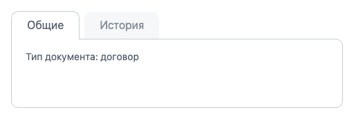
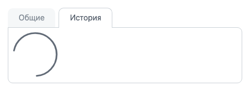
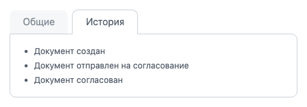

Расширение `ui.tabs` выводит блок вкладок — строку заголовков и область содержимого, в которой видна одна вкладка. Содержимое вкладки можно передать сразу или загрузить при открытии вкладки, например запросом к серверу.

Блок вкладок — экземпляр класса `Tabs`, каждая вкладка — экземпляр класса `Tab`.

## Подключить расширение

В PHP загрузите расширение `ui.tabs`.

```php
\Bitrix\Main\UI\Extension::load('ui.tabs');
```

В модульном JavaScript импортируйте классы.

```js
import { Tabs, Tab } from 'ui.tabs';
```

Вне модульного JavaScript те же классы доступны как `BX.UI.Tabs` и `BX.UI.Tab`.

## Вывести вкладки

Создайте экземпляр `Tabs` и передайте описания вкладок в параметре `items`. Метод `getContainer()` возвращает DOM-элемент блока — вставьте его на страницу.

**Пример.** Код создает карточку документа с двумя вкладками. Вкладка «Общие» содержит готовый текст, а вкладка «История» загружает список с сервера при первом открытии. Функция `loadDocumentHistory()` показана в разделе [Загрузить содержимое вкладки](#zagruzit-soderzhimoe-vkladki).

```js
import { Tabs } from 'ui.tabs';

const tabs = new Tabs({
    id: 'document-card',
    items: [
        {
            id: 'general',
            head: 'Общие',
            body: '<p>Тип документа: договор</p>',
        },
        {
            id: 'history',
            head: 'История',
            body: () => loadDocumentHistory(),
        },
    ],
});

document.getElementById('document-card').append(tabs.getContainer());
```

Блок выводит заголовки вкладок над областью содержимого. Заголовок открытой вкладки сливается с областью, у остальных заголовков серый фон.

{width=512px height=172px}

После создания блок открывает вкладку с наименьшим значением `sort`. Если `sort` не задан, вкладки идут в порядке массива `items`, и блок открывает первую.

У расширения нет PHP-API. Создать блок вкладок можно только в JavaScript.

### Параметры блока

| Параметр | Тип | Описание |
|---|---|---|
| `id` | `string` | Идентификатор блока. Если не передан, расширение создает его само |
| `items` | `array` | Описания вкладок — объекты с параметрами из раздела «Параметры вкладки». Блок сам создает из них экземпляры `Tab`. Порядок вкладок задает их параметр `sort`. Если параметр не передан, блок создается без вкладок |

Метод `addItem(tab)` добавляет вкладку после создания блока. Он принимает экземпляр `Tab`, а не объект описания. Добавляйте вкладки до первого вызова `getContainer()`. После него блок не вставляет новые вкладки в разметку. Метода для удаления вкладки у блока нет.

**Пример.** Блок получает третью вкладку «Файлы» до вставки на страницу.

```js
import { Tab } from 'ui.tabs';

// Блок tabs создан в предыдущем примере, но еще не вставлен на страницу
tabs.addItem(new Tab({
    id: 'files',
    head: 'Файлы',
    body: '<p>Файлов нет</p>',
}));

document.getElementById('document-card').append(tabs.getContainer());
```

### Параметры вкладки

| Параметр | Тип | Описание |
|---|---|---|
| `id` | `string` | Идентификатор вкладки. Если не передан, расширение создает его само |
| `head` | `string`, `object`, `HTMLElement` | Заголовок вкладки. Строка — текст заголовка. Объект содержит поля `title` — текст, `description` — всплывающая подсказка, `className` — CSS-класс заголовка |
| `body` | `string`, `HTMLElement`, `Function`, `Promise` | Содержимое вкладки. Подробнее — в разделе [Загрузить содержимое вкладки](#zagruzit-soderzhimoe-vkladki) |
| `sort` | `number` | Порядок вкладки, целое число. Блок выводит вкладки по возрастанию `sort`. Задавайте `sort` всем вкладкам блока или ни одной. Автоматическое значение — общий счетчик вкладок страницы |

Расширение экранирует текст заголовка, а строку содержимого `body` выводит как HTML. Пользовательские данные в `body` экранируйте методом `Text.encode()` из [main.core](./main-core.md).



Не передавайте вкладке параметр `active: true`. Такая вкладка считается открытой, но ее заголовок не выделяется, а содержимое не загружается. Клик по ее заголовку вкладку тоже не открывает. Вкладку, которую нужно открыть первой, поставьте первой через `sort` или откройте методом `activateItem()` после создания блока.



## Загрузить содержимое вкладки {#zagruzit-soderzhimoe-vkladki}

Параметр `body` принимает содержимое в одном из видов.

-  Строка — HTML-разметка содержимого.

-  DOM-элемент — готовый элемент содержимого.

-  Функция — вкладка вызывает ее при открытии и передает ей экземпляр `Tab`. Функция возвращает строку, DOM-элемент или `Promise`. Функция не должна возвращать пустое значение, иначе вкладка выбросит ошибку, а индикатор загрузки останется.

-  `Promise` — результат загрузки. Пока `Promise` не выполнен, вкладка показывает индикатор загрузки [main.loader](./main-loader.md). Выполненный `Promise` должен вернуть строку или DOM-элемент. Иначе вкладка останется пустой, а событие `onLoadErrored` не сработает.

Вкладка загружает содержимое заново при каждом открытии. Функцию из `body` вкладка вызывает повторно, и возвращенная строка заменяет прежнее содержимое. Строку из `body` вкладка тоже выводит заново, поэтому значения, введенные в поля вкладки, сбрасываются.

Если функция при каждом вызове создает новый DOM-элемент, элементы накапливаются во вкладке. Чтобы загрузить содержимое один раз, сохраните результат и возвращайте его повторно.

Кешируйте `Promise`, а не готовый элемент. Если сохранять элемент после ответа, пользователь может уйти с вкладки и вернуться до ответа сервера. Тогда функция отправит второй запрос, и во вкладке окажутся два списка. Метод `BX.ajax.runAction()` выполняет запрос к серверу — подробнее в статье [JS-ядро main.core](./main-core.md#vyzvat-dejstvie-kontrollera).

**Пример.** Функция запрашивает историю документа один раз и возвращает тот же `Promise` при следующих открытиях. При ошибке функция сбрасывает кеш и отклоняет `Promise` экранированным текстом ошибки, поэтому следующее открытие вкладки повторит запрос.

```js
import { Tag, Text } from 'main.core';

let historyPromise = null;

function loadDocumentHistory()
{
    historyPromise ??= Promise.resolve(
        BX.ajax.runAction('my:module.Document.history', {
            data: { documentId: 42 },
        }),
    ).then(
        (response) => {
            const list = Tag.render`<ul></ul>`;
            response.data.forEach((item) => {
                list.append(Tag.render`<li>${Text.encode(item.title)}</li>`);
            });

            return list;
        },
        (response) => {
            historyPromise = null;
            throw Text.encode(response.errors.map((error) => error.message).join(', '));
        },
    );

    return historyPromise;
}
```

Метод `Promise.resolve()` переводит результат `BX.ajax.runAction()` в стандартный `Promise`.

Пока `Promise` из примера не выполнен, вкладка выглядит так.

{width=512px height=187px}

Если `Promise` отклонен, вкладка выводит причину отклонения и вызывает событие `onLoadErrored`. При следующем открытии вкладка снова вызывает функцию из `body`. Повторный клик по уже открытой вкладке загрузку не повторяет.



Причину отклонения вкладка выводит как HTML, без экранирования. Отклоняйте `Promise` строкой и экранируйте текст ошибки методом `Text.encode()`. Если отклонить `Promise` объектом ответа `BX.ajax.runAction()`, вкладка выведет `[object Object]`.



## Переключить вкладку из кода

Метод `activateItem(tab)` экземпляра `Tabs` открывает переданную вкладку и закрывает текущую. Вторым аргументом передайте `false`, чтобы переключить вкладку без анимации. Метод `getItems()` возвращает упорядоченную коллекцию вкладок, а у каждой вкладки метод `getId()` возвращает идентификатор.

**Пример.** Код открывает вкладку «История» сразу после создания блока.

```js
// Блок tabs создан в примере из раздела «Вывести вкладки»
const historyTab = Array.from(tabs.getItems()).find((tab) => tab.getId() === 'history');

tabs.activateItem(historyTab, false);
```

После вызова открыта вкладка «История» с загруженным списком.

{width=512px height=178px}

Блок переключает вкладку с задержкой 100 миллисекунд. Не вызывайте `activateItem()` чаще. Если второй вызов придет раньше, чем выполнится первый, прежняя вкладка может остаться открытой рядом с новой.

У класса `Tab` есть методы, которые возвращают состояние и элементы вкладки.

-  `isActive()` — возвращает `true`, если вкладка открыта.

-  `getHeader()` — возвращает DOM-элемент заголовка.

-  `getBody()` — возвращает DOM-элемент области содержимого.

Метода, который возвращает открытую вкладку, у блока нет. Найдите ее по `isActive()`. Сразу после создания блока и после `activateItem()` флаг еще прежний, потому что блок переключает вкладку через 100 миллисекунд.

**Пример.** Код находит открытую вкладку блока.

```js
const activeTab = Array.from(tabs.getItems()).find((tab) => tab.isActive());
```

Метода для уничтожения блока тоже нет. Чтобы убрать блок, удалите его контейнер со страницы, например методом `Dom.remove(tabs.getContainer())` из [main.core](./main-core.md).

## Обработать события

Класс `Tab` наследует `EventEmitter`. Подпишитесь на события вкладки методом `subscribe()` — подробнее о событиях в статье [JS-ядро main.core и события](./main-core.md#rabotat-s-sobytiyami).

| Событие | Когда срабатывает |
|---|---|
| `onActive` | При открытии вкладки |
| `onInactive` | При закрытии вкладки, когда открывается другая |
| `onLoad` | При выводе содержимого из `body` |
| `onLoadErrored` | При отклонении `Promise` из `body` |

События не передают данных. Метод `event.getTarget()` возвращает вкладку, которая вызвала событие.

У блока `Tabs` собственных событий нет. Чтобы узнать о переключении, подпишитесь на `onActive` у каждой вкладки. События всех вкладок страницы доступны по полному имени, например `EventEmitter.subscribe('UI:Tabs::onActive', handler)`.

**Пример.** При открытии вкладки «История» код отправляет событие аналитики. Функция `sendAnalytics()` относится к коду приложения.

```js
// Вкладка historyTab найдена в предыдущем примере
historyTab.subscribe('onActive', () => {
    sendAnalytics('document-history-opened');
});
```

## Связанные материалы

-  [Индикатор загрузки main.loader](./main-loader.md)

-  [JS-ядро main.core и события](./main-core.md)

-  [Системное меню](./system-menu.md)

-  [Контроллеры](../framework/controllers.md)
