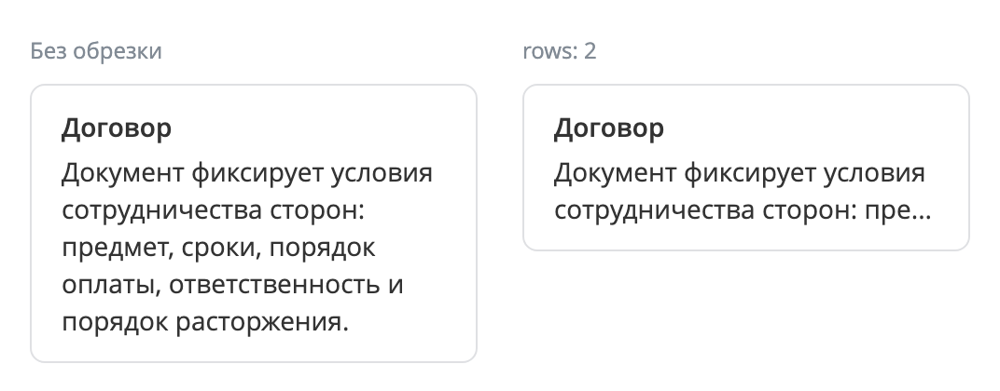

Расширение `ui.textcrop` обрезает текст элемента до заданного числа строк. Если текст не помещается, расширение убирает конец текста, добавляет три точки и записывает полный текст в атрибут `title`. Браузер показывает полный текст при наведении курсора на элемент.

За обрезку отвечает класс `TextCrop`. Он измеряет высоту строки и высоту текста в элементе и сокращает текст, пока тот не уложится в заданное число строк.

Расширение работает с одним текстовым элементом и заменяет его содержимое обычным текстом. Если в элементе есть ссылки, иконки или другая разметка, обрезайте только вложенный элемент с текстом.

Если текст нужно обрезать до одной строки, используйте параметр `wrap: 'truncate'` расширения [ui.system.typography](./typography.md). Это расширение обрезает строку стилями CSS, без измерений в JavaScript. Если вместо атрибута `title` нужна оформленная всплывающая подсказка, используйте [расширение ui.hint](./hint.md).

## Подключить расширение

Если вы подключаете расширение из PHP, загрузите `ui.textcrop`.

```php
\Bitrix\Main\UI\Extension::load('ui.textcrop');
```

В модульном JavaScript импортируйте класс `TextCrop`.

```js
import { TextCrop } from 'ui.textcrop';
```

Вне модульного JavaScript класс доступен как `BX.UI.TextCrop`.

## Обрезать текст

Создайте экземпляр `TextCrop`, передайте элемент в параметре `target` и число строк в параметре `rows`. Затем вызовите метод `init()`.

**Пример.** Разметка карточки типа документа шириной 240 пикселей. Описание с идентификатором `contract-description` занимает больше двух строк.

```html
<div class="document-type-card" style="width: 240px;">
    <div class="document-type-title">Договор</div>
    <div class="document-type-description" id="contract-description">
        Документ фиксирует условия сотрудничества сторон: предмет, сроки, порядок оплаты, ответственность и порядок расторжения.
    </div>
</div>
```

**Пример.** Код обрезает описание до двух строк. Если описание длиннее, вторая строка заканчивается тремя точками, а полный текст появляется при наведении курсора.

```js
import { TextCrop } from 'ui.textcrop';

const textCrop = new TextCrop({
    target: document.getElementById('contract-description'),
    rows: 2,
});

textCrop.init();
```

Слева карточка без обрезки, описание занимает пять строк. Справа та же карточка после вызова `init()` с `rows: 2`, вторая строка заканчивается тремя точками.

{width=536px height=210px}

Метод `init()` меняет элемент:

-  берет текст элемента без разметки из свойства `innerText` и вставляет его в новый блок `div` внутри элемента,
-  склеивает без пробела строки, которые разделены переносом или тегом `<br>`,
-  убирает символы с конца и добавляет `...`, если текст занимает больше строк, чем задано в `rows`,
-  записывает полный текст в атрибут `title` элемента.

Если текст помещается в заданное число строк, класс не сокращает его и не добавляет атрибут `title`.

Класс записывает в атрибут `title` текст с экранированными символами HTML. Если в тексте есть символы `&`, `<`, `>`, `'` или `"`, подсказка при наведении покажет их в виде `&amp;`, `&lt;`, `&gt;`, `&#39;` и `&quot;`.

Класс обрезает текст по символам, а не по словам. Последнее слово может прерваться посередине.



Вызывайте `init()`, когда элемент уже добавлен на страницу и виден. Класс измеряет высоту текста через свойство `offsetHeight`. У элемента вне DOM или внутри блока с `display: none` высота равна нулю, и текст не обрезается.





Если текст выводится веб-шрифтом, вызывайте `init()` после загрузки шрифта. Класс измеряет текст в момент вызова. Если шрифт загрузится позже, текст перенесется заново и может занять больше строк, чем задано в `rows`.



**Пример.** Код ждет загрузки шрифтов страницы через `document.fonts.ready` и после этого обрезает описание.

```js
import { TextCrop } from 'ui.textcrop';

document.fonts.ready.then(() => {
    const textCrop = new TextCrop({
        target: document.getElementById('contract-description'),
        rows: 2,
    });

    textCrop.init();
});
```

## Передать параметры

Передайте параметры в конструктор одним объектом.

*Обязательные параметры обозначены \*.*

| Параметр | Тип | Описание |
|---|---|---|
| `target`* | `HTMLElement` | Элемент с текстом, который нужно обрезать. Если передан не DOM-элемент, метод `init()` ничего не делает |
| `rows` | `number` | Максимальное число строк текста. По умолчанию `2`. Значение `0` класс тоже заменяет на `2` |
| `resize` | `boolean` | Если `true`, класс заново обрезает текст после изменения размера окна браузера. Обработчик нельзя снять, а каждый вызов `init()` или `crop()` добавляет еще один. Подробнее — в разделе [При изменении размера окна](#pri-izmenenii-razmera-okna). По умолчанию `false` |

## Обрезать текст в нескольких элементах

Экземпляр `TextCrop` работает с одним элементом. Чтобы обрезать текст в списке, создайте экземпляр для каждого элемента.

**Пример.** У описаний карточек в разметке есть атрибут `data-crop="description"`. Код находит описания по этому атрибуту и обрезает каждое до трех строк.

```js
import { TextCrop } from 'ui.textcrop';

const descriptionNodes = document.querySelectorAll('[data-crop="description"]');

descriptionNodes.forEach((descriptionNode) => {
    const textCrop = new TextCrop({
        target: descriptionNode,
        rows: 3,
    });

    textCrop.init();
});
```

Если вы добавляете карточки на страницу из JavaScript, вызывайте `init()` после вставки карточек в DOM, например после вызова `Dom.append()` из [расширения main.core](./main-core.md).

## Обрезать текст в шаблоне компонента

В [шаблоне компонента](../framework/components.md) без модульного JavaScript загрузите расширение из PHP и используйте глобальный класс `BX.UI.TextCrop`. Вызывайте `init()` внутри `BX.ready()`, чтобы разметка уже была на странице, и после `document.fonts.ready`, чтобы загрузился шрифт.

**Пример.** Шаблон выводит список типов документов и обрезает описание каждого типа до двух строк. Структура `$arResult` относится к компоненту, а для расширения нужны только атрибут `data-crop` у описаний и вызов `init()`.

```php
<?php
if (!defined('B_PROLOG_INCLUDED') || B_PROLOG_INCLUDED !== true)
{
    die();
}

\Bitrix\Main\UI\Extension::load('ui.textcrop');
?>
<div class="document-type-list">
    <?php foreach ($arResult['ITEMS'] as $item): ?>
        <div class="document-type-card">
            <div class="document-type-title"><?= htmlspecialcharsbx($item['NAME']) ?></div>
            <div class="document-type-description" data-crop="description">
                <?= htmlspecialcharsbx($item['DESCRIPTION']) ?>
            </div>
        </div>
    <?php endforeach; ?>
</div>
<script>
    BX.ready(() => {
        document.fonts.ready.then(() => {
            document.querySelectorAll('[data-crop="description"]').forEach((node) => {
                const textCrop = new BX.UI.TextCrop({
                    target: node,
                    rows: 2,
                });

                textCrop.init();
            });
        });
    });
</script>
```

В списке три типа документов. Описания «Договора» и «Накладной» не поместились в две строки, и класс обрезал их. Короткое описание «Счета» осталось без изменений и без атрибута `title`.

{width=800px height=122px}

## Пересчитать обрезку

Число строк зависит от ширины элемента. Если ширина изменилась, текст нужно обрезать заново. С параметром `resize: true` класс обрезает текст заново после изменения размера окна. В остальных случаях вызовите `init()` повторно.

### При изменении размера окна {#pri-izmenenii-razmera-okna}

Передайте `resize: true` в конструктор. При вызове `init()` класс подписывается на событие `resize` окна и пересчитывает обрезку через 100 мс после начала изменения размера, не дожидаясь его окончания.

**Пример.** Код обрезает описание до двух строк и пересчитывает обрезку, когда пользователь меняет размер окна.

```js
import { TextCrop } from 'ui.textcrop';

const textCrop = new TextCrop({
    target: document.getElementById('contract-description'),
    rows: 2,
    resize: true,
});

textCrop.init();
```

У параметра `resize` есть ограничения, которые влияют на выбор способа пересчета:

-  Класс отслеживает только размер окна. Если ширина элемента меняется по другой причине, например открылась боковая колонка, вызовите `init()` сами.
-  У класса нет метода, который снимает обработчик события `resize`. Экземпляр продолжает пересчитывать обрезку, пока открыта страница.
-  Каждый вызов `init()` или `crop()` у экземпляра с `resize: true` добавляет еще один обработчик `resize`. После изменения размера окна текст обрезается столько раз, сколько раз вызывали эти методы. Результат обрезки не меняется, но пересчеты повторяются. Вызывайте `init()` повторно, только если ширина элемента изменилась.

### После показа элемента или изменения его ширины

Повторный вызов `init()` обрезает текст заново. Класс берет полный текст, сохраненный при первом вызове, поэтому повторная обрезка не теряет символы.

**Пример.** Описание с идентификатором `contract-description` находится внутри вкладки `settings-tab`, которая скрыта при загрузке страницы. Код обрезает текст, когда вкладка становится видимой.

```js
import { TextCrop } from 'ui.textcrop';

const textCrop = new TextCrop({
    target: document.getElementById('contract-description'),
    rows: 2,
});

// Показывает вкладку и обрезает текст описания на ней
function showSettingsTab()
{
    document.getElementById('settings-tab').hidden = false;
    textCrop.init();
}
```

Если вкладки выведены через [расширение ui.tabs](./ui-tabs.md), вызывайте `init()` в обработчике события `onActive` вкладки. Как подписаться на события вкладки, описано в разделе [Обработать события](./ui-tabs.md#obrabotat-sobytiya) статьи о вкладках.

Класс только добавляет атрибут `title` и не удаляет его. Если элемент стал шире и текст поместился целиком, атрибут с полным текстом остается.

Класс запоминает высоту строки при первом вызове `init()`, в котором удалось ее измерить. Если после этого изменились размер шрифта или высота строки, повторный `init()` считает строки по прежней высоте. В этом случае создайте новый экземпляр, как описано в разделе [Заменить текст или начать обрезку заново](#zamenit-tekst-ili-nachat-obrezku-zanovo).

## Заменить текст или начать обрезку заново {#zamenit-tekst-ili-nachat-obrezku-zanovo}

Класс запоминает текст элемента при первом вызове `init()` и дальше работает с ним. Если записать в элемент новый текст и снова вызвать `init()`, на странице появится прежний текст.

Чтобы обрезать новый текст, создайте новый экземпляр `TextCrop`. Новый экземпляр читает текст из элемента, поэтому сначала подготовьте элемент:

1. Запишите в элемент полный текст.
2. Удалите атрибут `title`, который оставил прежний экземпляр. Иначе подсказка покажет старый текст, если новый текст поместится целиком.
3. Создайте экземпляр и вызовите `init()`.

Если прежний экземпляр создан с `resize: true`, он вернет старый текст при следующем изменении размера окна. В этом случае замените сам элемент новым, например методом `Dom.replace(oldElement, newElement)` из [расширения main.core](./main-core.md), и создайте экземпляр для нового элемента. Прежний экземпляр продолжит работать с удаленным элементом и не изменит новый.

**Пример.** Код заменяет описание договора и обрезает новый текст до двух строк.

```js
import { TextCrop } from 'ui.textcrop';

const descriptionNode = document.getElementById('contract-description');

descriptionNode.textContent = 'Документ фиксирует условия поставки: состав, сроки и порядок приемки.';
descriptionNode.removeAttribute('title');

const textCrop = new TextCrop({
    target: descriptionNode,
    rows: 2,
});

textCrop.init();
```

Если текст тот же, а обрезку нужно начать заново, например после смены шрифта, верните в элемент полный текст. Метод `getText()` прежнего экземпляра возвращает полный текст с экранированными символами HTML. Метод `Text.decode()` из `main.core` превращает экранированные символы обратно в исходные.

**Пример.** Код восстанавливает полный текст после прежнего экземпляра `oldTextCrop` и обрезает его новым экземпляром.

```js
import { Text } from 'main.core';
import { TextCrop } from 'ui.textcrop';

const descriptionNode = document.getElementById('contract-description');

descriptionNode.textContent = Text.decode(oldTextCrop.getText());
descriptionNode.removeAttribute('title');

const textCrop = new TextCrop({
    target: descriptionNode,
    rows: 2,
});

textCrop.init();
```

## Методы

-  `init()` — обрезает текст элемента до числа строк из `rows`. При первом вызове запоминает полный текст элемента. Если передан `resize: true`, каждый вызов добавляет обработчик события `resize`. Метод не возвращает значение.

-  `crop()` — вызывает `init()`.

-  `getText()` — возвращает полный текст элемента с экранированными символами HTML. Если `init()` еще не вызывали, метод читает текст элемента и запоминает его.

## Связанные материалы

-  [Типографика](./typography.md)

-  [Подсказка](./hint.md)

-  [JS-ядро main.core и события](./main-core.md)

-  [Вкладки ui.tabs](./ui-tabs.md)

-  [Компоненты](../framework/components.md)

-  [Расширения](../framework/extensions.md)
