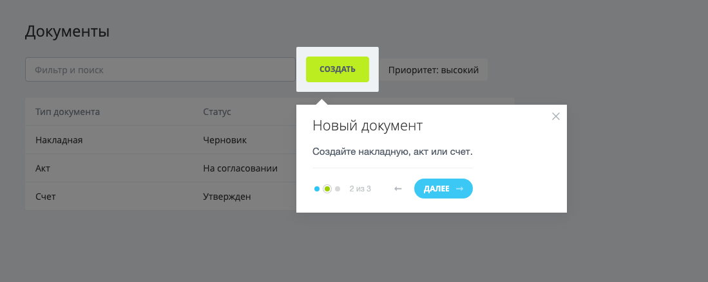
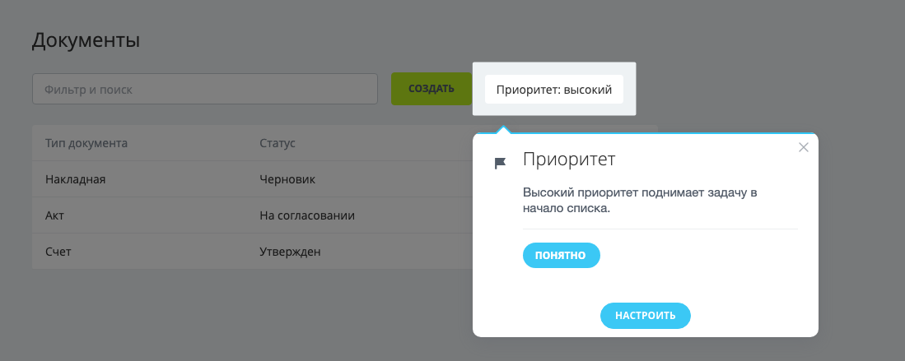
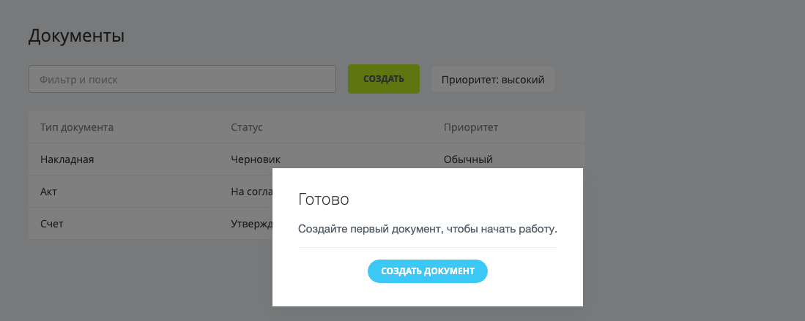
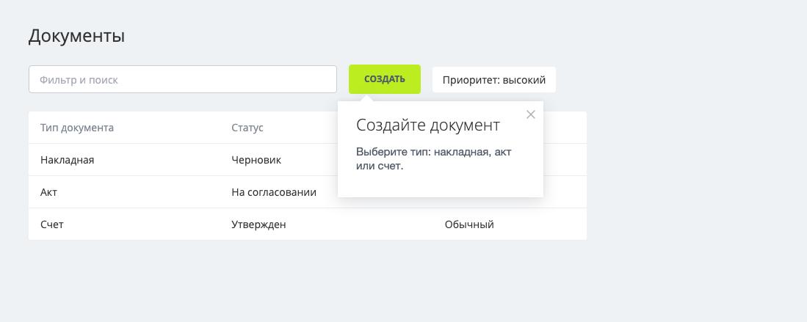

Расширение `ui.tour` показывает пошаговый тур по интерфейсу. Тур затемняет страницу, подсвечивает элемент и выводит рядом окно с заголовком, текстом и кнопками перехода. Тур знакомит пользователя с новым разделом или функцией, например показывает по шагам фильтр, кнопку создания и список документов.

Класс `Guide` создает и показывает тур. Шаги передавайте объектами в параметре `steps`, а экземпляры класса `Step` расширение создает из них само. Объект `Manager` выстраивает несколько туров в очередь, чтобы они не открывались одновременно. Отметку о просмотре расширение хранит на сервере в настройках пользователя, а не в браузере. Перед выводом тура проверьте отметку PHP-классом `Bitrix\Main\UI\UiTour`.

Окно тура — всплывающее окно `main.popup`.

Выберите решение по задаче:

-  тур `ui.tour` — пошаговое знакомство с интерфейсом или разовая подсказка о новой функции, которую пользователь больше не увидит после просмотра,
-  [подсказка](./hint.md) — постоянное пояснение, которое открывается при наведении на значок,
-  [системный хайлайтер](./system-highlighter.md) — выделение блока рамкой без окна с текстом,
-  [main.popup](./main-popup.md) — собственное окно без шагов и отметки о просмотре.

## Подключить расширение

В PHP загрузите `ui.tour` методом `Extension::load()`.

```php
\Bitrix\Main\UI\Extension::load('ui.tour');
```

В модульном JavaScript импортируйте классы.

```js
import { Guide, Step, Manager } from 'ui.tour';
```

Вне модульного JavaScript те же классы доступны как `BX.UI.Tour.Guide`, `BX.UI.Tour.Step` и `BX.UI.Tour.Manager`.

Если тур показывается редко, не загружайте расширение на каждой странице. Загрузите его перед показом методом `Runtime.loadExtension('ui.tour')` из `main.core`. Метод возвращает `Promise` с объектом экспортов, поэтому класс тура получите в обработчике `then()`, например `.then(({ Guide }) => { ... })`. Подробнее в разделе [Загрузить расширение по требованию](./main-core.md#zagruzit-rasshirenie-po-trebovaniyu) статьи о main.core.

## Показать тур

Создайте экземпляр `Guide`, передайте массив шагов в параметре `steps` и вызовите метод `start()`. Каждый шаг описывает элемент страницы в `target`, заголовок в `title` и текст в `text`.

**Пример.** Тур из трех шагов знакомит со списком документов — с фильтром, кнопкой создания и таблицей.

```js
import { Guide } from 'ui.tour';

const guide = new Guide({
    id: 'documents-list-tour',
    steps: [
        {
            target: '#documents-filter',
            title: 'Фильтр',
            text: 'Отберите документы по типу и статусу.',
        },
        {
            target: '#documents-add-button',
            title: 'Новый документ',
            text: 'Создайте накладную, акт или счет.',
        },
        {
            target: '#documents-grid',
            title: 'Список документов',
            text: 'Здесь отображаются документы, отобранные фильтром.',
        },
    ],
});

guide.start();
```

Расширение затемняет страницу, оставляет светлый вырез вокруг элемента шага и выводит рядом окно шириной 420 пикселей. В окне заголовок, текст, счетчик вида «1 из 3» с точками по числу шагов и кнопка «Далее». Со второго шага слева от нее появляется кнопка возврата со стрелкой, а на последнем шаге кнопка «Далее» меняет подпись на «Закрыть».

На снимке второй шаг тура из примера. Затемнение покрывает страницу, светлый вырез выделяет кнопку «Создать». Под кнопкой окно шага с заголовком «Новый документ» и текстом. Внизу окна слева три точки шагов и счетчик «2 из 3», справа стрелка возврата к первому шагу и кнопка «Далее».

{width=700px height=280px}

Пока на странице затемнение, она не прокручивается. Если элемент шага за пределами окна браузера, расширение прокручивает к нему страницу перед показом шага. Прокручиваемые контейнеры внутри страницы, например список в боковой панели, расширение не прокручивает.

Тур закрывается, когда пользователь:

-  нажимает «Закрыть» на последнем шаге,
-  нажимает крестик в окне,
-  щелкает вне окна тура,
-  щелкает по подсвеченному элементу шага.



Расширение выводит как HTML-разметку `title`, `text` и `linkTitle` шага, а также `finalTitle`, `finalText` и подписи кнопок итогового окна. Пользовательские данные экранируйте методом `Text.encode()` из [main.core](./main-core.md).



### Параметры Guide

*Обязательные параметры обозначены \*.*

| Параметр | Тип | Описание |
|---|---|---|
| `steps`* | `array` | Шаги тура. Каждый элемент — объект с параметрами шага из раздела [Параметры шага](#parametry-shaga). Если массив пустой или не передан, конструктор `Guide` выбрасывает `Error` |
| `id` | `string` | Идентификатор тура. По нему расширение сохраняет отметку о просмотре, поэтому для `autoSave` и `save()` передавайте постоянное значение. Обязателен для `Manager.add()` и `Manager.create()`. Если не передан, расширение создает случайный идентификатор вида `ui-tour-guide-...` |
| `autoSave` | `boolean` | Сохраняет отметку о просмотре при запуске тура. Подробнее в разделе [Показать тур один раз](#pokazat-tur-odin-raz). По умолчанию `false` |
| `overlay` | `boolean` | Затемняет страницу вокруг элемента шага. Значение `false` передавайте вместе с `onEvents: true`. В обычном режиме без затемнения метод `start()` выбрасывает `TypeError` для шага с элементом, если в `position` не передано `left`, `right` или `center`. Исключение — элемент шириной меньше 30 пикселей без `rounded`. По умолчанию `true` |
| `simpleMode` | `boolean` | Скрывает счетчик шагов и кнопку возврата, кнопка перехода получает подпись «Понятно». Рассчитан на тур из одного шага. При переходах между шагами подпись снова меняется на «Далее» и «Закрыть». По умолчанию `false` |
| `onEvents` | `boolean` | Включает режим подсказок по одной. Подробнее в разделе [Показать подсказки по одной](#pokazat-podskazki-po-odnoj). По умолчанию `false` |
| `targetContainer` | `HTMLElement` | Элемент, в который расширение добавляет затемнение и окно шага. Итоговое окно и анимированный курсор расширение всегда добавляет в `document.body`. По умолчанию `document.body` |
| `canShowWithoutTarget` | `boolean` | Разрешает методу `showNextStep()` показывать шаг, элемент которого отсутствует на странице или скрыт. На метод `start()` не влияет. По умолчанию `true` |
| `finalStep` | `boolean` | Показывает итоговое окно после последнего шага. Работает только с `overlay: true`. С `overlay: false` расширение выбрасывает `TypeError` при переходе к итоговому окну. По умолчанию `false` |
| `finalTitle` | `string` | Заголовок итогового окна. Действует при `finalStep: true`. Расширение выводит строку как HTML |
| `finalText` | `string` | Текст итогового окна. Действует при `finalStep: true`. Расширение выводит строку как HTML |
| `buttons` | `array` | Кнопки итогового окна. Обработчик каждой кнопки должен вызвать `guide.close()`, иначе затемнение останется на странице. Состав описан в разделе [Завершить тур итоговым окном](#zavershit-tur-itogovym-oknom) |
| `events` | `object` | Обработчики событий тура. Состав описан в разделе [Обработать события](#obrabotat-sobytiya) |

### Параметры шага

*Обязательные параметры обозначены \*.*

| Параметр | Тип | Описание |
|---|---|---|
| `text`* | `string` | Текст шага. Расширение выводит строку как HTML. Для шага с `cursorMode: true` не нужен |
| `title` | `string` | Заголовок шага. Расширение выводит строку как HTML |
| `target` | `string`, `HTMLElement`, `function` | Элемент, который подсвечивает шаг. Принимает CSS-селектор, DOM-узел или функцию, которая возвращает DOM-узел. Варианты описаны в разделе [Привязать шаг к элементу](#privyazat-shag-k-elementu) |
| `position` | `string` | Положение окна относительно элемента — `left`, `right` или `center`. Значение `center` выводит окно по центру экрана и оставляет вырез вокруг элемента. `left` и `right` меняются местами, если с заданной стороны не хватает места, а с другой хватает. Без параметра окно выводится под элементом, а если снизу не хватает места — над ним |
| `rounded` | `boolean` | Делает вырез в затемнении круглым. По умолчанию `false` — прямоугольный |
| `areaPadding` | `number` | Отступ выреза от границ элемента в пикселях. По умолчанию `15` |
| `link` | `string` | Адрес ссылки «Подробнее». Ссылка открывается в новой вкладке |
| `linkTitle` | `string` | Текст ссылки вместо «Подробнее». В обычном режиме действует только у первого шага |
| `article` | `string` | Код статьи Справки. Ссылка «Подробнее» открывает статью через `BX.Helper`. Работает только на страницах, где `BX.Helper` подключен и инициализирован, например в Битрикс24. Имеет приоритет над `infoHelperCode` и `link` |
| `articleAnchor` | `string` | Якорь внутри статьи Справки из `article` |
| `infoHelperCode` | `string` | Код слайдера `BX.UI.InfoHelper`. Ссылка «Подробнее» открывает этот слайдер. Если `BX.UI.InfoHelper` на странице не подключен, щелчок по ссылке ничего не делает. Имеет приоритет над `link` |
| `iconSrc` | `string` | Адрес картинки, которую расширение выводит слева от заголовка и текста. В обычном режиме действует только у первого шага |
| `condition` | `string`, `object` | Добавляет цветную полосу по верхнему и нижнему краю окна и окрашивает уголок. Цвет — `primary`, `warning`, `alert` или `copilot`. Константы `Guide.ConditionColor` не подходят. Полоса видна, только если на странице задана CSS-переменная `--popup-window-border-radius`, как в Битрикс24. Подробнее в разделе [Оформить окно шага](#oformit-okno-shaga). В обычном режиме действует только у первого шага |
| `buttons` | `array` | Кнопки в окне шага. Каждый элемент содержит подпись в `text` и обработчик щелчка в `event` — в отличие от кнопок итогового окна, где обработчик передают в `events.click`. Подпись выводится как текст, оформление кнопки задает расширение. Щелчок вызывает только обработчик, окно и тур остаются открытыми. В обычном режиме действует только у первого шага |
| `cursorMode` | `boolean` | Показывает вместо окна анимированный курсор. Действует только при показе шага методом `showNextStep()`, метод `start()` выводит такой шаг обычным окном. Нужен DOM-узел в `target`, с селектором или функцией метод выбрасывает `TypeError` |
| `targetEvent` | `string`, `function` | Действие после анимации курсора — имя события мыши, например `click`, или функция. Действует только у шага с `cursorMode: true` |
| `events` | `object` | Обработчики событий шага. Состав описан в разделе [Обработать события](#obrabotat-sobytiya) |
| `id` | `string` | Идентификатор шага. Метод `getId()` шага возвращает его, например чтобы определить текущий шаг в обработчике события |

## Привязать шаг к элементу

В параметре `target` передайте элемент в одном из трех видов:

-  CSS-селектор — расширение ищет элемент методом `document.querySelector()` при каждом показе шага,
-  DOM-узел — расширение использует переданный элемент,
-  функция — расширение вызывает ее при каждом показе шага и подсвечивает возвращенный DOM-узел.

Селектор и функция подходят, если элемент появляется на странице позже, чем создан тур.

Если `target` не передан или элемент не найден, расширение выводит окно по центру экрана без выреза в затемнении. Параметр `position: 'center'` тоже выводит окно по центру, но оставляет вырез вокруг элемента.

**Пример.** Первый шаг выводит приветствие по центру экрана. Второй подсвечивает круглую кнопку и выводит окно справа от нее.

```js
import { Guide } from 'ui.tour';

const guide = new Guide({
    id: 'units-tour',
    steps: [
        {
            title: 'Единицы измерения',
            text: 'Покажем, как добавить новую единицу измерения.',
        },
        {
            target: () => document.querySelector('.units-add-button'),
            title: 'Добавить единицу',
            text: 'Нажмите кнопку и заполните название и обозначение.',
            position: 'right',
            rounded: true,
            areaPadding: 6,
        },
    ],
});

guide.start();
```

При `position: 'right'` расширение выводит окно справа от элемента. Если справа не хватает места до края окна браузера, а слева хватает, окно переходит на левую сторону. При `position: 'left'` окно появляется слева и переходит на правую сторону, если слева не помещается.

## Добавить ссылку на подробности

Ссылка «Подробнее» выводится под текстом шага, если в шаге передан один из параметров:

-  `link` — открывает адрес в новой вкладке.
-  `article` — открывает статью Справки через `BX.Helper`. Ссылка работает только на страницах, где объект `BX.Helper` подключен и инициализирован, например в Битрикс24. Якорь внутри статьи передайте в `articleAnchor`.
-  `infoHelperCode` — открывает слайдер `BX.UI.InfoHelper` в [боковой панели](./main-sidepanel.md) с переданным кодом. Если `BX.UI.InfoHelper` на странице не подключен, щелчок по ссылке ничего не делает.

Если в шаге передано несколько параметров, ссылка открывает статью Справки из `article`, затем слайдер из `infoHelperCode`, и только без них — адрес из `link`. Подпись ссылки меняет параметр `linkTitle`, в обычном режиме он действует только у первого шага.

**Пример.** Шаг о статусах документа ведет на страницу с описанием статусов.

```js
import { Guide } from 'ui.tour';

const guide = new Guide({
    id: 'document-status-tour',
    steps: [
        {
            target: '#document-status',
            title: 'Статус документа',
            text: 'Статус показывает, на каком этапе согласования находится документ.',
            link: '/docs/statuses/',
            linkTitle: 'Все статусы',
        },
    ],
});

guide.start();
```

## Оформить окно шага

Параметр `condition` добавляет цветную полосу толщиной два пикселя по верхнему и нижнему краю окна. Передайте строку с цветом или объект:

-  `color` — задает цвет полосы.
-  `top` — показывает полосу сверху. По умолчанию `true`.
-  `bottom` — показывает полосу снизу. По умолчанию `true`.

Передайте цвет строкой `primary`, `warning`, `alert` или `copilot`. Константы `Guide.ConditionColor` для параметра `condition` не подходят. Они содержат имя CSS-класса с префиксом `--condition-`, и расширение добавляет префикс второй раз.

Полосу рисует стиль, который использует CSS-переменную `--popup-window-border-radius`. В Битрикс24 ее задают [дизайн-токены](./ui-design-tokens.md) модуля `intranet`. Если переменная на странице не задана, например на сайте без модуля `intranet`, полосы нет и цветом выделяется только уголок окна.

**Пример.** Окно тура из одного шага с `simpleMode: true` получает полосу цвета `primary` только сверху, иконку и кнопку «Настроить».

```js
import { Guide } from 'ui.tour';

const guide = new Guide({
    id: 'priority-hint',
    simpleMode: true,
    steps: [
        {
            target: '#task-priority',
            title: 'Приоритет',
            text: 'Высокий приоритет поднимает задачу в начало списка.',
            iconSrc: '/local/images/priority.svg',
            condition: {
                color: 'primary',
                top: true,
                bottom: false,
            },
            buttons: [
                {
                    text: 'Настроить',
                    // openPrioritySettings() — собственная функция, которая открывает настройки приоритета
                    event: () => openPrioritySettings(),
                },
            ],
        },
    ],
});

guide.start();
```

На снимке страница, где задана переменная `--popup-window-border-radius`, как в Битрикс24. Светлый вырез в затемнении выделяет элемент «Приоритет: высокий», под ним окно шага. Уголок окна и полоса по верхнему краю окрашены в цвет `primary`, слева от заголовка и текста выводится иконка. С `simpleMode: true` в окне нет счетчика, а кнопка перехода подписана «Понятно». Кнопка «Настроить» из параметра `buttons` шага выводится отдельно, ниже.

{width=700px height=280px}

В обычном режиме расширение создает окно один раз, для первого шага. Параметры `iconSrc`, `condition`, `buttons` и `linkTitle` расширение берет только из первого шага. От шага к шагу меняются заголовок, текст и ссылка «Подробнее». Чтобы у каждого шага было свое оформление, используйте [режим подсказок по одной](#pokazat-podskazki-po-odnoj). В нем расширение создает окно заново для каждого шага.

## Завершить тур итоговым окном

С параметром `finalStep: true` после последнего шага расширение убирает вырез и показывает отдельное итоговое окно с текстом из `finalTitle` и `finalText`. Кнопка «Далее» на последнем шаге при этом не меняет подпись на «Закрыть».

По умолчанию в итоговом окне одна кнопка «Закрыть», которая завершает тур. Чтобы вывести свои кнопки, передайте в параметре `buttons` тура массив объектов:

-  `text` — подпись кнопки,
-  `class` — CSS-классы кнопки, например классы [ui.buttons](./ui-buttons.md),
-  `events.click` — обработчик щелчка.

Итоговое окно работает только с затемнением. При `overlay: false` расширение выбрасывает `TypeError` при переходе к итоговому окну.

Итоговое окно не закрывается щелчком вне него и не имеет крестика, поэтому в обработчике каждой своей кнопки вызовите `guide.close()`. Иначе затемнение останется на странице.

**Пример.** Итоговое окно предлагает перейти к созданию первого документа.

```js
import { Guide } from 'ui.tour';

const guide = new Guide({
    id: 'documents-list-tour',
    finalStep: true,
    finalTitle: 'Готово',
    finalText: 'Создайте первый документ, чтобы начать работу.',
    buttons: [
        {
            text: 'Создать документ',
            class: 'ui-btn ui-btn-sm ui-btn-primary ui-btn-round',
            events: {
                click: () => {
                    guide.close();
                    // openDocumentForm() — собственная функция, которая открывает форму документа
                    openDocumentForm();
                },
            },
        },
    ],
    steps: [
        {
            target: '#documents-filter',
            title: 'Фильтр',
            text: 'Отберите документы по типу и статусу.',
        },
    ],
});

guide.start();
```

Итоговое окно выводится поверх затемнения без выреза. В окне заголовок «Готово», текст и кнопка «Создать документ», крестика нет.

{width=700px height=280px}

## Показать подсказки по одной

Режим `onEvents: true` подходит, когда каждый шаг нужно показать после действия пользователя, а не по кнопке «Далее».

В этом режиме окно шага отличается от обычного:

-  ширина окна 280 пикселей,
-  в окне нет счетчика и кнопок перехода, только крестик,
-  окно не закрывается щелчком вне него.

Метод `showNextStep()` показывает один шаг за вызов и не затемняет страницу.

Когда пользователь закрывает окно, расширение переходит к следующему шагу, но не показывает его, и вызывает событие `onFinish`. В этом режиме `onFinish` срабатывает при закрытии каждого шага, а не только последнего. Очередной вызов `showNextStep()` выводит следующий шаг. После последнего шага метод ничего не делает.

Если передать `canShowWithoutTarget: false`, метод `showNextStep()` не показывает шаг, элемент которого отсутствует на странице или скрыт.

**Пример.** Первая подсказка указывает на кнопку создания документа. Вторая появляется, когда документ создан.

```js
import { Guide } from 'ui.tour';

const guide = new Guide({
    id: 'first-document-hints',
    onEvents: true,
    steps: [
        {
            target: '#documents-add-button',
            title: 'Создайте документ',
            text: 'Выберите тип: накладная, акт или счет.',
        },
        {
            target: '#documents-grid',
            title: 'Документ создан',
            text: 'Новый документ появился в списке со статусом «Черновик».',
        },
    ],
});

guide.showNextStep();

// onDocumentCreated — собственный обработчик. Вызовите его, когда сервер подтвердил создание документа
function onDocumentCreated()
{
    guide.showNextStep();
}
```

Первая подсказка выводится под кнопкой «Создать» без затемнения. В окне только заголовок, текст и крестик.

{width=700px height=280px}

Метод `showNextStep()` не вызывает событие `onStart` и не сохраняет отметку о просмотре. Чтобы сохранить отметку при показе первого шага, передайте `autoSave: true` и выведите первый шаг методом `start()`, а следующие шаги — методом `showNextStep()`. Если затемнение при этом не нужно, передайте `overlay: false`. Метод `start()` в этом режиме выводит такое же окно подсказки шириной 280 пикселей.

**Пример.** Тот же тур с `autoSave: true` и `overlay: false`. Метод `start()` выводит первую подсказку без затемнения и сразу сохраняет отметку о просмотре. Вторую подсказку метод `showNextStep()` выводит после создания документа.

```js
import { Guide } from 'ui.tour';

const guide = new Guide({
    id: 'first-document-hints',
    onEvents: true,
    autoSave: true,
    overlay: false,
    steps: [
        {
            target: '#documents-add-button',
            title: 'Создайте документ',
            text: 'Выберите тип: накладная, акт или счет.',
        },
        {
            target: '#documents-grid',
            title: 'Документ создан',
            text: 'Новый документ появился в списке со статусом «Черновик».',
        },
    ],
});

guide.start();

// onDocumentCreated — собственный обработчик. Вызовите его, когда сервер подтвердил создание документа
function onDocumentCreated()
{
    guide.showNextStep();
}
```

### Показать анимированный курсор

Шаг с `cursorMode: true` показывает вместо окна курсор, который движется к элементу шага. После анимации расширение выполняет действие из `targetEvent`:

-  строка — расширение отправляет элементу событие мыши с этим именем, например `click`,
-  функция — расширение вызывает ее.

Курсор появляется только при показе шага методом `showNextStep()` и только если в `target` передан DOM-узел. Метод `start()` выводит такой шаг обычным окном. С селектором или функцией в `target` метод `showNextStep()` выбрасывает `TypeError`.

Расширение само не показывает следующий шаг после закрытия подсказки. Чтобы курсор появился сразу после закрытия, подпишитесь на глобальное событие `UI.Tour.Guide:onPopupClose` и вызовите в обработчике `showNextStep()`. Событие приходит до перехода к следующему шагу, поэтому вызов отложите через `setTimeout()`. Подробнее о событии в разделе [Обработать события](#obrabotat-sobytiya).

**Пример.** Пользователь закрывает подсказку о кнопке создания. Обработчик события `onPopupClose` вызывает `showNextStep()`, расширение подводит к кнопке курсор, а функция из `targetEvent` через секунду закрывает тур.

```js
import { EventEmitter } from 'main.core.events';
import { Guide } from 'ui.tour';

const addButton = document.getElementById('documents-add-button');

const guide = new Guide({
    id: 'add-button-cursor',
    onEvents: true,
    steps: [
        {
            target: addButton,
            title: 'Создать документ',
            text: 'Документы создаются этой кнопкой.',
        },
        {
            target: addButton,
            cursorMode: true,
            targetEvent: () => {
                setTimeout(() => guide.close(), 1000);
            },
        },
    ],
});

guide.showNextStep();

// Событие приходит до перехода ко второму шагу, поэтому показ курсора откладывается на следующий такт
EventEmitter.subscribe('UI.Tour.Guide:onPopupClose', (event) => {
    if (event.getData() === guide)
    {
        setTimeout(() => guide.showNextStep(), 0);
    }
});
```

## Обработать события

У тура и у шага свои события. Обработчики передайте в параметре `events` тура или шага.

| Событие | Объект | Когда срабатывает |
|---|---|---|
| `onStart` | Тур | При запуске тура методом `start()` |
| `onFinish` | Тур | При закрытии тура. В режиме `onEvents` — при закрытии каждого шага |
| `onBeforeShow` | Шаг | Перед показом окна тура. В обычном режиме окно показывается один раз, поэтому событие срабатывает только у первого шага |
| `onShow` | Шаг | При показе шага |
| `onClose` | Шаг | При переходе с шага вперед или назад и при закрытии тура |

Расширение вызывает обработчик события тура без аргументов. Обработчик события шага получает объект события, а метод `getData()` этого объекта возвращает `{ step, guide }`.

На события тура можно подписаться и после создания, например если тур получен из `Manager.create()`. Вызовите метод `subscribe()` тура и передайте полное имя события `UI.Tour.Guide:onStart` или `UI.Tour.Guide:onFinish`. Обработчик получает объект события, метод `getData()` которого возвращает `{ guide }`. Подписка устроена так же, как у других объектов `EventEmitter`. Подробнее в разделе [Подписаться на событие](./main-core.md#podpisatsya-na-sobytie) статьи о main.core.

**Пример.** При показе шага с таблицей код раскрывает свернутую панель, а после закрытия тура отправляет событие в аналитику.

```js
import { Guide } from 'ui.tour';

const guide = new Guide({
    id: 'documents-list-tour',
    events: {
        onFinish: () => {
            // sendAnalytics() — собственная функция, которая отправляет событие в аналитику
            sendAnalytics('documents-list-tour-finished');
        },
    },
    steps: [
        {
            target: '#documents-grid',
            title: 'Список документов',
            text: 'Здесь отображаются документы, отобранные фильтром.',
            events: {
                onShow: (event) => {
                    const { step } = event.getData();
                    // expandPanel() — собственная функция, которая раскрывает панель с элементом
                    expandPanel(step.getTarget());
                },
            },
        },
    ],
});

guide.start();
```

Расширение также отправляет глобальные события через `EventEmitter`:

-  `UI.Tour.Guide:onStart` и `UI.Tour.Guide:onFinish` — при запуске и закрытии тура, как события тура `onStart` и `onFinish`. Метод `getData()` возвращает `{ guide }`.
-  `UI.Tour.Guide:clickTarget` — при щелчке по подсвеченному элементу шага. Метод `getData()` возвращает тур.
-  `UI.Tour.Guide:onPopupClose` — при закрытии окна шага крестиком в режиме `onEvents`. Событие приходит до перехода к следующему шагу. Метод `getData()` возвращает тур.

Подписчик глобального события получает события всех туров страницы. В обработчике сравните тур из события со своим. Подробнее в разделе [Подписаться на события всех экземпляров](./main-core.md#podpisatsya-na-sobytiya-vseh-ekzemplyarov) статьи о main.core.

**Пример.** Код снимает служебный параметр со ссылки, когда закрывается тур `guide`, а не другой тур страницы.

```js
import { EventEmitter } from 'main.core.events';

// guide — экземпляр Guide, созданный ранее на этой странице
EventEmitter.subscribe('UI.Tour.Guide:onFinish', (event) => {
    const { guide: finishedGuide } = event.getData();
    if (finishedGuide === guide)
    {
        // removeTourParam() — собственная функция, которая убирает параметр тура из ссылки
        removeTourParam();
    }
});
```

## Показать тур один раз

Чтобы тур не повторялся, сохраните отметку о просмотре из JavaScript и проверьте ее в PHP перед выводом тура:

1. В JavaScript создайте тур с постоянным `id` и параметром `autoSave: true`. Расширение сохраняет время показа в пользовательскую настройку `view_date_<id>` категории `ui-tour` сразу при запуске методом `start()`, а не после последнего шага.
2. В PHP создайте объект `Bitrix\Main\UI\UiTour` с тем же `id` и вызовите `isViewed($userId)`. Метод возвращает `true`, если у пользователя есть отметка о просмотре.

Отметка привязана к пользователю. Для неавторизованного посетителя метод `isViewed(0)` возвращает `false`, поэтому выводите такой тур только авторизованным пользователям.

**Пример.** Шаблон страницы выводит тур, только если текущий пользователь авторизован и еще не видел тур.

```php
<?php
use Bitrix\Main\Engine\CurrentUser;
use Bitrix\Main\UI\Extension;
use Bitrix\Main\UI\UiTour;

$userId = (int)CurrentUser::get()->getId();
$tour = new UiTour('documents-list-tour');
$showTour = $userId > 0 && !$tour->isViewed($userId);

if ($showTour)
{
    Extension::load('ui.tour');
}
?>

<?php if ($showTour): ?>
<script>
BX.ready(() => {
    const guide = new BX.UI.Tour.Guide({
        id: 'documents-list-tour',
        autoSave: true,
        steps: [
            {
                target: '#documents-filter',
                title: 'Фильтр',
                text: 'Отберите документы по типу и статусу.',
            },
        ],
    });

    guide.start();
});
</script>
<?php endif; ?>
```

Чтобы отметить тур просмотренным только после закрытия, не передавайте `autoSave` и вызовите метод `save()` тура в обработчике `onFinish`. Метод сохраняет ту же отметку `view_date_<id>`.

**Пример.** Метод `save()` сохраняет отметку о просмотре, когда пользователь закрывает тур.

```js
import { Guide } from 'ui.tour';

const guide = new Guide({
    id: 'documents-list-tour',
    events: {
        onFinish: () => guide.save(),
    },
    steps: [
        {
            target: '#documents-filter',
            title: 'Фильтр',
            text: 'Отберите документы по типу и статусу.',
        },
    ],
});

guide.start();
```

Объект `UiTour` также управляет отметкой о просмотре:

-  `getViewDate($userId)` — возвращает время просмотра как Unix-время или `0`, если отметки нет.
-  `setViewDate($userId, $date)` — сохраняет отметку. Время передайте в Unix-времени целым числом, без второго аргумента метод сохраняет текущее время.
-  `unsetViewDate($userId)` — удаляет отметку, после этого `isViewed()` снова возвращает `false`.



Отметку о просмотре проверяйте классом `UiTour`, а не `Bitrix\Main\UI\Tour`. Класс `Tour` читает отметку из категории `tour`, а расширение сохраняет ее в категорию `ui-tour`. Компонент `bitrix:ui.tour` тоже проверяет отметку через класс `Tour`, поэтому не скрывает уже просмотренный тур.



### Ограничить показ по времени и аудитории

Метод `isAvailable()` объекта `Bitrix\Main\UI\Tour` проверяет условия показа по периоду, сроку жизни и типу пользователя. Отметку о просмотре по-прежнему проверяйте методом `isViewed()` объекта `UiTour`. Метод `isAvailable()` принимает ID пользователя, а без аргумента берет текущего. Метод возвращает `false`, если:

-  пользователь не авторизован,
-  текущее время раньше даты из `setStartDate()` или позже даты из `setEndDate()`,
-  с даты активации тура прошло больше времени, чем задано в `setLifetime()`,
-  пользователь не подходит под тип из `setUserType()`,
-  у пользователя есть отметка о просмотре в категории `tour`. Расширение такую отметку не сохраняет.



Вызывайте `isAvailable()` у объекта `Tour`, а не `UiTour`. У объекта `UiTour` методы `isAvailable()`, `getActivationDate()` и `activate()` выбрасывают исключение `ArgumentOutOfRangeException`. Они сохраняют дату активации в настройки модуля с идентификатором `ui-tour`, а дефис в идентификаторе модуля недопустим.



Класс `Tour` сохраняет дату активации в настройках модуля `tour` при первом вызове `isAvailable()`, если пользователь прошел проверки периода и авторизации. От этой даты класс отсчитывает срок жизни тура и границу между давними и новыми пользователями.



По умолчанию тур живет 30 дней с даты активации и показывается только давним пользователям — тем, кто зарегистрировался больше чем за 30 дней до активации.



Условия показа задают методы объекта `Tour`:

-  `setUserType($type)` — задает тип пользователей. `Tour::USER_TYPE_OLD` — давние, `Tour::USER_TYPE_NEW` — новые, `Tour::USER_TYPE_ALL` — все. По умолчанию `Tour::USER_TYPE_OLD`.
-  `setUserTimeSpan($seconds)` — задает, сколько секунд до даты активации отделяет давних пользователей от новых. По умолчанию 30 дней.
-  `setLifetime($seconds)` — задает срок жизни тура в секундах. Значение `0` снимает ограничение. По умолчанию 30 дней.
-  `setStartDate($timestamp)` и `setEndDate($timestamp)` — задают период показа в Unix-времени.
-  `activate($timestamp)` — задает дату активации. Без аргумента сохраняет текущее время.
-  `deactivate()` — удаляет дату активации. Следующий вызов `isAvailable()` активирует тур заново, и срок из `setLifetime()` отсчитывается с этого момента.

**Пример.** Тур показывается всем пользователям без ограничения срока жизни, но только до конца периода показа и только тем, кто его еще не видел.

```php
use Bitrix\Main\Engine\CurrentUser;
use Bitrix\Main\UI\Tour;
use Bitrix\Main\UI\UiTour;

$userId = (int)CurrentUser::get()->getId();

$conditions = new Tour('documents-list-tour');
$conditions->setUserType(Tour::USER_TYPE_ALL);
$conditions->setLifetime(0);
// $periodEnd — конец периода показа в Unix-времени, целое число
$conditions->setEndDate($periodEnd);

$showTour = $conditions->isAvailable($userId)
    && !(new UiTour('documents-list-tour'))->isViewed($userId);
```

## Выстроить туры в очередь

Если на странице несколько туров, объект `Manager` показывает их по очереди. Метод `Manager.add(options)` создает тур и запускает его. Если другой тур из очереди еще на экране, новый тур ждет, пока тот закроется.

Метод `add()` требует `id` в параметрах и без него выбрасывает `Error`. Метод не возвращает созданный тур.

Очередь не проверяет отметку о просмотре. Выводите код с `Manager.add()` только для туров, которые пользователь еще не видел. Подробнее в разделе [Показать тур один раз](#pokazat-tur-odin-raz).

**Пример.** Два тура разных модулей открываются один за другим.

```js
import { Manager } from 'ui.tour';

Manager.add({
    id: 'documents-list-tour',
    autoSave: true,
    steps: [
        {
            target: '#documents-filter',
            title: 'Фильтр',
            text: 'Отберите документы по типу и статусу.',
        },
    ],
});

Manager.add({
    id: 'units-tour',
    autoSave: true,
    steps: [
        {
            target: '#units-menu-item',
            title: 'Единицы измерения',
            text: 'Справочник единиц теперь в меню.',
        },
    ],
});
```

Другие методы `Manager`:

-  `create(options)` — создает тур и возвращает его, но не запускает и не ставит в очередь. Как и `add()`, без `id` выбрасывает `Error`,
-  `getCurrentGuide()` — возвращает тур, который `Manager` показывает сейчас, или `null`.

Методы `get(id)` и `remove(id)` не находят тур по идентификатору, потому что `Manager` хранит туры по объекту, а не по `id`. Чтобы запустить тур из `create()` или подписаться на его события, сохраните возвращенный объект в своем коде и вызывайте его методы `start()` и `subscribe()`.

Очередь учитывает только туры, добавленные методом `add()`. Тур, запущенный методом `start()` напрямую, в очередь не попадает.

## Управлять туром

Методы экземпляра `Guide`:

-  `start()` — показывает текущий шаг тура и вызывает событие `onStart`. С `autoSave: true` сохраняет отметку о просмотре.
-  `showNextStep()` — показывает текущий шаг без затемнения. Нужен для режима `onEvents`.
-  `close()` — закрывает тур, убирает затемнение и вызывает событие `onFinish`.
-  `save()` — сохраняет отметку о просмотре тура.
-  `getId()` — возвращает идентификатор тура.
-  `getCurrentStep()` — возвращает текущий шаг как экземпляр `Step`.
-  `getPopup()` — возвращает окно текущего шага как экземпляр `Popup` из [main.popup](./main-popup.md). Если окна еще нет, метод создает его.

Метод `close()` не возвращает тур к первому шагу. Повторный `start()` после закрытия на середине продолжает тур с того шага, на котором его закрыли.



Если тур пройден до конца, повторный `start()` выбрасывает `TypeError`, хотя расширение успевает вызвать событие `onStart`, а при `autoSave: true` — сохранить отметку о просмотре. Чтобы показать тур еще раз, например по кнопке «Пройти тур снова», создайте новый экземпляр `Guide`.



Окно из `getPopup()` существует до закрытия тура. В режиме `onEvents` расширение создает окно заново для каждого шага, поэтому настройка окна действует только на текущую подсказку. Вызывайте `getPopup()` и настраивайте окно перед каждым вызовом `showNextStep()`. Метод `showNextStep()` покажет уже созданное окно с этой настройкой. Подробнее о методах окна в разделе [Управлять окном](./main-popup.md#upravlyat-oknom) статьи о main.popup.

**Пример.** Метод `setWidth()` задает окну подсказки в режиме `onEvents` ширину 400 пикселей вместо 280.

```js
import { Guide } from 'ui.tour';

const guide = new Guide({
    onEvents: true,
    steps: [
        {
            target: '#documents-add-button',
            title: 'Создайте документ',
            text: 'Выберите тип: накладная, акт или счет.',
        },
    ],
});

guide.getPopup().setWidth(400);
guide.showNextStep();
```

Методы экземпляра `Step`:

-  `getTarget()` — возвращает DOM-узел элемента шага.
-  `getId()` — возвращает идентификатор шага.
-  `setTarget(target)` — привязывает шаг к другому элементу. Принимает те же значения, что параметр `target`.

## Связанные материалы

-  [Всплывающие окна и меню main.popup](./main-popup.md)

-  [Подсказка](./hint.md)

-  [Системный хайлайтер](./system-highlighter.md)

-  [JS-ядро main.core и события](./main-core.md)

-  [Кнопки ui.buttons](./ui-buttons.md)
