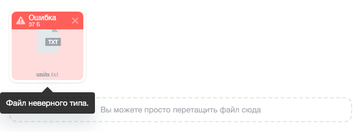
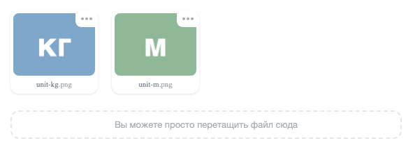

Расширение `ui.uploader` загружает файлы на сервер. Пользователь выбирает или перетаскивает файлы, а загрузчик отправляет их частями и показывает ход загрузки. Сервер принимает файлы через контроллер, который проверяет права и ограничения.

Загрузчик состоит из нескольких расширений:

-  `ui.uploader.core` — класс `Uploader` для загрузки без готового интерфейса,

-  `ui.uploader.tile-widget` — виджет `TileWidget` с областью для перетаскивания и списком файлов плитками с превью,

-  `ui.uploader.stack-widget` — виджет `StackWidget` в виде компактной кнопки со стопкой загруженных файлов.

Серверная часть — классы пространства имен `Bitrix\UI\FileUploader` модуля `ui`.

В продукте есть и другие механизмы загрузки — компонент `bitrix:main.file.input` и класс `FileInput`. Пометок устаревания у них нет, все механизмы работают. Выберите механизм по задаче:

-  `ui.uploader` — когда права на загрузку и просмотр файлов нужно проверять своим кодом в контроллере, который решает, кто загружает файлы и какие сохраненные файлы видит пользователь,

-  `bitrix:main.file.input` — когда нужно поле для публичной части, которое при загрузке сохраняет файл методом `CFile::SaveFile()` и возвращает в форму готовый идентификатор,

-  `FileInput` — когда поле выводится в административном разделе.

Подробнее — в статьях [Загрузка файлов Uploader](./uploader.md) и [Поле выбора файлов FileInput](./file-input.md).

## Порядок работы загрузчика

Сценарий загрузки файлов в форму состоит из четырех шагов.

1. Разработчик создает в своем модуле класс контроллера. Контроллер решает, кто может загружать файлы, и задает ограничения на размер и типы файлов.

2. Разработчик выводит на странице виджет с именем контроллера. Пока пользователь заполняет форму, виджет загружает выбранные файлы на сервер во временное хранилище.

3. Для каждого загруженного файла виджет добавляет в форму скрытое поле с идентификатором временного файла.

4. При отправке формы серверный код получает эти идентификаторы, проверяет их и сохраняет файлы методом `makePersistent()`.



Временный файл, который не сохранили методом `makePersistent()`, агент модуля `ui` удаляет не раньше чем через сутки после начала загрузки. Если обработчик формы не вызовет `makePersistent()`, файл пропадет.



## Создать контроллер

Класс контроллера лежит в вашем модуле, наследует `Bitrix\UI\FileUploader\UploaderController` и реализует шесть методов.

| Метод | Что возвращает или делает |
|---|---|
| `isAvailable()` | `true`, если контроллер можно использовать. При `false` загрузчик отказывает во всех запросах |
| `getConfiguration()` | Объект `Configuration` с ограничениями на файлы |
| `canUpload()` | `true`, если текущий пользователь может загружать файлы |
| `canView()` | `true`, если пользователь может просматривать уже сохраненные файлы. Подробнее — в разделе [Показать сохраненные файлы](#pokazat-sohranennye-fajly) |
| `verifyFileOwner($files)` | Помечает сохраненные файлы, к которым у пользователя есть доступ |
| `canRemove()` | Разрешает запрос удаления сохраненных файлов. Сейчас загрузчик сохраненные файлы не удаляет. Виджет такие запросы не отправляет, а удалять файл должен обработчик формы |

Конструктор принимает массив параметров из `controllerOptions` виджета. Метод `getOption($name, $default)` возвращает параметр по имени. Проверяйте параметры в конструкторе, потому что они приходят из браузера.

**Пример.** Контроллер загрузки фотографий единиц измерения в модуле `my.module`. Загружать можно только картинки размером до 5 Мб. Конструктор приводит параметр `unitId` из виджета к целому числу.

```php
<?php

namespace My\Module\FileUploader;

use Bitrix\Main\Engine\CurrentUser;
use Bitrix\UI\FileUploader\Configuration;
use Bitrix\UI\FileUploader\FileOwnershipCollection;
use Bitrix\UI\FileUploader\UploaderController;

class UnitPhotoController extends UploaderController
{
    public function __construct(array $options)
    {
        $options['unitId'] = (int)($options['unitId'] ?? 0);

        parent::__construct($options);
    }

    public function isAvailable(): bool
    {
        return CurrentUser::get()->getId() > 0;
    }

    public function getConfiguration(): Configuration
    {
        return (new Configuration())
            ->acceptOnlyImages()
            ->setMaxFileSize(5 * 1024 * 1024)
        ;
    }

    public function canUpload(): bool
    {
        return true;
    }

    public function canView(): bool
    {
        return false;
    }

    public function verifyFileOwner(FileOwnershipCollection $files): void
    {
    }

    public function canRemove(): bool
    {
        return false;
    }
}
```

Автозагрузчик должен находить класс контроллера. Как устроен автозагрузчик, описано в статье [Автозагрузка классов](../framework/autoloading.md).

Конструктор базового класса `UploaderController` защищенный. Объявите в своем контроллере публичный конструктор, как в примере выше, иначе загрузчик не сможет создать объект.



Загрузчик подключает модуль контроллера, только если модуль установлен и разрешил использовать свои контроллеры в файле `.settings.php`. Без этой настройки загрузчик не найдет контроллер.



**Пример.** Файл `/local/modules/my.module/.settings.php` разрешает загрузчику подключать контроллеры модуля.

```php
<?php

return [
    'ui.uploader' => [
        'value' => [
            'allowUseControllers' => true,
        ],
        'readonly' => true,
    ],
];
```

### Задать ограничения

Объект `Configuration` задает ограничения, которые сервер проверяет при каждой загрузке. Методы возвращают сам объект, поэтому их можно вызывать цепочкой. Основные методы:

-  `setMaxFileSize($bytes)`, `setMinFileSize($bytes)` — максимальный и минимальный размер файла в байтах,

-  `setAcceptedFileTypes($types)` — допустимые типы в виде расширений с точкой или MIME-типов, например `['.pdf', '.docx', 'image/*']`,

-  `acceptOnlyImages()` — разрешение загружать только картинки,

-  `setImageMaxWidth($width)`, `setImageMaxHeight($height)`, `setImageMinWidth($width)`, `setImageMinHeight($height)` — ограничения размеров картинки в пикселях,

-  `setImageMaxFileSize($bytes)` — максимальный размер файла картинки.

Без настройки загрузчик принимает файлы до 256 Мб, картинки — до 48 Мб и до 7000 пикселей по каждой стороне.

Метод `acceptOnlyImages()` записывает в список допустимых типов расширения картинок. Метод `setAcceptedFileTypes()` заменяет этот список и снимает разрешение только для картинок. Поэтому действует тот из двух методов, который вызван последним.

Числа файлов сервер не ограничивает. Число файлов в браузере ограничивает параметр загрузчика `maxFileCount`.

Настройки PHP не ограничивают размер файла. Загрузчик отправляет файл частями, а параметры `upload_max_filesize` и `post_max_size` ограничивают размер одной части.

### Получить имя контроллера

Виджет обращается к контроллеру по имени, которое загрузчик строит из полного имени класса.

-  Для класса партнерского модуля имя начинается с кода партнера и двоеточия. Класс `My\Module\FileUploader\UnitPhotoController` модуля `my.module` получает имя `my:module.fileUploader.unitPhotoController`.

-  Для класса модуля Bitrix Framework префикса нет. Класс `Bitrix\Tasks\FileUploader\TaskController` получает имя `tasks.fileUploader.taskController`.

Части пространства имен после модуля переходят в имя через точку. Регистр первой буквы в частях имени не важен, потому что загрузчик делает ее заглавной, когда ищет класс.

## Вывести виджет в форме

Создайте экземпляр `TileWidget` и вставьте его в форму методом `renderTo(node)`. Первый аргумент конструктора — параметры загрузчика, второй — параметры виджета.

Перед этим загрузите расширение `ui.uploader.tile-widget` в PHP-коде страницы.

```php
\Bitrix\Main\UI\Extension::load('ui.uploader.tile-widget');
```

В модульном JavaScript импортируйте класс из `ui.uploader.tile-widget`. Вне модульного JavaScript он доступен как `BX.UI.Uploader.TileWidget`.

**Пример.** Форма единицы измерения с виджетом загрузки фотографий. Виджет добавляет в форму скрытые поля `UNIT_PHOTOS[]` с идентификаторами загруженных файлов.

```php
<?php
\Bitrix\Main\UI\Extension::load('ui.uploader.tile-widget');
?>
<form id="unit-form" method="post" action="/local/unit/save.php">
    <?= bitrix_sessid_post() ?>
    <input type="hidden" name="UNIT_ID" value="42">
    <div id="unit-photos"></div>
    <button id="unit-submit" type="submit">Сохранить</button>
</form>

<script>
BX.ready(() => {
    const widget = new BX.UI.Uploader.TileWidget({
        controller: 'my:module.fileUploader.unitPhotoController',
        controllerOptions: {
            unitId: 42,
        },
        multiple: true,
        maxFileCount: 5,
        hiddenFieldName: 'UNIT_PHOTOS',
        hiddenFieldsContainer: BX('unit-form'),
    });

    widget.renderTo(BX('unit-photos'));
});
</script>
```

Пока файлов нет, виджет выводит область, на которую пользователь перетаскивает файлы.

{width=591px height=72px}

Скрытое поле получает имя из `hiddenFieldName`. Если включен `multiple`, виджет добавляет к имени квадратные скобки, и сервер получает массив. Без `hiddenFieldsContainer` виджет не создает скрытые поля.

### Параметры загрузчика

Все параметры необязательны, но без `controller` загрузчик не может отправить файл на сервер.

| Параметр | Тип | Описание |
|---|---|---|
| `controller` | `string` | Имя серверного контроллера |
| `controllerOptions` | `object` | Параметры, которые получит конструктор контроллера |
| `multiple` | `boolean` | Разрешает выбрать несколько файлов. По умолчанию `false` |
| `maxFileCount` | `number` | Максимальное число файлов. Работает при `multiple: true` |
| `autoUpload` | `boolean` | Загружает файл сразу после выбора. По умолчанию `true` |
| `hiddenFieldName` | `string` | Имя скрытого поля формы. По умолчанию `file` |
| `hiddenFieldsContainer` | `HTMLElement`, `string` | Элемент или CSS-селектор, например `'#unit-form'`, куда виджет добавляет скрытые поля. Обычно это сама форма |
| `assignServerFile` | `boolean` | Добавляет скрытые поля для сохраненных файлов из `files`. По умолчанию `true`. Подробнее — в разделе [Обновить файлы при редактировании](#obnovit-fajly-pri-redaktirovanii) |
| `files` | `array` | Файлы, которые нужно показать сразу. Подробнее — в разделе [Показать сохраненные файлы](#pokazat-sohranennye-fajly) |
| `maxFileSize`, `minFileSize` | `number` | Максимальный и минимальный размер файла в байтах |
| `acceptedFileTypes` | `string`, `string[]` | Допустимые расширения и MIME-типы |
| `acceptOnlyImages` | `boolean` | Разрешает только картинки |
| `events` | `object` | Обработчики событий загрузчика |

Браузер проверяет ограничения из параметров загрузчика до отправки файла. Пользователь может обойти браузерную проверку, поэтому обязательные ограничения задавайте в методе `getConfiguration()` контроллера — их проверяет сервер. Ограничения контроллера браузер не получает. Повторите их в параметрах загрузчика, чтобы пользователь видел ошибку до отправки файла.

Если файл не прошел проверку, плитка показывает статус «Ошибка». Причину ошибки виджет выводит во всплывающей подсказке, когда пользователь наводит указатель на плитку. На снимке — текстовый файл при включенном `acceptOnlyImages`.

{width=591px height=216px}

## Обработать события загрузчика

Объект загрузчика `Uploader` генерирует события загрузки. Подписаться на них можно двумя способами:

-  передать обработчики в параметре `events` первого аргумента конструктора `TileWidget`,

-  получить загрузчик методом `getUploader()` виджета и вызвать у него `subscribe()`.

Параметр `events` во втором аргументе конструктора относится к интерфейсу виджета, например к нажатию кнопки настроек. События загрузки туда не приходят.

| Событие | Когда срабатывает | Данные `event.getData()` |
|---|---|---|
| `File:onAdd` | При добавлении файла в список после проверки | `file`, при ошибке проверки еще `error` |
| `File:onUploadStart` | При начале загрузки файла на сервер | `file` |
| `File:onUploadProgress` | При изменении хода загрузки | `file`, `progress` |
| `File:onComplete` | При готовности файла — новый загружен на сервер, сохраненный получил данные с сервера | `file` |
| `File:onError` | При ошибке проверки, загрузки или удаления файла | `file`, `error` |
| `File:onRemove` | При удалении файла из списка | `file` |
| `onUploadStart` | При начале отправки очереди файлов | Нет |
| `onUploadComplete` | При завершении очереди — все файлы загружены или завершились ошибкой | Нет |
| `onError` | При ошибке загрузчика, например при превышении `maxFileCount` | `error` |

Объект `file` — файл загрузчика. Метод `getName()` возвращает имя файла. Метод `getServerFileId()` возвращает значение для скрытого поля — идентификатор временного файла для нового файла или числовой идентификатор сохраненного. Константы с именами событий собраны в `BX.UI.Uploader.UploaderEvent`.

Виджет подписывает обработчики из параметра `events` после того, как загрузчик добавил файлы из параметра `files`. Для этих файлов события `onBeforeFilesAdd`, `File:onBeforeAdd` и `File:onAddStart` обработчики не получают.

Скрытое поле нового файла появляется в форме только после того, как файл загрузится на сервер. Если отправить форму раньше, файл до обработчика не дойдет.

**Пример.** Код блокирует кнопку отправки формы, пока загрузчик отправляет файлы, и выводит в консоль имя каждого загруженного файла.

```js
const widget = new BX.UI.Uploader.TileWidget({
    controller: 'my:module.fileUploader.unitPhotoController',
    controllerOptions: {
        unitId: 42,
    },
    multiple: true,
    hiddenFieldName: 'UNIT_PHOTOS',
    hiddenFieldsContainer: BX('unit-form'),
    events: {
        'File:onComplete': (event) => {
            const { file } = event.getData();
            console.log(file.getName());
        },
    },
});

const uploader = widget.getUploader();
uploader.subscribe('onUploadStart', () => {
    BX('unit-submit').disabled = true;
});
uploader.subscribe('onUploadComplete', () => {
    BX('unit-submit').disabled = false;
});

widget.renderTo(BX('unit-photos'));
```

Чтобы обработать ошибку файла в своем коде, подпишитесь на событие `File:onError`. В данных события приходит объект `error` с методами:

-  `getCode()` — возвращает код ошибки,

-  `getMessage()` — возвращает текст для пользователя,

-  `getOrigin()` — возвращает место возникновения ошибки, `server` или `client`.

**Пример.** Обработчик события показывает текст ошибки во всплывающем уведомлении [ui.notification](./ui-notification.md). Перед этим загрузите на странице расширение `ui.notification`.

```js
widget.getUploader().subscribe('File:onError', (event) => {
    const { error } = event.getData();
    BX.UI.Notification.Center.notify({
        content: BX.Text.encode(error.getMessage()),
    });
});
```

## Сохранить файлы на сервере

Обработчик формы создает загрузчик `Bitrix\UI\FileUploader\Uploader` с тем же контроллером и передает в метод `getPendingFiles()` идентификаторы из скрытых полей. Метод возвращает коллекцию загруженных файлов с методами:

-  `getFileIds()` — возвращает идентификаторы зарегистрированных файлов, с которыми работает `CFile::GetFileArray()`. Их сохраняют в своих данных, например в свойстве элемента.

-  `makePersistent()` — делает файлы постоянными. После вызова агент не удаляет их.

-  `remove()` — удаляет файлы, которые не нужно сохранять.

Метод `getPendingFiles()` не вызывает `isAvailable()` и `canUpload()` контроллера. Права на сохранение проверяйте в обработчике формы сами.

Обработчик ниже не подходит для формы редактирования, где виджет показывает сохраненные файлы. Для нее используйте обработчик из раздела [Обновить файлы при редактировании](#obnovit-fajly-pri-redaktirovanii).

**Пример.** Обработчик формы создания единицы измерения сохраняет фотографии и записывает их идентификаторы. Функция `saveUnitPhotos()` относится к коду приложения и записывает идентификаторы файлов у единицы измерения.

```php
<?php

use Bitrix\Main\Application;
use Bitrix\Main\Loader;
use Bitrix\UI\FileUploader\Uploader;
use My\Module\FileUploader\UnitPhotoController;

Loader::includeModule('ui');
Loader::includeModule('my.module');

$request = Application::getInstance()->getContext()->getRequest();

if ($request->isPost() && check_bitrix_sessid())
{
    $unitId = (int)$request->getPost('UNIT_ID');
    $tempFileIds = (array)$request->getPost('UNIT_PHOTOS');

    $uploader = new Uploader(new UnitPhotoController(['unitId' => $unitId]));
    $pendingFiles = $uploader->getPendingFiles($tempFileIds);

    // Сохраните идентификаторы файлов в своих данных
    saveUnitPhotos($unitId, $pendingFiles->getFileIds());

    $pendingFiles->makePersistent();
}
```

Идентификатор временного файла подписан. В подпись входят имя класса контроллера, массив параметров, который конструктор передал в `parent::__construct()`, и сессия пользователя. Подпись перестает совпадать, если:

-  обработчик создает контроллер другого класса,

-  набор параметров отличается ключом, значением или типом, например строкой `'42'` вместо числа `42`,

-  пользователь вышел из системы или сессия сменилась.

Поэтому приводите параметры к нужному типу в конструкторе контроллера и создавайте его в обработчике формы с теми же параметрами, что передали в `controllerOptions` виджета.

### Проверить ошибки на сервере

Метод `getPendingFiles()` возвращает коллекцию, которую можно перебрать в `foreach`. Ключ элемента — переданный идентификатор, значение — объект `PendingFile`. Метод `isValid()` объекта возвращает `false`, если файл не прошел проверку. Метод `getErrors()` возвращает массив объектов `Bitrix\UI\FileUploader\UploaderError` — наследников `Bitrix\Main\Error` с методами `getCode()` и `getMessage()`.

Метод `getPendingFiles()` помечает файл одной из двух ошибок:

-  `INVALID_SIGNATURE` — подпись не совпала, потому что идентификатор выдан другому контроллеру, с другими параметрами, в другой сессии или это не идентификатор временного файла,

-  `UNKNOWN_TOKEN` — временного файла нет, потому что загрузка не завершена, файл уже сохранен методом `makePersistent()` или его удалил агент.

Файл с ошибкой не попадает в `getFileIds()`, и `makePersistent()` его не сохраняет. Повторная отправка той же формы вернет `UNKNOWN_TOKEN`, потому что после `makePersistent()` временного файла больше нет.

**Пример.** Обработчик собирает ошибки файлов и сохраняет фотографии, только если ошибок нет.

```php
$pendingFiles = $uploader->getPendingFiles($tempFileIds);

$errors = [];
foreach ($pendingFiles as $pendingFile)
{
    if (!$pendingFile->isValid())
    {
        foreach ($pendingFile->getErrors() as $error)
        {
            $errors[] = $error->getCode() . ': ' . $error->getMessage();
        }
    }
}

if (empty($errors))
{
    saveUnitPhotos($unitId, $pendingFiles->getFileIds());
    $pendingFiles->makePersistent();
}
```

Файлы, которые обработчик не сохранил, удалит агент модуля `ui`.

## Показать сохраненные файлы

Чтобы при повторном открытии формы виджет показал уже сохраненные файлы, передайте их идентификаторы, полученные от `getFileIds()`, в параметре `files`. Перед показом загрузчик проверяет права двумя методами контроллера.

1. Метод `canView()` должен вернуть `true`.

2. Метод `verifyFileOwner($files)` получает коллекцию запрошенных файлов и должен пометить разрешенные методом `markAsOwn()`. Метод `getId()` элемента коллекции возвращает идентификатор файла.

Если `canView()` вернул `false` или файл не помечен, загрузчик не отдает данные файла. Плитка получает статус ошибки, и скрытое поле для файла не создается.

**Пример.** Контроллер разрешает показать только те файлы, которые записаны в фотографиях своей единицы измерения. Функция `getUnitPhotoIds()` относится к коду приложения и возвращает массив идентификаторов файлов единицы измерения.

```php
public function canView(): bool
{
    return true;
}

public function verifyFileOwner(FileOwnershipCollection $files): void
{
    // Идентификаторы файлов, сохраненных у единицы измерения
    $unitFileIds = getUnitPhotoIds($this->getOption('unitId'));

    foreach ($files as $file)
    {
        if (in_array($file->getId(), $unitFileIds, true))
        {
            $file->markAsOwn();
        }
    }
}
```

Сохраненные файлы виджет выводит плитками с превью, без статуса загрузки.

{width=591px height=216px}

## Обновить файлы при редактировании

Когда форма открывается с сохраненными файлами, в скрытых полях приходят значения двух видов:

-  числовой идентификатор файла — для сохраненного файла, который пользователь оставил,

-  идентификатор временного файла — для нового файла.

Виджет создает скрытое поле сохраненного файла по умолчанию. Параметр загрузчика `assignServerFile: false` его отключает, и тогда форма передает только новые файлы. Если пользователь убрал плитку, ее скрытое поле исчезает, а файл на сервере остается. Удалить его должен обработчик формы.

Метод `getPendingFiles()` не обрабатывает числовые идентификаторы и помечает их ошибкой `INVALID_SIGNATURE`. Поэтому разделите значения перед вызовом:

1. Отберите числовые идентификаторы и оставьте только те, что уже принадлежат объекту.

2. Найдите файлы, которые пользователь убрал, — сохраненные у объекта, но отсутствующие среди оставленных.

3. Передайте в `getPendingFiles()` только идентификаторы временных файлов.

4. Сохраните оставленные и новые файлы, затем удалите убранные.

**Пример.** Обработчик формы редактирования обновляет фотографии единицы измерения.

```php
<?php

use Bitrix\Main\Application;
use Bitrix\Main\Loader;
use Bitrix\UI\FileUploader\Uploader;
use My\Module\FileUploader\UnitPhotoController;

Loader::includeModule('ui');
Loader::includeModule('my.module');

$request = Application::getInstance()->getContext()->getRequest();

if ($request->isPost() && check_bitrix_sessid())
{
    $unitId = (int)$request->getPost('UNIT_ID');
    $submittedIds = (array)$request->getPost('UNIT_PHOTOS');

    // Идентификаторы файлов, сохраненных у единицы измерения
    $currentFileIds = getUnitPhotoIds($unitId);

    $keptFileIds = [];
    $tempFileIds = [];
    foreach ($submittedIds as $id)
    {
        if (is_numeric($id))
        {
            $keptFileIds[] = (int)$id;
        }
        else
        {
            $tempFileIds[] = (string)$id;
        }
    }

    // Чужие идентификаторы из браузера отбрасываются
    $keptFileIds = array_values(array_intersect($currentFileIds, $keptFileIds));
    $removedFileIds = array_diff($currentFileIds, $keptFileIds);

    $uploader = new Uploader(new UnitPhotoController(['unitId' => $unitId]));
    $pendingFiles = $uploader->getPendingFiles($tempFileIds);

    saveUnitPhotos($unitId, array_merge($keptFileIds, $pendingFiles->getFileIds()));
    $pendingFiles->makePersistent();

    foreach ($removedFileIds as $fileId)
    {
        \CFile::Delete($fileId);
    }
}
```



Скрытое поле сохраненного файла появляется только после того, как виджет получит данные файла с сервера. Если `canView()` вернул `false`, `verifyFileOwner()` не пометил файл или форму отправили раньше ответа сервера, поля нет, и обработчик из примера удалит файл. Перед отправкой формы проверьте, что метод `widget.getUploader().isInProgress()` вернул `false`.



## Связанные материалы

-  [Загрузка файлов Uploader](./uploader.md)

-  [Поле выбора файлов FileInput](./file-input.md)

-  [Просмотр файлов ui.viewer](./ui-viewer.md)

-  [Автозагрузка классов](../framework/autoloading.md)
