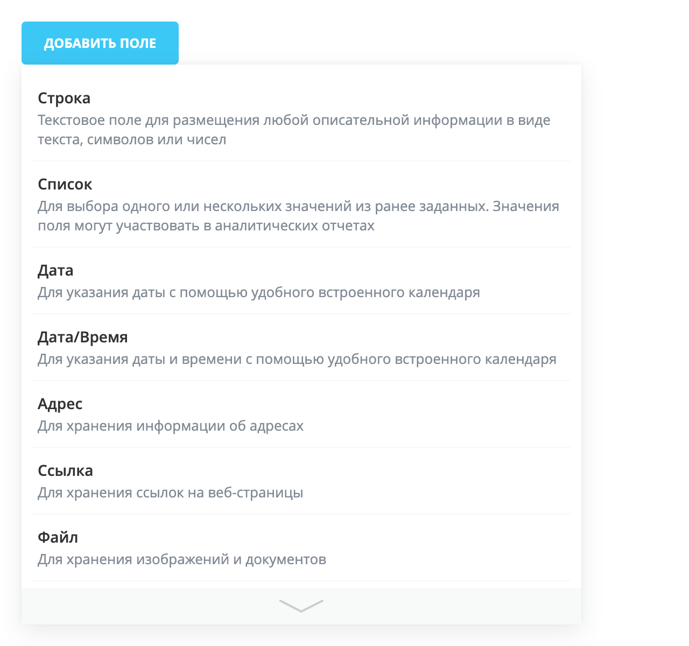
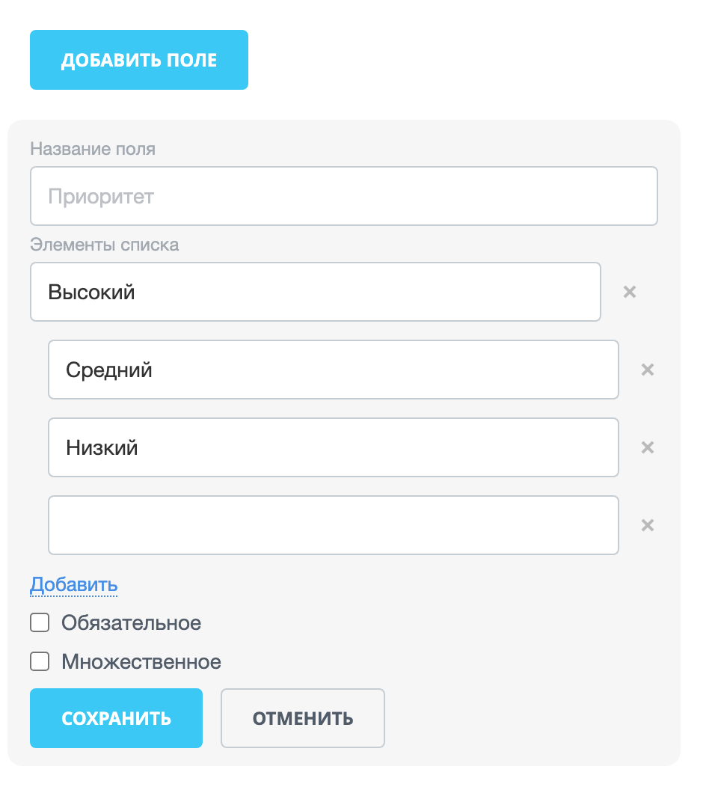

Расширения `ui.userfield` и `ui.userfieldfactory` создают, меняют и удаляют [пользовательские поля](../cms-basics/userfields.md) из JavaScript, без перезагрузки страницы. Расширения подходят для страницы объекта с кнопкой «Добавить поле». Пользователь выбирает тип, задает название и сохраняет поле, не уходя в административный раздел.

Расширения работают с настройками поля — кодом, типом, названием, обязательностью, вариантами списка. Объект здесь — то, к чему привязаны поля, например документ модуля. Его обозначает строковый идентификатор `ENTITY_ID`. Значения полей у конкретных объектов расширения не читают и не выводят. Вывод значений описан в статье [Отрисовка пользовательских полей в главном модуле](../cms-basics/userfields-main-rendering.md).

Работа разделена между двумя расширениями:

-  `ui.userfield` — модель `UserField`. Она хранит настройки одного поля и отправляет их на сервер в контроллер `main.userFieldConfig`.

-  `ui.userfieldfactory` — интерфейс создания поля. Класс `Factory` показывает меню типов, создает модель нового поля и выдает форму настроек `Configurator`.

Используйте модель без фабрики, если интерфейс создания поля строит код страницы. Фабрика без модели не работает, потому что создает объекты `UserField` и передает их в форму.

Сервер принимает запросы модели, только если модуль разрешил работу с полями своих объектов. Без этой настройки загрузка, сохранение и удаление завершаются ошибкой — она описана в разделе [Разрешить модулю работать с полями](#module-access).

## Подключить расширения {#connect}

Чтобы подключить расширения из PHP, загрузите `ui.userfieldfactory`. Фабрика подключает модель `ui.userfield` вместе с собой.

```php
\Bitrix\Main\UI\Extension::load('ui.userfieldfactory');
```

Фабрика подключает зависимости `main.core`, `main.popup`, `sidepanel`, `ui.design-tokens`, `ui.fonts.opensans` и `ui.userfield`. Если нужна только модель, загрузите расширение `ui.userfield`. Оно зависит только от `main.core`.

Форма настроек `Configurator` размечена классами полей ввода из [ui.forms](./ui-forms.md) и кнопок из [ui.buttons](./ui-buttons.md), но сами эти расширения фабрика не подключает. Загрузите их вместе с фабрикой, если на странице их еще нет.

**Пример.** Шаблон страницы загружает фабрику и оформление формы настроек.

```php
\Bitrix\Main\UI\Extension::load([
    'ui.userfieldfactory',
    'ui.forms',
    'ui.buttons',
]);
```

В модульном JavaScript импортируйте классы из расширений.

```js
import { UserField } from 'ui.userfield';
import { Factory, Configurator, FieldTypes } from 'ui.userfieldfactory';
```

Во встроенном скрипте страницы, где `import` недоступен, классы доступны как `BX.UI.UserField.UserField`, `BX.UI.UserFieldFactory.Factory`, `BX.UI.UserFieldFactory.Configurator` и `BX.UI.UserFieldFactory.FieldTypes`.

**Пример.** Встроенный скрипт страницы получает классы из глобальных имен.

```js
const { UserField } = BX.UI.UserField;
const { Factory } = BX.UI.UserFieldFactory;
```

## Разрешить модулю работать с полями {#module-access}

Модель не пишет в базу сама. Методы `load()`, `save()` и `delete()` отправляют AJAX-запросы к действиям серверного контроллера `main.userFieldConfig` через `BX.ajax.runAction()`. Контроллер проверяет права через класс доступа модуля. Как устроен вызов действий, описано в разделе [Вызвать действие контроллера](./main-core.md#vyzvat-dejstvie-kontrollera) статьи о main.core.

Передайте модуль в модель параметром `moduleId`. Контроллер ищет в файле `.settings.php` этого модуля секцию `userField` с именем класса доступа. Если секции нет, модуль не установлен или класс не наследует `\Bitrix\Main\UserField\UserFieldAccess`, запрос завершается ошибкой `No settings for UserFieldAccess`. Та же ошибка приходит, если модель создана без параметра `moduleId`.

Действия контроллера доступны только авторизованному пользователю. Если на сайте установлен модуль `intranet`, контроллер принимает запросы только от пользователей интранета. Тексты ошибок зависят от языка сайта, поэтому в коде не сравнивайте их со строкой.

Чтобы модуль принимал запросы модели, выполните два действия:

1. Создайте класс доступа — наследник `\Bitrix\Main\UserField\UserFieldAccess`.

2. Укажите полное имя класса в секции `userField` файла `.settings.php` модуля.

### Создать класс доступа

Класс доступа определяет объекты, с полями которых текущий пользователь может работать. Единственный обязательный метод — `getAvailableEntityIds()`. Он возвращает массив идентификаторов объектов `ENTITY_ID`, поля которых пользователю разрешено читать, создавать, менять и удалять.

**Пример.** Класс модуля `vendor.module` разрешает администраторам работать с полями документов `VENDOR_DOCUMENT`.

```php
<?php

namespace Vendor\Module\UserField;

class DocumentFieldAccess extends \Bitrix\Main\UserField\UserFieldAccess
{
    protected function getAvailableEntityIds(): array
    {
        $groups = array_map('intval', \CUser::GetUserGroup($this->getUserId()));

        if (in_array(1, $groups, true))
        {
            return ['VENDOR_DOCUMENT'];
        }

        return [];
    }
}
```

Группа с идентификатором `1` — администраторы сайта. Метод `getUserId()` возвращает идентификатор текущего пользователя. Класс получает его при создании, отдельно передавать не нужно.

Остальные проверки базовый класс строит на результате `getAvailableEntityIds()`:

-  `canRead($id)` — разрешает читать поле, если его `ENTITY_ID` есть в списке,

-  `canAdd($field)` — разрешает создать поле, если его `ENTITY_ID` есть в списке и тип поля не запрещен,

-  `canUpdate($id)` — повторяет проверку `canRead($id)`,

-  `canDelete($id)` — повторяет проверку `canUpdate($id)`.

Переопределите эти методы, если права на изменение и удаление у модуля строже, чем на чтение.

Метод `getRestrictedTypes()` возвращает типы, которые нельзя создать через контроллер. В базовом классе это `resourcebooking`, `mail_message`, `hlblock` и `string_formatted`, а также `rich_text`, если форматированный текст в полях выключен. Чтобы запретить свои типы, переопределите метод и добавьте их к списку родителя.

Метод `getDefaultSettings($field)` возвращает настройки, которые контроллер подставит в новое поле. Значения из запроса имеют приоритет. По умолчанию метод возвращает пустой массив.

### Зарегистрировать класс доступа

**Пример.** Файл `/local/modules/vendor.module/.settings.php` указывает контроллеру класс доступа модуля.

```php
<?php

return [
    'userField' => [
        'value' => [
            'access' => '\\Vendor\\Module\\UserField\\DocumentFieldAccess',
        ],
    ],
];
```

Если файл уже содержит другие секции, добавьте `userField` к ним.

## Создать модель поля

Конструктор `UserField` принимает два аргумента. Первый — данные поля, второй — параметры модели.

Тип `UserFieldParams` описывает второй аргумент.

```ts
type UserFieldParams = {
    moduleId?: string;
    languageId?: string;
};
```

| Параметр | Тип | Описание |
|---|---|---|
| `moduleId` | `string` | Задает модуль, через класс доступа которого контроллер проверяет права. Без него методы `load()`, `save()` и `delete()` завершаются ошибкой. Метод `setModuleId()` задает модуль после создания модели |
| `languageId` | `string` | Задает язык, на котором модель читает и записывает название поля. По умолчанию — язык текущей страницы из сообщения `LANGUAGE_ID`. Метод `setLanguageId()` меняет язык после создания модели |

**Пример.** Код создает модель нового строкового поля для документов.

```js
import { UserField } from 'ui.userfield';

const userField = new UserField({
    entityId: 'VENDOR_DOCUMENT',
    fieldName: 'UF_VENDOR_DOCUMENT_STATUS',
    userTypeId: 'string',
    multiple: 'N',
    mandatory: 'N',
}, {
    moduleId: 'vendor.module',
});
```

### Данные поля

Ключи данных совпадают с полями `CUserTypeEntity`, только записаны в camelCase. Например, `FIELD_NAME` становится `fieldName`, `USER_TYPE_ID` — `userTypeId`. В таком же виде контроллер возвращает поле после загрузки и сохранения.

*Ключи, обязательные при создании поля, обозначены \*. Для загрузки сохраненного поля достаточно ключа `id`.*

| Ключ | Тип | Описание |
|---|---|---|
| `id` | `number` | Идентификатор поля. У нового поля его нет. Контроллер заполняет его после сохранения |
| `entityId`* | `string` | Идентификатор объекта, к которому относится поле, например `VENDOR_DOCUMENT`. Должен входить в список класса доступа модуля |
| `fieldName`* | `string` | Код поля. При создании код должен начинаться с `UF_`, затем идет `entityId` и знак подчеркивания, например `UF_VENDOR_DOCUMENT_STATUS`. Иначе контроллер не создаст поле |
| `userTypeId`* | `string` | Тип поля, например `string`, `enumeration`, `date`. Список типов приведен в разделе [Типы данных](../cms-basics/userfields.md#data-types) статьи о пользовательских полях |
| `multiple` | `string` | Множественное поле — `Y` или `N` |
| `mandatory` | `string` | Обязательное поле — `Y` или `N` |
| `showFilter` | `string` | Способ показа в фильтре списка. `N` — не показывать, `I` — точное совпадение, `E` — поиск по маске, `S` — поиск по подстроке. Значение `Y` контроллер сохраняет как `E` |
| `isSearchable` | `string` | Значения поля участвуют в поиске — `Y` или `N` |
| `editInList` | `string` | Пользователь может менять значение в формах и списках — `Y` или `N` |
| `sort` | `number` | Индекс сортировки поля среди полей объекта |
| `xmlId` | `string` | Внешний идентификатор поля для обмена данными |
| `settings` | `object` | Настройки типа поля. Набор ключей зависит от типа |
| `editFormLabel` | `object` | Название поля в форме редактирования по языкам, например `{ ru: 'Статус' }` |
| `helpMessage` | `object` | Подсказка к полю по языкам. Контроллер обрезает каждую подсказку до 255 символов |
| `enum` | `Array` | Варианты значений поля типа `enumeration` |
| `detailUrl` | `string` | Адрес страницы настроек поля. Контроллер `main.userFieldConfig` этот ключ не заполняет. Значение записывает в данные код страницы |

При сохранении контроллер берет из данных только ключи из таблицы, кроме `id` и `detailUrl`. Остальные ключи, в том числе `listColumnLabel`, `listFilterLabel` и `errorMessage`, он отбрасывает.



При изменении сохраненного поля с названием в `editFormLabel` сервер перезаписывает все подписи поля и удаляет:

-  подписи в списке и фильтре и сообщение об ошибке на всех языках,

-  названия на языках, которых нет в `editFormLabel`.

Перед изменением загрузите поле методом `load()`, чтобы в `editFormLabel` попали названия на всех языках. Подписи в списке и фильтре задайте после сохранения методом `CUserTypeEntity::Update()` из PHP.



## Прочитать и изменить настройки модели

Модель меняет данные в памяти браузера. Изменения попадают на сервер после вызова `save()`.

Методы для чтения настроек:

-  `getId()` — возвращает идентификатор поля числом. У нового поля — `0`.

-  `isSaved()` — возвращает `true`, если у поля есть идентификатор больше нуля.

-  `getName()` — возвращает код поля.

-  `getEntityId()` — возвращает идентификатор объекта.

-  `getUserTypeId()` — возвращает тип поля.

-  `isMultiple()` и `isMandatory()` — возвращают `true`, если в данных стоит `Y`.

-  `getTitle()` — возвращает название поля на языке модели.

-  `getEnumeration()` — возвращает массив вариантов. Если вариантов нет, записывает в данные пустой массив и возвращает его.

-  `getDetailUrl()` — возвращает адрес страницы настроек поля из ключа `detailUrl`.

-  `getLanguageId()` — возвращает язык модели.

-  `getData()` — возвращает объект данных целиком. Это тот же объект, который хранит модель, поэтому изменения в нем меняют модель.

Методы для изменения настроек:

-  `setName(name)` — меняет код поля.

-  `setUserTypeId(userTypeId)` — меняет тип поля.

-  `setIsMultiple(isMultiple)` — делает поле множественным или одиночным. Принимает логическое значение или строку.

-  `setIsMandatory(mandatory)` — делает поле обязательным или необязательным. Принимает логическое значение.

-  `setTitle(title, languageId)` — задает название поля.

-  `setEnumeration(items)` — заменяет варианты значений.

-  `setData(data)` — заменяет данные поля целиком.

Все методы изменения, кроме `setIsMandatory()`, возвращают модель, поэтому их можно вызывать цепочкой. Метод `setIsMandatory()` ничего не возвращает. Вызывайте его отдельной строкой или последним в цепочке.



Задавайте код, тип и множественность до первого вызова `save()`. У сохраненного поля их изменить нельзя. Методы `setName()`, `setUserTypeId()` и `setIsMultiple()` у модели с идентификатором пишут ошибку в консоль и оставляют данные прежними.



Если код, тип или множественность нужно изменить у сохраненного поля, создайте новое поле и перенесите в него значения. Порядок действий описан в разделе [Как обновить поле](../cms-basics/userfields.md#update-field) статьи о пользовательских полях.

### Задать название поля

Метод `setTitle(title, languageId)` записывает название в ключ `editFormLabel` на указанном языке. Без второго аргумента он берет язык модели. Пустую строку метод не записывает.

У поля типа `boolean` метод дополнительно записывает название в настройку `LABEL_CHECKBOX` — подпись рядом с флажком.

Метод `getTitle()` ищет название на языке модели по очереди в ключах `editFormLabel`, `listColumnLabel` и `listFilterLabel`. Если названия нет ни в одном из них, метод возвращает код поля.

**Пример.** Код задает название поля на двух языках.

```js
userField
    .setTitle('Статус документа')
    .setTitle('Document status', 'en');
```

### Задать варианты списка

Варианты поля типа `enumeration` хранятся в ключе `enum`. Каждый вариант — объект с ключами:

-  `value` — текст варианта,

-  `sort` — индекс сортировки, число,

-  `id` — числовой идентификатор сохраненного варианта, у нового варианта его нет,

-  `xmlId` — внешний идентификатор варианта,

-  `def` — вариант по умолчанию, `Y` или `N`.

**Пример.** Код задает три варианта для поля статуса.

```js
userField.setEnumeration([
    { value: 'Черновик', sort: 100 },
    { value: 'На проверке', sort: 200 },
    { value: 'Утвержден', sort: 300 },
]);
```



Метод `setEnumeration()` заменяет список вариантов целиком. При сохранении контроллер удаляет варианты поля, которых нет в переданном списке. Чтобы добавить вариант к сохраненному полю, возьмите текущий список из `getEnumeration()`, добавьте к нему новый элемент и передайте весь список. У сохраненных вариантов оставляйте ключ `id`. Без него контроллер создаст вариант заново, а старый удалит.



## Загрузить, сохранить и удалить поле

Методы `load()`, `save()` и `delete()` отправляют запрос в контроллер `main.userFieldConfig` и возвращают `Promise`. При ошибке `Promise` отклоняется с массивом строк — текстами ошибок.

Модель выполняет один запрос за раз. Если вызвать любой из трех методов, пока предыдущий запрос не завершился, `Promise` сразу отклоняется с ошибкой `Another action is in progress`.

### Загрузить настройки

Метод `load()` получает с сервера актуальные настройки сохраненного поля и записывает их в модель. Для загрузки достаточно создать модель с одним ключом `id`. Метод возвращает `Promise`, который разрешается ответом контроллера. Данные поля читайте из самой модели.

**Пример.** Код загружает поле с идентификатором `15` и выводит его название.

```js
import { UserField } from 'ui.userfield';

const userField = new UserField({ id: 15 }, {
    moduleId: 'vendor.module',
});

userField.load().then(() => {
    console.log(userField.getTitle());
}).catch((errors) => {
    console.error(errors.join(', '));
});
```

У модели без идентификатора метод `load()` запрос не отправляет и отклоняет `Promise` с ошибкой `Cant load UserField without id`.

Контроллер возвращает поле, только если его `ENTITY_ID` входит в список класса доступа. Если поля нет или доступа к нему нет, `Promise` отклоняется.

### Загрузить все поля объекта

У модели нет метода для списка полей. Чтобы вывести на странице поля объекта и дать их править, получите их действием `main.userFieldConfig.list` того же контроллера и создайте модель для каждого поля. Ключи полей в ответе записаны в camelCase, как у `load()`, но данных в ответе меньше.

Действие принимает параметры:

-  `moduleId` — модуль с классом доступа.

-  `filter` — условия отбора в camelCase, например `{ entityId: 'VENDOR_DOCUMENT' }`.

-  `order` — порядок сортировки, например `{ sort: 'ASC' }`.

-  `select` — поля для выборки, по умолчанию все. Значения передавайте в верхнем регистре, например `FIELD_NAME`. Ключ `language` с кодом языка добавляет к полям подписи на этом языке. Чтобы получить все поля и подписи, передайте объект `{ 0: '*', language: <язык страницы> }`.

Действие возвращает массив полей в `response.data.fields`. При ошибке `Promise` отклоняется объектом ответа, тексты ошибок находятся в `response.errors[].message`. Методы модели в этом случае отдают массив строк.

Контроллер возвращает только поля объектов из списка класса доступа. Объекты фильтра не из списка он отбрасывает. Если в фильтре не осталось ни одного разрешенного объекта, действие возвращает ошибку доступа.

Без ключа `language` в `select` действие не возвращает названия полей, и метод `getTitle()` вернет код поля. Сервер записывает подписи под кодом языка текущей страницы, а не под переданным кодом. Передавайте в `language` язык страницы, иначе модель не найдет название. Язык страницы возвращает `Loc.getMessage('LANGUAGE_ID')` из `main.core`.



Действие `list` не возвращает варианты списка и возвращает названия только на одном языке. Перед вызовом `save()` у модели из списка, в том числе через форму настроек, вызовите `load()`. Иначе сервер удалит все варианты поля типа `enumeration` и названия на остальных языках.



**Пример.** Код загружает поля документов и создает для них модели.

```js
import { ajax, Loc } from 'main.core';
import { UserField } from 'ui.userfield';

ajax.runAction('main.userFieldConfig.list', {
    data: {
        moduleId: 'vendor.module',
        select: { 0: '*', language: Loc.getMessage('LANGUAGE_ID') },
        filter: { entityId: 'VENDOR_DOCUMENT' },
        order: { sort: 'ASC' },
    },
}).then((response) => {
    const userFields = response.data.fields.map((data) => new UserField(data, {
        moduleId: 'vendor.module',
    }));
    userFields.forEach((userField) => {
        console.log(userField.getId(), userField.getTitle());
    });
}).catch((response) => {
    console.error(response.errors.map(({ message }) => message).join(', '));
});
```

### Сохранить поле

Метод `save()` сам выбирает действие по идентификатору. Модель без идентификатора он отправляет на создание, модель с идентификатором — на изменение. После ответа сервера метод записывает в модель данные сохраненного поля, поэтому у нового поля появляется `id`.

**Пример.** Код создает поле статуса документа и выводит его идентификатор.

```js
import { UserField } from 'ui.userfield';

const userField = new UserField({
    entityId: 'VENDOR_DOCUMENT',
    fieldName: 'UF_VENDOR_DOCUMENT_STATUS',
    userTypeId: 'enumeration',
    multiple: 'N',
    mandatory: 'N',
}, {
    moduleId: 'vendor.module',
});

userField.setTitle('Статус документа');
userField.setEnumeration([
    { value: 'Черновик', sort: 100 },
    { value: 'Утвержден', sort: 200 },
]);

userField.save().then(() => {
    console.log(userField.getId());
}).catch((errors) => {
    console.error(errors.join(', '));
});
```

Метод `save()` возвращает `Promise`, который разрешается ответом контроллера, а не моделью. Данные сохраненного поля читайте из самой модели, как в примере.

При создании контроллер проверяет три условия:

1. `entityId` входит в список метода `getAvailableEntityIds()` класса доступа.

2. Тип поля не входит в список метода `getRestrictedTypes()`.

3. Код поля начинается с `UF_`, идентификатора объекта и знака подчеркивания.

Если хотя бы одно условие не выполнено, контроллер не создает поле и возвращает ошибку.

Контроллер создает, меняет и удаляет поле методами `Add()`, `Update()` и `Delete()` класса `CUserTypeEntity`. Ошибки этих методов тоже приходят в массив — например, если тип поля не зарегистрирован в продукте. Изменения через модель вызывают те же события главного модуля, что и работа с полем из PHP. События перечислены в разделе [События](../cms-basics/userfields.md#events) статьи о пользовательских полях.

### Удалить поле

Метод `delete()` удаляет сохраненное поле и возвращает `Promise`, который разрешается без значения. После успешного удаления метод `isDeleted()` возвращает `true`, а данные в модели остаются прежними.

Перед удалением убедитесь, что поле нигде не используется. Код, шаблоны и фильтры, которые обращаются к полю по коду, перестанут его находить.

**Пример.** Код удаляет поле и убирает его строку со страницы.

```js
import { Dom } from 'main.core';

userField.delete().then(() => {
    Dom.remove(document.getElementById('document-field-15'));
}).catch((errors) => {
    console.error(errors.join(', '));
});
```

У модели без идентификатора метод `delete()` запрос не отправляет и отклоняет `Promise` с ошибкой `Cant delete UserField without id`.

## Передать поле в другое окно {#transfer-field}

Объект модели нельзя передать между окнами браузера, например из [слайдера](./main-sidepanel.md) на родительскую страницу. Для этого переведите модель в строку и восстановите из нее:

-  `serialize()` — возвращает строку JSON с данными поля, языком, модулем и признаками выполнения запроса и удаления,

-  `UserField.unserialize(serializedData)` — статический метод, создает модель из такой строки.

**Пример.** Страница в слайдере сохраняет поле и передает его в данные слайдера под ключом `userFieldData`.

```js
userField.save().then(() => {
    const slider = BX.SidePanel.Instance.getSliderByWindow(window);
    if (slider)
    {
        slider.getData().set('userFieldData', userField.serialize());
        slider.close();
    }
});
```

**Пример.** Родительская страница при закрытии слайдера восстанавливает модель и проверяет, не удалено ли поле.

```js
import { UserField } from 'ui.userfield';

BX.SidePanel.Instance.open('/local/document-field.php', {
    cacheable: false,
    events: {
        onClose: (event) => {
            const userFieldData = event.getSlider().getData().get('userFieldData');
            if (!userFieldData)
            {
                return;
            }

            const userField = UserField.unserialize(userFieldData);
            console.log(userField.isDeleted(), userField.getTitle());
        },
    },
});
```

Фабрика читает ключ `userFieldData` при закрытии полной формы настроек, поэтому примеры используют этот ключ. Подробнее — в разделе [Открыть полную форму настроек](#custom-types-url).

## Собрать интерфейс создания поля

Фабрика `Factory` собирает типовой сценарий создания поля из трех частей:

1. Меню типов `getMenu()` — всплывающее окно со списком типов полей.

2. Модель `createUserField()` — новый объект `UserField` с настройками по умолчанию для выбранного типа.

3. Форма `getConfigurator()` — блок с названием, вариантами списка, флажками и кнопками сохранения и отмены.

Форма передает модель в обработчик `onSave`, обработчик вызывает `save()`.

**Пример.** Разметка выводит кнопку создания поля и контейнер для формы настроек.

```html
<span class="ui-btn ui-btn-primary" id="document-field-create">Добавить поле</span>
<div id="document-field-configurator"></div>
```

**Пример.** Код показывает меню типов по нажатию на кнопку, создает модель выбранного типа, выводит форму и сохраняет поле.

```js
import { Dom, Event } from 'main.core';
import { Factory } from 'ui.userfieldfactory';

const createButton = document.getElementById('document-field-create');
const configuratorContainer = document.getElementById('document-field-configurator');

const factory = new Factory('VENDOR_DOCUMENT', {
    moduleId: 'vendor.module',
    bindElement: createButton,
});

const showConfigurator = (userField) => {
    const configurator = factory.getConfigurator({
        userField,
        onSave: (changedField) => {
            changedField.save().then(() => {
                Dom.clean(configuratorContainer);
            }).catch((errors) => {
                console.error(errors.join(', '));
            });
        },
        onCancel: () => {
            Dom.clean(configuratorContainer);
        },
    });

    Dom.clean(configuratorContainer);
    Dom.append(configurator.render(), configuratorContainer);
};

Event.bind(createButton, 'click', () => {
    factory.getMenu().open((fieldType) => {
        showConfigurator(factory.createUserField(fieldType));
    });
});
```

После нажатия на кнопку откроется меню типов. Выбор типа создаст модель с кодом вида `UF_VENDOR_DOCUMENT_1732365331000` и названием по умолчанию, под кнопкой появится форма настроек. Кнопка сохранения формы отправит поле на сервер.

### Создать фабрику

Конструктор `Factory` принимает идентификатор объекта и параметры. Тип `FactoryParams` описывает второй аргумент.

```ts
type FactoryParams = {
    moduleId?: string;
    bindElement?: Element;
    menuId?: string;
    types?: Array<Object>;
    configuratorClass?: string | Function;
    customTypesUrl?: string;
};
```

*Обязательные параметры обозначены \*.*

#|
|| **Параметр** | **Тип** | **Описание** ||
|| `entityId`* | `string` | Первый аргумент конструктора. Задает идентификатор объекта, к которому фабрика создает поля. Фабрика записывает его в каждую новую модель и в начало кода поля ||
|| `moduleId` | `string` | Задает модуль для моделей, которые создает фабрика. Без него модели не сохраняются. Подробнее — в разделе [Разрешить модулю работать с полями](#module-access) ||
|| `bindElement` | `Element` | Задает элемент, к которому привязано меню типов ||
|| `menuId` | `string` | Задает идентификатор окна меню типов. По умолчанию `ui-user-field-factory-menu` ||
|| `types` | `Array` | Добавляет свои типы в конец меню. Формат элемента описан в разделе [Добавить свои типы](#custom-types) ||
|| `configuratorClass` | `string` \| `Function` | Задает свою форму настроек — наследника `Configurator` или полное глобальное имя такого класса строкой, например `BX.Vendor.DocumentFieldConfigurator`. Класс, который не наследует `Configurator`, фабрика пропускает и оставляет стандартную форму ||
|| `customTypesUrl` | `string` | Добавляет в меню пункт «Дополнительные поля...», который открывает этот адрес в слайдере. Подробнее — в разделе [Открыть полную форму настроек](#custom-types-url) ||
|#

Методы `setConfiguratorClass()` и `setCustomTypesUrl()` задают последние два параметра после создания фабрики.

### Показать меню типов {#show-menu}

Метод `getMenu(params)` возвращает меню типов — объект класса `CreationMenu`. Сам класс расширение не экспортирует, его объект получают только из фабрики. Объект `params` фабрика передает в параметры всплывающего окна [main.popup](./main-popup.md), например `bindElement`, `offsetLeft`, `offsetTop`. Если `bindElement` не передан, меню берет элемент из параметров фабрики.

Фабрика создает меню при первом вызове `getMenu()` и при следующих вызовах возвращает тот же объект. Параметры из следующих вызовов меню не применяет. Передавайте параметры окна при первом вызове.

Метод `open(callback)` показывает окно меню. Когда пользователь нажимает на пункт, меню вызывает `callback`, передает в него код типа, например `string`, и закрывает окно.

Меню открывается под элементом из `bindElement`. В каждом пункте — название типа и строка описания. Если пункты не помещаются по высоте, внизу меню появляется стрелка прокрутки.

{width=640px height=600px}

В стандартном меню типы идут в таком порядке.

| Код типа | Пункт меню | Название нового поля |
|---|---|---|
| `string` | Строка | Новая строка |
| `enumeration` | Список | Новый список |
| `date` | Дата | Новая дата |
| `datetime` | Дата/Время | Новая дата |
| `address` | Адрес | Новое поле |
| `url` | Ссылка | Новое поле |
| `file` | Файл | Новый файл |
| `money` | Деньги | Новая сумма |
| `boolean` | Да/Нет | Новое поле |
| `double` | Число | Новое число |
| `employee` | Привязка к пользователю | Новое поле |
| `rich_text` | Форматированный текст | Новое поле с форматированным текстом |

Тип `rich_text` появляется в меню, только если в продукте включен форматированный текст в пользовательских полях. Названия в таблице — значения русского языкового файла расширения.

Метод `getFieldTypes()` возвращает стандартные типы массивом объектов с ключами `name`, `title`, `description` и `defaultTitle`. Ключа `defaultTitle` нет у типов, для которых в таблице указано «Новое поле».

Статический метод `FieldTypes.getTypes()` возвращает объект с кодами типов, к которым обращается код фабрики, например `FieldTypes.getTypes().enumeration`. Кроме типов меню в нем есть ключи `crm` и `crmStatus` с кодами `crm` и `crm_status`, но в стандартное меню эти типы не входят.

### Создать модель нового поля

Метод `createUserField(fieldType, fieldName)` возвращает новую модель `UserField` выбранного типа. Метод на сервер не обращается. Поле появится в базе после вызова `save()`.

Модель получает:

-  тип `fieldType`, идентификатор объекта и модуль фабрики,

-  название по умолчанию из колонки «Название нового поля» таблицы в разделе [Показать меню типов](#show-menu),

-  настройки по умолчанию — одиночное, необязательное, участвует в фильтре по маске, не участвует в поиске.

Для части типов настройки по умолчанию другие:

-  `file` — не показывается в фильтре,

-  `employee` — фильтр по точному совпадению,

-  `enumeration` — настройка `DISPLAY` со значением `UI`,

-  `double` — настройка `PRECISION` со значением `2`.

Если код поля не передан, пустой или длиннее 50 символов, фабрика создает его сама методом `generateFieldName()`. Код состоит из префикса `UF_`, идентификатора объекта, знака подчеркивания и текущего времени в миллисекундах. Если код получается длиннее 50 символов, фабрика обрезает начало числа времени.

Свой код передавайте в формате, который принимает контроллер, — `UF_`, идентификатор объекта, знак подчеркивания и окончание.

**Пример.** Код создает модель поля статуса со своим кодом.

```js
const userField = factory.createUserField('enumeration', 'UF_VENDOR_DOCUMENT_STATUS');
```

Метод `getDefaultLabel(fieldType)` возвращает название по умолчанию для типа. Если у типа нет своего названия, метод возвращает «Новое поле».

### Показать форму настроек

Метод `getConfigurator(params)` возвращает форму настроек для модели. Метод `render()` формы собирает разметку и возвращает корневой элемент. Вставьте его в страницу сами. Для оформления формы загрузите [ui.forms](./ui-forms.md) и [ui.buttons](./ui-buttons.md), как в разделе [Подключить расширения](#connect).

Метод `getConfigurator()` принимает объект с параметрами.

*Обязательные параметры обозначены \*.*

| Параметр | Тип | Описание |
|---|---|---|
| `userField`* | `UserField` | Задает модель, которую настраивает форма |
| `onSave` | `Function` | Задает обработчик кнопки сохранения. Форма переносит введенные данные в модель и передает модель в обработчик |
| `onCancel` | `Function` | Задает обработчик кнопки отмены. Без обработчика форма по кнопке отмены скрывает себя |
| `canRequiredFields` | `boolean` | Показывает флажок обязательного поля. По умолчанию `true` |
| `canMultipleFields` | `boolean` | Показывает флажок множественного поля. По умолчанию `true` |

Форма содержит:

-  поле названия, подсказка в нем — текущее название модели,

-  список вариантов с кнопкой добавления, только у поля типа `enumeration`,

-  флажок обязательного поля, если `canRequiredFields` не равен `false`,

-  флажок множественного поля, если `canMultipleFields` не равен `false`, поле не сохранено и его тип не `boolean`,

-  кнопки сохранения и отмены.

У поля типа `enumeration` форма выводит строку на каждый вариант и одну пустую строку в конце для нового варианта. Ссылка «Добавить» добавляет еще одну пустую строку, крестик справа удаляет строку. На снимке — форма нового поля «Приоритет» с вариантами «Высокий», «Средний» и «Низкий».

{width=480px height=530px}

По кнопке сохранения форма записывает в модель название, обязательность, множественность и варианты списка. Если поле названия пустое, у модели остается прежнее название. Варианты списка форма передает в `setEnumeration()` с индексами сортировки `100`, `200`, `300` по порядку строк.



Форма не отправляет поле на сервер. Вызовите `save()` модели в обработчике `onSave`, иначе изменения останутся только в браузере.



Форму можно показать и для сохраненного поля, например чтобы переименовать его. В этом случае форма не выводит флажок множественности, потому что множественность сохраненного поля изменить нельзя. Перед показом формы загрузите поле методом `load()`, чтобы форма вывела все варианты списка, а сохранение не стерло названия на других языках.

## Добавить свои типы {#custom-types}

Добавьте свой тип в меню, если в продукте [зарегистрирован свой тип пользовательского поля](../cms-basics/userfields-main-types.md#register-type) и его нужно создавать из того же интерфейса.

Элемент массива `types` в параметрах фабрики описывает один пункт меню:

-  `name` — код типа, его меню передает в `callback` метода `open()`,

-  `title` — название пункта,

-  `description` — описание под названием пункта,

-  `defaultTitle` — название нового поля этого типа,

-  `onClick` — свой обработчик нажатия. Если он задан, меню вызывает его вместо `callback` и передает в него код типа.

**Пример.** Фабрика добавляет в меню тип поля оценки документа.

```js
const factory = new Factory('VENDOR_DOCUMENT', {
    moduleId: 'vendor.module',
    bindElement: createButton,
    types: [
        {
            name: 'vendor_rating',
            title: 'Оценка',
            description: 'Оценка документа от одного до пяти',
            defaultTitle: 'Оценка',
        },
    ],
});
```

Тип `vendor_rating` здесь — код типа, который зарегистрировал модуль. Контроллер создаст поле только зарегистрированного типа.

Стандартный список типов можно изменить через событие `OnGetUserTypes`. Фабрика вызывает его в конструкторе и строит меню из полученного списка. Подписка на экземпляр после создания фабрики меню уже не изменит. Подпишитесь глобально по полному имени события до создания фабрики методом `EventEmitter.subscribe()` — он описан в статье [JS-ядро main.core и события](./main-core.md). Подписка действует на все фабрики страницы.

**Пример.** Обработчик убирает тип «Адрес» из меню всех фабрик страницы.

```js
import { EventEmitter } from 'main.core.events';

EventEmitter.subscribe('BX.UI.UserFieldFactory.Factory:OnGetUserTypes', (event) => {
    const { types } = event.getData();
    const index = types.findIndex((type) => type.name === 'address');
    if (index >= 0)
    {
        types.splice(index, 1);
    }
});
```

Фабрика строит меню из массива `types` после того, как его обработали подписчики. Меняйте массив на месте — добавляйте и удаляйте элементы, а не присваивайте новый массив.

## Открыть полную форму настроек {#custom-types-url}

Короткая форма `Configurator` задает только название, обязательность, множественность и варианты списка. Остальные настройки — тип вне меню, настройки типа, подписи на других языках — пользователь задает на отдельной странице в слайдере.

Параметр `customTypesUrl` добавляет в конец меню пункт «Дополнительные поля...». По нажатию на него фабрика открывает адрес в слайдере шириной 900 пикселей.

При закрытии слайдера фабрика читает из его данных ключ `userFieldData`. Если там есть строка `serialize()`, фабрика восстанавливает модель и вызывает событие `onCreateCustomUserField` с этой моделью. Если ключа нет, событие не вызывается.

**Пример.** Фабрика открывает страницу полной настройки и добавляет созданное там поле в список на странице.

```js
const factory = new Factory('VENDOR_DOCUMENT', {
    moduleId: 'vendor.module',
    bindElement: createButton,
    customTypesUrl: '/local/document-field.php',
});

factory.subscribe('onCreateCustomUserField', (event) => {
    const { userField } = event.getData();
    console.log(userField.getId(), userField.getTitle());
});
```

Страница по адресу `customTypesUrl` должна сама сохранить поле и записать результат в данные слайдера — как в примере раздела [Передать поле в другое окно](#transfer-field). Готовая страница настроек поля в продукте — компонент `bitrix:main.field.config.detail`, он записывает в слайдер тот же ключ.

Соберите свою страницу для слайдера по правилам статьи [Боковая панель main.sidepanel](./main-sidepanel.md). Метод `GetSettingsHTML()` выводит на этой странице форму настроек конкретного типа поля. Он описан в разделе [Отрисовать форму настроек поля](../cms-basics/userfields-main-rendering.md#settings-form) статьи об отрисовке пользовательских полей.

## Подписаться на события фабрики

Фабрика вызывает события с пространством имен `BX.UI.UserFieldFactory.Factory`. На события конкретной фабрики подпишитесь методом `subscribe()` экземпляра, на события всех фабрик страницы — статическим методом `EventEmitter.subscribe()` с полным именем. Как устроены подписки, описано в статье [JS-ядро main.core и события](./main-core.md).

| Событие | Когда вызывается | Данные |
|---|---|---|
| `OnGetUserTypes` | При формировании списка стандартных типов в конструкторе и при каждом вызове `getFieldTypes()` | `types` — массив типов, его можно менять на месте |
| `onCreateField` | При создании модели методом `createUserField()` | `userField` — новая модель |
| `onCreateCustomUserField` | При закрытии слайдера полной формы настроек, если страница записала в него ключ `userFieldData` | `userField` — модель, восстановленная из строки |

**Пример.** Обработчик делает каждое новое поле фабрики обязательным.

```js
factory.subscribe('onCreateField', (event) => {
    const { userField } = event.getData();
    userField.setIsMandatory(true);
});
```

## Заменить форму настроек

Создайте наследника `Configurator`, если в короткой форме нужна еще одна настройка. Передайте его в параметр `configuratorClass` фабрики или в метод `setConfiguratorClass()`.

Точки переопределения формы:

-  `render()` — собирает всю форму и возвращает корневой элемент,

-  `renderOptions()` — собирает блок флажков и возвращает его,

-  `renderEnumeration()` — собирает блок вариантов списка,

-  `saveField()` — переносит данные из формы в модель и возвращает модель.

В переопределенном методе вызывайте реализацию родителя через `super`, чтобы стандартные поля формы продолжили работать.

**Пример.** Наследник добавляет в форму флажок участия поля в поиске.

```js
import { Tag } from 'main.core';
import { Configurator, Factory } from 'ui.userfieldfactory';

class DocumentFieldConfigurator extends Configurator
{
    renderOptions()
    {
        const container = super.renderOptions();

        this.searchableCheckbox = Tag.render`<input class="ui-ctl-element" type="checkbox">`;
        this.searchableCheckbox.checked = (this.userField.getData().isSearchable === 'Y');

        container.appendChild(Tag.render`<div>
            <label class="ui-ctl ui-ctl-checkbox ui-ctl-xs">
                ${this.searchableCheckbox}
                <div class="ui-ctl-label-text">Участвует в поиске</div>
            </label>
        </div>`);

        return container;
    }

    saveField()
    {
        const userField = super.saveField();
        userField.getData().isSearchable = (this.searchableCheckbox.checked ? 'Y' : 'N');

        return userField;
    }
}

const factory = new Factory('VENDOR_DOCUMENT', {
    moduleId: 'vendor.module',
    configuratorClass: DocumentFieldConfigurator,
});
```

Метод `getConfigurator()` этой фабрики вернет объект `DocumentFieldConfigurator`. Параметры из `getConfigurator()` он получит в конструкторе так же, как стандартная форма. Модель поля доступна в наследнике через свойство `this.userField`, обработчики — через `this.onSave` и `this.onCancel`.

## Связанные материалы

-  [Пользовательские поля](../cms-basics/userfields.md)

-  [Отрисовка пользовательских полей в главном модуле](../cms-basics/userfields-main-rendering.md)

-  [Типы и компоненты пользовательских полей в главном модуле](../cms-basics/userfields-main-types.md)

-  [Боковая панель main.sidepanel](./main-sidepanel.md)

-  [Всплывающие окна и меню main.popup](./main-popup.md)

-  [JS-ядро main.core и события](./main-core.md)

-  [Расширения](../framework/extensions.md)
