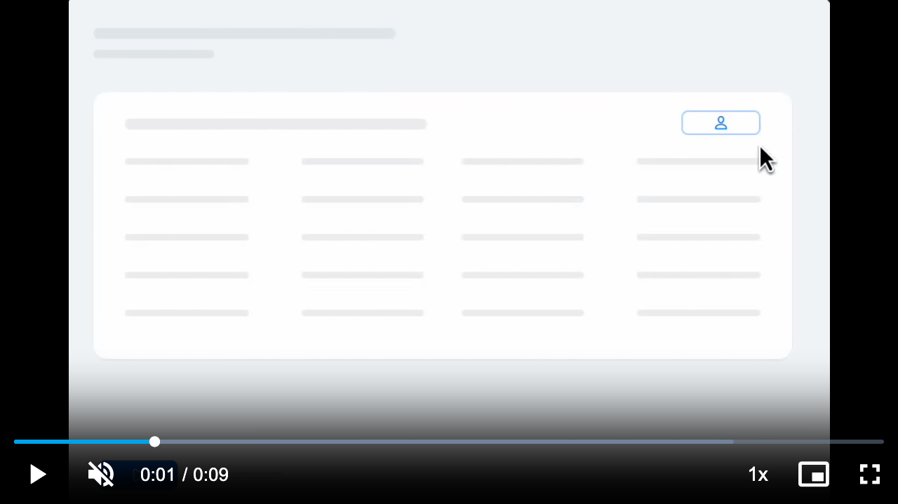
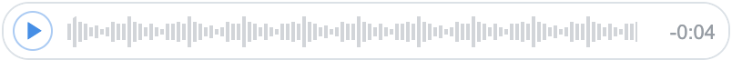
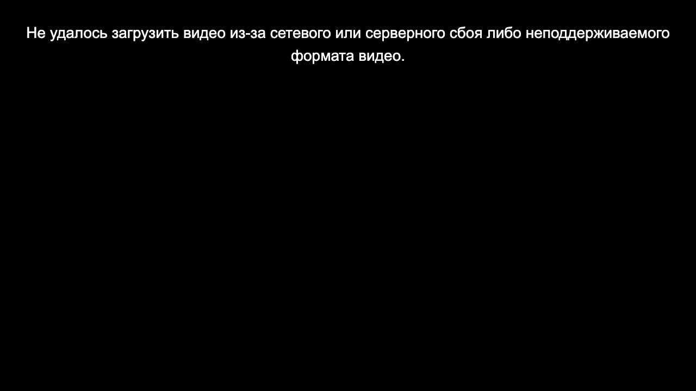

Расширение `ui.video-player` выводит видео или аудио прямо в блоке страницы. Плеер построен на библиотеке Video.js 8.18 и добавляет к ней собственное оформление, перевод интерфейса, горячие клавиши, запоминание громкости и автозапуск при прокрутке.

Используйте расширение, когда медиафайл должен проигрываться внутри страницы — в карточке записи, ленте, описании товара. Если файл нужно открыть поверх страницы по клику на ссылку, используйте [просмотр файлов ui.viewer](./ui-viewer.md) — он сам загружает этот плеер для видео и аудио.

За отдельный плеер отвечает класс `BX.UI.VideoPlayer.Player`, за все плееры страницы — статический класс `BX.UI.VideoPlayer.PlayerManager`.

Видеоплеер выводит кадр и панель управления с кнопкой воспроизведения, регулятором громкости, временем, шкалой прогресса, меню скорости, кнопками «Картинка в картинке» и полноэкранного режима.

{width=640px height=360px}

## Подключить расширение

Загрузите `ui.video-player` в шаблоне компонента или страницы.

В PHP-коде:

```php
\Bitrix\Main\UI\Extension::load('ui.video-player');
```

В JavaScript-коде:

```javascript
import { Player, PlayerManager } from 'ui.video-player';
```

Во встроенном скрипте страницы, где `import` недоступен, обращайтесь к глобальным именам `BX.UI.VideoPlayer.Player` и `BX.UI.VideoPlayer.PlayerManager`.

Если плеер нужен только после действия пользователя, загрузите расширение в этот момент вызовом `BX.Runtime.loadExtension('ui.video-player')`. Подробнее о таком подключении — в разделе «Загрузить расширение по требованию» статьи [JS-ядро main.core и события](./main-core.md).



Имена `BX.Fileman.Player` и `BX.Fileman.PlayerManager` остались для совместимости с плеером модуля `fileman`. Расширение регистрирует под ними те же классы, поэтому старый код работает без изменений. В новом коде используйте имена из пространства имен `BX.UI.VideoPlayer`.



## Вывести плеер на страницу {#vyvesti-pleer}

Создайте плеер в три шага.

1. Создайте объект `new Player(id, params)`. Первый аргумент — идентификатор, который получит сам тег `<video>` или `<audio>`, а не блок-контейнер. Второй аргумент — объект параметров.
2. Получите элемент методом `createElement()` и вставьте его в DOM.
3. Вызовите метод `init()`.

Метод `createElement()` строит тег `<video>`, а при параметре `isAudio: true` — тег `<audio>`. Внутрь тега метод добавляет `<source>` для каждого источника из параметра `sources`. Источник без ключа `src` или `type` метод пропускает. Если элемент с таким идентификатором уже есть на странице, метод возвращает его и новый не создает.

Идентификатор плеера должен быть уникальным на странице. Если один файл выводится дважды, добавьте к идентификатору суффикс. Иначе второй плеер получит элемент первого, а метод `PlayerManager.getPlayerById()` найдет только первый плеер.

Метод `init()` создает плеер Video.js на элементе с идентификатором `id`. Библиотека ищет элемент в документе, поэтому вставьте его в DOM до вызова `init()`. Повторный вызов `init()` ничего не делает.

Функция `BX.ready` и методы `BX.Dom` входят в ядро `main.core`. Подробнее о них — в статье [JS-ядро main.core и события](./main-core.md).

**Пример.** PHP-страница выводит видео в блок `video-container`.

```php
<?php
\Bitrix\Main\UI\Extension::load('ui.video-player');
?>

<div id="video-container"></div>

<script>
BX.ready(() => {
    const player = new BX.UI.VideoPlayer.Player('assembly-video', {
        width: 640,
        height: 360,
        sources: [
            {
                src: '/local/video/assembly.mp4',
                type: 'video/mp4',
            },
        ],
    });

    const container = document.getElementById('video-container');
    BX.Dom.append(player.createElement(), container);

    player.init();
});
</script>
```

Плеер можно подключить и к готовому тегу `<video>` в разметке. Тогда `createElement()` не нужен. Элемент с идентификатором `id` уже на странице, и достаточно вызвать `init()`. Перед созданием плеера Video.js расширение добавляет тегу классы оформления.

В этом режиме источники задают тегами `<source>` в разметке. Параметр `skin` не действует, потому что класс оформления добавляет только метод `createElement()`.

**Пример.** Плеер подключается к тегу `<video>`, который уже выведен в разметке страницы.

```php
<?php
\Bitrix\Main\UI\Extension::load('ui.video-player');
?>

<video id="assembly-video" controls>
    <source src="/local/video/assembly.mp4" type="video/mp4">
</video>

<script>
BX.ready(() => {
    const player = new BX.UI.VideoPlayer.Player('assembly-video', {
        muted: true,
    });

    player.init();
});
</script>
```

## Настроить плеер

Параметры передают вторым аргументом конструктора. Часть параметров класс `Player` обрабатывает сам, а затем передает весь объект в Video.js, так что в нем работают и настройки библиотеки.

### Параметры класса Player

Класс `Player` сам читает параметры из таблицы. Все параметры необязательные.

| Параметр | Тип | Описание |
|---|---|---|
| `sources` | `Array` | Источники медиафайла. Каждый элемент — объект с ключами `src` (адрес файла) и `type` (MIME-тип, например `video/mp4`). Адрес первого источника служит ключом отметки о просмотре — записи о том, что файл уже запускали. Подробнее в разделе [Запустить видео при прокрутке](#avtostart) |
| `width` | `number` | Ширина плеера в пикселях. Для видео по умолчанию `560`, значения меньше `400` плеер заменяет на `400`. Для аудио по умолчанию `400`, минимума нет |
| `height` | `number` | Высота плеера в пикселях. Для видео по умолчанию `315`, значения меньше `130` плеер заменяет на `130`. Для аудио по умолчанию `30`, минимума нет |
| `isAudio` | `boolean` | Аудиоплеер вместо видеоплеера. По умолчанию `false` |
| `skin` | `string` | CSS-класс оформления, который `createElement()` добавляет к элементу плеера. В расширении есть оформление аудиоплеера `vjs-audio-wave-skin`, его передают вместе с `isAudio: true` |
| `muted` | `boolean` | Плеер стартует без звука. По умолчанию `false` |
| `volume` | `number` | Громкость от `0` до `1` при первом запуске. Без параметра плеер с регулятором громкости на панели берет громкость, которую пользователь выставил последней, а если ее нет — `0.8`. Плеер без регулятора громкости, например аудиоплеер с оформлением `vjs-audio-wave-skin`, без параметра всегда стартует с `0.8`. Подробнее в разделе [Сохранение громкости](#volume) |
| `startTime` | `number` | Секунда, с которой начнется воспроизведение при первом запуске. По умолчанию `0` |
| `playbackRate` | `number` | Скорость при первом запуске. По умолчанию `1`. Значение `0` и меньше дает скорость `1`, значение больше `3` плеер заменяет на `3` |
| `duration` | `number` | Длительность в секундах, которую плеер покажет вместо определенной браузером. Передайте, если длительность записи известна заранее |
| `lazyload` | `boolean` | Отложенная инициализация. Менеджер создает плеер, когда до него остается не больше одного экрана прокрутки. По умолчанию `false`. Подробнее в разделе [Отложить создание плеера](#lazyload) |
| `autostart` | `boolean` | Автозапуск без звука, когда плеер попадает на экран. По умолчанию `false`. Передавайте вместе с `lazyload: true`, иначе плеер запустится со звуком сразу после загрузки данных. Подробнее в разделе [Запустить видео при прокрутке](#avtostart) |
| `onInit` | `Function` | Функция, которую плеер вызовет после готовности Video.js. Получает объект `Player` |

### Параметры Video.js

Класс `Player` задает Video.js свои значения по умолчанию:

- `controls: true` — панель управления видна,
- `playbackRates: [0.5, 1, 1.25, 1.5, 1.75, 2]` — варианты в меню скорости,
- `language: 'video-player'` — перевод интерфейса из языковых файлов расширения.

Любое из этих значений можно заменить в объекте параметров. Остальные настройки Video.js передают так же — например, `preload`, `fluid`, `autoplay` или `disablePictureInPicture`. Полный список — в [описании настроек Video.js](https://videojs.com/guides/options/).

Пример ниже показывает только создание объекта. Элемент вставьте в DOM и вызовите `init()`, как в разделе [Вывести плеер на страницу](#vyvesti-pleer).

**Пример.** Плеер не загружает файл заранее, растягивается по ширине контейнера и делает кнопку «Картинка в картинке» неактивной.

```javascript
const player = new BX.UI.VideoPlayer.Player('assembly-video', {
    preload: 'none',
    fluid: true,
    disablePictureInPicture: true,
    sources: [
        {
            src: '/local/video/assembly.mp4',
            type: 'video/mp4',
        },
    ],
});
```



Не передавайте параметр `userActions`. В нем класс `Player` задает обработчики клика и горячих клавиш, и новое значение отключит [горячие клавиши](#hotkeys) плеера.



## Вывести аудиоплеер

Параметр `isAudio: true` превращает плеер в аудиоплеер. Метод `createElement()` создает тег `<audio>`, а плеер убирает элементы, которые не нужны для звука:

- большую кнопку воспроизведения,
- обложку,
- кнопки полноэкранного режима и режима «Картинка в картинке»,
- кнопки глав и описаний,
- окно настроек субтитров.

Аудиофайл выводите только с параметром `isAudio: true`. Видеоплеер проверяет размеры кадра после загрузки данных файла и для файла без изображения показывает ошибку о неподдерживаемом формате.

**Пример.** Аудиоплеер шириной 320 пикселей выводит запись в блок `audio-container`.

```javascript
const player = new BX.UI.VideoPlayer.Player('report-audio', {
    isAudio: true,
    width: 320,
    sources: [
        {
            src: '/local/audio/report.mp3',
            type: 'audio/mpeg',
        },
    ],
});

BX.Dom.append(player.createElement(), document.getElementById('audio-container'));
player.init();
```

Аудиоплеер выводит одну строку с кнопкой воспроизведения, регулятором громкости, шкалой прогресса, оставшимся временем и меню скорости.

{width=400px height=30px}

### Оформление vjs-audio-wave-skin

В расширении есть оформление `vjs-audio-wave-skin` для компактного аудиоплеера. Передайте его в параметре `skin` вместе с `isAudio: true`. С этим оформлением плеер дополнительно убирает регулятор громкости, текущее время и меню скорости. Шкала прогресса выглядит как звуковая волна, рядом остаются кнопка воспроизведения и оставшееся время.

{width=402px height=33px}

## Проверить поддержку формата

Плеер проигрывает только форматы, которые поддерживает браузер. Чтобы заранее узнать, сыграет ли браузер файл, вызовите `canPlayType()` у пустого тега `<audio>` или `<video>`. Пустая строка в ответе означает, что формат не поддерживается.

**Пример.** Скрипт создает аудиоплеер в блоке `audio-container`, только если браузер поддерживает формат файла.

```javascript
const isSupported = document.createElement('audio').canPlayType('audio/mpeg') !== '';
if (isSupported)
{
    const player = new BX.UI.VideoPlayer.Player('report-audio', {
        isAudio: true,
        sources: [
            {
                src: '/local/audio/report.mp3',
                type: 'audio/mpeg',
            },
        ],
    });

    BX.Dom.append(player.createElement(), document.getElementById('audio-container'));
    player.init();
}
```

Создавайте объект `Player` после проверки, потому что конструктор сразу регистрирует плеер в менеджере.

Видео других форматов можно открыть через [просмотр файлов ui.viewer](./ui-viewer.md). Если установлен модуль `transformer`, сервер конвертирует такое видео в MP4.

## Отложить создание плеера {#lazyload}

Параметр `lazyload: true` откладывает создание плеера Video.js, пока пользователь не прокрутит страницу близко к нему. Так страница с несколькими видео не создает все плееры сразу.

С этим параметром метод `init()` обычно не вызывают. Менеджер плееров вызывает его сам, когда плеер находится на расстоянии не больше одного экрана от видимой области.

Менеджер проверяет позицию плееров при прокрутке. Без прокрутки он проверяет ее один раз — через `50` миллисекунд после того, как страница загрузилась и появился первый плеер с `lazyload` или `autostart`.

Если плеер добавлен позже и сразу виден на экране, менеджер создаст его только после прокрутки. Чтобы такой плеер появился сразу, вызовите у него `init()` сами.

**Пример.** Менеджер создает плеер в блоке ленты `feed-item-12`, когда страницу прокручивают близко к нему. Если параметр `lazyload` выключен, скрипт вызывает `init()` сразу.

```javascript
const player = new BX.UI.VideoPlayer.Player('feed-video-12', {
    lazyload: true,
    sources: [
        {
            src: '/local/video/assembly.mp4',
            type: 'video/mp4',
        },
    ],
});

BX.Dom.append(player.createElement(), document.getElementById('feed-item-12'));

if (!player.lazyload)
{
    player.init();
}
```

Свойство `player.lazyload` хранит значение параметра `lazyload`. Проверка нужна, если параметр приходит из настроек. Тогда один и тот же код выводит плеер в обоих режимах.

## Запустить видео при прокрутке {#avtostart}

Параметр `autostart: true` запускает видео без звука, когда плеер появляется на экране. Если на экране несколько таких плееров, менеджер выбирает тот, что создан раньше, а остальные плееры с автозапуском ставит на паузу. Если выбранный плеер уже запускали, менеджер не запускает ни один плеер.

Менеджер считает плеер видимым, если его центр не закрыт другими элементами страницы. Менеджер проверяет это при прокрутке не чаще раза в `300` миллисекунд.

При прокрутке автозапуск срабатывает один раз для файла. Его ограничивает отметка о просмотре, которую плеер хранит `14` дней в `BX.localStorage` — хранилище ядра `main.core` со сроком жизни записей. Плеер строит ключ отметки из адреса первого источника, а если источников нет — из идентификатора плеера. Пока отметка действует, плеер с этим файлом при прокрутке не стартует.

Отметку записывает метод `play()`. Его вызывают:

- автозапуск при прокрутке,
- клик по кадру,
- горячие клавиши,
- код страницы.

Кнопки воспроизведения Video.js на кадре и на панели управления запускают видео в обход метода `play()` и отметку не записывают.



Если плеер создан с `autostart`, но без `lazyload`, он дополнительно запускает воспроизведение, как только браузер загрузил достаточно данных. Этот запуск идет со звуком и не проверяет ни видимость плеера, ни отметку о просмотре. Чтобы видео стартовало только при появлении на экране, передайте `autostart: true` вместе с `lazyload: true`.



Не путайте параметр `autostart` с параметром Video.js `autoplay`. Параметр `autoplay` обрабатывает библиотека Video.js, а прокрутку отслеживает только `autostart`.

Если страница с плеерами открыта во фрейме [боковой панели](./main-sidepanel.md) и хотя бы у одного плеера задан `autostart` или `lazyload`, при закрытии панели менеджер ставит на паузу все плееры страницы.

## Управлять воспроизведением

Методы объекта `Player` работают после `init()`. До создания плеера Video.js методы `play()` и `pause()` воспроизведение не меняют, но события `Player:onPlay` и `Player:onPause` все равно отправляют. Метод `play()` при этом записывает отметку о просмотре, и автозапуск при прокрутке для этого файла уже не сработает.

| Метод | Описание |
|---|---|
| `play()` | Запускает воспроизведение и записывает отметку о просмотре |
| `pause()` | Ставит воспроизведение на паузу |
| `toggle()` | Запускает воспроизведение, если плеер стоит, и ставит на паузу, если играет |
| `mute(mute)` | Выключает звук при `true` и включает при `false` |
| `moveForward(seconds)` | Перематывает вперед на указанное число секунд, но не дальше конца файла |
| `moveBackward(seconds)` | Перематывает назад на указанное число секунд, но не раньше начала файла |
| `increasePlaybackRate()` | Переключает скорость на следующее значение из списка `playbackRates` |
| `decreasePlaybackRate()` | Переключает скорость на предыдущее значение из списка `playbackRates` |
| `setSource(source)` | Заменяет источник. Принимает адрес строкой, объект с ключами `src` и `type` или массив таких объектов |
| `getSource()` | Возвращает адрес текущего источника |
| `focus()` | Переводит фокус на плеер, чтобы работали горячие клавиши |
| `isInited()` | Возвращает `true`, если `init()` уже создал плеер Video.js |
| `isReady()` | Возвращает `true`, если плеер Video.js готов к работе |
| `isPlaying()` | Возвращает `true`, если плеер готов и воспроизводит файл |
| `isEnded()` | Возвращает `true`, если файл проигран до конца |
| `isMuted()` | Возвращает `true`, если звук выключен |
| `isPlayed()` | Возвращает `true`, если для файла действует [отметка о просмотре](#avtostart) |

В примерах этого и следующих разделов переменная `player` — объект `Player`, созданный как в разделе [Вывести плеер на страницу](#vyvesti-pleer) или найденный методом `PlayerManager.getPlayerById()`.

**Пример.** Кнопка `toggle-video` запускает и останавливает видео, а кнопка `next-video` показывает другой ролик.

```javascript
document.getElementById('toggle-video').addEventListener('click', () => {
    player.toggle();
});

document.getElementById('next-video').addEventListener('click', () => {
    player.setSource({
        src: '/local/video/maintenance.mp4',
        type: 'video/mp4',
    });
    player.play();
});
```

Метод `PlayerManager.getPlayerById(id)` возвращает объект `Player` по идентификатору элемента или `null`, если такого плеера нет. Используйте метод, если плеер создал другой код, например компонент, а управлять плеером требуется из своего скрипта.

**Пример.** Скрипт находит плеер по идентификатору и ставит его на паузу.

```javascript
const player = BX.UI.VideoPlayer.PlayerManager.getPlayerById('assembly-video');
if (player)
{
    player.pause();
}
```

## Обратиться к Video.js напрямую {#vjs}

Свойство `vjsPlayer` хранит объект плеера Video.js. Через него доступны возможности библиотеки, для которых у класса `Player` нет своего метода, — состав панели управления, текущее время, субтитры. Метод `init()` заполняет свойство. До вызова `init()` свойство равно `null`.

Состав панели управления меняйте в функции `onInit`. Плеер вызывает ее, когда объект Video.js уже готов.

**Пример.** Плеер убирает из панели управления кнопку полноэкранного режима.

```javascript
const player = new BX.UI.VideoPlayer.Player('assembly-video', {
    sources: [
        {
            src: '/local/video/assembly.mp4',
            type: 'video/mp4',
        },
    ],
    onInit: (readyPlayer) => {
        readyPlayer.vjsPlayer.controlBar.removeChild('FullscreenToggle');
    },
});
```

Пример показывает только создание объекта. Элемент вставьте в DOM и вызовите `init()`, как в разделе [Вывести плеер на страницу](#vyvesti-pleer).

Метод `removeChild()` принимает имя компонента Video.js, например `FullscreenToggle` или `PictureInPictureToggle`. Имена компонентов, методы и свойства объекта `vjsPlayer` — в [документации Video.js](https://docs.videojs.com/).

## Горячие клавиши {#hotkeys}

Когда фокус находится на плеере, клавиши из таблицы управляют воспроизведением.

| Клавиша | Действие |
|---|---|
| `K`, пробел | Запускает или ставит на паузу |
| `F` | Включает или выключает полноэкранный режим. В аудиоплеере не действует |
| `J` | Перематывает назад на `10` секунд |
| `L` | Перематывает вперед на `10` секунд |
| Стрелка влево | Перематывает назад на `5` секунд |
| Стрелка вправо | Перематывает вперед на `5` секунд |
| `M` | Выключает или включает звук |
| `,` | Уменьшает скорость |
| `.` | Увеличивает скорость |

Плеер распознает клавиши по их положению на клавиатуре, поэтому они работают при любой раскладке.

Перед обработкой нажатия плеер отправляет событие `Player:onBeforeKeyDown`. Если обработчик вызовет у события `preventDefault()`, плеер не выполнит ни одного действия из таблицы. Подписка на события — в разделе [Подписаться на события](#sobytiya).

**Пример.** Обработчик отключает все горячие клавиши плеера.

```javascript
BX.Event.EventEmitter.subscribe(player, 'Player:onBeforeKeyDown', (event) => {
    event.preventDefault();
});
```

Данных о нажатой клавише событие не передает. Чтобы отключить отдельную клавишу, отслеживайте ее своим обработчиком `keydown`.

## Сохранение громкости {#volume}

Когда пользователь меняет громкость после первого запуска, плеер сохраняет ее в `localStorage` браузера под ключом `bx-video-player-settings`. Значение общее для всех плееров на всех страницах сайта. Следующий плеер без параметра `volume` стартует с этой громкостью.

Если параметр `volume` передан, плеер стартует с ним и сохраненное значение не читает. Аудиоплеер без регулятора громкости, например с оформлением `vjs-audio-wave-skin`, сохраненное значение не читает никогда. Без параметра `volume` он стартует с громкостью `0.8`.

## Подписаться на события {#sobytiya}

Плеер отправляет события через `EventEmitter` ядра `main.core`, подробнее о механизме — в статье [JS-ядро main.core и события](./main-core.md). Подпишитесь на события методом `BX.Event.EventEmitter.subscribe()`, передав объект `Player` первым аргументом. Обработчик получает объект `BaseEvent`. Метод события `getCompatData()` возвращает массив из объекта `Player` и полного имени события.

| Событие | Когда срабатывает |
|---|---|
| `Player:onCreate` | При создании объекта `Player`. Событие отправляет конструктор, поэтому подписка на сам объект его не получит. До создания плеера подпишитесь на `PlayerManager.Player:onCreate` функцией `BX.addCustomEvent`, плеер придет первым аргументом обработчика |
| `Player:onBeforeInit` | Перед созданием плеера Video.js в `init()` |
| `Player:onAfterInit` | После готовности плеера Video.js, сразу после функции `onInit` |
| `Player:onSetSource` | При замене источника методом `setSource()` |
| `Player:onPlay` | При запуске воспроизведения. Если запуск идет через метод `play()`, событие приходит дважды — от метода и от Video.js |
| `Player:onPause` | При постановке на паузу. Если пауза идет через метод `pause()`, событие приходит дважды — от метода и от Video.js |
| `Player:onClick` | При клике по плееру |
| `Player:onEnded` | При завершении файла |
| `Player:onLoadedMetadata` | При загрузке данных о файле — длительности и размерах кадра |
| `Player:onError` | При ошибке загрузки или воспроизведения |
| `Player:onBeforeKeyDown` | При нажатии клавиши, до обработки горячих клавиш. Метод `preventDefault()` отменяет обработку |
| `Player:onKeyDown` | При нажатии клавиши, после обработки горячих клавиш |
| `Player:onEnterPictureInPicture` | При переходе в режим «Картинка в картинке» |
| `Player:onLeavePictureInPicture` | При выходе из режима «Картинка в картинке». Если плеера в этот момент не видно на экране, он встает на паузу. Метод `preventDefault()` отменяет паузу |

Чтобы не выполнить действие повторно, проверяйте в обработчиках `Player:onPlay` и `Player:onPause` состояние плеера методом `isPlaying()` или своим флагом.

### Обработать ошибку загрузки

Если файл не загрузился, плеер сам выводит в своей области сообщение об ошибке на языке интерфейса. Для недоступного или неподдерживаемого файла плеер выводит текст «Не удалось загрузить видео из-за сетевого или серверного сбоя либо неподдерживаемого формата видео».

{width=640px height=360px}

Плеер отправляет `Player:onError` начиная с вызова `init()`. Подпишитесь на событие до вызова `init()`. Если обработчик подписан после вызова `init()` или ошибка могла произойти до подписки, после готовности плеера проверьте ошибку методом Video.js `vjsPlayer.error()`. Метод возвращает объект ошибки или `null`.

**Пример.** Если файл не загрузился, скрипт скрывает блок `video-container` с плеером и показывает блок `video-error`, который изначально скрыт атрибутом `hidden`.

```javascript
const player = new BX.UI.VideoPlayer.Player('assembly-video', {
    sources: [
        {
            src: '/local/video/assembly.mp4',
            type: 'video/mp4',
        },
    ],
});

const showError = () => {
    BX.Dom.hide(document.getElementById('video-container'));
    BX.Dom.show(document.getElementById('video-error'));
};

BX.Event.EventEmitter.subscribe(player, 'Player:onError', showError);
BX.Event.EventEmitter.subscribe(player, 'Player:onAfterInit', () => {
    if (player.vjsPlayer.error())
    {
        showError();
    }
});

BX.Dom.append(player.createElement(), document.getElementById('video-container'));
player.init();
```

### Отследить все плееры страницы

Менеджер плееров повторяет события всех плееров страницы с префиксом `PlayerManager.`, например `PlayerManager.Player:onPlay`. Менеджер повторяет все события из таблицы, кроме `Player:onBeforeKeyDown` и `Player:onLoadedMetadata`. Так можно отследить плееры, которые создал другой код.

Менеджер передает плеер только в совместимом наборе аргументов. Получить его можно двумя способами:

- при подписке функцией `BX.addCustomEvent` — первым аргументом обработчика,
- при подписке методом `BX.Event.EventEmitter.subscribe()` — из метода события `getCompatData()`.

**Пример.** Обработчик выводит в консоль идентификатор каждого плеера, который начал воспроизведение.

```javascript
BX.addCustomEvent('PlayerManager.Player:onPlay', (player) => {
    console.log(player.id);
});
```

## Удалить плеер

Метод `destroy()` убирает плеер из списка менеджера и вызывает у плеера Video.js метод `dispose()`, который удаляет элемент плеера из DOM. После этого свойство `vjsPlayer` снова равно `null`. Вызывайте метод, когда блок с плеером удаляют со страницы без перезагрузки.

**Пример.** Скрипт удаляет плеер, а затем блок `video-container`.

```javascript
player.destroy();
BX.Dom.remove(document.getElementById('video-container'));
```

Если на странице есть плеер с `autostart` или `lazyload`, менеджер при прокрутке убирает из списка плееры, элементы которых пропали из DOM. Без таких плееров список не очищается, поэтому вызывайте `destroy()` для каждого удаляемого плеера.

## Связанные материалы

-  [Просмотр файлов ui.viewer](./ui-viewer.md) — открытие видео, аудио и документов поверх страницы.

-  [JS-ядро main.core и события](./main-core.md) — `BX.Dom`, `EventEmitter` и загрузка расширений по требованию.

-  [Боковая панель main.sidepanel](./main-sidepanel.md) — вывод страниц во фрейме поверх текущей.

-  [Расширения](../framework/extensions.md) — подключение JavaScript-расширений Bitrix Framework.
